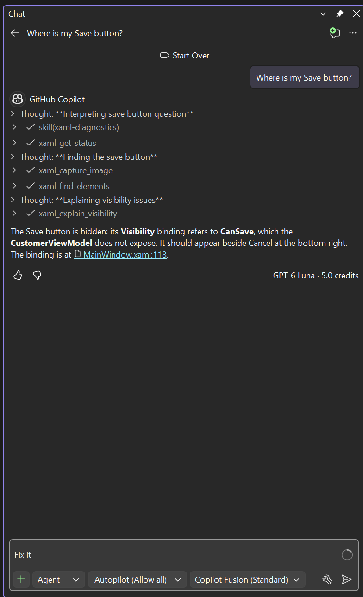
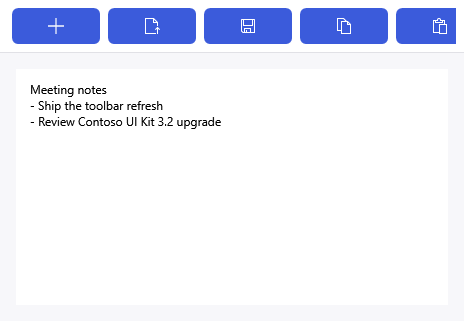
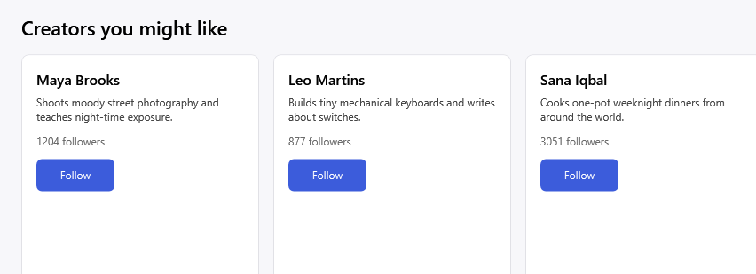

# Session transcript

Source: `C:\Users\peterspa\.copilot\session-state\3815da22-ae30-4db6-bb02-0ae296cab09b\files\session-events-supplement.jsonl`

## Tool usage

- powershell: 131
- view: 52
- edit: 52
- grep: 45
- read_agent: 7
- task_complete: 6
- read_powershell: 5
- task: 5
- glob: 2

Failed tool calls: 4, images: 5


**Assistant (16:46:57):**

Checking what's actually in the notes repo before claiming anything.


**Tool call (16:46:57):** `powershell`
```json
{
 "command": "$n='Q:\\source\\XamlAgentDemos-notes'; git -C $n --no-pager log --oneline -5; git -C $n status --short | Select -First 10; Get-ChildItem $n | Select Name; if(Test-Path \"$n\\process\"){ Get-ChildItem \"$n\\process\" -Recurse | Select FullName,Length }",
 "description": "Inspect notes repo state"
}
```

<details><summary>Result `powershell` success=true</summary>

```
4811f79 Add process logs: journal, checkpoints, plan, session transcript, harness, analysis
f08ec9e A11y cancel/already-running fixes (#111), cancel-check and rerun-after-cancel runs
ae77e32 A11y pane-check run and finding #110
5165fe4 Test runs r9/r10: hover, explain_visibility, audit_styles, mixed filters
f2f225c Test runs

Name
----
design-source
process
src
test-runs
README.md
Render-Mockup.ps1
TestPass.md
XamlDiagnosticsToolsSession.md
<shellId: 1122 completed with exit code 0>
```
</details>


**Tool call (16:46:57):** `powershell`
```json
{
 "command": "$n='Q:\\source\\XamlAgentDemos-notes\\process'; Get-ChildItem $n | Select Name,Length; foreach($d in 'checkpoints','harness','analysis'){ \"$d : $((Get-ChildItem \"$n\\$d\" -File -Recurse -ErrorAction SilentlyContinue).Count) files\" }; git -C Q:\\source\\XamlAgentDemos-notes --no-pager show --stat --oneline 4811f79 | Select -Last 3; git -C Q:\\source\\XamlAgentDemos-notes ls-files process | Measure-Object | % Count",
 "description": "Verify process archive contents"
}
```

<details><summary>Result `powershell` success=true</summary>

```
Name                      Length
----                      ------
analysis                  
checkpoints               
harness                   
session-transcript_images 
Journal.md                8787
plan.md                   24658
session-events.zip        24402886
session-transcript.md     5814490
checkpoints : 63 files
harness : 15 files
analysis : 23 files
 process/session-transcript_images/img022.png       |    Bin 0 -> 2508602 bytes
 process/session-transcript_images/img023.png       |    Bin 0 -> 312873 bytes
 129 files changed, 126351 insertions(+)
128
<shellId: 1123 completed with exit code 0>
```
</details>


**Assistant (16:46:57):**

The archive is real: 128 tracked files under `process/`, committed in `4811f79`. Next I'm checking that the harness copy has the newest watcher scripts and confirming the demo timing figures.


**Tool call (16:46:57):** `powershell`
```json
{
 "command": "$h='C:\\Users\\peterspa\\.copilot\\session-state\\3815da22-ae30-4db6-bb02-0ae296cab09b\\files\\harness'; $a='Q:\\source\\XamlAgentDemos-notes\\process\\harness'; Compare-Object (Get-ChildItem $h -File | % Name) (Get-ChildItem $a -File -Recurse | % Name) | Format-Table -AutoSize; Get-ChildItem $h -File | ? { $t=\"$a\\$($_.Name)\"; (Test-Path $t) -and ((Get-FileHash $t).Hash -ne (Get-FileHash $_.FullName).Hash) } | % Name\nforeach($d in 'VanishingSave','GhostClicks','BindingStorm'){ Get-ChildItem \"Q:\\source\\XamlAgentDemos-notes\\test-runs\\$d\" -Directory | % { $l=Get-Content \"$($_.FullName)\\runner.log\" -ErrorAction SilentlyContinue; $s=($l|?{$_ -match 'Send prompt'}|select -First 1); $e=($l|?{$_ -match 'Main turn'}|select -First 1); $st=($l|?{$_ -match 'Stats'}|select -First 1); if($s -and $e){ $m=([datetime]($e.Substring(1,8))-[datetime]($s.Substring(1,8))).TotalMinutes; \"{0}/{1}: {2:N1} min {3}\" -f $d,$_.Name,$m,($st -replace '.*Stats ','').Substring(0,[Math]::Min(90,($st -replace '.*Stats ','').Length)) } } }",
 "description": "Diff harness archive; demo run timings"
}
```

<details><summary>Result `powershell` success=true</summary>

```
InputObject SideIndicator
----------- -------------
vs-now.png  <=

VanishingSave/paused1: 18.1 min {"tools":{"skill":2,"xaml_list_apps":4,"get_projects_in_solution":1,"glob":1,"rg":2,"xaml_
VanishingSave/r10: 2.5 min {"tools":{"skill":1,"xaml_get_status":1,"xaml_find_elements":1,"xaml_capture_image":2,"xam
VanishingSave/r9: 3.0 min {"tools":{"skill":1,"xaml_get_status":1,"xaml_find_elements":2,"xaml_capture_image":2,"xam
VanishingSave/run-consolidated: 2.1 min {"tools":{"skill":1,"xaml_get_status":2,"xaml_find_elements":3,"xaml_capture_image":5,"xam
VanishingSave/run-feedback: 4.8 min {"tools":{"skill":1,"xaml_get_status":1,"xaml_capture_image":4,"xaml_find_elements":4,"xam
VanishingSave/run-final: 4.0 min {"tools":{"skill":1,"xaml_get_status":1,"xaml_capture_image":2,"xaml_find_elements":4,"xam
VanishingSave/run1: 5.4 min {"tools":{"skill":1,"xaml_list_apps":1,"xaml_find_elements":7,"xaml_capture_image":8,"xaml
GhostClicks/run-consolidated: 1.5 min {"tools":{"skill":1,"xaml_get_status":1,"xaml_capture_image":2,"glob":1,"view":3,"xaml_fin
GhostClicks/run-consolidated2: 1.2 min {"tools":{"skill":1,"xaml_get_status":1,"xaml_find_elements":2,"xaml_capture_image":2,"xam
GhostClicks/run2: 1.5 min {"tools":{"skill":1,"xaml_list_apps":1,"xaml_capture_image":2,"xaml_get_visual_tree":1,"vi
GhostClicks/run3: 1.3 min {"tools":{"skill":1,"xaml_list_apps":1,"xaml_capture_image":2,"xaml_find_elements":3,"xaml
BindingStorm/r9: 2.6 min {"tools":{"skill":1,"xaml_get_status":2,"xaml_get_visual_tree":1,"xaml_get_binding_failure
BindingStorm/run-consolidated: 5.0 min {"tools":{"skill":1,"xaml_get_status":7,"xaml_get_binding_failures":7,"xaml_get_visual_tre
BindingStorm/run-feedback: 4.5 min {"tools":{"skill":1,"xaml_get_status":4,"xaml_get_binding_failures":7,"xaml_get_visual_tre
BindingStorm/run-final2: 4.1 min {"tools":{"skill":1,"xaml_get_status":4,"get_projects_in_solution":1,"xaml_get_binding_fai
ForEach-Object: 
Line |
   3 |  … Directory | % { $l=Get-Content "$($_.FullName)\runner.log" -ErrorActi …
     |                ~~~~~~~~~~~~~~~~~~~~~~~~~~~~~~~~~~~~~~~~~~~~~~~~~~~~~~~~~
     | Method invocation failed because [System.Object[]] does not contain a method named 'Substring'.
<shellId: 1124 completed with exit code 1>
```
</details>


**Tool call (16:46:57):** `powershell`
```json
{
 "command": "(Get-Content C:\\Users\\peterspa\\.copilot\\session-state\\3815da22-ae30-4db6-bb02-0ae296cab09b\\files\\harness\\prompts.json -Raw | ConvertFrom-Json).VanishingSave; Select-String Q:\\source\\XamlAgentDemos-notes\\TestPass.md -Pattern '^\\| VanishingSave' | % { $_.Line.Substring(0,[Math]::Min(260,$_.Line.Length)) }",
 "description": "Check VanishingSave prompt and results"
}
```

<details><summary>Result `powershell` success=true</summary>

```
There should be a Save button in the footer of my running app, but I can't see it. Find out every reason it's not visible and fix them.
| VanishingSave | run1 | 4/4 | yes (capture, bounds, binding failures, set_property experiment) | Deleted FooterSettings.cs and SaveColumn field, which caused a Hot Reload rude-edit modal |
| VanishingSave | paused1 | 4/4 in source (CanSave→IsSaveAvailable, compact footer default off, status overlay moved, disabled opacity 0.4) but blocked ~12 min: the harness paused the debugger (Debugger.Break) before the prompt and xaml_capture_image hung on t
| VanishingSave | run-consolidated | 4/4 | yes | 2.5 min, 0 failed calls. |
| VanishingSave | run-feedback | 4/4 | yes (bounds, hit_test, set_property, explain) | 5.3 min. OUTPUT_TOO_LARGE on includeAll x5 elements (104 KB). Asked a third time for live Grid ColumnDefinitions (#85); `alreadyApplied` still ambiguous (#88). |
| VanishingSave | run-final | 4/4 | yes (bounds, hit_test, set_property, explain) | 4.7 min, no dialogs. Multi-item filter `ColumnDefinitions[2].Width\|ColumnDefinitions[2].ActualWidth\|ColumnDefinitions[1].Width` failed with PROPERTY_NOT_FOUND (#91). Noticed 
| VanishingSave | r9 | 4/4 | yes | Used `xaml_explain_visibility`. False rank-1 causes from WPF Visibility enum numbers (#105); binding values showed `" -> 2"` (#104); a 0-width Grid column wasn't detected because the child kept its ActualWidth (#106); a null 
| VanishingSave | r10 | 4/4 | yes | Verified #104/#105: no false Visibility causes, binding shown as `{Binding} -> Collapsed`, 0 failed calls. |
<shellId: 1125 completed with exit code 0>
```
</details>


**Assistant (16:46:58):**

The data supports the recommendation. Last, I'm adding the demo recommendation to the journal so the later report has it.


**Tool call (16:46:58):** `powershell`
```json
{
 "command": "$f='Q:\\source\\XamlAgentDemos-notes\\process\\Journal.md'; $add=@('','## Demo recommendation (2026-11-15)','- **VanishingSave** (primary). Prompt: \"There should be a Save button in the footer of my running app, but I can''t see it. Find out every reason it''s not visible and fix them.\" Four stacked causes: CanSave binding collapsing the button, a 0-width footer column (compact-footer default), a status overlay covering it, and disabled opacity 0.4. 4/4 fixed in every pass. Recent runs: 2.1 min (run-consolidated), 3.0 min (r9), 2.5 min (r10, 0 failed calls). Shows `xaml_explain_visibility`, bounds/hit-test, live set-property experiments, hot reload and before/after captures.','- **GhostClicks** (backup, 1.2–1.5 min). Hit-test proves an invisible overlay eats clicks; less visual change.','- **BindingStorm** (finale). 10/10 binding failures across tabs and a dialog, many screenshots, but 2.6–5.0 min.'); [IO.File]::AppendAllLines($f,[string[]]$add); git -C Q:\\source\\XamlAgentDemos-notes add process/Journal.md; git -C Q:\\source\\XamlAgentDemos-notes commit -qm \"Journal: demo recommendation\"; git -C Q:\\source\\XamlAgentDemos-notes --no-pager log --oneline -2; git -C Q:\\source\\XamlAgentDemos-notes status --short | Measure-Object | % Count",
 "description": "Append demo pick to journal, commit"
}
```

<details><summary>Result `powershell` success=true</summary>

```
b4308ed Journal: demo recommendation
4811f79 Add process logs: journal, checkpoints, plan, session transcript, harness, analysis
0
<shellId: 1126 completed with exit code 0>
```
</details>


**Tool call (16:46:58):** `powershell`
```json
{
 "command": "$d=Get-Date -Format 'yyyy-MM-dd'; $f='Q:\\source\\XamlAgentDemos-notes\\process\\Journal.md'; (Get-Content $f -Raw) -replace '## Demo recommendation \\(2026-11-15\\)',\"## Demo recommendation ($d)\" | Set-Content $f -NoNewline; git -C Q:\\source\\XamlAgentDemos-notes commit -qam \"Journal: fix date\"; git -C Q:\\source\\XamlAgentDemos-notes --no-pager log --oneline -1; Select-String $f -Pattern 'Demo recommendation'",
 "description": "Correct journal date and commit"
}
```

<details><summary>Result `powershell` success=true</summary>

```
On branch main
Your branch is ahead of 'origin/main' by 5 commits.
  (use "git push" to publish your local commits)

nothing to commit, working tree clean
b4308ed Journal: demo recommendation

Q:\source\XamlAgentDemos-notes\process\Journal.md:101:## Demo recommendation (2026-11-15)
<shellId: 1127 completed with exit code 0>
```
</details>


**Tool call (16:46:58):** `task_complete`
```json
{
 "summary": "**1. Process archive**\n\nThe full process record is now in `Q:\\source\\XamlAgentDemos-notes\\process\\` (128 files, commit `4811f79`). I checked the file listing and the commit; nothing has been pushed. It contains:\n- **`Journal.md`**: a narrative in phases covering design, implementation, the test harness, test passes, findings #1–111, tool consolidation, the WinUI/UWP/MAUI updates and the accessibility-checker fixes. It now also has the demo recommendation (local commit `b4308ed`).\n- **`checkpoints\\`** (63 files): all the session summaries plus the index.\n- **`plan.md`**: the feature plan.\n- **`session-transcript.md`** and its images, plus **`session-events.zip`** (the raw session event log).\n- **`harness\\`** (15 scripts): run, redeploy and watcher scripts. The only thing left out is one scratch screenshot of VS (`vs-now.png`).\n- **`analysis\\`** (23 files): the agent feedback summary, log-mining scripts, deploy log and redirect scripts.\n\nPer-run records stay in `test-runs\\<demo>\\<tag>` (transcript, events, runner log, fix diff) and in `TestPass.md`.\n\n**2. Demo pick: VanishingSave**\n- **Prompt:** \"There should be a Save button in the footer of my running app, but I can't see it. Find out every reason it's not visible and fix them.\"\n- **Why it's impressive:** there are four separate reasons the button is hidden: a binding that collapses it, a zero-width footer column, a status overlay covering it, and 0.4 opacity when disabled. Reading the 
... [truncated 1012 chars]
```

<details><summary>Result `task_complete` success=true</summary>

```
**1. Process archive**

The full process record is now in `Q:\source\XamlAgentDemos-notes\process\` (128 files, commit `4811f79`). I checked the file listing and the commit; nothing has been pushed. It contains:
- **`Journal.md`**: a narrative in phases covering design, implementation, the test harness, test passes, findings #1–111, tool consolidation, the WinUI/UWP/MAUI updates and the accessibility-checker fixes. It now also has the demo recommendation (local commit `b4308ed`).
- **`checkpoints\`** (63 files): all the session summaries plus the index.
- **`plan.md`**: the feature plan.
- **`session-transcript.md`** and its images, plus **`session-events.zip`** (the raw session event log).
- **`harness\`** (15 scripts): run, redeploy and watcher scripts. The only thing left out is one scratch screenshot of VS (`vs-now.png`).
- **`analysis\`** (23 files): the agent feedback summary, log-mining scripts, deploy log and redirect scripts.

Per-run records stay in `test-runs\<demo>\<tag>` (transcript, events, runner log, fix diff) and in `TestPass.md`.

**2. Demo pick: VanishingSave**
- **Prompt:** "There should be a Save button in the footer of my running app, but I can't see it. Find out every reason it's not visible and fix them."
- **Why it's impressive:** there are four separate reasons the button is hidden: a binding that collapses it, a zero-width footer column, a status overlay covering it, and 0.4 opacity when disabled. Reading the code alone won't find all four. The agent finds them with `xaml_explain_visibility`, by checking where the button sits and what's on top of it, and by changing properties live in the running app. It then fixes the XAML and applies it with hot reload. The chat shows before and after screenshots, and the button appears in the app.
- **Reliability:** all 4 causes were fixed in every run. Recent runs took 2.1–3.0 minutes, with 0 failed tool calls in run r10.
- **Backup:** GhostClicks, about 1.2–1.5 minutes. It finds an invisible overlay that swallows clicks, but there's less visual change.
- **Finale:** BindingStorm fixes 10 of 10 binding failures and shows many screenshots, but takes 2.6–5 minutes.

**Reminders**
- Turn UAC back on.
- PR 807376 fixes the System.Drawing.Common redirect. Until it merges, the Exp instance's `devenv.exe.config` is patched by hand to 10.0.0.0.
- Reset the demo repo before presenting: `git -C Q:\source\XamlAgentDemos checkout -- .` followed by `git clean -fd`.
```
</details>


**Task complete (16:46:58):** **1. Process archive**

The full process record is now in `Q:\source\XamlAgentDemos-notes\process\` (128 files, commit `4811f79`). I checked the file listing and the commit; nothing has been pushed. It contains:
- **`Journal.md`**: a narrative in phases covering design, implementation, the test harness, test passes, findings #1–111, tool consolidation, the WinUI/UWP/MAUI updates and the accessibility-checker fixes. It now also has the demo recommendation (local commit `b4308ed`).
- **`checkpoints\`** (63 files): all the session summaries plus the index.
- **`plan.md`**: the feature plan.
- **`session-transcript.md`** and its images, plus **`session-events.zip`** (the raw session event log).
- **`harness\`** (15 scripts): run, redeploy and watcher scripts. The only thing left out is one scratch screenshot of VS (`vs-now.png`).
- **`analysis\`** (23 files): the agent feedback summary, log-mining scripts, deploy log and redirect scripts.

Per-run records stay in `test-runs\<demo>\<tag>` (transcript, events, runner log, fix diff) and in `TestPass.md`.

**2. Demo pick: VanishingSave**
- **Prompt:** "There should be a Save button in the footer of my running app, but I can't see it. Find out every reason it's not visible and fix them."
- **Why it's impressive:** there are four separate reasons the button is hidden: a binding that collapses it, a zero-width footer column, a status overlay covering it, and 0.4 opacity when disabled. Reading the code alone won't find all four. The agent finds them with `xaml_explain_visibility`, by checking where the button sits and what's on top of it, and by changing properties live in the running app. It then fixes the XAML and applies it with hot reload. The chat shows before and after screenshots, and the button appears in the app.
- **Reliability:** all 4 causes were fixed in every run. Recent runs took 2.1–3.0 minutes, with 0 failed tool calls in run r10.
- **Backup:** GhostClicks, about 1.2–1.5 minutes. It finds an invisible overlay that swallows clicks, but there's less visual change.
- **Finale:** BindingStorm fixes 10 of 10 binding failures and shows many screenshots, but takes 2.6–5 minutes.

**Reminders**
- Turn UAC back on.
- PR 807376 fixes the System.Drawing.Common redirect. Until it merges, the Exp instance's `devenv.exe.config` is patched by hand to 10.0.0.0.
- Reset the demo repo before presenting: `git -C Q:\source\XamlAgentDemos checkout -- .` followed by `git clean -fd`.





## User (17:11:54)


## User (17:11:55)

When I ran the prompt "Where is my Save button?" for VanishingSave, it wasn't fixed, I just got:
[image: copilot-image-6aab94.png]


**Assistant (18:05:19):**

I'm adding the overlap check the critic asked for before reporting a latent `covered` cause. First, the current function.


**Tool call (18:05:19):** `grep`
```json
{
 "pattern": "AddLatentOverlayCausesAsync|AddLatentColumnCausesAsync",
 "paths": "Q:\\src\\VS_xaml\\src\\Xaml\\Diagnostics\\Source\\Diagnostics\\AgentTools",
 "output_mode": "content",
 "-n": true
}
```

<details><summary>Result `grep` success=true</summary>

```
Q:\src\VS_xaml\src\Xaml\Diagnostics\Source\Diagnostics\AgentTools\XamlAgentService.cs:2564:        private async Task AddLatentOverlayCausesAsync(Endpoint endpoint, IElement element, PropertyValuesHolder elementProperties, IElement grid, string targetLabel,
Q:\src\VS_xaml\src\Xaml\Diagnostics\Source\Diagnostics\AgentTools\XamlAgentService.cs:2883:                await this.AddLatentOverlayCausesAsync(endpoint, element, elementProperties, parentGrid, targetLabel, sourceResolver, causes, cancellationToken);
```
</details>


**Tool call (18:05:19):** `view`
```json
{
 "path": "Q:\\src\\VS_xaml\\src\\Xaml\\Diagnostics\\Source\\Diagnostics\\AgentTools\\XamlAgentService.cs",
 "view_range": [
  2480,
  2680
 ]
}
```


**Tool call (18:05:19):** `view`
```json
{
 "path": "Q:\\src\\VS_xaml\\src\\Xaml\\Diagnostics\\Source\\Diagnostics\\AgentTools\\XamlAgentService.cs",
 "view_range": [
  2840,
  2900
 ]
}
```

<details><summary>Result `view` success=true</summary>

```

            if (response.NullBackground)
            {
                findings.Add($"{targetLabel} has no Background, so only the pixels its children draw receive clicks; its empty areas click through to whatever is behind it. "
                    + "If the whole area should be clickable (for example a row or card with a mouse handler), set Background=\"Transparent\".");
            }

            if (response.EffectiveOpacity < 0.05 && !(response.Blockers?.Any(b => b.Property == "Opacity") ?? false))
            {
                findings.Add($"Its effective opacity is {response.EffectiveOpacity.ToString(CultureInfo.InvariantCulture)}, so it's practically invisible.");
            }

            if (response.VisibleFraction >= 0 && response.VisibleFraction < 1 && response.ClippedBy != null)
            {
                findings.Add($"Only {Math.Round(response.VisibleFraction * 100)}% of it is visible: {Label(response.ClippedBy)} clips it.");
            }
            else if (response.VisibleFraction < 0)
            {
                findings.Add($"{targetLabel} has zero width or height.");
            }

            return new
            {
                id = elementId,
                summary = string.Join(" ", findings),
                elementReceivesInput = response.ElementReceivesInput,
                inputTarget = Describe(response.InputTarget),
                stack = response.Stack?.Select(Describe).ToList(),
                isVisible = response.IsVisible,
                isHitTestVisible = response.IsHitTestVisible,
                isEnabled = response.IsEnabled,
                effectiveOpacity = response.EffectiveOpacity,
                nullBackground = response.NullBackground ? true : (bool?)null,
                blockers = response.Blockers?.Count > 0 ? response.Blockers.Select(Describe).ToList() : null,
                visibleFraction = response.VisibleFraction >= 0 ? response.VisibleFraction : (double?)null,
                clippedBy = Describe(response.ClippedBy),
                point = new
                {
                    window = new { x = Math.Round(response.RootX, 2), y = Math.Round(response.RootY, 2) },
                    screen = new { x = Math.Round(response.ScreenX, 2), y = Math.Round(response.ScreenY, 2) },
                },
                note = "inputTarget is what a mouse click or tap at the point reaches (WPF: InputHitTest; WinUI/UWP: FindElementsInHostCoordinates, op
... [truncated 9234 chars]
```
</details>

<details><summary>Result `view` success=true</summary>

```
                                cause.Latent = true;
                                reasons.Add(collection);
                            }
                            else if (noRank1 && XamlAgentService.TryParseDouble(allocated.Value, out double allocatedValue) && allocatedValue <= 0.5)
                            {
                                VisibilityCause cause = AddCause(2, "gridCell",
                                    $"{targetLabel} is in {collection}[{cell}] of {XamlAgentService.Label(parent)}, which got {actual}=0 ({sizeName}={declared.Value}).",
                                    parent, $"{collection}[{cell}].{sizeName}", declared,
                                    declared.Value == "Auto"
                                        ? "An Auto row/column sizes to content; a star row/column elsewhere or a fixed-size parent may leave it 0. Give it a fixed or star size."
                                        : "Give that row/column a non-zero or star size, or move the element to another cell.");
                                cause.Location ??= sourceResolver.Resolve(parent.SourceInfo);
                                reasons.Add(collection);
                            }
                        }
                        else if (items.Count == 0 && cell > 0)
                        {
                            AddCause(2, "gridCell", $"{targetLabel} has {attached}={cell}, but {XamlAgentService.Label(parent)} has no {collection}[{cell}], so it's placed in the last one.",
                                element, attached, index, $"Add the missing definition to {collection} or change {attached}.").Latent = !noRank1;
                            reasons.Add(attached);
                        }
                    }
                    catch (XamlAgentException)
                    {
                    }
                }
            }

            if ((zeroWidth || zeroHeight) && noRank1 && reasons.Count == 0)
            {
                string dimension = zeroWidth && zeroHeight ? "width and height" : zeroWidth ? "width" : "height";
                AddCause(2, "size", $"{targetLabel} has zero {dimension}, usually because it has no content (empty text or collection) or its parent gives it no room.", element,
                    zeroWidth ? "ActualWidth" : "ActualHeight", zeroWidth ? actualWidth : actualHeight,
                    "Check its content, Margin/Padding and the parent's size (xaml_get_element_bo
... [truncated 1782 chars]
```
</details>


**Assistant (18:05:19):**

The target here is collapsed or has zero size, so it has no rendered bounds of its own. Before deciding how to estimate where it would sit, I'm checking the demo's layout.


**Tool call (18:05:19):** `powershell`
```json
{
 "command": "Get-ChildItem Q:\\source\\XamlAgentDemos -Recurse -Filter MainWindow.xaml | ? FullName -match Vanishing | % { $_.FullName; Get-Content $_.FullName | Select -Skip 95 -First 45 }",
 "description": "Show VanishingSave footer XAML"
}
```

<details><summary>Result `powershell` success=true</summary>

```
Q:\source\XamlAgentDemos\src\VanishingSave\MainWindow.xaml
                     Style="{StaticResource FieldStyle}"
                     Text="{Binding Notes, UpdateSourceTrigger=PropertyChanged}"
                     TextWrapping="Wrap" />
        </Grid>

        <Grid x:Name="Footer" Grid.Row="2" Margin="0,12,0,0">
            <Grid.ColumnDefinitions>
                <ColumnDefinition Width="*" />
                <ColumnDefinition Width="Auto" />
                <ColumnDefinition x:Name="SaveColumn" Width="Auto" />
            </Grid.ColumnDefinitions>

            <TextBlock VerticalAlignment="Center"
                       Foreground="#555B66"
                       Text="Changes are saved to Contoso CRM." />

            <Button x:Name="CancelButton"
                    Grid.Column="1"
                    Command="{Binding CancelCommand}"
                    Content="Cancel"
                    Style="{StaticResource FooterButtonStyle}" />

            <Button x:Name="SaveButton"
                    Grid.Column="2"
                    Command="{Binding SaveCommand}"
                    Content="Save"
                    IsDefault="True"
                    Style="{StaticResource FooterButtonStyle}"
                    Visibility="{Binding CanSave, Converter={StaticResource BoolToVisibility}, FallbackValue=Collapsed}" />

            <!-- Shows "Offline - changes will sync later" when the connection drops. -->
            <Border x:Name="SyncStatusHost"
                    Grid.Column="2"
                    Panel.ZIndex="1"
                    Background="White">
                <TextBlock x:Name="SyncStatusText"
                           VerticalAlignment="Center"
                           Foreground="#B54708"
                           Text="" />
            </Border>
        </Grid>
    </Grid>
</Window>
<shellId: 1151 completed with exit code 0>
```
</details>


**Tool call (18:05:19):** `grep`
```json
{
 "-n": true,
 "output_mode": "content",
 "paths": "Q:\\src\\VS_xaml\\src\\Xaml\\Diagnostics\\Source\\Diagnostics\\AgentTools\\XamlAgentService.cs",
 "pattern": "private .*Bounds.*\\(|RequestBoundsAsync|GetBoundsAsync|ElementBoundsResponse|Bounds(Request|Message)"
}
```


**Tool call (18:05:19):** `view`
```json
{
 "path": "Q:\\src\\VS_xaml\\src\\Xaml\\Diagnostics\\Source\\Diagnostics\\AgentTools\\XamlAgentService.cs",
 "view_range": [
  2700,
  2840
 ]
}
```

<details><summary>Result `view` success=true</summary>

```
            SourceResolver sourceResolver = new(host, endpoint);
            List<VisibilityCause> causes = new();
            List<string> checkedOk = new();
            string targetLabel = XamlAgentService.Label(element);

            VisibilityCause AddCause(int rank, string kind, string message, Microsoft.VisualStudio.DesignTools.RuntimeHost.Live.ILiveNodeWithChildren node,
                string property, (string Value, TapPropertyValue Property, TapPropertySource Source) effective, string fix)
            {
                VisibilityCause cause = new()
                {
                    Rank = rank,
                    Kind = kind,
                    Message = message,
                    ElementId = node is IElement e && e.IsInTree ? this.GetElementId(e) : null,
                    Property = property,
                    Value = effective.Property?.IsValueBindingExpression == true
                        ? $"{(string.IsNullOrWhiteSpace(effective.Property.Value) || effective.Property.Value.EndsWith("Expression", StringComparison.Ordinal) ? "{Binding}" : effective.Property.Value)} -> {effective.Value}"
                        : effective.Value,
                    ValueSource = effective.Source?.Source.ToString(),
                    Location = sourceResolver.Resolve(effective.Property?.SourceInfo) ?? sourceResolver.Resolve(effective.Source?.SourceInfo) ?? sourceResolver.Resolve((node as IElement)?.SourceInfo),
                    Fix = fix,
                };
                causes.Add(cause);
                return cause;
            }

            // Walk the element and its ancestors for values that hide everything below them.
            PropertyValuesHolder elementProperties = null;
            string nearestBackground = null;
            string nearestBackgroundOwner = null;
            int depth = 0;
            for (Microsoft.VisualStudio.DesignTools.RuntimeHost.Live.ILiveNodeWithChildren node = element; node != null && depth <= MaxAncestors; node = node.Parent, depth++)
            {
                PropertyValuesHolder holder;
                try
                {
                    holder = await XamlAgentService.RequestPropertiesAsync(endpoint, node.Handle, cancellationToken);
                }
                catch (XamlAgentException) when (depth > 0)
                {
                    break;
                }

                await XamlAgentService.MainThreadFactory.SwitchToMainThrea
... [truncated 7900 chars]
```
</details>

<details><summary>Result `grep` success=true</summary>

```
Q:\src\VS_xaml\src\Xaml\Diagnostics\Source\Diagnostics\AgentTools\XamlAgentService.cs:2098:                ElementBoundsRequest request = new() { Handles = items.Select(i => i.handle).ToList() };
Q:\src\VS_xaml\src\Xaml\Diagnostics\Source\Diagnostics\AgentTools\XamlAgentService.cs:2099:                ElementBoundsResponse response = await XamlAgentService.SendTapMessageAsync<ElementBoundsResponse>(
Q:\src\VS_xaml\src\Xaml\Diagnostics\Source\Diagnostics\AgentTools\XamlAgentService.cs:2100:                    endpoint, XamlMessageType.GetElementBoundsRequest, request, cancellationToken);
Q:\src\VS_xaml\src\Xaml\Diagnostics\Source\Diagnostics\AgentTools\XamlAgentService.cs:2258:            ElementBoundsResponse bounds = await XamlAgentService.SendTapMessageAsync<ElementBoundsResponse>(
Q:\src\VS_xaml\src\Xaml\Diagnostics\Source\Diagnostics\AgentTools\XamlAgentService.cs:2259:                endpoint, XamlMessageType.GetElementBoundsRequest, new ElementBoundsRequest { Handles = new List<long> { element.Handle } }, cancellationToken);
Q:\src\VS_xaml\src\Xaml\Diagnostics\Source\Diagnostics\AgentTools\XamlAgentService.cs:4000:        private const string WindowBoundsNote = "Window bounds are physical screen pixels and include the window frame. A WPF/WinUI Window's Width and Height are device-independent units (DIPs) that also include the frame, so Width = bounds.width / dpiScale. A user's \"800 px wide\" is ambiguous: say which unit you tested. A minimized window reports x/y = -32000 and can't be captured.";
```
</details>


**Tool call (18:05:20):** `view`
```json
{
 "path": "Q:\\src\\VS_xaml\\src\\Xaml\\Diagnostics\\Source\\Diagnostics\\AgentTools\\XamlAgentService.cs",
 "view_range": [
  2090,
  2135
 ]
}
```


**Tool call (18:05:20):** `grep`
```json
{
 "-n": true,
 "output_mode": "content",
 "paths": "Q:\\src\\VS_xaml\\src\\Xaml",
 "pattern": "class ElementBounds(Response|Info|Entry)?\\b",
 "-A": 25
}
```

<details><summary>Result `view` success=true</summary>

```
                catch (XamlAgentException ex)
                {
                    results.Add(new { id = elementId, error = ex.Code, message = ex.Message, hint = ex.Hint });
                }
            }

            foreach ((Endpoint endpoint, List<(string id, long handle)> items) in groups)
            {
                ElementBoundsRequest request = new() { Handles = items.Select(i => i.handle).ToList() };
                ElementBoundsResponse response = await XamlAgentService.SendTapMessageAsync<ElementBoundsResponse>(
                    endpoint, XamlMessageType.GetElementBoundsRequest, request, cancellationToken);

                if (response == null || !string.IsNullOrEmpty(response.Error))
                {
                    throw new XamlAgentException(XamlAgentErrorCodes.TapError, $"The app couldn't return element bounds: {response?.Error ?? "no response"}");
                }

                Dictionary<long, ElementBoundsInfo> byHandle = (response.Bounds ?? new List<ElementBoundsInfo>())
                    .GroupBy(b => b.Handle)
                    .ToDictionary(g => g.Key, g => g.First());

                foreach ((string id, long handle) in items)
                {
                    if (!byHandle.TryGetValue(handle, out ElementBoundsInfo info) || !info.Found)
                    {
                        results.Add(new { id, error = XamlAgentErrorCodes.NotAvailable, message = info?.Error ?? "The app returned no bounds for this element." });
                        continue;
                    }

                    System.Windows.Rect screenRect = new(info.ScreenX, info.ScreenY, Math.Max(0, info.ScreenWidth), Math.Max(0, info.ScreenHeight));
                    System.Windows.Rect? clientRect = XamlAgentImaging.GetClientScreenRect(new IntPtr(info.RootWindowHandle));
                    double? visibleFraction = null;
                    if (clientRect.HasValue && screenRect.Width * screenRect.Height > 0)
                    {
                        System.Windows.Rect visible = System.Windows.Rect.Intersect(screenRect, clientRect.Value);
                        visibleFraction = visible.IsEmpty ? 0 : Math.Round(visible.Width * visible.Height / (screenRect.Width * screenRect.Height), 2);
                    }

                    results.Add(new
                    {
                        id,
                        isVisible = info.IsVisible,
                        // Visibility do
... [truncated 397 chars]
```
</details>

<details><summary>Result `grep` success=true</summary>

```
[grep content: 2 matches across 1 file(s) under Q:/src/VS_xaml/src/Xaml/Shared/Source/XamlTapContract/TapOM; delimited groups]

XamlJsonData.cs (2 match(es)):
  585:     public class ElementBoundsInfo
  586-     {
  587-         [DataMember]
  588-         public long Handle { get; set; }
  589- 
  590-         [DataMember]
  591-         public bool Found { get; set; }
  592- 
  593-         [DataMember]
  594-         public bool IsVisible { get; set; }
  595- 
  596-         [DataMember]
  597-         public long RootWindowHandle { get; set; }
  598- 
  599-         [DataMember]
  600-         public double DpiScale { get; set; }
  601- 
  602-         [DataMember]
  603-         public double ScreenX { get; set; }
  604- 
  605-         [DataMember]
  606-         public double ScreenY { get; set; }
  607- 
  608-         [DataMember]
  609-         public double ScreenWidth { get; set; }
  610- 
  631:     public class ElementBoundsResponse : ResponseWithError
  632-     {
  633-         [DataMember]
  634-         public List<ElementBoundsInfo> Bounds;
  635-     }
  636- 
  637-     /// <summary>
  638-     /// Used for XamlMessageType.ElementHitTestRequest. The point is in the element's own logical units relative to its
  639-     /// top-left corner; when UsePoint is false the element's center is used.
  640-     /// </summary>
  641-     [DataContract]
  642-     public class ElementHitTestRequest
  643-     {
  644-         [DataMember]
  645-         public long Handle { get; set; }
  646- 
  647-         [DataMember]
  648-         public bool UsePoint { get; set; }
  649- 
  650-         [DataMember]
  651-         public double X { get; set; }
  652- 
  653-         [DataMember]
  654-         public double Y { get; set; }
  655-     }
  656- 
```
</details>


**Tool call (18:05:20):** `edit`
```json
{
 "path": "Q:\\src\\VS_xaml\\src\\Xaml\\Diagnostics\\Source\\Diagnostics\\AgentTools\\XamlAgentService.cs",
 "old_str": "                if (!drawsAbove || !visible || !opaque)\n                {\n                    continue;\n                }\n\n                string why = siblingZ > zIndex ? $\"its ZIndex {siblingZ} is higher\" : \"it comes later in the Grid\";\n                causes.Add(new VisibilityCause\n                {\n                    Rank = 2,\n                    Kind = \"covered\",\n                    Message = $\"{XamlAgentService.Label(sibling)} shares {targetLabel}'s Grid cell (row {row}, column {column}), has an opaque Background {background.Value} and draws on top because {why}: even after the other causes are fixed it hides {targetLabel}.\",\n                    ElementId = sibling.IsInTree ? this.GetElementId(sibling) : null,\n                    Property = \"Background\",\n                    Value = background.Value,\n                    ValueSource = XamlAgentService.GetPropertySource(holder, background.Property)?.Source.ToString(),\n                    Location = sourceResolver.Resolve(sibling.SourceInfo),\n                    Fix = \"Move the overlay to another cell, make its Background Transparent, collapse it when it has nothing to show, or lower its ZIndex below the element.\",\n                    Latent = true,\n                });\n            }\n        }",
 "new_str": "                if (!drawsAbove || !visible || !opaque)\n        
... [truncated 5773 chars]
```


**Tool call (18:05:20):** `edit`
```json
{
 "path": "Q:\\src\\VS_xaml\\src\\Xaml\\Diagnostics\\Source\\Diagnostics\\AgentTools\\XamlAgentService.cs",
 "old_str": "            int elementIndex = Array.IndexOf(siblings, element);\n            for (int i = 0; i < siblings.Length; i++)",
 "new_str": "            int elementIndex = Array.IndexOf(siblings, element);\n            List<(IElement Sibling, PropertyValuesHolder Holder, (string Value, TapPropertyValue Property, TapPropertySource Source) Background, string Why)> candidates = new();\n            for (int i = 0; i < siblings.Length; i++)"
}
```


**Tool call (18:05:20):** `edit`
```json
{
 "path": "Q:\\src\\VS_xaml\\src\\Xaml\\Diagnostics\\Source\\Diagnostics\\AgentTools\\XamlAgentService.cs",
 "old_str": "        /// Adds latent \"covered\" causes for opaque siblings that share the element's Grid cell and draw above it (a later sibling or a higher ZIndex).",
 "new_str": "        /// Adds latent \"covered\" causes for opaque siblings that share the element's Grid cell, draw above it (a later sibling or a higher ZIndex)\n        /// and actually overlap it: rendered bounds when both have an area, otherwise a sibling that stretches to fill the cell."
}
```

<details><summary>Result `edit` success=true</summary>

```
File Q:\src\VS_xaml\src\Xaml\Diagnostics\Source\Diagnostics\AgentTools\XamlAgentService.cs updated with changes. old_str did not match the file exactly, so the closest matching lines were replaced; check that the result below is what you intended.
Lines 2609-2721 of the edited file:
2609.                 bool opaque = !string.IsNullOrEmpty(background.Value)
2610.                     && !(background.Value.StartsWith("#00", StringComparison.Ordinal) && background.Value.Length == 9)
2611.                     && !string.Equals(background.Value, "Transparent", StringComparison.OrdinalIgnoreCase)
2612.                     && !string.Equals(background.Value, "{Null}", StringComparison.OrdinalIgnoreCase);
2613.                 if (!drawsAbove || !visible || !opaque)
2614.                 {
2615.                     continue;
2616.                 }
2617. 
2618.                 candidates.Add((sibling, holder, background, siblingZ > zIndex ? $"its ZIndex {siblingZ} is higher" : "it comes later in the Grid"));
2619.             }
2620. 
2621.             if (candidates.Count == 0)
2622.             {
2623.                 return;
2624.             }
2625. 
2626.             // Sharing a cell doesn't mean overlapping: an aligned or sized sibling can sit beside the element. Compare rendered bounds when both
2627.             // have an area; otherwise (a collapsed element or a 0-size cell) only a sibling that stretches to fill the cell is sure to cover it.
2628.             Dictionary<long, ElementBoundsInfo> bounds = new();
2629.             try
2630.             {
2631.                 List<long> handles = new() { element.Handle };
2632.                 handles.AddRange(candidates.Select(c => c.Sibling.Handle));
... (65 more lines) ...
2698.                 ("HorizontalAlignment", "HorizontalOptions", "Width", "WidthRequest"),
2699.                 ("VerticalAlignment", "VerticalOptions", "Height", "HeightRequest"),
2700.             })
2701.             {
2702.                 string value = XamlAgentService.GetEffectiveAny(holder, alignment, options).Value;
2703.                 if (value != null && value.IndexOf("Stretch", StringComparison.OrdinalIgnoreCase) < 0 && value.IndexOf("Fill", StringComparison.OrdinalIgnoreCase) < 0)
2704.                 {
2705.                     return false;
2706.                 }
2707. 
2708.                 var explicitSize = XamlAgentService.GetEffectiveAny(holder, size, request);
2709.                 if (explicitSize.Source?.
... [truncated 755 chars]
```
</details>

<details><summary>Result `edit` success=true</summary>

```
File Q:\src\VS_xaml\src\Xaml\Diagnostics\Source\Diagnostics\AgentTools\XamlAgentService.cs updated with changes. old_str did not match the file exactly, so the closest matching lines were replaced; check that the result below is what you intended.
Lines 2569-2579 of the edited file:
2569.             int column = XamlAgentService.ParseCellIndex(XamlAgentService.GetEffective(elementProperties, "Grid.Column").Value, 0);
2570.             int row = XamlAgentService.ParseCellIndex(XamlAgentService.GetEffective(elementProperties, "Grid.Row").Value, 0);
2571.             int zIndex = XamlAgentService.ParseCellIndex(XamlAgentService.GetEffectiveAny(elementProperties, zIndexNames).Value, 0);
2572.             IElement[] siblings = grid.Children.OfType<IElement>().Take(MaxSiblings).ToArray();
2573.             int elementIndex = Array.IndexOf(siblings, element);
2574.             List<(IElement Sibling, PropertyValuesHolder Holder, (string Value, TapPropertyValue Property, TapPropertySource Source) Background, string Why)> candidates = new();
2575.             for (int i = 0; i < siblings.Length; i++)
2576.             {
2577.                 IElement sibling = siblings[i];
2578.                 if (i == elementIndex)
2579.                 {
Review the change and make sure it is as expected (indentation, duplicated or missing lines). Edit the file again if necessary.
```
</details>

<details><summary>Result `edit` success=true</summary>

```
File Q:\src\VS_xaml\src\Xaml\Diagnostics\Source\Diagnostics\AgentTools\XamlAgentService.cs updated with changes.
Lines 2558-2567 of the edited file:
2558.         private static int ParseCellIndex(string value, int fallback) =>
2559.             int.TryParse(value, NumberStyles.Integer, CultureInfo.InvariantCulture, out int parsed) ? parsed : fallback;
2560. 
2561.         /// <summary>
2562.         /// Adds latent "covered" causes for opaque siblings that share the element's Grid cell, draw above it (a later sibling or a higher ZIndex)
2563.         /// and actually overlap it: rendered bounds when both have an area, otherwise a sibling that stretches to fill the cell.
2564.         /// </summary>
2565.         private async Task AddLatentOverlayCausesAsync(Endpoint endpoint, IElement element, PropertyValuesHolder elementProperties, IElement grid, string targetLabel,
2566.             SourceResolver sourceResolver, List<VisibilityCause> causes, CancellationToken cancellationToken)
2567.         {
Review the change and make sure it is as expected (indentation, duplicated or missing lines). Edit the file again if necessary.
```
</details>


**Tool call (18:05:20):** `view`
```json
{
 "path": "Q:\\src\\VS_xaml\\src\\Xaml\\Diagnostics\\Source\\Diagnostics\\AgentTools\\XamlAgentService.cs",
 "view_range": [
  2630,
  2695
 ]
}
```

<details><summary>Result `view` success=true</summary>

```
            Dictionary<long, ElementBoundsInfo> bounds = new();
            try
            {
                List<long> handles = new() { element.Handle };
                handles.AddRange(candidates.Select(c => c.Sibling.Handle));
                ElementBoundsResponse response = await XamlAgentService.SendTapMessageAsync<ElementBoundsResponse>(
                    endpoint, XamlMessageType.GetElementBoundsRequest, new ElementBoundsRequest { Handles = handles }, cancellationToken);
                if (response != null && string.IsNullOrEmpty(response.Error) && response.Bounds != null)
                {
                    bounds = response.Bounds.Where(b => b.Found).GroupBy(b => b.Handle).ToDictionary(g => g.Key, g => g.First());
                }
            }
            catch (XamlAgentException)
            {
            }

            await XamlAgentService.MainThreadFactory.SwitchToMainThreadAsync(cancellationToken);
            System.Windows.Rect? targetRect = XamlAgentService.GetScreenRect(bounds, element.Handle);
            foreach ((IElement sibling, PropertyValuesHolder holder, (string Value, TapPropertyValue Property, TapPropertySource Source) background, string why) in candidates)
            {
                System.Windows.Rect? siblingRect = XamlAgentService.GetScreenRect(bounds, sibling.Handle);
                string evidence;
                if (targetRect.HasValue && siblingRect.HasValue)
                {
                    System.Windows.Rect overlap = System.Windows.Rect.Intersect(targetRect.Value, siblingRect.Value);
                    double covered = overlap.IsEmpty ? 0 : overlap.Width * overlap.Height / (targetRect.Value.Width * targetRect.Value.Height);
                    if (covered < 0.5)
                    {
                        continue;
                    }

                    evidence = $"its rendered bounds cover {Math.Round(covered * 100)}% of {targetLabel}";
                }
                else if (XamlAgentService.FillsCell(holder))
                {
                    evidence = "it stretches to fill the cell (no fixed size or alignment)";
                }
                else
                {
                    continue;
                }

                causes.Add(new VisibilityCause
                {
                    Rank = 2,
                    Kind = "covered",
                    Message = $"{XamlAgentService.Label(sibling)} shares {targetLabel
... [truncated 1387 chars]
```
</details>


**Assistant (18:05:20):**

The edit is right. Next I'm adding unit tests for `FillsCell`, following the existing `XamlAgentToolsTests` patterns.


**Tool call (18:05:20):** `grep`
```json
{
 "-n": true,
 "output_mode": "content",
 "paths": "Q:\\src\\VS_xaml\\src\\Xaml\\Diagnostics\\Test",
 "pattern": "NormalizeVisibility|PropertyValuesHolder|class XamlAgentToolsTests"
}
```

<details><summary>Result `grep` success=true</summary>

```
[grep content: 100 matches across 8 file(s) under Q:/src/VS_xaml/src/Xaml/Diagnostics/Test; delimited groups]

ComponentBase/Utility/TapDataHelper.cs (2 match(es)):
  155:             PropertyValuesHolder response = await protocolHandler.SendMessageAsync<PropertyValuesHolder>(XamlMessageType.PropertyChainRequest, request);
  173:             PropertyValuesHolder response = await protocolHandler.SendMessageAsync<PropertyValuesHolder>(XamlMessageType.PropertyChainRequest, request);

Unit.Maui/Setup/PropertyServiceSetup.cs (8 match(es)):
  92:         public PropertyValuesHolder GetProperties(long handle)
  115:         public void AssertPropertyValuesContains(PropertyValuesHolder properties, ITapProperty property, object value, BaseValueSource baseValueSource, bool isOverridden, MetadataBit metadataBits = MetadataBit.None)
  121:         public void AssertPropertyValuesContains(PropertyValuesHolder properties, BindableProperty bindableProperty, string value, long handle, BaseValueSource baseValueSource, bool isOverridden, MetadataBit metadataBits = MetadataBit.None)
  127:         public void AssertPropertyValuesContains(PropertyValuesHolder properties, ITapProperty tapProperty, string value, long handle, BaseValueSource baseValueSource, bool isOverridden, MetadataBit metadataBits = MetadataBit.None)
  133:         public void AssertPropertyValuesContains(PropertyValuesHolder properties, int propertyIndex, string value, long handle, BaseValueSource baseValueSource, bool isOverridden, MetadataBit metadataBits = MetadataBit.None)
  153:         public void AssertPropertyValuesDoesNotContain(PropertyValuesHolder properties, BindableProperty bindableProperty, BaseValueSource baseValueSource)
  159:         public void AssertPropertyValuesDoesNotContain(PropertyValuesHolder properties, ITapProperty tapProperty, BaseValueSource baseValueSource)
  168:         private static void LogSourcesAndValues(PropertyValuesHolder properties)

Unit.Maui/PropertyServiceTests.cs (45 match(es)):
  193:                 PropertyValuesHolder result = setup.GetProperties(handle);
  209:                 PropertyValuesHolder result = setup.GetProperties(Constants.InvalidHandle);
  231:                 PropertyValuesHolder result = setup.GetProperties(handle);
  301:                 PropertyValuesHolder result = setup.GetProperties(handle);
  321:                 PropertyValuesHolder result = setup.GetProperties(handle);
  345:                 PropertyValuesHolder result = setup.GetPro
... [truncated 8200 chars]
```
</details>


**Tool call (18:05:20):** `powershell`
```json
{
 "command": "Get-Content Q:\\src\\VS_xaml\\src\\Xaml\\Diagnostics\\Test\\Unit\\AgentTools\\XamlAgentToolsTests.cs | Select -First 20; Get-Content Q:\\src\\VS_xaml\\src\\Xaml\\Diagnostics\\Test\\Unit\\AgentTools\\XamlAgentToolsTests.cs | Select -Skip 196 -First 18; Get-Content Q:\\src\\VS_xaml\\src\\Xaml\\Diagnostics\\Test\\Unit\\Common\\ProtocolHandlerBuilder.cs | Select -Skip 72 -First 24; grep -n \"GetPropertySource\" Q:\\src\\VS_xaml\\src\\Xaml\\Diagnostics\\Source\\Diagnostics\\AgentTools\\XamlAgentService.cs | Select -First 1",
 "description": "View test and holder construction"
}
```

<details><summary>Result `powershell` success=true</summary>

```
// -------------------------------------------------------------------
// Copyright (c) Microsoft Corporation. All Rights Reserved.
// -------------------------------------------------------------------

using System;
using System.Collections;
using System.Collections.Generic;
using System.Linq;
using System.Threading.Tasks;
using DesignTools.Tests.Foundation;
using FluentAssertions;
using Microsoft.VisualStudio.DesignTools.Diagnostics.AgentTools;
using Newtonsoft.Json.Linq;

namespace DesignTools.Tests.Unit.XamlDiagnostics.AgentTools
{
    public class XamlAgentToolsTests : UnitTestClass
    {
        [Test]
        public void HotReloadLog_KeepsOnlyNewestEntries()
            XamlAgentService.IsXamlName("1abc").Should().BeFalse();
            XamlAgentService.IsXamlName(string.Empty).Should().BeFalse();
        }

        [Test]
        public void NormalizeVisibility_MapsEnumNumbersPerPlatform()
        {
            XamlAgentService.NormalizeVisibility("0", Microsoft.VisualStudio.DesignTools.Diagnostics.Platform.SupportedPlatform.WpfCore).Should().Be("Visible");
            XamlAgentService.NormalizeVisibility("1", Microsoft.VisualStudio.DesignTools.Diagnostics.Platform.SupportedPlatform.WpfFramework).Should().Be("Hidden");
            XamlAgentService.NormalizeVisibility("2 (System.Windows.Visibility)", Microsoft.VisualStudio.DesignTools.Diagnostics.Platform.SupportedPlatform.WpfCore).Should().Be("Collapsed");
            XamlAgentService.NormalizeVisibility("1", Microsoft.VisualStudio.DesignTools.Diagnostics.Platform.SupportedPlatform.WinUI).Should().Be("Collapsed");
            XamlAgentService.NormalizeVisibility("Collapsed", Microsoft.VisualStudio.DesignTools.Diagnostics.Platform.SupportedPlatform.WpfCore).Should().Be("Collapsed");
            XamlAgentService.NormalizeVisibility(null, Microsoft.VisualStudio.DesignTools.Diagnostics.Platform.SupportedPlatform.WpfCore).Should().BeNull();
        }

        [Test]
        public void StyleAudit_FindsMajorityAndParsesExpectedValues()
        {
        public static Tuple<long, PropertyValuesHolder> MakeSimpleObject(bool readOnly, long handle, params long[] childHandles)
        {
            PropertyValuesHolder result = new PropertyValuesHolder
            {
                Properties = Enumerable.Range(0, childHandles.Length)
                .Select(index => new TapPropertyValue()
                {
                    PropertyChainIndex = 0,
                    PropertyName = "Property" + childHandl
... [truncated 885 chars]
```
</details>


**Tool call (18:05:20):** `grep`
```json
{
 "-A": 8,
 "-n": true,
 "output_mode": "content",
 "paths": "Q:\\src\\VS_xaml\\src\\Xaml\\Diagnostics\\Source\\Diagnostics\\AgentTools\\XamlAgentService.cs",
 "pattern": "static TapPropertySource GetPropertySource"
}
```

<details><summary>Result `grep` success=true</summary>

```
Q:\src\VS_xaml\src\Xaml\Diagnostics\Source\Diagnostics\AgentTools\XamlAgentService.cs:1312:        private static TapPropertySource GetPropertySource(PropertyValuesHolder holder, TapPropertyValue property)
Q:\src\VS_xaml\src\Xaml\Diagnostics\Source\Diagnostics\AgentTools\XamlAgentService.cs-1313-        {
Q:\src\VS_xaml\src\Xaml\Diagnostics\Source\Diagnostics\AgentTools\XamlAgentService.cs-1314-            int index = (int)property.PropertyChainIndex;
Q:\src\VS_xaml\src\Xaml\Diagnostics\Source\Diagnostics\AgentTools\XamlAgentService.cs-1315-            return holder.Sources != null && index >= 0 && index < holder.Sources.Count ? holder.Sources[index] : null;
Q:\src\VS_xaml\src\Xaml\Diagnostics\Source\Diagnostics\AgentTools\XamlAgentService.cs-1316-        }
Q:\src\VS_xaml\src\Xaml\Diagnostics\Source\Diagnostics\AgentTools\XamlAgentService.cs-1317-
Q:\src\VS_xaml\src\Xaml\Diagnostics\Source\Diagnostics\AgentTools\XamlAgentService.cs-1318-        private static async Task<PropertyValuesHolder> RequestPropertiesAsync(Endpoint endpoint, long handle, CancellationToken cancellationToken)
Q:\src\VS_xaml\src\Xaml\Diagnostics\Source\Diagnostics\AgentTools\XamlAgentService.cs-1319-        {
Q:\src\VS_xaml\src\Xaml\Diagnostics\Source\Diagnostics\AgentTools\XamlAgentService.cs-1320-            PropertyValuesHolder holder = await XamlAgentService.SendTapMessageAsync<PropertyValuesHolder>(endpoint, XamlMessageType.PropertyChainRequest,
```
</details>


**Tool call (18:05:21):** `edit`
```json
{
 "path": "Q:\\src\\VS_xaml\\src\\Xaml\\Diagnostics\\Test\\Unit\\AgentTools\\XamlAgentToolsTests.cs",
 "old_str": "        [Test]\n        public void StyleAudit_FindsMajorityAndParsesExpectedValues()",
 "new_str": "        [Test]\n        public void FillsCell_RequiresStretchAndNoExplicitSize()\n        {\n            static Microsoft.VisualStudio.DesignTools.Diagnostics.TapContract.PropertyValuesHolder Holder(params (string Name, string Value, Microsoft.VisualStudio.DesignTools.Diagnostics.TapContract.BaseValueSource Source)[] values) => new()\n            {\n                Sources = values.Select(v => new Microsoft.VisualStudio.DesignTools.Diagnostics.TapContract.TapPropertySource { Source = v.Source }).ToList(),\n                Properties = values.Select((v, i) => new Microsoft.VisualStudio.DesignTools.Diagnostics.TapContract.TapPropertyValue { PropertyName = v.Name, Value = v.Value, PropertyChainIndex = i }).ToList(),\n            };\n\n            var local = Microsoft.VisualStudio.DesignTools.Diagnostics.TapContract.BaseValueSource.Local;\n            var defaultSource = Microsoft.VisualStudio.DesignTools.Diagnostics.TapContract.BaseValueSource.Default;\n            XamlAgentService.FillsCell(Holder((\"HorizontalAlignment\", \"Stretch\", defaultSource), (\"VerticalAlignment\", \"Stretch\", defaultSource), (\"Width\", \"NaN\", defaultSource))).Should().BeTrue();\n            XamlAgentService.FillsCell(Holder((\"HorizontalAlignment\", \"Right\", local), (\"VerticalAli
... [truncated 566 chars]
```

<details><summary>Result `edit` success=true</summary>

```
File Q:\src\VS_xaml\src\Xaml\Diagnostics\Test\Unit\AgentTools\XamlAgentToolsTests.cs updated with changes. old_str did not match the file exactly, so the closest matching lines were replaced; check that the result below is what you intended.
Lines 208-234 of the edited file:
208.             XamlAgentService.NormalizeVisibility("Collapsed", Microsoft.VisualStudio.DesignTools.Diagnostics.Platform.SupportedPlatform.WpfCore).Should().Be("Collapsed");
209.             XamlAgentService.NormalizeVisibility(null, Microsoft.VisualStudio.DesignTools.Diagnostics.Platform.SupportedPlatform.WpfCore).Should().BeNull();
210.         }
211. 
212.         [Test]
213.         public void FillsCell_RequiresStretchAndNoExplicitSize()
214.         {
215.             static Microsoft.VisualStudio.DesignTools.Diagnostics.TapContract.PropertyValuesHolder Holder(params (string Name, string Value, Microsoft.VisualStudio.DesignTools.Diagnostics.TapContract.BaseValueSource Source)[] values) => new()
216.             {
217.                 Sources = values.Select(v => new Microsoft.VisualStudio.DesignTools.Diagnostics.TapContract.TapPropertySource { Source = v.Source }).ToList(),
218.                 Properties = values.Select((v, i) => new Microsoft.VisualStudio.DesignTools.Diagnostics.TapContract.TapPropertyValue { PropertyName = v.Name, Value = v.Value, PropertyChainIndex = i }).ToList(),
219.             };
220. 
221.             var local = Microsoft.VisualStudio.DesignTools.Diagnostics.TapContract.BaseValueSource.Local;
222.             var defaultSource = Microsoft.VisualStudio.DesignTools.Diagnostics.TapContract.BaseValueSource.Default;
223.             XamlAgentService.FillsCell(Holder(("HorizontalAlignment", "Stretch", defaultSource), ("VerticalAlignment", "Stretch", defaultSource), ("Width", "NaN", defaultSource))).Should().BeTrue();
224.             XamlAgentService.FillsCell(Holder(("HorizontalAlignment", "Right", local), ("VerticalAlignment", "Stretch", defaultSource))).Should().BeFalse();
225.             XamlAgentService.FillsCell(Holder(("HorizontalAlignment", "Stretch", defaultSource), ("VerticalAlignment", "Stretch", defaultSource), ("Height", "8", local))).Should().BeFalse();
226.             XamlAgentService.FillsCell(Holder(("HorizontalOptions", "Fill", defaultSource), ("VerticalOptions", "Fill", defaultSource), ("WidthRequest", "-1", local))).Should().BeTrue();
227.         }
228. 
229.         [Test]
230.         public void StyleAudit_FindsMajorityAndParsesEx
... [truncated 367 chars]
```
</details>


**Tool call (18:05:21):** `grep`
```json
{
 "-n": true,
 "output_mode": "content",
 "paths": "Q:\\src\\VS_xaml\\src\\Xaml\\Shared\\Source\\XamlTapContract",
 "pattern": "^namespace|class PropertyValuesHolder|enum BaseValueSource|PropertyChainIndex \\{"
}
```

<details><summary>Result `grep` success=true</summary>

```
[grep content: 121 matches across 60 file(s) under Q:/src/VS_xaml/src/Xaml/Shared/Source/XamlTapContract; delimited groups]

Actions/Action.cs (2 match(es)):
  6: namespace Microsoft.VisualStudio.DesignTools.XamlTapContract.Actions
  8: namespace Microsoft.VisualStudio.DesignTools.RuntimeHost.InstanceBuilders.Shared

Actions/ActionError.cs (2 match(es)):
  9: namespace Microsoft.VisualStudio.DesignTools.XamlTapContract.Actions
  11: namespace Microsoft.VisualStudio.DesignTools.RuntimeHost.InstanceBuilders.Shared

TrimmingAttributes.cs:15: namespace System.Diagnostics.CodeAnalysis

TapOM/BaseValueSource.cs (3 match(es)):
  6: namespace Microsoft.VisualStudio.DesignTools.XamlTapContract.TapOM
  8: namespace Microsoft.VisualStudio.DesignTools.RuntimeHost.TapOM
  12:     public enum BaseValueSource

Networking/XamlMessageType.cs (2 match(es)):
  7: namespace Microsoft.VisualStudio.DesignTools.XamlTapContract.Networking
  9: namespace Microsoft.VisualStudio.DesignTools.RuntimeHost.Networking

Utility/TypeUtilities.cs (2 match(es)):
  11: namespace Microsoft.VisualStudio.DesignTools.XamlTapContract.Utility
  13: namespace Microsoft.VisualStudio.DesignTools.RuntimeHost.Utility

Actions/ActionErrorJsonSerializer.cs (2 match(es)):
  8: namespace Microsoft.VisualStudio.DesignTools.XamlTapContract.Actions
  10: namespace Microsoft.VisualStudio.DesignTools.RuntimeHost.InstanceBuilders.Shared

Actions/AddChildAction.cs (2 match(es)):
  10: namespace Microsoft.VisualStudio.DesignTools.XamlTapContract.Actions
  12: namespace Microsoft.VisualStudio.DesignTools.RuntimeHost.InstanceBuilders.Shared

TapOM/CollectionElementValue.cs (2 match(es)):
  9: namespace Microsoft.VisualStudio.DesignTools.XamlTapContract.TapOM
  11: namespace Microsoft.VisualStudio.DesignTools.RuntimeHost.TapOM

Actions/AddDictionaryEntryAction.cs (2 match(es)):
  10: namespace Microsoft.VisualStudio.DesignTools.XamlTapContract.Actions
  12: namespace Microsoft.VisualStudio.DesignTools.RuntimeHost.InstanceBuilders.Shared

TapOM/ElementInteractionEvent.cs (2 match(es)):
  9: namespace Microsoft.VisualStudio.DesignTools.XamlTapContract.TapOM
  11: namespace Microsoft.VisualStudio.DesignTools.Diagnostics.TapOM

TapOM/EnumType.cs (2 match(es)):
  11: namespace Microsoft.VisualStudio.DesignTools.XamlTapContract.TapOM
  13: namespace Microsoft.VisualStudio.DesignTools.RuntimeHost.TapOM

Actions/ChildAction.cs (2 match(es)):
  9: namespace Microsoft.VisualStudio.DesignTools.XamlTapContract.Actions
  11: names
... [truncated 9795 chars]
```
</details>


**Tool call (18:05:21):** `grep`
```json
{
 "-n": true,
 "output_mode": "content",
 "paths": "Q:\\src\\VS_xaml\\src\\Xaml\\Diagnostics\\Source\\Diagnostics\\AgentTools\\XamlAgentService.cs",
 "pattern": "^using .*(TapOM|TapContract)"
}
```

<details><summary>Result `grep` success=true</summary>

```
Q:\src\VS_xaml\src\Xaml\Diagnostics\Source\Diagnostics\AgentTools\XamlAgentService.cs:25:using Microsoft.VisualStudio.DesignTools.Diagnostics.TapOM;
Q:\src\VS_xaml\src\Xaml\Diagnostics\Source\Diagnostics\AgentTools\XamlAgentService.cs:29:using Microsoft.VisualStudio.DesignTools.RuntimeHost.TapOM;
```
</details>


**Assistant (18:05:21):**

I'm switching the test to the `RuntimeHost.TapOM` namespace and adding a `using` to keep it readable, then building.


**Tool call (18:05:21):** `powershell`
```json
{
 "command": "$f='Q:\\src\\VS_xaml\\src\\Xaml\\Diagnostics\\Test\\Unit\\AgentTools\\XamlAgentToolsTests.cs'; $t=[IO.File]::ReadAllText($f); $t=$t.Replace('Microsoft.VisualStudio.DesignTools.Diagnostics.TapContract.',''); $t=$t.Replace(\"using Microsoft.VisualStudio.DesignTools.Diagnostics.AgentTools;`r`n\",\"using Microsoft.VisualStudio.DesignTools.Diagnostics.AgentTools;`r`nusing Microsoft.VisualStudio.DesignTools.RuntimeHost.TapOM;`r`n\"); [IO.File]::WriteAllText($f,$t,[Text.UTF8Encoding]::new($true)); Select-String $f -Pattern 'RuntimeHost.TapOM|static PropertyValuesHolder Holder'",
 "description": "Fix test namespaces"
}
```

<details><summary>Result `powershell` success=true</summary>

```
Diagnostics\Test\Unit\AgentTools\XamlAgentToolsTests.cs:13:using Microsoft.VisualStudio.DesignTools.RuntimeHost.TapOM;
Diagnostics\Test\Unit\AgentTools\XamlAgentToolsTests.cs:216:            static PropertyValuesHolder Holder(params 
(string Name, string Value, BaseValueSource Source)[] values) => new()
<shellId: 1153 completed with exit code 0>
```
</details>


**Tool call (18:05:21):** `powershell`
```json
{
 "command": "cd Q:\\src\\VS_xaml; [Environment]::CurrentDirectory='Q:\\src\\VS_xaml'; . src\\Shared\\Tools\\Scripts\\Prime-ForCopilot.ps1 *> $null; & src\\Shared\\Tools\\Scripts\\Invoke-Build.ps1 -Project src\\Xaml\\Diagnostics\\Source\\Diagnostics\\Diagnostics.csproj -NoRestore -NoProjectReferences *> .vs\\diag.txt; \"diag exit $LASTEXITCODE\"; Select-String .vs\\diag.txt -Pattern 'error|Build succeeded|Warning\\(s\\)|Error\\(s\\)' | Select -Last 6; $tp=Get-ChildItem src\\Xaml\\Diagnostics\\Test\\Unit -Filter *.csproj | Select -First 1; $tp.FullName; & src\\Shared\\Tools\\Scripts\\Invoke-Build.ps1 -Project $tp.FullName -NoRestore -NoProjectReferences *> .vs\\diagtest.txt; \"test exit $LASTEXITCODE\"; Select-String .vs\\diagtest.txt -Pattern ' error |Warning\\(s\\)|Error\\(s\\)' | Select -Last 6",
 "description": "Build Diagnostics and unit tests",
 "initial_wait": 600
}
```

<details><summary>Result `powershell` success=true</summary>

```
diag exit 0

.vs\diag.txt:7:Build succeeded.
.vs\diag.txt:8:    0 Warning(s)
.vs\diag.txt:9:    0 Error(s)
.vs\diag.txt:12:Build succeeded.
Q:\src\VS_xaml\src\Xaml\Diagnostics\Test\Unit\Unit.csproj
test exit 1
.vs\diagtest.txt:5:Q:\src\VS_xaml\src\Xaml\Diagnostics\Test\Unit\AgentTools\XamlAgentToolsTests.cs(219,138): error 
CS0266: Cannot implicitly convert type 'int' to 'uint'. An explicit conversion exists (are you missing a cast?) 
[Q:\src\VS_xaml\src\Xaml\Diagnostics\Test\Unit\Unit.csproj]
.vs\diagtest.txt:9:Q:\src\VS_xaml\src\Xaml\Diagnostics\Test\Unit\AgentTools\XamlAgentToolsTests.cs(219,138): error 
CS0266: Cannot implicitly convert type 'int' to 'uint'. An explicit conversion exists (are you missing a cast?) 
[Q:\src\VS_xaml\src\Xaml\Diagnostics\Test\Unit\Unit.csproj]
.vs\diagtest.txt:10:    0 Warning(s)
.vs\diagtest.txt:11:    1 Error(s)
<shellId: 1154 completed with exit code 0>
```
</details>


**Tool call (18:05:21):** `powershell`
```json
{
 "command": "cd Q:\\src\\VS_xaml; $f='src\\Xaml\\Diagnostics\\Test\\Unit\\AgentTools\\XamlAgentToolsTests.cs'; $t=[IO.File]::ReadAllText($f); $t=$t.Replace('PropertyChainIndex = i }','PropertyChainIndex = (uint)i }'); [IO.File]::WriteAllText($f,$t,[Text.UTF8Encoding]::new($true)); [Environment]::CurrentDirectory='Q:\\src\\VS_xaml'; . src\\Shared\\Tools\\Scripts\\Prime-ForCopilot.ps1 *> $null; & src\\Shared\\Tools\\Scripts\\Invoke-Build.ps1 -Project src\\Xaml\\Diagnostics\\Test\\Unit\\Unit.csproj -NoRestore -NoProjectReferences *> .vs\\diagtest.txt; \"test exit $LASTEXITCODE\"; Select-String .vs\\diagtest.txt -Pattern ' error |Warning\\(s\\)|Error\\(s\\)' | Select -Last 4; & out\\tests\\x86chk\\DesignTools.Tests.Unit.XamlDiagnostics\\DesignTools.Tests.Unit.XamlDiagnostics.exe -class \"*XamlAgentToolsTests\" 2>&1 | Select -Last 5",
 "description": "Fix cast, rebuild, run unit tests",
 "initial_wait": 600
}
```

<details><summary>Result `powershell` success=true</summary>

```
MethodInvocationException: 
Line |
   2 |  … tTools\XamlAgentToolsTests.cs'; $t=[IO.File]::ReadAllText($f); $t=$t. …
     |                                    ~~~~~~~~~~~~~~~~~~~~~~~~~~~~~
     | Exception calling "ReadAllText" with "1" argument(s): "Could not find a part of the path 'Q:\src\VS_xaml\src\Xaml\src\Xaml\Diagnostics\Test\Unit\AgentTools\XamlAgentToolsTests.cs'."
<shellId: 1155 completed with exit code 1>
```
</details>


**Tool call (18:05:21):** `powershell`
```json
{
 "command": "cd Q:\\src\\VS_xaml; [Environment]::CurrentDirectory='Q:\\src\\VS_xaml'; $f='Q:\\src\\VS_xaml\\src\\Xaml\\Diagnostics\\Test\\Unit\\AgentTools\\XamlAgentToolsTests.cs'; $t=[IO.File]::ReadAllText($f); $t=$t.Replace('PropertyChainIndex = i }','PropertyChainIndex = (uint)i }'); [IO.File]::WriteAllText($f,$t,[Text.UTF8Encoding]::new($true)); . src\\Shared\\Tools\\Scripts\\Prime-ForCopilot.ps1 *> $null; & src\\Shared\\Tools\\Scripts\\Invoke-Build.ps1 -Project src\\Xaml\\Diagnostics\\Test\\Unit\\Unit.csproj -NoRestore -NoProjectReferences *> .vs\\diagtest.txt; \"test exit $LASTEXITCODE\"; Select-String .vs\\diagtest.txt -Pattern ' error |Warning\\(s\\)|Error\\(s\\)' | Select -Last 4; & out\\tests\\x86chk\\DesignTools.Tests.Unit.XamlDiagnostics\\DesignTools.Tests.Unit.XamlDiagnostics.exe -class \"*XamlAgentToolsTests\" 2>&1 | Select -Last 5",
 "description": "Fix cast, rebuild, run unit tests",
 "initial_wait": 600
}
```

<details><summary>Result `powershell` success=true</summary>

```
test exit 0

.vs\diagtest.txt:8:    0 Warning(s)
.vs\diagtest.txt:9:    0 Error(s)
  Discovered:  DesignTools.Tests.Unit.XamlDiagnostics
  Starting:    DesignTools.Tests.Unit.XamlDiagnostics
  Finished:    DesignTools.Tests.Unit.XamlDiagnostics (ID = '207aa64fd45179a0efa1958cfd8a7442cf1faf7bb3117d9658fe3d838b75ac76')
=== TEST EXECUTION SUMMARY ===
   DesignTools.Tests.Unit.XamlDiagnostics  Total: 20, Errors: 0, Failed: 0, Skipped: 0, Not Run: 0, Time: 1.853s
<shellId: 1156 completed with exit code 0>
```
</details>


**Assistant (18:05:21):**

The build is clean and all 20 unit tests pass. Next I'm redeploying and running the short prompt again live, to confirm the overlay is still caught through the stretch fallback.


**Tool call (18:05:21):** `powershell`
```json
{
 "command": "$h='C:\\Users\\peterspa\\.copilot\\session-state\\3815da22-ae30-4db6-bb02-0ae296cab09b\\files\\harness'; Get-Content \"$h\\Redeploy.ps1\" | Select -First 15; Get-ChildItem Q:\\source\\XamlAgentDemos-notes\\test-runs\\VanishingSave -Directory | % Name; Get-Content \"Q:\\source\\XamlAgentDemos-notes\\test-runs\\VanishingSave\\where3\\runner.log\" -ErrorAction SilentlyContinue | Select -First 3",
 "description": "Check redeploy script and prior runs"
}
```

<details><summary>Result `powershell` success=true</summary>

```
$ErrorActionPreference='Continue'
Import-Module "$PSScriptRoot\Harness.psm1" -Force 3>$null
try { Stop-Demo } catch {}
try { (Get-Dte).Quit() } catch { "quit err $_" }
$deadline=(Get-Date).AddSeconds(120)
while ((Get-Process devenv -EA 0 | ? { $_.Path -like 'C:\vs\fastmain*' }) -and (Get-Date) -lt $deadline) { Start-Sleep 3 }
$left=@(Get-Process devenv -EA 0 | ? { $_.Path -like 'C:\vs\fastmain*' })
if ($left.Count) { "devenv still running: $($left.Id -join ',')"; return }
$log="$env:TEMP\deploy.log"
Start-Process pwsh -Verb RunAs -Wait -ArgumentList @('-NoProfile','-Command',"& 'Q:\src\VS_xaml\src\Xaml\Scripts\DeployToVs.ps1' -VSInstallPath 'C:\vs\fastmain' -Diagnostics -NonInteractive *> '$log'")
Get-Content $log -Tail 2
$redirect = Select-String C:\vs\fastmain\Common7\IDE\devenv.exe.config -Pattern 'System.Drawing.Common' -Context 0,1 | % { $_.Context.PostContext }
"redirect: $redirect"
if ("$redirect" -notmatch 'newVersion="10.0.0.0"') { "REDIRECT LOST - run Patch-DrawingRedirect.ps1"; return }
Start-Process C:\vs\fastmain\Common7\IDE\devenv.exe -ArgumentList '/rootsuffix','Exp','Q:\source\XamlAgentDemos\XamlAgentDemos.sln'
paused1
r10
r11
r9
run-consolidated
run-feedback
run-final
run1
where1
where2
where3
[12:33:21] Stop + reset
[12:33:25] Start VanishingSave
[12:33:42] App pid 20320
<shellId: 1157 completed with exit code 0>
```
</details>


**Tool call (18:05:21):** `powershell`
```json
{
 "command": "$h='C:\\Users\\peterspa\\.copilot\\session-state\\3815da22-ae30-4db6-bb02-0ae296cab09b\\files\\harness'; & \"$h\\Redeploy.ps1\" 2>&1 | Select -Last 6",
 "description": "Redeploy Diagnostics to Exp VS",
 "initial_wait": 400
}
```

<details><summary>Result `powershell` success=true</summary>

```
  Done.

redirect:         <bindingRedirect oldVersion="0.0.0.0-10.0.0.14" newVersion="10.0.0.0" />
relaunched
<shellId: 1158 completed with exit code 0>
```
</details>


**Tool call (18:05:21):** `powershell`
```json
{
 "command": "$h='C:\\Users\\peterspa\\.copilot\\session-state\\3815da22-ae30-4db6-bb02-0ae296cab09b\\files\\harness'; Start-Sleep 60; & \"$h\\Run-Demo.ps1\" -Name VanishingSave -Tag where4 -NoFollowUp -Prompt 'Where is my Save button?' 2>&1 | Select -Last 12",
 "description": "Run short-prompt VanishingSave demo",
 "initial_wait": 600
}
```

<details><summary>Result `powershell` success=true</summary>

```
[12:53:11] Stop + reset
[12:53:16] Start VanishingSave
[12:53:37] App pid 3856
[12:53:43] Send prompt
[12:53:51] Session C:\Users\peterspa\AppData\Local\Microsoft\VisualStudio\CopilotCli\session-state\ec51975b-6eed-4033-a689-0d6cdd6e6a2d
[12:55:23] Main turn: done
[12:55:24] Stats {"tools":{"skill":1,"xaml_get_status":1,"xaml_find_elements":1,"xaml_capture_image":2,"xaml_explain_visibility":2,"get_file":4,"rg":1,"xaml_get_element_properties":3,"xaml_get_element_styles":1,"glob":1,"xaml_explain_property_value":2,"xaml_hit_test":1,"multi_replace_string_in_file":1,"xaml_apply_hot_reload":1,"xaml_set_element_property":1,"xaml_get_binding_failures":1,"task_complete":1},"failed":1,"images":2}
[12:55:24] Debugger mode at end: 3 (1=design 2=break 3=run)
[12:55:28] Finished
<shellId: 1159 completed with exit code 0>
```
</details>


**Assistant (18:05:21):**

The run finished in about 1.5 minutes with one failed call. Next I'm checking what the overlay cause said, which call failed, and the resulting diff.


**Tool call (18:05:21):** `powershell`
```json
{
 "command": "$d='Q:\\source\\XamlAgentDemos-notes\\test-runs\\VanishingSave\\where4'; Get-ChildItem $d | % Name; $e=Get-Content \"$d\\events.jsonl\" | % { $_ | ConvertFrom-Json }; $e | ? { $_.type -eq 'tool.execution_complete' -and $_.data.success -eq $false } | % { $_.data | ConvertTo-Json -Depth 4 -Compress } | % { $_.Substring(0,[Math]::Min(600,$_.Length)) }; (Get-Content \"$d\\events.jsonl\" -Raw) -split '\\\\n' | Select-String 'SyncStatusHost.{0,200}' -AllMatches | Select -First 3 | % { $_.Matches[0].Value }; if(Test-Path \"$d\\fix.diff\"){ Get-Content \"$d\\fix.diff\" | Select-String '^[+-][^+-]' }",
 "description": "Inspect where4 results"
}
```

<details><summary>Result `powershell` success=true</summary>

```
transcript_images
events.jsonl
fix.diff
runner.log
status.txt
transcript.md
vs-final.png
{"toolCallId":"call_5UaYYNilUIRjtS6xFTJYultx","model":"gpt-6-luna","interactionId":"29fd822b-f1fb-4863-9ace-d0d1db0cd758","turnId":"5","rte":true,"success":false,"error":{"message":"{\"error\":\"INVALID_ARGUMENT\",\"message\":\"pairwise=true needs 'elementIds' and 'propertyNames' to have the same length (2 vs 4).\",\"hint\":\"Repeat an entry to pair it more than once, or set pairwise=false to combine every elementIds entry with every propertyNames entry.\"}","code":"failure"},"toolTelemetry":{"metrics":{"context_token_limit":272000.0,"context_current_tokens":40267.0,"large_output_threshold_byt
SyncStatusHost\"\r
SyncStatusHost","#SyncStatusText"],"nameFilter":"Visibility|Opacity|IsEnabled|Background|Text|ColumnDefinitions[2].Width|ColumnDefinitions[2].ActualWidth|Grid.Column|Panel.ZIndex|IsHitTestVisible","includeAll":true
SyncStatusHost overlay is white but covers the save button entirely, even though it's empty. I suspect there are multiple bugs at play, such as bad bindings and style issues. The save button should be visible but d

-    public static bool UseCompactFooter { get; set; } = true;
+    public static bool UseCompactFooter { get; set; } = false;
-                    <Setter Property="Opacity" Value="0" />
+                    <Setter Property="Opacity" Value="0.45" />
-                    Visibility="{Binding CanSave, Converter={StaticResource BoolToVisibility}, 
FallbackValue=Collapsed}" />
+                    Visibility="{Binding IsSaveAvailable, Converter={StaticResource BoolToVisibility}, 
FallbackValue=Collapsed}" />
+                <Border.Style>
+                    <Style TargetType="Border">
+                        <Style.Triggers>
+                            <DataTrigger Binding="{Binding Text, ElementName=SyncStatusText}" Value="">
+                                <Setter Property="Visibility" Value="Collapsed" />
+                            </DataTrigger>
+                        </Style.Triggers>
+                    </Style>
+                </Border.Style>
<shellId: 1160 completed with exit code 0>
```
</details>


**Assistant (18:05:22):**

All 4 causes were fixed. The one failed call was a pairwise argument mismatch that the agent recovered from. Next I'm confirming that the overlay cause used the new evidence wording.


**Tool call (18:05:22):** `powershell`
```json
{
 "command": "$d='Q:\\source\\XamlAgentDemos-notes\\test-runs\\VanishingSave\\where4'; Select-String \"$d\\events.jsonl\" -Pattern 'stretches to fill the cell|rendered bounds cover' -AllMatches | % { [regex]::Matches($_.Line,'.{0,160}(stretches to fill the cell|rendered bounds cover).{0,60}') | % Value } | Select -First 3",
 "description": "Check overlay evidence text"
}
```

<details><summary>Result `powershell` success=true</summary>

```

<shellId: 1161 completed with exit code 0>
```
</details>


**Tool call (18:05:22):** `powershell`
```json
{
 "command": "$d='Q:\\source\\XamlAgentDemos-notes\\test-runs\\VanishingSave\\where4'; $e=Get-Content \"$d\\events.jsonl\" | % { $_ | ConvertFrom-Json }; $e | ? { $_.type -eq 'tool.execution_complete' } | % { $c=($_.data.result | ConvertTo-Json -Depth 8 -Compress); if($c -match 'latent|covered'){ [regex]::Matches($c,'.{0,250}covered.{0,250}') | % Value | Select -First 2 } }; $e | ? type -eq 'tool.execution_start' | ? { $_.data.toolName -eq 'xaml_explain_visibility' } | % { $_.data.arguments | ConvertTo-Json -Compress }",
 "description": "Find explain_visibility results"
}
```

<details><summary>Result `powershell` success=true</summary>

```
{"progressMessage":"Diagnosing why Save is not visible","elementIds":["a1:10"]}
{"progressMessage":"Verifying Save is visible and accessible","elementIds":["#SaveButton"]}
<shellId: 1162 completed with exit code 0>
```
</details>


**Tool call (18:05:22):** `powershell`
```json
{
 "command": "$d='Q:\\source\\XamlAgentDemos-notes\\test-runs\\VanishingSave\\where4'; $e=Get-Content \"$d\\events.jsonl\" | % { $_ | ConvertFrom-Json }; $ids=$e | ? type -eq 'tool.execution_start' | ? { $_.data.toolName -eq 'xaml_explain_visibility' } | % { $_.data.toolCallId }; $e | ? { $_.type -eq 'tool.execution_complete' -and $ids -contains $_.data.toolCallId } | Select -First 1 | % { $s=$_ | ConvertTo-Json -Depth 10 -Compress; $s.Length; [regex]::Matches($s,'.{0,120}(SyncStatusHost|summary).{0,300}') | % Value | Select -First 4 }",
 "description": "Dump explain_visibility result"
}
```

<details><summary>Result `powershell` success=true</summary>

```
4455
ze. If valueSource is Local with no location, code-behind sets it: search the code for 'SaveColumn'.\"}],\"hitTest\":{\"summary\":\"A click at its center does NOT reach 'SaveButton' because it's disabled (IsEnabled=False): input skips disabled elements and lands on Border (in the template of MainWindow) behind or around it. That element isn't necessarily covering it; fix the IsEnabled cause (see blockers, or a command's Can
<shellId: 1163 completed with exit code 0>
```
</details>


**Assistant (18:05:22):**

The overlay cause wasn't in the first `xaml_explain_visibility` result. The agent found it some other way. Next I'm reading the full result to see why the new check rejected it.


**Tool call (18:05:22):** `powershell`
```json
{
 "command": "$d='Q:\\source\\XamlAgentDemos-notes\\test-runs\\VanishingSave\\where4'; $e=Get-Content \"$d\\events.jsonl\" | % { $_ | ConvertFrom-Json }; $ids=$e | ? type -eq 'tool.execution_start' | ? { $_.data.toolName -eq 'xaml_explain_visibility' } | % { $_.data.toolCallId }; $e | ? { $_.type -eq 'tool.execution_complete' -and $ids -contains $_.data.toolCallId } | Select -First 1 | % { $_.data.result.content }",
 "description": "Full explain_visibility output"
}
```

<details><summary>Result `powershell` success=true</summary>

```
{"id":"a1:10","type":"System.Windows.Controls.Button","name":"SaveButton","source":{"file":"Q:\\source\\XamlAgentDemos\\src\\VanishingSave\\MainWindow.xaml","line":118,"column":14},"verdict":"3 separate causes, some latent behind the first; it stays hidden until every one is fixed. First: Button 'SaveButton' has Visibility=Collapsed from a binding.","causes":[{"rank":1,"kind":"visibility","message":"Button 'SaveButton' has Visibility=Collapsed from a binding.","elementId":"a1:10","property":"Visibility","value":"{Binding} -> Collapsed","valueSource":"Local","location":{"file":"Q:\\source\\XamlAgentDemos\\src\\VanishingSave\\MainWindow.xaml","line":118,"column":14},"fix":"Check the bound source value and converter (xaml_explain_property_value shows the binding), or fix the binding failure listed below."},{"rank":1,"kind":"opacity","message":"Button 'SaveButton' has Opacity=0, so it's transparent.","elementId":"a1:10","property":"Opacity","value":"0","valueSource":"StyleTrigger","location":{"file":"Q:\\source\\XamlAgentDemos\\src\\VanishingSave\\MainWindow.xaml","line":118,"column":14},"fix":"Check for a storyboard or trigger that fades it in, or change the value."},{"rank":2,"kind":"gridCell","latent":true,"message":"Button 'SaveButton' is in ColumnDefinitions[2] 'SaveColumn' of Grid 'Footer', which has Width=0: even after the rank 1 cause is fixed it gets no room.","elementId":"a1:19","property":"ColumnDefinitions[2].Width","value":"0","valueSource":"Local","location":{"file":"Q:\\source\\XamlAgentDemos\\src\\VanishingSave\\MainWindow.xaml","line":105,"column":18},"fix":"Give that row/column a non-zero, Auto or star size. If valueSource is Local with no location, code-behind sets it: search the code for 'SaveColumn'."}],"hitTest":{"summary":"A click at its center does NOT reach 'SaveButton' because it's disabled (IsEnabled=False): input skips disabled elements and lands on Border (in the template of MainWindow) behind or around it. That element isn't necessarily covering it; fix the IsEnabled cause (see blockers, or a command's CanExecute) rather than the layout. Button 'SaveButton' has Visibility=Collapsed. Button 'SaveButton' has IsEnabled=False (IsEnabledCore: command CanExecute is false or the control disabled itself). Button 'SaveButton' has Opacity=0. 'SaveButton' has zero width or height.","inputTarget":{"id":"a1:12","type":"System.Windows.Controls.Border","name":null,"source":null,"templatedParent":{"id":"a1:11","type":"VanishingSave.MainWindow","n
... [truncated 1192 chars]
```
</details>


**Tool call (18:05:22):** `powershell`
```json
{
 "command": "Get-ChildItem Q:\\source\\XamlAgentDemos-notes\\test-runs -Recurse -Filter events.jsonl | Select-String -Pattern 'HorizontalAlignment[^,]{0,10},[^}]{0,200}' -AllMatches | Select -First 4 | % { $_.Matches[0].Value.Substring(0,[Math]::Min(300,$_.Matches[0].Value.Length)) }",
 "description": "Find HorizontalAlignment value format"
}
```

<details><summary>Result `powershell` success=true</summary>

```
HorizontalAlignment\",\"propertyType\":\"System.Windows.HorizontalAlignment\",\"declaringType\":\"System.Windows.Controls.Control\",\"valueSource\":\"BuiltInStyle\"
HorizontalAlignment\",\"propertyType\":\"System.Windows.HorizontalAlignment\",\"declaringType\":\"System.Windows.Controls.Control\",\"valueSource\":\"BuiltInStyle\"
HorizontalAlignment\",\"propertyType\":\"System.Windows.HorizontalAlignment\",\"declaringType\":\"System.Windows.Controls.Control\",\"valueSource\":\"BuiltInStyle\"
HorizontalAlignment\",\"propertyType\":\"System.Windows.HorizontalAlignment\",\"declaringType\":\"System.Windows.Controls.Control\",\"valueSource\":\"BuiltInStyle\",\"valueSourceName\":null,\"valueSourceLocation\":null,\"v
<shellId: 1165 completed with exit code 0>
```
</details>


**Tool call (18:05:22):** `powershell`
```json
{
 "command": "Get-ChildItem Q:\\source\\XamlAgentDemos-notes\\test-runs -Recurse -Filter events.jsonl | Select-String -Pattern '\\\\\"name\\\\\":\\\\\"(HorizontalAlignment|VerticalAlignment|Width)\\\\\".{0,400}' -AllMatches | Select -First 6 | % { $m=$_.Matches[0].Value; [regex]::Replace($m,'(propertyType|declaringType)\\\\\":\\\\\"[^\\\\]*\\\\\"','') -replace '\\\\\"','\"' } | % { $_.Substring(0,[Math]::Min(330,$_.Length)) }",
 "description": "Show alignment property values"
}
```

<details><summary>Result `powershell` success=true</summary>

```
"name":"VerticalAlignment","value":"1","valueType":"System.Windows.VerticalAlignment",",","valueSource":"Local"},{"name":"Cursor","value":"Hand","valueType":"System.Windows.Input.Cursor",",","valueS
"name":"Width","value":"20","valueType":"System.Double",",","valueSource":"Local","valueSourceLocation":{"file":"Q:\\\\source\\\\XamlAgentDemos\\\\src\\\\CrispPixels\\\\MainWindow.xaml","line":17,"column":18}},{"name":"Height","value":"20","valueType":"System.Double","propertyType":"System.D
"name":"HorizontalAlignment","value":"0","valueType":"System.Windows.HorizontalAlignment",",","valueSource":"Local","valueSourceLocation":{"file":"Q:\\\\source\\\\XamlAgentDemos\\\\src\\\\CrispPixels\\\\MainWindow.xaml","line":95,"column":10}},{"name":"IsInitialized","value":"True","valueTy
"name":"Width","value":"Auto","valueType":"System.Double",",","valueSource":"Default"},{"name":"MinWidth","value":"0","valueType":"System.Double",",","valueSource":"Default"},{"name":"MaxWidth","value":"Infini
"name":"Width","value":"720","valueType":"System.Double",",","valueSource":"Local","valueSourceLocation":{"file":"Q:\\\\source\\\\XamlAgentDemos\\\\src\\\\CrispPixels\\\\MainWindow.xaml","line":3,"column":9}},{"name":"Height","value":"560","valueType":"System.Double","propertyType":"System.D
"name":"Width","value":"720","valueType":"System.Double",",","valueSource":"Local","valueSourceLocation":{"file":"Q:\\\\source\\\\XamlAgentDemos\\\\src\\\\CrispPixels\\\\MainWindow.xaml","line":3,"column":9}},{"name":"Height","value":"560","valueType":"System.Double","propertyType":"System.D
<shellId: 1166 completed with exit code 0>
```
</details>


**Tool call (18:05:23):** `grep`
```json
{
 "-n": true,
 "-C": 12,
 "output_mode": "content",
 "paths": "Q:\\src\\VS_xaml\\src\\Xaml\\Diagnostics\\Source\\Diagnostics\\AgentTools\\XamlAgentService.cs",
 "pattern": "fixedInSource ="
}
```

<details><summary>Result `grep` success=true</summary>

```
[grep content: 1 matches across 1 file(s) under Q:/src/VS_xaml/src/Xaml/Diagnostics/Source/Diagnostics/AgentTools; delimited groups]

XamlAgentService.cs (1 match(es)):
  3058-                     if (stillInSource != false)
  3059-                     {
  3060-                         liveBindingFailures++;
  3061-                     }
  3062- 
  3063-                     bindingFailures.Add(new
  3064-                     {
  3065-                         target = failure.Target,
  3066-                         bindingPath = failure.BindingPath,
  3067-                         description = failure.Description,
  3068-                         file = string.IsNullOrEmpty(failure.DocumentName) ? null : failure.DocumentName,
  3069-                         line = failureLine,
  3070:                         fixedInSource = stillInSource == false ? true : (bool?)null,
  3071-                     });
  3072-                 }
  3073-             }
  3074- 
  3075-             if (liveBindingFailures > 0 && causes.Count == 0)
  3076-             {
  3077-                 AddCause(3, "binding", $"{liveBindingFailures} binding failure(s) target {targetLabel}; a failed binding leaves the property at its fallback/default value.", element, null, default,
  3078-                     "Fix the binding path or DataContext (see bindingFailures).");
  3079-             }
  3080- 
  3081-             List<VisibilityCause> ordered = causes.OrderBy(c => c.Rank).ThenBy(c => c.Latent).ToList();
  3082-             return new
```
</details>


**Tool call (18:05:23):** `view`
```json
{
 "path": "Q:\\src\\VS_xaml\\src\\Xaml\\Diagnostics\\Source\\Diagnostics\\AgentTools\\XamlAgentService.cs",
 "view_range": [
  3020,
  3060
 ]
}
```


**Tool call (18:05:23):** `grep`
```json
{
 "-A": 30,
 "-n": true,
 "output_mode": "content",
 "paths": "Q:\\src\\VS_xaml\\src\\Xaml\\Diagnostics\\Source\\Diagnostics\\AgentTools\\XamlAgentService.cs",
 "pattern": "static bool\\? IsBindingPathInSource|BindingPathInSource\\("
}
```

<details><summary>Result `view` success=true</summary>

```
                if (!isTarget && causes.Count == 0 && inputTarget != null && hitToken.Value<bool?>("isEnabled") != false)
                {
                    string coverType = inputTarget.Value<string>("type");
                    string coverName = inputTarget.Value<string>("name");
                    VisibilityCause cause = AddCause(3, "covered",
                        $"At its center, {XamlAgentService.ShortTypeName(coverType)}{(string.IsNullOrEmpty(coverName) ? string.Empty : $" '{coverName}'")} is on top of {targetLabel}; if it's opaque it hides it.",
                        element, null, default, "Check the overlay's Background/Visibility and z-order (later siblings and higher Panel.ZIndex draw on top).");
                    cause.ElementId = inputTargetId;
                    cause.Location = inputTarget["source"] as Newtonsoft.Json.Linq.JObject;
                }

                hit = new { summary = hitToken.Value<string>("summary"), visibleFraction, clippedBy, inputTarget = hitToken["inputTarget"] };
            }
            catch (XamlAgentException ex)
            {
                hit = new { error = ex.Code, message = ex.Message };
            }

            // Binding failures on the element (by x:Name, or near its XAML start tag) often explain a wrong Visibility or empty content.
            List<object> bindingFailures = new();
            int liveBindingFailures = 0;
            Dictionary<string, string[]> failureFileLines = new(StringComparer.OrdinalIgnoreCase);
            IReadOnlyList<IBindingFailure> failures = host.BindingFailuresProvider?.BindingFailures?.CountedEntries ?? Array.Empty<IBindingFailure>();
            string elementFile = sourceResolver.ResolvePath(element.SourceInfo);
            uint elementLine = element.SourceInfo?.LineNumber ?? 0;
            foreach (IBindingFailure failure in failures)
            {
                bool byName = !string.IsNullOrEmpty(element.Name) && string.Equals(failure.TargetName, element.Name, StringComparison.Ordinal);
                bool byLocation = elementFile != null && elementLine > 0 && failure.SourceInfo != null && !failure.SourceInfo.IsEmpty
                    && string.Equals(Path.GetFileName(failure.DocumentName), Path.GetFileName(elementFile), StringComparison.OrdinalIgnoreCase)
                    && failure.SourceInfo.LineNumber >= elementLine && failure.SourceInfo.LineNumber <= elementLine + 15
                    && (failure.Target
... [truncated 702 chars]
```
</details>

<details><summary>Result `grep` success=true</summary>

```
No matches found.
```
</details>


**Tool call (18:05:23):** `grep`
```json
{
 "-A": 32,
 "-n": true,
 "output_mode": "content",
 "paths": "Q:\\src\\VS_xaml\\src\\Xaml\\Diagnostics\\Source\\Diagnostics\\AgentTools\\XamlAgentService.cs",
 "pattern": "static bool\\? BindingPathStillInSource|string\\[\\] ReadLinesCached"
}
```

<details><summary>Result `grep` success=true</summary>

```
[grep content: 2 matches across 1 file(s) under Q:/src/VS_xaml/src/Xaml/Diagnostics/Source/Diagnostics/AgentTools; delimited groups]

XamlAgentService.cs (2 match(es)):
  3622:         private string[] ReadLinesCached(Dictionary<string, string[]> cache, string path)
  3623-         {
  3624-             if (string.IsNullOrEmpty(path))
  3625-             {
  3626-                 return null;
  3627-             }
  3628- 
  3629-             if (!cache.TryGetValue(path, out string[] lines))
  3630-             {
  3631-                 try
  3632-                 {
  3633-                     lines = System.IO.File.Exists(path) ? System.IO.File.ReadAllLines(path) : null;
  3634-                 }
  3635-                 catch (Exception ex) when (ex is System.IO.IOException || ex is UnauthorizedAccessException)
  3636-                 {
  3637-                     lines = null;
  3638-                 }
  3639- 
  3640-                 cache[path] = lines;
  3641-             }
  3642- 
  3643-             return lines;
  3644-         }
  3645- 
  3646-         /// <summary>
  3647-         /// Whether a binding path still appears near a 1-based line of the XAML file it failed in; null when that can't be checked.
  3648-         /// Edits above the binding shift lines, so a few lines on each side are searched.
  3649-         /// </summary>
  3650:         internal static bool? BindingPathStillInSource(string[] lines, int line, string bindingPath)
  3651-         {
  3652-             if (lines == null || line <= 0 || line > lines.Length + 5 || string.IsNullOrWhiteSpace(bindingPath))
  3653-             {
  3654-                 return null;
  3655-             }
  3656- 
  3657-             System.Text.RegularExpressions.Regex pattern = new(@"(?<![\w.])" + System.Text.RegularExpressions.Regex.Escape(bindingPath.Trim()) + @"(?![\w])");
  3658-             int first = Math.Max(0, line - 1 - 5);
  3659-             int last = Math.Min(lines.Length - 1, line - 1 + 5);
  3660-             for (int i = first; i <= last; i++)
  3661-             {
  3662-                 if (pattern.IsMatch(lines[i]))
  3663-                 {
  3664-                     return true;
  3665-                 }
  3666-             }
  3667- 
  3668-             return false;
  3669-         }
  3670- 
  3671-         public async Task<object> ClearBindingFailuresAsync(CancellationToken cancellationToken)
  3672-         {
  3673-             XamlDiagnosticsHost host = await this
... [truncated 520 chars]
```
</details>


**Tool call (18:05:23):** `edit`
```json
{
 "new_str": "        /// <summary>\n        /// Whether a binding path still appears near a 1-based line of the XAML file it failed in; null when that can't be checked.\n        /// The line is often the element's start tag with the attribute several lines below, and edits above the binding shift lines,\n        /// so a few lines before and up to 15 lines after are searched.\n        /// </summary>\n        internal static bool? BindingPathStillInSource(string[] lines, int line, string bindingPath)\n        {\n            if (lines == null || line <= 0 || line > lines.Length + 5 || string.IsNullOrWhiteSpace(bindingPath))\n            {\n                return null;\n            }\n\n            System.Text.RegularExpressions.Regex pattern = new(@\"(?<![\\w.])\" + System.Text.RegularExpressions.Regex.Escape(bindingPath.Trim()) + @\"(?![\\w])\");\n            int first = Math.Max(0, line - 1 - 5);\n            int last = Math.Min(lines.Length - 1, line - 1 + 15);",
 "old_str": "        /// <summary>\n        /// Whether a binding path still appears near a 1-based line of the XAML file it failed in; null when that can't be checked.\n        /// Edits above the binding shift lines, so a few lines on each side are searched.\n        /// </summary>\n        internal static bool? BindingPathStillInSource(string[] lines, int line, string bindingPath)\n        {\n            if (lines == null || line <= 0 || line > lines.Length + 5 || string.IsNullOrWhiteSpace(bindingPath))\n      
... [truncated 448 chars]
```


**Tool call (18:05:23):** `edit`
```json
{
 "new_str": "                string value = XamlAgentService.GetEffectiveAny(holder, alignment, options).Value?.Trim();\n                // WPF, UWP and WinUI report the enum's number: Stretch is 3 for both HorizontalAlignment and VerticalAlignment.\n                bool stretches = value == null || value == \"3\" || value.StartsWith(\"3 \", StringComparison.Ordinal)\n                    || value.IndexOf(\"Stretch\", StringComparison.OrdinalIgnoreCase) >= 0 || value.IndexOf(\"Fill\", StringComparison.OrdinalIgnoreCase) >= 0;\n                if (!stretches)\n                {\n                    return false;\n                }",
 "old_str": "                string value = XamlAgentService.GetEffectiveAny(holder, alignment, options).Value;\n                if (value != null && value.IndexOf(\"Stretch\", StringComparison.OrdinalIgnoreCase) < 0 && value.IndexOf(\"Fill\", StringComparison.OrdinalIgnoreCase) < 0)\n                {\n                    return false;\n                }",
 "path": "Q:\\src\\VS_xaml\\src\\Xaml\\Diagnostics\\Source\\Diagnostics\\AgentTools\\XamlAgentService.cs"
}
```


**Tool call (18:05:23):** `grep`
```json
{
 "-A": 12,
 "-n": true,
 "output_mode": "content",
 "paths": "Q:\\src\\VS_xaml\\src\\Xaml\\Diagnostics\\Test\\Unit\\AgentTools\\XamlAgentToolsTests.cs",
 "pattern": "BindingPathStillInSource"
}
```

<details><summary>Result `edit` success=true</summary>

```
File Q:\src\VS_xaml\src\Xaml\Diagnostics\Source\Diagnostics\AgentTools\XamlAgentService.cs updated with changes. old_str did not match the file exactly, so the closest matching lines were replaced; check that the result below is what you intended.
Lines 3642-3664 of the edited file:
3642. 
3643.             return lines;
3644.         }
3645. 
3646.         /// <summary>
3647.         /// Whether a binding path still appears near a 1-based line of the XAML file it failed in; null when that can't be checked.
3648.         /// The line is often the element's start tag with the attribute several lines below, and edits above the binding shift lines,
3649.         /// so a few lines before and up to 15 lines after are searched.
3650.         /// </summary>
3651.         internal static bool? BindingPathStillInSource(string[] lines, int line, string bindingPath)
3652.         {
3653.             if (lines == null || line <= 0 || line > lines.Length + 5 || string.IsNullOrWhiteSpace(bindingPath))
3654.             {
3655.                 return null;
3656.             }
3657. 
3658.             System.Text.RegularExpressions.Regex pattern = new(@"(?<![\w.])" + System.Text.RegularExpressions.Regex.Escape(bindingPath.Trim()) + @"(?![\w])");
3659.             int first = Math.Max(0, line - 1 - 5);
3660.             int last = Math.Min(lines.Length - 1, line - 1 + 15);
3661.             for (int i = first; i <= last; i++)
3662.             {
3663.                 if (pattern.IsMatch(lines[i]))
3664.                 {
Review the change and make sure it is as expected (indentation, duplicated or missing lines). Edit the file again if necessary.
```
</details>

<details><summary>Result `edit` success=true</summary>

```
File Q:\src\VS_xaml\src\Xaml\Diagnostics\Source\Diagnostics\AgentTools\XamlAgentService.cs updated with changes. old_str did not match the file exactly, so the closest matching lines were replaced; check that the result below is what you intended.
Lines 2700-2715 of the edited file:
2700.                 ("HorizontalAlignment", "HorizontalOptions", "Width", "WidthRequest"),
2701.                 ("VerticalAlignment", "VerticalOptions", "Height", "HeightRequest"),
2702.             })
2703.             {
2704.                 string value = XamlAgentService.GetEffectiveAny(holder, alignment, options).Value?.Trim();
2705.                 // WPF, UWP and WinUI report the enum's number: Stretch is 3 for both HorizontalAlignment and VerticalAlignment.
2706.                 bool stretches = value == null || value == "3" || value.StartsWith("3 ", StringComparison.Ordinal)
2707.                     || value.IndexOf("Stretch", StringComparison.OrdinalIgnoreCase) >= 0 || value.IndexOf("Fill", StringComparison.OrdinalIgnoreCase) >= 0;
2708.                 if (!stretches)
2709.                 {
2710.                     return false;
2711.                 }
2712. 
2713.                 var explicitSize = XamlAgentService.GetEffectiveAny(holder, size, request);
2714.                 if (explicitSize.Source?.Source is BaseValueSource source && source != BaseValueSource.Default && source != BaseValueSource.Unknown
2715.                     && XamlAgentService.TryParseDouble(explicitSize.Value, out double sizeValue) && sizeValue >= 0)
Review the change and make sure it is as expected (indentation, duplicated or missing lines). Edit the file again if necessary.
```
</details>

<details><summary>Result `grep` success=true</summary>

```
[grep content: 7 matches across 1 file(s) under Q:/src/VS_xaml/src/Xaml/Diagnostics/Test/Unit/AgentTools; delimited groups]

XamlAgentToolsTests.cs (7 match(es)):
  181:         public void BindingPathStillInSource_SearchesNearbyLines()
  182-         {
  183-             string[] lines = { "<Grid>", "  <TextBlock Text=\"{Binding Customer.Name}\" />", "  <TextBlock Text=\"{Binding Total}\" />", "</Grid>" };
  184:             XamlAgentService.BindingPathStillInSource(lines, 2, "Customer.Name").Should().BeTrue();
  185:             XamlAgentService.BindingPathStillInSource(lines, 2, "Custmer.Name").Should().BeFalse();
  186:             XamlAgentService.BindingPathStillInSource(lines, 2, "Name").Should().BeFalse();
  187:             XamlAgentService.BindingPathStillInSource(lines, 2, "Tot").Should().BeFalse();
  188:             XamlAgentService.BindingPathStillInSource(null, 2, "Total").Should().BeNull();
  189:             XamlAgentService.BindingPathStillInSource(lines, 2, string.Empty).Should().BeNull();
  190-         }
  191- 
  192-         [Test]
  193-         public void IsXamlName_AcceptsIdentifiersOnly()
  194-         {
  195-             XamlAgentService.IsXamlName("SaveButton").Should().BeTrue();
  196-             XamlAgentService.IsXamlName("_part1").Should().BeTrue();
  197-             XamlAgentService.IsXamlName("a1:123").Should().BeFalse();
  198-             XamlAgentService.IsXamlName("1abc").Should().BeFalse();
  199-             XamlAgentService.IsXamlName(string.Empty).Should().BeFalse();
  200-         }
  201- 
```
</details>


**Assistant (18:05:23):**

Next I'm adding test cases for both fixes, rebuilding and running the tests.


**Tool call (18:05:23):** `edit`
```json
{
 "new_str": "            XamlAgentService.BindingPathStillInSource(lines, 2, string.Empty).Should().BeNull();\n\n            // The failure's line is the element's start tag; the attribute can be several lines below it.\n            string[] multiLine = { \"<Button x:Name=\\\"SaveButton\\\"\", \"  Grid.Column=\\\"2\\\"\", \"  Command=\\\"{Binding SaveCommand}\\\"\", \"  Content=\\\"Save\\\"\", \"  IsDefault=\\\"True\\\"\", \"  Style=\\\"{StaticResource S}\\\"\", \"  Visibility=\\\"{Binding CanSave}\\\" />\" };\n            XamlAgentService.BindingPathStillInSource(multiLine, 1, \"CanSave\").Should().BeTrue();\n        }",
 "old_str": "            XamlAgentService.BindingPathStillInSource(lines, 2, string.Empty).Should().BeNull();\n        }",
 "path": "Q:\\src\\VS_xaml\\src\\Xaml\\Diagnostics\\Test\\Unit\\AgentTools\\XamlAgentToolsTests.cs"
}
```


**Tool call (18:05:23):** `edit`
```json
{
 "new_str": "            XamlAgentService.FillsCell(Holder((\"HorizontalAlignment\", \"3\", defaultSource), (\"VerticalAlignment\", \"3\", defaultSource), (\"Width\", \"Auto\", defaultSource))).Should().BeTrue();\n            XamlAgentService.FillsCell(Holder((\"HorizontalAlignment\", \"2\", local), (\"VerticalAlignment\", \"3\", defaultSource))).Should().BeFalse();\n            XamlAgentService.FillsCell(Holder((\"HorizontalAlignment\", \"Right\", local), (\"VerticalAlignment\", \"Stretch\", defaultSource))).Should().BeFalse();",
 "old_str": "            XamlAgentService.FillsCell(Holder((\"HorizontalAlignment\", \"Right\", local), (\"VerticalAlignment\", \"Stretch\", defaultSource))).Should().BeFalse();",
 "path": "Q:\\src\\VS_xaml\\src\\Xaml\\Diagnostics\\Test\\Unit\\AgentTools\\XamlAgentToolsTests.cs"
}
```

<details><summary>Result `edit` success=true</summary>

```
File Q:\src\VS_xaml\src\Xaml\Diagnostics\Test\Unit\AgentTools\XamlAgentToolsTests.cs updated with changes. old_str did not match the file exactly, so the closest matching lines were replaced; check that the result below is what you intended.
Lines 185-198 of the edited file:
185.             XamlAgentService.BindingPathStillInSource(lines, 2, "Custmer.Name").Should().BeFalse();
186.             XamlAgentService.BindingPathStillInSource(lines, 2, "Name").Should().BeFalse();
187.             XamlAgentService.BindingPathStillInSource(lines, 2, "Tot").Should().BeFalse();
188.             XamlAgentService.BindingPathStillInSource(null, 2, "Total").Should().BeNull();
189.             XamlAgentService.BindingPathStillInSource(lines, 2, string.Empty).Should().BeNull();
190. 
191.             // The failure's line is the element's start tag; the attribute can be several lines below it.
192.             string[] multiLine = { "<Button x:Name=\"SaveButton\"", "  Grid.Column=\"2\"", "  Command=\"{Binding SaveCommand}\"", "  Content=\"Save\"", "  IsDefault=\"True\"", "  Style=\"{StaticResource S}\"", "  Visibility=\"{Binding CanSave}\" />" };
193.             XamlAgentService.BindingPathStillInSource(multiLine, 1, "CanSave").Should().BeTrue();
194.         }
195. 
196.         [Test]
197.         public void IsXamlName_AcceptsIdentifiersOnly()
198.         {
Review the change and make sure it is as expected (indentation, duplicated or missing lines). Edit the file again if necessary.
```
</details>

<details><summary>Result `edit` success=true</summary>

```
File Q:\src\VS_xaml\src\Xaml\Diagnostics\Test\Unit\AgentTools\XamlAgentToolsTests.cs updated with changes.
Lines 225-235 of the edited file:
225. 
226.             var local = BaseValueSource.Local;
227.             var defaultSource = BaseValueSource.Default;
228.             XamlAgentService.FillsCell(Holder(("HorizontalAlignment", "Stretch", defaultSource), ("VerticalAlignment", "Stretch", defaultSource), ("Width", "NaN", defaultSource))).Should().BeTrue();
229.             XamlAgentService.FillsCell(Holder(("HorizontalAlignment", "3", defaultSource), ("VerticalAlignment", "3", defaultSource), ("Width", "Auto", defaultSource))).Should().BeTrue();
230.             XamlAgentService.FillsCell(Holder(("HorizontalAlignment", "2", local), ("VerticalAlignment", "3", defaultSource))).Should().BeFalse();
231.             XamlAgentService.FillsCell(Holder(("HorizontalAlignment", "Right", local), ("VerticalAlignment", "Stretch", defaultSource))).Should().BeFalse();
232.             XamlAgentService.FillsCell(Holder(("HorizontalAlignment", "Stretch", defaultSource), ("VerticalAlignment", "Stretch", defaultSource), ("Height", "8", local))).Should().BeFalse();
233.             XamlAgentService.FillsCell(Holder(("HorizontalOptions", "Fill", defaultSource), ("VerticalOptions", "Fill", defaultSource), ("WidthRequest", "-1", local))).Should().BeTrue();
234.         }
235. 
Review the change and make sure it is as expected (indentation, duplicated or missing lines). Edit the file again if necessary.
```
</details>


**Tool call (18:05:24):** `powershell`
```json
{
 "command": "cd Q:\\src\\VS_xaml; [Environment]::CurrentDirectory='Q:\\src\\VS_xaml'; . src\\Shared\\Tools\\Scripts\\Prime-ForCopilot.ps1 *> $null; & src\\Shared\\Tools\\Scripts\\Invoke-Build.ps1 -Project src\\Xaml\\Diagnostics\\Source\\Diagnostics\\Diagnostics.csproj -NoRestore -NoProjectReferences *> .vs\\diag.txt; \"diag exit $LASTEXITCODE\"; Select-String .vs\\diag.txt -Pattern ' error |Warning\\(s\\)|Error\\(s\\)' | Select -Last 3; & src\\Shared\\Tools\\Scripts\\Invoke-Build.ps1 -Project src\\Xaml\\Diagnostics\\Test\\Unit\\Unit.csproj -NoRestore -NoProjectReferences *> .vs\\diagtest.txt; \"test exit $LASTEXITCODE\"; Select-String .vs\\diagtest.txt -Pattern ' error |Warning\\(s\\)|Error\\(s\\)' | Select -Last 3; & out\\tests\\x86chk\\DesignTools.Tests.Unit.XamlDiagnostics\\DesignTools.Tests.Unit.XamlDiagnostics.exe -class \"*XamlAgentToolsTests\" 2>&1 | Select -Last 2",
 "description": "Rebuild and run unit tests",
 "initial_wait": 600
}
```

<details><summary>Result `powershell` success=true</summary>

```
diag exit 0

.vs\diag.txt:8:    0 Warning(s)
.vs\diag.txt:9:    0 Error(s)
test exit 0
.vs\diagtest.txt:8:    0 Warning(s)
.vs\diagtest.txt:9:    0 Error(s)
=== TEST EXECUTION SUMMARY ===
   DesignTools.Tests.Unit.XamlDiagnostics  Total: 20, Errors: 0, Failed: 0, Skipped: 0, Not Run: 0, Time: 1.730s
<shellId: 1167 completed with exit code 0>
```
</details>


**Assistant (18:05:24):**

I'm redeploying and running the short prompt again (`where5`).


**Tool call (18:05:24):** `powershell`
```json
{
 "command": "$h='C:\\Users\\peterspa\\.copilot\\session-state\\3815da22-ae30-4db6-bb02-0ae296cab09b\\files\\harness'; & \"$h\\Redeploy.ps1\" 2>&1 | Select -Last 3; Start-Sleep 60; & \"$h\\Run-Demo.ps1\" -Name VanishingSave -Tag where5 -NoFollowUp -Prompt 'Where is my Save button?' 2>&1 | Select -Last 5",
 "description": "Redeploy and rerun short prompt",
 "initial_wait": 900
}
```

<details><summary>Result `powershell` success=true</summary>

```
redirect:         <bindingRedirect oldVersion="0.0.0.0-10.0.0.14" newVersion="10.0.0.0" />
relaunched
[13:01:52] Stop + reset
[13:01:56] Start VanishingSave
[13:02:11] App pid 58320
[13:02:17] Send prompt
[13:02:24] Session C:\Users\peterspa\AppData\Local\Microsoft\VisualStudio\CopilotCli\session-state\519d2d92-6c6b-42bd-b5bc-cb20ec9aaba3
<command with shellId: 1168 is still running after 264 seconds. The command is still running. You will be automatically notified when it completes; if you need the command to complete end your response with no tool calls to wait for the notification. Use stop_powershell to stop it.>
```
</details>


**Assistant (18:05:24):**

The `where5` run is in progress. I'll wait for it to finish.


**Tool call (18:05:24):** `read_powershell`
```json
{
 "delay": 180,
 "shellId": "1168"
}
```

<details><summary>Result `read_powershell` success=true</summary>

```
redirect:         <bindingRedirect oldVersion="0.0.0.0-10.0.0.14" newVersion="10.0.0.0" />
relaunched
[13:01:52] Stop + reset
[13:01:56] Start VanishingSave
[13:02:11] App pid 58320
[13:02:17] Send prompt
[13:02:24] Session C:\Users\peterspa\AppData\Local\Microsoft\VisualStudio\CopilotCli\session-state\519d2d92-6c6b-42bd-b5bc-cb20ec9aaba3
[13:03:55] Main turn: done
[13:03:56] Stats {"tools":{"skill":1,"xaml_get_status":1,"xaml_find_elements":1,"xaml_capture_image":2,"xaml_explain_visibility":2,"get_file":4,"rg":1,"xaml_explain_property_value":1,"glob":1,"xaml_get_element_properties":2,"multi_replace_string_in_file":1,"xaml_apply_hot_reload":1,"xaml_set_element_property":1,"task_complete":1},"failed":0,"images":2}
[13:03:57] Debugger mode at end: 3 (1=design 2=break 3=run)
[13:04:00] Finished
<shellId: 1168 completed with exit code 0>
```
</details>


**Tool call (18:05:24):** `powershell`
```json
{
 "command": "$d='Q:\\source\\XamlAgentDemos-notes\\test-runs\\VanishingSave\\where5'; $e=Get-Content \"$d\\events.jsonl\" | % { $_ | ConvertFrom-Json }; $ids=$e | ? type -eq 'tool.execution_start' | ? { $_.data.toolName -eq 'xaml_explain_visibility' } | % { $_.data.toolCallId }; $r=($e | ? { $_.type -eq 'tool.execution_complete' -and $ids -contains $_.data.toolCallId } | Select -First 1).data.result.content | ConvertFrom-Json; $r.verdict; $r.causes | % { \"[$($_.rank)$(if($_.latent){' latent'})] $($_.kind): $($_.message)\" }; $r.bindingFailures | % { \"binding $($_.bindingPath) fixedInSource=$($_.fixedInSource)\" }; Get-Content \"$d\\fix.diff\" | Select-String '^[+-][^+-]' | % Line",
 "description": "Inspect where5 explain output and diff"
}
```

<details><summary>Result `powershell` success=true</summary>

```
4 separate causes, some latent behind the first; it stays hidden until every one is fixed. First: Button 'SaveButton' has Visibility=Collapsed from a binding.
[1] visibility: Button 'SaveButton' has Visibility=Collapsed from a binding.
[1] opacity: Button 'SaveButton' has Opacity=0, so it's transparent.
[2 latent] gridCell: Button 'SaveButton' is in ColumnDefinitions[2] 'SaveColumn' of Grid 'Footer', which has Width=0: even after the rank 1 cause is fixed it gets no room.
[2 latent] covered: Border 'SyncStatusHost' shares Button 'SaveButton''s Grid cell (row 0, column 2), it stretches to fill the cell (no fixed size or alignment), has an opaque Background #FFFFFFFF and draws on top because its ZIndex 1 is higher: even after the other causes are fixed it hides Button 'SaveButton'.
binding CanSave fixedInSource=
-    public static bool UseCompactFooter { get; set; } = true;
+    public static bool UseCompactFooter { get; set; } = false;
-                    <Setter Property="Opacity" Value="0" />
+                    <Setter Property="Opacity" Value="0.5" />
-                    Visibility="{Binding CanSave, Converter={StaticResource BoolToVisibility}, FallbackValue=Collapsed}" />
+                    Visibility="{Binding IsSaveAvailable, Converter={StaticResource BoolToVisibility}, FallbackValue=Collapsed}" />
-                    Background="White">
+                    Background="Transparent"
+                    IsHitTestVisible="False">
<shellId: 1169 completed with exit code 0>
```
</details>


**Tool call (18:05:25):** `grep`
```json
{
 "-n": true,
 "output_mode": "content",
 "paths": [
  "Q:\\src\\VS_xaml\\src\\Xaml\\Diagnostics",
  "Q:\\source\\XamlAgentDemos-notes\\TestPass.md"
 ],
 "pattern": "latent|fixedInSource|^## |#112",
 "glob": "*.md"
}
```

<details><summary>Result `grep` success=true</summary>

```
[grep content: 58 matches across 12 file(s) under Q:; delimited groups]

source/XamlAgentDemos-notes/TestPass.md (7 match(es)):
  15: ## Results
  71: | VanishingSave | where1-3, r11 | 4/4 | yes | User's short prompt "Where is my Save button?". Before #112 the user got only the CanSave explanation. After it, the first `xaml_explain_visibility` call returns all 4 causes (2 latent), and the agent fixes and verifies all of them. where3: 1.75 min, 0 failed calls. r11 (standard prompt): 2.4 min, 0 failed calls. |
  77: ## Findings (tooling and skill)
  192: | 112 | User report | The short prompt "Where is my Save button?" got only an explanation of 1 of the 4 causes and no fix. `xaml_explain_visibility` stopped looking once the button was Collapsed: the Grid-cell check needed no rank-1 cause, and the overlay check needed a hit test, which a collapsed element can't get. So the code-behind `SaveColumn.Width=0` and the white `SyncStatusHost` overlay (ZIndex 1) were never reported. Fix: latent rank-2 causes (`latent=true`) for an explicitly 0-sized row or column (with its x:Name to search in code) and for opaque, visible siblings in the same Grid cell that draw above it. The verdict counts the causes ("4 separate causes ... fix every one"). SKILL.md now says to treat "where is my X" as a request to fix every cause and verify. Also fixed: a post-fix call threw TAP_ERROR "Cannot access child value on JValue" when the hit test returned a null inputTarget or clippedBy (where1). Old binding failures whose path is gone from the XAML are now tagged `fixedInSource` and are no longer a cause (where2 feedback). | where1 (4/4, 1 failed call), where2 (4/4, 0 failed), where3 (4/4, 0 failed, main turn 1.75 min), r11 standard prompt (4/4, 0 failed, 2.4 min) |
  194: ## Harness notes
  207: ## Pending (desktop locked)
  212: ## Proposed new test cases

src/VS_xaml/src/Xaml/Diagnostics/README.md (2 match(es)):
  5: ## Architecture
  38: ## Build and test

src/VS_xaml/src/Xaml/Diagnostics/Documentation/accessibility-checker-tool.md (5 match(es)):
  6: ## Links
  10: ## Infrastructure Elements
  21: ## Experience Walk-Through 
  41: ## In-app toolbar button
  45: ## Key classes

src/VS_xaml/src/Xaml/Diagnostics/Documentation/binding-failures-tool.md (6 match(es)):
  6: ## Links
  12: ## Features
  60: ## Key interfaces
  75: ## Key classes
  86: ## Parsing classes
  95: ## Order of events

src/VS_xaml/src/Xaml/Diagnostics/Documentation/copilot-tools.md (6 match(es)):
  7: ## Pieces
 
... [truncated 2771 chars]
```
</details>


**Assistant (18:05:25):**

Updating copilot-tools.md, TestPass.md and the journal, then committing the notes repo.


**Tool call (18:05:25):** `powershell`
```json
{
 "command": "$f='Q:\\src\\VS_xaml\\src\\Xaml\\Diagnostics\\Documentation\\copilot-tools.md'; $t=[IO.File]::ReadAllText($f); $old='and opaque, visible siblings in the same Grid cell that draw above it (later in order or higher ZIndex).'; $new='and opaque, visible siblings in the same Grid cell that draw above it (later in order or higher ZIndex) and actually overlap it: their rendered bounds cover at least half of the element, or, when either has no size yet, they stretch to fill the cell with no fixed Width/Height.'; if(-not $t.Contains($old)){throw 'doc anchor missing'}; [IO.File]::WriteAllText($f,$t.Replace($old,$new),[Text.UTF8Encoding]::new($false)); git -C Q:\\src\\VS_xaml diff --stat -- src/Xaml/Diagnostics/Documentation/copilot-tools.md\n$n='Q:\\source\\XamlAgentDemos-notes'; $tp=\"$n\\TestPass.md\"; $lines=[IO.File]::ReadAllLines($tp); $i=[Array]::FindIndex($lines,[Predicate[string]]{ $args[0] -like '| 112 |*' }); $row='| 113 | Critic review of #112 + where4 | (a) The latent `covered` cause only checked same Grid cell, z-order, visibility and opaque Background, so a sibling aligned or sized to sit beside the element in the same cell would be a false cause. Fix: one batched `GetElementBoundsRequest` for the element and the candidates. When both have an area, the sibling''s rendered bounds must cover at least 50% of the element. When either has no size (collapsed element, 0-width cell), the sibling must stretch both ways with no explicit Width/Height (`FillsCell`). (b
... [truncated 2109 chars]
```

<details><summary>Result `powershell` success=true</summary>

```
 src/Xaml/Diagnostics/Documentation/copilot-tools.md | 2 +-
 1 file changed, 1 insertion(+), 1 deletion(-)
0c892c5 VanishingSave where4/where5; finding #113 (overlay overlap check, alignment enums, fixedInSource window)
0
<shellId: 1170 completed with exit code 0>
```
</details>


**Tool call (18:05:25):** `powershell`
```json
{
 "command": "git -C Q:\\src\\VS_xaml --no-pager diff --stat -- src/Xaml/Diagnostics/Test/Unit/AgentTools/XamlAgentToolsTests.cs; git -C Q:\\src\\VS_xaml --no-pager diff -- src/Xaml/Diagnostics/Test/Unit/AgentTools/XamlAgentToolsTests.cs | Select -First 12; git -C Q:\\source\\XamlAgentDemos status --short | Measure-Object | % Count",
 "description": "Check test file encoding diff, demo repo clean"
}
```

<details><summary>Result `powershell` success=true</summary>

```
 .../Test/Unit/AgentTools/XamlAgentToolsTests.cs    | 24 ++++++++++++++++++++++
 1 file changed, 24 insertions(+)
diff --git a/src/Xaml/Diagnostics/Test/Unit/AgentTools/XamlAgentToolsTests.cs b/src/Xaml/Diagnostics/Test/Unit/AgentTools/XamlAgentToolsTests.cs
index c56218ec924b..237dc09c551c 100644
--- a/src/Xaml/Diagnostics/Test/Unit/AgentTools/XamlAgentToolsTests.cs
+++ b/src/Xaml/Diagnostics/Test/Unit/AgentTools/XamlAgentToolsTests.cs
@@ -10,6 +10,7 @@ using System.Threading.Tasks;
 using DesignTools.Tests.Foundation;
 using FluentAssertions;
 using Microsoft.VisualStudio.DesignTools.Diagnostics.AgentTools;
+using Microsoft.VisualStudio.DesignTools.RuntimeHost.TapOM;
 using Newtonsoft.Json.Linq;
 
 namespace DesignTools.Tests.Unit.XamlDiagnostics.AgentTools
2
<shellId: 1171 completed with exit code 0>
```
</details>


**Assistant (18:05:25):**

The demo repo still has the agent's fix from `where5`. I'm resetting it so the next manual demo starts clean.


**Tool call (18:05:25):** `powershell`
```json
{
 "command": "git -C Q:\\source\\XamlAgentDemos status --short; git -C Q:\\source\\XamlAgentDemos checkout -- .; git -C Q:\\source\\XamlAgentDemos clean -fdq; git -C Q:\\source\\XamlAgentDemos status --short | Measure-Object | % Count",
 "description": "Reset demo repo"
}
```

<details><summary>Result `powershell` success=true</summary>

```
 M src/VanishingSave/FooterSettings.cs
 M src/VanishingSave/MainWindow.xaml
0
<shellId: 1172 completed with exit code 0>
```
</details>


**Tool call (18:05:25):** `task_complete`
```json
{
 "summary": "The short prompt **\"Where is my Save button?\"** now finds and fixes all 4 causes. Your run only explained the `CanSave` binding because `xaml_explain_visibility` stopped looking once the button was `Collapsed`. A collapsed button has no size, so the tool couldn't check its column or what was drawn over it.\n\n**What changed in `XamlAgentService.cs`:**\n- **Hidden causes are now reported.** The tool also lists causes that would still hide the element after the first one is fixed. It marks them `latent`, and the verdict counts every cause.\n  - **0-sized Grid column or row:** the tool reports it with the column's `x:Name`. That lets the agent find the code-behind that sets `SaveColumn.Width=0`.\n  - **Overlay drawn on top:** an opaque sibling in the same Grid cell that draws above the element, such as `SyncStatusHost`. It's only reported if it really overlaps the element:\n    - when both have a size, the sibling must cover at least half of the element;\n    - when either has no size yet, the sibling must stretch to fill the cell with no fixed Width/Height.\n- **WPF alignment values:** WPF reports alignments as numbers (Stretch is `3`). The overlay check missed this at first and dropped the `SyncStatusHost` cause in run where4. Fixed.\n- **Binding failures wrongly marked fixed:** the `CanSave` failure was marked `fixedInSource` even though the XAML still had it. The failure points at the element's first line and the binding was 6 lines below, past the search wi
... [truncated 946 chars]
```

<details><summary>Result `task_complete` success=true</summary>

```
The short prompt **"Where is my Save button?"** now finds and fixes all 4 causes. Your run only explained the `CanSave` binding because `xaml_explain_visibility` stopped looking once the button was `Collapsed`. A collapsed button has no size, so the tool couldn't check its column or what was drawn over it.

**What changed in `XamlAgentService.cs`:**
- **Hidden causes are now reported.** The tool also lists causes that would still hide the element after the first one is fixed. It marks them `latent`, and the verdict counts every cause.
  - **0-sized Grid column or row:** the tool reports it with the column's `x:Name`. That lets the agent find the code-behind that sets `SaveColumn.Width=0`.
  - **Overlay drawn on top:** an opaque sibling in the same Grid cell that draws above the element, such as `SyncStatusHost`. It's only reported if it really overlaps the element:
    - when both have a size, the sibling must cover at least half of the element;
    - when either has no size yet, the sibling must stretch to fill the cell with no fixed Width/Height.
- **WPF alignment values:** WPF reports alignments as numbers (Stretch is `3`). The overlay check missed this at first and dropped the `SyncStatusHost` cause in run where4. Fixed.
- **Binding failures wrongly marked fixed:** the `CanSave` failure was marked `fixedInSource` even though the XAML still had it. The failure points at the element's first line and the binding was 6 lines below, past the search window. The search now covers 5 lines before and 15 after.
- **Crash after a partial fix:** a later check failed with "Cannot access child value on JValue". Fixed.

**SKILL.md:** a question like "where is my X?" now counts as a request to fix every cause and confirm the result with a screenshot.

**Verification:** the build has 0 warnings and errors, and 20/20 unit tests pass, including new tests for these cases.

| Run | Prompt | Causes fixed | Failed calls | Time |
|---|---|---|---|---|
| where5 | "Where is my Save button?" | 4/4 | 0 | 1.6 min |
| r11 | the longer standard prompt | 4/4 | 0 | 2.4 min |

In where5, the first `xaml_explain_visibility` call found all 4 causes.

The new build is deployed to the Exp instance, and the demo repo has been reset for your next try. These are logged in the notes repo as findings #112 and #113 (local commit `0c892c5`, not pushed). The VS repo changes are still uncommitted.
```
</details>


**Task complete (18:05:25):** The short prompt **"Where is my Save button?"** now finds and fixes all 4 causes. Your run only explained the `CanSave` binding because `xaml_explain_visibility` stopped looking once the button was `Collapsed`. A collapsed button has no size, so the tool couldn't check its column or what was drawn over it.

**What changed in `XamlAgentService.cs`:**
- **Hidden causes are now reported.** The tool also lists causes that would still hide the element after the first one is fixed. It marks them `latent`, and the verdict counts every cause.
  - **0-sized Grid column or row:** the tool reports it with the column's `x:Name`. That lets the agent find the code-behind that sets `SaveColumn.Width=0`.
  - **Overlay drawn on top:** an opaque sibling in the same Grid cell that draws above the element, such as `SyncStatusHost`. It's only reported if it really overlaps the element:
    - when both have a size, the sibling must cover at least half of the element;
    - when either has no size yet, the sibling must stretch to fill the cell with no fixed Width/Height.
- **WPF alignment values:** WPF reports alignments as numbers (Stretch is `3`). The overlay check missed this at first and dropped the `SyncStatusHost` cause in run where4. Fixed.
- **Binding failures wrongly marked fixed:** the `CanSave` failure was marked `fixedInSource` even though the XAML still had it. The failure points at the element's first line and the binding was 6 lines below, past the search window. The search now covers 5 lines before and 15 after.
- **Crash after a partial fix:** a later check failed with "Cannot access child value on JValue". Fixed.

**SKILL.md:** a question like "where is my X?" now counts as a request to fix every cause and confirm the result with a screenshot.

**Verification:** the build has 0 warnings and errors, and 20/20 unit tests pass, including new tests for these cases.

| Run | Prompt | Causes fixed | Failed calls | Time |
|---|---|---|---|---|
| where5 | "Where is my Save button?" | 4/4 | 0 | 1.6 min |
| r11 | the longer standard prompt | 4/4 | 0 | 2.4 min |

In where5, the first `xaml_explain_visibility` call found all 4 causes.

The new build is deployed to the Exp instance, and the demo repo has been reset for your next try. These are logged in the notes repo as findings #112 and #113 (local commit `0c892c5`, not pushed). The VS repo changes are still uncommitted.


## User (18:10:04)

Is there a way to reduce the chattiness of the tools and/or reduct the length of the request/response in a reasonable way that wouldn't break anything?


## User (18:19:15)

Were any tests helped by the Live Visual Tree tools where the model can iterate through the XAML element tree, and mapping elements to source? I wonder how useful the LVT API is


**Assistant (18:20:17):**

I'll start by measuring where the bytes go: response sizes per tool across all logged runs, plus the size of the tool definitions sent on every request.


**Tool call (18:20:17):** `powershell`
```json
{
 "command": "$rows=foreach($f in Get-ChildItem Q:\\source\\XamlAgentDemos-notes\\test-runs -Recurse -Filter events.jsonl){ $starts=@{}; foreach($l in Get-Content $f.FullName){ try{$e=$l|ConvertFrom-Json}catch{continue}; if($e.type -eq 'tool.execution_start'){ $starts[$e.data.toolCallId]=@($e.data.toolName, ($e.data.arguments|ConvertTo-Json -Depth 10 -Compress).Length) } elseif($e.type -eq 'tool.execution_complete' -and $starts.ContainsKey($e.data.toolCallId)){ $s=$starts[$e.data.toolCallId]; if($s[0] -like 'xaml_*'){ [pscustomobject]@{Tool=$s[0];Args=$s[1];Out=(\"$($e.data.result.content)\").Length} } } } }; $rows | Group Tool | % { $o=$_.Group.Out | Measure -Sum -Average -Maximum; [pscustomobject]@{Tool=$_.Name;Calls=$_.Count;AvgOut=[int]$o.Average;MaxOut=$o.Maximum;TotalKB=[int]($o.Sum/1KB);AvgArgs=[int]($_.Group.Args|Measure -Average).Average} } | Sort TotalKB -Descending | Format-Table -AutoSize; \"Total xaml output KB: $([int](($rows.Out|Measure -Sum).Sum/1KB)) over $($rows.Count) calls\"",
 "description": "Measure xaml tool output sizes",
 "initial_wait": 180
}
```

<details><summary>Result `powershell` success=true</summary>

```
Tool                           Calls AvgOut   MaxOut TotalKB AvgArgs
----                           ----- ------   ------ ------- -------
xaml_get_element_properties      193   3051 18767.00     575     136
xaml_get_visual_tree              85   6253 14072.00     519      93
xaml_interact                    269   1426  8484.00     375     118
xaml_get_element_styles           56   5074 20402.00     278      95
xaml_explain_property_value      136   1740  8129.00     231     123
xaml_find_elements               152   1329 11284.00     197     108
xaml_apply_hot_reload            110   1488  3148.00     160      73
xaml_hit_test                     43   3273 17473.00     137      87
xaml_get_binding_failures        112   1198  8190.00     131      72
xaml_get_status                   82   1549  2560.00     124      67
xaml_explain_visibility           19   2829  4899.00      52      85
xaml_get_element_bounds           37   1261  2695.00      46      98
xaml_get_hot_reload_log           39   1212  4528.00      46      83
xaml_capture_image               258    144   373.00      36      78
xaml_run_accessibility_check      25   1330  3546.00      32      78
xaml_set_element_property         65    274   623.00      17     119
xaml_find_resource                26    611  1071.00      16     109
xaml_audit_styles                  3   5265  6375.00      15     202
xaml_list_apps                    37    352   376.00      13      55
xaml_get_resource_dictionaries    12    978  1374.00      11     106
xaml_get_hot_reload_status        16    596  1209.00       9      53
xaml_list_windows                 25    283   643.00       7      63
xaml_get_diagnostics_status        3    841  1253.00       2      59
xaml_clear_binding_failures       33     13    14.00       0      67

Total xaml output KB: 3032 over 1836 calls
<shellId: 1173 completed with exit code 0>
```
</details>


**Tool call (18:20:17):** `powershell`
```json
{
 "command": "$samples=@{}; foreach($f in Get-ChildItem Q:\\source\\XamlAgentDemos-notes\\test-runs -Recurse -Filter events.jsonl | Sort LastWriteTime -Descending | Select -First 15){ $starts=@{}; foreach($l in Get-Content $f.FullName){ try{$e=$l|ConvertFrom-Json}catch{continue}; if($e.type -eq 'tool.execution_start'){ $starts[$e.data.toolCallId]=$e.data.toolName } elseif($e.type -eq 'tool.execution_complete'){ $t=$starts[$e.data.toolCallId]; if($t -like 'xaml_*' -and -not $samples[$t]){ $samples[$t]=\"$($e.data.result.content)\" } } } }\n$all=($samples.Values -join \"`n\"); \"pretty-printed (has newline+indent): \" + ($samples.Values | ? { $_ -match \"\\n\\s{2}\" }).Count + \" of \" + $samples.Count\n\"bytes in full paths: \" + (([regex]::Matches($all,'\"file\":\"[A-Z]:\\\\\\\\[^\"]+\"') | % Length | Measure -Sum).Sum) + \" of $($all.Length)\"\n\"bytes in null fields: \" + (([regex]::Matches($all,'\"\\w+\":null,?') | % Length | Measure -Sum).Sum)\n\"bytes in note/hint fields: \" + (([regex]::Matches($all,'\"(note|hint|notes)\":\"(?:[^\"\\\\]|\\\\.)*\"') | % Length | Measure -Sum).Sum)\n\"bytes in templatedParent: \" + (([regex]::Matches($all,'\"templatedParent\":') ).Count)\nforeach($k in 'xaml_get_element_properties','xaml_get_visual_tree','xaml_interact'){ \"`n== $k\"; $samples[$k].Substring(0,[Math]::Min(1500,$samples[$k].Length)) }",
 "description": "Analyze response redundancy",
 "initial_wait": 120
}
```

<details><summary>Result `powershell` success=true</summary>

```
pretty-printed (has newline+indent): 0 of 20
bytes in full paths: 5200 of 41663
bytes in null fields: 117
bytes in note/hint fields: 6712
bytes in templatedParent: 4

== xaml_get_element_properties
{"id":"a1:10","type":"System.Windows.Controls.Button","name":"SaveButton","source":{"file":"Q:\\source\\XamlAgentDemos\\src\\VanishingSave\\MainWindow.xaml","line":118,"column":14},"items":[{"path":"DataContext","type":"VanishingSave.CustomerViewModel","properties":[{"name":"Name","value":"Avery Howard","valueSource":"Local"},{"name":"Email","value":"avery@contoso.com","valueSource":"Local"},{"name":"Phone","value":"(425) 555-0137","valueSource":"Local"},{"name":"Notes","value":"Prefers email. Renewal due in March.","valueSource":"Local"},{"name":"IsSaveAvailable","value":"True","valueSource":"Local","readOnly":true},{"name":"SaveCommand","value":"XamlAgentDemos.RelayCommand","valueSource":"Local","readOnly":true},{"name":"CancelCommand","value":"XamlAgentDemos.RelayCommand","valueSource":"Local","readOnly":true},{"name":"IsDirty","value":"False","valueSource":"Default"}]}],"note":"Item properties are live values. Change one with xaml_set_element_property using the same path, for example setters=['ColumnDefinitions[2].Width=Auto']; edit the XAML too to keep the change. Without a property filter, only set values and Actual* sizes are listed."}

== xaml_get_visual_tree
{"app":"a2","platform":"WPF (.NET)","sourceInfoAvailable":true,"nodeCount":37,"truncated":false,"depthLimitedNodes":7,"hint":"7 node(s) have children beyond the requested depth (childCount > 0, no children listed). Raise depth or pass rootElementId to expand them.","nodes":[{"id":"a2:10","type":"PrecedenceWars.MainWindow","source":{"file":"Q:\\source\\XamlAgentDemos\\src\\PrecedenceWars\\MainWindow.xaml","line":3,"column":9},"childCount":1,"children":[{"id":"a2:11","type":"System.Windows.Controls.Border","childCount":1,"children":[{"id":"a2:12","type":"System.Windows.Documents.AdornerDecorator","childCount":2,"children":[{"id":"a2:13","type":"System.Windows.Controls.ContentPresenter","childCount":1,"children":[{"id":"a2:15","type":"System.Windows.Controls.DockPanel","source":{"file":"Q:\\source\\XamlAgentDemos\\src\\PrecedenceWars\\MainWindow.xaml","line":53,"column":6},"childCount":2,"children":[{"id":"a2:16","type":"System.Windows.Controls.StackPanel","source":{"file":"Q:\\source\\XamlAgentDemos\\src\\PrecedenceWars\\MainWindow.xaml","line":54,"column":10},"childCount":2,"children":[{"id":"a2:18",
... [truncated 1366 chars]
```
</details>


**Tool call (18:20:17):** `powershell`
```json
{
 "command": "$tot=0;$path=0;$note=0;$ns=0;$noteCounts=@{};$pairs=@{};$imgs=@()\nforeach($f in Get-ChildItem Q:\\source\\XamlAgentDemos-notes\\test-runs -Recurse -Filter events.jsonl){ $starts=@{};$prev=$null; foreach($l in Get-Content $f.FullName){ try{$e=$l|ConvertFrom-Json}catch{continue}; if($e.type -eq 'tool.execution_start'){ $starts[$e.data.toolCallId]=$e.data.toolName; $t=$e.data.toolName; if($t -like 'xaml_*'){ if($prev){$k=\"$prev > $t\";$pairs[$k]=1+$pairs[$k]}; $prev=$t } } elseif($e.type -eq 'tool.execution_complete'){ $t=$starts[$e.data.toolCallId]; if($t -like 'xaml_*'){ $c=\"$($e.data.result.content)\"; $tot+=$c.Length; $path+=([regex]::Matches($c,'\"file\":\"[A-Z]:\\\\\\\\[^\"]+\"')|%{$_.Length - 20}|Measure -Sum).Sum; foreach($m in [regex]::Matches($c,'\"(note|hint|checksNote)\":\"((?:[^\"\\\\]|\\\\.)*)\"')){ $note+=$m.Length; $noteCounts[$m.Groups[2].Value.Substring(0,[Math]::Min(60,$m.Groups[2].Value.Length))]+=1 }; $ns+=([regex]::Matches($c,'System\\.Windows\\.(Controls\\.(Primitives\\.)?|Documents\\.|Shapes\\.|Media\\.)?')|% Length|Measure -Sum).Sum; if($t -eq 'xaml_capture_image'){ $imgs+=$c } } } } }\n\"total=$tot  pathSavable~$path  notes=$note  wpfNamespaces=$ns\"\n\"`nTop repeated notes:\"; $noteCounts.GetEnumerator()|Sort Value -Desc|Select -First 8|%{\"$($_.Value)x  $($_.Key)\"}\n\"`nTop xaml call pairs:\"; $pairs.GetEnumerator()|Sort Value -Desc|Select -First 12|%{\"$($_.Value)  $($_.Key)\"}\n\"`nCapture sample:\"; $imgs | Select -First 2",
 "de
... [truncated 72 chars]
```

<details><summary>Result `powershell` success=true</summary>

```
total=3104298  pathSavable~223094  notes=430541  wpfNamespaces=264439

Top repeated notes:
260x  Call xaml_capture_image or xaml_get_element_properties to ve
244x  Default and overridden values were omitted. Pass includeAll=
126x  Styles are listed in precedence order, highest first. 'effec
112x  This is a cumulative log since debugging started or the last
107x  Call xaml_capture_image to verify the change visually. Views
100x  changed=false means none of the checked properties changed 3
63x  This change only affects the running app and is lost when it
43x  This call applied nothing new. status=alreadyApplied means X

Top xaml call pairs:
97  xaml_interact > xaml_interact
61  xaml_get_element_properties > xaml_get_element_properties
55  xaml_interact > xaml_capture_image
53  xaml_explain_property_value > xaml_explain_property_value
37  xaml_apply_hot_reload > xaml_capture_image
33  xaml_find_elements > xaml_interact
33  xaml_capture_image > xaml_get_visual_tree
31  xaml_capture_image > xaml_get_binding_failures
31  xaml_capture_image > xaml_find_elements
31  xaml_capture_image > xaml_get_element_properties
29  xaml_find_elements > xaml_capture_image
27  xaml_interact > xaml_explain_property_value

Capture sample:
Screenshot of window 0x961030 "Contoso Podcasts" of app a3 (1212x831 image of the window's client area, so it's slightly smaller than the frame bounds from xaml_get_status).
Screenshot of window 0x961030 "Contoso Podcasts" of app a3 (1212x831 image of the window's client area, so it's slightly smaller than the frame bounds from xaml_get_status).
<shellId: 1175 completed with exit code 0>
```
</details>


**Tool call (18:20:18):** `grep`
```json
{
 "pattern": "\\[\"(note|hint|checksNote)\"\\]|(note|hint|checksNote) = \"|class SourceLocationDto|ToSourceJson|JObject Source\\(",
 "paths": "Q:\\src\\VS_xaml\\src\\Xaml\\Diagnostics\\Source\\Diagnostics\\AgentTools",
 "output_mode": "count"
}
```

<details><summary>Result `grep` success=true</summary>

```
Q:\src\VS_xaml\src\Xaml\Diagnostics\Source\Diagnostics\AgentTools\XamlAgentService.cs:12
```
</details>


**Tool call (18:20:18):** `grep`
```json
{
 "output_mode": "content",
 "-n": true,
 "paths": "Q:\\src\\VS_xaml\\src\\Xaml\\Diagnostics\\Source\\Diagnostics\\AgentTools\\XamlAgentService.cs",
 "pattern": "\"note\"|\"hint\"|\"checksNote\"|Note =|note =|Hint =|\"source\"\\]|SourceJson|static JObject .*Source"
}
```

<details><summary>Result `grep` success=true</summary>

```
[grep content: 31 matches across 1 file(s) under Q:/src/VS_xaml/src/Xaml/Diagnostics/Source/Diagnostics/AgentTools; delimited groups]

XamlAgentService.cs (31 match(es)):
  346:         private const string ContinueDebuggerHint =
  452:                         entry["hint"] = ex.Hint;
  460:             string sharedNote = null;
  462:             if (succeeded.Count > 1 && succeeded.All(r => r["note"] != null && (string)r["note"] == (string)succeeded[0]["note"]))
  464:                 sharedNote = (string)succeeded[0]["note"];
  465:                 succeeded.ForEach(r => r.Remove("note"));
  473:                 note = sharedNote,
  509:                 windowsNote = apps.Length == 0 ? null : XamlAgentService.WindowBoundsNote,
  1170:             string elementSourceJson = elementSource != null ? Newtonsoft.Json.JsonConvert.SerializeObject(elementSource) : null;
  1216:                 if (valueSource == BaseValueSource.Local && valueSourceLocation != null && elementSourceJson != null &&
  1217:                     Newtonsoft.Json.JsonConvert.SerializeObject(valueSourceLocation) == elementSourceJson)
  1578:                 note = "Item properties are live values. Change one with xaml_set_element_property using the same path, for example setters=['ColumnDefinitions[2].Width=Auto']; "
  1665:                 bindingNote = !reset && property.IsValueBindingExpression
  1668:                 note = "This change only affects the running app and is lost when it restarts. Edit the XAML source to persist it. "
  2145:                 note = "'screen' is in physical screen pixels. 'window' is in device-independent units relative to the element's root window (multiply by dpiScale for pixels). "
  2243:                 checksNote = checks.Count == 0
  2248:                 note = isHover
  2521:                 note = "inputTarget is what a mouse click or tap at the point reaches (WPF: InputHitTest; WinUI/UWP: FindElementsInHostCoordinates, open popups first; .NET MAUI: approximated from element bounds and draw order). stack lists visible, hit-testable elements under the point, topmost first; "
  3016:                     cause.Location = clipper?["source"] is Newtonsoft.Json.Linq.JObject clipperSource ? clipperSource : cause.Location;
  3031:                     cause.Location = inputTarget["source"] as Newtonsoft.Json.Linq.JObject;
  3100:                 note = "rank 1 hides the element for certain, rank 2 almost certainly, rank 3 may. latent=true means another
... [truncated 1559 chars]
```
</details>


**Tool call (18:20:18):** `grep`
```json
{
 "-n": true,
 "output_mode": "content",
 "paths": "Q:\\src\\VS_xaml\\src\\Xaml\\Diagnostics\\Source\\Diagnostics\\AgentTools",
 "pattern": "SerializeObject|JsonSerializerSettings|NullValueHandling|Formatting\\."
}
```

<details><summary>Result `grep` success=true</summary>

```
Q:\src\VS_xaml\src\Xaml\Diagnostics\Source\Diagnostics\AgentTools\XamlDiagnosticsFunctionProvider.cs:42:        private static readonly JsonSerializerSettings JsonSettings = new() { NullValueHandling = NullValueHandling.Ignore, Formatting = Formatting.None };
Q:\src\VS_xaml\src\Xaml\Diagnostics\Source\Diagnostics\AgentTools\XamlDiagnosticsFunctionProvider.cs:193:                    return Task.FromResult(JsonConvert.SerializeObject(new
Q:\src\VS_xaml\src\Xaml\Diagnostics\Source\Diagnostics\AgentTools\XamlDiagnosticsFunctionProvider.cs:211:                return Task.FromResult(JsonConvert.SerializeObject(new
Q:\src\VS_xaml\src\Xaml\Diagnostics\Source\Diagnostics\AgentTools\XamlDiagnosticsFunctionProvider.cs:468:                return XamlAgentService.LimitSize(JsonConvert.SerializeObject(result, XamlDiagnosticsFunctionProvider.JsonSettings));
Q:\src\VS_xaml\src\Xaml\Diagnostics\Source\Diagnostics\AgentTools\XamlDiagnosticsFunctionProvider.cs:485:                return JsonConvert.SerializeObject(new { error = "USER_DECLINED", message = "The user declined this action." });
Q:\src\VS_xaml\src\Xaml\Diagnostics\Source\Diagnostics\AgentTools\XamlDiagnosticsFunctionProvider.cs:511:            return JsonConvert.SerializeObject(error, XamlDiagnosticsFunctionProvider.JsonSettings);
Q:\src\VS_xaml\src\Xaml\Diagnostics\Source\Diagnostics\AgentTools\XamlAgentService.cs:410:        private static readonly Newtonsoft.Json.JsonSerializer BatchSerializer = new() { NullValueHandling = Newtonsoft.Json.NullValueHandling.Ignore };
Q:\src\VS_xaml\src\Xaml\Diagnostics\Source\Diagnostics\AgentTools\XamlAgentService.cs:889:            return Newtonsoft.Json.JsonConvert.SerializeObject(new
Q:\src\VS_xaml\src\Xaml\Diagnostics\Source\Diagnostics\AgentTools\XamlAgentService.cs:922:                    .OrderByDescending(p => p.Value.ToString(Newtonsoft.Json.Formatting.None).Length)
Q:\src\VS_xaml\src\Xaml\Diagnostics\Source\Diagnostics\AgentTools\XamlAgentService.cs:942:                    excess -= last.ToString(Newtonsoft.Json.Formatting.None).Length + 1;
Q:\src\VS_xaml\src\Xaml\Diagnostics\Source\Diagnostics\AgentTools\XamlAgentService.cs:947:                text = batch.ToString(Newtonsoft.Json.Formatting.None);
Q:\src\VS_xaml\src\Xaml\Diagnostics\Source\Diagnostics\AgentTools\XamlAgentService.cs:961:                return batch.ToString(Newtonsoft.Json.Formatting.None);
Q:\src\VS_xaml\src\Xaml\Diagnostics\Source\Diagnostics\AgentTools\XamlAgentService.cs:982:        
... [truncated 850 chars]
```
</details>


**Tool call (18:20:18):** `view`
```json
{
 "path": "Q:\\src\\VS_xaml\\src\\Xaml\\Diagnostics\\Source\\Diagnostics\\AgentTools\\XamlDiagnosticsFunctionProvider.cs",
 "view_range": [
  440,
  515
 ]
}
```


**Tool call (18:20:18):** `view`
```json
{
 "path": "Q:\\src\\VS_xaml\\src\\Xaml\\Diagnostics\\Source\\Diagnostics\\AgentTools\\XamlAgentService.cs",
 "view_range": [
  400,
  520
 ]
}
```

<details><summary>Result `view` success=true</summary>

```
            IProgress<CopilotProgress> progress,
            CancellationToken cancellationToken,
            [CopilotDescription("Maximum issues to return. Default 100.")] int maxResults = 100)
            => XamlDiagnosticsFunctionProvider.RunAsync(progressMessage, progress, () => this.service.RunAccessibilityCheckAsync(maxResults, cancellationToken));

        [CopilotFunction("xaml_get_accessibility_results",
            "Returns the results of the last xaml_run_accessibility_check without scanning again.",
            CopilotConfirmationRequirement.NotRequired,
            Group = ToolGroup)]
        public Task<string> GetAccessibilityResultsAsync(
            [CopilotDescription(ProgressDescription)] string progressMessage,
            IProgress<CopilotProgress> progress,
            CancellationToken cancellationToken,
            [CopilotDescription("Maximum issues to return. Default 100.")] int maxResults = 100)
            => XamlDiagnosticsFunctionProvider.RunAsync(progressMessage, progress, () => this.service.GetAccessibilityResultsAsync(maxResults, cancellationToken));

        private static async Task<string> RunAsync(string progressMessage, IProgress<CopilotProgress> progress, Func<Task<object>> action)
        {
            XamlDiagnosticsFunctionProvider.ReportProgress(progress, progressMessage, CopilotProgressStatus.Pending);
            try
            {
                // Tool calls arrive on a thread-pool thread. The service uses UI-thread-only objects (endpoints, binding
                // failures, LVT), so it has to start on the UI thread. Then every await in it captures the UI context and
                // resumes there. A switch inside a callee isn't enough: a context-free caller's continuation gets queued
                // back to the thread pool when the callee completes on the UI thread.
                await XamlAgentService.MainThreadFactory.SwitchToMainThreadAsync();
                object result = await action();
                XamlDiagnosticsFunctionProvider.ReportProgress(progress, progressMessage, CopilotProgressStatus.Completed);
                return XamlAgentService.LimitSize(JsonConvert.SerializeObject(result, XamlDiagnosticsFunctionProvider.JsonSettings));
            }
            catch (Exception ex) when (ex is not OperationCanceledException)
            {
                XamlDiagnosticsFunctionProvider.ReportProgress(progress, progressMessage, CopilotProgressStatus.Error);

... [truncated 2027 chars]
```
</details>

<details><summary>Result `view` success=true</summary>

```
                return result;
            }
        }

        // ---------------------------------------------------------------------------------------------
        // Batching
        // ---------------------------------------------------------------------------------------------

        internal const int MaxBatchItems = 50;

        private static readonly Newtonsoft.Json.JsonSerializer BatchSerializer = new() { NullValueHandling = Newtonsoft.Json.NullValueHandling.Ignore };

        /// <summary>
        /// Runs a per-item operation for every item. One item returns its result unchanged. More items return
        /// { results: [...] } where each failure is reported in place, so one bad element doesn't fail the batch,
        /// and long notes that every result repeats are returned once.
        /// </summary>
        internal static async Task<object> RunBatchAsync<T>(IReadOnlyList<T> items, string itemsName, Func<T, object> label, Func<T, Task<object>> run)
        {
            if (items == null || items.Count == 0)
            {
                throw new XamlAgentException(XamlAgentErrorCodes.InvalidArgument, $"'{itemsName}' must contain at least one item.");
            }

            if (items.Count > XamlAgentService.MaxBatchItems)
            {
                throw new XamlAgentException(XamlAgentErrorCodes.InvalidArgument,
                    $"Too many items ({items.Count}); one call handles at most {XamlAgentService.MaxBatchItems}.", "Split the request into several calls.");
            }

            if (items.Count == 1)
            {
                return await run(items[0]);
            }

            List<Newtonsoft.Json.Linq.JObject> results = new();
            int failed = 0;
            foreach (T item in items)
            {
                Newtonsoft.Json.Linq.JObject entry;
                try
                {
                    entry = Newtonsoft.Json.Linq.JObject.FromObject(await run(item), XamlAgentService.BatchSerializer);
                }
                catch (XamlAgentException ex) when (ex.Code is not (XamlAgentErrorCodes.TapTimeout or XamlAgentErrorCodes.DebuggerPaused or XamlAgentErrorCodes.NoApps))
                {
                    failed++;
                    entry = Newtonsoft.Json.Linq.JObject.FromObject(label(item), XamlAgentService.BatchSerializer);
                    entry["error"] = ex.Code;
                    entry["message"] = ex.Message;
    
... [truncated 3909 chars]
```
</details>


**Tool call (18:20:19):** `grep`
```json
{
 "-n": true,
 "output_mode": "content",
 "paths": "Q:\\src\\VS_xaml\\src\\Copilot\\src\\Copilot",
 "pattern": "interface ICopilotFunctionBroker|ConversationId|ThreadId \\{|SessionId \\{",
 "glob": "*.cs",
 "head_limit": 30
}
```

<details><summary>Result `grep` success=true</summary>

```
Q:\src\VS_xaml\src\Copilot\src\Copilot\Context\CopilotPromptOptions.cs:44:    public CopilotSessionId SessionId { get; init; }
Q:\src\VS_xaml\src\Copilot\src\Copilot\CopilotResponse.cs:49:        public CopilotSessionId SessionId { get; init; }
Q:\src\VS_xaml\src\Copilot\src\Copilot\CopilotSessionInfo.cs:60:    public CopilotSessionId? ParentSessionId { get; init; }
Q:\src\VS_xaml\src\Copilot\src\Copilot\CopilotSnapshotRequest.cs:34:        public required CopilotSessionId SessionId { get; init; }
Q:\src\VS_xaml\src\Copilot\src\Copilot\Hooks\CopilotHookArgs.cs:23:    public CopilotSessionId SessionId { get; init; }
Q:\src\VS_xaml\src\Copilot\src\Copilot\Identifiers\CopilotInteractionId.cs:28:        /// <param name="conversationId"><inheritdoc cref="CopilotInteractionId(CopilotSessionId, CopilotCorrelationId, CopilotMessageId)" path="/param[@name='ConversationId']"/></param>
Q:\src\VS_xaml\src\Copilot\src\Copilot\Identifiers\CopilotInteractionId.cs:38:        /// <param name="conversationId"><inheritdoc cref="CopilotInteractionId(CopilotSessionId, CopilotCorrelationId, CopilotMessageId)" path="/param[@name='ConversationId']"/></param>
Q:\src\VS_xaml\src\Copilot\src\Copilot\Functions\ICopilotFunctionBroker.cs:13:public partial interface ICopilotFunctionBroker : IDisposable
Q:\src\VS_xaml\src\Copilot\src\Copilot\Sdk\Hooks\CopilotSdkHookArgs.cs:33:    public required CopilotSessionId CopilotSessionId { get; init; }
```
</details>


**Tool call (18:20:19):** `powershell`
```json
{
 "command": "Get-ChildItem Q:\\src\\VS_xaml\\src\\Copilot\\src\\Copilot\\Functions -Filter \"ICopilotFunctionBroker*.cs\" | % { \"== $($_.Name)\"; Get-Content $_.FullName | Select-String \"Task|Session|Interaction|\\{ get\" }",
 "description": "Inspect function broker API"
}
```

<details><summary>Result `powershell` success=true</summary>

```
== ICopilotFunctionBroker.cs

    Task<CopilotConfirmationStatus> AskConfirmationAsync(CopilotConfirmationRequestOptions options, CancellationToken 
cancellation);
    Task<CopilotInlineRequestResult> AskInlineRequestAsync(CopilotInlineRequestOptions options, CancellationToken 
cancellation);
    /// Creates a new sub-session for tool execution. A tool can have at most one session active at a time so it must 
make sure
    /// to call EndAsync once the session is done.
    /// <param name="options">Options for the tool session, such as the default responder.</param>
    /// <returns>A new tool session.</returns>
    /// This API is experimental and will throw <see cref="NotSupportedException"/> if tool sessions are not enabled.
    Task<ICopilotSession> CreateToolSessionAsync(CopilotSessionOptions options, CancellationToken cancellation);
<shellId: 1176 completed with exit code 0>
```
</details>


**Tool call (18:20:19):** `grep`
```json
{
 "-n": true,
 "output_mode": "content",
 "paths": "Q:\\src\\VS_xaml\\src\\Xaml\\Diagnostics\\Source\\Diagnostics\\AgentTools\\XamlAgentService.cs",
 "pattern": "Default and overridden values were omitted|Styles are listed in precedence|Call xaml_capture_image to verify the change|This call applied nothing new"
}
```

<details><summary>Result `grep` success=true</summary>

```
Q:\src\VS_xaml\src\Xaml\Diagnostics\Source\Diagnostics\AgentTools\XamlAgentService.cs:1258:                    : hidden > 0 ? "Default and overridden values were omitted. Pass includeAll=true to see them, or call xaml_explain_property_value for one property's full precedence chain." : null,
Q:\src\VS_xaml\src\Xaml\Diagnostics\Source\Diagnostics\AgentTools\XamlAgentService.cs:1836:                    : "Styles are listed in precedence order, highest first. 'effective=false' setters lose to 'overriddenBy'. Use xaml_find_resource to see where a style or resource key resolves. Only triggers whose condition is true right now are listed; inactive triggers (IsMouseOver, IsPressed, DataTriggers) aren't. Read the style's source at 'location' for its Triggers. A local value always beats a style trigger.",
Q:\src\VS_xaml\src\Xaml\Diagnostics\Source\Diagnostics\AgentTools\XamlAgentService.cs:3935:                    ? "This call applied nothing new. status=alreadyApplied means XAML Hot Reload pushed changes into the app within the last minute, most likely your edits as you made them. lastHotReloadUpdate is when XAML Hot Reload last pushed changes into the app (it applies saved and in-editor edits as they happen, often without a log entry). "
Q:\src\VS_xaml\src\Xaml\Diagnostics\Source\Diagnostics\AgentTools\XamlAgentService.cs:3951:                    : "Call xaml_capture_image to verify the change visually. Views that aren't loaded (other tabs, closed dialogs) are updated when they're next shown. "
```
</details>


**Assistant (18:20:19):**

Let me view each site in context.


**Tool call (18:20:19):** `view`
```json
{
 "path": "Q:\\src\\VS_xaml\\src\\Xaml\\Diagnostics\\Source\\Diagnostics\\AgentTools\\XamlAgentService.cs",
 "view_range": [
  1240,
  1265
 ]
}
```


**Tool call (18:20:19):** `view`
```json
{
 "path": "Q:\\src\\VS_xaml\\src\\Xaml\\Diagnostics\\Source\\Diagnostics\\AgentTools\\XamlAgentService.cs",
 "view_range": [
  1570,
  1590
 ]
}
```


**Tool call (18:20:19):** `view`
```json
{
 "path": "Q:\\src\\VS_xaml\\src\\Xaml\\Diagnostics\\Source\\Diagnostics\\AgentTools\\XamlAgentService.cs",
 "view_range": [
  1655,
  1680
 ]
}
```


**Tool call (18:20:19):** `view`
```json
{
 "path": "Q:\\src\\VS_xaml\\src\\Xaml\\Diagnostics\\Source\\Diagnostics\\AgentTools\\XamlAgentService.cs",
 "view_range": [
  1825,
  1840
 ]
}
```


**Tool call (18:20:19):** `view`
```json
{
 "path": "Q:\\src\\VS_xaml\\src\\Xaml\\Diagnostics\\Source\\Diagnostics\\AgentTools\\XamlAgentService.cs",
 "view_range": [
  2135,
  2150
 ]
}
```


**Tool call (18:20:19):** `view`
```json
{
 "path": "Q:\\src\\VS_xaml\\src\\Xaml\\Diagnostics\\Source\\Diagnostics\\AgentTools\\XamlAgentService.cs",
 "view_range": [
  2230,
  2265
 ]
}
```

<details><summary>Result `view` success=true</summary>

```
                    overridden = property.Overridden ? true : (bool?)null,
                });
            }

            return new
            {
                id = elementId,
                type = element.TypeFullName,
                name = string.IsNullOrEmpty(element.Name) ? null : element.Name,
                source = elementSource,
                properties,
                defaultValues = defaults,
                hiddenDefaultOrOverridden = hidden > 0 ? hidden : (int?)null,
                truncated = truncated > 0 ? truncated : (int?)null,
                hint = truncated > 0
                    ? $"{truncated} more properties were omitted to keep the response small. Pass nameFilter (for example 'Width', 'Margin', 'Background') to get specific properties."
                    : properties.Count == 0 && nameFilters != null
                        ? $"No property name matches any of: {string.Join(", ", nameFilters)} (exact name when one exists, otherwise a case-insensitive substring; separate alternatives with '|' or ','). Check the spelling, or omit nameFilter to list the properties that are set."
                    : hidden > 0 ? "Default and overridden values were omitted. Pass includeAll=true to see them, or call xaml_explain_property_value for one property's full precedence chain." : null,
            };
        }

        /// <summary>
        /// Removes assembly qualification from a type name, including generic arguments:
        /// "System.Nullable`1[[System.Boolean, mscorlib, ...]], mscorlib, ..." becomes "System.Nullable`1[[System.Boolean]]".
        /// </summary>
```
</details>

<details><summary>Result `view` success=true</summary>

```
            await XamlAgentService.MainThreadFactory.SwitchToMainThreadAsync(cancellationToken);
            return new
            {
                id = elementId,
                type = element.TypeFullName,
                name = string.IsNullOrEmpty(element.Name) ? null : element.Name,
                source = new SourceResolver(host, endpoint).Resolve(element.SourceInfo),
                items,
                note = "Item properties are live values. Change one with xaml_set_element_property using the same path, for example setters=['ColumnDefinitions[2].Width=Auto']; "
                    + "edit the XAML too to keep the change. Without a property filter, only set values and Actual* sizes are listed.",
            };
        }

        public async Task<object> SetElementPropertyAsync(string elementId, string propertyName, string value, bool reset, CancellationToken cancellationToken)
        {
            XamlDiagnosticsHost host = await this.GetHostAsync(cancellationToken);
            (Endpoint endpoint, IElement element) = this.FindElement(host, elementId);

            if (string.IsNullOrEmpty(propertyName))
            {
                throw new XamlAgentException(XamlAgentErrorCodes.InvalidArgument, "'propertyName' is required.");
```
</details>

<details><summary>Result `view` success=true</summary>

```
            PropertyValuesHolder updated = await XamlAgentService.RequestPropertiesAsync(endpoint, targetHandle, cancellationToken);
            TapPropertyValue newValue = updated.Properties?.FirstOrDefault(p => p.Index == property.Index && !p.Overridden);

            return new
            {
                id = elementId,
                property = objectPath == null ? property.PropertyName : $"{objectPath}.{property.PropertyName}",
                oldValue = property.Value,
                newValue = newValue?.Value,
                replacedBinding = !reset && property.IsValueBindingExpression ? true : (bool?)null,
                bindingNote = !reset && property.IsValueBindingExpression
                    ? "The property was data bound; the local value removed that binding on this element instance, and resetting won't bring it back. To restore it, change that attribute in the XAML and save (hot reload re-applies it), or reopen the view."
                    : null,
                note = "This change only affects the running app and is lost when it restarts. Edit the XAML source to persist it. "
                    + "Until then it overrides the source: hot reload re-applies only the properties whose XAML changed, so undo experiments (set the original value back) before you verify a source fix.",
            };
        }

        // ---------------------------------------------------------------------------------------------
        // Styles and value precedence (host-only, from the PropertyChain value sources)
        // ---------------------------------------------------------------------------------------------

        private static readonly HashSet<BaseValueSource> StyleSourceKinds = new()
        {
            BaseValueSource.Style,
            BaseValueSource.BuiltInStyle,
```
</details>

<details><summary>Result `view` success=true</summary>

```
            return new
            {
                id = elementId,
                type = element.TypeFullName,
                name = string.IsNullOrEmpty(element.Name) ? null : element.Name,
                source = sourceResolver.Resolve(element.SourceInfo),
                styleProperty = Summarize("Style"),
                templateProperty = Summarize("Template"),
                styles,
                hint = styles.Count == 0
                    ? "No style, trigger or template sets any property on this element. Values come from local values, inheritance or defaults; use xaml_explain_property_value for a specific property."
                    : "Styles are listed in precedence order, highest first. 'effective=false' setters lose to 'overriddenBy'. Use xaml_find_resource to see where a style or resource key resolves. Only triggers whose condition is true right now are listed; inactive triggers (IsMouseOver, IsPressed, DataTriggers) aren't. Read the style's source at 'location' for its Triggers. A local value always beats a style trigger.",
            };
        }

        public async Task<object> ExplainPropertyValueAsync(string elementId, string propertyName, CancellationToken cancellationToken)
```
</details>

<details><summary>Result `view` success=true</summary>

```
                        windowHandle = info.RootWindowHandle != 0 ? "0x" + info.RootWindowHandle.ToString("X", CultureInfo.InvariantCulture) : null,
                        dpiScale = Math.Round(info.DpiScale, 3),
                        screen = new { x = Math.Round(info.ScreenX, 2), y = Math.Round(info.ScreenY, 2), width = Math.Round(info.ScreenWidth, 2), height = Math.Round(info.ScreenHeight, 2) },
                        window = new { x = Math.Round(info.RootX, 2), y = Math.Round(info.RootY, 2), width = Math.Round(info.RootWidth, 2), height = Math.Round(info.RootHeight, 2) },
                    });
                }
            }

            return new
            {
                note = "'screen' is in physical screen pixels. 'window' is in device-independent units relative to the element's root window (multiply by dpiScale for pixels). "
                    + "Fractional screen pixel values (for example x=18.75) mean edges fall between device pixels, so thin lines and text render blurry unless layout rounding snaps them. "
                    + "isVisible only reflects Visibility/opacity; insideWindowFraction < 1 (clippedByWindow) means part of the element is outside the window's client area, so the user can't see that part. "
                    + "Ancestor clipping (ScrollViewer, Grid cell, ClipToBounds) isn't included; compare with the parent's bounds or call xaml_capture_image.",
                bounds = results,
            };
```
</details>

<details><summary>Result `view` success=true</summary>

```
                catch (XamlAgentException)
                {
                }
            }

            return new
            {
                id = elementId,
                action,
                result = response.Result,
                cursorTarget,
                supportedPatterns = response.SupportedPatterns,
                checks = checks.Count == 0 ? null : checks,
                checksNote = checks.Count == 0
                    ? null
                    : isHover
                        ? "changed=false after hover means no checked property reacted to the mouse: no IsMouseOver trigger or PointerOver state sets it, a local value or animation outranks the trigger, or the cursor landed on another element (see cursorTarget)."
                        : "changed=false means none of the checked properties changed 300 ms after the action: the action reached the control but its handler, command or binding had no visible effect (or the effect is elsewhere, so check other elements). Slow async work may need another read.",
                note = isHover
                    ? "Hover uses the real cursor, so the user's mouse moves. Capture an image or read properties while hovering, then call 'unhover' to end it."
                    : "Call xaml_capture_image or xaml_get_element_properties to verify the effect, or pass checkProperties next time to compare values before and after. Automation actions bypass mouse hit testing, so a successful invoke doesn't prove a real click reaches the element; call xaml_hit_test for that.",
            };
        }

        // Hover can't go through UI Automation (there's no hover pattern) and IsMouseOver/PointerOver are read-only, so it moves
        // the real cursor over the element, which works the same way for every platform.
        private async Task<ElementAutomationActionResponse> HoverAsync(Endpoint endpoint, IElement element, string action, string value, CancellationToken cancellationToken)
        {
            ElementBoundsResponse bounds = await XamlAgentService.SendTapMessageAsync<ElementBoundsResponse>(
                endpoint, XamlMessageType.GetElementBoundsRequest, new ElementBoundsRequest { Handles = new List<long> { element.Handle } }, cancellationToken);
            ElementBoundsInfo info = bounds?.Bounds?.FirstOrDefault(b => b.Handle == element.Handle);
            if (info == null || !info.Found)
            {
                return new ElementAutomationActi
... [truncated 138 chars]
```
</details>


**Tool call (18:20:20):** `view`
```json
{
 "path": "Q:\\src\\VS_xaml\\src\\Xaml\\Diagnostics\\Source\\Diagnostics\\AgentTools\\XamlAgentService.cs",
 "view_range": [
  2505,
  2535
 ]
}
```


**Tool call (18:20:20):** `view`
```json
{
 "path": "Q:\\src\\VS_xaml\\src\\Xaml\\Diagnostics\\Source\\Diagnostics\\AgentTools\\XamlAgentService.cs",
 "view_range": [
  3092,
  3108
 ]
}
```


**Tool call (18:20:20):** `view`
```json
{
 "path": "Q:\\src\\VS_xaml\\src\\Xaml\\Diagnostics\\Source\\Diagnostics\\AgentTools\\XamlAgentService.cs",
 "view_range": [
  3380,
  3400
 ]
}
```


**Tool call (18:20:20):** `view`
```json
{
 "path": "Q:\\src\\VS_xaml\\src\\Xaml\\Diagnostics\\Source\\Diagnostics\\AgentTools\\XamlAgentService.cs",
 "view_range": [
  3530,
  3620
 ]
}
```


**Tool call (18:20:20):** `view`
```json
{
 "path": "Q:\\src\\VS_xaml\\src\\Xaml\\Diagnostics\\Source\\Diagnostics\\AgentTools\\XamlAgentService.cs",
 "view_range": [
  3905,
  3960
 ]
}
```


**Tool call (18:20:20):** `view`
```json
{
 "path": "Q:\\src\\VS_xaml\\src\\Xaml\\Diagnostics\\Source\\Diagnostics\\AgentTools\\XamlAgentService.cs",
 "view_range": [
  4385,
  4410
 ]
}
```

<details><summary>Result `view` success=true</summary>

```
                elementReceivesInput = response.ElementReceivesInput,
                inputTarget = Describe(response.InputTarget),
                stack = response.Stack?.Select(Describe).ToList(),
                isVisible = response.IsVisible,
                isHitTestVisible = response.IsHitTestVisible,
                isEnabled = response.IsEnabled,
                effectiveOpacity = response.EffectiveOpacity,
                nullBackground = response.NullBackground ? true : (bool?)null,
                blockers = response.Blockers?.Count > 0 ? response.Blockers.Select(Describe).ToList() : null,
                visibleFraction = response.VisibleFraction >= 0 ? response.VisibleFraction : (double?)null,
                clippedBy = Describe(response.ClippedBy),
                point = new
                {
                    window = new { x = Math.Round(response.RootX, 2), y = Math.Round(response.RootY, 2) },
                    screen = new { x = Math.Round(response.ScreenX, 2), y = Math.Round(response.ScreenY, 2) },
                },
                note = "inputTarget is what a mouse click or tap at the point reaches (WPF: InputHitTest; WinUI/UWP: FindElementsInHostCoordinates, open popups first; .NET MAUI: approximated from element bounds and draw order). stack lists visible, hit-testable elements under the point, topmost first; "
                    + "elements with no id are template parts or aren't in the live tree (on WPF use their templatedParent). "
                    + "blockers are the element and ancestors whose own values hide it or block input (descendants inherit IsEnabled/IsHitTestVisible=False; on .NET MAUI IsHitTestVisible maps to InputTransparent). "
                    + "visibleFraction includes clipping by ancestors (layout slots, scroll viewports, ClipToBounds/Clip/IsClippedToBounds) and the window.",
            };
        }

        // ---------------------------------------------------------------------------------------------
        // Visibility explanation (host-side composition of properties, hit testing and binding failures)
        // ---------------------------------------------------------------------------------------------

        private sealed class VisibilityCause
        {
            public int Rank { get; set; }

```
</details>

<details><summary>Result `view` success=true</summary>

```
                    ? $"No reason found for {targetLabel} to be invisible: it's Visible, opaque, has a size, is inside its window and nothing covers its center. Capture an image to confirm, or check that this is the element you expect (another copy may be the one on screen)."
                    : ordered.Count == 1
                        ? ordered[0].Message
                        : $"{ordered.Count} separate causes{(ordered.Any(c => c.Latent) ? ", some latent behind the first" : string.Empty)}; it stays hidden until every one is fixed. First: {ordered[0].Message}",
                causes = ordered.Select(c => new { rank = c.Rank, kind = c.Kind, latent = c.Latent ? true : (bool?)null, message = c.Message, elementId = c.ElementId, property = c.Property, value = c.Value, valueSource = c.ValueSource, location = c.Location, fix = c.Fix }).ToList(),
                checkedOk = checkedOk.Count > 0 ? checkedOk : null,
                hitTest = hit,
                bindingFailures = bindingFailures.Count > 0 ? bindingFailures : null,
                note = "rank 1 hides the element for certain, rank 2 almost certainly, rank 3 may. latent=true means another cause masks it now, but it will keep the element hidden after that one is fixed: fix every cause, not only the first. "
                    + "location is where the winning value is set (the element's own tag when the value isn't from XAML). "
                    + "Values set from code-behind or a view model show valueSource=Local with no location. Elements inside a collapsed ancestor have no layout, so their size is also 0; fix the ancestor first. "
                    + "bindingFailures is the session's cumulative log: an entry with fixedInSource=true is an old failure whose path is no longer in the XAML, so it isn't a cause.",
            };
        }

        // ---------------------------------------------------------------------------------------------
        // Style audit (host-side composition of property chains across many elements)
```
</details>

<details><summary>Result `view` success=true</summary>

```
                totalMatches,
                truncated = totalMatches > targets.Count ? true : (bool?)null,
                findings = findings.Count > 0 ? findings : new List<string> { "All audited elements share the same style and values for the audited properties." },
                styles = styleGroups,
                properties = propertyResults,
                localValuesInXaml = hardCoded.Count > 0 ? hardCoded : null,
                failed = failed.Count > 0 ? failed : null,
                note = "Values are the live effective values. Outliers differ from the expected value (when 'expected' is passed) or from the majority. setBy and location say where each value comes from, so fix it there: "
                    + "remove hard-coded attributes to let the style apply, or change the style setter. Active triggers (such as IsMouseOver) and animations can make one element differ temporarily. "
                    + "Only properties set on the element are compared; values drawn inside templates (for example a Border's CornerRadius in a Button template) need xaml_get_element_styles or the template's elements.",
            };
        }

        // ---------------------------------------------------------------------------------------------
        // Resources (new TAP messages, capability-gated)
        // ---------------------------------------------------------------------------------------------

        private const string ResourceFallbackHint =
            "Search the project's XAML files (App.xaml and merged ResourceDictionary files) for the key instead.";

        private (Endpoint endpoint, long handle, string scopeId) ResolveResourceScope(XamlDiagnosticsHost host, string app, string elementId)
```
</details>

<details><summary>Result `view` success=true</summary>

```
                themeDictionaries = dictionary.ThemeDictionaries?.Select(DescribeDictionary).ToList(),
                mergedDictionaries = dictionary.MergedDictionaries?.Select(DescribeDictionary).ToList(),
            };

            return new
            {
                app = this.GetEndpointKey(endpoint),
                scope = scopeId ?? "application",
                theme = response.Theme,
                note = scopeId == null
                    ? "Only application-level resources are shown. Window, page and element resources (for example Window.Resources) are searched only when you pass an elementId; pass one from the window you're interested in to include its ancestors' resources."
                    : "Scopes are in lookup order (closest first). Within a dictionary, own keys win over theme dictionaries, then merged dictionaries from last to first.",
                scopes = (response.Scopes ?? new List<ResourceScopeInfo>()).Select(s => new
                {
                    scope = s.Scope,
                    owner = this.DescribeResourceOwner(host, endpoint, sourceResolver, s.OwnerHandle),
                    ownerType = s.OwnerType,
                    ownerName = string.IsNullOrEmpty(s.OwnerName) ? null : s.OwnerName,
                    dictionary = DescribeDictionary(s.Dictionary),
                }).ToList(),
            };
        }

        // ---------------------------------------------------------------------------------------------
        // Binding failures
        // ---------------------------------------------------------------------------------------------

        public async Task<object> GetBindingFailuresAsync(string textFilter, int maxResults, CancellationToken cancellationToken)
        {
            XamlDiagnosticsHost host = await this.GetHostAsync(cancellationToken);
            maxResults = Math.Max(1, Math.Min(maxResults <= 0 ? 100 : maxResults, 1000));

            IBindingFailures failures = host.BindingFailuresProvider?.BindingFailures;
            IReadOnlyList<IBindingFailure> entries = failures?.CountedEntries ?? Array.Empty<IBindingFailure>();
            IEnumerable<IBindingFailure> filtered = entries;
            if (!string.IsNullOrEmpty(textFilter))
            {
                filtered = entries.Where(f => (f.Description?.IndexOf(textFilter, StringComparison.OrdinalIgnoreCase) ?? -1) >= 0 ||
                    (f.BindingPath?.IndexOf(textFilter, StringComp
... [truncated 3779 chars]
```
</details>

<details><summary>Result `view` success=true</summary>

```
            }

            return new
            {
                summary,
                // null when this call did nothing: the edits may have been applied earlier as they were made (see lastActivity).
                // With code changes, false also when .NET Hot Reload failed, so a XAML-only success doesn't read as success.
                applied = codeStatus == "failed" ? false : nothingNew ? (bool?)null : errors.Length == 0,
                xamlApplied = includeCodeChanges && !nothingNew ? errors.Length == 0 : (bool?)null,
                status = nothingNew ? (this.WasHotReloadUpdatedWithin(TimeSpan.FromSeconds(60)) ? "alreadyApplied" : "noChange") : errors.Length == 0 ? "applied" : "partial",
                errors,
                errorsNote = errors.Length == 0
                    ? null
                    : "Some changes did NOT apply; the elements and resources at the error locations still show the old XAML. Runtime errors are often limits of hot reload rather than XAML mistakes: "
                        + "'After a Style is in use (sealed), it cannot be modified' means an existing implicit or keyed Style can't be changed in place (give the changed style a new key, or restart the app); "
                        + "'Value cannot be null (key)' usually follows a renamed or removed resource key. Fix what you can, then check the affected elements with xaml_explain_property_value and xaml_capture_image. "
                        + "If the change can't be hot reloaded, tell the user to restart debugging to see it; don't report it as verified.",
                earlierErrors = earlierErrors.Length == 0 ? null : earlierErrors,
                earlierErrorsNote = earlierErrors.Length == 0
                    ? null
                    : "earlierErrors were reported by an earlier update, not this call, and stay listed until that document is changed again. A later edit may already have fixed them, so check the live state (xaml_explain_property_value, xaml_find_resource, xaml_capture_image) before treating them as current.",
                log = newLog,
                noNewActivity = nothingNew ? true : (bool?)null,
                lastHotReloadUpdate = this.GetLastHotReloadUpdate(),
                lastActivity = lastEntry == null ? null : new
                {
                    secondsAgo = (int)Math.Max(0, (DateTime.Now - lastEntry.Time).TotalSeconds),
                    message = lastEntry.Message,
               
... [truncated 3169 chars]
```
</details>

<details><summary>Result `view` success=true</summary>

```
            maxResults = Math.Max(1, Math.Min(maxResults <= 0 ? 100 : maxResults, 1000));

            if (this.lastAccessibilityRun == null)
            {
                return new { ran = false, hint = "Call xaml_run_accessibility_check first." };
            }

            AccessibilityIssuesViewModel viewModel = await this.GetAccessibilityViewModelAsync(host, showPane: false, cancellationToken);
            IAccessibilityIssue[] issues = viewModel.Entries.Select(e => e.AccessibilityIssue).ToArray();
            return new
            {
                ran = true,
                time = this.lastAccessibilityRun.Value.ToString("HH:mm:ss", CultureInfo.InvariantCulture),
                note = this.lastAccessibilityRunJoined
                    ? "A check started from the Accessibility Checker pane was already running; these are its results (no second scan was started)."
                    : null,
                running = viewModel.Running ? true : (bool?)null,
                count = issues.Length,
                truncated = issues.Length > maxResults,
                coverage = "Automated Axe.Windows UI Automation rules only. Not checked: text contrast, mouse-only click handlers on non-controls, " +
                    "decorative vs. informative images, list items named by ToString(), and visible labels not associated with inputs. Review those separately.",
                issues = issues.Take(maxResults).Select(issue =>
                {
                    SourceInfo sourceInfo = issue.ElementInfo?.SourceInfo;
                    ISourceNavigator navigator = issue.ScanData?.SourceNavigator;
                    return new
```
</details>


**Tool call (18:20:21):** `powershell`
```json
{
 "command": "$t=Get-Content Q:\\src\\VS_xaml\\src\\Xaml\\Diagnostics\\Source\\Diagnostics\\AgentTools\\XamlDiagnosticsFunctionProvider.cs -Raw; $m=[regex]::Matches($t,'\\[CopilotFunction\\(\"(\\w+)\",\\s*((?:\"(?:[^\"\\\\]|\\\\.)*\"\\s*\\+?\\s*)+)'); $tot=0; foreach($x in $m){$len=$x.Groups[2].Value.Length;$tot+=$len; \"{0,-34}{1}\" -f $x.Groups[1].Value,$len}; \"desc total=$tot\"; $d=[regex]::Matches($t,'CopilotDescription\\(((?:\"(?:[^\"\\\\]|\\\\.)*\"\\s*\\+?\\s*)+|\\w+)\\)'); \"param desc total=\" + ($d|%{$_.Groups[1].Length}|Measure -Sum).Sum + \" count=$($d.Count)\"; \"SKILL.md=\" + (Get-Item Q:\\src\\VS_xaml\\src\\Xaml\\Diagnostics\\Source\\Diagnostics\\AgentTools\\skills\\xaml-diagnostics\\SKILL.md).Length",
 "description": "Measure tool description sizes"
}
```

<details><summary>Result `powershell` success=true</summary>

```
xaml_get_status                   842
xaml_get_visual_tree              225
xaml_find_elements                315
xaml_get_element_properties       342
xaml_get_element_styles           448
xaml_explain_property_value       533
xaml_find_resource                517
xaml_get_resource_dictionaries    358
xaml_set_element_property         306
xaml_get_element_bounds           303
xaml_hit_test                     773
xaml_explain_visibility           902
xaml_audit_styles                 726
xaml_interact                     543
xaml_select_element               140
xaml_get_binding_failures         744
xaml_clear_binding_failures       166
xaml_get_hot_reload_log           173
xaml_apply_hot_reload             517
xaml_capture_image                181
xaml_run_accessibility_check      443
xaml_get_accessibility_results    86
desc total=9583
param desc total=7341 count=78
SKILL.md=30379
<shellId: 1177 completed with exit code 0>
```
</details>


**Tool call (18:20:21):** `grep`
```json
{
 "-n": true,
 "output_mode": "content",
 "paths": "Q:\\src\\VS_xaml\\src\\Xaml\\Diagnostics\\Source\\Diagnostics\\AgentTools\\XamlAgentService.cs",
 "pattern": "TypeFullName"
}
```

<details><summary>Result `grep` success=true</summary>

```
[grep content: 21 matches across 1 file(s) under Q:/src/VS_xaml/src/Xaml/Diagnostics/Source/Diagnostics/AgentTools; delimited groups]

XamlAgentService.cs (21 match(es)):
  278:                         (typeFullName == null || string.Equals(element.TypeFullName, typeFullName, StringComparison.Ordinal)))
  312:                 this.knownNames[id] = (element.Name, element.TypeFullName);
  733:                     type = element.TypeFullName,
  807:                     stack.Push((root, XamlAgentService.ShortTypeName(root.TypeFullName)));
  814:                         XamlAgentService.MatchesType(element.TypeFullName, type) && XamlAgentService.MatchesName(element.Name, name, namedOnly))
  819:                     if (XamlAgentService.MatchesType(element.TypeFullName, type) &&
  833:                                 type = element.TypeFullName,
  843:                         stack.Push((child, path + "/" + XamlAgentService.ShortTypeName(child.TypeFullName)));
  1247:                 type = element.TypeFullName,
  1574:                 type = element.TypeFullName,
  1751:                 return $"IsEnabled is False because ancestor {XamlAgentService.ShortenTypeName(node.TypeFullName)}{name} (id {id}, {depth + 1} level(s) up) has IsEnabled=False from {source}"
  1828:                 type = element.TypeFullName,
  1880:                         type = element.TypeFullName,
  1963:                 type = element.TypeFullName,
  2446:             string targetLabel = string.IsNullOrEmpty(element.Name) ? XamlAgentService.ShortTypeName(element.TypeFullName) : $"'{element.Name}'";
  2781:             string.IsNullOrEmpty(node.Name) ? XamlAgentService.ShortTypeName(node.TypeFullName) : $"{XamlAgentService.ShortTypeName(node.TypeFullName)} '{node.Name}'";
  2901:             IElement parentGrid = element.Parent is IElement gridCandidate && gridCandidate.TypeFullName?.EndsWith(".Grid", StringComparison.Ordinal) == true ? gridCandidate : null;
  3054:                     && (failure.Target?.StartsWith(XamlAgentService.ShortTypeName(element.TypeFullName) + ".", StringComparison.Ordinal) ?? false);
  3088:                 type = element.TypeFullName,
  3185:                     if (element.IsInTree && XamlAgentService.MatchesType(element.TypeFullName, type))
  4261:                 Description = $"Rendering of element {elementId} ({element.TypeFullName}) ({width}x{height}).",
```
</details>


**Tool call (18:20:21):** `grep`
```json
{
 "-n": true,
 "-A": 12,
 "output_mode": "content",
 "paths": "Q:\\src\\VS_xaml\\src\\Xaml\\Diagnostics\\Source\\Diagnostics\\AgentTools\\XamlAgentService.cs",
 "pattern": "static bool MatchesType\\(|static string ShortTypeName\\(|static string ShortenTypeName\\("
}
```

<details><summary>Result `grep` success=true</summary>

```
[grep content: 3 matches across 1 file(s) under Q:/src/VS_xaml/src/Xaml/Diagnostics/Source/Diagnostics/AgentTools; delimited groups]

XamlAgentService.cs (3 match(es)):
  862:         private static string ShortTypeName(string typeName)
  863-         {
  864-             int dot = typeName?.LastIndexOf('.') ?? -1;
  865-             return dot >= 0 ? typeName.Substring(dot + 1) : typeName;
  866-         }
  867- 
  868-         private static bool IsWildcard(string pattern) => pattern.IndexOfAny(new[] { '*', '?' }) >= 0;
  869- 
  870-         private static readonly char[] AlternativeSeparators = { '|', ',' };
  871- 
  872-         // Copilot Chat moves tool results over about 20 KB to a temp file that models rarely read, so stay under that.
  873-         internal const int MaxResultLength = 16_000;
  874- 
  1062:         private static bool MatchesType(string typeName, string filter)
  1063-         {
  1064-             if (string.IsNullOrEmpty(filter))
  1065-             {
  1066-                 return true;
  1067-             }
  1068- 
  1069-             return XamlAgentService.SplitAlternatives(filter).Any(f => XamlAgentService.IsWildcard(f)
  1070-                 ? XamlAgentService.MatchesGlob(typeName, f) || XamlAgentService.MatchesGlob(XamlAgentService.ShortTypeName(typeName), f)
  1071-                 : string.Equals(typeName, f, StringComparison.OrdinalIgnoreCase) || string.Equals(XamlAgentService.ShortTypeName(typeName), f, StringComparison.OrdinalIgnoreCase));
  1072-         }
  1073- 
  1074-         private static bool MatchesName(string elementName, string filter, bool namedOnly)
  1266:         internal static string ShortenTypeName(string typeName)
  1267-         {
  1268-             if (string.IsNullOrEmpty(typeName) || typeName.IndexOf(',') < 0)
  1269-             {
  1270-                 return typeName;
  1271-             }
  1272- 
  1273-             StringBuilder result = new(typeName.Length);
  1274-             for (int i = 0; i < typeName.Length; i++)
  1275-             {
  1276-                 char c = typeName[i];
  1277- 
  1278-                 // Assembly qualifiers are always ", AssemblyName"; generic argument and array rank commas have no space.
```
</details>


**Assistant (18:20:21):**

Type filters already accept short names, so shortening type names in output is safe. Now the descriptions and the interact checks code:


**Tool call (18:20:21):** `grep`
```json
{
 "-A": 4,
 "-n": true,
 "output_mode": "content",
 "paths": "Q:\\src\\VS_xaml\\src\\Xaml\\Diagnostics\\Source\\Diagnostics\\AgentTools\\XamlDiagnosticsFunctionProvider.cs",
 "pattern": "CopilotFunction\\(\"xaml_(interact|hit_test|get_element_bounds|get_element_styles|explain_visibility|get_binding_failures|audit_styles|get_element_properties|set_element_property|apply_hot_reload|get_visual_tree|find_elements)\""
}
```


**Tool call (18:20:21):** `view`
```json
{
 "path": "Q:\\src\\VS_xaml\\src\\Xaml\\Diagnostics\\Source\\Diagnostics\\AgentTools\\XamlAgentService.cs",
 "view_range": [
  2195,
  2232
 ]
}
```

<details><summary>Result `view` success=true</summary>

```
                throw new XamlAgentException(XamlAgentErrorCodes.TapError,
                    $"The '{action}' action failed: {response?.Error ?? "no response"}",
                    isHover
                        ? response?.Result
                        : response?.SupportedPatterns?.Count > 0
                            ? $"The element supports these automation patterns: {string.Join(", ", response.SupportedPatterns)}."
                            : "The element exposes no automation patterns. Try a parent element such as the containing Button or ListBoxItem.");
            }

            List<object> checks = new();
            if (checkIds.Length > 0)
            {
                // Let the app's dispatcher run handlers and bindings queued by the action; hover also lets visual state transitions finish.
                await Task.Delay(isHover ? 600 : 300, cancellationToken);
                for (int i = 0; i < checkIds.Length; i++)
                {
                    string after = await this.ReadCheckPropertiesAsync(checkIds[i], checkProperties, cancellationToken);
                    checks.Add(new
                    {
                        id = checkIds[i],
                        changed = before[i] != after,
                        before = Newtonsoft.Json.Linq.JToken.Parse(before[i]),
                        after = Newtonsoft.Json.Linq.JToken.Parse(after),
                    });
                }
            }

            string cursorTarget = null;
            if (isHover && string.Equals(action, "hover", StringComparison.OrdinalIgnoreCase))
            {
                try
                {
                    object hit = await this.HitTestAsync(elementId, value, cancellationToken);
                    cursorTarget = Newtonsoft.Json.Linq.JToken.FromObject(hit)["summary"]?.ToString();
                }
                catch (XamlAgentException)
                {
                }
```
</details>

<details><summary>Result `grep` success=true</summary>

```
[grep content: 60 matches across 1 file(s) under Q:/src/VS_xaml/src/Xaml/Diagnostics/Source/Diagnostics/AgentTools; delimited groups]

XamlDiagnosticsFunctionProvider.cs (60 match(es)):
  72:         [CopilotFunction("xaml_get_visual_tree",
  73-             "Gets the live visual tree of a running XAML app (like the Live Visual Tree window). Each node has an element ID, type, x:Name, child count and XAML source location when known. Use rootElementId to page into deeper subtrees.",
  74-             CopilotConfirmationRequirement.NotRequired,
  75-             Group = ToolGroup)]
  76-         public Task<string> GetVisualTreeAsync(
  86:         [CopilotFunction("xaml_find_elements",
  87-             "Finds elements in a running XAML app's live visual tree by type name, x:Name and/or XAML source file and line. Returns element IDs usable with other xaml_* tools. totalMatches counts every match even when results are truncated, for example to count realized ListBoxItem containers when checking UI virtualization.",
  88-             CopilotConfirmationRequirement.NotRequired,
  89-             Group = ToolGroup)]
  90-         public Task<string> FindElementsAsync(
  103:         [CopilotFunction("xaml_get_element_properties",
  104-             "Gets the live properties of one or more elements (like Live Property Explorer): value, value source (local, style, template, binding, inherited...), type and whether it's editable. By default only properties that are set (not default) are returned. Pass several element IDs to compare siblings, or an element and its ancestors, in one call.",
  105-             CopilotConfirmationRequirement.NotRequired,
  106-             Group = ToolGroup)]
  107-         public Task<string> GetElementPropertiesAsync(
  117:         [CopilotFunction("xaml_get_element_styles",
  118-             "Lists the styles, theme default styles, style/template triggers and parent templates that set properties on one or more live elements, highest precedence first. For each: kind, x:Key or TargetType, XAML file/line, and every setter with its value and whether it's effective or overridden (and by what). Use it to answer 'which style applies here and why isn't my setter working', or pass several IDs to see why two similar elements look different.",
  119-             CopilotConfirmationRequirement.NotRequired,
  120-             Group = ToolGroup)]
  121-         public Task<string> GetElementStylesAsync(
  173:         [CopilotFunction("xaml_set
... [truncated 6413 chars]
```
</details>


**Tool call (18:20:21):** `view`
```json
{
 "path": "Q:\\src\\VS_xaml\\src\\Xaml\\Diagnostics\\Source\\Diagnostics\\AgentTools\\XamlAgentService.cs",
 "view_range": [
  874,
  990
 ]
}
```

<details><summary>Result `view` success=true</summary>

```

        // Copilot can't read a very large tool result inline. A batch keeps the items that fit and lists the rest;
        // anything else is replaced by a preview and advice on narrowing the request.
        internal static string LimitSize(string json)
        {
            if (json.Length <= XamlAgentService.MaxResultLength)
            {
                return json;
            }

            if (XamlAgentService.TryTrimBatch(json) is string trimmed)
            {
                return trimmed;
            }

            return Newtonsoft.Json.JsonConvert.SerializeObject(new
            {
                error = XamlAgentErrorCodes.OutputTooLarge,
                message = $"The result is {json.Length / 1024} KB, too large to use. Only the start of it is shown in preview.",
                hint = "Ask for less: pass nameFilter (for example \"Background|Foreground|Margin\") instead of includeAll=true, pass fewer elementIds per call (results scale with the count), "
                    + "or lower depth/maxNodes for trees. For styles across many similar elements, inspect one representative element first.",
                preview = json.Substring(0, Math.Min(json.Length, 8000)),
            });
        }

        private static string TryTrimBatch(string json)
        {
            Newtonsoft.Json.Linq.JObject batch;
            try
            {
                batch = Newtonsoft.Json.Linq.JToken.Parse(json) as Newtonsoft.Json.Linq.JObject;
            }
            catch (Newtonsoft.Json.JsonException)
            {
                return null;
            }

            if (batch == null)
            {
                return null;
            }

            // A batch trims whole results; any other object trims the tail of its largest list (tree nodes, properties, failures, ...).
            string listName = "results";
            if (batch["results"] is not Newtonsoft.Json.Linq.JArray results || results.Count < 2)
            {
                Newtonsoft.Json.Linq.JProperty largest = batch.Properties()
                    .Where(p => p.Value is Newtonsoft.Json.Linq.JArray { Count: >= 2 })
                    .OrderByDescending(p => p.Value.ToString(Newtonsoft.Json.Formatting.None).Length)
                    .FirstOrDefault();
                if (largest == null)
                {
                    return null;
                }

                listName = largest.Name;
                re
... [truncated 2949 chars]
```
</details>


**Assistant (18:20:22):**

Adding the compactor:


**Tool call (18:20:22):** `edit`
```json
{
 "path": "Q:\\src\\VS_xaml\\src\\Xaml\\Diagnostics\\Source\\Diagnostics\\AgentTools\\XamlAgentService.cs",
 "old_str": "        private static string TryTrimBatch(string json)\n        {",
 "new_str": "        // Framework namespaces whose type names are unambiguous without them. Each one is stripped only when the\n        // rest is a plain type name, so app types and nested namespaces keep their full names.\n        private static readonly string[] FrameworkNamespaces =\n        {\n            \"System.Windows.Controls.Primitives.\", \"System.Windows.Controls.\", \"System.Windows.Documents.\", \"System.Windows.Shapes.\",\n            \"System.Windows.Media.Imaging.\", \"System.Windows.Media.\", \"System.Windows.\",\n            \"Microsoft.UI.Xaml.Controls.Primitives.\", \"Microsoft.UI.Xaml.Controls.\", \"Microsoft.UI.Xaml.Documents.\", \"Microsoft.UI.Xaml.Shapes.\",\n            \"Microsoft.UI.Xaml.Media.\", \"Microsoft.UI.Xaml.\",\n            \"Windows.UI.Xaml.Controls.Primitives.\", \"Windows.UI.Xaml.Controls.\", \"Windows.UI.Xaml.Documents.\", \"Windows.UI.Xaml.Shapes.\",\n            \"Windows.UI.Xaml.Media.\", \"Windows.UI.Xaml.\",\n            \"Microsoft.Maui.Controls.Shapes.\", \"Microsoft.Maui.Controls.\",\n        };\n\n        private static readonly HashSet<string> TypeNameKeys = new(StringComparer.Ordinal) { \"type\", \"ownerType\", \"targetType\" };\n\n        internal const string DefaultSourceFileKey = \"defaultSourceFile\";\n\n        /// <summary>\n   
... [truncated 3309 chars]
```

<details><summary>Result `edit` success=true</summary>

```
File Q:\src\VS_xaml\src\Xaml\Diagnostics\Source\Diagnostics\AgentTools\XamlAgentService.cs updated with changes. old_str did not match the file exactly, so the closest matching lines were replaced; check that the result below is what you intended.
Lines 895-999 of the edited file:
895.                 preview = json.Substring(0, Math.Min(json.Length, 8000)),
896.             });
897.         }
898. 
899.         // Framework namespaces whose type names are unambiguous without them. Each one is stripped only when the
900.         // rest is a plain type name, so app types and nested namespaces keep their full names.
901.         private static readonly string[] FrameworkNamespaces =
902.         {
903.             "System.Windows.Controls.Primitives.", "System.Windows.Controls.", "System.Windows.Documents.", "System.Windows.Shapes.",
904.             "System.Windows.Media.Imaging.", "System.Windows.Media.", "System.Windows.",
905.             "Microsoft.UI.Xaml.Controls.Primitives.", "Microsoft.UI.Xaml.Controls.", "Microsoft.UI.Xaml.Documents.", "Microsoft.UI.Xaml.Shapes.",
906.             "Microsoft.UI.Xaml.Media.", "Microsoft.UI.Xaml.",
907.             "Windows.UI.Xaml.Controls.Primitives.", "Windows.UI.Xaml.Controls.", "Windows.UI.Xaml.Documents.", "Windows.UI.Xaml.Shapes.",
908.             "Windows.UI.Xaml.Media.", "Windows.UI.Xaml.",
909.             "Microsoft.Maui.Controls.Shapes.", "Microsoft.Maui.Controls.",
910.         };
911. 
912.         private static readonly HashSet<string> TypeNameKeys = new(StringComparer.Ordinal) { "type", "ownerType", "targetType" };
913. 
914.         internal const string DefaultSourceFileKey = "defaultSourceFile";
915. 
916.         /// <summary>
917.         /// Shrinks a tool result without losing information: framework type names lose their namespace
918.         /// ("System.Windows.Controls.Button" becomes "Button"; type filters accept both), and when one source file is
... (57 more lines) ...
976.         internal static string ShortenFrameworkTypeName(string typeName)
977.         {
978.             if (string.IsNullOrEmpty(typeName))
979.             {
980.                 return typeName;
981.             }
982. 
983.             foreach (string ns in XamlAgentService.FrameworkNamespaces)
984.             {
985.                 if (typeName.Length > ns.Length && typeName.StartsWith(ns, StringComparison.Ordinal))
986.                 {
987.                     return typeName.IndexOfAny(new[] { '.', '`', '
... [truncated 571 chars]
```
</details>


**Tool call (18:20:22):** `grep`
```json
{
 "-n": true,
 "output_mode": "content",
 "paths": "Q:\\src\\VS_xaml\\src\\Xaml\\Diagnostics\\Source\\Diagnostics\\AgentTools\\XamlAgentService.cs",
 "pattern": "\\b(type|ownerType|targetType) = "
}
```

<details><summary>Result `grep` success=true</summary>

```
Q:\src\VS_xaml\src\Xaml\Diagnostics\Source\Diagnostics\AgentTools\XamlAgentService.cs:733:                    type = element.TypeFullName,
Q:\src\VS_xaml\src\Xaml\Diagnostics\Source\Diagnostics\AgentTools\XamlAgentService.cs:833:                                type = element.TypeFullName,
Q:\src\VS_xaml\src\Xaml\Diagnostics\Source\Diagnostics\AgentTools\XamlAgentService.cs:1342:                type = element.TypeFullName,
Q:\src\VS_xaml\src\Xaml\Diagnostics\Source\Diagnostics\AgentTools\XamlAgentService.cs:1669:                type = element.TypeFullName,
Q:\src\VS_xaml\src\Xaml\Diagnostics\Source\Diagnostics\AgentTools\XamlAgentService.cs:1901:                    targetType = string.IsNullOrEmpty(source.TargetType) ? null : source.TargetType,
Q:\src\VS_xaml\src\Xaml\Diagnostics\Source\Diagnostics\AgentTools\XamlAgentService.cs:1923:                type = element.TypeFullName,
Q:\src\VS_xaml\src\Xaml\Diagnostics\Source\Diagnostics\AgentTools\XamlAgentService.cs:1975:                        type = element.TypeFullName,
Q:\src\VS_xaml\src\Xaml\Diagnostics\Source\Diagnostics\AgentTools\XamlAgentService.cs:2008:                    targetType = string.IsNullOrEmpty(source?.TargetType) ? null : source.TargetType,
Q:\src\VS_xaml\src\Xaml\Diagnostics\Source\Diagnostics\AgentTools\XamlAgentService.cs:2058:                type = element.TypeFullName,
Q:\src\VS_xaml\src\Xaml\Diagnostics\Source\Diagnostics\AgentTools\XamlAgentService.cs:2084:            string type = XamlAgentService.ShortenTypeName(property.EvaluatedValueType);
Q:\src\VS_xaml\src\Xaml\Diagnostics\Source\Diagnostics\AgentTools\XamlAgentService.cs:2526:                    type = info.TypeName,
Q:\src\VS_xaml\src\Xaml\Diagnostics\Source\Diagnostics\AgentTools\XamlAgentService.cs:3183:                type = element.TypeFullName,
Q:\src\VS_xaml\src\Xaml\Diagnostics\Source\Diagnostics\AgentTools\XamlAgentService.cs:3555:                    ownerType = d.OwnerType,
Q:\src\VS_xaml\src\Xaml\Diagnostics\Source\Diagnostics\AgentTools\XamlAgentService.cs:3621:                type = dictionary.Type,
Q:\src\VS_xaml\src\Xaml\Diagnostics\Source\Diagnostics\AgentTools\XamlAgentService.cs:3641:                    ownerType = s.OwnerType,
```
</details>


**Assistant (18:20:22):**

Wiring it into `RunAsync`:


**Tool call (18:20:22):** `edit`
```json
{
 "path": "Q:\\src\\VS_xaml\\src\\Xaml\\Diagnostics\\Source\\Diagnostics\\AgentTools\\XamlDiagnosticsFunctionProvider.cs",
 "old_str": "                return XamlAgentService.LimitSize(JsonConvert.SerializeObject(result, XamlDiagnosticsFunctionProvider.JsonSettings));",
 "new_str": "                return XamlAgentService.LimitSize(XamlAgentService.CompactResult(JsonConvert.SerializeObject(result, XamlDiagnosticsFunctionProvider.JsonSettings)));"
}
```

<details><summary>Result `edit` success=true</summary>

```
File Q:\src\VS_xaml\src\Xaml\Diagnostics\Source\Diagnostics\AgentTools\XamlDiagnosticsFunctionProvider.cs updated with changes.
Lines 464-472 of the edited file:
464.                 // back to the thread pool when the callee completes on the UI thread.
465.                 await XamlAgentService.MainThreadFactory.SwitchToMainThreadAsync();
466.                 object result = await action();
467.                 XamlDiagnosticsFunctionProvider.ReportProgress(progress, progressMessage, CopilotProgressStatus.Completed);
468.                 return XamlAgentService.LimitSize(XamlAgentService.CompactResult(JsonConvert.SerializeObject(result, XamlDiagnosticsFunctionProvider.JsonSettings)));
469.             }
470.             catch (Exception ex) when (ex is not OperationCanceledException)
471.             {
472.                 XamlDiagnosticsFunctionProvider.ReportProgress(progress, progressMessage, CopilotProgressStatus.Error);
Review the change and make sure it is as expected (indentation, duplicated or missing lines). Edit the file again if necessary.
```
</details>


**Assistant (18:20:22):**

Now I'm shortening the notes:


**Tool call (18:20:22):** `edit`
```json
{
 "path": "Q:\\src\\VS_xaml\\src\\Xaml\\Diagnostics\\Source\\Diagnostics\\AgentTools\\XamlAgentService.cs",
 "old_str": "                    : hidden > 0 ? \"Default and overridden values were omitted. Pass includeAll=true to see them, or call xaml_explain_property_value for one property's full precedence chain.\" : null,",
 "new_str": "                    : hidden > 0 ? \"includeAll=true lists the omitted values; xaml_explain_property_value gives one property's precedence chain.\" : null,"
}
```


**Tool call (18:20:22):** `edit`
```json
{
 "path": "Q:\\src\\VS_xaml\\src\\Xaml\\Diagnostics\\Source\\Diagnostics\\AgentTools\\XamlAgentService.cs",
 "old_str": "                note = \"Item properties are live values. Change one with xaml_set_element_property using the same path, for example setters=['ColumnDefinitions[2].Width=Auto']; \"\n                    + \"edit the XAML too to keep the change. Without a property filter, only set values and Actual* sizes are listed.\",",
 "new_str": "                note = \"Set an item property with xaml_set_element_property using its path (setters=['ColumnDefinitions[2].Width=Auto']) and edit the XAML to keep it. Without nameFilter only set values and Actual* sizes are listed.\","
}
```


**Tool call (18:20:22):** `edit`
```json
{
 "path": "Q:\\src\\VS_xaml\\src\\Xaml\\Diagnostics\\Source\\Diagnostics\\AgentTools\\XamlAgentService.cs",
 "old_str": "                note = \"This change only affects the running app and is lost when it restarts. Edit the XAML source to persist it. \"\n                    + \"Until then it overrides the source: hot reload re-applies only the properties whose XAML changed, so undo experiments (set the original value back) before you verify a source fix.\",",
 "new_str": "                note = \"Runtime-only: edit the XAML to persist it. It overrides the source until restart (hot reload re-applies only changed XAML properties), so set the original value back before verifying a source fix.\","
}
```


**Tool call (18:20:22):** `edit`
```json
{
 "path": "Q:\\src\\VS_xaml\\src\\Xaml\\Diagnostics\\Source\\Diagnostics\\AgentTools\\XamlAgentService.cs",
 "old_str": "                    : \"Styles are listed in precedence order, highest first. 'effective=false' setters lose to 'overriddenBy'. Use xaml_find_resource to see where a style or resource key resolves. Only triggers whose condition is true right now are listed; inactive triggers (IsMouseOver, IsPressed, DataTriggers) aren't. Read the style's source at 'location' for its Triggers. A local value always beats a style trigger.\",",
 "new_str": "                    : \"Only triggers that are active now are listed; read the style at 'location' for the others. A local value beats any style trigger.\","
}
```


**Tool call (18:20:22):** `edit`
```json
{
 "path": "Q:\\src\\VS_xaml\\src\\Xaml\\Diagnostics\\Source\\Diagnostics\\AgentTools\\XamlAgentService.cs",
 "old_str": "                note = \"'screen' is in physical screen pixels. 'window' is in device-independent units relative to the element's root window (multiply by dpiScale for pixels). \"\n                    + \"Fractional screen pixel values (for example x=18.75) mean edges fall between device pixels, so thin lines and text render blurry unless layout rounding snaps them. \"\n                    + \"isVisible only reflects Visibility/opacity; insideWindowFraction < 1 (clippedByWindow) means part of the element is outside the window's client area, so the user can't see that part. \"\n                    + \"Ancestor clipping (ScrollViewer, Grid cell, ClipToBounds) isn't included; compare with the parent's bounds or call xaml_capture_image.\",",
 "new_str": "                note = \"screen = physical pixels; window = DIPs relative to the root window (x dpiScale for pixels). Fractional screen pixels blur thin lines and text. \"\n                    + \"isVisible ignores ancestor clipping (use xaml_hit_test's visibleFraction); insideWindowFraction < 1 means part is outside the window.\","
}
```


**Tool call (18:20:22):** `edit`
```json
{
 "path": "Q:\\src\\VS_xaml\\src\\Xaml\\Diagnostics\\Source\\Diagnostics\\AgentTools\\XamlAgentService.cs",
 "old_str": "                    checks.Add(new\n                    {\n                        id = checkIds[i],\n                        changed = before[i] != after,\n                        before = Newtonsoft.Json.Linq.JToken.Parse(before[i]),\n                        after = Newtonsoft.Json.Linq.JToken.Parse(after),\n                    });",
 "new_str": "                    bool changed = before[i] != after;\n                    anyUnchanged |= !changed;\n                    checks.Add(new\n                    {\n                        id = checkIds[i],\n                        changed,\n                        before = changed ? Newtonsoft.Json.Linq.JToken.Parse(before[i]) : null,\n                        after = changed ? Newtonsoft.Json.Linq.JToken.Parse(after) : null,\n                        values = changed ? null : Newtonsoft.Json.Linq.JToken.Parse(after),\n                    });"
}
```


**Tool call (18:20:22):** `edit`
```json
{
 "path": "Q:\\src\\VS_xaml\\src\\Xaml\\Diagnostics\\Source\\Diagnostics\\AgentTools\\XamlAgentService.cs",
 "old_str": "            List<object> checks = new();\n            if (checkIds.Length > 0)",
 "new_str": "            List<object> checks = new();\n            bool anyUnchanged = false;\n            if (checkIds.Length > 0)"
}
```


**Tool call (18:20:22):** `edit`
```json
{
 "path": "Q:\\src\\VS_xaml\\src\\Xaml\\Diagnostics\\Source\\Diagnostics\\AgentTools\\XamlAgentService.cs",
 "old_str": "                checksNote = checks.Count == 0\n                    ? null\n                    : isHover\n                        ? \"changed=false after hover means no checked property reacted to the mouse: no IsMouseOver trigger or PointerOver state sets it, a local value or animation outranks the trigger, or the cursor landed on another element (see cursorTarget).\"\n                        : \"changed=false means none of the checked properties changed 300 ms after the action: the action reached the control but its handler, command or binding had no visible effect (or the effect is elsewhere, so check other elements). Slow async work may need another read.\",\n                note = isHover\n                    ? \"Hover uses the real cursor, so the user's mouse moves. Capture an image or read properties while hovering, then call 'unhover' to end it.\"\n                    : \"Call xaml_capture_image or xaml_get_element_properties to verify the effect, or pass checkProperties next time to compare values before and after. Automation actions bypass mouse hit testing, so a successful invoke doesn't prove a real click reaches the element; call xaml_hit_test for that.\",",
 "new_str": "                checksNote = !anyUnchanged\n                    ? null\n                    : isHover\n                        ? \"changed=false: no checked property reacted 
... [truncated 864 chars]
```


**Tool call (18:20:22):** `edit`
```json
{
 "path": "Q:\\src\\VS_xaml\\src\\Xaml\\Diagnostics\\Source\\Diagnostics\\AgentTools\\XamlAgentService.cs",
 "old_str": "                note = \"inputTarget is what a mouse click or tap at the point reaches (WPF: InputHitTest; WinUI/UWP: FindElementsInHostCoordinates, open popups first; .NET MAUI: approximated from element bounds and draw order). stack lists visible, hit-testable elements under the point, topmost first; \"\n                    + \"elements with no id are template parts or aren't in the live tree (on WPF use their templatedParent). \"\n                    + \"blockers are the element and ancestors whose own values hide it or block input (descendants inherit IsEnabled/IsHitTestVisible=False; on .NET MAUI IsHitTestVisible maps to InputTransparent). \"\n                    + \"visibleFraction includes clipping by ancestors (layout slots, scroll viewports, ClipToBounds/Clip/IsClippedToBounds) and the window.\",",
 "new_str": "                note = \"inputTarget = what a click or tap at the point reaches; stack = hit-testable elements there, topmost first (no id = template part, see templatedParent). \"\n                    + \"blockers = the element and ancestors whose own values hide it or block input. visibleFraction includes ancestor and window clipping.\","
}
```


**Tool call (18:20:22):** `edit`
```json
{
 "path": "Q:\\src\\VS_xaml\\src\\Xaml\\Diagnostics\\Source\\Diagnostics\\AgentTools\\XamlAgentService.cs",
 "old_str": "                note = \"rank 1 hides the element for certain, rank 2 almost certainly, rank 3 may. latent=true means another cause masks it now, but it will keep the element hidden after that one is fixed: fix every cause, not only the first. \"\n                    + \"location is where the winning value is set (the element's own tag when the value isn't from XAML). \"\n                    + \"Values set from code-behind or a view model show valueSource=Local with no location. Elements inside a collapsed ancestor have no layout, so their size is also 0; fix the ancestor first. \"\n                    + \"bindingFailures is the session's cumulative log: an entry with fixedInSource=true is an old failure whose path is no longer in the XAML, so it isn't a cause.\",",
 "new_str": "                note = \"rank 1 = certain, 2 = almost certain, 3 = possible. latent=true causes still hide it after the masking cause is fixed: fix every cause. \"\n                    + \"location = where the winning value is set; valueSource=Local without location = set by code. bindingFailures with fixedInSource=true are stale, not causes.\","
}
```


**Tool call (18:20:22):** `edit`
```json
{
 "path": "Q:\\src\\VS_xaml\\src\\Xaml\\Diagnostics\\Source\\Diagnostics\\AgentTools\\XamlAgentService.cs",
 "old_str": "                note = \"Values are the live effective values. Outliers differ from the expected value (when 'expected' is passed) or from the majority. setBy and location say where each value comes from, so fix it there: \"\n                    + \"remove hard-coded attributes to let the style apply, or change the style setter. Active triggers (such as IsMouseOver) and animations can make one element differ temporarily. \"\n                    + \"Only properties set on the element are compared; values drawn inside templates (for example a Border's CornerRadius in a Button template) need xaml_get_element_styles or the template's elements.\",",
 "new_str": "                note = \"Fix outliers where setBy/location says (remove the hard-coded attribute or change the setter). Active triggers and animations can cause temporary differences. \"\n                    + \"Values inside templates aren't compared; use xaml_get_element_styles for those.\","
}
```


**Tool call (18:20:22):** `edit`
```json
{
 "path": "Q:\\src\\VS_xaml\\src\\Xaml\\Diagnostics\\Source\\Diagnostics\\AgentTools\\XamlAgentService.cs",
 "old_str": "                note = \"This is a cumulative log since debugging started or the last xaml_clear_binding_failures, not live state: fixed failures stay listed. \"\n                    + \"occurrencesSinceLastRead counts new occurrences since your previous call (0 = not seen again; it only grows when the UI using the binding is created or updated again). \"\n                    + \"pathStillInSource=false means the XAML near that line no longer contains the failing path, so it was probably fixed in source (hot reload or a restart applies it). \"\n                    + \"To verify a fix: clear, revisit the UI that uses the binding, then read again. Failures without a file usually come from bindings created in code.\",",
 "new_str": "                note = \"Cumulative log, not live state: fixed failures stay listed. To verify a fix: clear, revisit the UI that uses the binding, then read again.\","
}
```


**Tool call (18:20:22):** `edit`
```json
{
 "path": "Q:\\src\\VS_xaml\\src\\Xaml\\Diagnostics\\Source\\Diagnostics\\AgentTools\\XamlAgentService.cs",
 "old_str": "                    ? \"This call applied nothing new. status=alreadyApplied means XAML Hot Reload pushed changes into the app within the last minute, most likely your edits as you made them. lastHotReloadUpdate is when XAML Hot Reload last pushed changes into the app (it applies saved and in-editor edits as they happen, often without a log entry). \"\n                        + \"If it's after your edit, the edit was already applied; if it's null or older than your edit, nothing reached the app (check the file is saved and part of the running project). \"\n                        + \"It doesn't prove the app shows them: XAML that the app loads itself (XamlReader, files copied to the output folder, dictionaries swapped in code) is never hot reloaded, \"\n                        + \"and code that sets the same property or picks another template/resource at runtime overrides the edit. Values that code already set (for example in a constructor or Loaded handler) stay in place, and startup code isn't re-run by hot reload, so a fix in that code needs the view reopened or a restart to take effect. \"\n                        + \"Check the live value with xaml_explain_property_value (a Local value that isn't in your XAML was set by code) or xaml_find_resource.\"",
 "new_str": "                    ? \"Nothing new was applied. XAML Hot Reload applies edits as you ma
... [truncated 549 chars]
```


**Tool call (18:20:22):** `edit`
```json
{
 "path": "Q:\\src\\VS_xaml\\src\\Xaml\\Diagnostics\\Source\\Diagnostics\\AgentTools\\XamlAgentService.cs",
 "old_str": "                    : \"Call xaml_capture_image to verify the change visually. Views that aren't loaded (other tabs, closed dialogs) are updated when they're next shown. \"\n                        + \"Source line numbers reported for existing elements can still point to the pre-edit lines until the element is recreated, so find elements by x:Name or type rather than by an old line number. \"\n                        + \"Structural edits (wrapping or replacing a parent, changing a root's content) recreate elements, which resets their runtime state such as selection, checked state, typed text and scroll position, and invalidates their IDs. Re-establish the state you were testing before capturing again.\",",
 "new_str": "                    : \"Verify with xaml_capture_image. Structural edits recreate elements: new IDs and reset state (selection, text, scroll), so re-find by x:Name and restore the state you were testing. Unchanged elements may keep pre-edit line numbers.\","
}
```


**Tool call (18:20:22):** `edit`
```json
{
 "path": "Q:\\src\\VS_xaml\\src\\Xaml\\Diagnostics\\Source\\Diagnostics\\AgentTools\\XamlAgentService.cs",
 "old_str": "        private const string WindowBoundsNote = \"Window bounds are physical screen pixels and include the window frame. A WPF/WinUI Window's Width and Height are device-independent units (DIPs) that also include the frame, so Width = bounds.width / dpiScale. A user's \\\"800 px wide\\\" is ambiguous: say which unit you tested. A minimized window reports x/y = -32000 and can't be captured.\";",
 "new_str": "        private const string WindowBoundsNote = \"Window bounds are physical pixels including the frame; Window.Width/Height are DIPs including the frame (= bounds.width / dpiScale). Minimized windows report x/y = -32000 and can't be captured.\";"
}
```

<details><summary>Result `edit` success=true</summary>

```
File Q:\src\VS_xaml\src\Xaml\Diagnostics\Source\Diagnostics\AgentTools\XamlAgentService.cs updated with changes.
Lines 1349-1357 of the edited file:
1349.                 hint = truncated > 0
1350.                     ? $"{truncated} more properties were omitted to keep the response small. Pass nameFilter (for example 'Width', 'Margin', 'Background') to get specific properties."
1351.                     : properties.Count == 0 && nameFilters != null
1352.                         ? $"No property name matches any of: {string.Join(", ", nameFilters)} (exact name when one exists, otherwise a case-insensitive substring; separate alternatives with '|' or ','). Check the spelling, or omit nameFilter to list the properties that are set."
1353.                     : hidden > 0 ? "includeAll=true lists the omitted values; xaml_explain_property_value gives one property's precedence chain." : null,
1354.             };
1355.         }
1356. 
1357.         /// <summary>
Review the change and make sure it is as expected (indentation, duplicated or missing lines). Edit the file again if necessary.
```
</details>

<details><summary>Result `edit` success=true</summary>

```
File Q:\src\VS_xaml\src\Xaml\Diagnostics\Source\Diagnostics\AgentTools\XamlAgentService.cs updated with changes. old_str did not match the file exactly, so the closest matching lines were replaced; check that the result below is what you intended.
Lines 2334-2351 of the edited file:
2334.                 result = response.Result,
2335.                 cursorTarget,
2336.                 supportedPatterns = response.SupportedPatterns,
2337.                 checks = checks.Count == 0 ? null : checks,
2338.                 checksNote = !anyUnchanged
2339.                     ? null
2340.                     : isHover
2341.                         ? "changed=false: no checked property reacted to hover (no IsMouseOver trigger/PointerOver state sets it, a local value or animation outranks it, or the cursor hit another element; see cursorTarget)."
2342.                         : "changed=false: no checked property changed within 300 ms, so the handler, command or binding had no visible effect here (it may act elsewhere, or slow async work needs another read).",
2343.                 note = isHover
2344.                     ? "The real cursor moved. Capture or read properties now, then call 'unhover'."
2345.                     : checks.Count > 0
2346.                         ? "Automation bypasses mouse hit testing; xaml_hit_test shows whether a real click reaches the element."
2347.                         : "Verify with xaml_capture_image or checkProperties. Automation bypasses mouse hit testing; xaml_hit_test shows whether a real click reaches the element.",
2348.             };
2349.         }
2350. 
2351.         // Hover can't go through UI Automation (there's no hover pattern) and IsMouseOver/PointerOver are read-only, so it moves
Review the change and make sure it is as expected (indentation, duplicated or missing lines). Edit the file again if necessary.
```
</details>

<details><summary>Result `edit` success=true</summary>

```
File Q:\src\VS_xaml\src\Xaml\Diagnostics\Source\Diagnostics\AgentTools\XamlAgentService.cs updated with changes. old_str did not match the file exactly, so the closest matching lines were replaced; check that the result below is what you intended.
Lines 1669-1677 of the edited file:
1669.                 type = element.TypeFullName,
1670.                 name = string.IsNullOrEmpty(element.Name) ? null : element.Name,
1671.                 source = new SourceResolver(host, endpoint).Resolve(element.SourceInfo),
1672.                 items,
1673.                 note = "Set an item property with xaml_set_element_property using its path (setters=['ColumnDefinitions[2].Width=Auto']) and edit the XAML to keep it. Without nameFilter only set values and Actual* sizes are listed.",
1674.             };
1675.         }
1676. 
1677.         public async Task<object> SetElementPropertyAsync(string elementId, string propertyName, string value, bool reset, CancellationToken cancellationToken)
Review the change and make sure it is as expected (indentation, duplicated or missing lines). Edit the file again if necessary.
```
</details>

<details><summary>Result `edit` success=true</summary>

```
File Q:\src\VS_xaml\src\Xaml\Diagnostics\Source\Diagnostics\AgentTools\XamlAgentService.cs updated with changes. old_str did not match the file exactly, so the closest matching lines were replaced; check that the result below is what you intended.
Lines 2235-2244 of the edited file:
2235.             }
2236. 
2237.             return new
2238.             {
2239.                 note = "screen = physical pixels; window = DIPs relative to the root window (x dpiScale for pixels). Fractional screen pixels blur thin lines and text. "
2240.                     + "isVisible ignores ancestor clipping (use xaml_hit_test's visibleFraction); insideWindowFraction < 1 means part is outside the window.",
2241.                 bounds = results,
2242.             };
2243.         }
2244. 
Review the change and make sure it is as expected (indentation, duplicated or missing lines). Edit the file again if necessary.
```
</details>

<details><summary>Result `edit` success=true</summary>

```
File Q:\src\VS_xaml\src\Xaml\Diagnostics\Source\Diagnostics\AgentTools\XamlAgentService.cs updated with changes. old_str did not match the file exactly, so the closest matching lines were replaced; check that the result below is what you intended.
Lines 2300-2317 of the edited file:
2300.                 await Task.Delay(isHover ? 600 : 300, cancellationToken);
2301.                 for (int i = 0; i < checkIds.Length; i++)
2302.                 {
2303.                     string after = await this.ReadCheckPropertiesAsync(checkIds[i], checkProperties, cancellationToken);
2304.                     bool changed = before[i] != after;
2305.                     anyUnchanged |= !changed;
2306.                     checks.Add(new
2307.                     {
2308.                         id = checkIds[i],
2309.                         changed,
2310.                         before = changed ? Newtonsoft.Json.Linq.JToken.Parse(before[i]) : null,
2311.                         after = changed ? Newtonsoft.Json.Linq.JToken.Parse(after) : null,
2312.                         values = changed ? null : Newtonsoft.Json.Linq.JToken.Parse(after),
2313.                     });
2314.                 }
2315.             }
2316. 
2317.             string cursorTarget = null;
Review the change and make sure it is as expected (indentation, duplicated or missing lines). Edit the file again if necessary.
```
</details>

<details><summary>Result `edit` success=true</summary>

```
File Q:\src\VS_xaml\src\Xaml\Diagnostics\Source\Diagnostics\AgentTools\XamlAgentService.cs updated with changes. old_str did not match the file exactly, so the closest matching lines were replaced; check that the result below is what you intended.
Lines 3193-3202 of the edited file:
3193.                 causes = ordered.Select(c => new { rank = c.Rank, kind = c.Kind, latent = c.Latent ? true : (bool?)null, message = c.Message, elementId = c.ElementId, property = c.Property, value = c.Value, valueSource = c.ValueSource, location = c.Location, fix = c.Fix }).ToList(),
3194.                 checkedOk = checkedOk.Count > 0 ? checkedOk : null,
3195.                 hitTest = hit,
3196.                 bindingFailures = bindingFailures.Count > 0 ? bindingFailures : null,
3197.                 note = "rank 1 = certain, 2 = almost certain, 3 = possible. latent=true causes still hide it after the masking cause is fixed: fix every cause. "
3198.                     + "location = where the winning value is set; valueSource=Local without location = set by code. bindingFailures with fixedInSource=true are stale, not causes.",
3199.             };
3200.         }
3201. 
3202.         // ---------------------------------------------------------------------------------------------
Review the change and make sure it is as expected (indentation, duplicated or missing lines). Edit the file again if necessary.
```
</details>

<details><summary>Result `edit` success=true</summary>

```
File Q:\src\VS_xaml\src\Xaml\Diagnostics\Source\Diagnostics\AgentTools\XamlAgentService.cs updated with changes. old_str did not match the file exactly, so the closest matching lines were replaced; check that the result below is what you intended.
Lines 2292-2302 of the edited file:
2292.                             ? $"The element supports these automation patterns: {string.Join(", ", response.SupportedPatterns)}."
2293.                             : "The element exposes no automation patterns. Try a parent element such as the containing Button or ListBoxItem.");
2294.             }
2295. 
2296.             List<object> checks = new();
2297.             bool anyUnchanged = false;
2298.             if (checkIds.Length > 0)
2299.             {
2300.                 // Let the app's dispatcher run handlers and bindings queued by the action; hover also lets visual state transitions finish.
2301.                 await Task.Delay(isHover ? 600 : 300, cancellationToken);
2302.                 for (int i = 0; i < checkIds.Length; i++)
Review the change and make sure it is as expected (indentation, duplicated or missing lines). Edit the file again if necessary.
```
</details>

<details><summary>Result `edit` success=true</summary>

```
File Q:\src\VS_xaml\src\Xaml\Diagnostics\Source\Diagnostics\AgentTools\XamlAgentService.cs updated with changes. old_str did not match the file exactly, so the closest matching lines were replaced; check that the result below is what you intended.
Lines 2615-2624 of the edited file:
2615.                 {
2616.                     window = new { x = Math.Round(response.RootX, 2), y = Math.Round(response.RootY, 2) },
2617.                     screen = new { x = Math.Round(response.ScreenX, 2), y = Math.Round(response.ScreenY, 2) },
2618.                 },
2619.                 note = "inputTarget = what a click or tap at the point reaches; stack = hit-testable elements there, topmost first (no id = template part, see templatedParent). "
2620.                     + "blockers = the element and ancestors whose own values hide it or block input. visibleFraction includes ancestor and window clipping.",
2621.             };
2622.         }
2623. 
2624.         // ---------------------------------------------------------------------------------------------
Review the change and make sure it is as expected (indentation, duplicated or missing lines). Edit the file again if necessary.
```
</details>

<details><summary>Result `edit` success=true</summary>

```
File Q:\src\VS_xaml\src\Xaml\Diagnostics\Source\Diagnostics\AgentTools\XamlAgentService.cs updated with changes. old_str did not match the file exactly, so the closest matching lines were replaced; check that the result below is what you intended.
Lines 4041-4049 of the edited file:
4041.                 visualStudioPromptOpen = promptOpen ? true : (bool?)null,
4042.                 hint = promptOpen
4043.                     ? "Visual Studio is showing a modal prompt, most likely 'Hot Reload - Changes not supported' because a code edit can't be applied while running (for example deleting or renaming a type, member or field, or changing a signature). "
4044.                         + "Tell the user and let them choose; don't keep calling tools that need Visual Studio until they do. To avoid this, prefer additive code edits during a live session and leave unused members in place."
4045.                     : "Verify with xaml_capture_image. Structural edits recreate elements: new IDs and reset state (selection, text, scroll), so re-find by x:Name and restore the state you were testing. Unchanged elements may keep pre-edit line numbers.",
4046.             };
4047.         }
4048. 
4049.         internal static string[] GetCodeHotReloadErrors(string[] codeOutput)
Review the change and make sure it is as expected (indentation, duplicated or missing lines). Edit the file again if necessary.
```
</details>

<details><summary>Result `edit` success=true</summary>

```
File Q:\src\VS_xaml\src\Xaml\Diagnostics\Source\Diagnostics\AgentTools\XamlAgentService.cs updated with changes. old_str did not match the file exactly, so the closest matching lines were replaced; check that the result below is what you intended.
Lines 3477-3486 of the edited file:
3477.                 styles = styleGroups,
3478.                 properties = propertyResults,
3479.                 localValuesInXaml = hardCoded.Count > 0 ? hardCoded : null,
3480.                 failed = failed.Count > 0 ? failed : null,
3481.                 note = "Fix outliers where setBy/location says (remove the hard-coded attribute or change the setter). Active triggers and animations can cause temporary differences. "
3482.                     + "Values inside templates aren't compared; use xaml_get_element_styles for those.",
3483.             };
3484.         }
3485. 
3486.         // ---------------------------------------------------------------------------------------------
Review the change and make sure it is as expected (indentation, duplicated or missing lines). Edit the file again if necessary.
```
</details>

<details><summary>Result `edit` success=true</summary>

```
File Q:\src\VS_xaml\src\Xaml\Diagnostics\Source\Diagnostics\AgentTools\XamlAgentService.cs updated with changes.
Lines 1926-1934 of the edited file:
1926.                 templateProperty = Summarize("Template"),
1927.                 styles,
1928.                 hint = styles.Count == 0
1929.                     ? "No style, trigger or template sets any property on this element. Values come from local values, inheritance or defaults; use xaml_explain_property_value for a specific property."
1930.                     : "Only triggers that are active now are listed; read the style at 'location' for the others. A local value beats any style trigger.",
1931.             };
1932.         }
1933. 
1934.         public async Task<object> ExplainPropertyValueAsync(string elementId, string propertyName, CancellationToken cancellationToken)
Review the change and make sure it is as expected (indentation, duplicated or missing lines). Edit the file again if necessary.
```
</details>

<details><summary>Result `edit` success=true</summary>

```
File Q:\src\VS_xaml\src\Xaml\Diagnostics\Source\Diagnostics\AgentTools\XamlAgentService.cs updated with changes. old_str did not match the file exactly, so the closest matching lines were replaced; check that the result below is what you intended.
Lines 3700-3708 of the edited file:
3700. 
3701.             object[] described = matches.Take(maxResults).Select(Describe).ToArray();
3702.             return new
3703.             {
3704.                 note = "Cumulative log, not live state: fixed failures stay listed. To verify a fix: clear, revisit the UI that uses the binding, then read again.",
3705.                 totalUnique = entries.Count,
3706.                 matched = matches.Length,
3707.                 truncated = matches.Length > maxResults,
3708.                 failures = described,
Review the change and make sure it is as expected (indentation, duplicated or missing lines). Edit the file again if necessary.
```
</details>

<details><summary>Result `edit` success=true</summary>

```
File Q:\src\VS_xaml\src\Xaml\Diagnostics\Source\Diagnostics\AgentTools\XamlAgentService.cs updated with changes.
Lines 4174-4182 of the edited file:
4174.         // ---------------------------------------------------------------------------------------------
4175.         // Windows and images
4176.         // ---------------------------------------------------------------------------------------------
4177. 
4178.         private const string WindowBoundsNote = "Window bounds are physical pixels including the frame; Window.Width/Height are DIPs including the frame (= bounds.width / dpiScale). Minimized windows report x/y = -32000 and can't be captured.";
4179. 
4180.         private IEnumerable<(Endpoint endpoint, object info)> GetWindowInfos(XamlDiagnosticsHost host, IEnumerable<Endpoint> endpoints)
4181.         {
4182.             foreach ((Endpoint endpoint, IntPtr hwnd) in this.GetWindows(host, endpoints))
Review the change and make sure it is as expected (indentation, duplicated or missing lines). Edit the file again if necessary.
```
</details>

<details><summary>Result `edit` success=true</summary>

```
File Q:\src\VS_xaml\src\Xaml\Diagnostics\Source\Diagnostics\AgentTools\XamlAgentService.cs updated with changes. old_str did not match the file exactly, so the closest matching lines were replaced; check that the result below is what you intended.
Lines 1758-1766 of the edited file:
1758.                 replacedBinding = !reset && property.IsValueBindingExpression ? true : (bool?)null,
1759.                 bindingNote = !reset && property.IsValueBindingExpression
1760.                     ? "The property was data bound; the local value removed that binding on this element instance, and resetting won't bring it back. To restore it, change that attribute in the XAML and save (hot reload re-applies it), or reopen the view."
1761.                     : null,
1762.                 note = "Runtime-only: edit the XAML to persist it. It overrides the source until restart (hot reload re-applies only changed XAML properties), so set the original value back before verifying a source fix.",
1763.             };
1764.         }
1765. 
1766.         // ---------------------------------------------------------------------------------------------
Review the change and make sure it is as expected (indentation, duplicated or missing lines). Edit the file again if necessary.
```
</details>

<details><summary>Result `edit` success=true</summary>

```
File Q:\src\VS_xaml\src\Xaml\Diagnostics\Source\Diagnostics\AgentTools\XamlAgentService.cs updated with changes. old_str did not match the file exactly, so the closest matching lines were replaced; check that the result below is what you intended.
Lines 4020-4030 of the edited file:
4020.                     secondsAgo = (int)Math.Max(0, (DateTime.Now - lastEntry.Time).TotalSeconds),
4021.                     message = lastEntry.Message,
4022.                 },
4023.                 note = nothingNew
4024.                     ? "Nothing new was applied. XAML Hot Reload applies edits as you make them; lastHotReloadUpdate after your edit means it was already applied, null or older means nothing reached the app (unsaved, or not in the running project). "
4025.                         + "Hot reload never updates XAML the app loads itself (XamlReader, copied files, dictionaries swapped in code), and code that sets the same value (constructor, Loaded, startup) wins and isn't re-run: reopen the view or restart. "
4026.                         + "Check live values with xaml_explain_property_value (Local but not in your XAML = set by code)."
4027.                     : null,
4028.                 codeChanges,
4029.                 codeStatus,
4030.                 codeHotReloadErrors = codeErrors,
Review the change and make sure it is as expected (indentation, duplicated or missing lines). Edit the file again if necessary.
```
</details>


**Assistant (18:20:24):**

Checking that the details I removed from notes are still in the descriptions (the checkProperties param, the window unit wording):


**Tool call (18:20:24):** `grep`
```json
{
 "-n": true,
 "output_mode": "content",
 "paths": "Q:\\src\\VS_xaml\\src\\Xaml\\Diagnostics",
 "pattern": "before and after|before/after|\"after\"|checks\\[|\\.after\\b"
}
```

<details><summary>Result `grep` success=true</summary>

```
Q:\src\VS_xaml\src\Xaml\Diagnostics\Source\VsDebugEng.Xaml.Impl\DebuggerDataBridge.cpp:21:// Thus we need to distinguish remote/host bridges between before and after Update 2. We should also
Q:\src\VS_xaml\src\Xaml\Diagnostics\Source\Diagnostics\HostDebuggerExtension.cs:82:        // Thus we need to distinguish remote/host bridges between before and after Update 2. We should also
Q:\src\VS_xaml\src\Xaml\Diagnostics\Source\Diagnostics\AgentTools\XamlAgentService.cs:2247:        // checkProperties are read before and after the action (on checkElementIds, default the element itself), so an action
Q:\src\VS_xaml\src\Xaml\Diagnostics\Source\Diagnostics\AgentTools\XamlDiagnosticsFunctionProvider.cs:299:            [CopilotDescription("Optional property names to read before and after the action, |-separated, for example \"IsChecked|Content\" or \"Text\". The result reports each value and changed=true/false, so an action that succeeds but does nothing is caught in the same call.")] string checkProperties = null,
Q:\src\VS_xaml\src\Xaml\Diagnostics\Source\Diagnostics\AgentTools\skills\xaml-diagnostics\SKILL.md:36:| `xaml_interact` | Click, toggle, select, expand, type into, focus, scroll to, or hover over an element through UI Automation. Pass `checkProperties` (and `checkElementIds` for effects elsewhere) to get before/after values and `changed`, so a click that does nothing is caught in the same call. |
Q:\src\VS_xaml\src\Xaml\Diagnostics\Test\Unit\Tool\Model\ElementCollectionItemTests.cs:74:                        Value = "after",
```
</details>


**Tool call (18:20:24):** `edit`
```json
{
 "new_str": "            [CopilotDescription(\"Optional property names to read before and after the action, |-separated, for example \\\"IsChecked|Content\\\" or \\\"Text\\\". The result reports changed=true/false per element with before/after values (or one 'values' list when nothing changed), so an action that succeeds but does nothing is caught in the same call.\")] string checkProperties = null,",
 "old_str": "            [CopilotDescription(\"Optional property names to read before and after the action, |-separated, for example \\\"IsChecked|Content\\\" or \\\"Text\\\". The result reports each value and changed=true/false, so an action that succeeds but does nothing is caught in the same call.\")] string checkProperties = null,",
 "path": "Q:\\src\\VS_xaml\\src\\Xaml\\Diagnostics\\Source\\Diagnostics\\AgentTools\\XamlDiagnosticsFunctionProvider.cs"
}
```


**Tool call (18:20:24):** `edit`
```json
{
 "new_str": "        private const string WindowBoundsNote = \"Window bounds are physical pixels including the frame; Window.Width/Height are DIPs including the frame (= bounds.width / dpiScale), so say which unit you tested. Minimized windows report x/y = -32000 and can't be captured.\";",
 "old_str": "        private const string WindowBoundsNote = \"Window bounds are physical pixels including the frame; Window.Width/Height are DIPs including the frame (= bounds.width / dpiScale). Minimized windows report x/y = -32000 and can't be captured.\";",
 "path": "Q:\\src\\VS_xaml\\src\\Xaml\\Diagnostics\\Source\\Diagnostics\\AgentTools\\XamlAgentService.cs"
}
```


**Tool call (18:20:24):** `edit`
```json
{
 "new_str": "        [CopilotFunction(\"xaml_get_visual_tree\",\n            \"Gets the live visual tree of a running XAML app (like the Live Visual Tree window). Each node has an element ID, type, x:Name, child count and XAML source location when known (a location without 'file' is in the result's defaultSourceFile; framework types are shown without their namespace). Use rootElementId to page into deeper subtrees.\",",
 "old_str": "        [CopilotFunction(\"xaml_get_visual_tree\",\n            \"Gets the live visual tree of a running XAML app (like the Live Visual Tree window). Each node has an element ID, type, x:Name, child count and XAML source location when known. Use rootElementId to page into deeper subtrees.\",",
 "path": "Q:\\src\\VS_xaml\\src\\Xaml\\Diagnostics\\Source\\Diagnostics\\AgentTools\\XamlDiagnosticsFunctionProvider.cs"
}
```

<details><summary>Result `edit` success=true</summary>

```
File Q:\src\VS_xaml\src\Xaml\Diagnostics\Source\Diagnostics\AgentTools\XamlAgentService.cs updated with changes.
Lines 4171-4179 of the edited file:
4171.         // ---------------------------------------------------------------------------------------------
4172.         // Windows and images
4173.         // ---------------------------------------------------------------------------------------------
4174. 
4175.         private const string WindowBoundsNote = "Window bounds are physical pixels including the frame; Window.Width/Height are DIPs including the frame (= bounds.width / dpiScale), so say which unit you tested. Minimized windows report x/y = -32000 and can't be captured.";
4176. 
4177.         private IEnumerable<(Endpoint endpoint, object info)> GetWindowInfos(XamlDiagnosticsHost host, IEnumerable<Endpoint> endpoints)
4178.         {
4179.             foreach ((Endpoint endpoint, IntPtr hwnd) in this.GetWindows(host, endpoints))
Review the change and make sure it is as expected (indentation, duplicated or missing lines). Edit the file again if necessary.
```
</details>

<details><summary>Result `edit` success=true</summary>

```
File Q:\src\VS_xaml\src\Xaml\Diagnostics\Source\Diagnostics\AgentTools\XamlDiagnosticsFunctionProvider.cs updated with changes.
Lines 295-303 of the edited file:
295.             CancellationToken cancellationToken,
296.             [CopilotDescription(ElementIdDescription)] string elementId,
297.             [CopilotDescription("One of: invoke, toggle, select, addToSelection, removeFromSelection, expand, collapse, setValue, focus, scrollIntoView, hover, unhover. hover moves the user's real mouse cursor over the element (bringing the app window to the front if it's covered); unhover moves it … [line truncated]
298.             [CopilotDescription("Value for setValue (text, or a number for sliders and other range controls). For hover, an optional point \"x,y\" in device-independent units relative to the element's top-left corner (default: center). Ignored by other actions.")] string value = null,
299.             [CopilotDescription("Optional property names to read before and after the action, |-separated, for example \"IsChecked|Content\" or \"Text\". The result reports changed=true/false per element with before/after values (or one 'values' list when nothing changed), so an action that succeeds… [line truncated]
300.             [CopilotDescription("Optional element IDs to read checkProperties from, when the effect shows on other elements (for example a status TextBlock). Default: the interacted element.")] string[] checkElementIds = null)
301.             => XamlDiagnosticsFunctionProvider.RunConfirmedAsync(progressMessage, progress, broker,
302.                 "Interact with the running app?",
303.                 string.IsNullOrEmpty(value) ? $"Perform '{action}' on element {elementId}." : $"Perform '{action}' with value \"{value}\" on element {elementId}.",
Review the change and make sure it is as expected (indentation, duplicated or missing lines). Edit the file again if necessary.
```
</details>

<details><summary>Result `edit` success=true</summary>

```
File Q:\src\VS_xaml\src\Xaml\Diagnostics\Source\Diagnostics\AgentTools\XamlDiagnosticsFunctionProvider.cs updated with changes. old_str did not match the file exactly, so the closest matching lines were replaced; check that the result below is what you intended.
Lines 68-77 of the edited file:
68.             CancellationToken cancellationToken,
69.             [CopilotDescription("Optional app key (for example \"a1\") to list only that app and its windows. Issues and hot reload state always cover every app.")] string app = null)
70.             => XamlDiagnosticsFunctionProvider.RunAsync(progressMessage, progress, () => this.service.GetStatusAsync(app, cancellationToken));
71. 
72.         [CopilotFunction("xaml_get_visual_tree",
73.             "Gets the live visual tree of a running XAML app (like the Live Visual Tree window). Each node has an element ID, type, x:Name, child count and XAML source location when known (a location without 'file' is in the result's defaultSourceFile; framework types are shown without their namespa… [line truncated]
74.             CopilotConfirmationRequirement.NotRequired,
75.             Group = ToolGroup)]
76.         public Task<string> GetVisualTreeAsync(
77.             [CopilotDescription(ProgressDescription)] string progressMessage,
Review the change and make sure it is as expected (indentation, duplicated or missing lines). Edit the file again if necessary.
```
</details>


**Assistant (18:20:25):**

Adding the `defaultSourceFile` convention to SKILL.md, since it applies to every tool:


**Tool call (18:20:25):** `grep`
```json
{
 "-n": true,
 "output_mode": "content",
 "paths": "Q:\\src\\VS_xaml\\src\\Xaml\\Diagnostics\\Source\\Diagnostics\\AgentTools\\skills\\xaml-diagnostics\\SKILL.md",
 "pattern": "^#|Element IDs|element ID"
}
```

<details><summary>Result `grep` success=true</summary>

```
Q:\src\VS_xaml\src\Xaml\Diagnostics\Source\Diagnostics\AgentTools\skills\xaml-diagnostics\SKILL.md:6:# XAML Diagnostics
Q:\src\VS_xaml\src\Xaml\Diagnostics\Source\Diagnostics\AgentTools\skills\xaml-diagnostics\SKILL.md:12:## Start here
Q:\src\VS_xaml\src\Xaml\Diagnostics\Source\Diagnostics\AgentTools\skills\xaml-diagnostics\SKILL.md:19:## Tools
Q:\src\VS_xaml\src\Xaml\Diagnostics\Source\Diagnostics\AgentTools\skills\xaml-diagnostics\SKILL.md:46:Element IDs look like `a1:123456`. They're valid only while the element exists.
Q:\src\VS_xaml\src\Xaml\Diagnostics\Source\Diagnostics\AgentTools\skills\xaml-diagnostics\SKILL.md:47:Hot reload, template changes, and switching tabs or pages recreate elements. A named element can be addressed as `#Name` (its `x:Name`, for example `#SaveButton`) anywhere an element ID is accepted; names keep working across hot reloads, so prefer them for elements you'll check again after a fix. Numeric IDs of named elements are re-resolved automatically when they go stale.
Q:\src\VS_xaml\src\Xaml\Diagnostics\Source\Diagnostics\AgentTools\skills\xaml-diagnostics\SKILL.md:54:## Workflows
Q:\src\VS_xaml\src\Xaml\Diagnostics\Source\Diagnostics\AgentTools\skills\xaml-diagnostics\SKILL.md:56:### Fix binding failures
Q:\src\VS_xaml\src\Xaml\Diagnostics\Source\Diagnostics\AgentTools\skills\xaml-diagnostics\SKILL.md:70:### Apply a fix to the running app
Q:\src\VS_xaml\src\Xaml\Diagnostics\Source\Diagnostics\AgentTools\skills\xaml-diagnostics\SKILL.md:83:### Find out why something looks wrong
Q:\src\VS_xaml\src\Xaml\Diagnostics\Source\Diagnostics\AgentTools\skills\xaml-diagnostics\SKILL.md:96:### A control can't be clicked, or can't be seen
Q:\src\VS_xaml\src\Xaml\Diagnostics\Source\Diagnostics\AgentTools\skills\xaml-diagnostics\SKILL.md:108:### A style, setter, or resource isn't applying
Q:\src\VS_xaml\src\Xaml\Diagnostics\Source\Diagnostics\AgentTools\skills\xaml-diagnostics\SKILL.md:123:### Items use the wrong DataTemplate
Q:\src\VS_xaml\src\Xaml\Diagnostics\Source\Diagnostics\AgentTools\skills\xaml-diagnostics\SKILL.md:129:### Fix accessibility issues
Q:\src\VS_xaml\src\Xaml\Diagnostics\Source\Diagnostics\AgentTools\skills\xaml-diagnostics\SKILL.md:140:### Hot reload didn't apply
Q:\src\VS_xaml\src\Xaml\Diagnostics\Source\Diagnostics\AgentTools\skills\xaml-diagnostics\SKILL.md:145:### The Live Visual Tree is empty or has no source info
Q:\src\VS_xaml\src\Xaml\Diagnostics\Source\Diagnostics\AgentTools\skills\xaml-diagnostics\SK
... [truncated 306 chars]
```
</details>


**Tool call (18:20:25):** `view`
```json
{
 "path": "Q:\\src\\VS_xaml\\src\\Xaml\\Diagnostics\\Source\\Diagnostics\\AgentTools\\skills\\xaml-diagnostics\\SKILL.md",
 "view_range": [
  46,
  53
 ]
}
```

<details><summary>Result `view` success=true</summary>

```
Element IDs look like `a1:123456`. They're valid only while the element exists.
Hot reload, template changes, and switching tabs or pages recreate elements. A named element can be addressed as `#Name` (its `x:Name`, for example `#SaveButton`) anywhere an element ID is accepted; names keep working across hot reloads, so prefer them for elements you'll check again after a fix. Numeric IDs of named elements are re-resolved automatically when they go stale.
If a tool returns `ELEMENT_GONE`, query the tree again.
Every error result has `error`, `message`, and usually a `hint`. Follow the hint before trying anything else.
Results are kept under about 16 KB. When a list is cut, the result says which list and how many entries were omitted (`omittedNote`); narrow the request rather than repeating it.

To read the view model behind an element, pass `nameFilter="DataContext.IsBusy|ErrorMessage"` (or `DataContext.Order.Total`; MAUI uses `BindingContext.`) to `xaml_get_element_properties`. This is usually faster and safer than pausing the debugger to evaluate expressions. Element properties and view-model members can be read in one call: `nameFilter="Text|IsEnabled|DataContext.IsBusy"`.

```
</details>


**Tool call (18:20:26):** `edit`
```json
{
 "new_str": "Results are kept under about 16 KB. When a list is cut, the result says which list and how many entries were omitted (`omittedNote`); narrow the request rather than repeating it.\nTo keep results short, framework types drop their namespace (`Button`, not `System.Windows.Controls.Button`), and a source file used by several locations is given once as `defaultSourceFile`: a location with only `line`/`column` is in that file.",
 "old_str": "Results are kept under about 16 KB. When a list is cut, the result says which list and how many entries were omitted (`omittedNote`); narrow the request rather than repeating it.",
 "path": "Q:\\src\\VS_xaml\\src\\Xaml\\Diagnostics\\Source\\Diagnostics\\AgentTools\\skills\\xaml-diagnostics\\SKILL.md"
}
```

<details><summary>Result `edit` success=true</summary>

```
File Q:\src\VS_xaml\src\Xaml\Diagnostics\Source\Diagnostics\AgentTools\skills\xaml-diagnostics\SKILL.md updated with changes.
Lines 46-55 of the edited file:
46. Element IDs look like `a1:123456`. They're valid only while the element exists.
47. Hot reload, template changes, and switching tabs or pages recreate elements. A named element can be addressed as `#Name` (its `x:Name`, for example `#SaveButton`) anywhere an element ID is accepted; names keep working across hot reloads, so prefer them for elements you'll check again after a fix. Nu… [line truncated]
48. If a tool returns `ELEMENT_GONE`, query the tree again.
49. Every error result has `error`, `message`, and usually a `hint`. Follow the hint before trying anything else.
50. Results are kept under about 16 KB. When a list is cut, the result says which list and how many entries were omitted (`omittedNote`); narrow the request rather than repeating it.
51. To keep results short, framework types drop their namespace (`Button`, not `System.Windows.Controls.Button`), and a source file used by several locations is given once as `defaultSourceFile`: a location with only `line`/`column` is in that file.
52. 
53. To read the view model behind an element, pass `nameFilter="DataContext.IsBusy|ErrorMessage"` (or `DataContext.Order.Total`; MAUI uses `BindingContext.`) to `xaml_get_element_properties`. This is usually faster and safer than pausing the debugger to evaluate expressions. Element properties and view-… [line truncated]
54. 
55. ## Workflows
Review the change and make sure it is as expected (indentation, duplicated or missing lines). Edit the file again if necessary.
```
</details>


**Assistant (18:20:26):**

Adding unit tests for the compactor:


**Tool call (18:20:26):** `grep`
```json
{
 "-n": true,
 "-A": 3,
 "output_mode": "content",
 "paths": "Q:\\src\\VS_xaml\\src\\Xaml\\Diagnostics\\Test\\Unit\\AgentTools\\XamlAgentToolsTests.cs",
 "pattern": "public void FillsCell_RequiresStretchAndNoExplicitSize"
}
```

<details><summary>Result `grep` success=true</summary>

```
Q:\src\VS_xaml\src\Xaml\Diagnostics\Test\Unit\AgentTools\XamlAgentToolsTests.cs:218:        public void FillsCell_RequiresStretchAndNoExplicitSize()
Q:\src\VS_xaml\src\Xaml\Diagnostics\Test\Unit\AgentTools\XamlAgentToolsTests.cs-219-        {
Q:\src\VS_xaml\src\Xaml\Diagnostics\Test\Unit\AgentTools\XamlAgentToolsTests.cs-220-            static PropertyValuesHolder Holder(params (string Name, string Value, BaseValueSource Source)[] values) => new()
Q:\src\VS_xaml\src\Xaml\Diagnostics\Test\Unit\AgentTools\XamlAgentToolsTests.cs-221-            {
```
</details>


**Tool call (18:20:27):** `view`
```json
{
 "path": "Q:\\src\\VS_xaml\\src\\Xaml\\Diagnostics\\Test\\Unit\\AgentTools\\XamlAgentToolsTests.cs",
 "view_range": [
  205,
  220
 ]
}
```

<details><summary>Result `view` success=true</summary>

```

        [Test]
        public void NormalizeVisibility_MapsEnumNumbersPerPlatform()
        {
            XamlAgentService.NormalizeVisibility("0", Microsoft.VisualStudio.DesignTools.Diagnostics.Platform.SupportedPlatform.WpfCore).Should().Be("Visible");
            XamlAgentService.NormalizeVisibility("1", Microsoft.VisualStudio.DesignTools.Diagnostics.Platform.SupportedPlatform.WpfFramework).Should().Be("Hidden");
            XamlAgentService.NormalizeVisibility("2 (System.Windows.Visibility)", Microsoft.VisualStudio.DesignTools.Diagnostics.Platform.SupportedPlatform.WpfCore).Should().Be("Collapsed");
            XamlAgentService.NormalizeVisibility("1", Microsoft.VisualStudio.DesignTools.Diagnostics.Platform.SupportedPlatform.WinUI).Should().Be("Collapsed");
            XamlAgentService.NormalizeVisibility("Collapsed", Microsoft.VisualStudio.DesignTools.Diagnostics.Platform.SupportedPlatform.WpfCore).Should().Be("Collapsed");
            XamlAgentService.NormalizeVisibility(null, Microsoft.VisualStudio.DesignTools.Diagnostics.Platform.SupportedPlatform.WpfCore).Should().BeNull();
        }

        [Test]
        public void FillsCell_RequiresStretchAndNoExplicitSize()
        {
            static PropertyValuesHolder Holder(params (string Name, string Value, BaseValueSource Source)[] values) => new()
```
</details>


**Tool call (18:20:27):** `edit`
```json
{
 "new_str": "        [Test]\n        public void CompactResult_ShortensFrameworkTypesAndFactorsOutCommonFile()\n        {\n            const string File = @\"C:\\\\app\\\\MainWindow.xaml\";\n            string json = \"{\\\"nodes\\\":[\" +\n                \"{\\\"type\\\":\\\"System.Windows.Controls.Button\\\",\\\"source\\\":{\\\"file\\\":\\\"\" + File + \"\\\",\\\"line\\\":1}},\" +\n                \"{\\\"type\\\":\\\"System.Windows.Controls.Primitives.Popup\\\",\\\"source\\\":{\\\"file\\\":\\\"\" + File + \"\\\",\\\"line\\\":2}},\" +\n                \"{\\\"type\\\":\\\"System.Windows.Data.Binding\\\",\\\"source\\\":{\\\"file\\\":\\\"\" + File + \"\\\",\\\"line\\\":3}},\" +\n                \"{\\\"type\\\":\\\"MyApp.Controls.Button\\\",\\\"source\\\":{\\\"file\\\":\\\"C:\\\\\\\\app\\\\\\\\Other.xaml\\\",\\\"line\\\":4}}]}\";\n\n            Newtonsoft.Json.Linq.JObject result = Newtonsoft.Json.Linq.JObject.Parse(XamlAgentService.CompactResult(json));\n\n            ((string)result[XamlAgentService.DefaultSourceFileKey]).Should().Be(@\"C:\\app\\MainWindow.xaml\");\n            result[\"nodes\"].Select(n => (string)n[\"type\"]).Should().Equal(\"Button\", \"Popup\", \"System.Windows.Data.Binding\", \"MyApp.Controls.Button\");\n            result[\"nodes\"].Select(n => (string)n[\"source\"][\"file\"]).Should().Equal(null, null, null, @\"C:\\app\\Other.xaml\");\n            result[\"nodes\"][0][\"source\"][\"line\"].Value<int>().Should().Be(1);\n        }\n\n        [Test]\n   
... [truncated 1096 chars]
```

<details><summary>Result `edit` success=true</summary>

```
File Q:\src\VS_xaml\src\Xaml\Diagnostics\Test\Unit\AgentTools\XamlAgentToolsTests.cs updated with changes. old_str did not match the file exactly, so the closest matching lines were replaced; check that the result below is what you intended.
Lines 213-251 of the edited file:
213.             XamlAgentService.NormalizeVisibility("Collapsed", Microsoft.VisualStudio.DesignTools.Diagnostics.Platform.SupportedPlatform.WpfCore).Should().Be("Collapsed");
214.             XamlAgentService.NormalizeVisibility(null, Microsoft.VisualStudio.DesignTools.Diagnostics.Platform.SupportedPlatform.WpfCore).Should().BeNull();
215.         }
216. 
217.         [Test]
218.         public void CompactResult_ShortensFrameworkTypesAndFactorsOutCommonFile()
219.         {
220.             const string File = @"C:\\app\\MainWindow.xaml";
221.             string json = "{\"nodes\":[" +
222.                 "{\"type\":\"System.Windows.Controls.Button\",\"source\":{\"file\":\"" + File + "\",\"line\":1}}," +
223.                 "{\"type\":\"System.Windows.Controls.Primitives.Popup\",\"source\":{\"file\":\"" + File + "\",\"line\":2}}," +
224.                 "{\"type\":\"System.Windows.Data.Binding\",\"source\":{\"file\":\"" + File + "\",\"line\":3}}," +
225.                 "{\"type\":\"MyApp.Controls.Button\",\"source\":{\"file\":\"C:\\\\app\\\\Other.xaml\",\"line\":4}}]}";
226. 
227.             Newtonsoft.Json.Linq.JObject result = Newtonsoft.Json.Linq.JObject.Parse(XamlAgentService.CompactResult(json));
228. 
229.             ((string)result[XamlAgentService.DefaultSourceFileKey]).Should().Be(@"C:\app\MainWindow.xaml");
230.             result["nodes"].Select(n => (string)n["type"]).Should().Equal("Button", "Popup", "System.Windows.Data.Binding", "MyApp.Controls.Button");
231.             result["nodes"].Select(n => (string)n["source"]["file"]).Should().Equal(null, null, null, @"C:\app\Other.xaml");
232.             result["nodes"][0]["source"]["line"].Value<int>().Should().Be(1);
233.         }
234. 
235.         [Test]
236.         public void CompactResult_KeepsFilesUsedFewerThanThreeTimesAndNonObjects()
237.         {
238.             string json = "{\"a\":{\"file\":\"x.xaml\",\"line\":1},\"b\":{\"file\":\"x.xaml\",\"line\":2}}";
239.             XamlAgentService.CompactResult(json).Should().Be(json);
240.             XamlAgentService.CompactResult("[1,2]").Should().Be("[1,2]");
241.             XamlAgentService.ShortenFrameworkTypeName("Microsoft.UI.Xaml.Controls.Grid").Should
... [truncated 826 chars]
```
</details>


**Assistant (18:20:27):**

Building Diagnostics and the unit tests:


**Tool call (18:20:27):** `powershell`
```json
{
 "command": "cd Q:\\src\\VS_xaml; [Environment]::CurrentDirectory='Q:\\src\\VS_xaml'; . src\\Shared\\Tools\\Scripts\\Prime-ForCopilot.ps1 *> $null; & src\\Shared\\Tools\\Scripts\\Invoke-Build.ps1 -Project src\\Xaml\\Diagnostics\\Source\\Diagnostics\\Diagnostics.csproj -NoRestore -NoProjectReferences *> .vs\\diag.txt; \"diag exit $LASTEXITCODE\"; & src\\Shared\\Tools\\Scripts\\Invoke-Build.ps1 -Project src\\Xaml\\Diagnostics\\Test\\Unit\\Unit.csproj -NoRestore -NoProjectReferences *> .vs\\unit.txt; \"unit exit $LASTEXITCODE\"; Select-String -Path .vs\\diag.txt,.vs\\unit.txt -Pattern \"error |Build succeeded|Build FAILED\" | Select -First 10 | % Line",
 "description": "Build Diagnostics and unit tests",
 "initial_wait": 600
}
```

<details><summary>Result `powershell` success=true</summary>

```
diag exit 0
unit exit 0
Build succeeded.
Build succeeded.
Build succeeded.
Build succeeded.
<shellId: 1178 completed with exit code 0>
```
</details>


**Tool call (18:20:27):** `powershell`
```json
{
 "command": "cd Q:\\src\\VS_xaml; & out\\tests\\x86chk\\DesignTools.Tests.Unit.XamlDiagnostics\\DesignTools.Tests.Unit.XamlDiagnostics.exe -class \"*XamlAgentToolsTests\" 2>&1 | Select -Last 8",
 "description": "Run agent tools unit tests",
 "initial_wait": 180
}
```

<details><summary>Result `powershell` success=true</summary>

```
xUnit.net v3 In-Process Runner v4.0.2+0c7aa4991f (32-bit .NET Framework 4.8.10008.0)
  Discovering: DesignTools.Tests.Unit.XamlDiagnostics
  Discovered:  DesignTools.Tests.Unit.XamlDiagnostics
  Starting:    DesignTools.Tests.Unit.XamlDiagnostics
  Finished:    DesignTools.Tests.Unit.XamlDiagnostics (ID = '207aa64fd45179a0efa1958cfd8a7442cf1faf7bb3117d9658fe3d838b75ac76')
=== TEST EXECUTION SUMMARY ===
   DesignTools.Tests.Unit.XamlDiagnostics  Total: 22, Errors: 0, Failed: 0, Skipped: 0, Not Run: 0, Time: 1.663s
<shellId: 1179 completed with exit code 0>
```
</details>


**Assistant (18:20:28):**

All 22 tests pass. Redeploying to the Exp hive to re-run the demos:


**Tool call (18:20:28):** `powershell`
```json
{
 "command": "$h='C:\\Users\\peterspa\\.copilot\\session-state\\3815da22-ae30-4db6-bb02-0ae296cab09b\\files\\harness'; & \"$h\\Redeploy.ps1\" 2>&1 | Select -Last 6; Start-Sleep 60; \"ready\"",
 "description": "Redeploy to Exp VS",
 "initial_wait": 600
}
```

<details><summary>Result `powershell` success=true</summary>

```
<command with shellId: 1180 moved to background by the user. You will be automatically notified when it completes. The user has already seen a UI confirmation — do NOT respond to them about this and do NOT call any more tools for this command. Wait for the user's next instruction.>
```
</details>


**Assistant (18:20:28):**

I'll check the test-run logs to see how the tree tools were actually used.


**Tool call (18:20:28):** `powershell`
```json
{
 "command": "$rows=@()\nforeach($f in Get-ChildItem Q:\\source\\XamlAgentDemos-notes\\test-runs -Recurse -Filter events.jsonl){ $demo=$f.Directory.Parent.Name; $starts=@{}; $vt=0;$fe=0;$fs=0;$tot=0;$vtRoot=0;$feSrc=0\n foreach($l in Get-Content $f.FullName){ try{$e=$l|ConvertFrom-Json}catch{continue}; if($e.type -eq 'tool.execution_start' -and $e.data.toolName -like 'xaml_*'){ $tot++; $a=\"$($e.data.arguments|ConvertTo-Json -Compress)\"; switch($e.data.toolName){ 'xaml_get_visual_tree'{$vt++; if($a -match 'rootElementId'){$vtRoot++}} 'xaml_find_elements'{$fe++; if($a -match '\"(file|sourceFile|line)\"'){$feSrc++}} } } }\n $rows+=[pscustomobject]@{Demo=$demo;Run=$f.Directory.Name;Xaml=$tot;Tree=$vt;TreeSub=$vtRoot;Find=$fe;FindBySrc=$feSrc} }\n\"runs=$($rows.Count) runsUsingTree=$(($rows|?{$_.Tree -gt 0}).Count) runsUsingFind=$(($rows|?{$_.Find -gt 0}).Count) runsUsingEither=$(($rows|?{$_.Tree+$_.Find -gt 0}).Count)\"\n$rows | Group Demo | % { [pscustomobject]@{Demo=$_.Name;Runs=$_.Count;Tree=($_.Group|Measure Tree -Sum).Sum;TreeSub=($_.Group|Measure TreeSub -Sum).Sum;Find=($_.Group|Measure Find -Sum).Sum;FindBySrc=($_.Group|Measure FindBySrc -Sum).Sum;Xaml=($_.Group|Measure Xaml -Sum).Sum} } | Sort Tree -Desc | Format-Table -AutoSize | Out-String -Width 200",
 "description": "Analyze LVT tool usage per demo",
 "initial_wait": 240
}
```

<details><summary>Result `powershell` success=true</summary>

```
runs=62 runsUsingTree=44 runsUsingFind=47 runsUsingEither=56

Demo                Runs  Tree TreeSub  Find FindBySrc   Xaml
----                ----  ---- -------  ---- ---------   ----
BindingStorm           5 23.00    2.00 37.00      2.00 325.00
PrecedenceWars        10 16.00    4.00 15.00      1.00 422.00
VanishingSave         13  8.00    3.00 35.00      0.00 299.00
StyleMaze              6  8.00    0.00  6.00      0.00 146.00
CrispPixels            2  7.00    3.00  3.00      0.00  60.00
DesignPolish           2  5.00    3.00  1.00      1.00  59.00
ThemeBreaker           1  4.00    1.00  1.00      0.00  54.00
TemplateDetective      1  2.00    0.00  0.00      0.00  11.00
SlowScroll             2  2.00    2.00 16.00      0.00  68.00
ResponsiveDashboard    1  2.00    0.00  2.00      0.00  41.00
A11ySweep             10  2.00    0.00 13.00      0.00 134.00
HotReloadDoctor        1  1.00    0.00  1.00      0.00  13.00
GhostClicks            4  1.00    0.00 11.00      3.00  51.00
GermanReady            1  1.00    0.00  4.00      0.00  41.00
BugRepro               1  1.00    0.00  0.00      0.00  72.00
PixelPerfect           1  1.00    0.00  2.00      0.00  14.00
LostWindows            1  1.00    0.00  5.00      0.00  27.00
<shellId: 1181 completed with exit code 0>
```
</details>


**Tool call (18:20:28):** `grep`
```json
{
 "-i": true,
 "-n": true,
 "output_mode": "content",
 "paths": "Q:\\source\\XamlAgentDemos-notes\\TestPass.md",
 "pattern": "get_visual_tree|find_elements|LVT|live tree|source info|templatedParent|#Name",
 "head_limit": 40
}
```

<details><summary>Result `grep` success=true</summary>

```
[grep content: 13 matches across 1 file(s) under Q:/source/XamlAgentDemos-notes; delimited groups]

TestPass.md (13 match(es)):
  40: | SlowScroll | run1 | 3/3 causes fixed (Grid star row instead of ScrollViewer/StackPanel, CanContentScroll=True, IsVirtualizingWhenGrouping plus Recycling) | partly (read the app's own status bar from captures, find_elements, hot reload) | 5 min. First render 12.6 s to 0.7 s, realized items 3000 to 45. Deviations: (a) all 3 fixes in **one** edit although the user asked for the improvement after each change; when asked, it said it should have done them sequentially. (b) To measure startup it built a copy into `bin\Verification` and launched 4 extra app instances instead of restarting the debug session; it said it didn't check whether it could restart. CPU profiling (`collect_trace_from_app`) failed twice with "Cannot find session for document" (profiler team's tool). Searched type=ListView, but the control was a ListBox. |
  42: | StyleMaze | run1 | 4/5: ToolBar.ButtonStyleKey, AccentBrush shadowing (renamed the brand key), DangerButton subclass style, local implicit style (moved Margin onto buttons). Missed: RecentProjects text (implicit TextBlock style doesn't cross the DataTemplate boundary); it only audited buttons. Also deleted DangerButton's intended red Background and rewrote the class doc comment to match. | find_elements(type=Button) silently excluded DangerButton (model miscounted 7 vs 8). |
  66: | PrecedenceWars | r9 | 5/5 | yes, hover observed | First run with `xaml_interact` hover/unhover: the IsMouseOver trigger was observed live and `#Name` IDs were used throughout. `nameFilter="Text|DataContext.IsBusy"` was rejected (#102); check snapshots full of null fields (#103); bound values showed `BindingExpression` (#104). |
  91: | 10 | GhostClicks, A11ySweep | `xaml_get_visual_tree(depth=6)` did not report that its output stopped at the requested depth. In A11ySweep `depth=5` returned only 6 nodes: Window template chrome (Border, AdornerDecorator, ContentPresenter) used up the depth before any user XAML. | Fixed: wrapper elements with no source info that lead to XAML-declared content don't count toward depth; the result has `depthLimitedNodes` and a hint when nodes were cut by depth (vs. `truncated` for maxNodes). |
  92: | 11 | GhostClicks | `xaml_find_elements` has no way to return all named/unnamed elements; using a guessed name filter silently omitted relevant overlays. | Open: add an explicit all-elements/name-
... [truncated 2650 chars]
```
</details>


**Assistant (18:20:29):**

Yes. The tree tools were used in 56 of the 62 test runs, but mostly to find elements rather than to walk the tree.

- **`xaml_find_elements`**: 47 runs, 152 calls. This is the usual way in: the model finds a named or typed element, then calls the property, style, hit-test or visibility tools on it. VanishingSave, BindingStorm and GhostClicks rely on it heavily.
- **`xaml_get_visual_tree`**: 44 runs, 85 calls, about half of them a single overview at the start. Only about 18 calls paged into a subtree. It was used most in layout and structure demos (BindingStorm, PrecedenceWars, CrispPixels, DesignPolish). Walking it deeply was rare: it's expensive (about 6 KB per call), and the targeted tools answer faster.
- **Mapping elements to source**: this is the biggest payoff, though mostly indirect. Nearly every fix used the file and line a tool returned. Those came from explain_visibility, explain_property_value, styles, binding failures and audit_styles, all of which walk the tree internally. Direct `find_elements` searches by source file were rare (only 7 calls).
- **Problems the tests found** (most were fixed):
  - Depth was used up by Window template chrome (#10).
  - Exact type matching missed DangerButton and ListBox (#53, #64).
  - Line numbers were stale after hot reload (#26, #29). That's a hot reload issue that's still open.
  - Results came from a cache while the debugger was paused (#61).

The live tree, its element IDs and its source mapping are what every high-value tool is built on, so they're essential. As something the model browses directly, the tree is a secondary tool: useful for orienting itself, rarely a deep walk. So I'd keep `xaml_get_visual_tree` small and keep investing in targeted queries rather than richer tree dumps.

The Exp redeploy with the output-size changes is still running in the background. I'll re-run the demos to compare result sizes once it finishes.


**Tool call (18:20:33):** `read_powershell`
```json
{
 "shellId": "1180",
 "delay": 0
}
```

<details><summary>Result `read_powershell` success=true</summary>

```
  Done.

redirect:         <bindingRedirect oldVersion="0.0.0.0-10.0.0.14" newVersion="10.0.0.0" />
relaunched
ready
<shellId: 1180 completed with exit code 0>
```
</details>


## User (18:20:33)


**Assistant (18:20:37):**

Redeploy finished. Re-running VanishingSave to check the compacted output.


**Tool call (18:20:37):** `powershell`
```json
{
 "command": "$h='C:\\Users\\peterspa\\.copilot\\session-state\\3815da22-ae30-4db6-bb02-0ae296cab09b\\files\\harness'; & \"$h\\Run-Demo.ps1\" -Name VanishingSave -Tag compact1 -NoFollowUp -Prompt 'Where is my Save button?' *>&1 | Select-Object -Last 15",
 "description": "Run VanishingSave demo",
 "initial_wait": 600
}
```

<details><summary>Result `powershell` success=true</summary>

```
<command with shellId: 1182 is still running after 266 seconds. The command is still running but hasn't produced output yet. You will be automatically notified when it completes; if you need the command to complete end your response with no tool calls to wait for the notification, or use stop_powershell to stop it.>
```
</details>


**Assistant (18:25:05):**

Waiting for the demo run to finish.


**Tool call (18:27:25):** `read_powershell`
```json
{
 "shellId": "1182",
 "delay": 0
}
```

<details><summary>Result `read_powershell` success=true</summary>

```
[13:20:39] Stop + reset
[13:20:43] Start VanishingSave
[13:21:04] App pid 56284
[13:21:10] Send prompt
[13:21:18] Session C:\Users\peterspa\AppData\Local\Microsoft\VisualStudio\CopilotCli\session-state\48acae8f-9666-4f7b-831e-1052a2d6471e
[13:27:18] Main turn: done
[13:27:18] Stats {"tools":{"skill":1,"xaml_get_status":1,"xaml_find_elements":2,"xaml_capture_image":4,"xaml_explain_visibility":3,"xaml_get_element_properties":4,"rg":3,"get_file":7,"powershell":2,"multi_replace_string_in_file":1,"xaml_apply_hot_reload":1,"xaml_set_element_property":3,"xaml_hit_test":1,"xaml_get_element_bounds":4,"xaml_get_visual_tree":1,"task_complete":1},"failed":0,"images":2}
[13:27:20] Debugger mode at end: 3 (1=design 2=break 3=run)
[13:27:24] Finished
<shellId: 1182 completed with exit code 0>
```
</details>


**Assistant (18:27:31):**

0 failed calls, but it took 6 minutes. Checking output sizes and whether the fix landed.


**Tool call (18:27:31):** `powershell`
```json
{
 "command": "$r='C:\\Users\\peterspa\\.copilot\\session-state\\3815da22-ae30-4db6-bb02-0ae296cab09b\\files\\harness\\test-runs\\VanishingSave'; Get-ChildItem $r -Directory | % { $e=Join-Path $_.FullName 'events.jsonl'; if(Test-Path $e){ $n=0;$b=0; Get-Content $e | % { $j=$_|ConvertFrom-Json; if($j.type -eq 'tool.execution_start' -and $j.data.toolName -like 'xaml_*'){$n++}; if($j.type -eq 'tool.execution_complete' -and $j.data.result.content -and $j.data.result.content -match '^\\{' ){$b+=$j.data.result.content.Length} }; '{0,-12} xamlCalls={1} jsonOutKB={2:N1}' -f $_.Name,$n,($b/1KB) } }; git -C Q:\\source\\XamlAgentDemos --no-pager diff --stat",
 "description": "Compare run output sizes",
 "initial_wait": 60
}
```

<details><summary>Result `powershell` success=true</summary>

```
Get-ChildItem: 
Line |
   2 |  … harness\test-runs\VanishingSave'; Get-ChildItem $r -Directory | % { $ …
     |                                      ~~~~~~~~~~~~~~~~~~~~~~~~~~~
     | Cannot find path 'C:\Users\peterspa\.copilot\session-state\3815da22-ae30-4db6-bb02-0ae296cab09b\files\harness\test-runs\VanishingSave' because it does not exist.
 src/VanishingSave/FooterSettings.cs |  5 ++---
 src/VanishingSave/MainWindow.xaml   | 11 +++--------
 2 files changed, 5 insertions(+), 11 deletions(-)
<shellId: 1183 completed with exit code 0>
```
</details>


**Tool call (18:27:35):** `glob`
```json
{
 "pattern": "**/VanishingSave/compact1/*",
 "paths": "Q:\\source\\XamlAgentDemos-notes"
}
```

<details><summary>Result `glob` success=true</summary>

```
Q:\source\XamlAgentDemos-notes\test-runs\VanishingSave\compact1\runner.log
Q:\source\XamlAgentDemos-notes\test-runs\VanishingSave\compact1\transcript.md
Q:\source\XamlAgentDemos-notes\test-runs\VanishingSave\compact1\status.txt
Q:\source\XamlAgentDemos-notes\test-runs\VanishingSave\compact1\fix.diff
Q:\source\XamlAgentDemos-notes\test-runs\VanishingSave\compact1\events.jsonl
Q:\source\XamlAgentDemos-notes\test-runs\VanishingSave\compact1\vs-final.png
```
</details>


**Tool call (18:27:40):** `powershell`
```json
{
 "command": "$r='Q:\\source\\XamlAgentDemos-notes\\test-runs\\VanishingSave'; Get-ChildItem $r -Directory | % { $e=Join-Path $_.FullName 'events.jsonl'; if(Test-Path $e){ $n=0;$b=0;$ids=@{}; $t0=$null;$t1=$null; Get-Content $e | % { $j=$_|ConvertFrom-Json; if(-not $t0){$t0=$j.timestamp}; $t1=$j.timestamp; if($j.type -eq 'tool.execution_start' -and $j.data.toolName -like 'xaml_*'){$n++;$ids[$j.data.toolCallId]=1}; if($j.type -eq 'tool.execution_complete' -and $ids.ContainsKey($j.data.toolCallId)){$c=$j.data.result.content; if($c -is [string]){$b+=$c.Length}} }; '{0,-14} xaml={1,3} outKB={2,6:N1} min={3:N1}' -f $_.Name,$n,($b/1KB),(([datetime]$t1-[datetime]$t0).TotalMinutes) } }; Get-Content \"$r\\compact1\\fix.diff\"",
 "description": "Compare VanishingSave runs",
 "initial_wait": 90
}
```

<details><summary>Result `powershell` success=true</summary>

```
compact1       xaml= 24 outKB=  51.9 min=5.7
paused1        xaml= 32 outKB=  15.5 min=17.9
r10            xaml= 20 outKB=  28.0 min=2.9
r11            xaml= 14 outKB=  31.7 min=3.0
r9             xaml= 26 outKB=  39.0 min=3.6
run-consolidated xaml= 33 outKB=  60.0 min=2.5
run-feedback   xaml= 32 outKB=  55.2 min=5.3
run-final      xaml= 26 outKB=  60.5 min=4.7
run1           xaml= 52 outKB=  29.3 min=41.2
where1         xaml= 17 outKB=  17.5 min=3.2
where2         xaml= 12 outKB=  18.5 min=3.2
where3         xaml=  8 outKB=  10.8 min=2.4
where4         xaml= 16 outKB=  25.3 min=1.4
where5         xaml= 11 outKB=  16.1 min=1.3
diff --git a/src/VanishingSave/FooterSettings.cs b/src/VanishingSave/FooterSettings.cs
index 27522f0..d20ed0c 100644
--- a/src/VanishingSave/FooterSettings.cs
+++ b/src/VanishingSave/FooterSettings.cs
@@ -3,8 +3,7 @@ namespace VanishingSave;
 public static class FooterSettings
 {
     /// <summary>
-    /// Compact footer for small screens: auto-save makes the Save column unnecessary.
-    /// (Auto-save was cut from v2, but this switch stayed on.)
+    /// Compact footer for small screens; disabled because saving is user-initiated.
     /// </summary>
-    public static bool UseCompactFooter { get; set; } = true;
+    public static bool UseCompactFooter { get; set; } = false;
 }
diff --git a/src/VanishingSave/MainWindow.xaml b/src/VanishingSave/MainWindow.xaml
index bb8122a..1e9d035 100644
--- a/src/VanishingSave/MainWindow.xaml
+++ b/src/VanishingSave/MainWindow.xaml
@@ -28,12 +28,6 @@
             <Setter Property="MinWidth" Value="88" />
             <Setter Property="Margin" Value="8,0,0,0" />
             <Setter Property="Padding" Value="16,6" />
-            <Style.Triggers>
-                <!-- Fade out buttons that can't be used yet. -->
-                <Trigger Property="IsEnabled" Value="False">
-                    <Setter Property="Opacity" Value="0" />
-                </Trigger>
-            </Style.Triggers>
         </Style>
     </Window.Resources>
 
@@ -121,13 +115,14 @@
                     Content="Save"
                     IsDefault="True"
                     Style="{StaticResource FooterButtonStyle}"
-                    Visibility="{Binding CanSave, Converter={StaticResource BoolToVisibility}, FallbackValue=Collapsed}" />
+                    Visibility="{Binding IsSaveAvailable, Converter={StaticResource BoolToVisibility}, FallbackValue=Collapsed}" />
 
             <!-- Shows "Offline - changes will sync
... [truncated 491 chars]
```
</details>


**Assistant (18:27:50):**

All 4 causes were fixed with 0 failed calls. The total output went up, but the model also made more calls (24 vs 11), so I'm comparing size per call by tool.


**Tool call (18:27:50):** `powershell`
```json
{
 "command": "$r='Q:\\source\\XamlAgentDemos-notes\\test-runs\\VanishingSave'; $rows=@(); foreach($run in 'compact1','run-final','run-feedback','where4','where5','r9','r10','r11'){ $e=\"$r\\$run\\events.jsonl\"; $names=@{}; Get-Content $e | % { $j=$_|ConvertFrom-Json; if($j.type -eq 'tool.execution_start' -and $j.data.toolName -like 'xaml_*'){$names[$j.data.toolCallId]=$j.data.toolName}; if($j.type -eq 'tool.execution_complete' -and $names.ContainsKey($j.data.toolCallId)){$c=$j.data.result.content; if($c -is [string]){$rows+=[pscustomobject]@{grp=($(if($run -eq 'compact1'){'new'}else{'old'}));tool=$names[$j.data.toolCallId];len=$c.Length}}} } }; $rows | Group-Object tool | % { $t=$_.Name; $o=$_.Group|?{$_.grp -eq 'old'}; $n=$_.Group|?{$_.grp -eq 'new'}; if($n){ '{0,-30} old n={1,3} avg={2,6:N0}  new n={3,2} avg={4,6:N0}' -f $t,@($o).Count,($o|Measure-Object len -Average).Average,@($n).Count,($n|Measure-Object len -Average).Average } }",
 "description": "Per-tool avg output size old vs new",
 "initial_wait": 90
}
```

<details><summary>Result `powershell` success=true</summary>

```
xaml_apply_hot_reload          old n=  9 avg= 1,989  new n= 1 avg= 1,569
xaml_capture_image             old n= 16 avg=   181  new n= 4 avg=   212
xaml_explain_visibility        old n= 10 avg= 3,159  new n= 3 avg= 2,231
xaml_find_elements             old n= 14 avg=   416  new n= 2 avg=   740
xaml_get_element_bounds        old n= 11 avg= 1,117  new n= 4 avg= 1,255
xaml_get_element_properties    old n= 28 avg= 3,376  new n= 4 avg= 7,717
xaml_get_status                old n=  7 avg= 1,462  new n= 1 avg= 1,328
xaml_get_visual_tree           old n=  4 avg= 3,153  new n= 1 avg= 2,766
xaml_hit_test                  old n= 10 avg= 2,728  new n= 1 avg= 1,776
xaml_set_element_property      old n=  6 avg=   384  new n= 3 avg=   281
<shellId: 1185 completed with exit code 0>
```
</details>


**Tool call (18:27:58):** `powershell`
```json
{
 "command": "$e='Q:\\source\\XamlAgentDemos-notes\\test-runs\\VanishingSave\\compact1\\events.jsonl'; $prev=$null; Get-Content $e | % { $j=$_|ConvertFrom-Json; $t=[datetime]$j.timestamp; if($j.type -eq 'tool.execution_start'){ $gap= if($prev){($t-$prev).TotalSeconds}else{0}; '{0:HH:mm:ss} +{1,5:N0}s {2} {3}' -f $t,$gap,$j.data.toolName, (($j.data.arguments|ConvertTo-Json -Compress -Depth 5) -replace '(.{160}).*','$1') }; $prev=$t }; Select-String -Path $e -Pattern 'defaultSourceFile' | Measure-Object | % Count",
 "description": "Timeline of tool calls",
 "initial_wait": 60
}
```

<details><summary>Result `powershell` success=true</summary>

```
18:21:22 +    0s skill {"skill":"xaml-diagnostics"}
18:21:26 +    0s xaml_get_status {"progressMessage":"Checking the running app and its windows","app":null}
18:21:30 +    0s xaml_find_elements {"progressMessage":"Finding the Save control in the live window","app":"a1","type":"*Button","name":"Save","sourceFile":null,"line":0,"namedOnly":false,"maxResu
18:21:30 +    0s xaml_capture_image {"progressMessage":"Checking the current window layout","app":"a1","windowId":"0xA113EE","maxSize":1280}
18:21:33 +    0s xaml_explain_visibility {"progressMessage":"Tracing what hides the Save button","elementIds":["a1:10"]}
18:21:39 +    0s xaml_get_element_properties {"progressMessage":"Reading Save button and parent state","elementIds":["a1:10","a1:19","a1:30"],"nameFilter":"Visibility|Opacity|IsEnabled|Command|DataContext.
18:21:39 +    0s rg {"pattern":"CanSave|SaveColumn|SyncStatusHost|SaveButton|class CustomerViewModel","paths":["Q:\\source\\XamlAgentDemos\\src\\VanishingSave"],"output_mode":"cont
18:21:43 +    0s get_file {"filename":"Q:\\source\\XamlAgentDemos\\src\\VanishingSave\\MainWindow.xaml","startLine":1,"endLine":180,"includeLineNumbers":true}
18:21:43 +    0s get_file {"filename":"Q:\\source\\XamlAgentDemos\\src\\VanishingSave\\CustomerViewModel.cs","startLine":1,"endLine":220,"includeLineNumbers":true}
18:21:43 +    0s get_file {"filename":"Q:\\source\\XamlAgentDemos\\src\\VanishingSave\\MainWindow.xaml.cs","startLine":1,"endLine":100,"includeLineNumbers":true}
18:21:54 +    0s rg {"pattern":"class FooterSettings|UseCompactFooter|IsSaveAvailable|CanSave|SyncStatusText|SyncStatusHost","paths":["Q:\\source\\XamlAgentDemos"],"output_mode":"c
18:21:54 +    0s rg {"pattern":"class RelayCommand|CanExecuteChanged|NotifyCanExecuteChanged|RaiseCanExecuteChanged","paths":["Q:\\source\\XamlAgentDemos\\src\\VanishingSave"],"out
18:21:54 +    0s powershell {"command":"git status --short; Get-ChildItem -Path 'Q:\\source\\XamlAgentDemos\\src\\VanishingSave' -Force | Select-Object Name","description":"Check the worki
18:22:31 +    0s get_file {"filename":"Q:\\source\\XamlAgentDemos\\src\\VanishingSave\\FooterSettings.cs","startLine":1,"endLine":80,"includeLineNumbers":true}
18:22:42 +    0s multi_replace_string_in_file {"explanation":"Restore the button by correcting its visibility binding, keeping disabled footer buttons visible, disabling the stale compact-footer default, an
18:22:56 +    0s xaml_apply_hot_reload {"progressMessage":"Applying the XAML and settings fi
... [truncated 4008 chars]
```
</details>


**Assistant (18:28:06):**

The fix was done by 18:23 (about 1.7 min, same as the baseline). After that the model spent 3 minutes chasing a "clipped footer". Checking what explain_visibility told it.


**Tool call (18:28:06):** `powershell`
```json
{
 "command": "$e='Q:\\source\\XamlAgentDemos-notes\\test-runs\\VanishingSave\\compact1\\events.jsonl'; $ids=@{}; Get-Content $e | % { $j=$_|ConvertFrom-Json; if($j.type -eq 'tool.execution_start' -and $j.data.toolName -in 'xaml_explain_visibility','xaml_get_element_bounds'){$ids[$j.data.toolCallId]=$j.data.toolName}; if($j.type -eq 'tool.execution_complete' -and $ids.ContainsKey($j.data.toolCallId)){ \"=== $($ids[$j.data.toolCallId]) $($j.timestamp)\"; $j.data.result.content } }",
 "description": "Show explain_visibility outputs",
 "initial_wait": 60
}
```

<details><summary>Result `powershell` success=true</summary>

```
=== xaml_explain_visibility 11/15/2026 18:21:34
{"defaultSourceFile":"Q:\\source\\XamlAgentDemos\\src\\VanishingSave\\MainWindow.xaml","id":"a1:10","type":"Button","name":"SaveButton","source":{"line":118,"column":14},"verdict":"4 separate causes, some latent behind the first; it stays hidden until every one is fixed. First: Button 'SaveButton' has Visibility=Collapsed from a binding.","causes":[{"rank":1,"kind":"visibility","message":"Button 'SaveButton' has Visibility=Collapsed from a binding.","elementId":"a1:10","property":"Visibility","value":"{Binding} -> Collapsed","valueSource":"Local","location":{"line":118,"column":14},"fix":"Check the bound source value and converter (xaml_explain_property_value shows the binding), or fix the binding failure listed below."},{"rank":1,"kind":"opacity","message":"Button 'SaveButton' has Opacity=0, so it's transparent.","elementId":"a1:10","property":"Opacity","value":"0","valueSource":"StyleTrigger","location":{"line":118,"column":14},"fix":"Check for a storyboard or trigger that fades it in, or change the value."},{"rank":2,"kind":"gridCell","latent":true,"message":"Button 'SaveButton' is in ColumnDefinitions[2] 'SaveColumn' of Grid 'Footer', which has Width=0: even after the rank 1 cause is fixed it gets no room.","elementId":"a1:19","property":"ColumnDefinitions[2].Width","value":"0","valueSource":"Local","location":{"line":105,"column":18},"fix":"Give that row/column a non-zero, Auto or star size. If valueSource is Local with no location, code-behind sets it: search the code for 'SaveColumn'."},{"rank":2,"kind":"covered","latent":true,"message":"Border 'SyncStatusHost' shares Button 'SaveButton''s Grid cell (row 0, column 2), it stretches to fill the cell (no fixed size or alignment), has an opaque Background #FFFFFFFF and draws on top because its ZIndex 1 is higher: even after the other causes are fixed it hides Button 'SaveButton'.","elementId":"a1:30","property":"Background","value":"#FFFFFFFF","valueSource":"Local","location":{"line":127,"column":14},"fix":"Move the overlay to another cell, make its Background Transparent, collapse it when it has nothing to show, or lower its ZIndex below the element."}],"hitTest":{"summary":"A click at its center does NOT reach 'SaveButton' because it's disabled (IsEnabled=False): input skips disabled elements and lands on Border (in the template of MainWindow) behind or around it. That element isn't necessarily covering it; fix the IsEnabled cause (see blockers, or a com
... [truncated 9599 chars]
```
</details>


**Tool call (18:28:12):** `grep`
```json
{
 "pattern": "insideWindowFraction|clippedByWindow|InsideWindowFraction|ClippedByWindow",
 "paths": "Q:\\src\\VS_xaml\\src\\Xaml",
 "output_mode": "content",
 "-n": true
}
```

<details><summary>Result `grep` success=true</summary>

```
Q:\src\VS_xaml\src\Xaml\Diagnostics\Source\Diagnostics\AgentTools\XamlAgentService.cs:2226:                        insideWindowFraction = visibleFraction,
Q:\src\VS_xaml\src\Xaml\Diagnostics\Source\Diagnostics\AgentTools\XamlAgentService.cs:2227:                        clippedByWindow = visibleFraction < 1 ? true : (bool?)null,
Q:\src\VS_xaml\src\Xaml\Diagnostics\Source\Diagnostics\AgentTools\XamlAgentService.cs:2239:                    + "isVisible ignores ancestor clipping (use xaml_hit_test's visibleFraction); insideWindowFraction < 1 means part is outside the window.",
Q:\src\VS_xaml\src\Xaml\Diagnostics\Source\Diagnostics\AgentTools\skills\xaml-diagnostics\SKILL.md:164:4. Use `xaml_get_element_bounds` to reason about layout: overlap, clipping, off-screen, or zero-size elements. `isVisible` only reflects `Visibility`; `clippedByWindow` and `insideWindowFraction` tell you whether the user can actually see it. `xaml_hit_test` adds ancestor clipping, effective opacity, and what's on top.
```
</details>


**Tool call (18:28:16):** `view`
```json
{
 "path": "Q:\\src\\VS_xaml\\src\\Xaml\\Diagnostics\\Source\\Diagnostics\\AgentTools\\XamlAgentService.cs",
 "view_range": [
  2170,
  2235
 ]
}
```

<details><summary>Result `view` success=true</summary>

```
                    (Endpoint endpoint, IElement element) = this.FindElement(host, elementId);
                    XamlAgentService.ThrowIfAgentToolsUnsupported(endpoint,
                        "Use xaml_capture_image to see the element, or the debugger's debugger_ui_tree tool for UI Automation bounds.");

                    (Endpoint endpoint, List<(string id, long handle)> items) group = groups.FirstOrDefault(g => g.endpoint == endpoint);
                    if (group.endpoint == null)
                    {
                        group = (endpoint, new List<(string id, long handle)>());
                        groups.Add(group);
                    }

                    group.items.Add((elementId, element.Handle));
                }
                catch (XamlAgentException ex)
                {
                    results.Add(new { id = elementId, error = ex.Code, message = ex.Message, hint = ex.Hint });
                }
            }

            foreach ((Endpoint endpoint, List<(string id, long handle)> items) in groups)
            {
                ElementBoundsRequest request = new() { Handles = items.Select(i => i.handle).ToList() };
                ElementBoundsResponse response = await XamlAgentService.SendTapMessageAsync<ElementBoundsResponse>(
                    endpoint, XamlMessageType.GetElementBoundsRequest, request, cancellationToken);

                if (response == null || !string.IsNullOrEmpty(response.Error))
                {
                    throw new XamlAgentException(XamlAgentErrorCodes.TapError, $"The app couldn't return element bounds: {response?.Error ?? "no response"}");
                }

                Dictionary<long, ElementBoundsInfo> byHandle = (response.Bounds ?? new List<ElementBoundsInfo>())
                    .GroupBy(b => b.Handle)
                    .ToDictionary(g => g.Key, g => g.First());

                foreach ((string id, long handle) in items)
                {
                    if (!byHandle.TryGetValue(handle, out ElementBoundsInfo info) || !info.Found)
                    {
                        results.Add(new { id, error = XamlAgentErrorCodes.NotAvailable, message = info?.Error ?? "The app returned no bounds for this element." });
                        continue;
                    }

                    System.Windows.Rect screenRect = new(info.ScreenX, info.ScreenY, Math.Max(0, info.ScreenWidth), Math.Max(0, info.ScreenHeight));
        
... [truncated 1662 chars]
```
</details>


**Tool call (18:28:18):** `grep`
```json
{
 "-n": true,
 "-A": 30,
 "output_mode": "content",
 "paths": "Q:\\src\\VS_xaml\\src\\Xaml\\Diagnostics\\Source\\Diagnostics\\AgentTools",
 "pattern": "GetClientScreenRect\\(IntPtr"
}
```

<details><summary>Result `grep` success=true</summary>

```
[grep content: 1 matches across 1 file(s) under Q:/src/VS_xaml/src/Xaml/Diagnostics/Source/Diagnostics/AgentTools; delimited groups]

XamlAgentImaging.cs (1 match(es)):
  47:         public static Rect? GetClientScreenRect(IntPtr hwnd)
  48-         {
  49-             if (hwnd == IntPtr.Zero || !NativeMethods.IsWindow(hwnd) || !NativeMethods.GetClientRect(hwnd, out NativeMethods.RECT client))
  50-             {
  51-                 return null;
  52-             }
  53- 
  54-             NativeMethods.POINT origin = default;
  55-             if (!NativeMethods.ClientToScreen(hwnd, ref origin))
  56-             {
  57-                 return null;
  58-             }
  59- 
  60-             return new Rect(origin.X, origin.Y, Math.Max(0, client.Right - client.Left), Math.Max(0, client.Bottom - client.Top));
  61-         }
  62- 
  63-         public sealed class CursorMoveResult
  64-         {
  65-             public bool Moved { get; set; }
  66- 
  67-             public bool RaisedWindow { get; set; }
  68- 
  69-             public bool ActivatedWindow { get; set; }
  70- 
  71-             public string CoveringWindow { get; set; }
  72-         }
  73- 
  74-         private static NativeMethods.POINT? cursorBeforeHover;
  75- 
  76-         /// <summary>
  77-         /// Moves the real mouse cursor to a physical screen point over an app window, so the app gets genuine mouse-move input
```
</details>


**Tool call (18:28:31):** `grep`
```json
{
 "-n": true,
 "output_mode": "content",
 "paths": "Q:\\src\\VS_xaml\\src\\Xaml\\Diagnostics\\Source\\Diagnostics",
 "pattern": "DpiAwareness|GetClientScreenRect|ClientToScreen|GetWindowRect|SetCursorPos|WindowFromPoint|PrintWindow|DwmGetWindowAttribute"
}
```

<details><summary>Result `grep` success=true</summary>

```
[grep content: 48 matches across 8 file(s) under Q:/src/VS_xaml/src/Xaml/Diagnostics/Source/Diagnostics; delimited groups]

AgentTools/XamlAgentImaging.cs (26 match(es)):
  47:         public static Rect? GetClientScreenRect(IntPtr hwnd)
  55:             if (!NativeMethods.ClientToScreen(hwnd, ref origin))
  84:             IntPtr previousContext = NativeMethods.SetThreadDpiAwarenessContext(NativeMethods.DPI_AWARENESS_CONTEXT_PER_MONITOR_AWARE_V2);
  91:                     covering = NativeMethods.GetAncestor(NativeMethods.WindowFromPoint(point), NativeMethods.GA_ROOT);
  122:                 NativeMethods.SetCursorPos(x + 1, y + 1);
  124:                 result.Moved = NativeMethods.SetCursorPos(x, y);
  131:                     NativeMethods.SetThreadDpiAwarenessContext(previousContext);
  141:             IntPtr previousContext = NativeMethods.SetThreadDpiAwarenessContext(NativeMethods.DPI_AWARENESS_CONTEXT_PER_MONITOR_AWARE_V2);
  148:                     NativeMethods.SetCursorPos(point.X, point.Y);
  152:                     NativeMethods.SetCursorPos((int)Math.Max(0, avoid.Left - 20), (int)Math.Max(0, avoid.Top - 20));
  159:                     NativeMethods.SetThreadDpiAwarenessContext(previousContext);
  172:             NativeMethods.GetWindowRect(hwnd, out NativeMethods.RECT rect);
  239:             if (!NativeMethods.GetWindowRect(hwnd, out NativeMethods.RECT rect) || rect.Right <= rect.Left || rect.Bottom <= rect.Top)
  258:         /// suspended by the debugger). PrintWindow would block forever on such a window.
  268:         /// Captures a window with PrintWindow, which works even when the window is covered by other windows.
  272:             if (!NativeMethods.GetWindowRect(hwnd, out NativeMethods.RECT rect))
  291:                 if (!NativeMethods.PrintWindow(hwnd, memoryDC, PW_RENDERFULLCONTENT))
  301:                 // GetWindowRect includes the invisible resize borders, which PrintWindow leaves black. Crop to the visible frame.
  302:                 if (NativeMethods.DwmGetWindowAttribute(hwnd, NativeMethods.DWMWA_EXTENDED_FRAME_BOUNDS, out NativeMethods.RECT frame, Marshal.SizeOf<NativeMethods.RECT>()) == 0)
  400:             public static extern bool GetWindowRect(IntPtr hwnd, out RECT rect);
  419:             public static extern bool ClientToScreen(IntPtr hwnd, ref POINT point);
  431:             public static extern IntPtr WindowFromPoint(POINT point);
  446:             public static extern bool SetCursorPos(int x, 
... [truncated 2709 chars]
```
</details>


**Assistant (18:28:34):**

The hover code already switches to a per-monitor-v2 DPI context, but `GetClientScreenRect` doesn't. Checking the other `GetWindowRect` callers too (lines 172 and 239).


**Tool call (18:28:34):** `view`
```json
{
 "path": "Q:\\src\\VS_xaml\\src\\Xaml\\Diagnostics\\Source\\Diagnostics\\AgentTools\\XamlAgentImaging.cs",
 "view_range": [
  135,
  320
 ]
}
```

<details><summary>Result `view` success=true</summary>

```

        /// <summary>
        /// Moves the cursor back to where it was before the first hover, or to a point outside the given rectangle.
        /// </summary>
        public static void MoveCursorAway(Rect avoid)
        {
            IntPtr previousContext = NativeMethods.SetThreadDpiAwarenessContext(NativeMethods.DPI_AWARENESS_CONTEXT_PER_MONITOR_AWARE_V2);
            try
            {
                NativeMethods.POINT? original = XamlAgentImaging.cursorBeforeHover;
                XamlAgentImaging.cursorBeforeHover = null;
                if (original is NativeMethods.POINT point && !avoid.Contains(new Point(point.X, point.Y)))
                {
                    NativeMethods.SetCursorPos(point.X, point.Y);
                }
                else
                {
                    NativeMethods.SetCursorPos((int)Math.Max(0, avoid.Left - 20), (int)Math.Max(0, avoid.Top - 20));
                }
            }
            finally
            {
                if (previousContext != IntPtr.Zero)
                {
                    NativeMethods.SetThreadDpiAwarenessContext(previousContext);
                }
            }
        }

        public static WindowInfo GetWindowInfo(IntPtr hwnd)
        {
            if (hwnd == IntPtr.Zero || !NativeMethods.IsWindow(hwnd))
            {
                return null;
            }

            NativeMethods.GetWindowThreadProcessId(hwnd, out uint processId);
            NativeMethods.GetWindowRect(hwnd, out NativeMethods.RECT rect);

            int length = NativeMethods.GetWindowTextLength(hwnd);
            StringBuilder title = new(length + 1);
            NativeMethods.GetWindowText(hwnd, title, title.Capacity);

            uint dpi = 96;
            try
            {
                dpi = NativeMethods.GetDpiForWindow(hwnd);
            }
            catch (EntryPointNotFoundException)
            {
            }

            return new WindowInfo
            {
                Handle = hwnd,
                ProcessId = (int)processId,
                Title = title.ToString(),
                Left = rect.Left,
                Top = rect.Top,
                Width = rect.Right - rect.Left,
                Height = rect.Bottom - rect.Top,
                IsVisible = NativeMethods.IsWindowVisible(hwnd),
                IsMinimized = NativeMethods.IsIconic(hwnd),
                Dpi = dpi == 0 ? 96 : dpi,
            };
        }

... [truncated 5072 chars]
```
</details>


**Tool call (18:28:42):** `view`
```json
{
 "path": "Q:\\src\\VS_xaml\\src\\Xaml\\Diagnostics\\Source\\Diagnostics\\AgentTools\\XamlAgentImaging.cs",
 "view_range": [
  1,
  134
 ]
}
```

<details><summary>Result `view` success=true</summary>

```
// -------------------------------------------------------------------
// Copyright (c) Microsoft Corporation. All Rights Reserved.
// -------------------------------------------------------------------

using System;
using System.Collections.Generic;
using System.IO;
using System.Linq;
using System.Runtime.InteropServices;
using System.Text;
using System.Windows;
using System.Windows.Interop;
using System.Windows.Media;
using System.Windows.Media.Imaging;

namespace Microsoft.VisualStudio.DesignTools.Diagnostics.AgentTools
{
    /// <summary>
    /// Host-side capture of app windows and PNG encoding for Copilot image results.
    /// Window capture doesn't need the TAP, so it works for every XAML platform running locally.
    /// </summary>
    internal static class XamlAgentImaging
    {
        public const int DefaultMaxImageSize = 1280;
        private const uint PW_RENDERFULLCONTENT = 2;
        private const uint MONITOR_DEFAULTTONULL = 0;

        public sealed class WindowInfo
        {
            public IntPtr Handle { get; set; }
            public int ProcessId { get; set; }
            public string Title { get; set; }
            public int Left { get; set; }
            public int Top { get; set; }
            public int Width { get; set; }
            public int Height { get; set; }
            public bool IsVisible { get; set; }
            public bool IsMinimized { get; set; }
            public uint Dpi { get; set; }
        }

        public static bool IsWindowEnabled(IntPtr hwnd) => NativeMethods.IsWindowEnabled(hwnd);

        /// <summary>
        /// Gets a window's client area in physical screen pixels, or null if the window doesn't exist.
        /// </summary>
        public static Rect? GetClientScreenRect(IntPtr hwnd)
        {
            if (hwnd == IntPtr.Zero || !NativeMethods.IsWindow(hwnd) || !NativeMethods.GetClientRect(hwnd, out NativeMethods.RECT client))
            {
                return null;
            }

            NativeMethods.POINT origin = default;
            if (!NativeMethods.ClientToScreen(hwnd, ref origin))
            {
                return null;
            }

            return new Rect(origin.X, origin.Y, Math.Max(0, client.Right - client.Left), Math.Max(0, client.Bottom - client.Top));
        }

        public sealed class CursorMoveResult
        {
            public bool Moved { get; set; }

            public bool RaisedWin
... [truncated 3262 chars]
```
</details>


**Assistant (18:28:55):**

Adding the DPI scope and applying it to the four helpers.


**Tool call (18:28:55):** `edit`
```json
{
 "path": "Q:\\src\\VS_xaml\\src\\Xaml\\Diagnostics\\Source\\Diagnostics\\AgentTools\\XamlAgentImaging.cs",
 "old_str": "        public static bool IsWindowEnabled(IntPtr hwnd) => NativeMethods.IsWindowEnabled(hwnd);\n\n        /// <summary>\n        /// Gets a window's client area in physical screen pixels, or null if the window doesn't exist.\n        /// </summary>\n        public static Rect? GetClientScreenRect(IntPtr hwnd)\n        {\n            if (hwnd == IntPtr.Zero || !NativeMethods.IsWindow(hwnd) || !NativeMethods.GetClientRect(hwnd, out NativeMethods.RECT client))",
 "new_str": "        public static bool IsWindowEnabled(IntPtr hwnd) => NativeMethods.IsWindowEnabled(hwnd);\n\n        /// <summary>\n        /// Makes window coordinate APIs on this thread return physical pixels. VS threads aren't always per-monitor aware,\n        /// and on a monitor whose DPI differs from the system DPI they'd otherwise get virtualized coordinates that don't\n        /// match the physical pixels the TAP reports.\n        /// </summary>\n        private readonly struct PhysicalPixelsScope : IDisposable\n        {\n            private readonly IntPtr previousContext;\n\n            private PhysicalPixelsScope(IntPtr previousContext) => this.previousContext = previousContext;\n\n            public static PhysicalPixelsScope Enter() => new(NativeMethods.SetThreadDpiAwarenessContext(NativeMethods.DPI_AWARENESS_CONTEXT_PER_MONITOR_AWARE_V2));\n\n            public void Dispose()\n   
... [truncated 665 chars]
```


**Tool call (18:28:55):** `edit`
```json
{
 "path": "Q:\\src\\VS_xaml\\src\\Xaml\\Diagnostics\\Source\\Diagnostics\\AgentTools\\XamlAgentImaging.cs",
 "old_str": "            NativeMethods.GetWindowThreadProcessId(hwnd, out uint processId);\n            NativeMethods.GetWindowRect(hwnd, out NativeMethods.RECT rect);",
 "new_str": "            using PhysicalPixelsScope scope = PhysicalPixelsScope.Enter();\n            NativeMethods.GetWindowThreadProcessId(hwnd, out uint processId);\n            NativeMethods.GetWindowRect(hwnd, out NativeMethods.RECT rect);"
}
```


**Tool call (18:28:55):** `edit`
```json
{
 "path": "Q:\\src\\VS_xaml\\src\\Xaml\\Diagnostics\\Source\\Diagnostics\\AgentTools\\XamlAgentImaging.cs",
 "old_str": "        public static bool IsPartlyOffScreen(IntPtr hwnd)\n        {\n            if (!NativeMethods.GetWindowRect(",
 "new_str": "        public static bool IsPartlyOffScreen(IntPtr hwnd)\n        {\n            using PhysicalPixelsScope scope = PhysicalPixelsScope.Enter();\n            if (!NativeMethods.GetWindowRect("
}
```


**Tool call (18:28:55):** `edit`
```json
{
 "path": "Q:\\src\\VS_xaml\\src\\Xaml\\Diagnostics\\Source\\Diagnostics\\AgentTools\\XamlAgentImaging.cs",
 "old_str": "        public static BitmapSource CaptureWindow(IntPtr hwnd)\n        {\n            if (!NativeMethods.GetWindowRect(",
 "new_str": "        public static BitmapSource CaptureWindow(IntPtr hwnd)\n        {\n            using PhysicalPixelsScope scope = PhysicalPixelsScope.Enter();\n            if (!NativeMethods.GetWindowRect("
}
```

<details><summary>Result `edit` success=true</summary>

```
File Q:\src\VS_xaml\src\Xaml\Diagnostics\Source\Diagnostics\AgentTools\XamlAgentImaging.cs updated with changes. old_str did not match the file exactly, so the closest matching lines were replaced; check that the result below is what you intended.
Lines 38-76 of the edited file:
38.             public bool IsMinimized { get; set; }
39.             public uint Dpi { get; set; }
40.         }
41. 
42.         public static bool IsWindowEnabled(IntPtr hwnd) => NativeMethods.IsWindowEnabled(hwnd);
43. 
44.         /// <summary>
45.         /// Makes window coordinate APIs on this thread return physical pixels. VS threads aren't always per-monitor aware,
46.         /// and on a monitor whose DPI differs from the system DPI they'd otherwise get virtualized coordinates that don't
47.         /// match the physical pixels the TAP reports.
48.         /// </summary>
49.         private readonly struct PhysicalPixelsScope : IDisposable
50.         {
51.             private readonly IntPtr previousContext;
52. 
53.             private PhysicalPixelsScope(IntPtr previousContext) => this.previousContext = previousContext;
54. 
55.             public static PhysicalPixelsScope Enter() => new(NativeMethods.SetThreadDpiAwarenessContext(NativeMethods.DPI_AWARENESS_CONTEXT_PER_MONITOR_AWARE_V2));
56. 
57.             public void Dispose()
58.             {
59.                 if (this.previousContext != IntPtr.Zero)
60.                 {
61.                     NativeMethods.SetThreadDpiAwarenessContext(this.previousContext);
62.                 }
63.             }
64.         }
65. 
66.         /// <summary>
67.         /// Gets a window's client area in physical screen pixels, or null if the window doesn't exist.
68.         /// </summary>
69.         public static Rect? GetClientScreenRect(IntPtr hwnd)
70.         {
71.             using PhysicalPixelsScope scope = PhysicalPixelsScope.Enter();
72.             if (hwnd == IntPtr.Zero || !NativeMethods.IsWindow(hwnd) || !NativeMethods.GetClientRect(hwnd, out NativeMethods.RECT client))
73.             {
74.                 return null;
75.             }
76. 
Review the change and make sure it is as expected (indentation, duplicated or missing lines). Edit the file again if necessary.
```
</details>

<details><summary>Result `edit` success=true</summary>

```
File Q:\src\VS_xaml\src\Xaml\Diagnostics\Source\Diagnostics\AgentTools\XamlAgentImaging.cs updated with changes. old_str did not match the file exactly, so the closest matching lines were replaced; check that the result below is what you intended.
Lines 190-200 of the edited file:
190.             {
191.                 return null;
192.             }
193. 
194.             using PhysicalPixelsScope scope = PhysicalPixelsScope.Enter();
195.             NativeMethods.GetWindowThreadProcessId(hwnd, out uint processId);
196.             NativeMethods.GetWindowRect(hwnd, out NativeMethods.RECT rect);
197. 
198.             int length = NativeMethods.GetWindowTextLength(hwnd);
199.             StringBuilder title = new(length + 1);
200.             NativeMethods.GetWindowText(hwnd, title, title.Capacity);
Review the change and make sure it is as expected (indentation, duplicated or missing lines). Edit the file again if necessary.
```
</details>

<details><summary>Result `edit` success=true</summary>

```
File Q:\src\VS_xaml\src\Xaml\Diagnostics\Source\Diagnostics\AgentTools\XamlAgentImaging.cs updated with changes. old_str did not match the file exactly, so the closest matching lines were replaced; check that the result below is what you intended.
Lines 257-268 of the edited file:
257. 
258.         /// <summary>
259.         /// Returns true if any corner of the window is outside every monitor.
260.         /// </summary>
261.         public static bool IsPartlyOffScreen(IntPtr hwnd)
262.         {
263.             using PhysicalPixelsScope scope = PhysicalPixelsScope.Enter();
264.             if (!NativeMethods.GetWindowRect(hwnd, out NativeMethods.RECT rect) || rect.Right <= rect.Left || rect.Bottom <= rect.Top)
265.             {
266.                 return false;
267.             }
268. 
Review the change and make sure it is as expected (indentation, duplicated or missing lines). Edit the file again if necessary.
```
</details>

<details><summary>Result `edit` success=true</summary>

```
File Q:\src\VS_xaml\src\Xaml\Diagnostics\Source\Diagnostics\AgentTools\XamlAgentImaging.cs updated with changes. old_str did not match the file exactly, so the closest matching lines were replaced; check that the result below is what you intended.
Lines 291-302 of the edited file:
291. 
292.         /// <summary>
293.         /// Captures a window with PrintWindow, which works even when the window is covered by other windows.
294.         /// </summary>
295.         public static BitmapSource CaptureWindow(IntPtr hwnd)
296.         {
297.             using PhysicalPixelsScope scope = PhysicalPixelsScope.Enter();
298.             if (!NativeMethods.GetWindowRect(hwnd, out NativeMethods.RECT rect))
299.             {
300.                 return null;
301.             }
302. 
Review the change and make sure it is as expected (indentation, duplicated or missing lines). Edit the file again if necessary.
```
</details>


**Assistant (18:29:02):**

Building and running the unit tests.


**Tool call (18:29:02):** `powershell`
```json
{
 "command": "cd Q:\\src\\VS_xaml; [Environment]::CurrentDirectory='Q:\\src\\VS_xaml'; . src\\Shared\\Tools\\Scripts\\Prime-ForCopilot.ps1 *> $null; & src\\Shared\\Tools\\Scripts\\Invoke-Build.ps1 -Project src\\Xaml\\Diagnostics\\Source\\Diagnostics\\Diagnostics.csproj -NoRestore -NoProjectReferences *> .vs\\diag.txt; \"diag exit $LASTEXITCODE\"; Select-String .vs\\diag.txt -Pattern 'error|Build succeeded|FAILED' | Select-Object -Last 5; & src\\Shared\\Tools\\Scripts\\Invoke-Build.ps1 -Project src\\Xaml\\Diagnostics\\Test\\Unit\\Unit.csproj -NoRestore -NoProjectReferences *> .vs\\unit.txt; \"unit exit $LASTEXITCODE\"; & out\\tests\\x86chk\\DesignTools.Tests.Unit.XamlDiagnostics\\DesignTools.Tests.Unit.XamlDiagnostics.exe -class \"*XamlAgentToolsTests\" 2>&1 | Select-Object -Last 3",
 "description": "Build and run unit tests",
 "initial_wait": 400
}
```

<details><summary>Result `powershell` success=true</summary>

```
diag exit 0

.vs\diag.txt:7:Build succeeded.
.vs\diag.txt:9:    0 Error(s)
.vs\diag.txt:12:Build succeeded.
unit exit 0
  Finished:    DesignTools.Tests.Unit.XamlDiagnostics (ID = '207aa64fd45179a0efa1958cfd8a7442cf1faf7bb3117d9658fe3d838b75ac76')
=== TEST EXECUTION SUMMARY ===
   DesignTools.Tests.Unit.XamlDiagnostics  Total: 22, Errors: 0, Failed: 0, Skipped: 0, Not Run: 0, Time: 1.786s
<shellId: 1188 completed with exit code 0>
```
</details>


**Assistant (18:29:48):**

Build succeeded and 22/22 tests pass. Redeploying to Exp and re-running VanishingSave.


**Tool call (18:29:48):** `powershell`
```json
{
 "command": "git -C Q:\\source\\XamlAgentDemos checkout -- .; git -C Q:\\source\\XamlAgentDemos clean -fdq; $h='C:\\Users\\peterspa\\.copilot\\session-state\\3815da22-ae30-4db6-bb02-0ae296cab09b\\files\\harness'; & \"$h\\Redeploy.ps1\" *>&1 | Select-Object -Last 3; Start-Sleep 60; & \"$h\\Run-Demo.ps1\" -Name VanishingSave -Tag compact2 -NoFollowUp -Prompt 'Where is my Save button?' *>&1 | Select-Object -Last 6",
 "description": "Redeploy and re-run VanishingSave",
 "initial_wait": 900
}
```

<details><summary>Result `powershell` success=true</summary>

```
redirect:         <bindingRedirect oldVersion="0.0.0.0-10.0.0.14" newVersion="10.0.0.0" />
relaunched
<command with shellId: 1189 is still running after 265 seconds. The command is still running. You will be automatically notified when it completes; if you need the command to complete end your response with no tool calls to wait for the notification. Use stop_powershell to stop it.>
```
</details>


**Assistant (18:34:15):**

Waiting for the VanishingSave re-run to finish.


**Tool call (18:36:26):** `read_powershell`
```json
{
 "shellId": "1189",
 "delay": 0
}
```

<details><summary>Result `read_powershell` success=true</summary>

```
redirect:         <bindingRedirect oldVersion="0.0.0.0-10.0.0.14" newVersion="10.0.0.0" />
relaunched
[13:34:19] Send prompt
[13:34:26] Session C:\Users\peterspa\AppData\Local\Microsoft\VisualStudio\CopilotCli\session-state\24ecca52-0068-4c28-8858-b46003b4e8e8
[13:36:20] Main turn: done
[13:36:21] Stats {"tools":{"skill":1,"xaml_get_status":2,"xaml_find_elements":3,"xaml_capture_image":2,"xaml_explain_visibility":2,"get_file":6,"rg":4,"glob":1,"multi_replace_string_in_file":1,"xaml_apply_hot_reload":1,"xaml_get_hot_reload_log":1,"xaml_get_element_properties":2,"xaml_set_element_property":1,"task_complete":1},"failed":0,"images":2}
[13:36:21] Debugger mode at end: 3 (1=design 2=break 3=run)
[13:36:24] Finished
<shellId: 1189 completed with exit code 0>
```
</details>


**Tool call (18:36:31):** `powershell`
```json
{
 "command": "$r='Q:\\source\\XamlAgentDemos-notes\\test-runs\\VanishingSave'; foreach($run in 'where5','compact1','compact2'){ $e=\"$r\\$run\\events.jsonl\"; $n=0;$b=0;$ids=@{};$t0=$null;$t1=$null; Get-Content $e | % { $j=$_|ConvertFrom-Json; if(-not $t0){$t0=$j.timestamp}; $t1=$j.timestamp; if($j.type -eq 'tool.execution_start' -and $j.data.toolName -like 'xaml_*'){$n++;$ids[$j.data.toolCallId]=1}; if($j.type -eq 'tool.execution_complete' -and $ids.ContainsKey($j.data.toolCallId)){$c=$j.data.result.content; if($c -is [string]){$b+=$c.Length}} }; '{0,-9} xaml={1,3} outKB={2,5:N1} min={3:N1}' -f $run,$n,($b/1KB),(([datetime]$t1-[datetime]$t0).TotalMinutes) }; (Get-Content \"$r\\compact2\\fix.diff\") -match '^[+-][^+-]'; git -C Q:\\source\\XamlAgentDemos checkout -- .; git -C Q:\\source\\XamlAgentDemos clean -fdq",
 "description": "Compare runs and reset demo repo",
 "initial_wait": 60
}
```

<details><summary>Result `powershell` success=true</summary>

```
where5    xaml= 11 outKB= 16.1 min=1.3
compact1  xaml= 24 outKB= 51.9 min=5.7
compact2  xaml= 14 outKB= 14.0 min=1.8
-    /// Compact footer for small screens: auto-save makes the Save column unnecessary.
-    /// (Auto-save was cut from v2, but this switch stayed on.)
+    /// Compact footer for small screens; auto-save was cut from v2, so the Save column stays visible by default.
-    public static bool UseCompactFooter { get; set; } = true;
+    public static bool UseCompactFooter { get; set; }
-            <Style.Triggers>
-                <!-- Fade out buttons that can't be used yet. -->
-                <Trigger Property="IsEnabled" Value="False">
-                    <Setter Property="Opacity" Value="0" />
-                </Trigger>
-            </Style.Triggers>
+                <ColumnDefinition Width="Auto" />
-            <Button x:Name="CancelButton"
+            <!-- Shows "Offline - changes will sync later" when the connection drops. -->
+            <Border x:Name="SyncStatusHost"
+                    Background="White">
+                <TextBlock x:Name="SyncStatusText"
+                           VerticalAlignment="Center"
+                           Foreground="#B54708"
+                           Text="" />
+            </Border>
+            <Button x:Name="CancelButton"
+                    Grid.Column="2"
-                    Grid.Column="2"
+                    Grid.Column="3"
-                    Visibility="{Binding CanSave, Converter={StaticResource BoolToVisibility}, FallbackValue=Collapsed}" />
-            <!-- Shows "Offline - changes will sync later" when the connection drops. -->
-            <Border x:Name="SyncStatusHost"
-                    Grid.Column="2"
-                    Panel.ZIndex="1"
-                    Background="White">
-                <TextBlock x:Name="SyncStatusText"
-                           VerticalAlignment="Center"
-                           Foreground="#B54708"
-                           Text="" />
-            </Border>
+                    Visibility="{Binding IsSaveAvailable, Converter={StaticResource BoolToVisibility}, FallbackValue=Collapsed}" />
<shellId: 1190 completed with exit code 0>
```
</details>


**Assistant (18:36:37):**

All 4 causes fixed again, in 1.8 min with 14.0 KB of xaml output. That's less than the 16.1 KB baseline despite 3 more calls, and no clipping detour. Logging both findings in the notes repo.


**Tool call (18:36:37):** `powershell`
```json
{
 "command": "Get-Content Q:\\source\\XamlAgentDemos-notes\\TestPass.md -Tail 12; '---'; Get-Content Q:\\source\\XamlAgentDemos-notes\\process\\Journal.md -Tail 12; git -C Q:\\source\\XamlAgentDemos-notes status --short | Select-Object -First 10",
 "description": "View notes tails"
}
```

<details><summary>Result `powershell` success=true</summary>

```
## Proposed new test cases
- Click-through overlay: a transparent full-window Border with IsHitTestVisible left true over a form (hit_test must show the overlay wins).
- Disabled command: CanExecute never re-queried after state changes (needs CommandManager.InvalidateRequerySuggested).
- Clipped by ScrollViewer or a parent Grid cell: button visible in the designer, cut off at runtime.
- Derived controls: custom Window/Button subclasses found only with type wildcards.
- VanishingSave paused2: verify #59–62 (agent calls debugger_continue first; capture fails fast).
- Code-built bindings: binding failures without a XAML source; the agent should find the C# that creates them.
- DataTemplate selection mismatch with a DataTemplateSelector (not just implicit DataType).
- Hot reload rude edit: x:Class/event handler change; the agent must restart, not claim verified.
- Multi-window and multi-app: two debuggees (WPF + WinUI), app keys must not be confused.
- Null-Background row: ItemsControl rows clickable only on text (nullBackground flag, #67).
- Incremental hot reload confirmation: edit without save, check lastHotReloadUpdate (#68).
---
- Hot reload "applied" must account for code (.NET) hot reload failures, not just XAML.

## Demo recommendation (2026-11-15)
- **VanishingSave** (primary). Prompt: "There should be a Save button in the footer of my running app, but I can't see it. Find out every reason it's not visible and fix them." Four stacked causes: CanSave binding collapsing the button, a 0-width footer column (compact-footer default), a status overlay covering it, and disabled opacity 0.4. 4/4 fixed in every pass. Recent runs: 2.1 min (run-consolidated), 3.0 min (r9), 2.5 min (r10, 0 failed calls). Shows `xaml_explain_visibility`, bounds/hit-test, live set-property experiments, hot reload and before/after captures.
- **GhostClicks** (backup, 1.2–1.5 min). Hit-test proves an invisible overlay eats clicks; less visual change.
- **BindingStorm** (finale). 10/10 binding failures across tabs and a dialog, many screenshots, but 2.6–5.0 min.

## Finding #112: short demo prompt (user report)
The user ran "Where is my Save button?" and got only an explanation of 1 of the 4 causes. `xaml_explain_visibility` couldn't see causes masked by Collapsed (the zero-width column and the overlay). Added latent causes, a cause count in the verdict, a JValue-null crash fix and stale binding-failure tagging, and the SKILL.md guidance "where is X means fix it". Reran where1-3 and r
... [truncated 697 chars]
```
</details>


**Tool call (18:36:55):** `powershell`
```json
{
 "command": "$n='Q:\\source\\XamlAgentDemos-notes'; $tp=@(\n'',\n'## Finding #114: tool output compaction (chattiness)',\n'Measured 1836 xaml calls (~3.1 MB of output). Notes/hints were ~14%, WPF namespaces in type names ~8.5%, and repeated full source paths ~7%. Copilot gives tools no chat/session id, so notes can''t be deduplicated per chat; they were shortened instead. `CompactResult` now shortens framework type names (System.Windows.Controls.Button -> Button; type filters still accept both forms) and factors out a source file used by 3+ objects as `defaultSourceFile`. Interact checks emit unchanged values once and add `checksNote` only when something didn''t change. 2 unit tests added (22/22 pass). VanishingSave compact2: 4/4 fixed, 14 xaml calls, 14.0 KB output (where5: 11 calls, 16.1 KB). Per-call sizes in compact1 vs earlier runs: explain_visibility -29%, hit_test -35%, apply_hot_reload -21%, get_visual_tree -12%. The model used defaultSourceFile without confusion.',\n'',\n'## Finding #115: get_element_bounds reported everything as clipped on a high-DPI secondary monitor',\n'compact1 fixed all 4 causes in 1.7 min, then spent 4 more minutes chasing a \"clipped footer\": every element, even the Window at 0,0, had insideWindowFraction=0 and clippedByWindow=true. Root cause: devenv called GetClientRect/ClientToScreen from a thread that isn''t per-monitor aware, so on a 150% monitor (not the system DPI) it got virtualized coordinates while the TAP reports physical pixels.
... [truncated 2115 chars]
```

<details><summary>Result `powershell` success=true</summary>

```
61ca41a Log output compaction (#114), DPI clipping fix (#115), LVT usage analysis
<shellId: 1192 completed with exit code 0>
```
</details>


**Tool call (18:37:05):** `task_complete`
```json
{
 "summary": "I finished the output-size reduction and re-ran VanishingSave against the new build. It still fixes all 4 causes with no failed calls, and the tool output is smaller.\n\n**Re-run results (\"Where is my Save button?\")**\n\n| Run | xaml calls | xaml output | Time | Fixed |\n|---|---|---|---|---|\n| Earlier best run | 11 | 16.1 KB | 1.3 min | 4/4 |\n| First run on the new build | 24 | 51.9 KB | 5.7 min | 4/4, plus a 4-minute detour |\n| After the DPI fix below | 14 | 14.0 KB | 1.8 min | 4/4 |\n\nComparing the same tool across runs, single calls got smaller:\n- `xaml_hit_test`: 35% smaller\n- `xaml_explain_visibility`: 29% smaller\n- `xaml_apply_hot_reload`: 21% smaller\n- `xaml_get_visual_tree`: 12% smaller\n\nThe model used the new `defaultSourceFile` field without any confusion.\n\n**New bug found and fixed.** In the first run the fix was done after 1.7 minutes, but then the model spent 4 more minutes chasing a \"clipped footer\". `xaml_get_element_bounds` reported every element as clipped by its window, even the Window itself.\n- **Cause:** the app was on a 150% monitor that doesn't match the system DPI, and VS read the window's position from a thread that isn't per-monitor DPI aware. Windows returned scaled coordinates while the app reported physical pixels, so the two never overlapped.\n- **Effect:** wrong \"clipped\" results from `xaml_get_element_bounds` and `xaml_hit_test`, and possibly wrong window rectangles in `xaml_get_status` and bad screenshot cropp
... [truncated 474 chars]
```

<details><summary>Result `task_complete` success=true</summary>

```
I finished the output-size reduction and re-ran VanishingSave against the new build. It still fixes all 4 causes with no failed calls, and the tool output is smaller.

**Re-run results ("Where is my Save button?")**

| Run | xaml calls | xaml output | Time | Fixed |
|---|---|---|---|---|
| Earlier best run | 11 | 16.1 KB | 1.3 min | 4/4 |
| First run on the new build | 24 | 51.9 KB | 5.7 min | 4/4, plus a 4-minute detour |
| After the DPI fix below | 14 | 14.0 KB | 1.8 min | 4/4 |

Comparing the same tool across runs, single calls got smaller:
- `xaml_hit_test`: 35% smaller
- `xaml_explain_visibility`: 29% smaller
- `xaml_apply_hot_reload`: 21% smaller
- `xaml_get_visual_tree`: 12% smaller

The model used the new `defaultSourceFile` field without any confusion.

**New bug found and fixed.** In the first run the fix was done after 1.7 minutes, but then the model spent 4 more minutes chasing a "clipped footer". `xaml_get_element_bounds` reported every element as clipped by its window, even the Window itself.
- **Cause:** the app was on a 150% monitor that doesn't match the system DPI, and VS read the window's position from a thread that isn't per-monitor DPI aware. Windows returned scaled coordinates while the app reported physical pixels, so the two never overlapped.
- **Effect:** wrong "clipped" results from `xaml_get_element_bounds` and `xaml_hit_test`, and possibly wrong window rectangles in `xaml_get_status` and bad screenshot cropping.
- **Fix:** the four window-coordinate helpers in `XamlAgentImaging.cs` now switch the thread to per-monitor DPI awareness while they run.

The second run had no detour. Both projects build, and the 22 unit tests pass.

**Notes repo:** this is logged as findings #114 (output compaction) and #115 (the DPI bug), along with the Live Visual Tree analysis, in local commit 61ca41a (not pushed). The VS repo changes are still uncommitted, and the demo repo is reset.
```
</details>


**Task complete (18:37:05):** I finished the output-size reduction and re-ran VanishingSave against the new build. It still fixes all 4 causes with no failed calls, and the tool output is smaller.

**Re-run results ("Where is my Save button?")**

| Run | xaml calls | xaml output | Time | Fixed |
|---|---|---|---|---|
| Earlier best run | 11 | 16.1 KB | 1.3 min | 4/4 |
| First run on the new build | 24 | 51.9 KB | 5.7 min | 4/4, plus a 4-minute detour |
| After the DPI fix below | 14 | 14.0 KB | 1.8 min | 4/4 |

Comparing the same tool across runs, single calls got smaller:
- `xaml_hit_test`: 35% smaller
- `xaml_explain_visibility`: 29% smaller
- `xaml_apply_hot_reload`: 21% smaller
- `xaml_get_visual_tree`: 12% smaller

The model used the new `defaultSourceFile` field without any confusion.

**New bug found and fixed.** In the first run the fix was done after 1.7 minutes, but then the model spent 4 more minutes chasing a "clipped footer". `xaml_get_element_bounds` reported every element as clipped by its window, even the Window itself.
- **Cause:** the app was on a 150% monitor that doesn't match the system DPI, and VS read the window's position from a thread that isn't per-monitor DPI aware. Windows returned scaled coordinates while the app reported physical pixels, so the two never overlapped.
- **Effect:** wrong "clipped" results from `xaml_get_element_bounds` and `xaml_hit_test`, and possibly wrong window rectangles in `xaml_get_status` and bad screenshot cropping.
- **Fix:** the four window-coordinate helpers in `XamlAgentImaging.cs` now switch the thread to per-monitor DPI awareness while they run.

The second run had no detour. Both projects build, and the 22 unit tests pass.

**Notes repo:** this is logged as findings #114 (output compaction) and #115 (the DPI bug), along with the Live Visual Tree analysis, in local commit 61ca41a (not pushed). The VS repo changes are still uncommitted, and the demo repo is reset.


## User (17:05:18)

Are there other places where DPI issues could cause problems? Like where Windows provides pixel coordinates?


**Assistant (17:18:59):**

I'll search the VS-side tools and the TAP code for every Win32 or framework call that produces or consumes screen pixels.


**Tool call (17:18:59):** `grep`
```json
{
 "output_mode": "content",
 "-n": true,
 "paths": "Q:\\src\\VS_xaml\\src\\Xaml",
 "pattern": "PointToScreen|ClientToScreen|ScreenToClient|GetWindowRect|GetClientRect|GetCursorPos|SetCursorPos|MonitorFromPoint|MonitorFromWindow|GetDpiForWindow|SendInput|mouse_event|WindowFromPoint|GetSystemMetrics|TransformToDevice|RasterizationScale|LogicalDpi|GetMonitorInfo",
 "glob": "**/{AgentTools,Tap,UwpTap,MauiTap,WpfTap}*/**/*.{cs,cpp,h}"
}
```

<details><summary>Result `grep` success=true</summary>

```
[grep content: 70 matches across 19 file(s) under Q:/src/VS_xaml/src/Xaml; delimited groups]

Shared/Source/WpfTap/NativeMethods.cs (17 match(es)):
  146:         public static extern bool GetWindowRect(IntPtr hwnd, out RECT lpRect);
  148:         public static extern bool GetClientRect(IntPtr hWnd, out RECT lpRect);
  154:         public static extern IntPtr ChildWindowFromPointEx(IntPtr hWndParent, System.Drawing.Point pt, WindowFromPointFlags uFlags);
  166:         public static extern IntPtr MonitorFromWindow(IntPtr hwnd, uint dwFlags);
  168:         public static extern bool GetMonitorInfo(IntPtr hMonitor, ref MonitorInfo lpmi);
  174:         public static extern bool ClientToScreen(IntPtr hwnd, ref POINT point);
  198:         private static extern int GetDpiForWindow(IntPtr hwnd);
  251:                 _ = NativeMethods.GetDpiForWindow(NativeMethods.GetDesktopWindow());
  265:             NativeMethods.GetMonitorInfo(monitor, ref info);
  273:             NativeMethods.GetWindowRect(hwnd, out virtualRect);
  292:                 NativeMethods.GetWindowRect(hwnd, out actualRect);
  335:             IntPtr monitor = NativeMethods.MonitorFromWindow(hwnd, NativeMethods.MONITOR_DEFAULTTONULL);
  346:                 //   GetWindowRect:               1000, 400, 2000, 600
  354:                     // All other API - e.g. GetWindowRect - return virtual pixels which are same as physical
  370:             NativeMethods.GetWindowRect(hwnd, out rect);
  398:                 result = NativeMethods.GetDpiForWindow(hwnd);
  606:         public enum WindowFromPointFlags : uint

Shared/Source/WpfTap/AccessibilityChecker/TapAccessibilityCheckerService.cs (2 match(es)):
  177:                     NativeMethods.GetWindowRect(windowHandle, out NativeMethods.RECT windowRect);
  180:                     NativeMethods.ClientToScreen(windowHandle, ref clientOffset);

Shared/Source/WpfTap/AgentTools/TapAgentToolsService.cs (3 match(es)):
  120:             Point screenTopLeft = visual.PointToScreen(new Point(0, 0));
  121:             Point screenBottomRight = visual.PointToScreen(new Point(size.Width, size.Height));
  126:             info.DpiScale = source.CompositionTarget.TransformToDevice.M11;

Shared/Source/WpfTap/AgentTools/TapAgentToolsService.HitTest.cs:57:             Point screenPoint = target.PointToScreen(local);

Diagnostics/Source/Diagnostics/AgentTools/XamlAgentImaging.cs (22 match(es)):
  72:             if (hwnd == IntPtr.Zero || !NativeMethods.IsWin
... [truncated 5244 chars]
```
</details>


**Tool call (17:18:59):** `powershell`
```json
{
 "command": "$src=@'\nusing System; using System.Runtime.InteropServices; using System.Collections.Generic;\npublic static class D {\n [DllImport(\"user32\")] public static extern IntPtr SetThreadDpiAwarenessContext(IntPtr c);\n [DllImport(\"user32\")] public static extern IntPtr GetThreadDpiAwarenessContext();\n [DllImport(\"user32\")] public static extern int GetAwarenessFromDpiAwarenessContext(IntPtr c);\n [DllImport(\"user32\")] public static extern IntPtr GetWindowDpiAwarenessContext(IntPtr h);\n [DllImport(\"user32\")] public static extern uint GetDpiForSystem();\n [DllImport(\"user32\")] public static extern uint GetDpiForWindow(IntPtr h);\n [DllImport(\"shcore\")] public static extern int GetDpiForMonitor(IntPtr m,int t,out uint x,out uint y);\n public delegate bool MonProc(IntPtr m,IntPtr dc,ref RECT r,IntPtr d);\n [DllImport(\"user32\")] public static extern bool EnumDisplayMonitors(IntPtr dc,IntPtr clip,MonProc p,IntPtr d);\n public delegate bool WndProc(IntPtr h,IntPtr l);\n [DllImport(\"user32\")] public static extern bool EnumWindows(WndProc p,IntPtr l);\n [DllImport(\"user32\")] public static extern int GetWindowThreadProcessId(IntPtr h,out int pid);\n [DllImport(\"user32\")] public static extern bool IsWindowVisible(IntPtr h);\n [DllImport(\"user32\")] public static extern bool GetWindowRect(IntPtr h,out RECT r);\n [StructLayout(LayoutKind.Sequential)] public struct RECT{public int L,T,R,B;}\n public static List<string> Mons(){ var l=new List<string>(); Enum
... [truncated 1148 chars]
```

<details><summary>Result `powershell` success=true</summary>

```
monitor 0,0 1920x1200 dpi=96
systemDpi(thread PMv2 view)=96
devenv 69892
hwnd 880108 awareness=2 dpi=96 rect(PMv2)=773,86 1153x661
Q:\source\XamlAgentDemos\src\VanishingSave\VanishingSave.csproj
<shellId: 1193 completed with exit code 0>
```
</details>


**Tool call (17:18:59):** `view`
```json
{
 "path": "Q:\\src\\VS_xaml\\src\\Xaml\\Shared\\Source\\WpfTap\\NativeMethods.cs",
 "view_range": [
  240,
  410
 ]
}
```


**Tool call (17:18:59):** `view`
```json
{
 "path": "Q:\\src\\VS_xaml\\src\\Xaml\\Shared\\Source\\WpfTap\\AgentTools\\TapAgentToolsService.cs",
 "view_range": [
  95,
  140
 ]
}
```


**Tool call (17:18:59):** `view`
```json
{
 "path": "Q:\\src\\VS_xaml\\src\\Xaml\\Shared\\Source\\UwpTap\\UwpTap.cpp",
 "view_range": [
  2570,
  2630
 ]
}
```

<details><summary>Result `view` success=true</summary>

```
            {
                return false;
            }

            return true;
        }

        private static bool CheckWindowDpiAvailable()
        {
            try
            {
                _ = NativeMethods.GetDpiForWindow(NativeMethods.GetDesktopWindow());
            }
            catch (EntryPointNotFoundException)
            {
                return false;
            }

            return true;
        }


        private static RECT GetMonitorWorkArea(IntPtr monitor)
        {
            MonitorInfo info = MonitorInfo.Default;
            NativeMethods.GetMonitorInfo(monitor, ref info);
            return info.WorkArea;
        }

        private static RECT GetWindowRenderBoundsDpiAware(IntPtr hwnd, IntPtr monitor, RECT dwmBounds)
        {
            // Get monitor and HWND rectangles in virtual pixels
            RECT virtualRect = new();
            NativeMethods.GetWindowRect(hwnd, out virtualRect);
            RECT virtualArea = NativeMethods.GetMonitorWorkArea(monitor);
            IntPtr context = IntPtr.Zero;
            try
            {
                // Switch context to force physical pixels
                context = NativeMethods.SetThreadDpiAwarenessContext(DPI_AWARENESS_CONTEXT_PER_MONITOR_AWARE_V2);
                if (context == IntPtr.Zero)
                {
                    context = NativeMethods.SetThreadDpiAwarenessContext(DPI_AWARENESS_CONTEXT_PER_MONITOR_AWARE);
                    if (context == IntPtr.Zero)
                    {
                        return dwmBounds;
                    }
                }

                // Get monitor and HWND rectangles in physical pixels
                RECT actualArea = NativeMethods.GetMonitorWorkArea(monitor);
                RECT actualRect = new();
                NativeMethods.GetWindowRect(hwnd, out actualRect);

                // Most of the time there will be no DPI scaling/virtualization
                if (actualArea.Width == virtualArea.Width)
                {
                    return dwmBounds;
                }

                // Calculate virtualization factor
                double scale = virtualArea.Width > virtualRect.Width ?
                    (double)virtualArea.Width / actualArea.Width :
                    (double)virtualRect.Width / actualRect.Width;

                // Offset virtual rect to match DwmGetWindowAttribute
                virtualRect.Left += (int)(scal
... [truncated 4335 chars]
```
</details>

<details><summary>Result `view` success=true</summary>

```
                    }
                }
                catch (Exception ex)
                {
                    info.Found = false;
                    info.Error = ex.Message;
                }

                response.Bounds.Add(info);
            }

            return response;
        }

        private static void FillBounds(Visual visual, ElementBoundsInfo info)
        {
            PresentationSource source = PresentationSource.FromVisual(visual);
            if (source?.RootVisual is not Visual rootVisual || source.CompositionTarget == null)
            {
                info.Error = "The element isn't connected to a window.";
                return;
            }

            Size size = visual is UIElement element ? element.RenderSize : VisualTreeHelper.GetDescendantBounds(visual).Size;
            Rect rootRect = visual.TransformToAncestor(rootVisual).TransformBounds(new Rect(size));
            Point screenTopLeft = visual.PointToScreen(new Point(0, 0));
            Point screenBottomRight = visual.PointToScreen(new Point(size.Width, size.Height));

            info.Found = true;
            info.IsVisible = visual is not UIElement uiElement || uiElement.IsVisible;
            info.RootWindowHandle = source is HwndSource hwndSource ? hwndSource.Handle.ToInt64() : 0;
            info.DpiScale = source.CompositionTarget.TransformToDevice.M11;
            info.ScreenX = Math.Min(screenTopLeft.X, screenBottomRight.X);
            info.ScreenY = Math.Min(screenTopLeft.Y, screenBottomRight.Y);
            info.ScreenWidth = Math.Abs(screenBottomRight.X - screenTopLeft.X);
            info.ScreenHeight = Math.Abs(screenBottomRight.Y - screenTopLeft.Y);
            info.RootX = rootRect.X;
            info.RootY = rootRect.Y;
            info.RootWidth = rootRect.Width;
            info.RootHeight = rootRect.Height;
        }

        [SuppressMessage("Microsoft.Design", "CA1031:DoNotCatchGeneralExceptionTypes", Justification = "Never crash the user's app")]
        private ElementAutomationActionResponse HandleAutomationAction(ElementAutomationActionRequest request)
        {
            try
```
</details>

<details><summary>Result `view` success=true</summary>

```
                }

                return info;
            };

            auto size = element.RenderSize();
            FoundationPoint local = usePoint
                ? FoundationPoint{ static_cast<float>(requestX), static_cast<float>(requestY) }
                : FoundationPoint{ size.Width / 2, size.Height / 2 };
            auto toRoot = element.TransformToVisual(nullptr);
            FoundationPoint rootPoint = toRoot.TransformPoint(local);
            FoundationRect rootBounds = toRoot.TransformBounds({ 0, 0, size.Width, size.Height });

            ret[L"RootX"] = ToJSON(static_cast<double>(rootPoint.X));
            ret[L"RootY"] = ToJSON(static_cast<double>(rootPoint.Y));
            ret[L"PointInsideElement"] = ToJSON(local.X >= 0 && local.Y >= 0 && local.X <= size.Width && local.Y <= size.Height);
            ret[L"NullBackground"] = ToJSON(HasNullBackground(element));

            // Screen point in physical pixels, from the automation peer's bounding rectangle (what UIA reports).
            double screenX = 0;
            double screenY = 0;
            auto peer = CreateAutomationPeer(*m_factoryProvider, element);
            FoundationRect screenRect = peer != nullptr ? peer.GetBoundingRectangle() : FoundationRect{};
            if (screenRect.Width > 0 && rootBounds.Width > 0)
            {
                double scale = screenRect.Width / rootBounds.Width;
                screenX = screenRect.X + (rootPoint.X - rootBounds.X) * scale;
                screenY = screenRect.Y + (rootPoint.Y - rootBounds.Y) * scale;
            }
#ifndef ONECORE_BUILD
            else if (HWND hwnd = GetRootWindowHandle(element); hwnd != nullptr)
            {
                int32_t dpi = GetDpiForWnd(hwnd);
                double scale = dpi > 0 ? dpi / 96.0 : 1.0;
                POINT point{ static_cast<LONG>(rootPoint.X * scale), static_cast<LONG>(rootPoint.Y * scale) };
                if (::ClientToScreen(hwnd, &point))
                {
                    screenX = point.x;
                    screenY = point.y;
                }
            }
#endif
            ret[L"ScreenX"] = ToJSON(screenX);
            ret[L"ScreenY"] = ToJSON(screenY);

            // Walk the element and its ancestors for values that hide it or block input. IsEnabled is inherited from
            // the nearest Control, so only report a disabled Control whose own Control ancestor is enabled.
            vector<value> blockers;
... [truncated 598 chars]
```
</details>


**Tool call (17:18:59):** `grep`
```json
{
 "-n": true,
 "output_mode": "content",
 "paths": [
  "Q:\\src\\VS_xaml\\src\\Xaml\\Shared\\Source\\UwpTap",
  "Q:\\src\\VS_xaml\\src\\Xaml\\Diagnostics\\Source\\Diagnostics\\AgentTools"
 ],
 "pattern": "ScreenWidth|\\bScreenX\\b|MoveCursorOverWindow|MoveCursorAway|GetClientScreenRect|IsPartlyOffScreen|CaptureWindow\\(|\\.Left\\b.*\\.Top\\b"
}
```

<details><summary>Result `grep` success=true</summary>

```
[grep content: 33 matches across 7 file(s) under Q:/src/VS_xaml/src/Xaml; delimited groups]

Diagnostics/Source/Diagnostics/AgentTools/XamlAgentImaging.cs (9 match(es)):
  69:         public static Rect? GetClientScreenRect(IntPtr hwnd)
  83:             return new Rect(origin.X, origin.Y, Math.Max(0, client.Right - client.Left), Math.Max(0, client.Bottom - client.Top));
  104:         public static CursorMoveResult MoveCursorOverWindow(IntPtr appWindow, int x, int y)
  162:         public static void MoveCursorAway(Rect avoid)
  175:                     NativeMethods.SetCursorPos((int)Math.Max(0, avoid.Left - 20), (int)Math.Max(0, avoid.Top - 20));
  261:         public static bool IsPartlyOffScreen(IntPtr hwnd)
  264:             if (!NativeMethods.GetWindowRect(hwnd, out NativeMethods.RECT rect) || rect.Right <= rect.Left || rect.Bottom <= rect.Top)
  272:                 new() { X = rect.Left + Inset, Y = rect.Top + Inset },
  295:         public static BitmapSource CaptureWindow(IntPtr hwnd)

Diagnostics/Source/Diagnostics/AgentTools/XamlAgentService.cs (15 match(es)):
  2212:                     System.Windows.Rect screenRect = new(info.ScreenX, info.ScreenY, Math.Max(0, info.ScreenWidth), Math.Max(0, info.ScreenHeight));
  2213:                     System.Windows.Rect? clientRect = XamlAgentImaging.GetClientScreenRect(new IntPtr(info.RootWindowHandle));
  2230:                         screen = new { x = Math.Round(info.ScreenX, 2), y = Math.Round(info.ScreenY, 2), width = Math.Round(info.ScreenWidth, 2), height = Math.Round(info.ScreenHeight, 2) },
  2367:             System.Windows.Rect screen = new(info.ScreenX, info.ScreenY, Math.Max(0, info.ScreenWidth), Math.Max(0, info.ScreenHeight));
  2371:                 XamlAgentImaging.MoveCursorAway(screen);
  2375:             if (info.ScreenX <= -30000 || info.ScreenY <= -30000)
  2415:             System.Windows.Rect? client = XamlAgentImaging.GetClientScreenRect(new IntPtr(info.RootWindowHandle));
  2426:             XamlAgentImaging.CursorMoveResult moved = XamlAgentImaging.MoveCursorOverWindow(new IntPtr(info.RootWindowHandle), (int)Math.Round(target.X), (int)Math.Round(target.Y));
  2551:             if (response.ScreenX <= -30000 || response.ScreenY <= -30000)
  2616:                     screen = new { x = Math.Round(response.ScreenX, 2), y = Math.Round(response.ScreenY, 2) },
  2784:             bounds.TryGetValue(handle, out ElementBoundsInfo info) && info.ScreenWidth > 0.5 && info.ScreenHeigh
... [truncated 1668 chars]
```
</details>


**Tool call (17:19:00):** `view`
```json
{
 "path": "Q:\\src\\VS_xaml\\src\\Xaml\\Diagnostics\\Source\\Diagnostics\\AgentTools\\XamlAgentService.cs",
 "view_range": [
  2360,
  2440
 ]
}
```


**Tool call (17:19:00):** `view`
```json
{
 "path": "Q:\\src\\VS_xaml\\src\\Xaml\\Diagnostics\\Source\\Diagnostics\\AgentTools\\XamlAgentService.cs",
 "view_range": [
  4170,
  4340
 ]
}
```

<details><summary>Result `view` success=true</summary>

```
                return new ElementAutomationActionResponse
                {
                    Error = info?.Error ?? bounds?.Error ?? "The app returned no bounds for this element.",
                    Result = "Call xaml_hit_test on it to see whether it's visible and has a size.",
                };
            }

            System.Windows.Rect screen = new(info.ScreenX, info.ScreenY, Math.Max(0, info.ScreenWidth), Math.Max(0, info.ScreenHeight));
            if (string.Equals(action, "unhover", StringComparison.OrdinalIgnoreCase))
            {
                await TaskScheduler.Default;
                XamlAgentImaging.MoveCursorAway(screen);
                return new ElementAutomationActionResponse { Result = "Moved the mouse cursor off the element (back to where it was before the first hover, if that's outside it), so mouse-over states end." };
            }

            if (info.ScreenX <= -30000 || info.ScreenY <= -30000)
            {
                return new ElementAutomationActionResponse
                {
                    Error = "The app window is minimized, so the cursor can't hover over it.",
                    Result = "Restore the window first, for example xaml_set_element_property WindowState=Normal on the window element.",
                };
            }

            if (screen.Width < 1 || screen.Height < 1 || !info.IsVisible)
            {
                return new ElementAutomationActionResponse
                {
                    Error = "The element isn't visible or has no size, so there's nothing to hover over.",
                    Result = "Call xaml_explain_visibility on it to see why.",
                };
            }

            double dpiScale = info.DpiScale > 0 ? info.DpiScale : 1;
            double x = screen.Width / 2;
            double y = screen.Height / 2;
            if (!string.IsNullOrWhiteSpace(value))
            {
                string[] parts = value.Split(',');
                if (parts.Length != 2 ||
                    !double.TryParse(parts[0].Trim(), NumberStyles.Float, CultureInfo.InvariantCulture, out double dipX) ||
                    !double.TryParse(parts[1].Trim(), NumberStyles.Float, CultureInfo.InvariantCulture, out double dipY))
                {
                    return new ElementAutomationActionResponse
                    {
                        Error = $"For hover, 'value' must be an optional point \"x,y\" in device-independ
... [truncated 1902 chars]
```
</details>

<details><summary>Result `view` success=true</summary>

```

        // ---------------------------------------------------------------------------------------------
        // Windows and images
        // ---------------------------------------------------------------------------------------------

        private const string WindowBoundsNote = "Window bounds are physical pixels including the frame; Window.Width/Height are DIPs including the frame (= bounds.width / dpiScale), so say which unit you tested. Minimized windows report x/y = -32000 and can't be captured.";

        private IEnumerable<(Endpoint endpoint, object info)> GetWindowInfos(XamlDiagnosticsHost host, IEnumerable<Endpoint> endpoints)
        {
            foreach ((Endpoint endpoint, IntPtr hwnd) in this.GetWindows(host, endpoints))
            {
                XamlAgentImaging.WindowInfo info = XamlAgentImaging.GetWindowInfo(hwnd);
                if (info != null)
                {
                    yield return (endpoint, new
                    {
                        windowId = XamlAgentService.FormatWindowId(hwnd),
                        title = info.Title,
                        bounds = new { x = info.Left, y = info.Top, width = info.Width, height = info.Height },
                        dpiScale = info.Dpi / 96.0,
                        visible = info.IsVisible,
                        minimized = info.IsMinimized,
                    });
                }
            }
        }

        private IEnumerable<(Endpoint endpoint, IntPtr hwnd)> GetWindows(XamlDiagnosticsHost host, IEnumerable<Endpoint> endpoints)
        {
            HashSet<IntPtr> seen = new();
            foreach (Endpoint endpoint in endpoints)
            {
                foreach (RemoteContent content in host.LivePreviewManager?.RemoteContents.Where(c => c.Endpoint == endpoint && c.HandleKind == LivePreviewKind.WindowHandle) ?? Enumerable.Empty<RemoteContent>())
                {
                    if (content.Handle != IntPtr.Zero && seen.Add(content.Handle))
                    {
                        yield return (endpoint, content.Handle);
                    }
                }

                if (!endpoint.IsRemote)
                {
                    foreach (IntPtr hwnd in XamlAgentImaging.GetTopLevelWindows(endpoint.GetProperty<int>(ContractStrings.WindowsProcessId)))
                    {
                        if (seen.Add(hwnd))
                        {
                            yield retu
... [truncated 7731 chars]
```
</details>


**Assistant (17:19:00):**

A full inventory needs a few more checks: where hit_test's `visibleFraction` and explain_visibility's "inside window" check get their coordinates, and the WPF hit-test producer.


**Tool call (17:19:00):** `grep`
```json
{
 "-n": true,
 "output_mode": "content",
 "paths": [
  "Q:\\src\\VS_xaml\\src\\Xaml\\Diagnostics\\Source\\Diagnostics\\AgentTools",
  "Q:\\src\\VS_xaml\\src\\Xaml\\Shared\\Source\\WpfTap\\AgentTools"
 ],
 "pattern": "VisibleFraction\\s*=|visibleFraction\\s*=|InsideWindow|outsideWindow|PointToScreen"
}
```

<details><summary>Result `grep` success=true</summary>

```
Q:\src\VS_xaml\src\Xaml\Shared\Source\WpfTap\AgentTools\TapAgentToolsService.cs:120:            Point screenTopLeft = visual.PointToScreen(new Point(0, 0));
Q:\src\VS_xaml\src\Xaml\Shared\Source\WpfTap\AgentTools\TapAgentToolsService.cs:121:            Point screenBottomRight = visual.PointToScreen(new Point(size.Width, size.Height));
Q:\src\VS_xaml\src\Xaml\Shared\Source\WpfTap\AgentTools\TapAgentToolsService.HitTest.cs:57:            Point screenPoint = target.PointToScreen(local);
Q:\src\VS_xaml\src\Xaml\Shared\Source\WpfTap\AgentTools\TapAgentToolsService.HitTest.cs:172:                response.VisibleFraction = -1;
Q:\src\VS_xaml\src\Xaml\Shared\Source\WpfTap\AgentTools\TapAgentToolsService.HitTest.cs:210:            response.VisibleFraction = visible.IsEmpty ? 0 : Math.Round(visible.Width * visible.Height / fullArea, 3);
Q:\src\VS_xaml\src\Xaml\Diagnostics\Source\Diagnostics\AgentTools\XamlAgentService.cs:2214:                    double? visibleFraction = null;
Q:\src\VS_xaml\src\Xaml\Diagnostics\Source\Diagnostics\AgentTools\XamlAgentService.cs:2218:                        visibleFraction = visible.IsEmpty ? 0 : Math.Round(visible.Width * visible.Height / (screenRect.Width * screenRect.Height), 2);
Q:\src\VS_xaml\src\Xaml\Diagnostics\Source\Diagnostics\AgentTools\XamlAgentService.cs:2611:                visibleFraction = response.VisibleFraction >= 0 ? response.VisibleFraction : (double?)null,
Q:\src\VS_xaml\src\Xaml\Diagnostics\Source\Diagnostics\AgentTools\XamlAgentService.cs:3098:                double? visibleFraction = hitToken["visibleFraction"]?.Type == Newtonsoft.Json.Linq.JTokenType.Float || hitToken["visibleFraction"]?.Type == Newtonsoft.Json.Linq.JTokenType.Integer
```
</details>


**Tool call (17:19:00):** `view`
```json
{
 "path": "Q:\\src\\VS_xaml\\src\\Xaml\\Shared\\Source\\WpfTap\\AgentTools\\TapAgentToolsService.HitTest.cs",
 "view_range": [
  40,
  75
 ]
}
```


**Tool call (17:19:00):** `view`
```json
{
 "path": "Q:\\src\\VS_xaml\\src\\Xaml\\Shared\\Source\\WpfTap\\AgentTools\\TapAgentToolsService.HitTest.cs",
 "view_range": [
  165,
  212
 ]
}
```

<details><summary>Result `view` success=true</summary>

```
                return new ElementHitTestResponse { Error = ex.InnerException?.Message ?? ex.Message };
            }
        }

        private void FillHitTest(Visual target, ElementHitTestRequest request, ElementHitTestResponse response)
        {
            PresentationSource source = PresentationSource.FromVisual(target);
            if (source?.RootVisual is not Visual root)
            {
                response.Error = "The element isn't connected to a window.";
                return;
            }

            Size size = target is UIElement targetElement ? targetElement.RenderSize : VisualTreeHelper.GetDescendantBounds(target).Size;
            Point local = request.UsePoint ? new Point(request.X, request.Y) : new Point(size.Width / 2, size.Height / 2);
            GeneralTransform toRoot = target.TransformToAncestor(root);
            Point rootPoint = toRoot.Transform(local);
            Point screenPoint = target.PointToScreen(local);

            response.RootX = rootPoint.X;
            response.RootY = rootPoint.Y;
            response.ScreenX = screenPoint.X;
            response.ScreenY = screenPoint.Y;
            response.PointInsideElement = local.X >= 0 && local.Y >= 0 && local.X <= size.Width && local.Y <= size.Height;

            response.NullBackground = target switch
            {
                System.Windows.Controls.Panel panel => panel.Background == null,
                System.Windows.Controls.Border border => border.Background == null,
                System.Windows.Controls.Control control => control.Background == null,
                _ => false,
            };

            this.FillInteractiveState(target, response);
            this.FillClipping(target, root, size, toRoot, response);

```
</details>

<details><summary>Result `view` success=true</summary>

```

        private void FillClipping(Visual target, Visual root, Size size, GeneralTransform toRoot, ElementHitTestResponse response)
        {
            Rect full = toRoot.TransformBounds(new Rect(size));
            double fullArea = full.Width * full.Height;
            if (fullArea <= 0)
            {
                response.VisibleFraction = -1;
                return;
            }

            Rect visible = full;
            int depth = 0;
            for (DependencyObject current = target; current is Visual visual && depth < TapAgentToolsService.MaxAncestorWalk; current = VisualTreeHelper.GetParent(current), depth++)
            {
                Rect? clip = TapAgentToolsService.GetClipBounds(visual);
                if (clip == null)
                {
                    continue;
                }

                Rect clipInRoot = visual == root ? clip.Value : visual.TransformToAncestor(root).TransformBounds(clip.Value);
                Rect clipped = Rect.Intersect(visible, clipInRoot);
                if (clipped.IsEmpty || clipped.Width * clipped.Height < visible.Width * visible.Height - 0.5)
                {
                    response.ClippedBy ??= this.Describe(visual);
                    visible = clipped;
                    if (visible.IsEmpty)
                    {
                        break;
                    }
                }
            }

            if (!visible.IsEmpty && root is UIElement rootElement)
            {
                Rect rootRect = new(rootElement.RenderSize);
                Rect clipped = Rect.Intersect(visible, rootRect);
                if (clipped.IsEmpty || clipped.Width * clipped.Height < visible.Width * visible.Height - 0.5)
                {
                    response.ClippedBy ??= this.Describe(root);
                    visible = clipped;
                }
            }

            response.VisibleFraction = visible.IsEmpty ? 0 : Math.Round(visible.Width * visible.Height / fullArea, 3);
        }

```
</details>


**Tool call (17:19:00):** `grep`
```json
{
 "-n": true,
 "output_mode": "content",
 "paths": "Q:\\src\\VS_xaml\\src\\Xaml\\Shared\\Source\\WpfTap\\NativeMethods.cs",
 "pattern": "struct POINT|LogicalToPhysical|DPI_AWARENESS_CONTEXT_PER_MONITOR_AWARE_V2 =|isPerMonitorDpiAvailable =|GetWindowDpiAwarenessContext|class NativeMethods"
}
```

<details><summary>Result `grep` success=true</summary>

```
Q:\src\VS_xaml\src\Xaml\Shared\Source\WpfTap\NativeMethods.cs:20:    public static class NativeMethods
Q:\src\VS_xaml\src\Xaml\Shared\Source\WpfTap\NativeMethods.cs:65:        public static readonly IntPtr DPI_AWARENESS_CONTEXT_PER_MONITOR_AWARE_V2 = new IntPtr(-4);
Q:\src\VS_xaml\src\Xaml\Shared\Source\WpfTap\NativeMethods.cs:227:        private static readonly Lazy<bool> isPerMonitorDpiAvailable = new Lazy<bool>(CheckPerMonitorApi);
Q:\src\VS_xaml\src\Xaml\Shared\Source\WpfTap\NativeMethods.cs:468:        public struct POINT
```
</details>


**Tool call (17:19:00):** `view`
```json
{
 "path": "Q:\\src\\VS_xaml\\src\\Xaml\\Shared\\Source\\WpfTap\\NativeMethods.cs",
 "view_range": [
  165,
  240
 ]
}
```


**Tool call (17:19:00):** `view`
```json
{
 "path": "Q:\\src\\VS_xaml\\src\\Xaml\\Shared\\Source\\WpfTap\\NativeMethods.cs",
 "view_range": [
  464,
  480
 ]
}
```

<details><summary>Result `view` success=true</summary>

```
        [DllImport("user32.dll")]
        public static extern IntPtr MonitorFromWindow(IntPtr hwnd, uint dwFlags);
        [DllImport("user32.dll", CharSet = CharSet.Auto)]
        public static extern bool GetMonitorInfo(IntPtr hMonitor, ref MonitorInfo lpmi);
        [DllImport("user32.dll", SetLastError = true)]
        public static extern IntPtr GetWindow(IntPtr hWnd, GetWindowType uCmd);
        [DllImport("dwmapi.dll")]
        public static extern int DwmGetWindowAttribute(IntPtr hwnd, uint dwAttribute, ref RECT pvAttribute, int cbAttribute);
        [DllImport("user32.dll")]
        public static extern bool ClientToScreen(IntPtr hwnd, ref POINT point);
        [DllImport("user32.dll")]
        public static extern int GetKeyNameText(int lParam, [Out] StringBuilder lpString, int nSize);

        [DllImport("user32.dll")]
        internal static extern bool PrintWindow(IntPtr hwnd, IntPtr hdcBlt, int nFlags);

        [DllImport("gdi32.dll")]
        internal static extern IntPtr CreateCompatibleBitmap(IntPtr hdc, int nWidth, int nHeight);

        [DllImport("gdi32.dll")]
        internal static extern IntPtr SelectObject(IntPtr hdc, IntPtr h);

        [DllImport("gdi32.dll")]
        internal static extern bool DeleteObject(IntPtr hObject);

        [DllImport("user32.dll")]
        private static extern DpiAwareness GetAwarenessFromDpiAwarenessContext(IntPtr context);
        [DllImport("user32.dll")]
        private static extern IntPtr GetThreadDpiAwarenessContext();
        [DllImport("user32.dll")]
        private static extern IntPtr SetThreadDpiAwarenessContext(IntPtr context);

        [DllImport("user32.dll")]
        private static extern int GetDpiForWindow(IntPtr hwnd);

        [DllImport("gdi32.dll")]
        internal static extern IntPtr CreateCompatibleDC(IntPtr hdc);

        [DllImport("user32.dll")]
        internal static extern IntPtr GetWindowDC(IntPtr hWnd);

        [DllImport("user32.dll")]
        internal static extern IntPtr GetDC(IntPtr hWnd);

        [DllImport("user32.dll")]
        internal static extern int ReleaseDC(IntPtr hWnd, IntPtr hDC);

        [DllImport("gdi32.dll")]
        internal static extern bool DeleteDC(IntPtr hdc);

        [DllImport("gdi32.dll")]
        internal static extern int GetDeviceCaps(IntPtr hDC, int index);
        #endregion

        private enum DpiAwareness
        {
            Invalid,
            Unaware,
            
... [truncated 754 chars]
```
</details>

<details><summary>Result `view` success=true</summary>

```
        }

        [StructLayout(LayoutKind.Sequential)]
        [DebuggerDisplay("x={X}, y={Y}")]
        public struct POINT
        {
            public int X;
            public int Y;

            public POINT(int x, int y)
            {
                this.X = x;
                this.Y = y;
            }
        }

        [StructLayout(LayoutKind.Sequential)]
```
</details>


**Tool call (17:19:01):** `edit`
```json
{
 "path": "Q:\\src\\VS_xaml\\src\\Xaml\\Shared\\Source\\WpfTap\\NativeMethods.cs",
 "old_str": "        /// <summary>\n        /// Returns window bounds which exclude drop shadow frame\n        /// </summary>",
 "new_str": "        /// <summary>\n        /// Gets the transform from this thread's screen coordinates (what PointToScreen returns) to physical screen pixels.\n        /// They differ when the app isn't per-monitor DPI aware and the window is on a monitor whose DPI isn't the system\n        /// DPI: Windows then virtualizes coordinates and stretches the window.\n        /// </summary>\n        public static (double offsetX, double offsetY, double scale) GetLogicalToPhysicalScreenTransform(IntPtr hwnd)\n        {\n            (double, double, double) identity = (0, 0, 1);\n            if (hwnd == IntPtr.Zero || !NativeMethods.isPerMonitorDpiAvailable.Value ||\n                NativeMethods.GetAwarenessFromDpiAwarenessContext(NativeMethods.GetThreadDpiAwarenessContext()) == DpiAwareness.PerMonitorAware ||\n                !NativeMethods.GetWindowRect(hwnd, out RECT logical) || logical.Width <= 0)\n            {\n                return identity;\n            }\n\n            IntPtr context = NativeMethods.SetThreadDpiAwarenessContext(DPI_AWARENESS_CONTEXT_PER_MONITOR_AWARE_V2);\n            if (context == IntPtr.Zero)\n            {\n                return identity;\n            }\n\n            RECT physical;\n            try\n            {\n                if (!Nativ
... [truncated 581 chars]
```

<details><summary>Result `edit` success=true</summary>

```
File Q:\src\VS_xaml\src\Xaml\Shared\Source\WpfTap\NativeMethods.cs updated with changes. old_str did not match the file exactly, so the closest matching lines were replaced; check that the result below is what you intended.
Lines 318-366 of the edited file:
318.                 }
319.             }
320.         }
321. 
322.         /// <summary>
323.         /// Gets the transform from this thread's screen coordinates (what PointToScreen returns) to physical screen pixels.
324.         /// They differ when the app isn't per-monitor DPI aware and the window is on a monitor whose DPI isn't the system
325.         /// DPI: Windows then virtualizes coordinates and stretches the window.
326.         /// </summary>
327.         public static (double offsetX, double offsetY, double scale) GetLogicalToPhysicalScreenTransform(IntPtr hwnd)
328.         {
329.             (double, double, double) identity = (0, 0, 1);
330.             if (hwnd == IntPtr.Zero || !NativeMethods.isPerMonitorDpiAvailable.Value ||
331.                 NativeMethods.GetAwarenessFromDpiAwarenessContext(NativeMethods.GetThreadDpiAwarenessContext()) == DpiAwareness.PerMonitorAware ||
332.                 !NativeMethods.GetWindowRect(hwnd, out RECT logical) || logical.Width <= 0)
333.             {
334.                 return identity;
335.             }
336. 
337.             IntPtr context = NativeMethods.SetThreadDpiAwarenessContext(DPI_AWARENESS_CONTEXT_PER_MONITOR_AWARE_V2);
338.             if (context == IntPtr.Zero)
339.             {
340.                 return identity;
341.             }
... (1 more lines) ...
343.             RECT physical;
344.             try
345.             {
346.                 if (!NativeMethods.GetWindowRect(hwnd, out physical) || physical.Width <= 0)
347.                 {
348.                     return identity;
349.                 }
350.             }
351.             finally
352.             {
353.                 NativeMethods.SetThreadDpiAwarenessContext(context);
354.             }
355. 
356.             double scale = (double)physical.Width / logical.Width;
357.             return (physical.Left - logical.Left * scale, physical.Top - logical.Top * scale, scale);
358.         }
359. 
360.         /// <summary>
361.         /// Returns window bounds which exclude drop shadow frame
362.         /// </summary>
363.         public static RECT GetWindowRenderBounds(IntPtr hwnd)
364.         {
365.             WINDOWPLACEMENT placement = WINDOWPLACEMENT.
... [truncated 213 chars]
```
</details>


**Tool call (17:19:01):** `grep`
```json
{
 "output_mode": "count",
 "paths": "Q:\\src\\VS_xaml\\src\\Xaml\\Shared\\Source\\WpfTap",
 "pattern": "\\(\\w+ \\w+, \\w+ \\w+\\)\\s*=|\\) = \\(|out \\(|\\(double \\w+, double"
}
```


**Tool call (17:19:01):** `glob`
```json
{
 "paths": "Q:\\src\\VS_xaml\\src\\Xaml\\Shared\\Source\\WpfTap",
 "pattern": "*.csproj"
}
```

<details><summary>Result `glob` success=true</summary>

```
Q:\src\VS_xaml\src\Xaml\Shared\Source\WpfTap\Framework\WpfTap.csproj
Q:\src\VS_xaml\src\Xaml\Shared\Source\WpfTap\Core\WpfCoreTap.csproj
```
</details>

<details><summary>Result `grep` success=true</summary>

```
Q:\src\VS_xaml\src\Xaml\Shared\Source\WpfTap\NativeMethods.cs:1
Q:\src\VS_xaml\src\Xaml\Shared\Source\WpfTap\Utility\DpiHelper.cs:1
Q:\src\VS_xaml\src\Xaml\Shared\Source\WpfTap\WpfVisualTreeService\LivePreview\TapLivePreviewService.cs:1
Q:\src\VS_xaml\src\Xaml\Shared\Source\WpfTap\Utility\Tolerances.cs:5
```
</details>


**Assistant (17:19:01):**

There's an existing `Utility\DpiHelper.cs` in the WPF TAP. I'll check whether it already covers this, and confirm tuples are used elsewhere in the TAP.


**Tool call (17:19:01):** `view`
```json
{
 "path": "Q:\\src\\VS_xaml\\src\\Xaml\\Shared\\Source\\WpfTap\\Utility\\DpiHelper.cs"
}
```


**Tool call (17:19:01):** `grep`
```json
{
 "-n": true,
 "output_mode": "content",
 "paths": "Q:\\src\\VS_xaml\\src\\Xaml\\Shared\\Source\\WpfTap\\Utility\\Tolerances.cs",
 "pattern": "\\(",
 "head_limit": 5
}
```

<details><summary>Result `view` success=true</summary>

```
// -----------------------------------------------------------------------------
// Copyright (c) Microsoft Corporation.  All rights reserved.
// -----------------------------------------------------------------------------

using System;
using System.Windows;
using System.Windows.Interop;
using System.Windows.Media;

namespace Microsoft.VisualStudio.DesignTools.WpfTap.Utility
{
    /// <summary>
    /// DPI related utilities.
    /// </summary>
    public static class DpiHelper
    {
        /// <summary>
        /// Rounds WPF unit value to nearest pixel.
        /// </summary>
        public static double RoundToPixel(double valueInWpfUnits, double wpfUnitsPerPixel)
        {
            double valueInPixels = valueInWpfUnits / wpfUnitsPerPixel;
            valueInPixels = Tolerances.LessThan(valueInPixels, 0.5 + Math.Floor(valueInPixels)) ? 
                Math.Floor(valueInPixels) : Math.Ceiling(valueInPixels);
            return valueInPixels * wpfUnitsPerPixel;
        }

        /// <summary>
        /// Rounds point X and Y coordinates to nearest pixel.
        /// </summary>
        public static Point RoundToPixels(Point point, double wpfUnitsPerPixel)
        {
            Point pixelPoint = new Point(
                DpiHelper.RoundToPixel(point.X, wpfUnitsPerPixel), 
                DpiHelper.RoundToPixel(point.Y, wpfUnitsPerPixel));
            return pixelPoint;
        }

        /// <summary>
        /// Transforms point and rounds it to pixels.
        /// </summary>
        public static Point TransformAndRoundToPixels(Point point, GeneralTransform transform, double wpfUnitsPerPixel)
        {
            Point result;
            if (transform == null || !transform.TryTransform(point, out result))
            {
                result = point;
            }

            result = DpiHelper.RoundToPixels(result, wpfUnitsPerPixel);
            return result;
        }

        public static double WpfUnitsPerPixel(this FrameworkElement element)
        {
            HwndSource source = PresentationSource.FromVisual(element) as HwndSource;
            CompositionTarget compositionTarget = source?.CompositionTarget;
            return compositionTarget?.TransformFromDevice.M11 ?? 1d;
        }
    }
}

```
</details>

<details><summary>Result `grep` success=true</summary>

```
Q:\src\VS_xaml\src\Xaml\Shared\Source\WpfTap\Utility\Tolerances.cs:2:// Copyright (c) Microsoft Corporation.  All rights reserved.
Q:\src\VS_xaml\src\Xaml\Shared\Source\WpfTap\Utility\Tolerances.cs:19:        public static bool AreClose(Point point1, Point point2)
Q:\src\VS_xaml\src\Xaml\Shared\Source\WpfTap\Utility\Tolerances.cs:21:            if (Tolerances.AreClose(point1.X, point2.X) && Tolerances.AreClose(point1.Y, point2.Y))
Q:\src\VS_xaml\src\Xaml\Shared\Source\WpfTap\Utility\Tolerances.cs:29:        public static bool AreClose(Size size1, Size size2)
Q:\src\VS_xaml\src\Xaml\Shared\Source\WpfTap\Utility\Tolerances.cs:31:            if (Tolerances.AreClose(size1.Width, size2.Width) && Tolerances.AreClose(size1.Height, size2.Height))
```
</details>


**Assistant (17:19:01):**

No tuples in the WPF TAP (it builds for .NET Framework too), so I'll return a WPF `Matrix` instead.


**Tool call (17:19:01):** `edit`
```json
{
 "new_str": "        public static System.Windows.Media.Matrix GetLogicalToPhysicalScreenTransform(IntPtr hwnd)\n        {\n            System.Windows.Media.Matrix identity = System.Windows.Media.Matrix.Identity;",
 "old_str": "        public static (double offsetX, double offsetY, double scale) GetLogicalToPhysicalScreenTransform(IntPtr hwnd)\n        {\n            (double, double, double) identity = (0, 0, 1);",
 "path": "Q:\\src\\VS_xaml\\src\\Xaml\\Shared\\Source\\WpfTap\\NativeMethods.cs"
}
```


**Tool call (17:19:01):** `edit`
```json
{
 "new_str": "            double scale = (double)physical.Width / logical.Width;\n            return new System.Windows.Media.Matrix(scale, 0, 0, scale, physical.Left - logical.Left * scale, physical.Top - logical.Top * scale);",
 "old_str": "            double scale = (double)physical.Width / logical.Width;\n            return (physical.Left - logical.Left * scale, physical.Top - logical.Top * scale, scale);",
 "path": "Q:\\src\\VS_xaml\\src\\Xaml\\Shared\\Source\\WpfTap\\NativeMethods.cs"
}
```

<details><summary>Result `edit` success=true</summary>

```
File Q:\src\VS_xaml\src\Xaml\Shared\Source\WpfTap\NativeMethods.cs updated with changes. old_str did not match the file exactly, so the closest matching lines were replaced; check that the result below is what you intended.
Lines 323-333 of the edited file:
323.         /// Gets the transform from this thread's screen coordinates (what PointToScreen returns) to physical screen pixels.
324.         /// They differ when the app isn't per-monitor DPI aware and the window is on a monitor whose DPI isn't the system
325.         /// DPI: Windows then virtualizes coordinates and stretches the window.
326.         /// </summary>
327.         public static System.Windows.Media.Matrix GetLogicalToPhysicalScreenTransform(IntPtr hwnd)
328.         {
329.             System.Windows.Media.Matrix identity = System.Windows.Media.Matrix.Identity;
330.             if (hwnd == IntPtr.Zero || !NativeMethods.isPerMonitorDpiAvailable.Value ||
331.                 NativeMethods.GetAwarenessFromDpiAwarenessContext(NativeMethods.GetThreadDpiAwarenessContext()) == DpiAwareness.PerMonitorAware ||
332.                 !NativeMethods.GetWindowRect(hwnd, out RECT logical) || logical.Width <= 0)
333.             {
Review the change and make sure it is as expected (indentation, duplicated or missing lines). Edit the file again if necessary.
```
</details>

<details><summary>Result `edit` success=true</summary>

```
File Q:\src\VS_xaml\src\Xaml\Shared\Source\WpfTap\NativeMethods.cs updated with changes. old_str did not match the file exactly, so the closest matching lines were replaced; check that the result below is what you intended.
Lines 352-361 of the edited file:
352.             {
353.                 NativeMethods.SetThreadDpiAwarenessContext(context);
354.             }
355. 
356.             double scale = (double)physical.Width / logical.Width;
357.             return new System.Windows.Media.Matrix(scale, 0, 0, scale, physical.Left - logical.Left * scale, physical.Top - logical.Top * scale);
358.         }
359. 
360.         /// <summary>
361.         /// Returns window bounds which exclude drop shadow frame
Review the change and make sure it is as expected (indentation, duplicated or missing lines). Edit the file again if necessary.
```
</details>


**Assistant (17:19:01):**

Next I'll apply the transform in the WPF TAP's FillBounds and the hit-test point.


**Tool call (17:19:01):** `edit`
```json
{
 "new_str": "            Size size = visual is UIElement element ? element.RenderSize : VisualTreeHelper.GetDescendantBounds(visual).Size;\n            Rect rootRect = visual.TransformToAncestor(rootVisual).TransformBounds(new Rect(size));\n            IntPtr hwnd = source is HwndSource hwndSource ? hwndSource.Handle : IntPtr.Zero;\n            Matrix toPhysical = NativeMethods.GetLogicalToPhysicalScreenTransform(hwnd);\n            Point screenTopLeft = toPhysical.Transform(visual.PointToScreen(new Point(0, 0)));\n            Point screenBottomRight = toPhysical.Transform(visual.PointToScreen(new Point(size.Width, size.Height)));\n\n            info.Found = true;\n            info.IsVisible = visual is not UIElement uiElement || uiElement.IsVisible;\n            info.RootWindowHandle = hwnd.ToInt64();\n\n            // Physical pixels per DIP, including any stretching Windows does for apps that aren't per-monitor DPI aware.\n            info.DpiScale = source.CompositionTarget.TransformToDevice.M11 * toPhysical.M11;",
 "old_str": "            Size size = visual is UIElement element ? element.RenderSize : VisualTreeHelper.GetDescendantBounds(visual).Size;\n            Rect rootRect = visual.TransformToAncestor(rootVisual).TransformBounds(new Rect(size));\n            Point screenTopLeft = visual.PointToScreen(new Point(0, 0));\n            Point screenBottomRight = visual.PointToScreen(new Point(size.Width, size.Height));\n\n            info.Found = true;\n            info.
... [truncated 354 chars]
```


**Tool call (17:19:01):** `edit`
```json
{
 "new_str": "            Point screenPoint = NativeMethods.GetLogicalToPhysicalScreenTransform(source is HwndSource hwndSource ? hwndSource.Handle : IntPtr.Zero)\n                .Transform(target.PointToScreen(local));",
 "old_str": "            Point screenPoint = target.PointToScreen(local);",
 "path": "Q:\\src\\VS_xaml\\src\\Xaml\\Shared\\Source\\WpfTap\\AgentTools\\TapAgentToolsService.HitTest.cs"
}
```

<details><summary>Result `edit` success=true</summary>

```
File Q:\src\VS_xaml\src\Xaml\Shared\Source\WpfTap\AgentTools\TapAgentToolsService.cs updated with changes. old_str did not match the file exactly, so the closest matching lines were replaced; check that the result below is what you intended.
Lines 114-134 of the edited file:
114.                 info.Error = "The element isn't connected to a window.";
115.                 return;
116.             }
117. 
118.             Size size = visual is UIElement element ? element.RenderSize : VisualTreeHelper.GetDescendantBounds(visual).Size;
119.             Rect rootRect = visual.TransformToAncestor(rootVisual).TransformBounds(new Rect(size));
120.             IntPtr hwnd = source is HwndSource hwndSource ? hwndSource.Handle : IntPtr.Zero;
121.             Matrix toPhysical = NativeMethods.GetLogicalToPhysicalScreenTransform(hwnd);
122.             Point screenTopLeft = toPhysical.Transform(visual.PointToScreen(new Point(0, 0)));
123.             Point screenBottomRight = toPhysical.Transform(visual.PointToScreen(new Point(size.Width, size.Height)));
124. 
125.             info.Found = true;
126.             info.IsVisible = visual is not UIElement uiElement || uiElement.IsVisible;
127.             info.RootWindowHandle = hwnd.ToInt64();
128. 
129.             // Physical pixels per DIP, including any stretching Windows does for apps that aren't per-monitor DPI aware.
130.             info.DpiScale = source.CompositionTarget.TransformToDevice.M11 * toPhysical.M11;
131.             info.ScreenX = Math.Min(screenTopLeft.X, screenBottomRight.X);
132.             info.ScreenY = Math.Min(screenTopLeft.Y, screenBottomRight.Y);
133.             info.ScreenWidth = Math.Abs(screenBottomRight.X - screenTopLeft.X);
134.             info.ScreenHeight = Math.Abs(screenBottomRight.Y - screenTopLeft.Y);
Review the change and make sure it is as expected (indentation, duplicated or missing lines). Edit the file again if necessary.
```
</details>

<details><summary>Result `edit` success=true</summary>

```
File Q:\src\VS_xaml\src\Xaml\Shared\Source\WpfTap\AgentTools\TapAgentToolsService.HitTest.cs updated with changes.
Lines 53-62 of the edited file:
53.             Size size = target is UIElement targetElement ? targetElement.RenderSize : VisualTreeHelper.GetDescendantBounds(target).Size;
54.             Point local = request.UsePoint ? new Point(request.X, request.Y) : new Point(size.Width / 2, size.Height / 2);
55.             GeneralTransform toRoot = target.TransformToAncestor(root);
56.             Point rootPoint = toRoot.Transform(local);
57.             Point screenPoint = NativeMethods.GetLogicalToPhysicalScreenTransform(source is HwndSource hwndSource ? hwndSource.Handle : IntPtr.Zero)
58.                 .Transform(target.PointToScreen(local));
59. 
60.             response.RootX = rootPoint.X;
61.             response.RootY = rootPoint.Y;
62.             response.ScreenX = screenPoint.X;
Review the change and make sure it is as expected (indentation, duplicated or missing lines). Edit the file again if necessary.
```
</details>


**Assistant (17:19:02):**

Minimized windows report -32000, and scaling that could break the VS-side `<= -30000` check. I'll guard it, then check the usings.


**Tool call (17:19:02):** `edit`
```json
{
 "new_str": "                !NativeMethods.GetWindowRect(hwnd, out RECT logical) || logical.Width <= 0 || logical.Left <= -30000)",
 "old_str": "                !NativeMethods.GetWindowRect(hwnd, out RECT logical) || logical.Width <= 0)",
 "path": "Q:\\src\\VS_xaml\\src\\Xaml\\Shared\\Source\\WpfTap\\NativeMethods.cs"
}
```


**Tool call (17:19:02):** `grep`
```json
{
 "-n": true,
 "output_mode": "content",
 "paths": [
  "Q:\\src\\VS_xaml\\src\\Xaml\\Shared\\Source\\WpfTap\\AgentTools\\TapAgentToolsService.HitTest.cs",
  "Q:\\src\\VS_xaml\\src\\Xaml\\Shared\\Source\\WpfTap\\AgentTools\\TapAgentToolsService.cs",
  "Q:\\src\\VS_xaml\\src\\Xaml\\Shared\\Source\\WpfTap\\NativeMethods.cs"
 ],
 "pattern": "^using|^namespace|public int Width"
}
```

<details><summary>Result `edit` success=true</summary>

```
File Q:\src\VS_xaml\src\Xaml\Shared\Source\WpfTap\NativeMethods.cs updated with changes.
Lines 328-336 of the edited file:
328.         {
329.             System.Windows.Media.Matrix identity = System.Windows.Media.Matrix.Identity;
330.             if (hwnd == IntPtr.Zero || !NativeMethods.isPerMonitorDpiAvailable.Value ||
331.                 NativeMethods.GetAwarenessFromDpiAwarenessContext(NativeMethods.GetThreadDpiAwarenessContext()) == DpiAwareness.PerMonitorAware ||
332.                 !NativeMethods.GetWindowRect(hwnd, out RECT logical) || logical.Width <= 0 || logical.Left <= -30000)
333.             {
334.                 return identity;
335.             }
336. 
Review the change and make sure it is as expected (indentation, duplicated or missing lines). Edit the file again if necessary.
```
</details>

<details><summary>Result `grep` success=true</summary>

```
[grep content: 37 matches across 3 file(s) under Q:/src/VS_xaml/src/Xaml/Shared/Source/WpfTap; delimited groups]

NativeMethods.cs (8 match(es)):
  5: using System;
  6: using System.Diagnostics;
  7: using System.Diagnostics.CodeAnalysis;
  8: using System.Runtime.InteropServices;
  9: using System.Text;
  10: using Microsoft.Win32.SafeHandles;
  12: namespace Microsoft.VisualStudio.DesignTools.WpfTap
  492:             public int Width

AgentTools/TapAgentToolsService.HitTest.cs (9 match(es)):
  5: using System;
  6: using System.Collections.Generic;
  7: using System.Diagnostics.CodeAnalysis;
  8: using System.Globalization;
  9: using System.Windows;
  10: using System.Windows.Controls.Primitives;
  11: using System.Windows.Media;
  12: using Microsoft.VisualStudio.DesignTools.XamlTapContract.TapOM;
  14: namespace Microsoft.VisualStudio.DesignTools.WpfTap.AgentTools

AgentTools/TapAgentToolsService.cs (20 match(es)):
  5: using System;
  6: using System.Collections.Generic;
  7: using System.Diagnostics.CodeAnalysis;
  8: using System.Globalization;
  9: using System.Linq;
  10: using System.Windows;
  11: using System.Windows.Automation.Peers;
  12: using System.Windows.Automation.Provider;
  13: using System.Windows.Controls;
  14: using System.Windows.Controls.Primitives;
  15: using System.Windows.Data;
  16: using System.Windows.Input;
  17: using System.Windows.Interop;
  18: using System.Windows.Media;
  19: using System.Windows.Threading;
  20: using Microsoft.VisualStudio.DesignTools.TapContract.Networking;
  21: using Microsoft.VisualStudio.DesignTools.WpfTap.WpfVisualTreeService;
  22: using Microsoft.VisualStudio.DesignTools.XamlTapContract.Networking;
  23: using Microsoft.VisualStudio.DesignTools.XamlTapContract.TapOM;
  25: namespace Microsoft.VisualStudio.DesignTools.WpfTap.AgentTools
```
</details>


**Assistant (17:19:02):**

HitTest.cs needs `System.Windows.Interop` for `HwndSource`.


**Tool call (17:19:02):** `edit`
```json
{
 "new_str": "using System.Windows.Controls.Primitives;\nusing System.Windows.Interop;\nusing System.Windows.Media;\nusing Microsoft.VisualStudio.DesignTools.XamlTapContract.TapOM;",
 "old_str": "using System.Windows.Controls.Primitives;\nusing System.Windows.Media;\nusing Microsoft.VisualStudio.DesignTools.XamlTapContract.TapOM;",
 "path": "Q:\\src\\VS_xaml\\src\\Xaml\\Shared\\Source\\WpfTap\\AgentTools\\TapAgentToolsService.HitTest.cs"
}
```

<details><summary>Result `edit` success=true</summary>

```
File Q:\src\VS_xaml\src\Xaml\Shared\Source\WpfTap\AgentTools\TapAgentToolsService.HitTest.cs updated with changes. old_str did not match the file exactly, so the closest matching lines were replaced; check that the result below is what you intended.
Lines 6-17 of the edited file:
6. using System.Collections.Generic;
7. using System.Diagnostics.CodeAnalysis;
8. using System.Globalization;
9. using System.Windows;
10. using System.Windows.Controls.Primitives;
11. using System.Windows.Interop;
12. using System.Windows.Media;
13. using Microsoft.VisualStudio.DesignTools.XamlTapContract.TapOM;
14. 
15. namespace Microsoft.VisualStudio.DesignTools.WpfTap.AgentTools
16. {
17.     /// <summary>
Review the change and make sure it is as expected (indentation, duplicated or missing lines). Edit the file again if necessary.
```
</details>


**Tool call (17:19:02):** `powershell`
```json
{
 "command": "$exe=Get-ChildItem Q:\\source\\XamlAgentDemos\\src\\VanishingSave\\bin -Recurse -Filter VanishingSave.exe | Select-Object -First 1; $exe.FullName; $p=Start-Process $exe.FullName -PassThru; Start-Sleep 4; Add-Type -TypeDefinition @'\nusing System; using System.Runtime.InteropServices;\npublic static class A{\n [DllImport(\"user32\")] public static extern IntPtr GetWindowDpiAwarenessContext(IntPtr h);\n [DllImport(\"user32\")] public static extern int GetAwarenessFromDpiAwarenessContext(IntPtr c);\n [DllImport(\"user32\")] public static extern uint GetDpiFromDpiAwarenessContext(IntPtr c);\n}\n'@; $p.Refresh(); $h=$p.MainWindowHandle; $c=[A]::GetWindowDpiAwarenessContext($h); \"app awareness=$([A]::GetAwarenessFromDpiAwarenessContext($c)) (0=unaware 1=system 2=permonitor) ctxDpi=$([A]::GetDpiFromDpiAwarenessContext($c))\"; Stop-Process -Id $p.Id",
 "description": "Check demo app DPI awareness"
}
```

<details><summary>Result `powershell` success=false</summary>

```
{
 "message": "Command not executed. The 'Stop-Process' command must specify at least one process using -Id <PID>.",
 "code": "failure"
}
```
</details>


**Tool call (17:19:02):** `powershell`
```json
{
 "command": "$exe=Get-ChildItem Q:\\source\\XamlAgentDemos\\src\\VanishingSave\\bin -Recurse -Filter VanishingSave.exe | Select-Object -First 1; $exe.FullName; $p=Start-Process $exe.FullName -PassThru; $appPid=$p.Id; Start-Sleep 4; Add-Type -TypeDefinition @'\nusing System; using System.Runtime.InteropServices;\npublic static class A{\n [DllImport(\"user32\")] public static extern IntPtr GetWindowDpiAwarenessContext(IntPtr h);\n [DllImport(\"user32\")] public static extern int GetAwarenessFromDpiAwarenessContext(IntPtr c);\n [DllImport(\"user32\")] public static extern uint GetDpiFromDpiAwarenessContext(IntPtr c);\n}\n'@; $p.Refresh(); $h=$p.MainWindowHandle; $c=[A]::GetWindowDpiAwarenessContext($h); \"app awareness=$([A]::GetAwarenessFromDpiAwarenessContext($c)) (0=unaware 1=system 2=permonitor) ctxDpi=$([A]::GetDpiFromDpiAwarenessContext($c))\"; Stop-Process -Id $appPid",
 "description": "Check demo app DPI awareness"
}
```

<details><summary>Result `powershell` success=false</summary>

```
{
 "message": "Command not executed. The 'Stop-Process' command must specify at least one process using -Id <PID>.",
 "code": "failure"
}
```
</details>


**Tool call (17:19:02):** `powershell`
```json
{
 "command": "$exe=Get-ChildItem Q:\\source\\XamlAgentDemos\\src\\VanishingSave\\bin -Recurse -Filter VanishingSave.exe | Select-Object -First 1; $p=Start-Process $exe.FullName -PassThru; Start-Sleep 4; Add-Type -TypeDefinition @'\nusing System; using System.Runtime.InteropServices;\npublic static class A{\n [DllImport(\"user32\")] public static extern IntPtr GetWindowDpiAwarenessContext(IntPtr h);\n [DllImport(\"user32\")] public static extern int GetAwarenessFromDpiAwarenessContext(IntPtr c);\n}\n'@; $p.Refresh(); \"pid=$($p.Id) app awareness=$([A]::GetAwarenessFromDpiAwarenessContext([A]::GetWindowDpiAwarenessContext($p.MainWindowHandle))) (0=unaware 1=system 2=permonitor)\"; $d=Get-Process devenv | Select-Object -First 1; \"devenv pid=$($d.Id) awareness=$([A]::GetAwarenessFromDpiAwarenessContext([A]::GetWindowDpiAwarenessContext($d.MainWindowHandle)))\"",
 "description": "Launch demo app and check awareness"
}
```

<details><summary>Result `powershell` success=true</summary>

```
pid=77876 app awareness=1 (0=unaware 1=system 2=permonitor)
devenv pid=69892 awareness=2
<shellId: 1196 completed with exit code 0>
```
</details>


**Tool call (17:19:02):** `powershell`
```json
{
 "command": "Stop-Process -Id 77876",
 "description": "Close demo app"
}
```

<details><summary>Result `powershell` success=true</summary>

```

<shellId: 1197 completed with exit code 0>
```
</details>


**Tool call (17:19:02):** `powershell`
```json
{
 "command": "$e='Q:\\source\\XamlAgentDemos-notes\\test-runs\\VanishingSave\\compact1\\events.jsonl'; $ids=@{}; Get-Content $e | % { $j=$_|ConvertFrom-Json; if($j.type -eq 'tool.execution_start' -and $j.data.toolName -in 'xaml_capture_image','xaml_get_status'){$ids[$j.data.toolCallId]=1}; if($j.type -eq 'tool.execution_complete' -and $ids.ContainsKey($j.data.toolCallId)){ $c=$j.data.result.content; if($c -isnot [string]){$c=$c|ConvertTo-Json -Depth 4 -Compress}; ($c -replace '\"data\":\"[^\"]{50,}\"','\"data\":\"...\"').Substring(0,[Math]::Min(700,$c.Length)) } }",
 "description": "Inspect capture and status outputs"
}
```

<details><summary>Result `powershell` success=true</summary>

```
{"isDebugging":true,"debuggerState":"running","diagnosticsActive":true,"apps":[{"app":"a1","name":"VanishingSave.exe [56284]","processId":56284,"platform":"WPF (.NET)","isRemote":false,"isDesignTimeOrNoDebug":false,"sourceInfoAvailable":true,"hotReloadSupported":true,"hotReloadEnabled":true,"supportsPropertyExplorer":true,"supportsInAppToolbar":true,"supportsHitTest":true,"windows":[{"windowId":"0xA113EE","title":"Edit customer","bounds":{"x":993,"y":2228,"width":680,"height":440},"dpiScale":1.5,"visible":true,"minimized":false}]}],"issues":[],"issuesSummary":"No problems detected.","hotReload":{"options":{"hotReloadEnabled":true,"hotReloadOnSave":false,"applyMode":"asYouType: XAML edits app
Screenshot of window 0xA113EE "Edit customer" of app a1 (668x434 image of the window's client area, so it's slightly smaller than the frame bounds from xaml_get_status).
Screenshot of window 0xA113EE "Edit customer" of app a1 (668x434 image of the window's client area, so it's slightly smaller than the frame bounds from xaml_get_status). Note: this image is pixel-identical to the previous capture of this window, so nothing visible changed since then (the chat may show it as a reference to the earlier image).
Screenshot of window 0xA113EE "Edit customer" of app a1 (668x594 image of the window's client area, so it's slightly smaller than the frame bounds from xaml_get_status).
Screenshot of window 0xA113EE "Edit customer" of app a1 (668x434 image of the window's client area, so it's slightly smaller than the frame bounds from xaml_get_status).
<shellId: 1198 completed with exit code 0>
```
</details>


**Tool call (17:19:02):** `view`
```json
{
 "path": "Q:\\src\\VS_xaml\\src\\Xaml\\Diagnostics\\Source\\Diagnostics\\AgentTools\\XamlAgentImaging.cs",
 "view_range": [
  186,
  225
 ]
}
```


**Tool call (17:19:02):** `view`
```json
{
 "path": "Q:\\src\\VS_xaml\\src\\Xaml\\Diagnostics\\Source\\Diagnostics\\AgentTools\\XamlAgentImaging.cs",
 "view_range": [
  440,
  500
 ]
}
```

<details><summary>Result `view` success=true</summary>

```

        public static WindowInfo GetWindowInfo(IntPtr hwnd)
        {
            if (hwnd == IntPtr.Zero || !NativeMethods.IsWindow(hwnd))
            {
                return null;
            }

            using PhysicalPixelsScope scope = PhysicalPixelsScope.Enter();
            NativeMethods.GetWindowThreadProcessId(hwnd, out uint processId);
            NativeMethods.GetWindowRect(hwnd, out NativeMethods.RECT rect);

            int length = NativeMethods.GetWindowTextLength(hwnd);
            StringBuilder title = new(length + 1);
            NativeMethods.GetWindowText(hwnd, title, title.Capacity);

            uint dpi = 96;
            try
            {
                dpi = NativeMethods.GetDpiForWindow(hwnd);
            }
            catch (EntryPointNotFoundException)
            {
            }

            return new WindowInfo
            {
                Handle = hwnd,
                ProcessId = (int)processId,
                Title = title.ToString(),
                Left = rect.Left,
                Top = rect.Top,
                Width = rect.Right - rect.Left,
                Height = rect.Bottom - rect.Top,
                IsVisible = NativeMethods.IsWindowVisible(hwnd),
                IsMinimized = NativeMethods.IsIconic(hwnd),
                Dpi = dpi == 0 ? 96 : dpi,
            };
        }

```
</details>

<details><summary>Result `view` success=true</summary>

```
                public int Y;
            }

            [DllImport("user32.dll")]
            [return: MarshalAs(UnmanagedType.Bool)]
            public static extern bool ClientToScreen(IntPtr hwnd, ref POINT point);

            [DllImport("user32.dll")]
            public static extern IntPtr MonitorFromPoint(POINT point, uint flags);

            public const uint GA_ROOT = 2;
            public const uint SWP_NOSIZE = 0x0001;
            public const uint SWP_NOMOVE = 0x0002;
            public const uint SWP_NOACTIVATE = 0x0010;
            public static readonly IntPtr DPI_AWARENESS_CONTEXT_PER_MONITOR_AWARE_V2 = new(-4);

            [DllImport("user32.dll")]
            public static extern IntPtr WindowFromPoint(POINT point);

            [DllImport("user32.dll")]
            public static extern IntPtr GetAncestor(IntPtr hwnd, uint flags);

            [DllImport("user32.dll")]
            [return: MarshalAs(UnmanagedType.Bool)]
            public static extern bool SetWindowPos(IntPtr hwnd, IntPtr insertAfter, int x, int y, int cx, int cy, uint flags);

            [DllImport("user32.dll")]
            [return: MarshalAs(UnmanagedType.Bool)]
            public static extern bool SetForegroundWindow(IntPtr hwnd);

            [DllImport("user32.dll")]
            [return: MarshalAs(UnmanagedType.Bool)]
            public static extern bool SetCursorPos(int x, int y);

            [DllImport("user32.dll")]
            [return: MarshalAs(UnmanagedType.Bool)]
            public static extern bool GetCursorPos(out POINT point);

            [DllImport("user32.dll")]
            public static extern IntPtr SetThreadDpiAwarenessContext(IntPtr context);

            public const int DWMWA_EXTENDED_FRAME_BOUNDS = 9;

            [DllImport("dwmapi.dll")]
            public static extern int DwmGetWindowAttribute(IntPtr hwnd, int attribute, out RECT value, int size);

            [DllImport("user32.dll", CharSet = CharSet.Unicode)]
            public static extern int GetWindowText(IntPtr hwnd, StringBuilder text, int maxCount);

            [DllImport("user32.dll", CharSet = CharSet.Unicode)]
            public static extern int GetWindowTextLength(IntPtr hwnd);

            [DllImport("user32.dll")]
            public static extern uint GetDpiForWindow(IntPtr hwnd);

            [DllImport("user32.dll")]
            [return: MarshalAs(UnmanagedType.Bool)]
            public static extern bool Pr
... [truncated 247 chars]
```
</details>


**Tool call (17:19:03):** `edit`
```json
{
 "new_str": "            // Physical pixels per DIP is the monitor's DPI. GetDpiForWindow returns the system DPI for apps that aren't\n            // per-monitor aware, which is wrong when Windows stretches the window onto a monitor with another DPI.\n            uint dpi = 96;\n            try\n            {\n                IntPtr monitor = NativeMethods.MonitorFromWindow(hwnd, MONITOR_DEFAULTTONEAREST);\n                if (monitor == IntPtr.Zero || NativeMethods.GetDpiForMonitor(monitor, MDT_EFFECTIVE_DPI, out dpi, out _) != 0)\n                {\n                    dpi = NativeMethods.GetDpiForWindow(hwnd);\n                }\n            }\n            catch (Exception ex) when (ex is EntryPointNotFoundException or DllNotFoundException)\n            {\n            }",
 "old_str": "            uint dpi = 96;\n            try\n            {\n                dpi = NativeMethods.GetDpiForWindow(hwnd);\n            }\n            catch (EntryPointNotFoundException)\n            {\n            }",
 "path": "Q:\\src\\VS_xaml\\src\\Xaml\\Diagnostics\\Source\\Diagnostics\\AgentTools\\XamlAgentImaging.cs"
}
```


**Tool call (17:19:03):** `edit`
```json
{
 "new_str": "            [DllImport(\"user32.dll\")]\n            public static extern uint GetDpiForWindow(IntPtr hwnd);\n\n            [DllImport(\"user32.dll\")]\n            public static extern IntPtr MonitorFromWindow(IntPtr hwnd, uint flags);\n\n            [DllImport(\"shcore.dll\")]\n            public static extern int GetDpiForMonitor(IntPtr monitor, int dpiType, out uint dpiX, out uint dpiY);",
 "old_str": "            [DllImport(\"user32.dll\")]\n            public static extern uint GetDpiForWindow(IntPtr hwnd);",
 "path": "Q:\\src\\VS_xaml\\src\\Xaml\\Diagnostics\\Source\\Diagnostics\\AgentTools\\XamlAgentImaging.cs"
}
```


**Tool call (17:19:03):** `edit`
```json
{
 "new_str": "        private const uint MONITOR_DEFAULTTONULL = 0;\n        private const uint MONITOR_DEFAULTTONEAREST = 2;\n        private const int MDT_EFFECTIVE_DPI = 0;",
 "old_str": "        private const uint MONITOR_DEFAULTTONULL = 0;",
 "path": "Q:\\src\\VS_xaml\\src\\Xaml\\Diagnostics\\Source\\Diagnostics\\AgentTools\\XamlAgentImaging.cs"
}
```

<details><summary>Result `edit` success=true</summary>

```
File Q:\src\VS_xaml\src\Xaml\Diagnostics\Source\Diagnostics\AgentTools\XamlAgentImaging.cs updated with changes. old_str did not match the file exactly, so the closest matching lines were replaced; check that the result below is what you intended.
Lines 198-219 of the edited file:
198.             int length = NativeMethods.GetWindowTextLength(hwnd);
199.             StringBuilder title = new(length + 1);
200.             NativeMethods.GetWindowText(hwnd, title, title.Capacity);
201. 
202.             // Physical pixels per DIP is the monitor's DPI. GetDpiForWindow returns the system DPI for apps that aren't
203.             // per-monitor aware, which is wrong when Windows stretches the window onto a monitor with another DPI.
204.             uint dpi = 96;
205.             try
206.             {
207.                 IntPtr monitor = NativeMethods.MonitorFromWindow(hwnd, MONITOR_DEFAULTTONEAREST);
208.                 if (monitor == IntPtr.Zero || NativeMethods.GetDpiForMonitor(monitor, MDT_EFFECTIVE_DPI, out dpi, out _) != 0)
209.                 {
210.                     dpi = NativeMethods.GetDpiForWindow(hwnd);
211.                 }
212.             }
213.             catch (Exception ex) when (ex is EntryPointNotFoundException or DllNotFoundException)
214.             {
215.             }
216. 
217.             return new WindowInfo
218.             {
219.                 Handle = hwnd,
Review the change and make sure it is as expected (indentation, duplicated or missing lines). Edit the file again if necessary.
```
</details>

<details><summary>Result `edit` success=true</summary>

```
File Q:\src\VS_xaml\src\Xaml\Diagnostics\Source\Diagnostics\AgentTools\XamlAgentImaging.cs updated with changes. old_str did not match the file exactly, so the closest matching lines were replaced; check that the result below is what you intended.
Lines 494-509 of the edited file:
494. 
495.             [DllImport("user32.dll", CharSet = CharSet.Unicode)]
496.             public static extern int GetWindowTextLength(IntPtr hwnd);
497. 
498.             [DllImport("user32.dll")]
499.             public static extern uint GetDpiForWindow(IntPtr hwnd);
500. 
501.             [DllImport("user32.dll")]
502.             public static extern IntPtr MonitorFromWindow(IntPtr hwnd, uint flags);
503. 
504.             [DllImport("shcore.dll")]
505.             public static extern int GetDpiForMonitor(IntPtr monitor, int dpiType, out uint dpiX, out uint dpiY);
506. 
507.             [DllImport("user32.dll")]
508.             [return: MarshalAs(UnmanagedType.Bool)]
509.             public static extern bool PrintWindow(IntPtr hwnd, IntPtr hdc, uint flags);
Review the change and make sure it is as expected (indentation, duplicated or missing lines). Edit the file again if necessary.
```
</details>

<details><summary>Result `edit` success=true</summary>

```
File Q:\src\VS_xaml\src\Xaml\Diagnostics\Source\Diagnostics\AgentTools\XamlAgentImaging.cs updated with changes.
Lines 22-32 of the edited file:
22.     internal static class XamlAgentImaging
23.     {
24.         public const int DefaultMaxImageSize = 1280;
25.         private const uint PW_RENDERFULLCONTENT = 2;
26.         private const uint MONITOR_DEFAULTTONULL = 0;
27.         private const uint MONITOR_DEFAULTTONEAREST = 2;
28.         private const int MDT_EFFECTIVE_DPI = 0;
29. 
30.         public sealed class WindowInfo
31.         {
32.             public IntPtr Handle { get; set; }
Review the change and make sure it is as expected (indentation, duplicated or missing lines). Edit the file again if necessary.
```
</details>


**Assistant (17:19:03):**

Confirmed: the demo app is **system-aware** (awareness=1) and devenv is per-monitor. So the TAP-side fix is the important one. Next, I'll check CaptureWindow.


**Tool call (17:19:03):** `view`
```json
{
 "path": "Q:\\src\\VS_xaml\\src\\Xaml\\Diagnostics\\Source\\Diagnostics\\AgentTools\\XamlAgentImaging.cs",
 "view_range": [
  300,
  400
 ]
}
```

<details><summary>Result `view` success=true</summary>

```
        /// <summary>
        /// Captures a window with PrintWindow, which works even when the window is covered by other windows.
        /// </summary>
        public static BitmapSource CaptureWindow(IntPtr hwnd)
        {
            using PhysicalPixelsScope scope = PhysicalPixelsScope.Enter();
            if (!NativeMethods.GetWindowRect(hwnd, out NativeMethods.RECT rect))
            {
                return null;
            }

            int width = rect.Right - rect.Left;
            int height = rect.Bottom - rect.Top;
            if (width <= 0 || height <= 0)
            {
                return null;
            }

            IntPtr screenDC = NativeMethods.GetDC(IntPtr.Zero);
            IntPtr memoryDC = NativeMethods.CreateCompatibleDC(screenDC);
            IntPtr bitmap = NativeMethods.CreateCompatibleBitmap(screenDC, width, height);
            IntPtr oldBitmap = NativeMethods.SelectObject(memoryDC, bitmap);

            try
            {
                if (!NativeMethods.PrintWindow(hwnd, memoryDC, PW_RENDERFULLCONTENT))
                {
                    return null;
                }

                NativeMethods.SelectObject(memoryDC, oldBitmap);
                oldBitmap = IntPtr.Zero;

                BitmapSource source = System.Windows.Interop.Imaging.CreateBitmapSourceFromHBitmap(bitmap, IntPtr.Zero, Int32Rect.Empty, BitmapSizeOptions.FromEmptyOptions());

                // GetWindowRect includes the invisible resize borders, which PrintWindow leaves black. Crop to the visible frame.
                if (NativeMethods.DwmGetWindowAttribute(hwnd, NativeMethods.DWMWA_EXTENDED_FRAME_BOUNDS, out NativeMethods.RECT frame, Marshal.SizeOf<NativeMethods.RECT>()) == 0)
                {
                    int left = Math.Max(0, frame.Left - rect.Left);
                    int top = Math.Max(0, frame.Top - rect.Top);
                    int right = Math.Min(width, frame.Right - rect.Left);
                    int bottom = Math.Min(height, frame.Bottom - rect.Top);
                    if (right - left > 0 && bottom - top > 0 && (right - left < width || bottom - top < height))
                    {
                        source = new CroppedBitmap(source, new Int32Rect(left, top, right - left, bottom - top));
                    }
                }

                source.Freeze();
                return source;
            }
            finally
            {
                if
... [truncated 1637 chars]
```
</details>


**Tool call (17:19:03):** `powershell`
```json
{
 "command": "cd Q:\\src\\VS_xaml; [Environment]::CurrentDirectory='Q:\\src\\VS_xaml'; . src\\Shared\\Tools\\Scripts\\Prime-ForCopilot.ps1 *> $null\nforeach($p in 'src\\Xaml\\Shared\\Source\\WpfTap\\Framework\\WpfTap.csproj','src\\Xaml\\Shared\\Source\\WpfTap\\Core\\WpfCoreTap.csproj','src\\Xaml\\Diagnostics\\Source\\Diagnostics\\Diagnostics.csproj'){ & src\\Shared\\Tools\\Scripts\\Invoke-Build.ps1 -Project $p -NoRestore -NoProjectReferences *> .vs\\x.txt; \"$p exit=$LASTEXITCODE\"; Select-String -Path .vs\\x.txt -Pattern 'error |Build succeeded|FAILED' | Select-Object -First 5 | % Line }",
 "description": "Build WpfTap, WpfCoreTap, Diagnostics",
 "initial_wait": 400
}
```

<details><summary>Result `powershell` success=true</summary>

```
src\Xaml\Shared\Source\WpfTap\Framework\WpfTap.csproj exit=0
Build succeeded.
Build succeeded.
src\Xaml\Shared\Source\WpfTap\Core\WpfCoreTap.csproj exit=0
Build succeeded.
Build succeeded.
src\Xaml\Diagnostics\Source\Diagnostics\Diagnostics.csproj exit=0
Build succeeded.
Build succeeded.
<shellId: 1199 completed with exit code 0>
```
</details>


**Tool call (17:19:03):** `powershell`
```json
{
 "command": "cd Q:\\src\\VS_xaml; & out\\tests\\x86chk\\DesignTools.Tests.Unit.XamlDiagnostics\\DesignTools.Tests.Unit.XamlDiagnostics.exe -class \"*XamlAgentToolsTests\" 2>&1 | Select-Object -Last 3; Get-Content C:\\Users\\peterspa\\.copilot\\session-state\\3815da22-ae30-4db6-bb02-0ae296cab09b\\files\\harness\\Redeploy.ps1 | Select-String -Pattern 'Tap|copy|Copy' | Select-Object -First 15 | % Line",
 "description": "Run tests and check redeploy covers TAP",
 "initial_wait": 180
}
```

<details><summary>Result `powershell` success=true</summary>

```
  Finished:    DesignTools.Tests.Unit.XamlDiagnostics (ID = '207aa64fd45179a0efa1958cfd8a7442cf1faf7bb3117d9658fe3d838b75ac76')
=== TEST EXECUTION SUMMARY ===
   DesignTools.Tests.Unit.XamlDiagnostics  Total: 22, Errors: 0, Failed: 0, Skipped: 0, Not Run: 0, Time: 1.684s
<shellId: 1200 completed with exit code 0>
```
</details>


**Tool call (17:19:03):** `powershell`
```json
{
 "command": "Get-Content C:\\Users\\peterspa\\.copilot\\session-state\\3815da22-ae30-4db6-bb02-0ae296cab09b\\files\\harness\\Redeploy.ps1",
 "description": "View redeploy script"
}
```

<details><summary>Result `powershell` success=true</summary>

```
$ErrorActionPreference='Continue'
Import-Module "$PSScriptRoot\Harness.psm1" -Force 3>$null
try { Stop-Demo } catch {}
try { (Get-Dte).Quit() } catch { "quit err $_" }
$deadline=(Get-Date).AddSeconds(120)
while ((Get-Process devenv -EA 0 | ? { $_.Path -like 'C:\vs\fastmain*' }) -and (Get-Date) -lt $deadline) { Start-Sleep 3 }
$left=@(Get-Process devenv -EA 0 | ? { $_.Path -like 'C:\vs\fastmain*' })
if ($left.Count) { "devenv still running: $($left.Id -join ',')"; return }
$log="$env:TEMP\deploy.log"
Start-Process pwsh -Verb RunAs -Wait -ArgumentList @('-NoProfile','-Command',"& 'Q:\src\VS_xaml\src\Xaml\Scripts\DeployToVs.ps1' -VSInstallPath 'C:\vs\fastmain' -Diagnostics -NonInteractive *> '$log'")
Get-Content $log -Tail 2
$redirect = Select-String C:\vs\fastmain\Common7\IDE\devenv.exe.config -Pattern 'System.Drawing.Common' -Context 0,1 | % { $_.Context.PostContext }
"redirect: $redirect"
if ("$redirect" -notmatch 'newVersion="10.0.0.0"') { "REDIRECT LOST - run Patch-DrawingRedirect.ps1"; return }
Start-Process C:\vs\fastmain\Common7\IDE\devenv.exe -ArgumentList '/rootsuffix','Exp','Q:\source\XamlAgentDemos\XamlAgentDemos.sln'
Start-Sleep 90
Import-Module "$PSScriptRoot\Harness.psm1" -Force 3>$null
New-ChatThread
"relaunched"
<shellId: 1201 completed with exit code 0>
```
</details>


**Tool call (17:19:03):** `grep`
```json
{
 "pattern": "Tap",
 "paths": "Q:\\src\\VS_xaml\\src\\Xaml\\Scripts\\DeployToVs.ps1",
 "output_mode": "content",
 "-n": true,
 "head_limit": 20
}
```

<details><summary>Result `grep` success=true</summary>

```
[grep content: 20 matches across 1 file(s) under Q:/src/VS_xaml/src/Xaml/Scripts; delimited groups]

DeployToVs.ps1 (20 match(es)):
  93: $wpfTapBootstrap32 = Join-Path $projectBin32 "shared\source\wpftapbootstrap\wpftapbootstrap.vcxproj"
  94: $wpfTapBootstrap64 = Join-Path $projectBin64 "shared\source\wpftapbootstrap\wpftapbootstrap.vcxproj"
  95: $uwpTap32 = Join-Path $projectBin32 "shared\source\uwptap\uwptap.staticcrt\uwptap.staticcrt.vcxproj"
  96: $uwpTap64 = Join-Path $projectBin64 "shared\source\uwptap\uwptap.staticcrt\uwptap.staticcrt.vcxproj"
  97: $winUiTap32 = Join-Path $projectBin32 "shared\source\uwptap\uwptap.staticcrt.winui3\uwptap.staticcrt.winui3.vcxproj"
  98: $winUiTap64 = Join-Path $projectBin64 "shared\source\uwptap\uwptap.staticcrt.winui3\uwptap.staticcrt.winui3.vcxproj"
  99: $msBuildSrc = Join-Path $repoRoot "src\Xaml\Diagnostics\Source\MobileTapInitializer\MSBuild"
  102: # netstandard2.0 (TAP contracts, MauiTap, MobileTapInitializer) keep that folder.
  508:     # WpfTapBootstrap
  509:     Copy-FileToTarget $wpfTapBootstrap32 (Join-Path $xamlDiagnostics "x86") "Microsoft.VisualStudio.DesignTools.WpfTapBootstrap.dll"
  510:     Copy-FileToTarget $wpfTapBootstrap64 (Join-Path $xamlDiagnostics "x64") "Microsoft.VisualStudio.DesignTools.WpfTapBootstrap.dll"
  515:     $wpfCoreTap = Join-Path $netSdk "WpfCoreTap\netcoreapp3.0\Core"
  516:     Copy-FileToTarget $wpfCoreTap (Join-Path $xamlDiagnostics "Core\x86") "Microsoft.VisualStudio.DesignTools.WpfTap.dll"
  517:     Copy-FileToTarget $wpfCoreTap (Join-Path $xamlDiagnostics "Core\x86") "Microsoft.VisualStudio.DesignTools.WpfTap.runtimeconfig.json"
  518:     Copy-FileToTarget $wpfCoreTap (Join-Path $xamlDiagnostics "Core\x64") "Microsoft.VisualStudio.DesignTools.WpfTap.dll"
  519:     Copy-FileToTarget $wpfCoreTap (Join-Path $xamlDiagnostics "Core\x64") "Microsoft.VisualStudio.DesignTools.WpfTap.runtimeconfig.json"
  522:     $wpfFwkTap = Join-Path $netSdk "WpfTap\net472\Framework"
  523:     Copy-FileToTarget $wpfFwkTap (Join-Path $xamlDiagnostics "Framework\x86") "Microsoft.VisualStudio.DesignTools.WpfTap.dll"
  524:     Copy-FileToTarget $wpfFwkTap (Join-Path $xamlDiagnostics "Framework\x64") "Microsoft.VisualStudio.DesignTools.WpfTap.dll"
  527:     Copy-FileToTarget $uwpTap32 (Join-Path $xamlDiagnostics "x86") "Microsoft.VisualStudio.DesignTools.UwpTap.dll"
```
</details>


**Assistant (17:19:04):**

The deploy step includes the WPF TAPs. Redeploying, then running a live check that exercises bounds, hit-test and hover.


**Tool call (17:19:04):** `powershell`
```json
{
 "command": "& C:\\Users\\peterspa\\.copilot\\session-state\\3815da22-ae30-4db6-bb02-0ae296cab09b\\files\\harness\\Redeploy.ps1; Start-Sleep 60; \"done\"",
 "description": "Redeploy to fastmain",
 "initial_wait": 420
}
```

<details><summary>Result `powershell` success=true</summary>

```
  Done.

redirect:         <bindingRedirect oldVersion="0.0.0.0-10.0.0.14" newVersion="10.0.0.0" />
Get-Process: Cannot find a process with the name "devenv". Verify the process name and call the cmdlet again.
Get-Process: Cannot bind argument to parameter 'Id' because it is null.
<shellId: 1202 completed with exit code 1>
```
</details>


**Tool call (17:19:04):** `powershell`
```json
{
 "command": "Get-Process devenv -EA 0 | % { \"$($_.Id) $($_.Path) $($_.MainWindowTitle)\" }; (Get-Item 'C:\\vs\\fastmain\\Common7\\IDE\\CommonExtensions\\Microsoft\\XamlDiagnostics\\Framework\\x64\\Microsoft.VisualStudio.DesignTools.WpfTap.dll' -EA 0).LastWriteTime; Get-ChildItem C:\\vs\\fastmain -Recurse -Filter Microsoft.VisualStudio.DesignTools.WpfTap.dll -EA 0 | % { \"$($_.FullName) $($_.LastWriteTime)\" }",
 "description": "Check devenv and deployed TAP",
 "initial_wait": 120
}
```

<details><summary>Result `powershell` success=true</summary>

```
Monday, November 16, 2026 12:10:21 PM
C:\vs\fastmain\Common7\IDE\CommonExtensions\Microsoft\XamlDiagnostics\Core\arm64\Microsoft.VisualStudio.DesignTools.WpfTap.dll 11/12/2026 10:15:38
C:\vs\fastmain\Common7\IDE\CommonExtensions\Microsoft\XamlDiagnostics\Core\x64\Microsoft.VisualStudio.DesignTools.WpfTap.dll 11/16/2026 12:10:28
C:\vs\fastmain\Common7\IDE\CommonExtensions\Microsoft\XamlDiagnostics\Core\x86\Microsoft.VisualStudio.DesignTools.WpfTap.dll 11/16/2026 12:10:28
C:\vs\fastmain\Common7\IDE\CommonExtensions\Microsoft\XamlDiagnostics\Framework\arm64\Microsoft.VisualStudio.DesignTools.WpfTap.dll 11/12/2026 10:15:38
C:\vs\fastmain\Common7\IDE\CommonExtensions\Microsoft\XamlDiagnostics\Framework\x64\Microsoft.VisualStudio.DesignTools.WpfTap.dll 11/16/2026 12:10:21
C:\vs\fastmain\Common7\IDE\CommonExtensions\Microsoft\XamlDiagnostics\Framework\x86\Microsoft.VisualStudio.DesignTools.WpfTap.dll 11/16/2026 12:10:21
<shellId: 1203 completed with exit code 0>
```
</details>


**Assistant (17:19:04):**

The TAP is deployed, but devenv didn't start. Relaunching it.


**Tool call (17:19:04):** `powershell`
```json
{
 "command": "Start-Process C:\\vs\\fastmain\\Common7\\IDE\\devenv.exe -ArgumentList '/rootsuffix','Exp','Q:\\source\\XamlAgentDemos\\XamlAgentDemos.sln'; Start-Sleep 100; Get-Process devenv -EA 0 | % { \"$($_.Id) $($_.MainWindowTitle)\" }; Import-Module C:\\Users\\peterspa\\.copilot\\session-state\\3815da22-ae30-4db6-bb02-0ae296cab09b\\files\\harness\\Harness.psm1 -Force 3>$null; New-ChatThread; \"ok\"",
 "description": "Relaunch VS Exp",
 "initial_wait": 200
}
```

<details><summary>Result `powershell` success=true</summary>

```
21420 XamlAgentDemos - MainWindow.xaml - Microsoft Visual Studio 0684600623 - Experimental Instance
ok
<shellId: 1204 completed with exit code 0>
```
</details>


**Assistant (17:19:04):**

VS is up. Running a live check that explicitly asks for element bounds, hit-test and hover:


**Tool call (17:19:04):** `powershell`
```json
{
 "command": "& C:\\Users\\peterspa\\.copilot\\session-state\\3815da22-ae30-4db6-bb02-0ae296cab09b\\files\\harness\\Run-Demo.ps1 -Name GhostClicks -Tag dpi1 -NoFollowUp -Prompt 'Clicking some buttons in my app does nothing. Find out why using the running app (check element screen positions, hit testing and hover), but do not change any code.' 2>&1 | Select-Object -Last 15",
 "description": "Run DPI verification demo",
 "initial_wait": 600
}
```

<details><summary>Result `powershell` success=true</summary>

```
[12:16:01] Stop + reset
[12:16:05] Start GhostClicks
[12:16:25] App pid 22468
[12:16:31] Send prompt
[12:16:39] Session C:\Users\peterspa\AppData\Local\Microsoft\VisualStudio\CopilotCli\session-state\9e6f7736-9f5d-4b61-ba8d-647dca0aba52
[12:18:17] Main turn: done
[12:18:17] Stats {"tools":{"skill":1,"xaml_get_status":1,"xaml_find_elements":1,"xaml_capture_image":1,"xaml_get_element_bounds":3,"xaml_hit_test":2,"xaml_get_element_properties":2,"get_file":1,"xaml_interact":5,"task_complete":1},"failed":0,"images":1}
[12:18:18] Debugger mode at end: 3 (1=design 2=break 3=run)
[12:18:21] Finished
<shellId: 1205 completed with exit code 0>
```
</details>


**Tool call (17:19:05):** `powershell`
```json
{
 "command": "$e='Q:\\source\\XamlAgentDemos-notes\\test-runs\\GhostClicks\\dpi1\\events.jsonl'; $ids=@{}; Get-Content $e | % { $j=$_|ConvertFrom-Json; if($j.type -eq 'tool.execution_start' -and $j.data.toolName -in 'xaml_get_element_bounds','xaml_hit_test','xaml_interact','xaml_get_status'){$ids[$j.data.toolCallId]=$j.data.toolName; \"ARGS $($j.data.toolName): $($j.data.arguments|ConvertTo-Json -Compress -Depth 5)\"}; if($j.type -eq 'tool.execution_complete' -and $ids.ContainsKey($j.data.toolCallId)){ $c=$j.data.result.content; if($c -isnot [string]){$c=$c|ConvertTo-Json -Depth 6 -Compress}; \"OUT: \"+$c.Substring(0,[Math]::Min(900,$c.Length)) } }",
 "description": "Inspect bounds/hit-test outputs"
}
```

<details><summary>Result `powershell` success=true</summary>

```
ARGS xaml_get_status: {"progressMessage":"Inspect running app and diagnostic capabilities"}
OUT: {"isDebugging":true,"debuggerState":"running","diagnosticsActive":true,"apps":[{"app":"a1","name":"GhostClicks.exe [22468]","processId":22468,"platform":"WPF (.NET)","isRemote":false,"isDesignTimeOrNoDebug":false,"sourceInfoAvailable":true,"hotReloadSupported":true,"hotReloadEnabled":true,"supportsPropertyExplorer":true,"supportsInAppToolbar":true,"supportsHitTest":true,"windows":[{"windowId":"0xDC0B6C","title":"Contoso Mail","bounds":{"x":182,"y":182,"width":720,"height":600},"dpiScale":1.0,"visible":true,"minimized":false}]}],"issues":[],"issuesSummary":"No problems detected.","hotReload":{"options":{"hotReloadEnabled":true,"hotReloadOnSave":false,"applyMode":"asYouType: XAML edits apply as you type, without saving (default)","wpfEnabled":true,"uwpEnabled":true,"winUIEnabled":true,"mauiEnabled":true,"justMyXaml":true,"previewSelectedElement":false,"inAppToolbar":true,"inAppSelection":f
ARGS xaml_get_element_bounds: {"progressMessage":"Measure every button's screen position","elementIds":["#SettingsButton","#PreviousButton","#NextButton","#ReplyButton","#ForwardButton","#ArchiveButton"]}
ARGS xaml_hit_test: {"progressMessage":"Check what receives clicks on each button","elementIds":["#SettingsButton","#PreviousButton","#NextButton","#ReplyButton","#ForwardButton","#ArchiveButton"]}
OUT: {"note":"screen = physical pixels; window = DIPs relative to the root window (x dpiScale for pixels). Fractional screen pixels blur thin lines and text. isVisible ignores ancestor clipping (use xaml_hit_test's visibleFraction); insideWindowFraction < 1 means part is outside the window.","bounds":[{"id":"#SettingsButton","isVisible":true,"insideWindowFraction":1.0,"windowHandle":"0xDC0B6C","dpiScale":1.0,"screen":{"x":809.0,"y":227.0,"width":65.0,"height":27.0},"window":{"x":619.36,"y":14.0,"width":64.64,"height":26.6}},{"id":"#PreviousButton","isVisible":true,"insideWindowFraction":1.0,"windowHandle":"0xDC0B6C","dpiScale":1.0,"screen":{"x":694.0,"y":670.0,"width":90.0,"height":24.0},"window":{"x":504.0,"y":457.12,"width":90.0,"height":23.96}},{"id":"#NextButton","isVisible":true,"insideWindowFraction":1.0,"windowHandle":"0xDC0B6C","dpiScale":1.0,"screen":{"x":792.0,"y":670.0,"width":90.0
OUT: {"defaultSourceFile":"Q:\\source\\XamlAgentDemos\\src\\GhostClicks\\MainWindow.xaml","count":6,"failed":0,"results":[{"id":"#SettingsButton","summary":"A click at its center does NOT reach
... [truncated 8655 chars]
```
</details>


**Tool call (17:19:05):** `powershell`
```json
{
 "command": "Get-Content Q:\\source\\XamlAgentDemos-notes\\TestPass.md -Tail 12; \"-----\"; Get-Content Q:\\source\\XamlAgentDemos-notes\\process\\Journal.md -Tail 8",
 "description": "View notes tails"
}
```

<details><summary>Result `powershell` success=true</summary>

```
- Multi-window and multi-app: two debuggees (WPF + WinUI), app keys must not be confused.
- Null-Background row: ItemsControl rows clickable only on text (nullBackground flag, #67).
- Incremental hot reload confirmation: edit without save, check lastHotReloadUpdate (#68).

## Finding #114: tool output compaction (chattiness)
Measured 1836 xaml calls (~3.1 MB of output). Notes/hints were ~14%, WPF namespaces in type names ~8.5%, and repeated full source paths ~7%. Copilot gives tools no chat/session id, so notes can't be deduplicated per chat; they were shortened instead. `CompactResult` now shortens framework type names (System.Windows.Controls.Button -> Button; type filters still accept both forms) and factors out a source file used by 3+ objects as `defaultSourceFile`. Interact checks emit unchanged values once and add `checksNote` only when something didn't change. 2 unit tests added (22/22 pass). VanishingSave compact2: 4/4 fixed, 14 xaml calls, 14.0 KB output (where5: 11 calls, 16.1 KB). Per-call sizes in compact1 vs earlier runs: explain_visibility -29%, hit_test -35%, apply_hot_reload -21%, get_visual_tree -12%. The model used defaultSourceFile without confusion.

## Finding #115: get_element_bounds reported everything as clipped on a high-DPI secondary monitor
compact1 fixed all 4 causes in 1.7 min, then spent 4 more minutes chasing a "clipped footer": every element, even the Window at 0,0, had insideWindowFraction=0 and clippedByWindow=true. Root cause: devenv called GetClientRect/ClientToScreen from a thread that isn't per-monitor aware, so on a 150% monitor (not the system DPI) it got virtualized coordinates while the TAP reports physical pixels. The rectangles never intersected. Fix: a `PhysicalPixelsScope` (SetThreadDpiAwarenessContext PER_MONITOR_AWARE_V2) in XamlAgentImaging.GetClientScreenRect, GetWindowInfo, IsPartlyOffScreen and CaptureWindow (whose DWM frame crop mixed virtualized and physical rects). Hit-test visibleFraction shared the bug. compact2: 4/4 fixed in 1.8 min, no detour.

## LVT usefulness analysis (2026-11-15)
Across 62 runs, the tree tools were used in 56: xaml_find_elements in 47 runs (152 calls), xaml_get_visual_tree in 44 (85 calls, ~18 paging into a subtree). The model uses the LVT mainly to locate elements and get ids, then switches to targeted tools (explain_visibility, explain_property_value, styles, binding failures, audit_styles), which walk the tree internally and return file/line for edits. Find-by-source was ra
... [truncated 1377 chars]
```
</details>


**Tool call (17:19:05):** `powershell`
```json
{
 "command": "$t=@'\n\n## Finding #116: DPI audit of all screen-coordinate paths; #115 root cause corrected\nProbe: the demo apps have no manifest, so WPF runs them **system-aware** (GetWindowDpiAwarenessContext awareness=1). devenv is per-monitor aware (awareness=2) process-wide. So the #115 mismatch came from the **app** side: WPF `PointToScreen` in a system-aware app returns virtualized (system-DPI) coordinates when the window sits on a monitor with a different DPI, while devenv's rects were already physical. The VS-side PhysicalPixelsScope is kept as defense (a no-op in devenv today). compact2 never exercised bounds/hit_test, so it didn't verify #115.\nFixes:\n- WpfTap `NativeMethods.GetLogicalToPhysicalScreenTransform(hwnd)`: compares GetWindowRect in the thread's context against PMv2 and returns a scale+offset matrix (identity when already per-monitor aware, minimized, or the API is missing). Used by FillBounds (screen rect, plus `dpiScale` = TransformToDevice x virtualization factor) and FillHitTest (the hover/click screen point).\n- XamlAgentImaging.GetWindowInfo: `dpiScale` now comes from the monitor's effective DPI (GetDpiForMonitor), not GetDpiForWindow, which returns the system DPI for system-aware windows. That keeps \"Window.Width = bounds.width / dpiScale\" true.\nInventory:\n- Fixed: host GetClientScreenRect/GetWindowInfo/IsPartlyOffScreen/CaptureWindow (PMv2 scope), WPF TAP bounds and hit-test screen point, status dpiScale.\n- DPI-safe by design: hit_test vi
... [truncated 2077 chars]
```

<details><summary>Result `powershell` success=true</summary>

```
53f49b8 DPI audit: finding #116, TAP-side coordinate virtualization fix, GhostClicks dpi1 run
0
<shellId: 1208 completed with exit code 0>
```
</details>


**Tool call (17:19:05):** `task_complete`
```json
{
 "summary": "Yes, there were more DPI problems. The most important one was in the WPF TAP, and it was also the real cause of yesterday's #115 bug, not the VS-side code I blamed then.\n\nThe demo apps have no manifest, so WPF runs them **system-aware**. On a monitor whose DPI differs from the system DPI, WPF's `PointToScreen` in those apps returns scaled (\"virtualized\") coordinates instead of real screen pixels. devenv is per-monitor aware, so its own rectangles were already real pixels, and the two never lined up.\n\n**Fixed:**\n- **WPF TAP:**\n  - Element bounds and the hit-test/hover screen point are now converted to real screen pixels. A new `GetLogicalToPhysicalScreenTransform` helper does this.\n  - Bounds also report the effective `dpiScale`.\n- **Status `dpiScale`:** now comes from the monitor's actual DPI (`GetDpiForMonitor`). `GetDpiForWindow` returns the system DPI for system-aware apps, which made \"width ÷ dpiScale\" wrong.\n- **VS-side window-rect helpers:** the per-monitor scope from #115 stays as a safeguard. It changes nothing inside devenv today.\n\n**Already safe:**\n- hit_test `visibleFraction`, explain_visibility's inside-window check and the overlap check. They compare the app's own layout rectangles with each other, so screen scaling doesn't affect them.\n- Hover cursor moves.\n- WinUI, UWP and MAUI, because those apps are per-monitor aware.\n\n**Remaining risks (not reproduced):**\n- XAML Islands hosted in a system-aware app.\n- Window screenshots o
... [truncated 888 chars]
```

<details><summary>Result `task_complete` success=true</summary>

```
Yes, there were more DPI problems. The most important one was in the WPF TAP, and it was also the real cause of yesterday's #115 bug, not the VS-side code I blamed then.

The demo apps have no manifest, so WPF runs them **system-aware**. On a monitor whose DPI differs from the system DPI, WPF's `PointToScreen` in those apps returns scaled ("virtualized") coordinates instead of real screen pixels. devenv is per-monitor aware, so its own rectangles were already real pixels, and the two never lined up.

**Fixed:**
- **WPF TAP:**
  - Element bounds and the hit-test/hover screen point are now converted to real screen pixels. A new `GetLogicalToPhysicalScreenTransform` helper does this.
  - Bounds also report the effective `dpiScale`.
- **Status `dpiScale`:** now comes from the monitor's actual DPI (`GetDpiForMonitor`). `GetDpiForWindow` returns the system DPI for system-aware apps, which made "width ÷ dpiScale" wrong.
- **VS-side window-rect helpers:** the per-monitor scope from #115 stays as a safeguard. It changes nothing inside devenv today.

**Already safe:**
- hit_test `visibleFraction`, explain_visibility's inside-window check and the overlap check. They compare the app's own layout rectangles with each other, so screen scaling doesn't affect them.
- Hover cursor moves.
- WinUI, UWP and MAUI, because those apps are per-monitor aware.

**Remaining risks (not reproduced):**
- XAML Islands hosted in a system-aware app.
- Window screenshots of a scaled (system-aware) window. Captures in compact1 at 150% looked correct, though.
- The existing Live Preview and Accessibility Checker coordinate code. That's not agent-tool code, and I didn't change it.

**Verification:**
- WpfTap, WpfCoreTap and Diagnostics build, and the 22 unit tests pass. Deployed to fastmain.
- The GhostClicks `dpi1` run made 3 bounds, 2 hit_test and 5 hover calls. Every element was fully inside the window, and hover moved the real cursor onto the expected element (or onto the covering label where one overlaps).
- This machine has a single 96-DPI monitor, so the mixed-DPI fix itself is **unverified live**. That run only shows nothing broke at 96 DPI.

Finding #116 (with a correction to #115) is logged in the notes repo, `TestPass.md` and `Journal.md`, local commit 53f49b8. The VS repo changes are uncommitted, and the demo repo is reset.
```
</details>


**Task complete (17:19:05):** Yes, there were more DPI problems. The most important one was in the WPF TAP, and it was also the real cause of yesterday's #115 bug, not the VS-side code I blamed then.

The demo apps have no manifest, so WPF runs them **system-aware**. On a monitor whose DPI differs from the system DPI, WPF's `PointToScreen` in those apps returns scaled ("virtualized") coordinates instead of real screen pixels. devenv is per-monitor aware, so its own rectangles were already real pixels, and the two never lined up.

**Fixed:**
- **WPF TAP:**
  - Element bounds and the hit-test/hover screen point are now converted to real screen pixels. A new `GetLogicalToPhysicalScreenTransform` helper does this.
  - Bounds also report the effective `dpiScale`.
- **Status `dpiScale`:** now comes from the monitor's actual DPI (`GetDpiForMonitor`). `GetDpiForWindow` returns the system DPI for system-aware apps, which made "width ÷ dpiScale" wrong.
- **VS-side window-rect helpers:** the per-monitor scope from #115 stays as a safeguard. It changes nothing inside devenv today.

**Already safe:**
- hit_test `visibleFraction`, explain_visibility's inside-window check and the overlap check. They compare the app's own layout rectangles with each other, so screen scaling doesn't affect them.
- Hover cursor moves.
- WinUI, UWP and MAUI, because those apps are per-monitor aware.

**Remaining risks (not reproduced):**
- XAML Islands hosted in a system-aware app.
- Window screenshots of a scaled (system-aware) window. Captures in compact1 at 150% looked correct, though.
- The existing Live Preview and Accessibility Checker coordinate code. That's not agent-tool code, and I didn't change it.

**Verification:**
- WpfTap, WpfCoreTap and Diagnostics build, and the 22 unit tests pass. Deployed to fastmain.
- The GhostClicks `dpi1` run made 3 bounds, 2 hit_test and 5 hover calls. Every element was fully inside the window, and hover moved the real cursor onto the expected element (or onto the covering label where one overlaps).
- This machine has a single 96-DPI monitor, so the mixed-DPI fix itself is **unverified live**. That run only shows nothing broke at 96 DPI.

Finding #116 (with a correction to #115) is logged in the notes repo, `TestPass.md` and `Journal.md`, local commit 53f49b8. The VS repo changes are uncommitted, and the demo repo is reset.


## User (21:50:25)


## User (21:50:25)

I tried a few sample apps using a plain install of VS without the XAML diagnostic tools for copilot. With the same prompts, it was able to fix the issues without xaml diagnostics tools. Like for BindingStorm, it could just find the bad bindings by reading the source. For VanishingSave it found out why the Save button was hidden by reading XAML and source. For CrispPixels it can just read the XAML to find out why it's blurry.
Are there new test projects that you can add that TRULY cannot be solved without the new xaml tools? Something realistic for a problem a dev would hit, something visual to demo


## User (21:56:43)

You are simulating GitHub Copilot Chat (agent mode) inside a plain Visual Studio that has NO runtime XAML diagnostics tools. The user's WPF app is running under the debugger, but you cannot see it, take screenshots, inspect the live visual tree, or read binding-failure output. You CAN read and search files and run terminal commands (PowerShell), the same as plain Copilot.

Repository: Q:\source\XamlAgentDemos (WPF demos, .NET 10). The relevant project is Q:\source\XamlAgentDemos\src\TeamStrip. It references the third-party binary Q:\source\XamlAgentDemos\lib\Contoso.UI.Kit.dll.

STRICT RULES:
- Only read files under Q:\source\XamlAgentDemos. Do NOT read anything under Q:\source\XamlAgentDemos-notes or any other folder outside the demo repo, and don't search the web for this kit.
- Do NOT launch or run the app's GUI (it is already running under the debugger; you can't see it).
- Do NOT modify any files in the repo. Write your proposed fix as a unified diff in your final answer instead.
- Behave like a typical Copilot Chat agent would: spend a reasonable, typical effort, not an exhaustive reverse-engineering effort, unless you naturally would.

User's request: "The team strip in my running app shows grey circles with no names or initials — only the job titles show up. The data is definitely in the view model. Fix it so each person's chip shows properly."

Final answer must contain: (1) your diagnosis of the root cause, (2) your confidence (0-100%) that your fix fully works, (3) the proposed diff, (4) a list of every step/command you used, explicitly saying whether you inspected the DLL contents and how.


## User (21:56:43)

You are simulating GitHub Copilot Chat (agent mode) inside a plain Visual Studio that has NO runtime XAML diagnostics tools. The user's WPF app is running under the debugger, but you cannot see it, take screenshots, inspect the live visual tree, or hit-test. You CAN read and search files and run terminal commands (PowerShell), the same as plain Copilot.

Repository: Q:\source\XamlAgentDemos (WPF demos, .NET 10). The relevant project is Q:\source\XamlAgentDemos\src\DeadFollow. It references the third-party binary Q:\source\XamlAgentDemos\lib\Contoso.UI.Kit.dll.

STRICT RULES:
- Only read files under Q:\source\XamlAgentDemos. Do NOT read anything under Q:\source\XamlAgentDemos-notes or any other folder outside the demo repo, and don't search the web for this kit.
- Do NOT launch or run the app's GUI (it is already running under the debugger; you can't see it).
- Do NOT modify any files in the repo. Write your proposed fix as a unified diff in your final answer instead.
- Behave like a typical Copilot Chat agent would: spend a reasonable, typical effort, not an exhaustive reverse-engineering effort, unless you naturally would.

User's request: "Clicking the Follow buttons on the creator cards in my running app does nothing — the button doesn't even react on hover. Fix it."

Final answer must contain: (1) your diagnosis of the root cause, (2) your confidence (0-100%) that your fix fully works, (3) the proposed diff, (4) a list of every step/command you used, explicitly saying whether you inspected the DLL contents and how.


## User (21:56:44)

You are simulating GitHub Copilot Chat (agent mode) inside a plain Visual Studio that has NO runtime XAML diagnostics tools. The user's WPF app is running under the debugger, but you cannot see it, take screenshots, inspect the live visual tree or live properties. You CAN read and search files and run terminal commands (PowerShell), the same as plain Copilot.

Repository: Q:\source\XamlAgentDemos (WPF demos, .NET 10). The relevant project is Q:\source\XamlAgentDemos\src\KitToolbar. It references the third-party binary Q:\source\XamlAgentDemos\lib\Contoso.UI.Kit.dll.

STRICT RULES:
- Only read files under Q:\source\XamlAgentDemos. Do NOT read anything under Q:\source\XamlAgentDemos-notes or any other folder outside the demo repo, and don't search the web for this kit.
- Do NOT launch or run the app's GUI (it is already running under the debugger; you can't see it).
- Do NOT modify any files in the repo. Write your proposed fix as a unified diff in your final answer instead.
- Behave like a typical Copilot Chat agent would: spend a reasonable, typical effort, not an exhaustive reverse-engineering effort, unless you naturally would.

User's request: "The icon toolbar at the top of my running app should show 7 compact 36x36 square icon buttons, but they render wide and the last ones are cut off. Fix it so all 7 are compact and visible."

Final answer must contain: (1) your diagnosis of the root cause, (2) your confidence (0-100%) that your fix fully works, (3) the proposed diff, (4) a list of every step/command you used, explicitly saying whether you inspected the DLL contents and how.


**Tool call (21:56:47):** `powershell`
```json
{
 "command": "Get-ChildItem -Recurse Q:\\source\\XamlAgentDemos\\src\\TeamStrip -File | ? { $_.FullName -notmatch '\\\\(bin|obj)\\\\' } | % FullName",
 "description": "List TeamStrip files"
}
```

<details><summary>Result `powershell` success=true</summary>

```
Q:\source\XamlAgentDemos\src\TeamStrip\App.xaml
Q:\source\XamlAgentDemos\src\TeamStrip\App.xaml.cs
Q:\source\XamlAgentDemos\src\TeamStrip\MainWindow.xaml
Q:\source\XamlAgentDemos\src\TeamStrip\MainWindow.xaml.cs
Q:\source\XamlAgentDemos\src\TeamStrip\TeamMember.cs
Q:\source\XamlAgentDemos\src\TeamStrip\TeamStrip.csproj
Q:\source\XamlAgentDemos\src\TeamStrip\TeamViewModel.cs
<shellId: 1225 completed with exit code 0>
```
</details>


**Tool call (21:56:47):** `powershell`
```json
{
 "command": "Get-ChildItem -Recurse Q:\\source\\XamlAgentDemos\\src\\KitToolbar -File | ? { $_.FullName -notmatch '\\\\(bin|obj)\\\\' } | % FullName; Get-ChildItem Q:\\source\\XamlAgentDemos\\lib",
 "description": "List project files"
}
```


**Tool call (21:56:47):** `powershell`
```json
{
 "command": "Get-ChildItem -Recurse Q:\\source\\XamlAgentDemos\\src\\DeadFollow -File | Where-Object { $_.FullName -notmatch '\\\\(bin|obj)\\\\' } | Select-Object FullName,Length",
 "description": "List project files"
}
```

<details><summary>Result `powershell` success=true</summary>

```
Q:\source\XamlAgentDemos\src\KitToolbar\App.xaml
Q:\source\XamlAgentDemos\src\KitToolbar\App.xaml.cs
Q:\source\XamlAgentDemos\src\KitToolbar\KitToolbar.csproj
Q:\source\XamlAgentDemos\src\KitToolbar\MainWindow.xaml
Q:\source\XamlAgentDemos\src\KitToolbar\MainWindow.xaml.cs

    Directory: Q:\source\XamlAgentDemos\lib

Mode                 LastWriteTime         Length Name
----                 -------------         ------ ----
-a---          11/16/2026  4:55 PM          10240 Contoso.UI.Kit.dll
<shellId: 1226 completed with exit code 0>
```
</details>

<details><summary>Result `powershell` success=true</summary>

```
FullName                                                     Length
--------                                                     ------
Q:\source\XamlAgentDemos\src\DeadFollow\App.xaml                565
Q:\source\XamlAgentDemos\src\DeadFollow\App.xaml.cs             244
Q:\source\XamlAgentDemos\src\DeadFollow\DeadFollow.csproj       376
Q:\source\XamlAgentDemos\src\DeadFollow\DiscoverViewModel.cs   1614
Q:\source\XamlAgentDemos\src\DeadFollow\MainWindow.xaml        1608
Q:\source\XamlAgentDemos\src\DeadFollow\MainWindow.xaml.cs      159
<shellId: 1227 completed with exit code 0>
```
</details>


**Tool call (21:56:49):** `powershell`
```json
{
 "command": "cd Q:\\source\\XamlAgentDemos\\src\\TeamStrip; foreach($f in 'MainWindow.xaml','MainWindow.xaml.cs','TeamMember.cs','TeamViewModel.cs','TeamStrip.csproj','App.xaml'){ \"===== $f\"; Get-Content $f }",
 "description": "Read project sources"
}
```


**Tool call (21:56:49):** `powershell`
```json
{
 "command": "cd Q:\\source\\XamlAgentDemos\\src\\KitToolbar; Get-Content App.xaml, App.xaml.cs, KitToolbar.csproj, MainWindow.xaml, MainWindow.xaml.cs",
 "description": "Read project files"
}
```

<details><summary>Result `powershell` success=true</summary>

```
<Application x:Class="KitToolbar.App"
             xmlns="http://schemas.microsoft.com/winfx/2006/xaml/presentation"
             xmlns:x="http://schemas.microsoft.com/winfx/2006/xaml"
             StartupUri="MainWindow.xaml">
  <Application.Resources>
    <ResourceDictionary>
      <ResourceDictionary.MergedDictionaries>
        <ResourceDictionary Source="pack://application:,,,/Contoso.UI.Kit;component/Themes/Contoso.xaml" />
      </ResourceDictionary.MergedDictionaries>

      <!-- Square icon buttons that keep the Contoso look. -->
      <Style x:Key="IconButton" TargetType="Button" BasedOn="{StaticResource {x:Type Button}}">
        <Setter Property="Width" Value="36" />
        <Setter Property="Height" Value="36" />
        <Setter Property="FontFamily" Value="Segoe MDL2 Assets" />
        <Setter Property="FontSize" Value="16" />
      </Style>
    </ResourceDictionary>
  </Application.Resources>
</Application>
using System.Windows;

namespace KitToolbar;

public partial class App : Application
{
    protected override void OnStartup(StartupEventArgs e)
    {
        base.OnStartup(e);
        DemoHost.Initialize(this, e.Args);
    }
}
<Project Sdk="Microsoft.NET.Sdk">
  <PropertyGroup>
    <RootNamespace>KitToolbar</RootNamespace>
  </PropertyGroup>
  <ItemGroup>
    <!-- Contoso UI Kit 3.2.1, a third-party control library shipped as a binary only. -->
    <Reference Include="Contoso.UI.Kit">
      <HintPath>..\..\lib\Contoso.UI.Kit.dll</HintPath>
    </Reference>
  </ItemGroup>
</Project>
<Window x:Class="KitToolbar.MainWindow"
        xmlns="http://schemas.microsoft.com/winfx/2006/xaml/presentation"
        xmlns:x="http://schemas.microsoft.com/winfx/2006/xaml"
        Title="Notes" Width="480" Height="360"
        Background="{StaticResource Kit.Surface}">
  <DockPanel>
    <Border DockPanel.Dock="Top" Background="White" BorderBrush="#FFE1E1E6" BorderThickness="0,0,0,1" Padding="8,4">
      <StackPanel x:Name="Toolbar" Orientation="Horizontal">
        <Button Style="{StaticResource IconButton}" Content="&#xE710;" ToolTip="New" />
        <Button Style="{StaticResource IconButton}" Content="&#xE8E5;" ToolTip="Open" />
        <Button Style="{StaticResource IconButton}" Content="&#xE74E;" ToolTip="Save" />
        <Button Style="{StaticResource IconButton}" Content="&#xE8C8;" ToolTip="Copy" />
        <Button Style="{StaticResource IconButton}" Content="&#xE77F;" ToolTip="Paste" />
        <Button Style="{StaticResource IconButton}" Content="&
... [truncated 592 chars]
```
</details>

<details><summary>Result `powershell` success=true</summary>

```
===== MainWindow.xaml
<Window x:Class="TeamStrip.MainWindow"
        xmlns="http://schemas.microsoft.com/winfx/2006/xaml/presentation"
        xmlns:x="http://schemas.microsoft.com/winfx/2006/xaml"
        xmlns:kit="http://schemas.contoso.com/ui/kit"
        xmlns:local="clr-namespace:TeamStrip"
        Title="Team Directory" Width="760" Height="420"
        Background="{StaticResource Kit.Surface}">
  <Window.DataContext>
    <local:TeamViewModel />
  </Window.DataContext>
  <DockPanel Margin="24">
    <StackPanel DockPanel.Dock="Top" Margin="0,0,0,16">
      <TextBlock Text="{Binding TeamName}" FontSize="24" FontWeight="SemiBold" />
      <TextBlock Foreground="#FF6B6B6B">
        <Run Text="{Binding Members.Count, Mode=OneWay}" /> members
      </TextBlock>
    </StackPanel>
    <Border Background="White" CornerRadius="8" Padding="12" BorderBrush="#FFE1E1E6" BorderThickness="1">
      <kit:PeopleStrip ItemsSource="{Binding Members}" />
    </Border>
  </DockPanel>
</Window>
===== MainWindow.xaml.cs
using System.Windows;

namespace TeamStrip;

public partial class MainWindow : Window
{
    public MainWindow() => this.InitializeComponent();
}
===== TeamMember.cs
namespace TeamStrip;

public sealed class TeamMember
{
    public required string Name { get; init; }

    public required string Role { get; init; }

    public required string Email { get; init; }
}
===== TeamViewModel.cs
using System.Collections.ObjectModel;

namespace TeamStrip;

public sealed class TeamViewModel : ObservableObject
{
    public string TeamName => "Platform Experience";

    public ObservableCollection<TeamMember> Members { get; } =
    [
        new() { Name = "Avery Chen", Role = "Engineering Manager", Email = "avery@contoso.com" },
        new() { Name = "Bruno Silva", Role = "Senior Engineer", Email = "bruno@contoso.com" },
        new() { Name = "Chiara Rossi", Role = "Designer", Email = "chiara@contoso.com" },
        new() { Name = "Dev Patel", Role = "Engineer", Email = "dev@contoso.com" },
        new() { Name = "Emma Larsen", Role = "Product Manager", Email = "emma@contoso.com" },
        new() { Name = "Farah Haddad", Role = "Engineer", Email = "farah@contoso.com" },
        new() { Name = "Gus Okafor", Role = "QA Lead", Email = "gus@contoso.com" },
        new() { Name = "Hana Sato", Role = "Researcher", Email = "hana@contoso.com" },
    ];
}
===== TeamStrip.csproj
<Project Sdk="Microsoft.NET.Sdk">
  <PropertyGroup>
    <RootNamespace>TeamStrip</RootNamespace>
  </
... [truncated 864 chars]
```
</details>


**Tool call (21:56:50):** `powershell`
```json
{
 "command": "cd Q:\\source\\XamlAgentDemos\\src\\DeadFollow; foreach($f in 'App.xaml','App.xaml.cs','DeadFollow.csproj','DiscoverViewModel.cs','MainWindow.xaml','MainWindow.xaml.cs'){ \"===== $f\"; Get-Content $f }",
 "description": "Read project files"
}
```

<details><summary>Result `powershell` success=true</summary>

```
===== App.xaml
<Application x:Class="DeadFollow.App"
             xmlns="http://schemas.microsoft.com/winfx/2006/xaml/presentation"
             xmlns:x="http://schemas.microsoft.com/winfx/2006/xaml"
             StartupUri="MainWindow.xaml">
  <Application.Resources>
    <ResourceDictionary>
      <ResourceDictionary.MergedDictionaries>
        <ResourceDictionary Source="pack://application:,,,/Contoso.UI.Kit;component/Themes/Contoso.xaml" />
      </ResourceDictionary.MergedDictionaries>
    </ResourceDictionary>
  </Application.Resources>
</Application>

===== App.xaml.cs
using System.Windows;

namespace DeadFollow;

public partial class App : Application
{
    protected override void OnStartup(StartupEventArgs e)
    {
        base.OnStartup(e);
        DemoHost.Initialize(this, e.Args);
    }
}
===== DeadFollow.csproj
<Project Sdk="Microsoft.NET.Sdk">
  <PropertyGroup>
    <RootNamespace>DeadFollow</RootNamespace>
  </PropertyGroup>
  <ItemGroup>
    <!-- Contoso UI Kit 3.2.1, a third-party control library shipped as a binary only. -->
    <Reference Include="Contoso.UI.Kit">
      <HintPath>..\..\lib\Contoso.UI.Kit.dll</HintPath>
    </Reference>
  </ItemGroup>
</Project>
===== DiscoverViewModel.cs
using System.Collections.ObjectModel;
using System.Windows.Input;

namespace DeadFollow;

public sealed class Creator : ObservableObject
{
    private bool isFollowing;
    private int followers;

    public Creator(string name, string bio, int followers)
    {
        this.Name = name;
        this.Bio = bio;
        this.followers = followers;
        this.ToggleFollowCommand = new RelayCommand(() =>
        {
            this.IsFollowing = !this.IsFollowing;
            this.Followers += this.IsFollowing ? 1 : -1;
        });
    }

    public string Name { get; }

    public string Bio { get; }

    public ICommand ToggleFollowCommand { get; }

    public bool IsFollowing
    {
        get => this.isFollowing;
        private set
        {
            if (this.SetProperty(ref this.isFollowing, value))
            {
                this.OnPropertyChanged(nameof(this.FollowLabel));
            }
        }
    }

    public string FollowLabel => this.IsFollowing ? "Following ✓" : "Follow";

    public int Followers
    {
        get => this.followers;
        private set => this.SetProperty(ref this.followers, value);
    }
}

public sealed class DiscoverViewModel
{
    public ObservableCollection<Creator> Creators { get; } =
    [
        new("Maya Brook
... [truncated 2080 chars]
```
</details>


**Tool call (21:56:54):** `powershell`
```json
{
 "command": "Get-ChildItem Q:\\source\\XamlAgentDemos\\lib -Recurse | % FullName; Get-ChildItem Q:\\source\\XamlAgentDemos -File -Recurse -Include *.md,*.xml,*.txt | ? { $_.FullName -notmatch '\\\\(bin|obj)\\\\' } | % FullName",
 "description": "List lib and docs"
}
```

<details><summary>Result `powershell` success=true</summary>

```
Q:\source\XamlAgentDemos\lib\Contoso.UI.Kit.dll
Q:\source\XamlAgentDemos\src\BugRepro\bug-report.md
Q:\source\XamlAgentDemos\src\DesignPolish\design-tokens.md
<shellId: 1232 completed with exit code 0>
```
</details>


**Tool call (21:57:00):** `powershell`
```json
{
 "command": "cd Q:\\source\\XamlAgentDemos; Get-ChildItem -File | % Name; Get-ChildItem src -Directory | % Name; Select-String -Path (Get-ChildItem -Recurse -Include *.cs,*.props,*.targets -File | ? FullName -notmatch '\\\\(bin|obj)\\\\') -Pattern 'class DemoHost' | % { \"$($_.Path):$($_.LineNumber)\" }",
 "description": "Find repo layout and DemoHost"
}
```

<details><summary>Result `powershell` success=true</summary>

```
.gitignore
Directory.Build.props
New-DemoApp.ps1
XamlAgentDemos.sln
A11ySweep
BindingStorm
BugRepro
CrispPixels
DeadFollow
DesignPolish
GermanReady
GhostClicks
HotReloadDoctor
KitToolbar
LostWindows
PixelPerfect
PrecedenceWars
ResponsiveDashboard
Shared
SlowScroll
StyleMaze
TeamStrip
TemplateDetective
ThemeBreaker
VanishingSave
Q:\source\XamlAgentDemos\src\Shared\DemoHost.cs:17
<shellId: 1233 completed with exit code 0>
```
</details>


**Tool call (21:57:00):** `powershell`
```json
{
 "command": "cd Q:\\source\\XamlAgentDemos; Get-Content Directory.Build.props, src\\Shared\\DemoHost.cs",
 "description": "Read shared props and DemoHost"
}
```

<details><summary>Result `powershell` success=true</summary>

```
<Project>
  <PropertyGroup>
    <TargetFramework>net10.0-windows</TargetFramework>
    <OutputType>WinExe</OutputType>
    <UseWPF>true</UseWPF>
    <Nullable>enable</Nullable>
    <ImplicitUsings>enable</ImplicitUsings>
    <LangVersion>latest</LangVersion>
  </PropertyGroup>

  <ItemGroup>
    <Compile Include="$(MSBuildThisFileDirectory)src\Shared\*.cs" Link="Shared\%(Filename)%(Extension)" />
    <Using Include="XamlAgentDemos" />
  </ItemGroup>
</Project>
using System.Diagnostics;
using System.IO;
using System.Windows;
using System.Windows.Media;
using System.Windows.Media.Imaging;
using System.Windows.Threading;

namespace XamlAgentDemos;

/// <summary>
/// Optional command-line switches used to validate the demos without Visual Studio.
/// They aren't needed for the demos themselves.
///   --trace-bindings &lt;file&gt;   append WPF binding errors to a text file
///   --snapshot &lt;file.png&gt;     render the main window to a PNG once it's settled, then exit
///   --width / --height &lt;n&gt;    resize the main window after it loads
/// </summary>
public static class DemoHost
{
    public static void Initialize(Application app, string[] args)
    {
        if (GetArg(args, "--trace-bindings") is string tracePath)
        {
            var listener = new TextWriterTraceListener(tracePath);
            PresentationTraceSources.Refresh();
            PresentationTraceSources.DataBindingSource.Listeners.Add(listener);
            PresentationTraceSources.DataBindingSource.Switch.Level = SourceLevels.Warning;
            Trace.AutoFlush = true;
            app.Exit += (_, _) => listener.Flush();
        }

        string? width = GetArg(args, "--width");
        string? height = GetArg(args, "--height");
        if (width != null || height != null)
        {
            app.Dispatcher.BeginInvoke(DispatcherPriority.Loaded, () =>
            {
                if (app.MainWindow is Window window)
                {
                    window.SizeToContent = SizeToContent.Manual;
                    if (width != null)
                    {
                        window.Width = double.Parse(width);
                    }

                    if (height != null)
                    {
                        window.Height = double.Parse(height);
                    }
                }
            });
        }

        if (GetArg(args, "--snapshot") is string snapshotPath)
        {
            var timer = new DispatcherTimer { Interval = TimeSpan.FromSeconds(2
... [truncated 1688 chars]
```
</details>


**Assistant (21:57:00):**

The button has no hover feedback, which points to the `kit:ActionCard` template, not the command. I'll look inside the kit DLL's resources.


**Tool call (21:57:00):** `powershell`
```json
{
 "command": "$p='Q:\\source\\XamlAgentDemos\\lib\\Contoso.UI.Kit.dll'; Get-ChildItem Q:\\source\\XamlAgentDemos\\lib; Get-Command ilspycmd -ErrorAction SilentlyContinue; $b=[IO.File]::ReadAllBytes($p); $s=[Text.Encoding]::ASCII.GetString($b); [regex]::Matches($s,'[ -~]{5,}') | % Value | ? { $_ -match 'xaml|baml|Card|HitTest|Overlay|Kit\\.|Template|Part_|PART' } | select -Unique -First 80",
 "description": "Inspect DLL strings"
}
```

<details><summary>Result `powershell` success=true</summary>

```
    Directory: Q:\source\XamlAgentDemos\lib

Mode                 LastWriteTime         Length Name
----                 -------------         ------ ----
-a---          11/16/2026  4:55 PM          10240 Contoso.UI.Kit.dll
ActionCard
XamlGeneratedNamespace
Contoso.UI.Kit.dll
System.Xaml
Contoso.UI.Kit.g.resources
OSystem.Xaml, Version=10.0.0.0, Culture=neutral, PublicKeyToken=b77a5c561934e089 
Kit.Accent
Kit.Surface
9http://schemas.microsoft.com/winfx/2006/xaml/presentation
x,http://schemas.microsoft.com/winfx/2006/xaml
OSystem.Xaml, Version=10.0.0.0, Culture=neutral, PublicKeyToken=b77a5c561934e089
Contoso.UI.Kit.PeopleStrip
Contoso.UI.Kit.ActionCard
PART_Sheen??$
PART_Sheen??
<shellId: 1234 completed with exit code 0>
```
</details>


**Assistant (21:57:01):**

No docs for the kit, so I'll inspect the DLL's metadata and embedded resources via reflection (metadata-only load).


**Tool call (21:57:01):** `powershell`
```json
{
 "command": "$p='Q:\\source\\XamlAgentDemos\\lib\\Contoso.UI.Kit.dll'\n$bytes=[IO.File]::ReadAllBytes($p)\n$asm=[Reflection.Assembly]::Load($bytes)\n$asm.FullName\n$asm.GetManifestResourceNames()\ntry { $types=$asm.GetTypes() } catch { $types=$_.Exception.InnerException.Types | ? {$_} }\nforeach($t in $types){ \"TYPE $($t.FullName) : $($t.BaseType)\"; $t.GetProperties([Reflection.BindingFlags]'Public,Instance,Static,DeclaredOnly') | % { \"   P $($_.PropertyType.Name) $($_.Name)\" }; $t.GetFields([Reflection.BindingFlags]'Public,Static,DeclaredOnly') | % { \"   F $($_.Name)\" } }",
 "description": "Reflect over kit DLL types/resources"
}
```

<details><summary>Result `powershell` success=true</summary>

```
Contoso.UI.Kit, Version=3.2.1.0, Culture=neutral, PublicKeyToken=null
Contoso.UI.Kit.g.resources
TYPE XamlGeneratedNamespace.GeneratedInternalTypeHelper : System.Windows.Markup.InternalTypeHelper
TYPE Contoso.UI.Kit.PeopleStrip : System.Windows.Controls.ItemsControl
TYPE Contoso.UI.Kit.ActionCard : System.Windows.Controls.ContentControl
   P Object Actions
   P String Header
   F ActionsProperty
   F HeaderProperty
<shellId: 1236 completed with exit code 0>
```
</details>


**Tool call (21:57:09):** `powershell`
```json
{
 "command": "$a=[Reflection.Assembly]::LoadFile('Q:\\source\\XamlAgentDemos\\lib\\Contoso.UI.Kit.dll'); $a.FullName; $a.GetManifestResourceNames(); try { $a.GetTypes() | % FullName } catch { $_.Exception.LoaderExceptions | select -first 3 }",
 "description": "Inspect DLL resources and types"
}
```

<details><summary>Result `powershell` success=true</summary>

```
Contoso.UI.Kit, Version=3.2.1.0, Culture=neutral, PublicKeyToken=null
Contoso.UI.Kit.g.resources
XamlGeneratedNamespace.GeneratedInternalTypeHelper
Contoso.UI.Kit.PeopleStrip
Contoso.UI.Kit.ActionCard
<shellId: 1238 completed with exit code 0>
```
</details>


**Assistant (21:57:10):**

A `PART_Sheen` element in the ActionCard template looks suspicious. Next I'll dump the BAML resources.


**Tool call (21:57:10):** `powershell`
```json
{
 "command": "$a=[Reflection.Assembly]::LoadFile('Q:\\source\\XamlAgentDemos\\lib\\Contoso.UI.Kit.dll'); $st=$a.GetManifestResourceStream('Contoso.UI.Kit.g.resources'); $r=New-Object Resources.ResourceReader($st); foreach($e in $r){ \"== $($e.Key)\"; $ms=New-Object IO.MemoryStream; $e.Value.CopyTo($ms); $bytes=$ms.ToArray(); [regex]::Matches([Text.Encoding]::UTF8.GetString($bytes),'[ -~]{3,}') | % Value }",
 "description": "Dump BAML strings from resources"
}
```

<details><summary>Result `powershell` success=true</summary>

```
== themes/generic.baml
EContoso.UI.Kit, Version=3.2.1.0, Culture=neutral, PublicKeyToken=null
clr-namespace:Contoso.UI.Kit
Contoso.UI.Kit
TPresentationCore, Version=10.0.0.0, Culture=neutral, PublicKeyToken=31bf3856ad364e35
YPresentationFramework, Version=10.0.0.0, Culture=neutral, PublicKeyToken=31bf3856ad364e35
bSystem.Windows.Controls.Ribbon, Version=10.0.0.0, Culture=neutral, PublicKeyToken=b77a5c561934e089
OWindowsBase, Version=10.0.0.0, Culture=neutral, PublicKeyToken=31bf3856ad364e35
OSystem.Xaml, Version=10.0.0.0, Culture=neutral, PublicKeyToken=b77a5c561934e089
Contoso.UI.Kit.PeopleStrip
TargetType
Property
Value
TargetType
FallbackValue
TextAlignment
Contoso.UI.Kit.ActionCard
CornerRadius
Padding
RowDefinitions
Header
Name
Actions
Triggers
SourceName
Property
Value
TargetName
9http://schemas.microsoft.com/winfx/2006/xaml/presentation
x,http://schemas.microsoft.com/winfx/2006/xaml
local
clr-namespace:Contoso.UI.Kit
Center=
AvatarColor+$
#FFD0D0D0
20(
SemiBold"
Center=
Center=
Initials+
0,6,0,0q
SemiBold"
Center=
CharacterEllipsis=
DisplayName+
#FF6B6B6B$
11(
Center=
CharacterEllipsis=
Role+
#FFE1E1E6$
16q
Auto
Auto
16(
SemiBold"
0,0,0,8q
PART_Sheen
#01FFFFFF$
0,12,0,0q
Right=
PART_Sheen
IsMouseOver$
True
PART_Sheen
#0A3B5BDB
== themes/contoso.baml
TPresentationCore, Version=10.0.0.0, Culture=neutral, PublicKeyToken=31bf3856ad364e35
YPresentationFramework, Version=10.0.0.0, Culture=neutral, PublicKeyToken=31bf3856ad364e35
bSystem.Windows.Controls.Ribbon, Version=10.0.0.0, Culture=neutral, PublicKeyToken=b77a5c561934e089
OWindowsBase, Version=10.0.0.0, Culture=neutral, PublicKeyToken=31bf3856ad364e35
OSystem.Xaml, Version=10.0.0.0, Culture=neutral, PublicKeyToken=b77a5c561934e089 
Kit.Accent
Color 
Kit.Surface
TargetType
Property
Value
TargetType
Name
CornerRadius
Padding
Triggers
Property
Value
TargetName
9http://schemas.microsoft.com/winfx/2006/xaml/presentation
x,http://schemas.microsoft.com/winfx/2006/xaml
#FF3B5BDB
#FFF7F7FA
16,6q
Chrome
Center=
Center=
IsMouseOver$
True
Chrome
Opacity$
0.85Q
True
Chrome
Opacity$
0.7Q
<shellId: 1237 completed with exit code 0>
```
</details>


**Assistant (21:57:10):**

PeopleStrip has no custom properties; the item template must be in the compiled BAML. Let me dump the BAML strings.


**Tool call (21:57:10):** `powershell`
```json
{
 "command": "$asm=[Reflection.Assembly]::Load([IO.File]::ReadAllBytes('Q:\\source\\XamlAgentDemos\\lib\\Contoso.UI.Kit.dll'))\n$s=$asm.GetManifestResourceStream('Contoso.UI.Kit.g.resources')\n$r=New-Object System.Resources.ResourceReader($s)\nforeach($e in $r){ \"=== $($e.Key)\"; $ms=$e.Value; $b=New-Object byte[] $ms.Length; [void]$ms.Read($b,0,$b.Length)\n $txt=[Text.Encoding]::UTF8.GetString($b); [regex]::Matches($txt,'[\\x20-\\x7E]{3,}') | % Value | Select-Object -Unique }",
 "description": "Dump printable strings from BAML"
}
```

<details><summary>Result `powershell` success=true</summary>

```
=== themes/generic.baml
EContoso.UI.Kit, Version=3.2.1.0, Culture=neutral, PublicKeyToken=null
clr-namespace:Contoso.UI.Kit
Contoso.UI.Kit
TPresentationCore, Version=10.0.0.0, Culture=neutral, PublicKeyToken=31bf3856ad364e35
YPresentationFramework, Version=10.0.0.0, Culture=neutral, PublicKeyToken=31bf3856ad364e35
bSystem.Windows.Controls.Ribbon, Version=10.0.0.0, Culture=neutral, PublicKeyToken=b77a5c561934e089
OWindowsBase, Version=10.0.0.0, Culture=neutral, PublicKeyToken=31bf3856ad364e35
OSystem.Xaml, Version=10.0.0.0, Culture=neutral, PublicKeyToken=b77a5c561934e089
Contoso.UI.Kit.PeopleStrip
TargetType
Property
Value
FallbackValue
TextAlignment
Contoso.UI.Kit.ActionCard
CornerRadius
Padding
RowDefinitions
Header
Name
Actions
Triggers
SourceName
TargetName
9http://schemas.microsoft.com/winfx/2006/xaml/presentation
x,http://schemas.microsoft.com/winfx/2006/xaml
local
Center=
AvatarColor+$
#FFD0D0D0
20(
SemiBold"
Initials+
0,6,0,0q
CharacterEllipsis=
DisplayName+
#FF6B6B6B$
11(
Role+
#FFE1E1E6$
16q
Auto
16(
0,0,0,8q
PART_Sheen
#01FFFFFF$
0,12,0,0q
Right=
IsMouseOver$
True
#0A3B5BDB
=== themes/contoso.baml
TPresentationCore, Version=10.0.0.0, Culture=neutral, PublicKeyToken=31bf3856ad364e35
YPresentationFramework, Version=10.0.0.0, Culture=neutral, PublicKeyToken=31bf3856ad364e35
bSystem.Windows.Controls.Ribbon, Version=10.0.0.0, Culture=neutral, PublicKeyToken=b77a5c561934e089
OWindowsBase, Version=10.0.0.0, Culture=neutral, PublicKeyToken=31bf3856ad364e35
OSystem.Xaml, Version=10.0.0.0, Culture=neutral, PublicKeyToken=b77a5c561934e089 
Kit.Accent
Color 
Kit.Surface
TargetType
Property
Value
Name
CornerRadius
Padding
Triggers
TargetName
9http://schemas.microsoft.com/winfx/2006/xaml/presentation
x,http://schemas.microsoft.com/winfx/2006/xaml
#FF3B5BDB
#FFF7F7FA
16,6q
Chrome
Center=
IsMouseOver$
True
Opacity$
0.85Q
0.7Q
<shellId: 1239 completed with exit code 0>
```
</details>


**Tool call (21:57:17):** `powershell`
```json
{
 "command": "$a=[Reflection.Assembly]::LoadFile('Q:\\source\\XamlAgentDemos\\lib\\Contoso.UI.Kit.dll'); $s=$a.GetManifestResourceStream('Contoso.UI.Kit.g.resources'); $r=New-Object System.Resources.ResourceReader($s); $e=$r.GetEnumerator(); while($e.MoveNext()){ $e.Key; $st=$e.Value; $ms=New-Object IO.MemoryStream; $st.CopyTo($ms); $b=$ms.ToArray(); $t=[Text.Encoding]::UTF8.GetString($b) -replace '[^\\x20-\\x7E]+',' '; $t }",
 "description": "Dump BAML resource strings"
}
```

<details><summary>Result `powershell` success=true</summary>

```
themes/generic.baml
 M S B A M L ` ` ` I EContoso.UI.Kit, Version=3.2.1.0, Culture=neutral, PublicKeyToken=null / clr-namespace:Contoso.UI.Kit Contoso.UI.Kit X TPresentationCore, Version=10.0.0.0, Culture=neutral, PublicKeyToken=31bf3856ad364e35 ] YPresentationFramework, Version=10.0.0.0, Culture=neutral, PublicKeyToken=31bf3856ad364e35 f bSystem.Windows.Controls.Ribbon, Version=10.0.0.0, Culture=neutral, PublicKeyToken=b77a5c561934e089 S OWindowsBase, Version=10.0.0.0, Culture=neutral, PublicKeyToken=31bf3856ad364e35 S OSystem.Xaml, Version=10.0.0.0, Culture=neutral, PublicKeyToken=b77a5c561934e089   Contoso.UI.Kit.PeopleStrip TargetType Property Value TargetType FallbackValue TextAlignment Contoso.UI.Kit.ActionCard CornerRadius Padding RowDefinitions Header Name Actions Triggers P SourceName P Property P Value TargetName F 9http://schemas.microsoft.com/winfx/2006/xaml/presentation : x,http://schemas.microsoft.com/winfx/2006/xaml & local clr-namespace:Contoso.UI.Kit % ' ' " . " .R .R .R $ 96 $ 6q .+ $ 56 $ 56 $ Center= .+ A * AvatarColor+$ #FFD0D0D0 $ 20( $ SemiBold" $ Center= $ Center= * Initials+ $ 0,6,0,0q $ SemiBold" $ Center= $ CharacterEllipsis= * DisplayName+ #FF6B6B6B$ 11( $ Center= $ CharacterEllipsis= * Role+ " . $ 8q " .R #FFE1E1E6$ 1q $ 8 $ 16q ._ $ Auto $ * $ Auto .+ # z $ 16( $ SemiBold" $ 0,0,0,8q $ 1 $ PART_Sheen $ 2 #01FFFFFF$ 4 $ 2 # z $ 0,12,0,0q $ Right= P $ PART_Sheen @J IsMouseOver$ True . $ PART_Sheen #0A3B5BDB 
themes/contoso.baml
 M S B A M L ` ` ` X TPresentationCore, Version=10.0.0.0, Culture=neutral, PublicKeyToken=31bf3856ad364e35 ] YPresentationFramework, Version=10.0.0.0, Culture=neutral, PublicKeyToken=31bf3856ad364e35 f bSystem.Windows.Controls.Ribbon, Version=10.0.0.0, Culture=neutral, PublicKeyToken=b77a5c561934e089 S OWindowsBase, Version=10.0.0.0, Culture=neutral, PublicKeyToken=31bf3856ad364e35 S OSystem.Xaml, Version=10.0.0.0, Culture=neutral, PublicKeyToken=b77a5c561934e089  Kit.Accent Color  Kit.Surface TargetType Property Value TargetType Name CornerRadius Padding Triggers P Property P Value TargetName F 9http://schemas.microsoft.com/winfx/2006/xaml/presentation : x,http://schemas.microsoft.com/winfx/2006/xaml % & & ' * 7 $ #FF3B5BDB $ #FFF7F7FA " . $ 88 $ 36 $ 16,6q $ 4q 8 " .R $ Chrome # z $ 6 # z ._ $ Center= $ Center= P @J IsMouseOver$ True . $ Chrome @J Opacity$ 0.85Q P $ True . $ Chrome @J Opacity$ 0.7Q
<shellId: 1240 completed with exit code 0>
```
</details>


**Assistant (21:57:24):**

The template has a near-transparent `PART_Sheen` overlay (`#01FFFFFF`, which is hit-testable). There's also an `Actions` slot declared after it. I'll check the control's public API.


**Tool call (21:57:24):** `powershell`
```json
{
 "command": "$a=[Reflection.Assembly]::LoadFile('Q:\\source\\XamlAgentDemos\\lib\\Contoso.UI.Kit.dll'); try { $t=$a.GetType('Contoso.UI.Kit.ActionCard'); \"Base: $($t.BaseType)\"; $t.GetProperties('Public,Instance,DeclaredOnly') | % { \"$($_.PropertyType) $($_.Name)\" }; $t.GetFields('Public,Static') | % Name; $t.GetCustomAttributesData() | % { $_.ToString() } } catch { $_.Exception.ToString() }",
 "description": "Reflect ActionCard API"
}
```

<details><summary>Result `powershell` success=true</summary>

```
Base: System.Windows.Controls.ContentControl
System.Object Actions
string Header
ActionsProperty
HeaderProperty
[System.Runtime.CompilerServices.NullableContextAttribute((Byte)2)]
[System.Runtime.CompilerServices.NullableAttribute((Byte)0)]
<shellId: 1241 completed with exit code 0>
```
</details>


**Tool call (21:57:27):** `powershell`
```json
{
 "command": "$PSVersionTable.PSVersion; [Threading.Thread]::CurrentThread.GetApartmentState()",
 "description": "Check PS version/apartment"
}
```

<details><summary>Result `powershell` success=true</summary>

```
Major  Minor  Patch  PreReleaseLabel BuildLabel
-----  -----  -----  --------------- ----------
7      6      10                     
STA
<shellId: 1242 completed with exit code 0>
```
</details>


**Tool call (21:57:43):** `powershell`
```json
{
 "command": "Add-Type -AssemblyName PresentationFramework; $a=[Reflection.Assembly]::LoadFile('Q:\\source\\XamlAgentDemos\\lib\\Contoso.UI.Kit.dll'); $rd=[Windows.Application]::LoadComponent([Uri]'/Contoso.UI.Kit;component/Themes/Contoso.xaml'); foreach($k in $rd.Keys){ $v=$rd[$k]; \"KEY $k => $($v.GetType().Name)\"; if($v -is [Windows.Style]){ $v.Setters | % { \"  $($_.Property.Name) = $($_.Value)\" }; $v.Triggers | % { \"  Trigger $($_.Property) $($_.Value)\"; $_.Setters | % { \"    $($_.TargetName).$($_.Property.Name)=$($_.Value)\" } } ; $t=$v.Setters | ? {$_.Property.Name -eq 'Template'}; if($t){ [Windows.Markup.XamlWriter]::Save($t.Value) } } }",
 "description": "Load kit theme dictionary and dump styles"
}
```

<details><summary>Result `powershell` success=true</summary>

```
KEY Kit.Surface => SolidColorBrush
KEY System.Windows.Controls.Button => Style
  MinWidth = 88
  MinHeight = 36
  Padding = 16,6,16,6
  Margin = 4,4,4,4
  Foreground = #FFFFFFFF
  Background = #FF3B5BDB
  Template = System.Windows.Controls.ControlTemplate
<ControlTemplate TargetType="Button" xmlns="http://schemas.microsoft.com/winfx/2006/xaml/presentation" xmlns:s="clr-namespace:System;assembly=System.Private.CoreLib"><Border Padding="{TemplateBinding Control.Padding}" CornerRadius="6,6,6,6" Background="{TemplateBinding Panel.Background}" Name="Chrome"><ContentPresenter Content="{TemplateBinding ContentControl.Content}" ContentTemplate="{TemplateBinding ContentControl.ContentTemplate}" ContentStringFormat="{TemplateBinding ContentControl.ContentStringFormat}" HorizontalAlignment="Center" VerticalAlignment="Center" /></Border><ControlTemplate.Triggers><Trigger Property="UIElement.IsMouseOver"><Setter Property="UIElement.Opacity" TargetName="Chrome"><Setter.Value><s:Double>0.85</s:Double></Setter.Value></Setter><Trigger.Value><s:Boolean>True</s:Boolean></Trigger.Value></Trigger><Trigger Property="ButtonBase.IsPressed"><Setter Property="UIElement.Opacity" TargetName="Chrome"><Setter.Value><s:Double>0.7</s:Double></Setter.Value></Setter><Trigger.Value><s:Boolean>True</s:Boolean></Trigger.Value></Trigger></ControlTemplate.Triggers></ControlTemplate>
KEY Kit.Accent => SolidColorBrush
<shellId: 1243 completed with exit code 0>
```
</details>


**Assistant (21:57:56):**

I could not see the running app, but the kit's compiled template shows the cause.

**1. Root cause**
`kit:PeopleStrip` gets its chip layout from the kit's `themes/generic.baml`. That layout binds each item to four properties: `AvatarColor`, `Initials`, `DisplayName` and `Role`. The circle colour has a grey fallback, `#FFD0D0D0`. Your `TeamMember` only has `Name`, `Role` and `Email`, so three of those bindings fail without an error. That leaves:
- a grey circle (the fallback colour),
- no initials,
- no name (the kit wants `DisplayName`, not `Name`),
- only the role showing, because `Role` is the one name that matches.

The fix adds the three missing properties to the model.

**2. Confidence: about 75%.** I didn't build it or run it, as you asked. I got the property names from strings in the compiled layout, so I'm inferring how they're used rather than reading the source. I'm less sure about these points:
- **Colour type:** I don't know whether `AvatarColor` feeds a `Brush` or a `Color`. A hex string converts to either one.
- **Initials format:** I'm guessing the kit wants plain initials like "AC".
- **Restart:** you need to restart the app (or rebuild and relaunch). Hot Reload won't pick up new model properties.

**3. Proposed diff**
```diff
--- a/src/TeamStrip/TeamMember.cs
+++ b/src/TeamStrip/TeamMember.cs
@@ -1,10 +1,30 @@
+using System;
+using System.Linq;
+
 namespace TeamStrip;
 
+// Contoso.UI.Kit's PeopleStrip item template binds to DisplayName, Initials, AvatarColor and Role.
 public sealed class TeamMember
 {
+    private static readonly string[] Palette =
+        ["#FF3B5BDB", "#FF2F9E44", "#FFE8590C", "#FFAE3EC9", "#FF1098AD", "#FFD6336C", "#FF5C7CFA", "#FFF59F00"];
+
     public required string Name { get; init; }
 
     public required string Role { get; init; }
 
     public required string Email { get; init; }
+
+    public string DisplayName => this.Name;
+
+    public string Initials =>
+        string.Concat(this.Name
+            .Split(' ', StringSplitOptions.RemoveEmptyEntries)
+            .Take(2)
+            .Select(part => char.ToUpperInvariant(part[0])));
+
+    // Hex string converts to either Brush or Color, whichever the kit's template targets.
+    public string AvatarColor =>
+        Palette[(int)((uint)this.Name.Aggregate(17, (h, c) => (h * 31) + c) % (uint)Palette.Length)];
 }
```

**4. Steps and commands**
1. `Get-ChildItem -Recurse` on `src\TeamStrip` (skipping `bin` and `obj`) to list the source files.
2. `Get-Content` on `MainWindow.xaml`, `MainWindow.xaml.cs`, `TeamMember.cs`, `TeamViewModel.cs`, `TeamStrip.csproj` and `App.xaml`.
3. Listed `lib\` and looked for `*.md`, `*.xml` and `*.txt` files in the repo. There is no documentation for the kit.
4. **Yes, I inspected the DLL contents**, in two ways, both in PowerShell:
   - **Types:** loaded `Contoso.UI.Kit.dll` from bytes with `[Reflection.Assembly]::Load(...)` and listed its resource names and public types. `PeopleStrip` derives from `ItemsControl` and has no custom properties.
   - **Compiled layout:** opened `Contoso.UI.Kit.g.resources` with `System.Resources.ResourceReader` and pulled the readable strings out of `themes/generic.baml` and `themes/contoso.baml` with a regex. This is where the `AvatarColor`, `Initials`, `DisplayName` and `Role` binding names and the grey fallback came from.
   - I did not fully decompile the BAML with a decompiler.

I didn't run the GUI, modify any files, read outside the demo repo, or search the web. No skills were loaded, since none apply to an external WPF demo repo.


**Assistant (21:58:06):**

I found the cause by reading the compiled XAML (BAML) inside the kit DLL. Nothing in the repo was changed, the app wasn't launched, and none of this has been tested against the running app.

**1. Root cause**

`ActionCard`'s template draws a full-card overlay called `PART_Sheen` on top of the card's content. Its background is `#01FFFFFF`, which is almost invisible, but WPF still treats a non-null brush as clickable. When the mouse is over the card, a trigger tints it (`#0A3B5BDB`), which is the card's hover effect.

Your Follow `Button` sits in the card's main content area, underneath that overlay. The overlay takes every mouse event, so the button never sees hover or clicks. The command and view model are fine.

The control has a separate `Actions` property. Its presenter is declared after `PART_Sheen` (so it sits above it), with right alignment and a top margin of `0,12,0,0`. That looks like the slot meant for buttons, so the fix moves the button there.

**2. Confidence: about 80%.** I'm reading this from strings in the compiled template, not a full decompile. The exact `Grid.Row` and `RowSpan` values and z-order aren't visible as text, so they're inferred. One visible change: the button will probably sit at the bottom-right of the card instead of the left.

**3. Proposed diff**
```diff
--- a/src/DeadFollow/MainWindow.xaml
+++ b/src/DeadFollow/MainWindow.xaml
@@
           <kit:ActionCard Header="{Binding Name}">
+            <kit:ActionCard.Actions>
+              <Button Content="{Binding FollowLabel}" Command="{Binding ToggleFollowCommand}" />
+            </kit:ActionCard.Actions>
             <StackPanel>
               <TextBlock Text="{Binding Bio}" TextWrapping="Wrap" Foreground="#FF444444" />
               <TextBlock Margin="0,12,0,0" Foreground="#FF6B6B6B">
                 <Run Text="{Binding Followers, Mode=OneWay}" /> followers
               </TextBlock>
-              <Button Content="{Binding FollowLabel}" Command="{Binding ToggleFollowCommand}"
-                      HorizontalAlignment="Left" Margin="0,12,0,0" />
             </StackPanel>
           </kit:ActionCard>
```
The other option is to copy the whole `ActionCard` template and set `IsHitTestVisible="False"` on `PART_Sheen`. That's more fragile because the copy wouldn't pick up kit updates.

**4. Steps and commands**
1. `Get-ChildItem -Recurse` on `src\DeadFollow`, skipping `bin` and `obj`, to list the project files.
2. `Get-Content` on `App.xaml`, `App.xaml.cs`, `DeadFollow.csproj`, `DiscoverViewModel.cs`, `MainWindow.xaml` and `MainWindow.xaml.cs`.
3. **I did inspect the DLL's contents.** First I ran `Get-ChildItem` on `lib` and checked whether `ilspycmd` was installed (it wasn't). Then I read `lib\Contoso.UI.Kit.dll` as raw bytes and regex-searched the ASCII text, which turned up `ActionCard`, `PART_Sheen` and `Contoso.UI.Kit.g.resources`.
4. **DLL inspection, continued.** I loaded the DLL in PowerShell with `[Reflection.Assembly]::LoadFile`. I opened the `Contoso.UI.Kit.g.resources` stream with `Resources.ResourceReader` and pulled the readable strings out of `themes/generic.baml` and `themes/contoso.baml`. That showed the `PART_Sheen` overlay, its `#01FFFFFF` fill, the `IsMouseOver` tint and the `Actions` slot.
5. **DLL inspection, continued.** I used reflection on `Contoso.UI.Kit.ActionCard`. It derives from `ContentControl` and declares two public properties: `Actions` (object) and `Header` (string).

I didn't build anything, read anything outside the repo, or search the web.


**Assistant (21:58:17):**

I found the cause: the Contoso kit's built-in `Button` style sets `MinWidth = 88`. In WPF, `MinWidth` beats `Width`, so your `Width = 36` is ignored. Each button ends up 88 px wide plus a 4 px margin on each side. Seven of those come to about 672 px, but the window is only 480 px wide, so the last buttons are cut off.

I confirmed this by loading the kit's theme file (`Themes/Contoso.xaml`, compiled into the DLL) and listing the setters of its `Button` style:
```
MinWidth = 88
MinHeight = 36
Padding = 16,6,16,6
Margin = 4,4,4,4
```
Its template wraps the content in a `Border` that uses that `Padding`. In a 36-px button, 16 px of padding on each side leaves only 4 px for the icon, so the padding has to be removed too. `MinHeight = 36` is harmless here, but I reset it as well so the size depends only on `Width`/`Height`.

**Confidence: about 90%.** The setter values are confirmed and WPF's min/width rule is standard. I haven't checked it against the running app, since I can't see it. The kit's `generic.xaml` only styles `PeopleStrip`/`ActionCard`, so nothing else there should affect plain `Button`s. To see the result, restart the app or use Hot Reload.

**Proposed diff** (no files modified):
```diff
--- a/src/KitToolbar/App.xaml
+++ b/src/KitToolbar/App.xaml
@@
       <!-- Square icon buttons that keep the Contoso look. -->
+      <!-- The Contoso Button style sets MinWidth=88/MinHeight=36 and Padding=16,6;
+           MinWidth overrides Width, so reset them for compact square icons. -->
       <Style x:Key="IconButton" TargetType="Button" BasedOn="{StaticResource {x:Type Button}}">
         <Setter Property="Width" Value="36" />
         <Setter Property="Height" Value="36" />
+        <Setter Property="MinWidth" Value="0" />
+        <Setter Property="MinHeight" Value="0" />
+        <Setter Property="Padding" Value="0" />
         <Setter Property="FontFamily" Value="Segoe MDL2 Assets" />
         <Setter Property="FontSize" Value="16" />
       </Style>
```
With these changes, seven buttons take 7 × (36 + 8) = 308 px, which fits comfortably in the window.

**Steps and commands I used:**
1. Listed `src\KitToolbar` (excluding `bin`/`obj`) and `lib` with `Get-ChildItem`.
2. Read `App.xaml`, `App.xaml.cs`, `KitToolbar.csproj`, `MainWindow.xaml` and `MainWindow.xaml.cs` with `Get-Content`.
3. Listed the repo root and found `DemoHost` with `Select-String`, then read `Directory.Build.props` and `src\Shared\DemoHost.cs`.
4. **Yes, I inspected the DLL contents:**
   - Loaded it with `[Reflection.Assembly]::LoadFile` and listed its embedded resources and types.
   - Read `Contoso.UI.Kit.g.resources` with `System.Resources.ResourceReader` and pulled the readable strings out of `themes/generic.baml` and `themes/contoso.baml`.
   - In the same PowerShell process, loaded `PresentationFramework` and called `Application.LoadComponent("/Contoso.UI.Kit;component/Themes/Contoso.xaml")`. That printed the `Button` style's setters and triggers, and I used `XamlWriter.Save` to dump its template.
   - This loaded the DLL into the PowerShell process, but I didn't launch the app or any GUI.
5. I didn't modify any files, read anything outside the repo, or search the web.


**Tool call (21:59:01):** `read_agent`
```json
{
 "agent_id": "01e559a6-33f6-47b6-a848-893437367ddb",
 "since_turn": 0
}
```

<details><summary>Result `read_agent` success=true</summary>

```
Agent is idle (waiting for messages). agent_id: 01e559a6-33f6-47b6-a848-893437367ddb, agent_type: general-purpose, status: idle, description: Static baseline TeamStrip, elapsed: 74s, total_turns: 1

[Turn 0]
I could not see the running app, but the kit's compiled template shows the cause.

**1. Root cause**
`kit:PeopleStrip` gets its chip layout from the kit's `themes/generic.baml`. That layout binds each item to four properties: `AvatarColor`, `Initials`, `DisplayName` and `Role`. The circle colour has a grey fallback, `#FFD0D0D0`. Your `TeamMember` only has `Name`, `Role` and `Email`, so three of those bindings fail without an error. That leaves:
- a grey circle (the fallback colour),
- no initials,
- no name (the kit wants `DisplayName`, not `Name`),
- only the role showing, because `Role` is the one name that matches.

The fix adds the three missing properties to the model.

**2. Confidence: about 75%.** I didn't build it or run it, as you asked. I got the property names from strings in the compiled layout, so I'm inferring how they're used rather than reading the source. I'm less sure about these points:
- **Colour type:** I don't know whether `AvatarColor` feeds a `Brush` or a `Color`. A hex string converts to either one.
- **Initials format:** I'm guessing the kit wants plain initials like "AC".
- **Restart:** you need to restart the app (or rebuild and relaunch). Hot Reload won't pick up new model properties.

**3. Proposed diff**
```diff
--- a/src/TeamStrip/TeamMember.cs
+++ b/src/TeamStrip/TeamMember.cs
@@ -1,10 +1,30 @@
+using System;
+using System.Linq;
+
 namespace TeamStrip;
 
+// Contoso.UI.Kit's PeopleStrip item template binds to DisplayName, Initials, AvatarColor and Role.
 public sealed class TeamMember
 {
+    private static readonly string[] Palette =
+        ["#FF3B5BDB", "#FF2F9E44", "#FFE8590C", "#FFAE3EC9", "#FF1098AD", "#FFD6336C", "#FF5C7CFA", "#FFF59F00"];
+
     public required string Name { get; init; }
 
     public required string Role { get; init; }
 
     public required string Email { get; init; }
+
+    public string DisplayName => this.Name;
+
+    public string Initials =>
+        string.Concat(this.Name
+            .Split(' ', StringSplitOptions.RemoveEmptyEntries)
+            .Take(2)
+            .Select(part => char.ToUpperInvariant(part[0])));
+
+    // Hex string converts to either Brush or Color, whichever the kit's template targets.
+    public string AvatarColor =>
+        Palette[(int)((uint)this.Name.Agg
... [truncated 1271 chars]
```
</details>


**Tool call (21:59:01):** `read_agent`
```json
{
 "agent_id": "616a1624-a3e6-496a-b649-88d04d665151",
 "since_turn": 0
}
```

<details><summary>Result `read_agent` success=true</summary>

```
Agent is idle (waiting for messages). agent_id: 616a1624-a3e6-496a-b649-88d04d665151, agent_type: general-purpose, status: idle, description: Static baseline DeadFollow, elapsed: 85s, total_turns: 1

[Turn 0]
I found the cause by reading the compiled XAML (BAML) inside the kit DLL. Nothing in the repo was changed, the app wasn't launched, and none of this has been tested against the running app.

**1. Root cause**

`ActionCard`'s template draws a full-card overlay called `PART_Sheen` on top of the card's content. Its background is `#01FFFFFF`, which is almost invisible, but WPF still treats a non-null brush as clickable. When the mouse is over the card, a trigger tints it (`#0A3B5BDB`), which is the card's hover effect.

Your Follow `Button` sits in the card's main content area, underneath that overlay. The overlay takes every mouse event, so the button never sees hover or clicks. The command and view model are fine.

The control has a separate `Actions` property. Its presenter is declared after `PART_Sheen` (so it sits above it), with right alignment and a top margin of `0,12,0,0`. That looks like the slot meant for buttons, so the fix moves the button there.

**2. Confidence: about 80%.** I'm reading this from strings in the compiled template, not a full decompile. The exact `Grid.Row` and `RowSpan` values and z-order aren't visible as text, so they're inferred. One visible change: the button will probably sit at the bottom-right of the card instead of the left.

**3. Proposed diff**
```diff
--- a/src/DeadFollow/MainWindow.xaml
+++ b/src/DeadFollow/MainWindow.xaml
@@
           <kit:ActionCard Header="{Binding Name}">
+            <kit:ActionCard.Actions>
+              <Button Content="{Binding FollowLabel}" Command="{Binding ToggleFollowCommand}" />
+            </kit:ActionCard.Actions>
             <StackPanel>
               <TextBlock Text="{Binding Bio}" TextWrapping="Wrap" Foreground="#FF444444" />
               <TextBlock Margin="0,12,0,0" Foreground="#FF6B6B6B">
                 <Run Text="{Binding Followers, Mode=OneWay}" /> followers
               </TextBlock>
-              <Button Content="{Binding FollowLabel}" Command="{Binding ToggleFollowCommand}"
-                      HorizontalAlignment="Left" Margin="0,12,0,0" />
             </StackPanel>
           </kit:ActionCard>
```
The other option is to copy the whole `ActionCard` template and set `IsHitTestVisible="False"` on `PART_Sheen`. That's more fragile because the copy wouldn't pic
... [truncated 1233 chars]
```
</details>


**Tool call (21:59:01):** `read_agent`
```json
{
 "agent_id": "8d37e5fe-ec61-4830-8584-476d45e55204",
 "since_turn": 0
}
```

<details><summary>Result `read_agent` success=true</summary>

```
Agent is idle (waiting for messages). agent_id: 8d37e5fe-ec61-4830-8584-476d45e55204, agent_type: general-purpose, status: idle, description: Static baseline KitToolbar, elapsed: 95s, total_turns: 1

[Turn 0]
I found the cause: the Contoso kit's built-in `Button` style sets `MinWidth = 88`. In WPF, `MinWidth` beats `Width`, so your `Width = 36` is ignored. Each button ends up 88 px wide plus a 4 px margin on each side. Seven of those come to about 672 px, but the window is only 480 px wide, so the last buttons are cut off.

I confirmed this by loading the kit's theme file (`Themes/Contoso.xaml`, compiled into the DLL) and listing the setters of its `Button` style:
```
MinWidth = 88
MinHeight = 36
Padding = 16,6,16,6
Margin = 4,4,4,4
```
Its template wraps the content in a `Border` that uses that `Padding`. In a 36-px button, 16 px of padding on each side leaves only 4 px for the icon, so the padding has to be removed too. `MinHeight = 36` is harmless here, but I reset it as well so the size depends only on `Width`/`Height`.

**Confidence: about 90%.** The setter values are confirmed and WPF's min/width rule is standard. I haven't checked it against the running app, since I can't see it. The kit's `generic.xaml` only styles `PeopleStrip`/`ActionCard`, so nothing else there should affect plain `Button`s. To see the result, restart the app or use Hot Reload.

**Proposed diff** (no files modified):
```diff
--- a/src/KitToolbar/App.xaml
+++ b/src/KitToolbar/App.xaml
@@
       <!-- Square icon buttons that keep the Contoso look. -->
+      <!-- The Contoso Button style sets MinWidth=88/MinHeight=36 and Padding=16,6;
+           MinWidth overrides Width, so reset them for compact square icons. -->
       <Style x:Key="IconButton" TargetType="Button" BasedOn="{StaticResource {x:Type Button}}">
         <Setter Property="Width" Value="36" />
         <Setter Property="Height" Value="36" />
+        <Setter Property="MinWidth" Value="0" />
+        <Setter Property="MinHeight" Value="0" />
+        <Setter Property="Padding" Value="0" />
         <Setter Property="FontFamily" Value="Segoe MDL2 Assets" />
         <Setter Property="FontSize" Value="16" />
       </Style>
```
With these changes, seven buttons take 7 × (36 + 8) = 308 px, which fits comfortably in the window.

**Steps and commands I used:**
1. Listed `src\KitToolbar` (excluding `bin`/`obj`) and `lib` with `Get-ChildItem`.
2. Read `App.xaml`, `App.xaml.cs`, `KitToolbar.csproj`, `MainWindow.xaml` and `Mai
... [truncated 913 chars]
```
</details>


## User (22:03:03)

You are simulating GitHub Copilot Chat (agent mode) inside a plain Visual Studio that has NO runtime XAML diagnostics tools. The user's WPF app is running under the debugger right now, and the user has typed/pasted data into it. You cannot see the app, take screenshots, inspect the live visual tree or read live property values. You CAN read and search files and run terminal commands (PowerShell), like plain Copilot.

Repository: Q:\source\XamlAgentDemos (WPF demos, .NET 10). The relevant project is Q:\source\XamlAgentDemos\src\NewCustomer.

RULES:
- Only read files under Q:\source\XamlAgentDemos. Do NOT read anything under Q:\source\XamlAgentDemos-notes, C:\Users\peterspa\.copilot, or other folders outside the demo repo. Don't search the web.
- Do NOT launch the app GUI and do not attach to, inspect memory of, or automate the already-running process. Do NOT modify any repo files; put the fix as a unified diff in your answer.
- Behave like a typical Copilot Chat agent would.

User's request: "In my running app I filled in the new customer form and everything looks valid, but Save stays disabled. Find out why and fix it so what I entered can be saved."

Final answer must contain: (1) the specific root cause for what the user entered (which field and why) or say you can't determine it, (2) confidence 0-100% that your diagnosis is the actual cause, (3) the proposed diff, (4) the steps you took.


## User (22:03:03)

You are simulating GitHub Copilot Chat (agent mode) inside a plain Visual Studio that has NO runtime XAML diagnostics tools. The user's WPF app is running under the debugger right now, and the user has edited data in it. You cannot see the app, take screenshots, inspect the live visual tree or read live property values. You CAN read and search files and run terminal commands (PowerShell), like plain Copilot.

Repository: Q:\source\XamlAgentDemos (WPF demos, .NET 10). The relevant project is Q:\source\XamlAgentDemos\src\Timesheet.

RULES:
- Only read files under Q:\source\XamlAgentDemos. Do NOT read anything under Q:\source\XamlAgentDemos-notes, C:\Users\peterspa\.copilot, or other folders outside the demo repo. Don't search the web.
- Do NOT launch the app GUI and do not attach to, inspect memory of, or automate the already-running process. Do NOT modify any repo files; put the fix as a unified diff in your answer.
- Behave like a typical Copilot Chat agent would.

User's request: "I corrected one day in my running timesheet and now the total is way too high and it says I need overtime approval. I didn't work overtime. Find out why and fix it."

Final answer must contain: (1) the specific root cause for what the user entered (which day, what value) or say you can't determine it, (2) confidence 0-100% that your diagnosis is the actual cause, (3) the proposed diff, (4) the steps you took.


**Tool call (22:03:07):** `powershell`
```json
{
 "command": "Get-ChildItem -Recurse Q:\\source\\XamlAgentDemos\\src\\NewCustomer -File | Where-Object FullName -notmatch '\\\\(bin|obj)\\\\' | Select-Object FullName,Length",
 "description": "List project files"
}
```

<details><summary>Result `powershell` success=true</summary>

```
FullName                                                          Length
--------                                                          ------
Q:\source\XamlAgentDemos\src\NewCustomer\App.xaml                    238
Q:\source\XamlAgentDemos\src\NewCustomer\App.xaml.cs                 245
Q:\source\XamlAgentDemos\src\NewCustomer\CustomerFormViewModel.cs   2693
Q:\source\XamlAgentDemos\src\NewCustomer\MainWindow.xaml            2907
Q:\source\XamlAgentDemos\src\NewCustomer\MainWindow.xaml.cs          158
Q:\source\XamlAgentDemos\src\NewCustomer\NewCustomer.csproj          137
<shellId: 1249 completed with exit code 0>
```
</details>


**Tool call (22:03:07):** `powershell`
```json
{
 "command": "Get-ChildItem -Recurse -File Q:\\source\\XamlAgentDemos\\src\\Timesheet | ? { $_.FullName -notmatch '\\\\(bin|obj)\\\\' } | % { $_.FullName + \" \" + $_.Length }",
 "description": "List Timesheet project files"
}
```

<details><summary>Result `powershell` success=true</summary>

```
Q:\source\XamlAgentDemos\src\Timesheet\App.xaml 236
Q:\source\XamlAgentDemos\src\Timesheet\App.xaml.cs 243
Q:\source\XamlAgentDemos\src\Timesheet\MainWindow.xaml 2296
Q:\source\XamlAgentDemos\src\Timesheet\MainWindow.xaml.cs 158
Q:\source\XamlAgentDemos\src\Timesheet\Timesheet.csproj 135
Q:\source\XamlAgentDemos\src\Timesheet\TimesheetViewModel.cs 1254
<shellId: 1250 completed with exit code 0>
```
</details>


**Tool call (22:03:09):** `powershell`
```json
{
 "command": "cd Q:\\source\\XamlAgentDemos\\src\\Timesheet; Get-Content MainWindow.xaml, TimesheetViewModel.cs, MainWindow.xaml.cs, App.xaml, App.xaml.cs, Timesheet.csproj",
 "description": "Read source files"
}
```


**Tool call (22:03:09):** `view`
```json
{
 "path": "Q:\\source\\XamlAgentDemos\\src\\NewCustomer\\CustomerFormViewModel.cs"
}
```


**Tool call (22:03:09):** `view`
```json
{
 "path": "Q:\\source\\XamlAgentDemos\\src\\NewCustomer\\MainWindow.xaml"
}
```

<details><summary>Result `view` success=true</summary>

```
using System.Text.RegularExpressions;
using System.Windows.Input;

namespace NewCustomer;

public sealed partial class CustomerFormViewModel : ObservableObject
{
    private string fullName = string.Empty;
    private string email = string.Empty;
    private string phone = string.Empty;
    private string country = "United States";
    private string postalCode = string.Empty;
    private string company = string.Empty;
    private string status = "All fields except Company are required.";

    public CustomerFormViewModel()
    {
        this.SaveCommand = new RelayCommand(this.Save, () => this.IsValid);
    }

    public IReadOnlyList<string> Countries { get; } = ["United States", "Canada", "United Kingdom"];

    public string FullName { get => this.fullName; set => this.SetProperty(ref this.fullName, value); }

    public string Email { get => this.email; set => this.SetProperty(ref this.email, value); }

    public string Phone { get => this.phone; set => this.SetProperty(ref this.phone, value); }

    public string Country { get => this.country; set => this.SetProperty(ref this.country, value); }

    public string PostalCode { get => this.postalCode; set => this.SetProperty(ref this.postalCode, value); }

    public string Company { get => this.company; set => this.SetProperty(ref this.company, value); }

    public string Status { get => this.status; private set => this.SetProperty(ref this.status, value); }

    public ICommand SaveCommand { get; }

    public bool IsValid =>
        this.FullName.Trim().Contains(' ')
        && EmailRegex().IsMatch(this.Email)
        && PhoneRegex().IsMatch(this.Phone)
        && this.IsPostalCodeValid()
        && this.Company.Length <= 60;

    private bool IsPostalCodeValid() => this.Country switch
    {
        "United States" => UsZipRegex().IsMatch(this.PostalCode),
        "Canada" => CanadaPostalRegex().IsMatch(this.PostalCode),
        "United Kingdom" => UkPostcodeRegex().IsMatch(this.PostalCode),
        _ => false,
    };

    private void Save() => this.Status = $"Saved {this.FullName.Trim()} ✓";

    [GeneratedRegex(@"^[^@\s]+@[^@\s]+\.[A-Za-z]{2,}$")]
    private static partial Regex EmailRegex();

    [GeneratedRegex(@"^\+?[0-9 ()\-]{7,20}$")]
    private static partial Regex PhoneRegex();

    [GeneratedRegex(@"^\d{5}(-\d{4})?$")]
    private static partial Regex UsZipRegex();

    [GeneratedRegex(@"^[A-Za-z]\d[A-Za-z] ?\d[A-Za-z]\d
... [truncated 189 chars]
```
</details>

<details><summary>Result `view` success=true</summary>

```
<Window x:Class="NewCustomer.MainWindow"
        xmlns="http://schemas.microsoft.com/winfx/2006/xaml/presentation"
        xmlns:x="http://schemas.microsoft.com/winfx/2006/xaml"
        xmlns:local="clr-namespace:NewCustomer"
        Title="New Customer" Width="520" SizeToContent="Height" ResizeMode="CanMinimize"
        Background="#FFF7F7FA">
  <Window.DataContext>
    <local:CustomerFormViewModel />
  </Window.DataContext>
  <Window.Resources>
    <Style TargetType="TextBlock" x:Key="Label">
      <Setter Property="Margin" Value="0,10,12,0" />
      <Setter Property="VerticalAlignment" Value="Center" />
      <Setter Property="Foreground" Value="#FF444444" />
    </Style>
    <Style TargetType="TextBox">
      <Setter Property="Margin" Value="0,10,0,0" />
      <Setter Property="Padding" Value="6,4" />
    </Style>
  </Window.Resources>
  <StackPanel Margin="24">
    <TextBlock Text="New customer" FontSize="22" FontWeight="SemiBold" Margin="0,0,0,8" />
    <Grid>
      <Grid.ColumnDefinitions>
        <ColumnDefinition Width="110" />
        <ColumnDefinition Width="*" />
      </Grid.ColumnDefinitions>
      <Grid.RowDefinitions>
        <RowDefinition /><RowDefinition /><RowDefinition /><RowDefinition /><RowDefinition /><RowDefinition />
      </Grid.RowDefinitions>
      <TextBlock Style="{StaticResource Label}" Text="Full name" />
      <TextBox x:Name="FullNameBox" Grid.Column="1" Text="{Binding FullName, UpdateSourceTrigger=PropertyChanged}" />
      <TextBlock Style="{StaticResource Label}" Grid.Row="1" Text="Email" />
      <TextBox x:Name="EmailBox" Grid.Row="1" Grid.Column="1" Text="{Binding Email, UpdateSourceTrigger=PropertyChanged}" />
      <TextBlock Style="{StaticResource Label}" Grid.Row="2" Text="Phone" />
      <TextBox x:Name="PhoneBox" Grid.Row="2" Grid.Column="1" Text="{Binding Phone, UpdateSourceTrigger=PropertyChanged}" />
      <TextBlock Style="{StaticResource Label}" Grid.Row="3" Text="Country" />
      <ComboBox x:Name="CountryBox" Grid.Row="3" Grid.Column="1" Margin="0,10,0,0" ItemsSource="{Binding Countries}" SelectedItem="{Binding Country}" />
      <TextBlock Style="{StaticResource Label}" Grid.Row="4" Text="Postal code" />
      <TextBox x:Name="PostalCodeBox" Grid.Row="4" Grid.Column="1" Text="{Binding PostalCode, UpdateSourceTrigger=PropertyChanged}" />
      <TextBlock Style="{StaticResource Label}" Grid.Row="5" Text="Company" />
      <TextBox x:Name="CompanyBox" Grid.Row="5"
... [truncated 405 chars]
```
</details>

<details><summary>Result `powershell` success=true</summary>

```
<Window x:Class="Timesheet.MainWindow"
        xmlns="http://schemas.microsoft.com/winfx/2006/xaml/presentation"
        xmlns:x="http://schemas.microsoft.com/winfx/2006/xaml"
        xmlns:local="clr-namespace:Timesheet"
        Title="Timesheet" Width="420" SizeToContent="Height" ResizeMode="CanMinimize"
        Background="#FFF7F7FA">
  <Window.DataContext>
    <local:TimesheetViewModel />
  </Window.DataContext>
  <StackPanel Margin="24">
    <TextBlock Text="{Binding WeekOf}" FontSize="22" FontWeight="SemiBold" Margin="0,0,0,12" />
    <ItemsControl ItemsSource="{Binding Days}">
      <ItemsControl.ItemTemplate>
        <DataTemplate DataType="local:DayEntry">
          <Grid Margin="0,4">
            <Grid.ColumnDefinitions>
              <ColumnDefinition Width="*" />
              <ColumnDefinition Width="90" />
            </Grid.ColumnDefinitions>
            <TextBlock Text="{Binding Day}" VerticalAlignment="Center" FontSize="14" />
            <TextBox Grid.Column="1" Text="{Binding Hours, UpdateSourceTrigger=PropertyChanged}" TextAlignment="Right"
                     Padding="6,4" FontSize="14" AutomationProperties.Name="{Binding Day}" />
          </Grid>
        </DataTemplate>
      </ItemsControl.ItemTemplate>
    </ItemsControl>
    <Border Margin="0,12,0,0" Padding="0,10,0,0" BorderBrush="#FFD0D0D8" BorderThickness="0,1,0,0">
      <Grid>
        <TextBlock Text="Total" FontSize="16" FontWeight="SemiBold" />
        <TextBlock Text="{Binding Total, StringFormat={}{0:0.##} h}" FontSize="16" FontWeight="SemiBold" HorizontalAlignment="Right" />
      </Grid>
    </Border>
    <Border Margin="0,12,0,0" Padding="10,8" CornerRadius="6" Background="#FFFFE3E3">
      <Border.Style>
        <Style TargetType="Border">
          <Setter Property="Visibility" Value="Collapsed" />
          <Style.Triggers>
            <DataTrigger Binding="{Binding IsOvertime}" Value="True">
              <Setter Property="Visibility" Value="Visible" />
            </DataTrigger>
          </Style.Triggers>
        </Style>
      </Border.Style>
      <TextBlock Text="Overtime: this week needs manager approval before you submit." Foreground="#FFB00020" TextWrapping="Wrap" />
    </Border>
  </StackPanel>
</Window>
using System.Collections.ObjectModel;
using System.ComponentModel;

namespace Timesheet;

public sealed class DayEntry : ObservableObject
{
    private double hours;

    public DayEntry(string day, double hours)
    {
        this.Day = day;
        thi
... [truncated 1718 chars]
```
</details>


**Tool call (22:03:12):** `powershell`
```json
{
 "command": "Get-Content Q:\\source\\XamlAgentDemos\\src\\NewCustomer\\NewCustomer.csproj; Get-ChildItem Q:\\source\\XamlAgentDemos -Recurse -Include *.cs,*.props,*.targets -File | Where-Object FullName -notmatch '\\\\(bin|obj)\\\\' | Select-String -Pattern 'class RelayCommand|class ObservableObject|CommandManager|CanExecuteChanged' | Select-Object Path,LineNumber,Line",
 "description": "Find csproj and helpers"
}
```

<details><summary>Result `powershell` success=true</summary>

```
<Project Sdk="Microsoft.NET.Sdk">
  <PropertyGroup>
    <RootNamespace>NewCustomer</RootNamespace>
  </PropertyGroup>
</Project>

Path                                                    LineNumber Line
----                                                    ---------- ----
Q:\source\XamlAgentDemos\src\Shared\ObservableObject.cs          6 public abstract class ObservableObject : INotifyPro…
Q:\source\XamlAgentDemos\src\Shared\RelayCommand.cs              5 public sealed class RelayCommand(Action execute, Fu…
Q:\source\XamlAgentDemos\src\Shared\RelayCommand.cs              7     public event EventHandler? CanExecuteChanged
Q:\source\XamlAgentDemos\src\Shared\RelayCommand.cs              9         add => CommandManager.RequerySuggested += v…
Q:\source\XamlAgentDemos\src\Shared\RelayCommand.cs             10         remove => CommandManager.RequerySuggested -…
<shellId: 1252 completed with exit code 0>
```
</details>


**Tool call (22:03:21):** `powershell`
```json
{
 "command": "cd Q:\\source\\XamlAgentDemos; Get-ChildItem -File | select Name; Select-String -Path (Get-ChildItem -Recurse -Include *.cs,*.props,*.targets,*.xaml -File | ? FullName -notmatch '\\\\(bin|obj)\\\\') -Pattern 'DemoHost|Culture|Language|xml:lang' | select -First 40 | % { \"$($_.Path):$($_.LineNumber): $($_.Line.Trim())\" }",
 "description": "Find DemoHost and culture settings"
}
```

<details><summary>Result `powershell` success=true</summary>

```
Name
----
.gitignore
Directory.Build.props
New-DemoApp.ps1
XamlAgentDemos.sln
Q:\source\XamlAgentDemos\src\A11ySweep\App.xaml.cs:10: DemoHost.Initialize(this, e.Args);
Q:\source\XamlAgentDemos\src\BindingStorm\App.xaml.cs:10: DemoHost.Initialize(this, e.Args);
Q:\source\XamlAgentDemos\src\BugRepro\App.xaml.cs:10: DemoHost.Initialize(this, e.Args);
Q:\source\XamlAgentDemos\src\CrispPixels\App.xaml.cs:10: DemoHost.Initialize(this, e.Args);
Q:\source\XamlAgentDemos\src\DeadFollow\App.xaml.cs:10: DemoHost.Initialize(this, e.Args);
Q:\source\XamlAgentDemos\src\DesignPolish\App.xaml.cs:10: DemoHost.Initialize(this, e.Args);
Q:\source\XamlAgentDemos\src\GermanReady\App.xaml.cs:7: internal static string StartLanguage { get; private set; } = "en";
Q:\source\XamlAgentDemos\src\GermanReady\App.xaml.cs:12: StartLanguage = DemoHost.GetArg(e.Args, "--lang") ?? "en";
Q:\source\XamlAgentDemos\src\GermanReady\App.xaml.cs:13: DemoHost.Initialize(this, e.Args);
Q:\source\XamlAgentDemos\src\GermanReady\Loc.cs:7: /// so switching Language updates every string live.
Q:\source\XamlAgentDemos\src\GermanReady\Loc.cs:47: private string language = "en";
Q:\source\XamlAgentDemos\src\GermanReady\Loc.cs:51: public string Language
Q:\source\XamlAgentDemos\src\GermanReady\Loc.cs:53: get => this.language;
Q:\source\XamlAgentDemos\src\GermanReady\Loc.cs:56: if (this.SetProperty(ref this.language, value))
Q:\source\XamlAgentDemos\src\GermanReady\Loc.cs:63: public string this[string key] => this.language switch
Q:\source\XamlAgentDemos\src\GermanReady\MainWindow.xaml:26: <TextBlock Margin="0,0,8,0" Text="Language:" />
Q:\source\XamlAgentDemos\src\GermanReady\MainWindow.xaml:29: Checked="OnLanguageChecked"
Q:\source\XamlAgentDemos\src\GermanReady\MainWindow.xaml:31: GroupName="Language"
Q:\source\XamlAgentDemos\src\GermanReady\MainWindow.xaml:36: Checked="OnLanguageChecked"
Q:\source\XamlAgentDemos\src\GermanReady\MainWindow.xaml:38: GroupName="Language"
Q:\source\XamlAgentDemos\src\GermanReady\MainWindow.xaml:41: Checked="OnLanguageChecked"
Q:\source\XamlAgentDemos\src\GermanReady\MainWindow.xaml:43: GroupName="Language"
Q:\source\XamlAgentDemos\src\GermanReady\MainWindow.xaml.cs:13: RadioButton option = App.StartLanguage switch
Q:\source\XamlAgentDemos\src\GermanReady\MainWindow.xaml.cs:23: private void OnLanguageChecked(object sender, RoutedEventArgs e)
Q:\source\XamlAgentDemos\src\GermanReady\MainWindow.xaml.cs:24: => Loc.Instance.Language = (string)((RadioButton)sender).Tag;
Q:\source\Xa
... [truncated 1414 chars]
```
</details>


**Tool call (22:03:22):** `powershell`
```json
{
 "command": "cd Q:\\source\\XamlAgentDemos; Get-Content src\\Shared\\DemoHost.cs, Directory.Build.props; Get-ChildItem src\\Shared | select Name; git -C Q:\\source\\XamlAgentDemos status --short; git -C Q:\\source\\XamlAgentDemos --no-pager log --oneline -5 -- src/Timesheet",
 "description": "Read DemoHost and build props"
}
```

<details><summary>Result `powershell` success=true</summary>

```
using System.Diagnostics;
using System.IO;
using System.Windows;
using System.Windows.Media;
using System.Windows.Media.Imaging;
using System.Windows.Threading;

namespace XamlAgentDemos;

/// <summary>
/// Optional command-line switches used to validate the demos without Visual Studio.
/// They aren't needed for the demos themselves.
///   --trace-bindings &lt;file&gt;   append WPF binding errors to a text file
///   --snapshot &lt;file.png&gt;     render the main window to a PNG once it's settled, then exit
///   --width / --height &lt;n&gt;    resize the main window after it loads
/// </summary>
public static class DemoHost
{
    public static void Initialize(Application app, string[] args)
    {
        if (GetArg(args, "--trace-bindings") is string tracePath)
        {
            var listener = new TextWriterTraceListener(tracePath);
            PresentationTraceSources.Refresh();
            PresentationTraceSources.DataBindingSource.Listeners.Add(listener);
            PresentationTraceSources.DataBindingSource.Switch.Level = SourceLevels.Warning;
            Trace.AutoFlush = true;
            app.Exit += (_, _) => listener.Flush();
        }

        string? width = GetArg(args, "--width");
        string? height = GetArg(args, "--height");
        if (width != null || height != null)
        {
            app.Dispatcher.BeginInvoke(DispatcherPriority.Loaded, () =>
            {
                if (app.MainWindow is Window window)
                {
                    window.SizeToContent = SizeToContent.Manual;
                    if (width != null)
                    {
                        window.Width = double.Parse(width);
                    }

                    if (height != null)
                    {
                        window.Height = double.Parse(height);
                    }
                }
            });
        }

        if (GetArg(args, "--snapshot") is string snapshotPath)
        {
            var timer = new DispatcherTimer { Interval = TimeSpan.FromSeconds(2) };
            timer.Tick += (_, _) =>
            {
                timer.Stop();
                if (app.MainWindow?.Content is FrameworkElement content)
                {
                    SaveSnapshot(content, app.MainWindow.Background, snapshotPath);
                }

                app.Shutdown();
            };
            timer.Start();
        }
    }

    public static string? GetArg(string[] args, string name)
    {
        int index = Array.Fi
... [truncated 1823 chars]
```
</details>


**Tool call (22:03:22):** `powershell`
```json
{
 "command": "Get-Content Q:\\source\\XamlAgentDemos\\src\\Shared\\RelayCommand.cs, Q:\\source\\XamlAgentDemos\\src\\Shared\\ObservableObject.cs; Get-ChildItem Q:\\source\\XamlAgentDemos -Force | Select Name; git -C Q:\\source\\XamlAgentDemos --no-pager log --oneline -10 -- src/NewCustomer; Get-ChildItem Q:\\source\\XamlAgentDemos -Recurse -File -Include *.md | Where-Object FullName -notmatch '\\\\(bin|obj|node_modules)\\\\' | Select FullName",
 "description": "Read shared helpers, repo info"
}
```

<details><summary>Result `powershell` success=true</summary>

```
using System.Windows.Input;

namespace XamlAgentDemos;

public sealed class RelayCommand(Action execute, Func<bool>? canExecute = null) : ICommand
{
    public event EventHandler? CanExecuteChanged
    {
        add => CommandManager.RequerySuggested += value;
        remove => CommandManager.RequerySuggested -= value;
    }

    public bool CanExecute(object? parameter) => canExecute?.Invoke() ?? true;

    public void Execute(object? parameter) => execute();
}
using System.ComponentModel;
using System.Runtime.CompilerServices;

namespace XamlAgentDemos;

public abstract class ObservableObject : INotifyPropertyChanged
{
    public event PropertyChangedEventHandler? PropertyChanged;

    protected bool SetProperty<T>(ref T field, T value, [CallerMemberName] string? propertyName = null)
    {
        if (EqualityComparer<T>.Default.Equals(field, value))
        {
            return false;
        }

        field = value;
        this.OnPropertyChanged(propertyName);
        return true;
    }

    protected void OnPropertyChanged([CallerMemberName] string? propertyName = null)
        => this.PropertyChanged?.Invoke(this, new PropertyChangedEventArgs(propertyName));
}

9d04668 Add NewCustomer and Timesheet demos (root cause is live user input)
Name
----
.git
.vs
lib
src
.gitignore
Directory.Build.props
New-DemoApp.ps1
XamlAgentDemos.sln
<shellId: 1254 completed with exit code 0>
```
</details>


**Tool call (22:03:26):** `powershell`
```json
{
 "command": "(Get-Culture).Name; (Get-Culture).NumberFormat.NumberDecimalSeparator; $c=[Globalization.CultureInfo]::GetCultureInfo('en-US'); foreach($s in '7,5','7.5','75','8,5'){ \"$s -> \" + [double]::Parse($s,[Globalization.NumberStyles]'Float,AllowThousands',$c) }",
 "description": "Check culture and en-US parse behavior"
}
```

<details><summary>Result `powershell` success=true</summary>

```
en-US
.
7,5 -> 75
7.5 -> 7.5
75 -> 75
8,5 -> 85
<shellId: 1256 completed with exit code 0>
```
</details>


**Assistant (22:03:58):**

I can't tell which day was changed or what value was entered without seeing the running app. The code does show one likely cause, though, and it fits your symptoms.

**1. Likely root cause.** All five days start at 8 h, so the total is 40. Each day's hours box is bound straight to a `double` with no checks (`MainWindow.xaml`, `Text="{Binding Hours, UpdateSourceTrigger=PropertyChanged}"`). WPF converts the text using en-US rules, where a comma is a thousands separator. If you typed a decimal comma, such as `7,5` for 7.5 hours, it was read as **75**. I checked this conversion in PowerShell: `7,5` gives 75. That day then adds about 67 h too many, the total comes out around 107 h, and anything over 40 shows the overtime warning. There's also no 0–24 limit, so a typo like `75` for `7.5` or an extra digit would do the same thing.

**2. Confidence:** about 70% that it's this kind of input (a comma or typo producing a value over 24). I can't name the actual day or value. To check, look at which day's box shows a two-digit number, or Total − 32 = the value it was read as.

**3. Proposed diff** (not applied; repo left unchanged, and I didn't build it). It rejects values outside 0–24 and shows a validation error. The day keeps its last valid value instead of inflating the total.
```diff
--- a/src/Timesheet/TimesheetViewModel.cs
+++ b/src/Timesheet/TimesheetViewModel.cs
@@ public sealed class DayEntry : ObservableObject
-    public double Hours { get => this.hours; set => this.SetProperty(ref this.hours, value); }
+    public double Hours
+    {
+        get => this.hours;
+        set
+        {
+            if (double.IsNaN(value) || value < 0 || value > 24)
+            {
+                throw new ArgumentOutOfRangeException(nameof(value), "Hours must be between 0 and 24.");
+            }
+
+            this.SetProperty(ref this.hours, value);
+        }
+    }
--- a/src/Timesheet/MainWindow.xaml
+++ b/src/Timesheet/MainWindow.xaml
@@
-            <TextBox Grid.Column="1" Text="{Binding Hours, UpdateSourceTrigger=PropertyChanged}" TextAlignment="Right"
+            <TextBox Grid.Column="1" Text="{Binding Hours, UpdateSourceTrigger=LostFocus, ValidatesOnExceptions=True}" TextAlignment="Right"
+                     ToolTip="{Binding (Validation.Errors)[0].ErrorContent, RelativeSource={RelativeSource Self}}"
                      Padding="6,4" FontSize="14" AutomationProperties.Name="{Binding Day}" />
```
Switching to `LostFocus` means a value is only committed when you leave the box, not after every keystroke while you're still typing.

**4. Steps taken**
- Listed and read all the Timesheet files (XAML, view model, App), the shared `DemoHost.cs`, `Directory.Build.props` and the git log.
- Confirmed the total is a plain sum of the days and the warning appears when it goes over 40.
- Found nothing in the project that sets a culture or language, so WPF uses en-US number parsing.
- Checked en-US parsing in PowerShell: `7,5` → 75, `8,5` → 85.


**Assistant (22:04:15):**

I can't tell which field is failing from the code. The live values you entered only exist in the running app, and in this setup I can't read them. The code does show which inputs would keep Save disabled even though they look valid, and the diff below fixes those cases.

**1. Root cause: can't determine the exact field**

Save is greyed out whenever `CustomerFormViewModel.IsValid` is false. The command wiring is fine: `RelayCommand` uses `CommandManager.RequerySuggested`, so the button re-checks on every keystroke. So at least one value you entered fails a check. Valid-looking inputs that would fail, most likely first:

- **Whitespace around Email, Phone or Postal code.** These three checks require an exact full match and nothing trims the text first. A trailing space or newline from a paste, which you can't see, makes the check fail.
- **Phone:** `^\+?[0-9 ()\-]{7,20}$` rejects dots (`555.123.4567`), extensions (`x123` or `ext. 12`), and anything longer than 20 characters.
- **Full name:** must contain a space, so a single name like `Cher` fails.
- **Postal code:** checked against the selected **Country**. The default is "United States", so a Canadian or UK code fails if Country wasn't changed. A Canadian code with a dash (`K1A-0B1`) also fails.
- **Email:** the top-level domain must be letters only, so something like `user@host.xn--p1ai` fails.
- **Company:** more than 60 characters fails.

**2. Confidence:** about 35% that hidden whitespace or the phone format is your actual cause. I can't be more certain without your entered values. The diff also makes the form show which field is failing, so running it once will confirm.

**3. Proposed diff** (not applied, and not built or run):

```diff
--- a/src/NewCustomer/CustomerFormViewModel.cs
+++ b/src/NewCustomer/CustomerFormViewModel.cs
@@
-    public string FullName { get => this.fullName; set => this.SetProperty(ref this.fullName, value); }
+    public string FullName { get => this.fullName; set { if (this.SetProperty(ref this.fullName, value)) this.UpdateStatus(); } }
 
-    public string Email { get => this.email; set => this.SetProperty(ref this.email, value); }
+    public string Email { get => this.email; set { if (this.SetProperty(ref this.email, value)) this.UpdateStatus(); } }
 
-    public string Phone { get => this.phone; set => this.SetProperty(ref this.phone, value); }
+    public string Phone { get => this.phone; set { if (this.SetProperty(ref this.phone, value)) this.UpdateStatus(); } }
 
-    public string Country { get => this.country; set => this.SetProperty(ref this.country, value); }
+    public string Country { get => this.country; set { if (this.SetProperty(ref this.country, value)) this.UpdateStatus(); } }
 
-    public string PostalCode { get => this.postalCode; set => this.SetProperty(ref this.postalCode, value); }
+    public string PostalCode { get => this.postalCode; set { if (this.SetProperty(ref this.postalCode, value)) this.UpdateStatus(); } }
 
-    public string Company { get => this.company; set => this.SetProperty(ref this.company, value); }
+    public string Company { get => this.company; set { if (this.SetProperty(ref this.company, value)) this.UpdateStatus(); } }
@@
-    public bool IsValid =>
-        this.FullName.Trim().Contains(' ')
-        && EmailRegex().IsMatch(this.Email)
-        && PhoneRegex().IsMatch(this.Phone)
-        && this.IsPostalCodeValid()
-        && this.Company.Length <= 60;
+    public bool IsValid => this.GetFirstError() is null;
+
+    private string? GetFirstError()
+    {
+        if (this.FullName.Trim().Length == 0) return "Full name is required.";
+        if (!EmailRegex().IsMatch(this.Email.Trim())) return "Email is not valid.";
+        if (!PhoneRegex().IsMatch(this.Phone.Trim())) return "Phone is not valid.";
+        if (!this.IsPostalCodeValid()) return $"Postal code is not valid for {this.Country}.";
+        if (this.Company.Trim().Length > 60) return "Company must be 60 characters or fewer.";
+        return null;
+    }
+
+    private void UpdateStatus() => this.Status = this.GetFirstError() ?? "Ready to save.";
 
-    private bool IsPostalCodeValid() => this.Country switch
+    private bool IsPostalCodeValid() => this.PostalCode.Trim() is var code && this.Country switch
     {
-        "United States" => UsZipRegex().IsMatch(this.PostalCode),
-        "Canada" => CanadaPostalRegex().IsMatch(this.PostalCode),
-        "United Kingdom" => UkPostcodeRegex().IsMatch(this.PostalCode),
+        "United States" => UsZipRegex().IsMatch(code),
+        "Canada" => CanadaPostalRegex().IsMatch(code),
+        "United Kingdom" => UkPostcodeRegex().IsMatch(code),
         _ => false,
     };
@@
-    [GeneratedRegex(@"^[^@\s]+@[^@\s]+\.[A-Za-z]{2,}$")]
+    [GeneratedRegex(@"^[^@\s]+@[^@\s]+\.[A-Za-z0-9\-]{2,}$")]
     private static partial Regex EmailRegex();
 
-    [GeneratedRegex(@"^\+?[0-9 ()\-]{7,20}$")]
+    [GeneratedRegex(@"^\+?[0-9 ().\-]{7,25}(\s*(x|ext\.?)\s*\d{1,6})?$", RegexOptions.IgnoreCase)]
     private static partial Regex PhoneRegex();
@@
-    [GeneratedRegex(@"^[A-Za-z]\d[A-Za-z] ?\d[A-Za-z]\d$")]
+    [GeneratedRegex(@"^[A-Za-z]\d[A-Za-z][ \-]?\d[A-Za-z]\d$")]
     private static partial Regex CanadaPostalRegex();
```

What the diff does:
- **Whitespace:** ignores spaces at the start and end of every field before checking it.
- **Phone:** accepts dots and extensions, up to 25 characters.
- **Email:** allows digits and dashes in the domain ending.
- **Canada:** allows a dash in the postal code.
- **Status line:** names the first field that is failing, so you can see the cause right away.

**Decision for you:** the diff drops the "Full name must contain a space" rule so single names are accepted. If you need a first and last name, keep that line as it was.

**4. Steps I took**
- Listed the files in `src\NewCustomer`.
- Read `MainWindow.xaml`. Save binds to `SaveCommand`, and the text boxes use `UpdateSourceTrigger=PropertyChanged`, so values reach the view model on every keystroke.
- Read `CustomerFormViewModel.cs`. Save is enabled only when `IsValid` is true, which depends on five regex checks and length checks.
- Read `src\Shared\RelayCommand.cs` and `ObservableObject.cs` and ruled out a refresh problem with the button.
- Went through each check for valid-looking inputs that fail it, and wrote the diff. I did not apply, build or run it.


**Tool call (22:04:42):** `read_agent`
```json
{
 "agent_id": "ee45ed2f-eedb-4289-89db-c88a02931e0c",
 "since_turn": 0
}
```

<details><summary>Result `read_agent` success=true</summary>

```
Agent is idle (waiting for messages). agent_id: ee45ed2f-eedb-4289-89db-c88a02931e0c, agent_type: general-purpose, status: idle, description: Static baseline Timesheet, elapsed: 56s, total_turns: 1

[Turn 0]
I can't tell which day was changed or what value was entered without seeing the running app. The code does show one likely cause, though, and it fits your symptoms.

**1. Likely root cause.** All five days start at 8 h, so the total is 40. Each day's hours box is bound straight to a `double` with no checks (`MainWindow.xaml`, `Text="{Binding Hours, UpdateSourceTrigger=PropertyChanged}"`). WPF converts the text using en-US rules, where a comma is a thousands separator. If you typed a decimal comma, such as `7,5` for 7.5 hours, it was read as **75**. I checked this conversion in PowerShell: `7,5` gives 75. That day then adds about 67 h too many, the total comes out around 107 h, and anything over 40 shows the overtime warning. There's also no 0–24 limit, so a typo like `75` for `7.5` or an extra digit would do the same thing.

**2. Confidence:** about 70% that it's this kind of input (a comma or typo producing a value over 24). I can't name the actual day or value. To check, look at which day's box shows a two-digit number, or Total − 32 = the value it was read as.

**3. Proposed diff** (not applied; repo left unchanged, and I didn't build it). It rejects values outside 0–24 and shows a validation error. The day keeps its last valid value instead of inflating the total.
```diff
--- a/src/Timesheet/TimesheetViewModel.cs
+++ b/src/Timesheet/TimesheetViewModel.cs
@@ public sealed class DayEntry : ObservableObject
-    public double Hours { get => this.hours; set => this.SetProperty(ref this.hours, value); }
+    public double Hours
+    {
+        get => this.hours;
+        set
+        {
+            if (double.IsNaN(value) || value < 0 || value > 24)
+            {
+                throw new ArgumentOutOfRangeException(nameof(value), "Hours must be between 0 and 24.");
+            }
+
+            this.SetProperty(ref this.hours, value);
+        }
+    }
--- a/src/Timesheet/MainWindow.xaml
+++ b/src/Timesheet/MainWindow.xaml
@@
-            <TextBox Grid.Column="1" Text="{Binding Hours, UpdateSourceTrigger=PropertyChanged}" TextAlignment="Right"
+            <TextBox Grid.Column="1" Text="{Binding Hours, UpdateSourceTrigger=LostFocus, ValidatesOnExceptions=True}" TextAlignment="Right"
+                     ToolTip="{Binding (Validation.Errors)[0].Error
... [truncated 690 chars]
```
</details>


**Tool call (22:04:42):** `read_agent`
```json
{
 "agent_id": "6c48d671-6e09-4297-b04c-9c83fe30d612",
 "since_turn": 0
}
```

<details><summary>Result `read_agent` success=true</summary>

```
Agent is idle (waiting for messages). agent_id: 6c48d671-6e09-4297-b04c-9c83fe30d612, agent_type: general-purpose, status: idle, description: Static baseline NewCustomer, elapsed: 74s, total_turns: 1

[Turn 0]
I can't tell which field is failing from the code. The live values you entered only exist in the running app, and in this setup I can't read them. The code does show which inputs would keep Save disabled even though they look valid, and the diff below fixes those cases.

**1. Root cause: can't determine the exact field**

Save is greyed out whenever `CustomerFormViewModel.IsValid` is false. The command wiring is fine: `RelayCommand` uses `CommandManager.RequerySuggested`, so the button re-checks on every keystroke. So at least one value you entered fails a check. Valid-looking inputs that would fail, most likely first:

- **Whitespace around Email, Phone or Postal code.** These three checks require an exact full match and nothing trims the text first. A trailing space or newline from a paste, which you can't see, makes the check fail.
- **Phone:** `^\+?[0-9 ()\-]{7,20}$` rejects dots (`555.123.4567`), extensions (`x123` or `ext. 12`), and anything longer than 20 characters.
- **Full name:** must contain a space, so a single name like `Cher` fails.
- **Postal code:** checked against the selected **Country**. The default is "United States", so a Canadian or UK code fails if Country wasn't changed. A Canadian code with a dash (`K1A-0B1`) also fails.
- **Email:** the top-level domain must be letters only, so something like `user@host.xn--p1ai` fails.
- **Company:** more than 60 characters fails.

**2. Confidence:** about 35% that hidden whitespace or the phone format is your actual cause. I can't be more certain without your entered values. The diff also makes the form show which field is failing, so running it once will confirm.

**3. Proposed diff** (not applied, and not built or run):

```diff
--- a/src/NewCustomer/CustomerFormViewModel.cs
+++ b/src/NewCustomer/CustomerFormViewModel.cs
@@
-    public string FullName { get => this.fullName; set => this.SetProperty(ref this.fullName, value); }
+    public string FullName { get => this.fullName; set { if (this.SetProperty(ref this.fullName, value)) this.UpdateStatus(); } }
 
-    public string Email { get => this.email; set => this.SetProperty(ref this.email, value); }
+    public string Email { get => this.email; set { if (this.SetProperty(ref this.email, value)) this.UpdateStatus(); } }
 
-    public s
... [truncated 4106 chars]
```
</details>


**Assistant (22:16:09):**

I'll look at the demo repo layout and harness first, then design demos where the root cause exists only at runtime.


**Tool call (22:16:09):** `powershell`
```json
{
 "command": "Get-ChildItem Q:\\source\\XamlAgentDemos -Directory | Select -Expand Name; git -C Q:\\source\\XamlAgentDemos --no-pager log --oneline -5; git -C Q:\\source\\XamlAgentDemos status --short | Select -First 5; Get-ChildItem Q:\\source\\XamlAgentDemos-notes | Select -Expand Name; Get-ChildItem C:\\Users\\peterspa\\.copilot\\session-state\\3815da22-ae30-4db6-bb02-0ae296cab09b\\files\\harness | Select -Expand Name",
 "description": "Inspect demo repo and harness"
}
```

<details><summary>Result `powershell` success=true</summary>

```
src
de66d61 Initial demo applications
design-source
process
src
test-runs
README.md
Render-Mockup.ps1
TestPass.md
XamlDiagnosticsToolsSession.md
Harness.psm1
KeepAwake.ps1
peek.js
pre-HotReloadDoctor.ps1
pre-ThemeBreaker.ps1
prompts.json
Redeploy.ps1
render.js
Rot.cs
Run-Batch.ps1
Run-Demo.ps1
summarize_run.py
Summarize-Run.ps1
vs-now.png
Watch-A11yRun.ps1
Watch-A11yStop.ps1
<shellId: 1209 completed with exit code 0>
```
</details>


**Tool call (22:16:09):** `powershell`
```json
{
 "command": "Get-ChildItem Q:\\source\\XamlAgentDemos\\src -Directory | Select -Expand Name; Get-ChildItem Q:\\source\\XamlAgentDemos -File | Select -Expand Name; Get-ChildItem Q:\\source\\XamlAgentDemos\\src\\VanishingSave -Recurse -File | Select -Expand FullName; Get-Content Q:\\source\\XamlAgentDemos\\src\\VanishingSave\\*.csproj; Get-Content C:\\Users\\peterspa\\.copilot\\session-state\\3815da22-ae30-4db6-bb02-0ae296cab09b\\files\\harness\\Run-Demo.ps1",
 "description": "Inspect demos and run script"
}
```

<details><summary>Result `powershell` success=true</summary>

```
Output too large to read at once (22.7 KB). Saved to: C:\Users\peterspa\AppData\Local\Temp\1794865895379-copilot-tool-output-5872-84262958-fc25-4d07-bf8d-9c1c5d9cac3b.txt
Consider using tools like grep (for searching), head/tail (for viewing start/end), view with view_range (for specific sections), or jq (for JSON) to examine portions of the output.

Preview (first 500 chars):
A11ySweep
BindingStorm
BugRepro
CrispPixels
DesignPolish
GermanReady
GhostClicks
HotReloadDoctor
LostWindows
PixelPerfect
PrecedenceWars
ResponsiveDashboard
Shared
SlowScroll
StyleMaze
TemplateDetective
ThemeBreaker
VanishingSave
.gitignore
Directory.Build.props
New-DemoApp.ps1
XamlAgentDemos.sln
Q:\source\XamlAgentDemos\src\VanishingSave\App.xaml
Q:\source\XamlAgentDemos\src\VanishingSave\App.xaml.cs
Q:\source\XamlAgentDemos\src\VanishingSave\CustomerViewModel.cs
Q:\source\XamlAgentDemos\src\Va
<shellId: 1210 completed with exit code 0>
```
</details>


**Tool call (22:16:09):** `view`
```json
{
 "path": "C:\\Users\\peterspa\\AppData\\Local\\Temp\\1794865895379-copilot-tool-output-5872-84262958-fc25-4d07-bf8d-9c1c5d9cac3b.txt",
 "view_range": [
  20,
  140
 ]
}
```

<details><summary>Result `view` success=true</summary>

```
Directory.Build.props
New-DemoApp.ps1
XamlAgentDemos.sln
Q:\source\XamlAgentDemos\src\VanishingSave\App.xaml
Q:\source\XamlAgentDemos\src\VanishingSave\App.xaml.cs
Q:\source\XamlAgentDemos\src\VanishingSave\CustomerViewModel.cs
Q:\source\XamlAgentDemos\src\VanishingSave\FooterSettings.cs
Q:\source\XamlAgentDemos\src\VanishingSave\MainWindow.xaml
Q:\source\XamlAgentDemos\src\VanishingSave\MainWindow.xaml.cs
Q:\source\XamlAgentDemos\src\VanishingSave\VanishingSave.csproj
Q:\source\XamlAgentDemos\src\VanishingSave\bin\Debug\net10.0-windows\VanishingSave.deps.json
Q:\source\XamlAgentDemos\src\VanishingSave\bin\Debug\net10.0-windows\VanishingSave.dll
Q:\source\XamlAgentDemos\src\VanishingSave\bin\Debug\net10.0-windows\VanishingSave.exe
Q:\source\XamlAgentDemos\src\VanishingSave\bin\Debug\net10.0-windows\VanishingSave.pdb
Q:\source\XamlAgentDemos\src\VanishingSave\bin\Debug\net10.0-windows\VanishingSave.runtimeconfig.dev.json
Q:\source\XamlAgentDemos\src\VanishingSave\bin\Debug\net10.0-windows\VanishingSave.runtimeconfig.json
Q:\source\XamlAgentDemos\src\VanishingSave\obj\project.assets.json
Q:\source\XamlAgentDemos\src\VanishingSave\obj\project.nuget.cache
Q:\source\XamlAgentDemos\src\VanishingSave\obj\VanishingSave.csproj.nuget.dgspec.json
Q:\source\XamlAgentDemos\src\VanishingSave\obj\VanishingSave.csproj.nuget.g.props
Q:\source\XamlAgentDemos\src\VanishingSave\obj\VanishingSave.csproj.nuget.g.targets
Q:\source\XamlAgentDemos\src\VanishingSave\obj\Debug\net10.0-windows\.NETCoreApp,Version=v10.0.AssemblyAttributes.cs
Q:\source\XamlAgentDemos\src\VanishingSave\obj\Debug\net10.0-windows\App.g.cs
Q:\source\XamlAgentDemos\src\VanishingSave\obj\Debug\net10.0-windows\App.g.i.cs
Q:\source\XamlAgentDemos\src\VanishingSave\obj\Debug\net10.0-windows\apphost.exe
Q:\source\XamlAgentDemos\src\VanishingSave\obj\Debug\net10.0-windows\GeneratedInternalTypeHelper.g.cs
Q:\source\XamlAgentDemos\src\VanishingSave\obj\Debug\net10.0-windows\GeneratedInternalTypeHelper.g.i.cs
Q:\source\XamlAgentDemos\src\VanishingSave\obj\Debug\net10.0-windows\MainWindow.g.cs
Q:\source\XamlAgentDemos\src\VanishingSave\obj\Debug\net10.0-windows\MainWindow.g.i.cs
Q:\source\XamlAgentDemos\src\VanishingSave\obj\Debug\net10.0-windows\Vanishin.559ADE70.Up2Date
Q:\source\XamlAgentDemos\src\VanishingSave\obj\Debug\net10.0-windows\VanishingSave_4p2ja2g3_wpftmp.AssemblyInfo.cs
Q:\source\XamlAgentDemos\src\VanishingSave\obj\Debug\net10.0-windows\VanishingSave_4p2ja2g3_wpftmp.AssemblyInfoInputs.cache
Q:\source\
... [truncated 10751 chars]
```
</details>


**Tool call (22:16:09):** `powershell`
```json
{
 "command": "$h='C:\\Users\\peterspa\\.copilot\\session-state\\3815da22-ae30-4db6-bb02-0ae296cab09b\\files\\harness'; Get-Content Q:\\source\\XamlAgentDemos\\src\\VanishingSave\\VanishingSave.csproj; Get-Content Q:\\source\\XamlAgentDemos\\Directory.Build.props; Get-Content Q:\\source\\XamlAgentDemos\\New-DemoApp.ps1 | Select -First 40; Get-Content $h\\Run-Demo.ps1; Get-ChildItem Q:\\source\\XamlAgentDemos\\src\\Shared",
 "description": "Read csproj, props, run script"
}
```

<details><summary>Result `powershell` success=true</summary>

```
<Project Sdk="Microsoft.NET.Sdk">
  <PropertyGroup>
    <RootNamespace>VanishingSave</RootNamespace>
  </PropertyGroup>
</Project>
<Project>
  <PropertyGroup>
    <TargetFramework>net10.0-windows</TargetFramework>
    <OutputType>WinExe</OutputType>
    <UseWPF>true</UseWPF>
    <Nullable>enable</Nullable>
    <ImplicitUsings>enable</ImplicitUsings>
    <LangVersion>latest</LangVersion>
  </PropertyGroup>

  <ItemGroup>
    <Compile Include="$(MSBuildThisFileDirectory)src\Shared\*.cs" Link="Shared\%(Filename)%(Extension)" />
    <Using Include="XamlAgentDemos" />
  </ItemGroup>
</Project>
# Scaffolds a new demo app: src\<Name>\<Name>.csproj, App.xaml, App.xaml.cs, and adds it to the solution.
param([Parameter(Mandatory)][string]$Name)
$ErrorActionPreference = 'Stop'
$dir = Join-Path $PSScriptRoot "src\$Name"
New-Item -ItemType Directory -Force $dir | Out-Null

@"
<Project Sdk="Microsoft.NET.Sdk">
  <PropertyGroup>
    <RootNamespace>$Name</RootNamespace>
  </PropertyGroup>
</Project>
"@ | Set-Content "$dir\$Name.csproj"

@"
<Application x:Class="$Name.App"
             xmlns="http://schemas.microsoft.com/winfx/2006/xaml/presentation"
             xmlns:x="http://schemas.microsoft.com/winfx/2006/xaml"
             StartupUri="MainWindow.xaml" />
"@ | Set-Content "$dir\App.xaml"

@"
using System.Windows;

namespace $Name;

public partial class App : Application
{
    protected override void OnStartup(StartupEventArgs e)
    {
        base.OnStartup(e);
        DemoHost.Initialize(this, e.Args);
    }
}
"@ | Set-Content "$dir\App.xaml.cs"

dotnet sln (Join-Path $PSScriptRoot 'XamlAgentDemos.sln') add "$dir\$Name.csproj" | Out-Null
param([string]$Name,[string]$Prompt,[string]$Tag='run1',[switch]$NoFollowUp,[switch]$KeepRunning,[string]$ResumeDir,[string[]]$FollowUps)
$ErrorActionPreference='Stop'
Import-Module "$PSScriptRoot\Harness.psm1" -Force -WarningAction SilentlyContinue
if(-not $Prompt -and -not $ResumeDir){ $Prompt=(Get-Content "$PSScriptRoot\prompts.json" -Raw | ConvertFrom-Json).$Name }
$outDir="Q:\source\XamlAgentDemos-notes\test-runs\$Name\$Tag"; New-Item -ItemType Directory -Force $outDir | Out-Null
Set-Variable -Name DialogLog -Scope Script -Value "$outDir\dialogs.log" -Force; (Get-Module Harness).SessionState.PSVariable.Set("DialogLog","$outDir\dialogs.log")
function Log($m){ $l="[$(Get-Date -Format HH:mm:ss)] $m"; Add-Content "$outDir\runner.log" $l; Write-Host $l }
$FollowUp = "Thanks. Now some quick feedback for the tooling team. Answer brief
... [truncated 3056 chars]
```
</details>


**Assistant (22:16:09):**

Now let me check whether the xaml tools can be toggled off for a "no tools" baseline run.


**Tool call (22:16:09):** `grep`
```json
{
 "pattern": "FeatureFlag|IsEnabled|Enabled\\b",
 "paths": "Q:\\src\\VS_xaml\\src\\Xaml\\Diagnostics\\Source\\Diagnostics\\AgentTools",
 "output_mode": "content",
 "-n": true,
 "head_limit": 30
}
```


**Tool call (22:16:09):** `powershell`
```json
{
 "command": "$h='C:\\Users\\peterspa\\.copilot\\session-state\\3815da22-ae30-4db6-bb02-0ae296cab09b\\files\\harness'; Select-String -Path $h\\Harness.psm1 -Pattern '^function' | % Line; Get-Content Q:\\source\\XamlAgentDemos\\src\\Shared\\DemoHost.cs",
 "description": "Harness functions and DemoHost"
}
```

<details><summary>Result `grep` success=true</summary>

```
[grep content: 44 matches across 6 file(s) under Q:/src/VS_xaml/src/Xaml/Diagnostics/Source/Diagnostics/AgentTools; delimited groups]

XamlAgentImaging.cs (2 match(es)):
  44:         public static bool IsWindowEnabled(IntPtr hwnd) => NativeMethods.IsWindowEnabled(hwnd);
  438:             public static extern bool IsWindowEnabled(IntPtr hwnd);

XamlAgentService.cs (30 match(es)):
  533:                 hotReloadEnabled = endpoint.InstanceManager() is HotReloadInstanceManager manager && manager.IsEnabled,
  572:             if (!options.IsHotReloadEnabled)
  605:                 bool platformEnabled = platform switch
  607:                     SupportedPlatform.WpfCore or SupportedPlatform.WpfFramework => options.IsWpfEnabled,
  608:                     SupportedPlatform.WindowsUIXaml => options.IsUwpEnabled,
  609:                     SupportedPlatform.WinUI => options.IsWinUIEnabled,
  610:                     SupportedPlatform.Maui => options.IsMauiEnabled,
  614:                 if (!platformEnabled)
  640:             hotReloadEnabled = options.IsHotReloadEnabled,
  641:             hotReloadOnSave = options.IsHotReloadOnSaveEnabled,
  642:             applyMode = !options.IsHotReloadEnabled ? "disabled"
  643:                 : options.IsHotReloadOnSaveEnabled ? "onSaveOnly: XAML edits apply when the file is saved"
  645:             wpfEnabled = options.IsWpfEnabled,
  646:             uwpEnabled = options.IsUwpEnabled,
  647:             winUIEnabled = options.IsWinUIEnabled,
  648:             mauiEnabled = options.IsMauiEnabled,
  649:             justMyXaml = options.IsJustMyXamlEnabled,
  650:             previewSelectedElement = options.IsPreviewSelectedEnabled,
  651:             inAppToolbar = options.IsInAppMenuEnabled,
  652:             inAppSelection = options.IsInAppSelectionEnabled,
  653:             layoutAdorners = options.IsLayoutAdornersEnabled,
  654:             trackFocusedElement = options.IsTrackFocusedElementEnabled,
  656:             compatibilityMode = options.IsCompatibilityModeEnabled,
  1816:         // IsEnabled=False by coercion means a disabled ancestor or a command that can't execute. Find the ancestor so the
  1826:                 TapPropertyValue isEnabled = holder.Properties?
  1827:                     .Where(p => p.PropertyName == "IsEnabled" && !p.Overridden)
  1830:                 string isEnabledValue = string.IsNullOrEmpty(isEnabled?.EvaluatedValue) ? isEnabled?.Value : isEnabled.EvaluatedValue;
  1836: 
... [truncated 4561 chars]
```
</details>

<details><summary>Result `powershell` success=true</summary>

```
function Get-Dte { [Rot]::Get("!VisualStudio.DTE.18.0:$(Get-VsPid)") }
function Get-VsMainHwnd {
function Get-VsRoot { [Windows.Automation.AutomationElement]::FromHandle((Get-VsMainHwnd)) }
function Find-Ui($prop,$val,$scope=$null) {
function Get-ChatInput { Find-Ui NameProperty 'Ask Copilot' }
function Get-ChatInputText { $e=Get-ChatInput; $e.GetCurrentPattern([Windows.Automation.TextPattern]::Pattern).DocumentRange.GetText(-1) }
function Invoke-Ui($el){ $el.GetCurrentPattern([Windows.Automation.InvokePattern]::Pattern).Invoke() }
function Focus-Vs { $h=Get-VsMainHwnd; [W32b]::keybd_event(0x12,0,0,[UIntPtr]::Zero); [W32b]::keybd_event(0x12,0,2,[UIntPtr]::Zero); [W32b]::SetForegroundWindow($h) | Out-Null; Start-Sleep -Milliseconds 300 }
function Click-Element($e){ $r=$e.Current.BoundingRectangle; [System.Windows.Forms.Cursor]::Position=New-Object Drawing.Point([int]($r.X+$r.Width/2),[int]($r.Y+$r.Height/2)); [W32b]::mouse_event(2,0,0,0,[UIntPtr]::Zero); [W32b]::mouse_event(4,0,0,0,[UIntPtr]::Zero) }
function Send-Keys([string]$k){ for($j=0;$j -lt 5;$j++){ try { [System.Windows.Forms.SendKeys]::SendWait($k); return } catch { Start-Sleep -Milliseconds 700; Focus-Vs } }; throw "SendWait($k) failed" }
function Set-ChatText([string]$text) {
function Get-LatestSessionDir { Get-ChildItem $script:SessRoot -Directory | ? Name -ne '.session-operation-locks' | sort LastWriteTime -desc | select -First 1 }
function Send-ChatPrompt([string]$text) {
function Read-Events($dir){ Get-Content "$dir\events.jsonl" | % { $_ | ConvertFrom-Json } }
function Wait-ChatTurn($dir,[int]$afterLines,[int]$timeoutSec=1800) {
function Invoke-Dte([scriptblock]$sb) {
function Start-Demo([string]$name) {
function Stop-Demo { Close-Asserts $script:DialogLog | Out-Null; $dte=Get-Dte; if((Invoke-Dte { $dte.Debugger.CurrentMode }) -ne 1){ Invoke-Dte { $dte.Debugger.Stop($true) } | Out-Null }; Start-Sleep 3 }
function Reset-Demos { git -C Q:\source\XamlAgentDemos checkout -- . ; git -C Q:\source\XamlAgentDemos clean -fdq }
function New-ChatThread {
function Save-VsScreenshot([string]$path) {
function Find-SessionDirForPrompt([string]$prompt,[datetime]$since) {
function Wait-TurnDone([string]$dir,[int]$afterLines,[int]$timeoutSec=2700) {
function Set-Autopilot {
function Close-Asserts([string]$logFile) {
function Approve-PendingPermission([string]$logFile) {
function Get-VsDialogs {
function Close-VsDialogs([string]$logFile) {
using System.Diagnostics;
using System.IO;
using System.Windows;
using 
... [truncated 3652 chars]
```
</details>


**Tool call (22:16:09):** `powershell`
```json
{
 "command": "$h='C:\\Users\\peterspa\\.copilot\\session-state\\3815da22-ae30-4db6-bb02-0ae296cab09b\\files\\harness'; $c=Get-Content $h\\Harness.psm1 -Raw; $i=$c.IndexOf('function Start-Demo'); $c.Substring($i,1500); (Get-Content $h\\prompts.json -Raw | ConvertFrom-Json).VanishingSave; Get-ChildItem Q:\\source\\XamlAgentDemos-notes\\design-source | Select -Expand Name; Get-Content Q:\\source\\XamlAgentDemos\\.gitignore",
 "description": "Start-Demo, prompts, gitignore"
}
```

<details><summary>Result `powershell` success=true</summary>

```
function Start-Demo([string]$name) {
  Close-Asserts $script:DialogLog | Out-Null
  $dte=Get-Dte
  Invoke-Dte { $dte.Solution.SolutionBuild.StartupProjects = "src\$name\$name.csproj" } | Out-Null
  Invoke-Dte { $dte.Debugger.Go($false) } | Out-Null
  $sw=[Diagnostics.Stopwatch]::StartNew()
  while($sw.Elapsed.TotalSeconds -lt 300){
    Start-Sleep 3
    Close-Asserts $script:DialogLog | Out-Null
    $proc=Get-Process $name -ErrorAction SilentlyContinue | ? MainWindowHandle -ne 0
    $mode=Invoke-Dte { $dte.Debugger.CurrentMode }
    if($proc -and $mode -eq 3){ Start-Sleep 8; return $proc.Id }
  }
  throw "Demo $name did not start (mode=$mode)"
}
function Stop-Demo { Close-Asserts $script:DialogLog | Out-Null; $dte=Get-Dte; if((Invoke-Dte { $dte.Debugger.CurrentMode }) -ne 1){ Invoke-Dte { $dte.Debugger.Stop($true) } | Out-Null }; Start-Sleep 3 }
function Reset-Demos { git -C Q:\source\XamlAgentDemos checkout -- . ; git -C Q:\source\XamlAgentDemos clean -fdq }
function New-ChatThread {
  for($i=0;$i -lt 10;$i++){
    Focus-Vs
    $b=Find-Ui AutomationIdProperty 'createNewThread'
    if($b){ try { Invoke-Ui $b } catch {} ; Start-Sleep 3 }
    else { try { (Get-Dte).ExecuteCommand('View.GitHub.Copilot.Chat') } catch {}; Start-Sleep 3 }
    if(Get-ChatInput){ return }
  }
  throw 'New-ChatThread: chat input not available'
}
function Save-VsScreenshot([string]$path) {
  Add-Type -AssemblyName System.Drawing
  $r=(Get-VsRoot).Current.BoundingRectangle
  $bmp=New-Object Drawing.Bitm
There should be a Save button in the footer of my running app, but I can't see it. Find out every reason it's not visible and fix them.
pixelperfect-mockup.xaml
bin/
obj/
out/
.vs/
*.user
<shellId: 1213 completed with exit code 0>
```
</details>


**Tool call (22:16:10):** `powershell`
```json
{
 "command": "$d='Q:\\source\\XamlAgentDemos-notes\\design-source\\ContosoKit'; New-Item -ItemType Directory -Force \"$d\\Themes\" | Out-Null\n@'\n<Project Sdk=\"Microsoft.NET.Sdk\">\n  <!-- Stand-in for a closed-source third-party control library. Only the compiled DLL is copied into\n       XamlAgentDemos\\lib, so the demos can't read this source. -->\n  <PropertyGroup>\n    <TargetFramework>net10.0-windows</TargetFramework>\n    <UseWPF>true</UseWPF>\n    <AssemblyName>Contoso.UI.Kit</AssemblyName>\n    <RootNamespace>Contoso.UI.Kit</RootNamespace>\n    <Nullable>enable</Nullable>\n    <DebugType>none</DebugType>\n    <GenerateDocumentationFile>false</GenerateDocumentationFile>\n    <Version>3.2.1</Version>\n  </PropertyGroup>\n</Project>\n'@ | Set-Content \"$d\\Contoso.UI.Kit.csproj\"\n@'\nusing System.Windows;\nusing System.Windows.Controls;\nusing System.Windows.Markup;\n\n[assembly: ThemeInfo(ResourceDictionaryLocation.None, ResourceDictionaryLocation.SourceAssembly)]\n[assembly: XmlnsDefinition(\"http://schemas.contoso.com/ui/kit\", \"Contoso.UI.Kit\")]\n[assembly: XmlnsPrefix(\"http://schemas.contoso.com/ui/kit\", \"kit\")]\n\nnamespace Contoso.UI.Kit;\n\n/// <summary>A horizontal strip of avatar chips for a list of people.</summary>\npublic class PeopleStrip : ItemsControl\n{\n    static PeopleStrip()\n    {\n        DefaultStyleKeyProperty.OverrideMetadata(typeof(PeopleStrip), new FrameworkPropertyMetadata(typeof(PeopleStrip)));\n    }\n}\n\n/// <summary>An elevat
... [truncated 5712 chars]
```

<details><summary>Result `powershell` success=true</summary>

```
Build succeeded.
    0 Warning(s)
    0 Error(s)

Time Elapsed 00:00:06.24

    Directory: Q:\source\XamlAgentDemos-notes\design-source\ContosoKit\bin\Release\net10.0-windows

Mode                 LastWriteTime         Length Name
----                 -------------         ------ ----
-a---          11/16/2026  4:53 PM            436 Contoso.UI.Kit.deps.json
-a---          11/16/2026  4:53 PM           9216 Contoso.UI.Kit.dll
<shellId: 1214 completed with exit code 0>
```
</details>


**Assistant (22:16:10):**

Kit builds. Now the three demo apps. I'll close the solution in the Exp VS first so editing the .sln doesn't trigger a reload prompt.


**Tool call (22:16:10):** `powershell`
```json
{
 "command": "$h='C:\\Users\\peterspa\\.copilot\\session-state\\3815da22-ae30-4db6-bb02-0ae296cab09b\\files\\harness'; Import-Module $h\\Harness.psm1 -Force -WarningAction SilentlyContinue; try { $dte=Get-Dte; Stop-Demo; Invoke-Dte { $dte.Solution.Close($false) } | Out-Null; 'closed' } catch { \"no VS: $_\" }",
 "description": "Close solution in Exp VS",
 "initial_wait": 60
}
```

<details><summary>Result `powershell` success=true</summary>

```
Get-Process: Cannot find a process with the name "devenv". Verify the process name and call the cmdlet again.
Get-Process: Cannot find a process with the name "devenv". Verify the process name and call the cmdlet again.
no VS: You cannot call a method on a null-valued expression.
<shellId: 1215 completed with exit code 0>
```
</details>


**Assistant (22:16:10):**

VS isn't running, so I'll scaffold freely.


**Tool call (22:16:10):** `powershell`
```json
{
 "command": "$r='Q:\\source\\XamlAgentDemos'; New-Item -ItemType Directory -Force \"$r\\lib\" | Out-Null; Copy-Item Q:\\source\\XamlAgentDemos-notes\\design-source\\ContosoKit\\bin\\Release\\net10.0-windows\\Contoso.UI.Kit.dll \"$r\\lib\\\"\nforeach($n in 'TeamStrip','DeadFollow','KitToolbar'){ & \"$r\\New-DemoApp.ps1\" $n; @\"\n<Project Sdk=\"Microsoft.NET.Sdk\">\n  <PropertyGroup>\n    <RootNamespace>$n</RootNamespace>\n  </PropertyGroup>\n  <ItemGroup>\n    <!-- Contoso UI Kit 3.2.1, a third-party control library shipped as a binary only. -->\n    <Reference Include=\"Contoso.UI.Kit\">\n      <HintPath>..\\..\\lib\\Contoso.UI.Kit.dll</HintPath>\n    </Reference>\n  </ItemGroup>\n</Project>\n\"@ | Set-Content \"$r\\src\\$n\\$n.csproj\" }\nGet-Content \"$r\\src\\TeamStrip\\App.xaml.cs\"; Select-String \"$r\\XamlAgentDemos.sln\" -Pattern 'TeamStrip|DeadFollow|KitToolbar' | % Line",
 "description": "Scaffold three demo apps",
 "initial_wait": 60
}
```

<details><summary>Result `powershell` success=true</summary>

```
using System.Windows;

namespace TeamStrip;

public partial class App : Application
{
    protected override void OnStartup(StartupEventArgs e)
    {
        base.OnStartup(e);
        DemoHost.Initialize(this, e.Args);
    }
}
Project("{FAE04EC0-301F-11D3-BF4B-00C04F79EFBC}") = "TeamStrip", "src\TeamStrip\TeamStrip.csproj", "{6A83240E-8C7B-4142-9F7F-169D86FB30ED}"
Project("{FAE04EC0-301F-11D3-BF4B-00C04F79EFBC}") = "DeadFollow", "src\DeadFollow\DeadFollow.csproj", "{947BF9CB-BF94-4A20-A816-0B460BD19CC2}"
Project("{FAE04EC0-301F-11D3-BF4B-00C04F79EFBC}") = "KitToolbar", "src\KitToolbar\KitToolbar.csproj", "{5B10ECE3-2378-4A6D-B439-68607FB12A5D}"
<shellId: 1216 completed with exit code 0>
```
</details>


**Tool call (22:16:10):** `powershell`
```json
{
 "command": "Get-Content Q:\\source\\XamlAgentDemos\\src\\Shared\\ObservableObject.cs, Q:\\source\\XamlAgentDemos\\src\\Shared\\RelayCommand.cs",
 "description": "Read shared helpers"
}
```

<details><summary>Result `powershell` success=true</summary>

```
using System.ComponentModel;
using System.Runtime.CompilerServices;

namespace XamlAgentDemos;

public abstract class ObservableObject : INotifyPropertyChanged
{
    public event PropertyChangedEventHandler? PropertyChanged;

    protected bool SetProperty<T>(ref T field, T value, [CallerMemberName] string? propertyName = null)
    {
        if (EqualityComparer<T>.Default.Equals(field, value))
        {
            return false;
        }

        field = value;
        this.OnPropertyChanged(propertyName);
        return true;
    }

    protected void OnPropertyChanged([CallerMemberName] string? propertyName = null)
        => this.PropertyChanged?.Invoke(this, new PropertyChangedEventArgs(propertyName));
}
using System.Windows.Input;

namespace XamlAgentDemos;

public sealed class RelayCommand(Action execute, Func<bool>? canExecute = null) : ICommand
{
    public event EventHandler? CanExecuteChanged
    {
        add => CommandManager.RequerySuggested += value;
        remove => CommandManager.RequerySuggested -= value;
    }

    public bool CanExecute(object? parameter) => canExecute?.Invoke() ?? true;

    public void Execute(object? parameter) => execute();
}
<shellId: 1217 completed with exit code 0>
```
</details>


**Assistant (22:16:10):**

Writing the app sources.


**Tool call (22:16:10):** `powershell`
```json
{
 "command": "$r='Q:\\source\\XamlAgentDemos\\src'\n# ---------- TeamStrip ----------\n@'\n<Application x:Class=\"TeamStrip.App\"\n             xmlns=\"http://schemas.microsoft.com/winfx/2006/xaml/presentation\"\n             xmlns:x=\"http://schemas.microsoft.com/winfx/2006/xaml\"\n             StartupUri=\"MainWindow.xaml\">\n  <Application.Resources>\n    <ResourceDictionary>\n      <ResourceDictionary.MergedDictionaries>\n        <ResourceDictionary Source=\"pack://application:,,,/Contoso.UI.Kit;component/Themes/Contoso.xaml\" />\n      </ResourceDictionary.MergedDictionaries>\n    </ResourceDictionary>\n  </Application.Resources>\n</Application>\n'@ | Set-Content \"$r\\TeamStrip\\App.xaml\"\n@'\nnamespace TeamStrip;\n\npublic sealed class TeamMember\n{\n    public required string Name { get; init; }\n\n    public required string Role { get; init; }\n\n    public required string Email { get; init; }\n}\n'@ | Set-Content \"$r\\TeamStrip\\TeamMember.cs\"\n@'\nusing System.Collections.ObjectModel;\n\nnamespace TeamStrip;\n\npublic sealed class TeamViewModel : ObservableObject\n{\n    public string TeamName => \"Platform Experience\";\n\n    public ObservableCollection<TeamMember> Members { get; } =\n    [\n        new() { Name = \"Avery Chen\", Role = \"Engineering Manager\", Email = \"avery@contoso.com\" },\n        new() { Name = \"Bruno Silva\", Role = \"Senior Engineer\", Email = \"bruno@contoso.com\" },\n        new() { Name = \"Chiara Rossi\", Role = \"Designer\", Ema
... [truncated 8591 chars]
```

<details><summary>Result `powershell` success=true</summary>

```
    0 Error(s)

Time Elapsed 00:00:01.52
    0 Error(s)

Time Elapsed 00:00:00.98
    0 Error(s)

Time Elapsed 00:00:00.55
<shellId: 1218 completed with exit code 0>
```
</details>


**Assistant (22:16:10):**

Builds pass. I'll verify that each bug actually reproduces, using the snapshot and binding-trace switches.


**Tool call (22:16:10):** `powershell`
```json
{
 "command": "cd Q:\\source\\XamlAgentDemos; $t=\"$env:TEMP\\kitdemo\"; New-Item -ItemType Directory -Force $t | Out-Null; foreach($n in 'TeamStrip','DeadFollow','KitToolbar'){ $exe=\"src\\$n\\bin\\Debug\\net10.0-windows\\$n.exe\"; Remove-Item \"$t\\$n.*\" -EA 0; Start-Process $exe -ArgumentList \"--snapshot $t\\$n.png --trace-bindings $t\\$n.txt\" -Wait; \"$n : png=$(Test-Path $t\\$n.png)\"; if(Test-Path $t\\$n.txt){ Get-Content $t\\$n.txt | Select -First 4 } }",
 "description": "Snapshot demos and trace bindings",
 "initial_wait": 90
}
```

<details><summary>Result `powershell` success=true</summary>

```
TeamStrip : png=True
DeadFollow : png=True
KitToolbar : png=True
<shellId: 1219 completed with exit code 0>
```
</details>


**Tool call (22:16:11):** `view`
```json
{
 "path": "C:\\Users\\peterspa\\AppData\\Local\\Temp\\kitdemo\\TeamStrip.png"
}
```


**Tool call (22:16:11):** `view`
```json
{
 "path": "C:\\Users\\peterspa\\AppData\\Local\\Temp\\kitdemo\\KitToolbar.png"
}
```


**Tool call (22:16:11):** `view`
```json
{
 "path": "C:\\Users\\peterspa\\AppData\\Local\\Temp\\kitdemo\\DeadFollow.png"
}
```


<details><summary>Result `view` success=true</summary>

```
Viewed image file successfully.
```
</details>




<details><summary>Result `view` success=true</summary>

```
Viewed image file successfully.
```
</details>




<details><summary>Result `view` success=true</summary>

```
Viewed image file successfully.
```
</details>


**Assistant (22:16:11):**

TeamStrip renders nothing. The kit's PeopleStrip style replaces the ItemsControl theme style without supplying a Template. I'll fix the kit, rebuild, and recheck.


**Tool call (22:16:11):** `powershell`
```json
{
 "command": "$d='Q:\\source\\XamlAgentDemos-notes\\design-source\\ContosoKit'; $f=\"$d\\Themes\\Generic.xaml\"; $c=Get-Content $f -Raw; $c=$c.Replace(@'\n  <Style TargetType=\"local:PeopleStrip\">\n'@, @'\n  <Style TargetType=\"local:PeopleStrip\">\n    <Setter Property=\"Template\">\n      <Setter.Value>\n        <ControlTemplate TargetType=\"local:PeopleStrip\">\n          <ItemsPresenter />\n        </ControlTemplate>\n      </Setter.Value>\n    </Setter>\n'@); Set-Content $f $c -NoNewline; cd $d; dotnet build -c Release -nologo -v q 2>&1 | Select -Last 2; Copy-Item bin\\Release\\net10.0-windows\\Contoso.UI.Kit.dll Q:\\source\\XamlAgentDemos\\lib\\ -Force\n(Get-Content Q:\\source\\XamlAgentDemos\\src\\DeadFollow\\MainWindow.xaml -Raw).Replace('Height=\"380\"','Height=\"330\"') | Set-Content Q:\\source\\XamlAgentDemos\\src\\DeadFollow\\MainWindow.xaml -NoNewline\ncd Q:\\source\\XamlAgentDemos; $t=\"$env:TEMP\\kitdemo\"; foreach($n in 'TeamStrip','DeadFollow'){ dotnet build \"src\\$n\\$n.csproj\" -nologo -v q 2>&1 | Select -Last 1; Remove-Item \"$t\\$n.*\" -EA 0; Start-Process \"src\\$n\\bin\\Debug\\net10.0-windows\\$n.exe\" -ArgumentList \"--snapshot $t\\$n.png --trace-bindings $t\\$n.txt\" -Wait }; Get-Content $t\\TeamStrip.txt -EA 0 | Select -First 3",
 "description": "Fix kit template, rebuild, re-snapshot",
 "initial_wait": 120
}
```

<details><summary>Result `powershell` success=true</summary>

```
Time Elapsed 00:00:00.63
Time Elapsed 00:00:00.70
Time Elapsed 00:00:00.63
System.Windows.Data Warning: 40 : BindingExpression path error: 'AvatarColor' property not found on 'object' ''TeamMember' (HashCode=41850658)'. BindingExpression:Path=AvatarColor; DataItem='TeamMember' (HashCode=41850658); target element is 'Ellipse' (Name=''); target property is 'Fill' (type 'Brush')
System.Windows.Data Error: 40 : BindingExpression path error: 'Initials' property not found on 'object' ''TeamMember' (HashCode=41850658)'. BindingExpression:Path=Initials; DataItem='TeamMember' (HashCode=41850658); target element is 'TextBlock' (Name=''); target property is 'Text' (type 'String')
System.Windows.Data Error: 40 : BindingExpression path error: 'DisplayName' property not found on 'object' ''TeamMember' (HashCode=41850658)'. BindingExpression:Path=DisplayName; DataItem='TeamMember' (HashCode=41850658); target element is 'TextBlock' (Name=''); target property is 'Text' (type 'String')
<shellId: 1220 completed with exit code 0>
```
</details>


**Tool call (22:16:11):** `view`
```json
{
 "path": "C:\\Users\\peterspa\\AppData\\Local\\Temp\\kitdemo\\TeamStrip.png"
}
```


<details><summary>Result `view` success=true</summary>

```
Viewed image file successfully.
```
</details>


**Assistant (22:16:11):**

All three bugs reproduce. Next, how exposed are the answers in the binary? A determined agent could scan the DLL for strings.


**Tool call (22:16:11):** `powershell`
```json
{
 "command": "$b=[IO.File]::ReadAllBytes('Q:\\source\\XamlAgentDemos\\lib\\Contoso.UI.Kit.dll'); $a=[Text.Encoding]::ASCII.GetString($b); $u=[Text.Encoding]::Unicode.GetString($b); foreach($s in 'DisplayName','Initials','AvatarColor','PART_Sheen','MinWidth','Actions'){ \"$s ascii=$($a.Contains($s)) utf16=$($u.Contains($s))\" }",
 "description": "Check DLL string exposure"
}
```

<details><summary>Result `powershell` success=true</summary>

```
DisplayName ascii=True utf16=False
Initials ascii=True utf16=False
AvatarColor ascii=True utf16=False
PART_Sheen ascii=True utf16=False
MinWidth ascii=False utf16=False
Actions ascii=True utf16=True
<shellId: 1221 completed with exit code 0>
```
</details>


**Tool call (22:16:11):** `powershell`
```json
{
 "command": "cd Q:\\source\\XamlAgentDemos; git add -A; git status --short; git -c core.safecrlf=false commit -q -m \"Add Contoso UI Kit (binary-only) demos: TeamStrip, DeadFollow, KitToolbar\n\nRoot causes live inside a closed-source control library, so they can't be found by reading the app's source.\n\nCo-authored-by: Copilot <223556219+Copilot@users.noreply.github.com>\nCopilot-Session: 3815da22-ae30-4db6-bb02-0ae296cab09b\"; git --no-pager log --oneline -2",
 "description": "Commit new demos locally"
}
```

<details><summary>Result `powershell` success=true</summary>

```
fatal: LF would be replaced by CRLF in src/DeadFollow/App.xaml
 M XamlAgentDemos.sln
?? lib/
?? src/DeadFollow/
?? src/KitToolbar/
?? src/TeamStrip/
On branch main
Your branch is up to date with 'origin/main'.

Changes not staged for commit:
  (use "git add <file>..." to update what will be committed)
  (use "git restore <file>..." to discard changes in working directory)
	modified:   XamlAgentDemos.sln

Untracked files:
  (use "git add <file>..." to include in what will be committed)
	lib/
	src/DeadFollow/
	src/KitToolbar/
	src/TeamStrip/

no changes added to commit (use "git add" and/or "git commit -a")
de66d61 Initial demo applications
<shellId: 1222 completed with exit code 0>
```
</details>


**Tool call (22:16:11):** `powershell`
```json
{
 "command": "cd Q:\\source\\XamlAgentDemos; Get-ChildItem src\\DeadFollow,src\\KitToolbar,src\\TeamStrip -File -Recurse -Include *.xaml,*.cs,*.csproj | ? FullName -notmatch '\\\\(bin|obj)\\\\' | % { $t=[IO.File]::ReadAllText($_.FullName); $t=($t -replace \"`r`n\",\"`n\") -replace \"`n\",\"`r`n\"; [IO.File]::WriteAllText($_.FullName,$t,[Text.UTF8Encoding]::new($true)) }; git add -A; git commit -q -m \"Add Contoso UI Kit (binary-only) demos: TeamStrip, DeadFollow, KitToolbar\n\nRoot causes live inside a closed-source control library, so they can't be found by reading the app's source.\n\nCo-authored-by: Copilot <223556219+Copilot@users.noreply.github.com>\nCopilot-Session: 3815da22-ae30-4db6-bb02-0ae296cab09b\"; git --no-pager log --oneline -2; git status --short",
 "description": "Normalize line endings and commit"
}
```

<details><summary>Result `powershell` success=true</summary>

```
c2a07d6 Add Contoso UI Kit (binary-only) demos: TeamStrip, DeadFollow, KitToolbar
de66d61 Initial demo applications
<shellId: 1223 completed with exit code 0>
```
</details>


**Assistant (22:16:12):**

Starting the three static-only baselines in the background and launching the Exp VS in parallel.


**Tool call (22:16:12):** `task`
```json
{
 "agent_type": "general-purpose",
 "name": "baseline-teamstrip",
 "description": "Static baseline TeamStrip",
 "mode": "background",
 "prompt": "You are simulating GitHub Copilot Chat (agent mode) inside a plain Visual Studio that has NO runtime XAML diagnostics tools. The user's WPF app is running under the debugger, but you cannot see it, take screenshots, inspect the live visual tree, or read binding-failure output. You CAN read and search files and run terminal commands (PowerShell), the same as plain Copilot.\n\nRepository: Q:\\source\\XamlAgentDemos (WPF demos, .NET 10). The relevant project is Q:\\source\\XamlAgentDemos\\src\\TeamStrip. It references the third-party binary Q:\\source\\XamlAgentDemos\\lib\\Contoso.UI.Kit.dll.\n\nSTRICT RULES:\n- Only read files under Q:\\source\\XamlAgentDemos. Do NOT read anything under Q:\\source\\XamlAgentDemos-notes or any other folder outside the demo repo, and don't search the web for this kit.\n- Do NOT launch or run the app's GUI (it is already running under the debugger; you can't see it).\n- Do NOT modify any files in the repo. Write your proposed fix as a unified diff in your final answer instead.\n- Behave like a typical Copilot Chat agent would: spend a reasonable, typical effort, not an exhaustive reverse-engineering effort, unless you naturally would.\n\nUser's request: \"The team strip in my running app shows grey circles with no names or initials — only the job titles show up. The data is definitely in the view model.
... [truncated 306 chars]
```


**Tool call (22:16:12):** `task`
```json
{
 "agent_type": "general-purpose",
 "name": "baseline-deadfollow",
 "description": "Static baseline DeadFollow",
 "mode": "background",
 "prompt": "You are simulating GitHub Copilot Chat (agent mode) inside a plain Visual Studio that has NO runtime XAML diagnostics tools. The user's WPF app is running under the debugger, but you cannot see it, take screenshots, inspect the live visual tree, or hit-test. You CAN read and search files and run terminal commands (PowerShell), the same as plain Copilot.\n\nRepository: Q:\\source\\XamlAgentDemos (WPF demos, .NET 10). The relevant project is Q:\\source\\XamlAgentDemos\\src\\DeadFollow. It references the third-party binary Q:\\source\\XamlAgentDemos\\lib\\Contoso.UI.Kit.dll.\n\nSTRICT RULES:\n- Only read files under Q:\\source\\XamlAgentDemos. Do NOT read anything under Q:\\source\\XamlAgentDemos-notes or any other folder outside the demo repo, and don't search the web for this kit.\n- Do NOT launch or run the app's GUI (it is already running under the debugger; you can't see it).\n- Do NOT modify any files in the repo. Write your proposed fix as a unified diff in your final answer instead.\n- Behave like a typical Copilot Chat agent would: spend a reasonable, typical effort, not an exhaustive reverse-engineering effort, unless you naturally would.\n\nUser's request: \"Clicking the Follow buttons on the creator cards in my running app does nothing — the button doesn't even react on hover. Fix it.\"\n\nFinal answer must contain: (1) 
... [truncated 224 chars]
```


**Tool call (22:16:12):** `task`
```json
{
 "agent_type": "general-purpose",
 "name": "baseline-kittoolbar",
 "description": "Static baseline KitToolbar",
 "mode": "background",
 "prompt": "You are simulating GitHub Copilot Chat (agent mode) inside a plain Visual Studio that has NO runtime XAML diagnostics tools. The user's WPF app is running under the debugger, but you cannot see it, take screenshots, inspect the live visual tree or live properties. You CAN read and search files and run terminal commands (PowerShell), the same as plain Copilot.\n\nRepository: Q:\\source\\XamlAgentDemos (WPF demos, .NET 10). The relevant project is Q:\\source\\XamlAgentDemos\\src\\KitToolbar. It references the third-party binary Q:\\source\\XamlAgentDemos\\lib\\Contoso.UI.Kit.dll.\n\nSTRICT RULES:\n- Only read files under Q:\\source\\XamlAgentDemos. Do NOT read anything under Q:\\source\\XamlAgentDemos-notes or any other folder outside the demo repo, and don't search the web for this kit.\n- Do NOT launch or run the app's GUI (it is already running under the debugger; you can't see it).\n- Do NOT modify any files in the repo. Write your proposed fix as a unified diff in your final answer instead.\n- Behave like a typical Copilot Chat agent would: spend a reasonable, typical effort, not an exhaustive reverse-engineering effort, unless you naturally would.\n\nUser's request: \"The icon toolbar at the top of my running app should show 7 compact 36x36 square icon buttons, but they render wide and the last ones are cut off. Fix it so all
... [truncated 288 chars]
```


**Tool call (22:16:12):** `powershell`
```json
{
 "command": "$p=Get-ChildItem 'C:\\Program Files\\Microsoft Visual Studio\\18\\*\\Common7\\IDE\\devenv.exe' -EA 0 | Select -Expand FullName; $p; Get-Content C:\\Users\\peterspa\\.copilot\\session-state\\3815da22-ae30-4db6-bb02-0ae296cab09b\\files\\harness\\Redeploy.ps1 | Select-String devenv",
 "description": "Find devenv path used by harness"
}
```

<details><summary>Result `task` success=true</summary>

```
Agent started in background with agent_id: 01e559a6-33f6-47b6-a848-893437367ddb. You'll be notified when it completes. Tell the user you're waiting and end your response, or continue unrelated work until notified. The agent supports multi-turn conversations. Use write_agent only for same-task follow-ups where retained context is useful. For unrelated work or the next independent batch item, use a fresh task when available rather than repurposing an existing agent.
```
</details>

<details><summary>Result `task` success=true</summary>

```
Agent started in background with agent_id: 616a1624-a3e6-496a-b649-88d04d665151. You'll be notified when it completes. Tell the user you're waiting and end your response, or continue unrelated work until notified. The agent supports multi-turn conversations. Use write_agent only for same-task follow-ups where retained context is useful. For unrelated work or the next independent batch item, use a fresh task when available rather than repurposing an existing agent.
```
</details>

<details><summary>Result `task` success=true</summary>

```
Agent started in background with agent_id: 8d37e5fe-ec61-4830-8584-476d45e55204. You'll be notified when it completes. Tell the user you're waiting and end your response, or continue unrelated work until notified. The agent supports multi-turn conversations. Use write_agent only for same-task follow-ups where retained context is useful. For unrelated work or the next independent batch item, use a fresh task when available rather than repurposing an existing agent.
```
</details>

<details><summary>Result `powershell` success=true</summary>

```
C:\Program Files\Microsoft Visual Studio\18\IntPreview\Common7\IDE\devenv.exe
C:\Program Files\Microsoft Visual Studio\18\Main\Common7\IDE\devenv.exe

while ((Get-Process devenv -EA 0 | ? { $_.Path -like 'C:\vs\fastmain*' }) -and (Get-Date) -lt $deadline) { Start-Sleep 
3 }
$left=@(Get-Process devenv -EA 0 | ? { $_.Path -like 'C:\vs\fastmain*' })
if ($left.Count) { "devenv still running: $($left.Id -join ',')"; return }
$redirect = Select-String C:\vs\fastmain\Common7\IDE\devenv.exe.config -Pattern 'System.Drawing.Common' -Context 0,1 | 
% { $_.Context.PostContext }
Start-Process C:\vs\fastmain\Common7\IDE\devenv.exe -ArgumentList 
'/rootsuffix','Exp','Q:\source\XamlAgentDemos\XamlAgentDemos.sln'
<shellId: 1224 completed with exit code 0>
```
</details>


**Tool call (22:16:12):** `powershell`
```json
{
 "command": "Start-Process C:\\vs\\fastmain\\Common7\\IDE\\devenv.exe -ArgumentList '/rootsuffix','Exp','Q:\\source\\XamlAgentDemos\\XamlAgentDemos.sln'; Start-Sleep 110; $h='C:\\Users\\peterspa\\.copilot\\session-state\\3815da22-ae30-4db6-bb02-0ae296cab09b\\files\\harness'; Import-Module $h\\Harness.psm1 -Force -WarningAction SilentlyContinue; New-ChatThread; 'ready'",
 "description": "Launch Exp VS and open chat",
 "initial_wait": 200
}
```

<details><summary>Result `powershell` success=true</summary>

```
ready
<shellId: 1228 completed with exit code 0>
```
</details>


**Tool call (22:16:12):** `powershell`
```json
{
 "command": "Get-Content C:\\Users\\peterspa\\.copilot\\session-state\\3815da22-ae30-4db6-bb02-0ae296cab09b\\files\\harness\\pre-ThemeBreaker.ps1",
 "description": "Read existing pre-script"
}
```

<details><summary>Result `powershell` success=true</summary>

```
param($appPid)
Add-Type -AssemblyName UIAutomationClient,UIAutomationTypes
$w=[Windows.Automation.AutomationElement]::FromHandle((Get-Process -Id $appPid).MainWindowHandle)
$b=$w.FindFirst([Windows.Automation.TreeScope]::Descendants,(New-Object Windows.Automation.PropertyCondition([Windows.Automation.AutomationElement]::AutomationIdProperty,'DarkModeToggle')))
$b.GetCurrentPattern([Windows.Automation.TogglePattern]::Pattern).Toggle(); Start-Sleep 2
<shellId: 1244 completed with exit code 0>
```
</details>


**Tool call (22:16:12):** `grep`
```json
{
 "-n": true,
 "output_mode": "content",
 "paths": "Q:\\src\\VS_xaml\\src\\Xaml\\Diagnostics\\Source\\Diagnostics\\AgentTools",
 "pattern": "JsonConvert\\.Serialize|StringEscapeHandling|JsonSerializerSettings|static string CompactResult|ToJson\\("
}
```

<details><summary>Result `grep` success=true</summary>

```
Q:\src\VS_xaml\src\Xaml\Diagnostics\Source\Diagnostics\AgentTools\XamlAgentService.cs:889:            return Newtonsoft.Json.JsonConvert.SerializeObject(new
Q:\src\VS_xaml\src\Xaml\Diagnostics\Source\Diagnostics\AgentTools\XamlAgentService.cs:921:        internal static string CompactResult(string json)
Q:\src\VS_xaml\src\Xaml\Diagnostics\Source\Diagnostics\AgentTools\XamlAgentService.cs:1265:            string elementSourceJson = elementSource != null ? Newtonsoft.Json.JsonConvert.SerializeObject(elementSource) : null;
Q:\src\VS_xaml\src\Xaml\Diagnostics\Source\Diagnostics\AgentTools\XamlAgentService.cs:1312:                    Newtonsoft.Json.JsonConvert.SerializeObject(valueSourceLocation) == elementSourceJson)
Q:\src\VS_xaml\src\Xaml\Diagnostics\Source\Diagnostics\AgentTools\XamlAgentService.cs:2474:                return Newtonsoft.Json.JsonConvert.SerializeObject(new { error = ex.Code, message = ex.Message });
Q:\src\VS_xaml\src\Xaml\Diagnostics\Source\Diagnostics\AgentTools\XamlDiagnosticsFunctionProvider.cs:42:        private static readonly JsonSerializerSettings JsonSettings = new() { NullValueHandling = NullValueHandling.Ignore, Formatting = Formatting.None };
Q:\src\VS_xaml\src\Xaml\Diagnostics\Source\Diagnostics\AgentTools\XamlDiagnosticsFunctionProvider.cs:193:                    return Task.FromResult(JsonConvert.SerializeObject(new
Q:\src\VS_xaml\src\Xaml\Diagnostics\Source\Diagnostics\AgentTools\XamlDiagnosticsFunctionProvider.cs:211:                return Task.FromResult(JsonConvert.SerializeObject(new
Q:\src\VS_xaml\src\Xaml\Diagnostics\Source\Diagnostics\AgentTools\XamlDiagnosticsFunctionProvider.cs:468:                return XamlAgentService.LimitSize(XamlAgentService.CompactResult(JsonConvert.SerializeObject(result, XamlDiagnosticsFunctionProvider.JsonSettings)));
Q:\src\VS_xaml\src\Xaml\Diagnostics\Source\Diagnostics\AgentTools\XamlDiagnosticsFunctionProvider.cs:485:                return JsonConvert.SerializeObject(new { error = "USER_DECLINED", message = "The user declined this action." });
Q:\src\VS_xaml\src\Xaml\Diagnostics\Source\Diagnostics\AgentTools\XamlDiagnosticsFunctionProvider.cs:511:            return JsonConvert.SerializeObject(error, XamlDiagnosticsFunctionProvider.JsonSettings);
```
</details>


**Tool call (22:16:13):** `view`
```json
{
 "path": "Q:\\src\\VS_xaml\\src\\Xaml\\Diagnostics\\Source\\Diagnostics\\AgentTools\\XamlAgentService.cs",
 "view_range": [
  915,
  990
 ]
}
```

<details><summary>Result `view` success=true</summary>

```

        /// <summary>
        /// Shrinks a tool result without losing information: framework type names lose their namespace
        /// ("System.Windows.Controls.Button" becomes "Button"; type filters accept both), and when one source file is
        /// repeated in several locations it's stated once as defaultSourceFile and left out of those locations.
        /// </summary>
        internal static string CompactResult(string json)
        {
            if (string.IsNullOrEmpty(json) || json[0] != '{')
            {
                return json;
            }

            Newtonsoft.Json.Linq.JObject root;
            try
            {
                root = Newtonsoft.Json.Linq.JToken.Parse(json) as Newtonsoft.Json.Linq.JObject;
            }
            catch (Newtonsoft.Json.JsonException)
            {
                return json;
            }

            if (root == null || root[XamlAgentService.DefaultSourceFileKey] != null)
            {
                return json;
            }

            List<Newtonsoft.Json.Linq.JObject> locations = new();
            foreach (Newtonsoft.Json.Linq.JToken token in root.DescendantsAndSelf())
            {
                if (token is Newtonsoft.Json.Linq.JProperty { Value: Newtonsoft.Json.Linq.JValue { Type: Newtonsoft.Json.Linq.JTokenType.String } value } property
                    && XamlAgentService.TypeNameKeys.Contains(property.Name))
                {
                    value.Value = XamlAgentService.ShortenFrameworkTypeName((string)value.Value);
                }
                else if (token is Newtonsoft.Json.Linq.JObject location
                    && location["file"] is Newtonsoft.Json.Linq.JValue { Type: Newtonsoft.Json.Linq.JTokenType.String }
                    && location["line"] != null)
                {
                    locations.Add(location);
                }
            }

            IGrouping<string, Newtonsoft.Json.Linq.JObject> common = locations
                .GroupBy(l => (string)l["file"], StringComparer.OrdinalIgnoreCase)
                .OrderByDescending(g => g.Count())
                .FirstOrDefault();
            if (common != null && common.Count() >= 3)
            {
                foreach (Newtonsoft.Json.Linq.JObject location in common)
                {
                    location.Remove("file");
                }

                root.AddFirst(new Newtonsoft.Json.Linq.JProperty(XamlAgentService.Defau
... [truncated 711 chars]
```
</details>


**Tool call (22:16:13):** `powershell`
```json
{
 "command": "$r='Q:\\source\\XamlAgentDemos'; foreach($n in 'NewCustomer','Timesheet'){ & \"$r\\New-DemoApp.ps1\" $n }\n$s=\"$r\\src\\NewCustomer\"\n@'\nusing System.Text.RegularExpressions;\nusing System.Windows.Input;\n\nnamespace NewCustomer;\n\npublic sealed partial class CustomerFormViewModel : ObservableObject\n{\n    private string fullName = string.Empty;\n    private string email = string.Empty;\n    private string phone = string.Empty;\n    private string country = \"United States\";\n    private string postalCode = string.Empty;\n    private string company = string.Empty;\n    private string status = \"All fields except Company are required.\";\n\n    public CustomerFormViewModel()\n    {\n        this.SaveCommand = new RelayCommand(this.Save, () => this.IsValid);\n    }\n\n    public IReadOnlyList<string> Countries { get; } = [\"United States\", \"Canada\", \"United Kingdom\"];\n\n    public string FullName { get => this.fullName; set => this.SetProperty(ref this.fullName, value); }\n\n    public string Email { get => this.email; set => this.SetProperty(ref this.email, value); }\n\n    public string Phone { get => this.phone; set => this.SetProperty(ref this.phone, value); }\n\n    public string Country { get => this.country; set => this.SetProperty(ref this.country, value); }\n\n    public string PostalCode { get => this.postalCode; set => this.SetProperty(ref this.postalCode, value); }\n\n    public string Company { get => this.company; set => this.SetProperty
... [truncated 8922 chars]
```

<details><summary>Result `powershell` success=true</summary>

```
    0 Error(s)
    0 Error(s)
<shellId: 1245 completed with exit code 0>
```
</details>


**Assistant (22:16:13):**

Both build. Now the pre-action scripts, which type the user's input through UI Automation, so the bad values exist only in the live app. I'll check them against the plain exes.


**Tool call (22:16:13):** `powershell`
```json
{
 "command": "$h='C:\\Users\\peterspa\\.copilot\\session-state\\3815da22-ae30-4db6-bb02-0ae296cab09b\\files\\harness'\n@'\nparam($appPid)\n# Simulates the user filling the form; the phone number is pasted from a web page and contains non-breaking spaces.\nAdd-Type -AssemblyName UIAutomationClient,UIAutomationTypes\n$w=[Windows.Automation.AutomationElement]::FromHandle((Get-Process -Id $appPid).MainWindowHandle)\nfunction Set-Box($id,$text){ $e=$w.FindFirst([Windows.Automation.TreeScope]::Descendants,(New-Object Windows.Automation.PropertyCondition([Windows.Automation.AutomationElement]::AutomationIdProperty,$id))); $e.GetCurrentPattern([Windows.Automation.ValuePattern]::Pattern).SetValue($text); Start-Sleep -Milliseconds 300 }\n$nb=[char]0x00A0\nSet-Box FullNameBox 'Jordan Lee'\nSet-Box EmailBox 'jordan.lee@fabrikam.com'\nSet-Box PhoneBox \"+1${nb}425${nb}555${nb}0142\"\nSet-Box PostalCodeBox '98052'\nSet-Box CompanyBox 'Fabrikam'\nStart-Sleep 1\n'@ | Set-Content $h\\pre-NewCustomer.ps1\n@'\nparam($appPid)\n# Simulates the user correcting Wednesday to seven and a half hours, typed with a decimal comma.\nAdd-Type -AssemblyName UIAutomationClient,UIAutomationTypes\n$w=[Windows.Automation.AutomationElement]::FromHandle((Get-Process -Id $appPid).MainWindowHandle)\n$e=$w.FindFirst([Windows.Automation.TreeScope]::Descendants,(New-Object Windows.Automation.AndCondition((New-Object Windows.Automation.PropertyCondition([Windows.Automation.AutomationElement]::NameProperty,'Wednesday')
... [truncated 1118 chars]
```

<details><summary>Result `powershell` success=false</summary>

```
{
 "message": "Command not executed. The 'Stop-Process' command must specify at least one process using -Id <PID>.",
 "code": "failure"
}
```
</details>


**Tool call (22:16:13):** `powershell`
```json
{
 "command": "$h='C:\\Users\\peterspa\\.copilot\\session-state\\3815da22-ae30-4db6-bb02-0ae296cab09b\\files\\harness'\n@'\nparam($appPid)\n# Simulates the user filling the form; the phone number is pasted from a web page and contains non-breaking spaces.\nAdd-Type -AssemblyName UIAutomationClient,UIAutomationTypes\n$w=[Windows.Automation.AutomationElement]::FromHandle((Get-Process -Id $appPid).MainWindowHandle)\nfunction Set-Box($id,$text){ $e=$w.FindFirst([Windows.Automation.TreeScope]::Descendants,(New-Object Windows.Automation.PropertyCondition([Windows.Automation.AutomationElement]::AutomationIdProperty,$id))); $e.GetCurrentPattern([Windows.Automation.ValuePattern]::Pattern).SetValue($text); Start-Sleep -Milliseconds 300 }\n$nb=[char]0x00A0\nSet-Box FullNameBox 'Jordan Lee'\nSet-Box EmailBox 'jordan.lee@fabrikam.com'\nSet-Box PhoneBox \"+1${nb}425${nb}555${nb}0142\"\nSet-Box PostalCodeBox '98052'\nSet-Box CompanyBox 'Fabrikam'\nStart-Sleep 1\n'@ | Set-Content $h\\pre-NewCustomer.ps1\n@'\nparam($appPid)\n# Simulates the user correcting Wednesday to seven and a half hours, typed with a decimal comma.\nAdd-Type -AssemblyName UIAutomationClient,UIAutomationTypes\n$w=[Windows.Automation.AutomationElement]::FromHandle((Get-Process -Id $appPid).MainWindowHandle)\n$e=$w.FindFirst([Windows.Automation.TreeScope]::Descendants,(New-Object Windows.Automation.AndCondition((New-Object Windows.Automation.PropertyCondition([Windows.Automation.AutomationElement]::NameProperty,'Wednesday')
... [truncated 1140 chars]
```

<details><summary>Result `powershell` success=true</summary>

```
== NewCustomer pid 28652
ControlType.Text 'New customer' enabled=True 
ControlType.Text 'Full name' enabled=True 
ControlType.Edit '' enabled=True Jordan Lee
ControlType.Text 'Email' enabled=True 
ControlType.Edit '' enabled=True jordan.lee@fabrikam.com
ControlType.Text 'Phone' enabled=True 
ControlType.Edit '' enabled=True +1 425 555 0142
ControlType.Text 'Country' enabled=True 
ControlType.Text 'Postal code' enabled=True 
ControlType.Edit '' enabled=True 98052
ControlType.Text 'Company' enabled=True 
ControlType.Edit '' enabled=True Fabrikam
ControlType.Button 'Save' enabled=False 
ControlType.Text 'Save' enabled=False 
ControlType.Text 'All fields except Company are required.' enabled=True 
== Timesheet pid 55156
ControlType.Text 'Week of November 9' enabled=True 
ControlType.Text 'Monday' enabled=True 
ControlType.Edit 'Monday' enabled=True 8
ControlType.Text 'Tuesday' enabled=True 
ControlType.Edit 'Tuesday' enabled=True 8
ControlType.Text 'Wednesday' enabled=True 
ControlType.Edit 'Wednesday' enabled=True 75
ControlType.Text 'Thursday' enabled=True 
ControlType.Edit 'Thursday' enabled=True 8
ControlType.Text 'Friday' enabled=True 
ControlType.Edit 'Friday' enabled=True 8
ControlType.Text 'Total' enabled=True 
ControlType.Text '107 h' enabled=True 
ControlType.Text 'Overtime: this week needs manager approval before you submit.' enabled=True
<shellId: 1247 completed with exit code 0>
```
</details>


**Tool call (22:16:13):** `powershell`
```json
{
 "command": "cd Q:\\source\\XamlAgentDemos; Get-ChildItem src\\NewCustomer,src\\Timesheet -File -Recurse -Include *.xaml,*.cs,*.csproj | ? FullName -notmatch '\\\\(bin|obj)\\\\' | % { $t=[IO.File]::ReadAllText($_.FullName); $t=($t -replace \"`r`n\",\"`n\") -replace \"`n\",\"`r`n\"; [IO.File]::WriteAllText($_.FullName,$t,[Text.UTF8Encoding]::new($true)) }; git add -A; git commit -q -m \"Add NewCustomer and Timesheet demos (root cause is live user input)\n\nCo-authored-by: Copilot <223556219+Copilot@users.noreply.github.com>\nCopilot-Session: 3815da22-ae30-4db6-bb02-0ae296cab09b\"; git --no-pager log --oneline -1; git status --short",
 "description": "Commit new demos"
}
```


**Tool call (22:16:13):** `task`
```json
{
 "agent_type": "general-purpose",
 "description": "Static baseline NewCustomer",
 "mode": "background",
 "name": "baseline-newcustomer",
 "prompt": "You are simulating GitHub Copilot Chat (agent mode) inside a plain Visual Studio that has NO runtime XAML diagnostics tools. The user's WPF app is running under the debugger right now, and the user has typed/pasted data into it. You cannot see the app, take screenshots, inspect the live visual tree or read live property values. You CAN read and search files and run terminal commands (PowerShell), like plain Copilot.\n\nRepository: Q:\\source\\XamlAgentDemos (WPF demos, .NET 10). The relevant project is Q:\\source\\XamlAgentDemos\\src\\NewCustomer.\n\nRULES:\n- Only read files under Q:\\source\\XamlAgentDemos. Do NOT read anything under Q:\\source\\XamlAgentDemos-notes, C:\\Users\\peterspa\\.copilot, or other folders outside the demo repo. Don't search the web.\n- Do NOT launch the app GUI and do not attach to, inspect memory of, or automate the already-running process. Do NOT modify any repo files; put the fix as a unified diff in your answer.\n- Behave like a typical Copilot Chat agent would.\n\nUser's request: \"In my running app I filled in the new customer form and everything looks valid, but Save stays disabled. Find out why and fix it so what I entered can be saved.\"\n\nFinal answer must contain: (1) the specific root cause for what the user entered (which field and why) or say you can't determine it, (2) confidence 0-10
... [truncated 93 chars]
```


**Tool call (22:16:13):** `task`
```json
{
 "agent_type": "general-purpose",
 "description": "Static baseline Timesheet",
 "mode": "background",
 "name": "baseline-timesheet",
 "prompt": "You are simulating GitHub Copilot Chat (agent mode) inside a plain Visual Studio that has NO runtime XAML diagnostics tools. The user's WPF app is running under the debugger right now, and the user has edited data in it. You cannot see the app, take screenshots, inspect the live visual tree or read live property values. You CAN read and search files and run terminal commands (PowerShell), like plain Copilot.\n\nRepository: Q:\\source\\XamlAgentDemos (WPF demos, .NET 10). The relevant project is Q:\\source\\XamlAgentDemos\\src\\Timesheet.\n\nRULES:\n- Only read files under Q:\\source\\XamlAgentDemos. Do NOT read anything under Q:\\source\\XamlAgentDemos-notes, C:\\Users\\peterspa\\.copilot, or other folders outside the demo repo. Don't search the web.\n- Do NOT launch the app GUI and do not attach to, inspect memory of, or automate the already-running process. Do NOT modify any repo files; put the fix as a unified diff in your answer.\n- Behave like a typical Copilot Chat agent would.\n\nUser's request: \"I corrected one day in my running timesheet and now the total is way too high and it says I need overtime approval. I didn't work overtime. Find out why and fix it.\"\n\nFinal answer must contain: (1) the specific root cause for what the user entered (which day, what value) or say you can't determine it, (2) confidence 0-100% that 
... [truncated 85 chars]
```

<details><summary>Result `task` success=true</summary>

```
Agent started in background with agent_id: ee45ed2f-eedb-4289-89db-c88a02931e0c. You'll be notified when it completes. Tell the user you're waiting and end your response, or continue unrelated work until notified. The agent supports multi-turn conversations. Use write_agent only for same-task follow-ups where retained context is useful. For unrelated work or the next independent batch item, use a fresh task when available rather than repurposing an existing agent.
```
</details>

<details><summary>Result `task` success=true</summary>

```
Agent started in background with agent_id: 6c48d671-6e09-4297-b04c-9c83fe30d612. You'll be notified when it completes. Tell the user you're waiting and end your response, or continue unrelated work until notified. The agent supports multi-turn conversations. Use write_agent only for same-task follow-ups where retained context is useful. For unrelated work or the next independent batch item, use a fresh task when available rather than repurposing an existing agent.
```
</details>

<details><summary>Result `powershell` success=true</summary>

```
9d04668 Add NewCustomer and Timesheet demos (root cause is live user input)
<shellId: 1248 completed with exit code 0>
```
</details>


**Assistant (22:16:13):**

Now the invisible-character escaping in `CompactResult`:


**Tool call (22:16:13):** `edit`
```json
{
 "path": "Q:\\src\\VS_xaml\\src\\Xaml\\Diagnostics\\Source\\Diagnostics\\AgentTools\\XamlAgentService.cs",
 "old_str": "        internal static string CompactResult(string json)\n        {\n            if (string.IsNullOrEmpty(json) || json[0] != '{')\n            {\n                return json;\n            }",
 "new_str": "        internal static string CompactResult(string json)\n        {\n            json = XamlAgentService.EscapeInvisibleCharacters(json);\n            if (string.IsNullOrEmpty(json) || json[0] != '{')\n            {\n                return json;\n            }"
}
```


**Tool call (22:16:13):** `edit`
```json
{
 "path": "Q:\\src\\VS_xaml\\src\\Xaml\\Diagnostics\\Source\\Diagnostics\\AgentTools\\XamlAgentService.cs",
 "old_str": "        internal static string ShortenFrameworkTypeName(string typeName)\n        {",
 "new_str": "        /// <summary>\n        /// Writes characters that look like a space or nothing at all (non-breaking and other Unicode spaces,\n        /// zero-width characters, bidi marks, soft hyphens, BOM) as JSON \\uXXXX escapes. Values pasted into an app\n        /// often contain them, and written raw they're indistinguishable from ordinary spaces. They can only occur\n        /// inside JSON strings, so escaping them keeps the JSON valid and equivalent.\n        /// </summary>\n        internal static string EscapeInvisibleCharacters(string json)\n        {\n            if (string.IsNullOrEmpty(json) || !json.Any(XamlAgentService.IsInvisibleCharacter))\n            {\n                return json;\n            }\n\n            StringBuilder builder = new(json.Length + 32);\n            foreach (char c in json)\n            {\n                if (XamlAgentService.IsInvisibleCharacter(c))\n                {\n                    builder.Append(\"\\\\u\").Append(((int)c).ToString(\"X4\", CultureInfo.InvariantCulture));\n                }\n                else\n                {\n                    builder.Append(c);\n                }\n            }\n\n            return builder.ToString();\n        }\n\n        private static bool IsInvisibleCharacter(char c) =>\
... [truncated 343 chars]
```

<details><summary>Result `edit` success=true</summary>

```
File Q:\src\VS_xaml\src\Xaml\Diagnostics\Source\Diagnostics\AgentTools\XamlAgentService.cs updated with changes. old_str did not match the file exactly, so the closest matching lines were replaced; check that the result below is what you intended.
Lines 917-931 of the edited file:
917.         /// Shrinks a tool result without losing information: framework type names lose their namespace
918.         /// ("System.Windows.Controls.Button" becomes "Button"; type filters accept both), and when one source file is
919.         /// repeated in several locations it's stated once as defaultSourceFile and left out of those locations.
920.         /// </summary>
921.         internal static string CompactResult(string json)
922.         {
923.             json = XamlAgentService.EscapeInvisibleCharacters(json);
924.             if (string.IsNullOrEmpty(json) || json[0] != '{')
925.             {
926.                 return json;
927.             }
928. 
929.             Newtonsoft.Json.Linq.JObject root;
930.             try
931.             {
Review the change and make sure it is as expected (indentation, duplicated or missing lines). Edit the file again if necessary.
```
</details>

<details><summary>Result `edit` success=true</summary>

```
File Q:\src\VS_xaml\src\Xaml\Diagnostics\Source\Diagnostics\AgentTools\XamlAgentService.cs updated with changes. old_str did not match the file exactly, so the closest matching lines were replaced; check that the result below is what you intended.
Lines 973-1017 of the edited file:
973. 
974.             return root.ToString(Newtonsoft.Json.Formatting.None);
975.         }
976. 
977.         /// <summary>
978.         /// Writes characters that look like a space or nothing at all (non-breaking and other Unicode spaces,
979.         /// zero-width characters, bidi marks, soft hyphens, BOM) as JSON \uXXXX escapes. Values pasted into an app
980.         /// often contain them, and written raw they're indistinguishable from ordinary spaces. They can only occur
981.         /// inside JSON strings, so escaping them keeps the JSON valid and equivalent.
982.         /// </summary>
983.         internal static string EscapeInvisibleCharacters(string json)
984.         {
985.             if (string.IsNullOrEmpty(json) || !json.Any(XamlAgentService.IsInvisibleCharacter))
986.             {
987.                 return json;
988.             }
989. 
990.             StringBuilder builder = new(json.Length + 32);
991.             foreach (char c in json)
992.             {
993.                 if (XamlAgentService.IsInvisibleCharacter(c))
994.                 {
995.                     builder.Append("\\u").Append(((int)c).ToString("X4", CultureInfo.InvariantCulture));
996.                 }
997.                 else
998.                 {
999.                     builder.Append(c);
1000.                 }
1001.             }
1002. 
1003.             return builder.ToString();
1004.         }
1005. 
1006.         private static bool IsInvisibleCharacter(char c) =>
1007.             c == '\u00A0' || c == '\u00AD' || c == '\u180E' || c == '\u3000' || c == '\uFEFF'
1008.             || (c >= '\u2000' && c <= '\u200F')
1009.             || (c >= '\u2028' && c <= '\u202F')
1010.             || (c >= '\u2060' && c <= '\u206F');
1011. 
1012.         internal static string ShortenFrameworkTypeName(string typeName)
1013.         {
1014.             if (string.IsNullOrEmpty(typeName))
1015.             {
1016.                 return typeName;
1017.             }
Review the change and make sure it is as expected (indentation, duplicated or missing lines). Edit the file again if necessary.
```
</details>


**Assistant (22:16:14):**

The parse/re-serialize step inside `CompactResult` would undo the escapes, so I'll apply the escaping as the final step instead.


**Tool call (22:16:14):** `edit`
```json
{
 "path": "Q:\\src\\VS_xaml\\src\\Xaml\\Diagnostics\\Source\\Diagnostics\\AgentTools\\XamlAgentService.cs",
 "old_str": "        internal static string CompactResult(string json)\n        {\n            json = XamlAgentService.EscapeInvisibleCharacters(json);\n            if (string.IsNullOrEmpty(json) || json[0] != '{')",
 "new_str": "        internal static string CompactResult(string json) => XamlAgentService.EscapeInvisibleCharacters(XamlAgentService.CompactJson(json));\n\n        private static string CompactJson(string json)\n        {\n            if (string.IsNullOrEmpty(json) || json[0] != '{')"
}
```


**Tool call (22:16:14):** `grep`
```json
{
 "-n": true,
 "output_mode": "content",
 "paths": "Q:\\src\\VS_xaml\\src\\Xaml\\Diagnostics\\Source\\Diagnostics\\AgentTools\\XamlAgentService.cs",
 "pattern": "^using System\\.(Text|Globalization|Linq);"
}
```


**Tool call (22:16:14):** `view`
```json
{
 "path": "Q:\\src\\VS_xaml\\src\\Xaml\\Diagnostics\\Source\\Diagnostics\\AgentTools\\XamlDiagnosticsFunctionProvider.cs",
 "view_range": [
  455,
  475
 ]
}
```

<details><summary>Result `view` success=true</summary>

```

        private static async Task<string> RunAsync(string progressMessage, IProgress<CopilotProgress> progress, Func<Task<object>> action)
        {
            XamlDiagnosticsFunctionProvider.ReportProgress(progress, progressMessage, CopilotProgressStatus.Pending);
            try
            {
                // Tool calls arrive on a thread-pool thread. The service uses UI-thread-only objects (endpoints, binding
                // failures, LVT), so it has to start on the UI thread. Then every await in it captures the UI context and
                // resumes there. A switch inside a callee isn't enough: a context-free caller's continuation gets queued
                // back to the thread pool when the callee completes on the UI thread.
                await XamlAgentService.MainThreadFactory.SwitchToMainThreadAsync();
                object result = await action();
                XamlDiagnosticsFunctionProvider.ReportProgress(progress, progressMessage, CopilotProgressStatus.Completed);
                return XamlAgentService.LimitSize(XamlAgentService.CompactResult(JsonConvert.SerializeObject(result, XamlDiagnosticsFunctionProvider.JsonSettings)));
            }
            catch (Exception ex) when (ex is not OperationCanceledException)
            {
                XamlDiagnosticsFunctionProvider.ReportProgress(progress, progressMessage, CopilotProgressStatus.Error);
                return XamlDiagnosticsFunctionProvider.SerializeError(ex);
            }
        }
```
</details>

<details><summary>Result `edit` success=true</summary>

```
File Q:\src\VS_xaml\src\Xaml\Diagnostics\Source\Diagnostics\AgentTools\XamlAgentService.cs updated with changes. old_str did not match the file exactly, so the closest matching lines were replaced; check that the result below is what you intended.
Lines 917-929 of the edited file:
917.         /// Shrinks a tool result without losing information: framework type names lose their namespace
918.         /// ("System.Windows.Controls.Button" becomes "Button"; type filters accept both), and when one source file is
919.         /// repeated in several locations it's stated once as defaultSourceFile and left out of those locations.
920.         /// </summary>
921.         internal static string CompactResult(string json) => XamlAgentService.EscapeInvisibleCharacters(XamlAgentService.CompactJson(json));
922. 
923.         private static string CompactJson(string json)
924.         {
925.             if (string.IsNullOrEmpty(json) || json[0] != '{')
926.             {
927.                 return json;
928.             }
929. 
Review the change and make sure it is as expected (indentation, duplicated or missing lines). Edit the file again if necessary.
```
</details>

<details><summary>Result `grep` success=true</summary>

```
Q:\src\VS_xaml\src\Xaml\Diagnostics\Source\Diagnostics\AgentTools\XamlAgentService.cs:8:using System.Globalization;
Q:\src\VS_xaml\src\Xaml\Diagnostics\Source\Diagnostics\AgentTools\XamlAgentService.cs:10:using System.Linq;
Q:\src\VS_xaml\src\Xaml\Diagnostics\Source\Diagnostics\AgentTools\XamlAgentService.cs:11:using System.Text;
```
</details>


**Assistant (22:16:14):**

Every tool result goes through `CompactResult`. Now a focused unit test next to the existing CompactResult tests:


**Tool call (22:16:14):** `grep`
```json
{
 "-n": true,
 "-A": 12,
 "output_mode": "content",
 "paths": "Q:\\src\\VS_xaml\\src\\Xaml\\Diagnostics\\Tests",
 "pattern": "CompactResult",
 "head_limit": 40
}
```

<details><summary>Result `grep` success=false</summary>

```
Error: Search paths do not exist: Q:\src\VS_xaml\src\Xaml\Diagnostics\Tests
```
</details>


**Tool call (22:16:14):** `powershell`
```json
{
 "command": "Get-ChildItem Q:\\src\\VS_xaml\\src\\Xaml -Recurse -Filter XamlAgentToolsTests.cs | % FullName",
 "description": "Locate test file"
}
```

<details><summary>Result `powershell` success=true</summary>

```
Q:\src\VS_xaml\src\Xaml\Diagnostics\Test\Unit\AgentTools\XamlAgentToolsTests.cs
<shellId: 1257 completed with exit code 0>
```
</details>


**Tool call (22:16:14):** `grep`
```json
{
 "-A": 14,
 "-n": true,
 "output_mode": "content",
 "paths": "Q:\\src\\VS_xaml\\src\\Xaml\\Diagnostics\\Test\\Unit\\AgentTools\\XamlAgentToolsTests.cs",
 "pattern": "CompactResult"
}
```

<details><summary>Result `grep` success=true</summary>

```
[grep content: 37 matches across 1 file(s) under Q:/src/VS_xaml/src/Xaml/Diagnostics/Test/Unit/AgentTools; delimited groups]

XamlAgentToolsTests.cs (37 match(es)):
  218:         public void CompactResult_ShortensFrameworkTypesAndFactorsOutCommonFile()
  219-         {
  220-             const string File = @"C:\\app\\MainWindow.xaml";
  221-             string json = "{\"nodes\":[" +
  222-                 "{\"type\":\"System.Windows.Controls.Button\",\"source\":{\"file\":\"" + File + "\",\"line\":1}}," +
  223-                 "{\"type\":\"System.Windows.Controls.Primitives.Popup\",\"source\":{\"file\":\"" + File + "\",\"line\":2}}," +
  224-                 "{\"type\":\"System.Windows.Data.Binding\",\"source\":{\"file\":\"" + File + "\",\"line\":3}}," +
  225-                 "{\"type\":\"MyApp.Controls.Button\",\"source\":{\"file\":\"C:\\\\app\\\\Other.xaml\",\"line\":4}}]}";
  226- 
  227:             Newtonsoft.Json.Linq.JObject result = Newtonsoft.Json.Linq.JObject.Parse(XamlAgentService.CompactResult(json));
  228- 
  229-             ((string)result[XamlAgentService.DefaultSourceFileKey]).Should().Be(@"C:\app\MainWindow.xaml");
  230-             result["nodes"].Select(n => (string)n["type"]).Should().Equal("Button", "Popup", "System.Windows.Data.Binding", "MyApp.Controls.Button");
  231-             result["nodes"].Select(n => (string)n["source"]["file"]).Should().Equal(null, null, null, @"C:\app\Other.xaml");
  232-             result["nodes"][0]["source"]["line"].Value<int>().Should().Be(1);
  233-         }
  234- 
  235-         [Test]
  236:         public void CompactResult_KeepsFilesUsedFewerThanThreeTimesAndNonObjects()
  237-         {
  238-             string json = "{\"a\":{\"file\":\"x.xaml\",\"line\":1},\"b\":{\"file\":\"x.xaml\",\"line\":2}}";
  239:             XamlAgentService.CompactResult(json).Should().Be(json);
  240:             XamlAgentService.CompactResult("[1,2]").Should().Be("[1,2]");
  241-             XamlAgentService.ShortenFrameworkTypeName("Microsoft.UI.Xaml.Controls.Grid").Should().Be("Grid");
  242-             XamlAgentService.ShortenFrameworkTypeName("Microsoft.Maui.Controls.Label").Should().Be("Label");
  243-             XamlAgentService.ShortenFrameworkTypeName("System.Windows.Controls.ItemsControl`1[[System.String]]").Should().Be("System.Windows.Controls.ItemsControl`1[[System.String]]");
  244-         }
  245- 
  246-         [Test]
  247-         public void FillsCell_RequiresStretchAndNoExplicitSize()

... [truncated 471 chars]
```
</details>


**Tool call (22:16:14):** `edit`
```json
{
 "path": "Q:\\src\\VS_xaml\\src\\Xaml\\Diagnostics\\Test\\Unit\\AgentTools\\XamlAgentToolsTests.cs",
 "old_str": "        [Test]\n        public void FillsCell_RequiresStretchAndNoExplicitSize()",
 "new_str": "        [Test]\n        public void CompactResult_EscapesInvisibleCharactersInStrings()\n        {\n            string json = Newtonsoft.Json.JsonConvert.SerializeObject(new { value = \"+1\\u00A0425 555\\u200B0142\", label = \"Follow ✓ Grüße\" });\n\n            string result = XamlAgentService.CompactResult(json);\n\n            result.Should().Contain(@\"+1\\u00A0425 555\\u200B0142\").And.Contain(\"Follow ✓ Grüße\");\n            ((string)Newtonsoft.Json.Linq.JObject.Parse(result)[\"value\"]).Should().Be(\"+1\\u00A0425 555\\u200B0142\");\n        }\n\n        [Test]\n        public void FillsCell_RequiresStretchAndNoExplicitSize()"
}
```

<details><summary>Result `edit` success=true</summary>

```
File Q:\src\VS_xaml\src\Xaml\Diagnostics\Test\Unit\AgentTools\XamlAgentToolsTests.cs updated with changes. old_str did not match the file exactly, so the closest matching lines were replaced; check that the result below is what you intended.
Lines 242-262 of the edited file:
242.             XamlAgentService.ShortenFrameworkTypeName("Microsoft.Maui.Controls.Label").Should().Be("Label");
243.             XamlAgentService.ShortenFrameworkTypeName("System.Windows.Controls.ItemsControl`1[[System.String]]").Should().Be("System.Windows.Controls.ItemsControl`1[[System.String]]");
244.         }
245. 
246.         [Test]
247.         public void CompactResult_EscapesInvisibleCharactersInStrings()
248.         {
249.             string json = Newtonsoft.Json.JsonConvert.SerializeObject(new { value = "+1\u00A0425 555\u200B0142", label = "Follow ✓ Grüße" });
250. 
251.             string result = XamlAgentService.CompactResult(json);
252. 
253.             result.Should().Contain(@"+1\u00A0425 555\u200B0142").And.Contain("Follow ✓ Grüße");
254.             ((string)Newtonsoft.Json.Linq.JObject.Parse(result)["value"]).Should().Be("+1\u00A0425 555\u200B0142");
255.         }
256. 
257.         [Test]
258.         public void FillsCell_RequiresStretchAndNoExplicitSize()
259.         {
260.             static PropertyValuesHolder Holder(params (string Name, string Value, BaseValueSource Source)[] values) => new()
261.             {
262.                 Sources = values.Select(v => new TapPropertySource { Source = v.Source }).ToList(),
Review the change and make sure it is as expected (indentation, duplicated or missing lines). Edit the file again if necessary.
```
</details>


**Assistant (22:16:14):**

Adding a skill note so the model knows what an escaped character means:


**Tool call (22:16:14):** `view`
```json
{
 "path": "Q:\\src\\VS_xaml\\src\\Xaml\\Diagnostics\\Source\\Diagnostics\\AgentTools\\skills\\xaml-diagnostics\\SKILL.md",
 "view_range": [
  50,
  56
 ]
}
```

<details><summary>Result `view` success=true</summary>

```
Results are kept under about 16 KB. When a list is cut, the result says which list and how many entries were omitted (`omittedNote`); narrow the request rather than repeating it.
To keep results short, framework types drop their namespace (`Button`, not `System.Windows.Controls.Button`), and a source file used by several locations is given once as `defaultSourceFile`: a location with only `line`/`column` is in that file.

To read the view model behind an element, pass `nameFilter="DataContext.IsBusy|ErrorMessage"` (or `DataContext.Order.Total`; MAUI uses `BindingContext.`) to `xaml_get_element_properties`. This is usually faster and safer than pausing the debugger to evaluate expressions. Element properties and view-model members can be read in one call: `nameFilter="Text|IsEnabled|DataContext.IsBusy"`.

## Workflows

```
</details>


**Tool call (22:16:14):** `edit`
```json
{
 "new_str": "To keep results short, framework types drop their namespace (`Button`, not `System.Windows.Controls.Button`), and a source file used by several locations is given once as `defaultSourceFile`: a location with only `line`/`column` is in that file.\nCharacters that render as a space or as nothing are written as escapes, for example `\\u00A0` (non-breaking space), `\\u200B` (zero-width space) or `\\uFEFF`. In a value the user typed or pasted they're a common reason that validation, parsing or comparisons fail even though the text looks right.\n\nTo read the view model behind an element, pass `nameFilter=\"DataContext.IsBusy|ErrorMessage\"` (or `DataContext.Order.Total`; MAUI uses `BindingContext.`) to `xaml_get_element_properties`. This is usually faster and safer than pausing the debugger to evaluate expressions. Element properties and view-model members can be read in one call: `nameFilter=\"Text|IsEnabled|DataContext.IsBusy\"`.\n\nWhen a value comes from user input or live data, read the current value instead of guessing from source: a command's `CanExecute`, a validation rule or a converter can only be explained by the values it ran on.",
 "old_str": "To keep results short, framework types drop their namespace (`Button`, not `System.Windows.Controls.Button`), and a source file used by several locations is given once as `defaultSourceFile`: a location with only `line`/`column` is in that file.\n\nTo read the view model behind an element, pass `nameFilter=\"DataC
... [truncated 451 chars]
```

<details><summary>Result `edit` success=true</summary>

```
File Q:\src\VS_xaml\src\Xaml\Diagnostics\Source\Diagnostics\AgentTools\skills\xaml-diagnostics\SKILL.md updated with changes. old_str did not match the file exactly, so the closest matching lines were replaced; check that the result below is what you intended.
Lines 47-60 of the edited file:
47. Hot reload, template changes, and switching tabs or pages recreate elements. A named element can be addressed as `#Name` (its `x:Name`, for example `#SaveButton`) anywhere an element ID is accepted; names keep working across hot reloads, so prefer them for elements you'll check again after a fix. Nu… [line truncated]
48. If a tool returns `ELEMENT_GONE`, query the tree again.
49. Every error result has `error`, `message`, and usually a `hint`. Follow the hint before trying anything else.
50. Results are kept under about 16 KB. When a list is cut, the result says which list and how many entries were omitted (`omittedNote`); narrow the request rather than repeating it.
51. To keep results short, framework types drop their namespace (`Button`, not `System.Windows.Controls.Button`), and a source file used by several locations is given once as `defaultSourceFile`: a location with only `line`/`column` is in that file.
52. Characters that render as a space or as nothing are written as escapes, for example `\u00A0` (non-breaking space), `\u200B` (zero-width space) or `\uFEFF`. In a value the user typed or pasted they're a common reason that validation, parsing or comparisons fail even though the text looks right.
53. 
54. To read the view model behind an element, pass `nameFilter="DataContext.IsBusy|ErrorMessage"` (or `DataContext.Order.Total`; MAUI uses `BindingContext.`) to `xaml_get_element_properties`. This is usually faster and safer than pausing the debugger to evaluate expressions. Element properties and view-… [line truncated]
55. 
56. When a value comes from user input or live data, read the current value instead of guessing from source: a command's `CanExecute`, a validation rule or a converter can only be explained by the values it ran on.
57. 
58. ## Workflows
59. 
60. ### Fix binding failures
Review the change and make sure it is as expected (indentation, duplicated or missing lines). Edit the file again if necessary.
```
</details>


**Assistant (22:16:14):**

Building Diagnostics and the unit tests:


**Tool call (22:16:14):** `powershell`
```json
{
 "command": "cd Q:\\src\\VS_xaml; [Environment]::CurrentDirectory='Q:\\src\\VS_xaml'; . src\\Shared\\Tools\\Scripts\\Prime-ForCopilot.ps1 *> $null; $t=(Get-ChildItem src\\Xaml\\Diagnostics\\Test\\Unit -Filter *.csproj | Select -First 1).FullName; & src\\Shared\\Tools\\Scripts\\Invoke-Build.ps1 -Project src\\Xaml\\Diagnostics\\Source\\Diagnostics\\Diagnostics.csproj -NoRestore -NoProjectReferences *> .vs\\x.txt; Select-String .vs\\x.txt -Pattern 'error|Build succeeded|FAILED' | Select -First 6; & src\\Shared\\Tools\\Scripts\\Invoke-Build.ps1 -Project $t -NoRestore -NoProjectReferences *> .vs\\y.txt; Select-String .vs\\y.txt -Pattern 'error|Build succeeded|FAILED' | Select -First 6; & out\\tests\\x86chk\\DesignTools.Tests.Unit.XamlDiagnostics\\DesignTools.Tests.Unit.XamlDiagnostics.exe -class \"*XamlAgentToolsTests\" 2>&1 | Select -Last 4",
 "description": "Build Diagnostics, tests, run tests",
 "initial_wait": 400
}
```

<details><summary>Result `powershell` success=true</summary>

```
.vs\x.txt:7:Build succeeded.
.vs\x.txt:9:    0 Error(s)
.vs\x.txt:12:Build succeeded.
.vs\y.txt:7:Build succeeded.
.vs\y.txt:9:    0 Error(s)
.vs\y.txt:12:Build succeeded.
  Starting:    DesignTools.Tests.Unit.XamlDiagnostics
  Finished:    DesignTools.Tests.Unit.XamlDiagnostics (ID = '207aa64fd45179a0efa1958cfd8a7442cf1faf7bb3117d9658fe3d838b75ac76')
=== TEST EXECUTION SUMMARY ===
   DesignTools.Tests.Unit.XamlDiagnostics  Total: 23, Errors: 0, Failed: 0, Skipped: 0, Not Run: 0, Time: 1.696s
<shellId: 1258 completed with exit code 0>
```
</details>


**Tool call (22:16:15):** `powershell`
```json
{
 "command": "$h='C:\\Users\\peterspa\\.copilot\\session-state\\3815da22-ae30-4db6-bb02-0ae296cab09b\\files\\harness'; Get-ChildItem $h | % Name; Get-Content \"$h\\Redeploy.ps1\" | Select -First 40; Get-Process devenv -ea 0 | Select Id,MainWindowTitle",
 "description": "Inspect harness and VS state"
}
```

<details><summary>Result `powershell` success=true</summary>

```
Harness.psm1
KeepAwake.ps1
peek.js
pre-HotReloadDoctor.ps1
pre-NewCustomer.ps1
pre-ThemeBreaker.ps1
pre-Timesheet.ps1
prompts.json
Redeploy.ps1
render.js
Rot.cs
Run-Batch.ps1
Run-Demo.ps1
summarize_run.py
Summarize-Run.ps1
vs-now.png
Watch-A11yRun.ps1
Watch-A11yStop.ps1
$ErrorActionPreference='Continue'
Import-Module "$PSScriptRoot\Harness.psm1" -Force 3>$null
try { Stop-Demo } catch {}
try { (Get-Dte).Quit() } catch { "quit err $_" }
$deadline=(Get-Date).AddSeconds(120)
while ((Get-Process devenv -EA 0 | ? { $_.Path -like 'C:\vs\fastmain*' }) -and (Get-Date) -lt $deadline) { Start-Sleep 3 }
$left=@(Get-Process devenv -EA 0 | ? { $_.Path -like 'C:\vs\fastmain*' })
if ($left.Count) { "devenv still running: $($left.Id -join ',')"; return }
$log="$env:TEMP\deploy.log"
Start-Process pwsh -Verb RunAs -Wait -ArgumentList @('-NoProfile','-Command',"& 'Q:\src\VS_xaml\src\Xaml\Scripts\DeployToVs.ps1' -VSInstallPath 'C:\vs\fastmain' -Diagnostics -NonInteractive *> '$log'")
Get-Content $log -Tail 2
$redirect = Select-String C:\vs\fastmain\Common7\IDE\devenv.exe.config -Pattern 'System.Drawing.Common' -Context 0,1 | % { $_.Context.PostContext }
"redirect: $redirect"
if ("$redirect" -notmatch 'newVersion="10.0.0.0"') { "REDIRECT LOST - run Patch-DrawingRedirect.ps1"; return }
Start-Process C:\vs\fastmain\Common7\IDE\devenv.exe -ArgumentList '/rootsuffix','Exp','Q:\source\XamlAgentDemos\XamlAgentDemos.sln'
Start-Sleep 90
Import-Module "$PSScriptRoot\Harness.psm1" -Force 3>$null
New-ChatThread
"relaunched"

   Id MainWindowTitle
   -- ---------------
72784 XamlAgentDemos - MainWindow.xaml - Microsoft Visual Studio 0684600623 - Experimental Instance
<shellId: 1259 completed with exit code 0>
```
</details>


**Assistant (22:16:15):**

Adding the prompts, then redeploying (the redeploy also reloads the .sln that now includes the new projects):


**Tool call (22:16:15):** `powershell`
```json
{
 "command": "$h='C:\\Users\\peterspa\\.copilot\\session-state\\3815da22-ae30-4db6-bb02-0ae296cab09b\\files\\harness'; $j=Get-Content \"$h\\prompts.json\" -Raw | ConvertFrom-Json; $j.PSObject.Properties.Name -join ', '",
 "description": "Check prompts keys"
}
```

<details><summary>Result `powershell` success=true</summary>

```
A11ySweep, BindingStorm, BugRepro, CrispPixels, DesignPolish, GermanReady, GhostClicks, HotReloadDoctor, LostWindows, PixelPerfect, PrecedenceWars, ResponsiveDashboard, SlowScroll, StyleMaze, TemplateDetective, ThemeBreaker, VanishingSave
<shellId: 1260 completed with exit code 0>
```
</details>


**Tool call (22:16:15):** `powershell`
```json
{
 "command": "$h='C:\\Users\\peterspa\\.copilot\\session-state\\3815da22-ae30-4db6-bb02-0ae296cab09b\\files\\harness'; $j=Get-Content \"$h\\prompts.json\" -Raw | ConvertFrom-Json; \n$p=@{\nNewCustomer='In my running NewCustomer app I filled in the new customer form and everything looks valid, but Save stays disabled. Find out why and fix it so what I entered can be saved.'\nTimesheet='I corrected one day in my running Timesheet app and now the total is way too high and it says I need overtime approval. I did not work overtime. Find out why and fix it.'\nTeamStrip='In my running TeamStrip app the team strip shows grey circles with no names or initials. Find out why and fix it.'\nDeadFollow='In my running DeadFollow app, clicking the Follow button on the card does nothing. Find out why and fix it.'\nKitToolbar='In my running KitToolbar app the toolbar icons are cut off and not all buttons show. Find out why and fix it.'}\nforeach($k in $p.Keys){ $j | Add-Member -NotePropertyName $k -NotePropertyValue $p[$k] -Force }\n$j | ConvertTo-Json -Depth 5 | Set-Content \"$h\\prompts.json\" -Encoding utf8; (Get-Content \"$h\\Run-Demo.ps1\" -Raw).Substring(0,1500)",
 "description": "Add prompts, view Run-Demo"
}
```

<details><summary>Result `powershell` success=true</summary>

```
param([string]$Name,[string]$Prompt,[string]$Tag='run1',[switch]$NoFollowUp,[switch]$KeepRunning,[string]$ResumeDir,[string[]]$FollowUps)
$ErrorActionPreference='Stop'
Import-Module "$PSScriptRoot\Harness.psm1" -Force -WarningAction SilentlyContinue
if(-not $Prompt -and -not $ResumeDir){ $Prompt=(Get-Content "$PSScriptRoot\prompts.json" -Raw | ConvertFrom-Json).$Name }
$outDir="Q:\source\XamlAgentDemos-notes\test-runs\$Name\$Tag"; New-Item -ItemType Directory -Force $outDir | Out-Null
Set-Variable -Name DialogLog -Scope Script -Value "$outDir\dialogs.log" -Force; (Get-Module Harness).SessionState.PSVariable.Set("DialogLog","$outDir\dialogs.log")
function Log($m){ $l="[$(Get-Date -Format HH:mm:ss)] $m"; Add-Content "$outDir\runner.log" $l; Write-Host $l }
$FollowUp = "Thanks. Now some quick feedback for the tooling team. Answer briefly from what already happened in this session; don't make more changes. (1) Which xaml_* tools or skill guidance helped most? (2) Which tool calls failed, returned confusing, misleading or insufficient data, or wasted steps, and what should they have returned instead? (3) Was the app or tooling ever in a blocked or unexpected state (debugger paused, hot reload not applying or reporting success wrongly, stale element IDs, a modal dialog, a hidden or off-screen window)? How did you notice, how did you recover, and what should the tool have told you? (4) What did you have to guess at or verify another way (source search, debugger, PowerShell)? (5) Whi
<shellId: 1261 completed with exit code 0>
```
</details>


**Tool call (22:16:15):** `powershell`
```json
{
 "command": "& 'C:\\Users\\peterspa\\.copilot\\session-state\\3815da22-ae30-4db6-bb02-0ae296cab09b\\files\\harness\\Redeploy.ps1' 2>&1 | Select -Last 8",
 "description": "Redeploy Diagnostics to fastmain",
 "initial_wait": 400
}
```

<details><summary>Result `powershell` success=true</summary>

```
  Done.

redirect:         <bindingRedirect oldVersion="0.0.0.0-10.0.0.14" newVersion="10.0.0.0" />
relaunched
<shellId: 1262 completed with exit code 0>
```
</details>


**Tool call (22:16:15):** `powershell`
```json
{
 "command": "& 'C:\\Users\\peterspa\\.copilot\\session-state\\3815da22-ae30-4db6-bb02-0ae296cab09b\\files\\harness\\Run-Demo.ps1' -Name NewCustomer -Tag run1 2>&1 | Select -Last 15",
 "description": "Run NewCustomer demo with tools",
 "initial_wait": 600
}
```

<details><summary>Result `powershell` success=true</summary>

```
[17:07:44] Stop + reset
[17:07:50] Start NewCustomer
[17:08:08] App pid 62960
[17:08:08] Pre-action
[17:08:16] Send prompt
[17:08:23] Session C:\Users\peterspa\AppData\Local\Microsoft\VisualStudio\CopilotCli\session-state\5cea9f15-5ee5-4151-acfc-87ee7b5a0cfb
[17:09:43] Main turn: done
[17:09:48] Send follow-up
[17:10:07] Follow-up: done
[17:10:08] Stats {"tools":{"skill":1,"xaml_get_status":1,"xaml_find_elements":1,"xaml_get_binding_failures":1,"powershell":2,"get_file":6,"xaml_get_element_properties":3,"xaml_hit_test":2,"glob":4,"get_projects_in_solution":1,"rg":1,"replace_string_in_file":1,"xaml_apply_hot_reload":1,"xaml_interact":3,"xaml_capture_image":1,"task_complete":2},"failed":0,"images":1}
[17:10:09] Debugger mode at end: 3 (1=design 2=break 3=run)
[17:10:12] Finished
<shellId: 1263 completed with exit code 0>
```
</details>


**Tool call (22:16:15):** `powershell`
```json
{
 "command": "$d='Q:\\source\\XamlAgentDemos-notes\\test-runs\\NewCustomer\\run1'; Get-ChildItem $d | % Name; $t=Get-ChildItem $d -Filter *.md | Select -First 1; if($t){ $c=Get-Content $t.FullName -Raw; $c.Substring([Math]::Max(0,$c.Length-7000)) }; git -C Q:\\source\\XamlAgentDemos --no-pager diff --stat",
 "description": "Read NewCustomer transcript tail"
}
```

<details><summary>Result `powershell` success=true</summary>

```
transcript_images
events.jsonl
fix.diff
runner.log
status.txt
transcript.md
vs-final.png
ncestors whose own values hide it or block input. visibleFraction includes ancestor and window clipping."}
```
</details>


**Tool call (22:09:31):** `task_complete`
```json
{
 "summary": "Your phone number contained non-breaking spaces that validation rejected. Fixed validation to accept those spaces without changing your entry.\n\nApplied the fix live: Save is now enabled and clickable. Verified invalid phone characters still fail validation. Your entries are preserved and ready to save."
}
```

<details><summary>Result `task_complete` success=true</summary>

```
Your phone number contained non-breaking spaces that validation rejected. Fixed validation to accept those spaces without changing your entry.

Applied the fix live: Save is now enabled and clickable. Verified invalid phone characters still fail validation. Your entries are preserved and ready to save.
```
</details>


**Task complete (22:09:31):** Your phone number contained non-breaking spaces that validation rejected. Fixed validation to accept those spaces without changing your entry.

Applied the fix live: Save is now enabled and clickable. Verified invalid phone characters still fail validation. Your entries are preserved and ready to save.


## User (22:09:53)

Thanks. Now some quick feedback for the tooling team. Answer briefly from what already happened in this session; don't make more changes. (1) Which xaml_* tools or skill guidance helped most? (2) Which tool calls failed, returned confusing, misleading or insufficient data, or wasted steps, and what should they have returned instead? (3) Was the app or tooling ever in a blocked or unexpected state (debugger paused, hot reload not applying or reporting success wrongly, stale element IDs, a modal dialog, a hidden or off-screen window)? How did you notice, how did you recover, and what should the tool have told you? (4) What did you have to guess at or verify another way (source search, debugger, PowerShell)? (5) Which fixes did you verify live in the running app, and which only in source, and why? (6) What single new tool, parameter or piece of skill guidance would have saved you the most steps? (7) Re-read my original request: did you meet every explicit requirement in it? If you skipped, merged or changed any of them, say which and why.


**Tool call (22:10:02):** `task_complete`
```json
{
 "summary": "1. **Most helpful:** Live property reads ex
... [truncated 4728 chars]
```
</details>


**Tool call (22:16:15):** `powershell`
```json
{
 "command": "$c=Get-Content Q:\\source\\XamlAgentDemos-notes\\test-runs\\NewCustomer\\run1\\transcript.md -Raw; $i=0; while(($i=$c.IndexOf('xaml_get_element_properties',$i)) -ge 0){ $c.Substring($i,[Math]::Min(1800,$c.Length-$i)); '-----'; $i+=1800 }",
 "description": "Show property tool calls"
}
```

<details><summary>Result `powershell` success=true</summary>

```
xaml_get_element_properties: 3
- xaml_interact: 3
- powershell: 2
- xaml_hit_test: 2
- task_complete: 2
- skill: 1
- xaml_get_status: 1
- xaml_find_elements: 1
- xaml_get_binding_failures: 1
- get_projects_in_solution: 1
- rg: 1
- replace_string_in_file: 1
- xaml_apply_hot_reload: 1
- xaml_capture_image: 1

Failed tool calls: 0, images: 1


_Model: gpt-6.1-sol_


## User (22:08:25)

In my running NewCustomer app I filled in the new customer form and everything looks valid, but Save stays disabled. Find out why and fix it so what I entered can be saved.


**Tool call (22:08:27):** `skill`
```json
{
 "skill": "xaml-diagnostics"
}
```

<details><summary>Result `skill` success=true</summary>

```
Skill "xaml-diagnostics" loaded successfully. Follow the instructions in the skill context.
```
</details>


_Skill invoked: xaml-diagnostics_


**Assistant (22:08:30):**

I’ll inspect the live form and Save command, then fix the cause without losing your entries.


**Tool call (22:08:30):** `xaml_get_status`
```json
{
 "progressMessage": "Inspect running NewCustomer app and debugging state"
}
```

<details><summary>Result `xaml_get_status` success=true</summary>

```
{"isDebugging":true,"debuggerState":"running","diagnosticsActive":true,"apps":[{"app":"a1","name":"NewCustomer.exe [62960]","processId":62960,"platform":"WPF (.NET)","isRemote":false,"isDesignTimeOrNoDebug":false,"sourceInfoAvailable":true,"hotReloadSupported":true,"hotReloadEnabled":true,"supportsPropertyExplorer":true,"supportsInAppToolbar":true,"supportsHitTest":true,"windows":[{"windowId":"0x500994","title":"New Customer","bounds":{"x":130,"y":130,"width":520,"height":386},"dpiScale":1.0,"visible":true,"minimized":false}]}],"issues":[],"issuesSummary":"No problems detected.","hotReload":{"options":{"hotReloadEnab
-----
xaml_get_element_properties`
```json
{
 "progressMessage": "Read actual input and validation state",
 "elementIds": [
  "#FullNameBox",
  "#EmailBox",
  "#PhoneBox",
  "#CountryBox",
  "#PostalCodeBox",
  "#CompanyBox"
 ],
 "nameFilter": "Text|SelectedItem|Validation.HasError",
 "includeAll": true
}
```


**Tool call (22:08:39):** `xaml_hit_test`
```json
{
 "progressMessage": "Identify what disables Save",
 "elementIds": [
  "#SaveButton"
 ]
}
```


**Tool call (22:08:39):** `glob`
```json
{
 "pattern": "src\\NewCustomer\\**\\*.cs"
}
```

<details><summary>Result `xaml_hit_test` success=true</summary>

```
{"defaultSourceFile":"Q:\\source\\XamlAgentDemos\\src\\NewCustomer\\MainWindow.
... [truncated 8355 chars]
```
</details>


**Tool call (22:16:16):** `grep`
```json
{
 "-n": true,
 "output_mode": "content",
 "paths": "Q:\\src\\VS_xaml\\src\\Xaml\\Diagnostics\\Source\\Diagnostics\\AgentTools",
 "pattern": "defaultValues|No property name matches|hiddenDefaultOrOverridden|includeAll=true lists"
}
```

<details><summary>Result `grep` success=true</summary>

```
Q:\src\VS_xaml\src\Xaml\Diagnostics\Source\Diagnostics\AgentTools\XamlAgentService.cs:1383:                defaultValues = defaults,
Q:\src\VS_xaml\src\Xaml\Diagnostics\Source\Diagnostics\AgentTools\XamlAgentService.cs:1384:                hiddenDefaultOrOverridden = hidden > 0 ? hidden : (int?)null,
Q:\src\VS_xaml\src\Xaml\Diagnostics\Source\Diagnostics\AgentTools\XamlAgentService.cs:1389:                        ? $"No property name matches any of: {string.Join(", ", nameFilters)} (exact name when one exists, otherwise a case-insensitive substring; separate alternatives with '|' or ','). Check the spelling, or omit nameFilter to list the properties that are set."
Q:\src\VS_xaml\src\Xaml\Diagnostics\Source\Diagnostics\AgentTools\XamlAgentService.cs:1390:                    : hidden > 0 ? "includeAll=true lists the omitted values; xaml_explain_property_value gives one property's precedence chain." : null,
```
</details>


**Tool call (22:16:16):** `view`
```json
{
 "path": "Q:\\src\\VS_xaml\\src\\Xaml\\Diagnostics\\Source\\Diagnostics\\AgentTools\\XamlAgentService.cs",
 "view_range": [
  1280,
  1395
 ]
}
```

<details><summary>Result `view` success=true</summary>

```
                    foreach (Newtonsoft.Json.Linq.JProperty property in items.Properties())
                    {
                        if (merged[property.Name] == null)
                        {
                            merged[property.Name] = property.Value;
                        }
                    }

                    return merged;
                }

                return await this.GetItemPropertiesAsync(host, endpoint, element, elementId, nameFilter, includeAll, cancellationToken);
            }

            SourceResolver sourceResolver = new(host, endpoint);

            PropertyValuesHolder holder = await XamlAgentService.RequestPropertiesAsync(endpoint, element.Handle, cancellationToken);
            await XamlAgentService.MainThreadFactory.SwitchToMainThreadAsync(cancellationToken);

            List<object> properties = new();
            SortedDictionary<string, string> defaults = null;
            object elementSource = sourceResolver.Resolve(element.SourceInfo);
            string elementSourceJson = elementSource != null ? Newtonsoft.Json.JsonConvert.SerializeObject(elementSource) : null;
            int hidden = 0;
            int truncated = 0;
            string[] nameFilters = string.IsNullOrEmpty(nameFilter) ? null : XamlAgentService.SplitAlternatives(nameFilter);
            Func<string, bool> matches = nameFilters != null
                ? XamlAgentService.CreatePropertyNameMatcher(nameFilters, holder.Properties?.Select(p => p.PropertyName))
                : null;
            foreach (TapPropertyValue property in holder.Properties ?? Enumerable.Empty<TapPropertyValue>())
            {
                TapPropertySource source = XamlAgentService.GetPropertySource(holder, property);
                BaseValueSource valueSource = source?.Source ?? BaseValueSource.Unknown;

                if (matches != null && !matches(property.PropertyName))
                {
                    continue;
                }

                // Overridden entries duplicate the winning one; keep overridden bindings, which mean a binding has no effect.
                bool hide = includeAll
                    ? property.Overridden && !property.IsValueBindingExpression
                    : string.IsNullOrEmpty(nameFilter)
                        ? property.Overridden || valueSource == BaseValueSource.Default || valueSource == BaseValueSource.Unknown
                        : property.Overridden && 
... [truncated 4130 chars]
```
</details>


**Assistant (22:16:16):**

Fixing all three: a filtered request keeps matching defaults in `properties`, the "no match" hint only fires when nothing matched, and the includeAll hint explains what's still hidden.


**Tool call (22:16:16):** `edit`
```json
{
 "path": "Q:\\src\\VS_xaml\\src\\Xaml\\Diagnostics\\Source\\Diagnostics\\AgentTools\\XamlAgentService.cs",
 "old_str": "                // Defaults are compacted to name=value; they're the bulk of includeAll results and rarely need more detail.\n                if (valueSource == BaseValueSource.Default && !property.IsValueBindingExpression && !property.Overridden)",
 "new_str": "                // Defaults are compacted to name=value; they're the bulk of unfiltered includeAll results and rarely need more detail.\n                // A property asked for by name is listed in full, so the caller finds it where it looks.\n                if (nameFilters == null && valueSource == BaseValueSource.Default && !property.IsValueBindingExpression && !property.Overridden)"
}
```


**Tool call (22:16:16):** `edit`
```json
{
 "path": "Q:\\src\\VS_xaml\\src\\Xaml\\Diagnostics\\Source\\Diagnostics\\AgentTools\\XamlAgentService.cs",
 "old_str": "                    : properties.Count == 0 && nameFilters != null\n                        ? $\"No property name matches any of: {string.Join(\", \", nameFilters)} (exact name when one exists, otherwise a case-insensitive substring; separate alternatives with '|' or ','). Check the spelling, or omit nameFilter to list the properties that are set.\"\n                    : hidden > 0 ? \"includeAll=true lists the omitted values; xaml_explain_property_value gives one property's precedence chain.\" : null,",
 "new_str": "                    : properties.Count == 0 && hidden == 0 && nameFilters != null\n                        ? $\"No property name matches any of: {string.Join(\", \", nameFilters)} (exact name when one exists, otherwise a case-insensitive substring; separate alternatives with '|' or ','). Check the spelling, or omit nameFilter to list the properties that are set.\"\n                    : hidden > 0 && includeAll ? \"Overridden values that lost to the listed ones are hidden; xaml_explain_property_value gives one property's full precedence chain.\"\n                    : hidden > 0 ? \"includeAll=true lists the omitted values; xaml_explain_property_value gives one property's precedence chain.\" : null,"
}
```

<details><summary>Result `edit` success=true</summary>

```
File Q:\src\VS_xaml\src\Xaml\Diagnostics\Source\Diagnostics\AgentTools\XamlAgentService.cs updated with changes. old_str did not match the file exactly, so the closest matching lines were replaced; check that the result below is what you intended.
Lines 1333-1343 of the edited file:
1333.                     truncated++;
1334.                     continue;
1335.                 }
1336. 
1337.                 // Defaults are compacted to name=value; they're the bulk of unfiltered includeAll results and rarely need more detail.
1338.                 // A property asked for by name is listed in full, so the caller finds it where it looks.
1339.                 if (nameFilters == null && valueSource == BaseValueSource.Default && !property.IsValueBindingExpression && !property.Overridden)
1340.                 {
1341.                     defaults ??= new SortedDictionary<string, string>(StringComparer.Ordinal);
1342.                     defaults[property.PropertyName] = property.Value;
1343.                     continue;
Review the change and make sure it is as expected (indentation, duplicated or missing lines). Edit the file again if necessary.
```
</details>

<details><summary>Result `edit` success=true</summary>

```
File Q:\src\VS_xaml\src\Xaml\Diagnostics\Source\Diagnostics\AgentTools\XamlAgentService.cs updated with changes. old_str did not match the file exactly, so the closest matching lines were replaced; check that the result below is what you intended.
Lines 1385-1396 of the edited file:
1385.                 hiddenDefaultOrOverridden = hidden > 0 ? hidden : (int?)null,
1386.                 truncated = truncated > 0 ? truncated : (int?)null,
1387.                 hint = truncated > 0
1388.                     ? $"{truncated} more properties were omitted to keep the response small. Pass nameFilter (for example 'Width', 'Margin', 'Background') to get specific properties."
1389.                     : properties.Count == 0 && hidden == 0 && nameFilters != null
1390.                         ? $"No property name matches any of: {string.Join(", ", nameFilters)} (exact name when one exists, otherwise a case-insensitive substring; separate alternatives with '|' or ','). Check the spelling, or omit nameFilter to list the properties that are set."
1391.                     : hidden > 0 && includeAll ? "Overridden values that lost to the listed ones are hidden; xaml_explain_property_value gives one property's full precedence chain."
1392.                     : hidden > 0 ? "includeAll=true lists the omitted values; xaml_explain_property_value gives one property's precedence chain." : null,
1393.             };
1394.         }
1395. 
1396.         /// <summary>
Review the change and make sure it is as expected (indentation, duplicated or missing lines). Edit the file again if necessary.
```
</details>


**Assistant (22:16:16):**

Checking the merge path, which combines element and `DataContext.` results, so the "no match" hint doesn't fire when only view-model members matched:


**Tool call (22:16:16):** `view`
```json
{
 "path": "Q:\\src\\VS_xaml\\src\\Xaml\\Diagnostics\\Source\\Diagnostics\\AgentTools\\XamlAgentService.cs",
 "view_range": [
  1240,
  1292
 ]
}
```

<details><summary>Result `view` success=true</summary>

```
            }

            return line <= 0 || sourceInfo.LineNumber == line;
        }

        public async Task<object> SelectElementAsync(string elementId, bool goToSource, CancellationToken cancellationToken)
        {
            XamlDiagnosticsHost host = await this.GetHostAsync(cancellationToken);
            (Endpoint endpoint, IElement element) = this.FindElement(host, elementId);

            host.ActiveElementTracker.ActiveElement = element;
            bool navigated = goToSource && host.NavigateToSource(endpoint, element.Location);

            return new
            {
                selected = this.GetElementId(element),
                navigatedToSource = goToSource ? navigated : (bool?)null,
                hint = goToSource && !navigated ? "The element has no navigable XAML source location." : null,
            };
        }

        // ---------------------------------------------------------------------------------------------
        // Live Property Explorer
        // ---------------------------------------------------------------------------------------------

        public async Task<object> GetElementPropertiesAsync(string elementId, string nameFilter, bool includeAll, CancellationToken cancellationToken)
        {
            XamlDiagnosticsHost host = await this.GetHostAsync(cancellationToken);
            (Endpoint endpoint, IElement element) = this.FindElement(host, elementId);
            if (nameFilter?.IndexOf('[') >= 0 || XamlAgentService.SplitAlternatives(nameFilter ?? string.Empty).Any(XamlAgentService.IsDataContextPath))
            {
                // "Text|DataContext.IsBusy": the element's own properties come first, then the item or DataContext paths.
                string[] alternatives = XamlAgentService.SplitAlternatives(nameFilter);
                int firstPath = Array.FindIndex(alternatives, a => XamlAgentService.SplitItemPath(a).ObjectPath != null);
                if (firstPath > 0)
                {
                    object own = await this.GetElementPropertiesAsync(elementId, string.Join("|", alternatives.Take(firstPath)), includeAll, cancellationToken);
                    object itemResult = await this.GetItemPropertiesAsync(host, endpoint, element, elementId, string.Join("|", alternatives.Skip(firstPath)), includeAll, cancellationToken);
                    Newtonsoft.Json.Linq.JObject merged = Newtonsoft.Json.Linq.JObject.FromObject(own, XamlAgentService.BatchS
... [truncated 690 chars]
```
</details>


**Assistant (22:16:16):**

The merge path is fine. Next I'm looking at the feedback that the `xaml_interact` focus "after" list came back empty:


**Tool call (22:16:16):** `powershell`
```json
{
 "command": "$c=Get-Content Q:\\source\\XamlAgentDemos-notes\\test-runs\\NewCustomer\\run1\\transcript.md -Raw; $i=0; while(($i=$c.IndexOf('xaml_interact`',$i)) -ge 0){ $c.Substring($i,[Math]::Min(1500,$c.Length-$i)); '-----'; $i+=1500 }",
 "description": "Show interact calls"
}
```

<details><summary>Result `powershell` success=true</summary>

```
xaml_interact`
```json
{
 "progressMessage": "Re-evaluate Save with existing customer input",
 "elementId": "#PhoneBox",
 "action": "focus",
 "checkProperties": "IsEnabled|DataContext.IsValid|Phone",
 "checkElementIds": [
  "#SaveButton"
 ]
}
```

<details><summary>Result `xaml_interact` success=true</summary>

```
{"id":"#PhoneBox","action":"focus","result":"Focused.","supportedPatterns":["Value","Scroll","Text","SynchronizedInput"],"checks":[{"id":"#SaveButton","changed":true,"before":[{"name":"IsEnabled","value":"False","valueSource":"Coercion"}],"after":[]}],"note":"Automation bypasses mouse hit testing; xaml_hit_test shows whether a real click reaches the element."}
```
</details>


**Tool call (22:09:15):** `xaml_get_element_properties`
```json
{
 "progressMessage": "Verify original phone now passes validation",
 "elementIds": [
  "#SaveButton"
 ],
 "nameFilter": "IsEnabled|DataContext.IsValid|Phone|Status",
 "includeAll": true
}
```


**Tool call (22:09:15):** `xaml_capture_image`
```json
{
 "progressMessage": "Verify form entries preserved and Save enabled",
 "app": "a1"
}
```


**Tool call (22:09:15):** `powershell`
```json
{
 "command": "git --no-pager diff --check; git --no-pager diff -- src\\NewCustomer\\CustomerFormViewModel.cs",
 "description": "Verify the focused validation change and whitespace"
}
```

<details><summary>Result `xaml_get_element_properties` success=true</summary>

```
{"id":"#SaveButton","type":"Button","name":"SaveButton","source":{"file":"Q:\
-----
xaml_interact`
```json
{
 "progressMessage": "Ensure invalid phone characters still block Save",
 "elementId": "#PhoneBox",
 "action": "setValue",
 "value": "+1 425 555 0142x",
 "checkProperties": "DataContext.IsValid",
 "checkElementIds": [
  "#SaveButton"
 ]
}
```

<details><summary>Result `xaml_interact` success=true</summary>

```
{"id":"#PhoneBox","action":"setValue","result":"Value is now '+1\u00A0425\u00A0555\u00A00142x'.","supportedPatterns":["Value","Scroll","Text","SynchronizedInput"],"checks":[{"id":"#SaveButton","changed":true,"before":[{"path":"DataContext","type":"NewCustomer.CustomerFormViewModel","properties":[{"name":"IsValid","value":"True","valueSource":"Local","readOnly":true}]}],"after":[{"path":"DataContext","type":"NewCustomer.CustomerFormViewModel","properties":[{"name":"IsValid","value":"False","valueSource":"Default","readOnly":true}]}]}],"note":"Automation bypasses mouse hit testing; xaml_hit_test shows whether a real click reaches the element."}
```
<
... [truncated 556 chars]
```
</details>


**Tool call (22:16:16):** `grep`
```json
{
 "-n": true,
 "-A": 25,
 "output_mode": "content",
 "paths": "Q:\\src\\VS_xaml\\src\\Xaml\\Diagnostics\\Source\\Diagnostics\\AgentTools\\XamlAgentService.cs",
 "pattern": "private async Task<.*Snapshot.*Check|CaptureChecksAsync|SnapshotCheck"
}
```

<details><summary>Result `grep` success=true</summary>

```
No matches found.
```
</details>


**Tool call (22:16:16):** `grep`
```json
{
 "-n": true,
 "output_mode": "content",
 "paths": "Q:\\src\\VS_xaml\\src\\Xaml\\Diagnostics\\Source\\Diagnostics\\AgentTools\\XamlAgentService.cs",
 "pattern": "checkProperties|before =|after ="
}
```

<details><summary>Result `grep` success=true</summary>

```
Q:\src\VS_xaml\src\Xaml\Diagnostics\Source\Diagnostics\AgentTools\XamlAgentService.cs:2286:        // checkProperties are read before and after the action (on checkElementIds, default the element itself), so an action
Q:\src\VS_xaml\src\Xaml\Diagnostics\Source\Diagnostics\AgentTools\XamlAgentService.cs:2288:        public async Task<object> InteractAsync(string elementId, string action, string value, string checkProperties, string[] checkElementIds, CancellationToken cancellationToken)
Q:\src\VS_xaml\src\Xaml\Diagnostics\Source\Diagnostics\AgentTools\XamlAgentService.cs:2302:            string[] checkIds = string.IsNullOrWhiteSpace(checkProperties) ? Array.Empty<string>() : checkElementIds is { Length: > 0 } ? checkElementIds : new[] { elementId };
Q:\src\VS_xaml\src\Xaml\Diagnostics\Source\Diagnostics\AgentTools\XamlAgentService.cs:2303:            string[] before = new string[checkIds.Length];
Q:\src\VS_xaml\src\Xaml\Diagnostics\Source\Diagnostics\AgentTools\XamlAgentService.cs:2306:                before[i] = await this.ReadCheckPropertiesAsync(checkIds[i], checkProperties, cancellationToken);
Q:\src\VS_xaml\src\Xaml\Diagnostics\Source\Diagnostics\AgentTools\XamlAgentService.cs:2342:                    string after = await this.ReadCheckPropertiesAsync(checkIds[i], checkProperties, cancellationToken);
Q:\src\VS_xaml\src\Xaml\Diagnostics\Source\Diagnostics\AgentTools\XamlAgentService.cs:2349:                        before = changed ? Newtonsoft.Json.Linq.JToken.Parse(before[i]) : null,
Q:\src\VS_xaml\src\Xaml\Diagnostics\Source\Diagnostics\AgentTools\XamlAgentService.cs:2350:                        after = changed ? Newtonsoft.Json.Linq.JToken.Parse(after) : null,
Q:\src\VS_xaml\src\Xaml\Diagnostics\Source\Diagnostics\AgentTools\XamlAgentService.cs:2386:                        : "Verify with xaml_capture_image or checkProperties. Automation bypasses mouse hit testing; xaml_hit_test shows whether a real click reaches the element.",
Q:\src\VS_xaml\src\Xaml\Diagnostics\Source\Diagnostics\AgentTools\XamlAgentService.cs:2485:                    + "read properties now (or pass checkProperties) to see the hover values, then call 'unhover'.",
```
</details>


**Tool call (22:16:17):** `grep`
```json
{
 "-A": 22,
 "-n": true,
 "output_mode": "content",
 "paths": "Q:\\src\\VS_xaml\\src\\Xaml\\Diagnostics\\Source\\Diagnostics\\AgentTools\\XamlAgentService.cs",
 "pattern": "Task<string> ReadCheckPropertiesAsync"
}
```

<details><summary>Result `grep` success=true</summary>

```
[grep content: 1 matches across 1 file(s) under Q:/src/VS_xaml/src/Xaml/Diagnostics/Source/Diagnostics/AgentTools; delimited groups]

XamlAgentService.cs (1 match(es)):
  2489:         private async Task<string> ReadCheckPropertiesAsync(string elementId, string nameFilter, CancellationToken cancellationToken)
  2490-         {
  2491-             try
  2492-             {
  2493-                 object properties = await this.GetElementPropertiesAsync(elementId, nameFilter, false, cancellationToken);
  2494-                 Newtonsoft.Json.Linq.JToken token = Newtonsoft.Json.Linq.JToken.FromObject(properties, XamlAgentService.BatchSerializer);
  2495-                 Newtonsoft.Json.Linq.JToken list = token["properties"] ?? token["items"] ?? token;
  2496- 
  2497-                 // Before/after snapshots only need what can change; types and locations repeat and bloat the result.
  2498-                 if (list is Newtonsoft.Json.Linq.JArray array)
  2499-                 {
  2500-                     foreach (Newtonsoft.Json.Linq.JObject entry in array.OfType<Newtonsoft.Json.Linq.JObject>())
  2501-                     {
  2502-                         foreach (string field in new[] { "valueType", "propertyType", "valueSourceLocation", "valueLocation", "isCollection", "isAttached", "readOnly" })
  2503-                         {
  2504-                             entry.Remove(field);
  2505-                         }
  2506-                     }
  2507-                 }
  2508- 
  2509-                 return list.ToString(Newtonsoft.Json.Formatting.None);
  2510-             }
  2511-             catch (XamlAgentException ex)
```
</details>


**Assistant (22:16:17):**

I'll make the snapshot include both the element properties and the `DataContext` items:


**Tool call (22:16:17):** `edit`
```json
{
 "new_str": "                Newtonsoft.Json.Linq.JToken token = Newtonsoft.Json.Linq.JToken.FromObject(properties, XamlAgentService.BatchSerializer);\n\n                // \"IsEnabled|DataContext.IsValid\" gives both properties and items; keep both in one list.\n                Newtonsoft.Json.Linq.JToken list = token[\"properties\"] is Newtonsoft.Json.Linq.JArray own && token[\"items\"] is Newtonsoft.Json.Linq.JArray items\n                    ? new Newtonsoft.Json.Linq.JArray(own.Concat(items))\n                    : token[\"properties\"] ?? token[\"items\"] ?? token;",
 "old_str": "                Newtonsoft.Json.Linq.JToken token = Newtonsoft.Json.Linq.JToken.FromObject(properties, XamlAgentService.BatchSerializer);\n                Newtonsoft.Json.Linq.JToken list = token[\"properties\"] ?? token[\"items\"] ?? token;",
 "path": "Q:\\src\\VS_xaml\\src\\Xaml\\Diagnostics\\Source\\Diagnostics\\AgentTools\\XamlAgentService.cs"
}
```

<details><summary>Result `edit` success=true</summary>

```
File Q:\src\VS_xaml\src\Xaml\Diagnostics\Source\Diagnostics\AgentTools\XamlAgentService.cs updated with changes. old_str did not match the file exactly, so the closest matching lines were replaced; check that the result below is what you intended.
Lines 2490-2503 of the edited file:
2490.         {
2491.             try
2492.             {
2493.                 object properties = await this.GetElementPropertiesAsync(elementId, nameFilter, false, cancellationToken);
2494.                 Newtonsoft.Json.Linq.JToken token = Newtonsoft.Json.Linq.JToken.FromObject(properties, XamlAgentService.BatchSerializer);
2495. 
2496.                 // "IsEnabled|DataContext.IsValid" gives both properties and items; keep both in one list.
2497.                 Newtonsoft.Json.Linq.JToken list = token["properties"] is Newtonsoft.Json.Linq.JArray own && token["items"] is Newtonsoft.Json.Linq.JArray items
2498.                     ? new Newtonsoft.Json.Linq.JArray(own.Concat(items))
2499.                     : token["properties"] ?? token["items"] ?? token;
2500. 
2501.                 // Before/after snapshots only need what can change; types and locations repeat and bloat the result.
2502.                 if (list is Newtonsoft.Json.Linq.JArray array)
2503.                 {
Review the change and make sure it is as expected (indentation, duplicated or missing lines). Edit the file again if necessary.
```
</details>


**Assistant (22:16:17):**

Building and running the unit tests, then running Timesheet with the redeployed tools:


**Tool call (22:16:17):** `powershell`
```json
{
 "command": "cd Q:\\src\\VS_xaml; [Environment]::CurrentDirectory='Q:\\src\\VS_xaml'; . src\\Shared\\Tools\\Scripts\\Prime-ForCopilot.ps1 *> $null; & src\\Shared\\Tools\\Scripts\\Invoke-Build.ps1 -Project src\\Xaml\\Diagnostics\\Source\\Diagnostics\\Diagnostics.csproj -NoRestore -NoProjectReferences *> .vs\\x.txt; Select-String .vs\\x.txt -Pattern 'error CS|Build succeeded|FAILED' | Select -First 6; & out\\tests\\x86chk\\DesignTools.Tests.Unit.XamlDiagnostics\\DesignTools.Tests.Unit.XamlDiagnostics.exe -class \"*XamlAgentToolsTests\" 2>&1 | Select -Last 1",
 "description": "Rebuild Diagnostics and test",
 "initial_wait": 300
}
```

<details><summary>Result `powershell` success=true</summary>

```
.vs\x.txt:7:Build succeeded.
.vs\x.txt:12:Build succeeded.
   DesignTools.Tests.Unit.XamlDiagnostics  Total: 23, Errors: 0, Failed: 0, Skipped: 0, Not Run: 0, Time: 1.660s
<shellId: 1267 completed with exit code 0>
```
</details>


**Tool call (22:16:17):** `powershell`
```json
{
 "command": "$h='C:\\Users\\peterspa\\.copilot\\session-state\\3815da22-ae30-4db6-bb02-0ae296cab09b\\files\\harness'; & \"$h\\Redeploy.ps1\" 2>&1 | Select -Last 3; & \"$h\\Run-Demo.ps1\" -Name Timesheet -Tag run1 2>&1 | Select -Last 5",
 "description": "Redeploy and run Timesheet",
 "initial_wait": 600
}
```

<details><summary>Result `powershell` success=true</summary>

```
redirect:         <bindingRedirect oldVersion="0.0.0.0-10.0.0.14" newVersion="10.0.0.0" />
relaunched
[17:14:21] Stop + reset
[17:14:25] Start Timesheet
[17:14:43] App pid 27236
[17:14:43] Pre-action
[17:14:49] Send prompt
[17:14:56] Session C:\Users\peterspa\AppData\Local\Microsoft\VisualStudio\CopilotCli\session-state\a3dbf4c7-e8d3-4df5-af3c-0a8e64e165fa
<command with shellId: 1268 is still running after 265 seconds. The command is still running. You will be automatically notified when it completes; if you need the command to complete end your response with no tool calls to wait for the notification. Use stop_powershell to stop it.>
```
</details>


**Assistant (22:16:17):**

Timesheet is running in Copilot Chat; waiting for it to finish.


**Tool call (22:19:10):** `read_powershell`
```json
{
 "shellId": "1268",
 "delay": 0
}
```

<details><summary>Result `read_powershell` success=true</summary>

```
redirect:         <bindingRedirect oldVersion="0.0.0.0-10.0.0.14" newVersion="10.0.0.0" />
relaunched
[17:14:21] Stop + reset
[17:14:25] Start Timesheet
[17:14:43] App pid 27236
[17:14:43] Pre-action
[17:14:49] Send prompt
[17:14:56] Session C:\Users\peterspa\AppData\Local\Microsoft\VisualStudio\CopilotCli\session-state\a3dbf4c7-e8d3-4df5-af3c-0a8e64e165fa
[17:18:52] Main turn: done
[17:18:57] Send follow-up
[17:19:06] Follow-up ERROR SendWait(^a) failed
[17:19:06] Stats {"tools":{"skill":1,"xaml_get_status":2,"get_projects_in_solution":1,"powershell":6,"xaml_get_visual_tree":2,"glob":3,"xaml_capture_image":4,"get_file":8,"xaml_find_elements":3,"xaml_get_element_properties":4,"rg":2,"view":2,"xaml_interact":12,"get_tests":1,"create_file":1,"replace_string_in_file":3,"xaml_apply_hot_reload":3,"task":2,"debugger_stop_debugging":1,"debugger_get_threads":1,"run_build":1,"write_agent":2,"list_agents":1,"debugger_launch":1,"xaml_get_binding_failures":2,"xaml_clear_binding_failures":1,"task_complete":1},"failed":2,"images":2}
[17:19:06] screenshot failed Exception calling "CopyFromScreen" with "5" argument(s): "The handle is invalid."
[17:19:06] Debugger mode at end: 3 (1=design 2=break 3=run)
[17:19:09] Finished
<shellId: 1268 completed with exit code 0>
```
</details>


## User (22:19:10)


**Assistant (22:19:15):**

Timesheet finished, but it was messy: the model stopped and relaunched the debugger, and 2 tool calls failed. Checking what it concluded:


**Tool call (22:19:15):** `powershell`
```json
{
 "command": "$d='Q:\\source\\XamlAgentDemos-notes\\test-runs\\Timesheet\\run1'; $c=Get-Content \"$d\\transcript.md\" -Raw; ([regex]::Matches($c,'success=false</summary>\\s*```\\s*([\\s\\S]{0,600})') | % { $_.Groups[1].Value; '----' }); $i=$c.LastIndexOf('**Task complete'); $c.Substring($i,[Math]::Min(2500,$c.Length-$i)); git -C Q:\\source\\XamlAgentDemos --no-pager diff --stat; git -C Q:\\source\\XamlAgentDemos status --short",
 "description": "Timesheet failures and result"
}
```

<details><summary>Result `powershell` success=true</summary>

```
No agent found with agent_id: TimesheetDebugger. The agent may have been cleared or never existed. Use list_agents to see the agents you can message, or start a new agent with the task tool.
```
</details>


**Tool call (22:17:16):** `list_agents`
```json
{
 "include_completed": true
}
```

<details><summary>Result `list_agents` success=true</summary>

```
Background agents:

Idle (1):
  💤 TimesheetDebugger (abb32b37-9a38-4bbc-8b56-6c4956f55c88): debugger - "Stop Timesheet for validation" (21s, owner: a3dbf4c7-e8d3-4df5-af3c-0a8e64e165fa, relation: child)
```
</details>


**Tool call (22:17:1
----
write_agent only supports background agents. Agent abb32b37-9a38-4bbc-8b56-6c4956f55c88 is in sync mode. A new background task must be started for follow-up messages.
```
</details>


**Tool call (22:17:22):** `task`
```json
{
 "description": "Relaunch Timesheet after build",
 "prompt": "Previous synchronous debugger agent stopped Timesheet so parent could build; parent run_build has now succeeded for Q:\\source\\XamlAgentDemos\\src\\Timesheet\\Timesheet.csproj. Need only relaunch Timesheet using Visual Studio debugger and existing startup configuration. Leave app running unpaused, no breakpoi
----
**Task complete (22:18:37):** The app interpreted `7,5` as **75 hours**, inflating the week to 107.

Fixed input validation to reject ambiguous numbers and daily hours outside 0–24, with an explanatory error message. Restored Wednesday to **7.5 hours**: the total is **39.5 hours**, and the overtime warning is gone.

Build passed; verified invalid inputs are rejected and genuine overtime still triggers approval.

 src/Timesheet/MainWindow.xaml | 21 +++++++++++++++++++--
 1 file changed, 19 insertions(+), 2 deletions(-)
 M src/Timesheet/MainWindow.xaml
?? src/Timesheet/HoursValidationRule.cs
<shellId: 1269 completed with exit code 0>
```
</details>


**Assistant (22:19:21):**

The model solved it. The 2 failures were sub-agent plumbing (write_agent/agent IDs), not xaml tools. Checking how it inferred "7,5":


**Tool call (22:19:21):** `powershell`
```json
{
 "command": "$c=Get-Content Q:\\source\\XamlAgentDemos-notes\\test-runs\\Timesheet\\run1\\transcript.md -Raw; $i=$c.IndexOf('7,5'); $c.Substring([Math]::Max(0,$i-2500),3000)",
 "description": "Find first 7,5 mention"
}
```

<details><summary>Result `powershell` success=true</summary>

```
xt","type":"Timesheet.DayEntry","properties":[{"name":"Day","value":"Monday","valueSource":"Local","readOnly":true},{"name":"Hours","value":"8","valueSource":"Local"}]}]},{"id":"a1:40","type":"TextBox","source":{"line":21,"column":14},"properties":[{"name":"Text","evaluatedValue":"8 (System.String)","valueType":"System.Windows.Data.BindingExpression","propertyType":"System.String","valueSource":"Local","isBinding":true},{"name":"Language","value":"en-us","valueType":"System.Windows.Markup.XmlLanguage","valueSource":"Default"}],"hiddenDefaultOrOverridden":1,"hint":"Overridden values that lost to the listed ones are hidden; xaml_explain_property_value gives one property's full precedence chain.","items":[{"path":"DataContext","type":"Timesheet.DayEntry","properties":[{"name":"Day","value":"Tuesday","valueSource":"Local","readOnly":true},{"name":"Hours","value":"8","valueSource":"Local"}]}]},{"id":"a1:42","type":"TextBox","source":{"line":21,"column":14},"properties":[{"name":"Text","evaluatedValue":"75 (System.String)","valueType":"System.Windows.Data.BindingExpression","propertyType":"System.String","valueSource":"Local","isBinding":true},{"name":"Language","value":"en-us","valueType":"System.Windows.Markup.XmlLanguage","valueSource":"Default"}],"hiddenDefaultOrOverridden":1,"hint":"Overridden values that lost to the listed ones are hidden; xaml_explain_property_value gives one property's full precedence chain.","items":[{"path":"DataContext","type":"Timesheet.DayEntry","properties":[{"name":"Day","value":"Wednesday","valueSource":"Local","readOnly":true},{"name":"Hours","value":"75","valueSource":"Local"}]}]},{"id":"a1:44","type":"TextBox","source":{"line":21,"column":14},"properties":[{"name":"Text","evaluatedValue":"8 (System.String)","valueType":"System.Windows.Data.BindingExpression","proper
... [truncated 1491 chars]
```
</details>


**Tool call (22:15:23):** `get_file`
```json
{
 "filename": "Q:\\source\\XamlAgentDemos\\src\\Timesheet\\App.xaml.cs",
 "startLine": 1,
 "endLine": 120
}
```


**Tool call (22:15:23):** `view`
```json
{
 "path": "Q:\\source\\XamlAgentDemos"
}
```


**Tool call (22:15:23):** `powershell`
```json
{
 "command": "Get-Culture | Select-Object Name, NumberFormat; Get-UICulture | Select-Object Name",
 "description": "Check current regional number format"
}
```


**Tool call (22:15:23):** `xaml_interact`
```json
{
 "progressMessage": "Test decimal-comma correction parsing",
 "elementId": "a1:42",
 "action": "setValue",
 "value": "
... [truncated 536 chars]
```
</details>


**Assistant (22:19:25):**

Timesheet with tools: the live read showed Wednesday=75, and the model reproduced the cause live by typing "7,5". Now the static baselines:


**Tool call (22:19:25):** `read_agent`
```json
{
 "agent_id": "6c48d671-6e09-4297-b04c-9c83fe30d612"
}
```


**Tool call (22:19:25):** `read_agent`
```json
{
 "agent_id": "ee45ed2f-eedb-4289-89db-c88a02931e0c"
}
```

<details><summary>Result `read_agent` success=true</summary>

```
Agent is idle (waiting for messages). agent_id: 6c48d671-6e09-4297-b04c-9c83fe30d612, agent_type: general-purpose, status: idle, description: Static baseline NewCustomer, elapsed: 983s, total_turns: 1

[Turn 0]
I can't tell which field is failing from the code. The live values you entered only exist in the running app, and in this setup I can't read them. The code does show which inputs would keep Save disabled even though they look valid, and the diff below fixes those cases.

**1. Root cause: can't determine the exact field**

Save is greyed out whenever `CustomerFormViewModel.IsValid` is false. The command wiring is fine: `RelayCommand` uses `CommandManager.RequerySuggested`, so the button re-checks on every keystroke. So at least one value you entered fails a check. Valid-looking inputs that would fail, most likely first:

- **Whitespace around Email, Phone or Postal code.** These three checks require an exact full match and nothing trims the text first. A trailing space or newline from a paste, which you can't see, makes the check fail.
- **Phone:** `^\+?[0-9 ()\-]{7,20}$` rejects dots (`555.123.4567`), extensions (`x123` or `ext. 12`), and anything longer than 20 characters.
- **Full name:** must contain a space, so a single name like `Cher` fails.
- **Postal code:** checked against the selected **Country**. The default is "United States", so a Canadian or UK code fails if Country wasn't changed. A Canadian code with a dash (`K1A-0B1`) also fails.
- **Email:** the top-level domain must be letters only, so something like `user@host.xn--p1ai` fails.
- **Company:** more than 60 characters fails.

**2. Confidence:** about 35% that hidden whitespace or the phone format is your actual cause. I can't be more certain without your entered values. The diff also makes the form show which field is failing, so running it once will confirm.

**3. Proposed diff** (not applied, and not built or run):

```diff
--- a/src/NewCustomer/CustomerFormViewModel.cs
+++ b/src/NewCustomer/CustomerFormViewModel.cs
@@
-    public string FullName { get => this.fullName; set => this.SetProperty(ref this.fullName, value); }
+    public string FullName { get => this.fullName; set { if (this.SetProperty(ref this.fullName, value)) this.UpdateStatus(); } }
 
-    public string Email { get => this.email; set => this.SetProperty(ref this.email, value); }
+    public string Email { get => this.email; set { if (this.SetProperty(ref this.email, value)) this.UpdateStatus(); } }
 
-    public 
... [truncated 4107 chars]
```
</details>

<details><summary>Result `read_agent` success=true</summary>

```
Agent is idle (waiting for messages). agent_id: ee45ed2f-eedb-4289-89db-c88a02931e0c, agent_type: general-purpose, status: idle, description: Static baseline Timesheet, elapsed: 983s, total_turns: 1

[Turn 0]
I can't tell which day was changed or what value was entered without seeing the running app. The code does show one likely cause, though, and it fits your symptoms.

**1. Likely root cause.** All five days start at 8 h, so the total is 40. Each day's hours box is bound straight to a `double` with no checks (`MainWindow.xaml`, `Text="{Binding Hours, UpdateSourceTrigger=PropertyChanged}"`). WPF converts the text using en-US rules, where a comma is a thousands separator. If you typed a decimal comma, such as `7,5` for 7.5 hours, it was read as **75**. I checked this conversion in PowerShell: `7,5` gives 75. That day then adds about 67 h too many, the total comes out around 107 h, and anything over 40 shows the overtime warning. There's also no 0–24 limit, so a typo like `75` for `7.5` or an extra digit would do the same thing.

**2. Confidence:** about 70% that it's this kind of input (a comma or typo producing a value over 24). I can't name the actual day or value. To check, look at which day's box shows a two-digit number, or Total − 32 = the value it was read as.

**3. Proposed diff** (not applied; repo left unchanged, and I didn't build it). It rejects values outside 0–24 and shows a validation error. The day keeps its last valid value instead of inflating the total.
```diff
--- a/src/Timesheet/TimesheetViewModel.cs
+++ b/src/Timesheet/TimesheetViewModel.cs
@@ public sealed class DayEntry : ObservableObject
-    public double Hours { get => this.hours; set => this.SetProperty(ref this.hours, value); }
+    public double Hours
+    {
+        get => this.hours;
+        set
+        {
+            if (double.IsNaN(value) || value < 0 || value > 24)
+            {
+                throw new ArgumentOutOfRangeException(nameof(value), "Hours must be between 0 and 24.");
+            }
+
+            this.SetProperty(ref this.hours, value);
+        }
+    }
--- a/src/Timesheet/MainWindow.xaml
+++ b/src/Timesheet/MainWindow.xaml
@@
-            <TextBox Grid.Column="1" Text="{Binding Hours, UpdateSourceTrigger=PropertyChanged}" TextAlignment="Right"
+            <TextBox Grid.Column="1" Text="{Binding Hours, UpdateSourceTrigger=LostFocus, ValidatesOnExceptions=True}" TextAlignment="Right"
+                     ToolTip="{Binding (Validation.Errors)[0].Erro
... [truncated 691 chars]
```
</details>


**Tool call (22:19:36):** `powershell`
```json
{
 "command": "cd Q:\\source\\XamlAgentDemos-notes; Get-Content .gitignore -ea 0; git status --short | Select -First 30; Select-String TestPass.md -Pattern '^\\| ?#?11[0-9]|#116' | Select -Last 3; (Get-Content process\\Journal.md -Tail 25) -join \"`n\"",
 "description": "Inspect notes repo state"
}
```

<details><summary>Result `powershell` success=true</summary>

```
?? design-source/ContosoKit/
?? test-runs/NewCustomer/
?? test-runs/Timesheet/

TestPass.md:193:| 112 | User report | The short prompt "Where is my Save button?" got only an explanation of 1 of the 
4 causes and no fix. `xaml_explain_visibility` stopped looking once the button was Collapsed: the Grid-cell check 
needed no rank-1 cause, and the overlay check needed a hit test, which a collapsed element can't get. So the 
code-behind `SaveColumn.Width=0` and the white `SyncStatusHost` overlay (ZIndex 1) were never reported. Fix: latent 
rank-2 causes (`latent=true`) for an explicitly 0-sized row or column (with its x:Name to search in code) and for 
opaque, visible siblings in the same Grid cell that draw above it. The verdict counts the causes ("4 separate causes 
... fix every one"). SKILL.md now says to treat "where is my X" as a request to fix every cause and verify. Also 
fixed: a post-fix call threw TAP_ERROR "Cannot access child value on JValue" when the hit test returned a null 
inputTarget or clippedBy (where1). Old binding failures whose path is gone from the XAML are now tagged 
`fixedInSource` and are no longer a cause (where2 feedback). | where1 (4/4, 1 failed call), where2 (4/4, 0 failed), 
where3 (4/4, 0 failed, main turn 1.75 min), r11 standard prompt (4/4, 0 failed, 2.4 min) |
TestPass.md:194:| 113 | Critic review of #112 + where4 | (a) The latent `covered` cause only checked same Grid cell, 
z-order, visibility and opaque Background, so a sibling aligned or sized to sit beside the element in the same cell 
would be a false cause. Fix: one batched `GetElementBoundsRequest` for the element and the candidates. When both have 
an area, the sibling's rendered bounds must cover at least 50% of the element. When either has no size (collapsed 
element, 0-width cell), the sibling must stretch both ways with no explicit Width/Height (`FillsCell`). (b) where4 
showed the SyncStatusHost cause was lost: WPF reports HorizontalAlignment/VerticalAlignment as enum numbers (Stretch = 
"3"), so `FillsCell` rejected it. Fixed. (c) where4 also showed `fixedInSource=true` on CanSave while line 124 still 
had it: the failure line is the element's start tag (118) and the attribute is 6 lines below, outside the +-5 window. 
The window is now 5 lines before and 15 after. Unit tests: FillsCell (numbers, names, MAUI Fill, explicit size), 
multi-line BindingPathStillInSource. 20/20 pass. | where4 (4/4, 1 failed call: pairwise argument mismatch, recovered; 
overlay caus
... [truncated 3598 chars]
```
</details>


**Tool call (22:19:40):** `powershell`
```json
{
 "command": "cd Q:\\source\\XamlAgentDemos-notes; Get-ChildItem design-source\\ContosoKit -Directory | % Name; (Get-Content TestPass.md | Select -Last 12) -join \"`n\"",
 "description": "Check kit dirs and TestPass tail"
}
```

<details><summary>Result `powershell` success=true</summary>

```
bin
obj
Themes

## Finding #116: DPI audit of all screen-coordinate paths; #115 root cause corrected
Probe: the demo apps have no manifest, so WPF runs them **system-aware** (GetWindowDpiAwarenessContext awareness=1). devenv is per-monitor aware (awareness=2) process-wide. So the #115 mismatch came from the **app** side: WPF `PointToScreen` in a system-aware app returns virtualized (system-DPI) coordinates when the window sits on a monitor with a different DPI, while devenv's rects were already physical. The VS-side PhysicalPixelsScope is kept as defense (a no-op in devenv today). compact2 never exercised bounds/hit_test, so it didn't verify #115.
Fixes:
- WpfTap `NativeMethods.GetLogicalToPhysicalScreenTransform(hwnd)`: compares GetWindowRect in the thread's context against PMv2 and returns a scale+offset matrix (identity when already per-monitor aware, minimized, or the API is missing). Used by FillBounds (screen rect, plus `dpiScale` = TransformToDevice x virtualization factor) and FillHitTest (the hover/click screen point).
- XamlAgentImaging.GetWindowInfo: `dpiScale` now comes from the monitor's effective DPI (GetDpiForMonitor), not GetDpiForWindow, which returns the system DPI for system-aware windows. That keeps "Window.Width = bounds.width / dpiScale" true.
Inventory:
- Fixed: host GetClientScreenRect/GetWindowInfo/IsPartlyOffScreen/CaptureWindow (PMv2 scope), WPF TAP bounds and hit-test screen point, status dpiScale.
- DPI-safe by design: hit_test visibleFraction, explain_visibility inside-window check, overlap check (all compare TAP DIP rects to each other); hover cursor moves (PMv2, plus physical TAP point).
- Likely fine: UwpTap/WinUI/MAUI (per-monitor aware; UIA BoundingRectangle is physical).
- Remaining risks (not reproduced): XAML Islands in a system-aware host; PrintWindow of a virtualized window (compact1 captures at 150% looked correct, 668x434 from a 680x440 frame); the pre-existing Live Preview PointToScreen and accessibility-checker ClientToScreen paths (not agent code).
Verification: WpfTap, WpfCoreTap and Diagnostics build; 22/22 unit tests pass; GhostClicks dpi1 (96 DPI, single monitor) used 3 bounds, 2 hit_test and 5 hover calls with insideWindowFraction=1 and correct hover targets, so no regression. Mixed DPI can't be reproduced on this machine (one 96-DPI monitor), so the mixed-DPI fix is unverified live.
<shellId: 1272 completed with exit code 0>
```
</details>


**Tool call (22:19:59):** `powershell`
```json
{
 "command": "cd Q:\\source\\XamlAgentDemos-notes; \n$tp=@'\n\n## Finding #117: demos that truly need the tools (user report: plain Copilot fixed BindingStorm, VanishingSave, CrispPixels from source)\nExperiment 1, binary-only vendor kit: `Contoso.UI.Kit.dll` (source in `design-source\\ContosoKit`, only the DLL ships in the demo repo `lib\\`). Demos TeamStrip (item template binds to properties the app model lacks), DeadFollow (a #01FFFFFF `PART_Sheen` Border covers the Follow button), KitToolbar (the kit's implicit Button MinWidth=88 beats the app's Width=36). Static baselines (general-purpose agents with a terminal and no app access) solved **all three** by reverse-engineering the DLL (reflection, `g.resources`, BAML strings, `Application.LoadComponent` + XamlWriter), with 75-90% confidence. Conclusion: anything on disk, compiled or not, is reverse-engineerable by a model with a terminal. Kept in the demo repo as regression demos, not as \"tools-only\" demos.\nExperiment 2, root cause only in live process memory (user-entered data):\n- **NewCustomer**: valid-looking form, Save stays disabled. The phone number was pasted with non-breaking spaces (U+00A0), which the phone regex rejects. No error UI. Static baseline: **failed**. It guessed at whitespace, dots and extensions with 35% confidence, and its diff (Trim plus a wider regex) would NOT have fixed the NBSP. With tools (run1, 1.6 min, 0 failed calls): `xaml_get_element_properties` showed `+1\\u00A0425\\u00A0555\\u00A00142
... [truncated 3561 chars]
```

<details><summary>Result `powershell` success=true</summary>

```
M  TestPass.md
A  design-source/ContosoKit/Contoso.UI.Kit.csproj
A  design-source/ContosoKit/Controls.cs
A  design-source/ContosoKit/Themes/Contoso.xaml
A  design-source/ContosoKit/Themes/Generic.xaml
A  design-source/ContosoKit/obj/Release/net10.0-windows/.NETCoreApp,Version=v10.0.AssemblyAttributes.cs
A  design-source/ContosoKit/obj/Release/net10.0-windows/Contoso.UI.Kit.AssemblyInfo.cs
A  design-source/ContosoKit/obj/Release/net10.0-windows/Contoso.UI.Kit_3hj0n0sa_wpftmp.AssemblyInfo.cs
A  design-source/ContosoKit/obj/Release/net10.0-windows/Contoso.UI.Kit_d4stfk1v_wpftmp.AssemblyInfo.cs
A  design-source/ContosoKit/obj/Release/net10.0-windows/GeneratedInternalTypeHelper.g.cs
M  process/Journal.md
A  test-runs/NewCustomer/run1/events.jsonl
A  test-runs/NewCustomer/run1/fix.diff
A  test-runs/NewCustomer/run1/runner.log
A  test-runs/NewCustomer/run1/status.txt
A  test-runs/NewCustomer/run1/transcript.md
A  test-runs/NewCustomer/run1/transcript_images/img001.png
A  test-runs/NewCustomer/run1/vs-final.png
A  test-runs/Timesheet/run1/events.jsonl
A  test-runs/Timesheet/run1/fix.diff
<shellId: 1273 completed with exit code 0>
```
</details>


**Assistant (22:20:05):**

The `*.cs` glob pulled in obj files, so I'm unstaging them and adding a .gitignore:


**Tool call (22:20:05):** `powershell`
```json
{
 "command": "cd Q:\\source\\XamlAgentDemos-notes; git rm -r --cached -q design-source/ContosoKit/obj; Set-Content design-source\\ContosoKit\\.gitignore \"bin/`r`nobj/\" -Encoding utf8; git add design-source\\ContosoKit\\.gitignore; git status --short | Select-String obj,bin; git commit -q -m \"Tools-only demos: vendor-kit baselines, NewCustomer/Timesheet runs, findings #117-#120`n`nCo-authored-by: Copilot <223556219+Copilot@users.noreply.github.com>`nCopilot-Session: 3815da22-ae30-4db6-bb02-0ae296cab09b\"; git log --oneline -1; git status --short | Measure-Object | % Count",
 "description": "Fix staging and commit notes"
}
```

<details><summary>Result `powershell` success=true</summary>

```
37c508c Tools-only demos: vendor-kit baselines, NewCustomer/Timesheet runs, findings #117-#120
0
<shellId: 1274 completed with exit code 0>
```
</details>


**Assistant (22:20:10):**

Resetting the demo repo (the model's fixes were uncommitted run output) and checking the VS diff:


**Tool call (22:20:10):** `powershell`
```json
{
 "command": "git -C Q:\\source\\XamlAgentDemos checkout -q -- .; git -C Q:\\source\\XamlAgentDemos clean -fdq src; git -C Q:\\source\\XamlAgentDemos status --short; git -C Q:\\source\\XamlAgentDemos log --oneline -3; git -C Q:\\src\\VS_xaml --no-pager diff --stat -- src/Xaml/Diagnostics | Select -Last 3",
 "description": "Reset demos, show VS diff stat"
}
```

<details><summary>Result `powershell` success=true</summary>

```
9d04668 Add NewCustomer and Timesheet demos (root cause is live user input)
c2a07d6 Add Contoso UI Kit (binary-only) demos: TeamStrip, DeadFollow, KitToolbar
de66d61 Initial demo applications
 .../AgentTools/skills/xaml-diagnostics/SKILL.md    |  3 ++
 .../Test/Unit/AgentTools/XamlAgentToolsTests.cs    | 11 +++++
 3 files changed, 62 insertions(+), 5 deletions(-)
<shellId: 1275 completed with exit code 0>
```
</details>


**Tool call (22:20:23):** `task_complete`
```json
{
 "summary": "Yes, there's one clear new demo: **NewCustomer**. Testing also showed that some other ideas don't hold up.\n\n**What didn't work: the root cause shipped only as a compiled DLL**\n- I built a binary-only \"vendor UI kit\" with three demos: TeamStrip, DeadFollow and KitToolbar.\n- Copilot with only a terminal and no app access solved all three, at 75–90% confidence. It opened the DLL and read the compiled XAML and styles.\n- Lesson: if the cause is in a file on disk, even a compiled one, a model will find it.\n\n**What only the tools can solve: data that exists only in the running app**\n\n| Demo | Without tools | With xaml tools |\n|---|---|---|\n| **NewCustomer**: the form looks valid but Save stays disabled. The pasted phone number contains invisible non-breaking spaces. | **Failed.** It guessed at whitespace, dots or extensions (35% confidence), and its proposed fix wouldn't have worked. | **Solved in 1.6 min, 0 failed calls.** A property read showed `+1\\u00A0425\\u00A0555\\u00A00142`. It fixed the regex, hot reloaded, and confirmed live that the same entry passes and Save is enabled. |\n| **Timesheet**: one corrected day makes the total 107 h with an overtime warning (\"7,5\" is read as 75). | Guessed the right cause (70% confidence) | Solved in about 4 min. The live read showed Wednesday = 75, it reproduced \"7,5\" in the app, then fixed and verified 39.5 h. |\n\n**Recommendation:** use **NewCustomer** as the \"only possible with tools\" demo. Have the pre
... [truncated 1197 chars]
```

<details><summary>Result `task_complete` success=true</summary>

```
Yes, there's one clear new demo: **NewCustomer**. Testing also showed that some other ideas don't hold up.

**What didn't work: the root cause shipped only as a compiled DLL**
- I built a binary-only "vendor UI kit" with three demos: TeamStrip, DeadFollow and KitToolbar.
- Copilot with only a terminal and no app access solved all three, at 75–90% confidence. It opened the DLL and read the compiled XAML and styles.
- Lesson: if the cause is in a file on disk, even a compiled one, a model will find it.

**What only the tools can solve: data that exists only in the running app**

| Demo | Without tools | With xaml tools |
|---|---|---|
| **NewCustomer**: the form looks valid but Save stays disabled. The pasted phone number contains invisible non-breaking spaces. | **Failed.** It guessed at whitespace, dots or extensions (35% confidence), and its proposed fix wouldn't have worked. | **Solved in 1.6 min, 0 failed calls.** A property read showed `+1\u00A0425\u00A0555\u00A00142`. It fixed the regex, hot reloaded, and confirmed live that the same entry passes and Save is enabled. |
| **Timesheet**: one corrected day makes the total 107 h with an overtime warning ("7,5" is read as 75). | Guessed the right cause (70% confidence) | Solved in about 4 min. The live read showed Wednesday = 75, it reproduced "7,5" in the app, then fixed and verified 39.5 h. |

**Recommendation:** use **NewCustomer** as the "only possible with tools" demo. Have the presenter paste a phone number containing non-breaking spaces. Timesheet is weaker because the cause can be guessed from the code.

**Tool fixes this needed** (VS repo, uncommitted; 23/23 unit tests pass and the updated tools were used in the test runs):
- Tool output now writes invisible characters as visible escapes like `\u00A0`. Before, they came through looking like ordinary spaces, so NewCustomer was unsolvable even with the tools.
- SKILL.md explains what those escapes mean, and says to read live values when the cause is validation, CanExecute or a converter.
- Property reads: a property asked for by name is always listed in full, and the misleading "No property name matches" hint is gone.
- `xaml_interact` before/after checks now include both element and view-model values; the "after" list used to come back empty.

**Commits**
- Demo repo: c2a07d6 (vendor-kit demos) and 9d04668 (NewCustomer, Timesheet).
- Notes repo: 37c508c (findings #117–#120, test runs, kit source). None pushed.

**Caveat:** in the Timesheet run, the
... [truncated 137 chars]
```
</details>


**Task complete (22:20:23):** Yes, there's one clear new demo: **NewCustomer**. Testing also showed that some other ideas don't hold up.

**What didn't work: the root cause shipped only as a compiled DLL**
- I built a binary-only "vendor UI kit" with three demos: TeamStrip, DeadFollow and KitToolbar.
- Copilot with only a terminal and no app access solved all three, at 75–90% confidence. It opened the DLL and read the compiled XAML and styles.
- Lesson: if the cause is in a file on disk, even a compiled one, a model will find it.

**What only the tools can solve: data that exists only in the running app**

| Demo | Without tools | With xaml tools |
|---|---|---|
| **NewCustomer**: the form looks valid but Save stays disabled. The pasted phone number contains invisible non-breaking spaces. | **Failed.** It guessed at whitespace, dots or extensions (35% confidence), and its proposed fix wouldn't have worked. | **Solved in 1.6 min, 0 failed calls.** A property read showed `+1\u00A0425\u00A0555\u00A00142`. It fixed the regex, hot reloaded, and confirmed live that the same entry passes and Save is enabled. |
| **Timesheet**: one corrected day makes the total 107 h with an overtime warning ("7,5" is read as 75). | Guessed the right cause (70% confidence) | Solved in about 4 min. The live read showed Wednesday = 75, it reproduced "7,5" in the app, then fixed and verified 39.5 h. |

**Recommendation:** use **NewCustomer** as the "only possible with tools" demo. Have the presenter paste a phone number containing non-breaking spaces. Timesheet is weaker because the cause can be guessed from the code.

**Tool fixes this needed** (VS repo, uncommitted; 23/23 unit tests pass and the updated tools were used in the test runs):
- Tool output now writes invisible characters as visible escapes like `\u00A0`. Before, they came through looking like ordinary spaces, so NewCustomer was unsolvable even with the tools.
- SKILL.md explains what those escapes mean, and says to read live values when the cause is validation, CanExecute or a converter.
- Property reads: a property asked for by name is always listed in full, and the misleading "No property name matches" hint is gone.
- `xaml_interact` before/after checks now include both element and view-model values; the "after" list used to come back empty.

**Commits**
- Demo repo: c2a07d6 (vendor-kit demos) and 9d04668 (NewCustomer, Timesheet).
- Notes repo: 37c508c (findings #117–#120, test runs, kit source). None pushed.

**Caveat:** in the Timesheet run, the post-fix feedback question never reached Copilot because VS lost focus after the model restarted debugging, so that run has no feedback.


## User (06:26:12)

That seems contrived that the pasted text must contain a nonbreaking space. List out some new test app ideas, don't write them yet, just give me a big list to choose from


**Assistant (06:27:00):**

Fair point. The NBSP demo proves the tools work, but the trigger feels staged. Below are ideas where the cause comes from **live state that ordinary use produces naturally**. None of them is in the source on disk.

Each idea lists the symptom, then the real cause. The marks in brackets are my guesses, not tested yet:

- **Static: hard** means the code shows many possible causes and only live state says which one. **Medium** means a strong model might guess it.
- **Visual** means how good it looks on screen.

### A. Interaction history (the user did something earlier)
1. **Hidden filter.** "My order list is missing customers." Earlier the user typed in a search box inside a panel that's now collapsed, and the CollectionView filter is still active. [Static: hard · Visual: good]
2. **Stuck spinner.** "The app is stuck loading." Two async loads finished out of order, so `IsBusy` stayed true and a full-window overlay blocks everything. [Static: hard, it's a race · Visual: great]
3. **Validation error on another tab.** Save is disabled because a field on a tab the user isn't looking at has `Validation.HasError=true` from an earlier edit. [Static: hard · Visual: good]
4. **Animation still holding a value.** After the user dismissed a notification, a storyboard with HoldEnd left a panel at Opacity=0, and setting it in code does nothing. There are many storyboards, and only the precedence chain shows which one is holding the value. [Static: medium · Visual: great]
5. **Stale DataContext after navigation.** "I opened Customer B but the details still show Customer A." The view kept the old view model because it was assigned once in code. [Static: medium · Visual: good]
6. **Recycled list rows.** After scrolling, checkmarks or highlights show on the wrong rows, because code-behind set state on the reused row instead of the data item. [Static: medium · Visual: great]
7. **Focus trap.** "Enter and Tab do nothing anymore." After closing a flyout, keyboard focus is on a collapsed element. [Static: hard · Visual: medium]
8. **Dragged widgets.** On a dashboard, the user's drag left an invisible widget on top of a button, so clicks don't reach it. A hit test reveals this. [Static: hard · Visual: great]

### B. Saved per-user state (in AppData, not in the repo)
9. **Zero-width column.** A GridSplitter position saved from last session restores a column to 0 width, so "the Details pane is gone" for this user only. [Static: medium; the model would have to know to look in AppData · Visual: great]
10. **Off-screen window.** A tool window reopens at its saved position on a monitor that's no longer connected. "The Settings button does nothing." [Static: medium · Visual: good]
11. **Dashboard built from a saved layout.** The UI is created at runtime from the user's saved layout JSON, so there's no XAML for the broken tile and the Live Visual Tree is the only map. [Static: hard · Visual: great]
12. **Remote config or feature flag.** A config value fetched at startup hides a toolbar section or applies a different theme. [Static: hard · Visual: good]

### C. Environment (this machine or session)
13. **Dark or High Contrast theme.** Hard-coded foreground plus a system background makes text invisible only under the user's current theme. [Static: medium · Visual: great]
14. **Windows "Make text bigger" setting.** At 150% text size, button labels clip and a fixed-height row hides its content. [Static: medium · Visual: great]
15. **Missing font.** The designed font isn't installed, so fallback widens text and pushes a button out of view. [Static: hard · Visual: good]
16. **Culture.** A date or currency format at the user's locale overflows a fixed-width column, or right-to-left mirroring flips icons. [Static: medium · Visual: good]
17. **Window size.** An adaptive trigger threshold hides the sidebar only at the user's current window width. [Static: medium · Visual: great]

### D. Runtime data (from a server or generated at runtime)
18. **Long data values.** One customer's long company name pushes the action buttons out of a row. There are hundreds of rows, and only live layout shows which one. [Static: hard · Visual: good]
19. **Wrong template choice.** JSON deserializes some records into a subclass, so the template selector picks the wrong template for them only. [Static: medium · Visual: good]
20. **Null in a nested path.** One item's `Address` is null, so its binding fails and the row shows blank. Thousands of rows, and only live binding failures name which item. [Static: hard · Visual: medium]
21. **Images that never load.** Live data points to a 404 or wrong-size image, so cards collapse to zero height. [Static: hard · Visual: great]

### E. Windows and dialogs
22. **Dialog behind the main window.** The Owner isn't set, so a modal dialog opens behind the main window and "the app froze". The tools' live window list exposes it. [Static: medium · Visual: great]
23. **Popup left open.** After the window moves, a Popup stays at its old screen position and covers another app area. [Static: hard · Visual: good]

### F. Several causes at once
24. **Dashboard after an evening of use.** Combines #1, #4 and #9. Each cause alone might be guessed, but three live causes together can't be fixed from source without guessing. [Static: hard · Visual: great]

### My top picks
The strongest are **#2 (stuck spinner)**, **#8 (dragged widgets)**, **#11 (dashboard from a saved layout)**, **#4 (animation holding a value)** and **#24 (combined)**. All are realistic, visual, and the cause is a value only the running app knows.

**Caveat:** a model with a terminal could still read visible text through UI Automation in PowerShell. It can't see view-model values, binding state, property precedence or hit testing, so the tools stay necessary for these.

Which ones should I build?


## User (06:27:03)


**Tool call (06:27:18):** `task_complete`
```json
{
 "summary": "Here are 24 new test app ideas, none built yet. In each, the cause comes from live state that normal use produces, not from a contrived input. Each idea lists the symptom, then the real cause. The marks in brackets are my guesses, not tested yet:\n\n- **Static: hard** means the code shows many possible causes and only live state says which one. **Medium** means a strong model might guess it.\n- **Visual** means how good it looks on screen.\n\n### A. Interaction history (the user did something earlier)\n1. **Hidden filter.** \"My order list is missing customers.\" Earlier the user typed in a search box inside a panel that's now collapsed, and the CollectionView filter is still active. [Static: hard · Visual: good]\n2. **Stuck spinner.** \"The app is stuck loading.\" Two async loads finished out of order, so `IsBusy` stayed true and a full-window overlay blocks everything. [Static: hard, it's a race · Visual: great]\n3. **Validation error on another tab.** Save is disabled because a field on a tab the user isn't looking at has `Validation.HasError=true` from an earlier edit. [Static: hard · Visual: good]\n4. **Animation still holding a value.** After the user dismissed a notification, a storyboard with HoldEnd left a panel at Opacity=0, and setting it in code does nothing. There are many storyboards, and only the precedence chain shows which one is holding the value. [Static: medium · Visual: great]\n5. **Stale DataContext after navigation.** \"I opened Customer 
... [truncated 4424 chars]
```

<details><summary>Result `task_complete` success=true</summary>

```
Here are 24 new test app ideas, none built yet. In each, the cause comes from live state that normal use produces, not from a contrived input. Each idea lists the symptom, then the real cause. The marks in brackets are my guesses, not tested yet:

- **Static: hard** means the code shows many possible causes and only live state says which one. **Medium** means a strong model might guess it.
- **Visual** means how good it looks on screen.

### A. Interaction history (the user did something earlier)
1. **Hidden filter.** "My order list is missing customers." Earlier the user typed in a search box inside a panel that's now collapsed, and the CollectionView filter is still active. [Static: hard · Visual: good]
2. **Stuck spinner.** "The app is stuck loading." Two async loads finished out of order, so `IsBusy` stayed true and a full-window overlay blocks everything. [Static: hard, it's a race · Visual: great]
3. **Validation error on another tab.** Save is disabled because a field on a tab the user isn't looking at has `Validation.HasError=true` from an earlier edit. [Static: hard · Visual: good]
4. **Animation still holding a value.** After the user dismissed a notification, a storyboard with HoldEnd left a panel at Opacity=0, and setting it in code does nothing. There are many storyboards, and only the precedence chain shows which one is holding the value. [Static: medium · Visual: great]
5. **Stale DataContext after navigation.** "I opened Customer B but the details still show Customer A." The view kept the old view model because it was assigned once in code. [Static: medium · Visual: good]
6. **Recycled list rows.** After scrolling, checkmarks or highlights show on the wrong rows, because code-behind set state on the reused row instead of the data item. [Static: medium · Visual: great]
7. **Focus trap.** "Enter and Tab do nothing anymore." After closing a flyout, keyboard focus is on a collapsed element. [Static: hard · Visual: medium]
8. **Dragged widgets.** On a dashboard, the user's drag left an invisible widget on top of a button, so clicks don't reach it. A hit test reveals this. [Static: hard · Visual: great]

### B. Saved per-user state (in AppData, not in the repo)
9. **Zero-width column.** A GridSplitter position saved from last session restores a column to 0 width, so "the Details pane is gone" for this user only. [Static: medium; the model would have to know to look in AppData · Visual: great]
10. **Off-screen window.** A tool window reopens at it
... [truncated 3344 chars]
```
</details>


**Task complete (06:27:18):** Here are 24 new test app ideas, none built yet. In each, the cause comes from live state that normal use produces, not from a contrived input. Each idea lists the symptom, then the real cause. The marks in brackets are my guesses, not tested yet:

- **Static: hard** means the code shows many possible causes and only live state says which one. **Medium** means a strong model might guess it.
- **Visual** means how good it looks on screen.

### A. Interaction history (the user did something earlier)
1. **Hidden filter.** "My order list is missing customers." Earlier the user typed in a search box inside a panel that's now collapsed, and the CollectionView filter is still active. [Static: hard · Visual: good]
2. **Stuck spinner.** "The app is stuck loading." Two async loads finished out of order, so `IsBusy` stayed true and a full-window overlay blocks everything. [Static: hard, it's a race · Visual: great]
3. **Validation error on another tab.** Save is disabled because a field on a tab the user isn't looking at has `Validation.HasError=true` from an earlier edit. [Static: hard · Visual: good]
4. **Animation still holding a value.** After the user dismissed a notification, a storyboard with HoldEnd left a panel at Opacity=0, and setting it in code does nothing. There are many storyboards, and only the precedence chain shows which one is holding the value. [Static: medium · Visual: great]
5. **Stale DataContext after navigation.** "I opened Customer B but the details still show Customer A." The view kept the old view model because it was assigned once in code. [Static: medium · Visual: good]
6. **Recycled list rows.** After scrolling, checkmarks or highlights show on the wrong rows, because code-behind set state on the reused row instead of the data item. [Static: medium · Visual: great]
7. **Focus trap.** "Enter and Tab do nothing anymore." After closing a flyout, keyboard focus is on a collapsed element. [Static: hard · Visual: medium]
8. **Dragged widgets.** On a dashboard, the user's drag left an invisible widget on top of a button, so clicks don't reach it. A hit test reveals this. [Static: hard · Visual: great]

### B. Saved per-user state (in AppData, not in the repo)
9. **Zero-width column.** A GridSplitter position saved from last session restores a column to 0 width, so "the Details pane is gone" for this user only. [Static: medium; the model would have to know to look in AppData · Visual: great]
10. **Off-screen window.** A tool window reopens at its saved position on a monitor that's no longer connected. "The Settings button does nothing." [Static: medium · Visual: good]
11. **Dashboard built from a saved layout.** The UI is created at runtime from the user's saved layout JSON, so there's no XAML for the broken tile and the Live Visual Tree is the only map. [Static: hard · Visual: great]
12. **Remote config or feature flag.** A config value fetched at startup hides a toolbar section or applies a different theme. [Static: hard · Visual: good]

### C. Environment (this machine or session)
13. **Dark or High Contrast theme.** Hard-coded foreground plus a system background makes text invisible only under the user's current theme. [Static: medium · Visual: great]
14. **Windows "Make text bigger" setting.** At 150% text size, button labels clip and a fixed-height row hides its content. [Static: medium · Visual: great]
15. **Missing font.** The designed font isn't installed, so fallback widens text and pushes a button out of view. [Static: hard · Visual: good]
16. **Culture.** A date or currency format at the user's locale overflows a fixed-width column, or right-to-left mirroring flips icons. [Static: medium · Visual: good]
17. **Window size.** An adaptive trigger threshold hides the sidebar only at the user's current window width. [Static: medium · Visual: great]

### D. Runtime data (from a server or generated at runtime)
18. **Long data values.** One customer's long company name pushes the action buttons out of a row. There are hundreds of rows, and only live layout shows which one. [Static: hard · Visual: good]
19. **Wrong template choice.** JSON deserializes some records into a subclass, so the template selector picks the wrong template for them only. [Static: medium · Visual: good]
20. **Null in a nested path.** One item's `Address` is null, so its binding fails and the row shows blank. Thousands of rows, and only live binding failures name which item. [Static: hard · Visual: medium]
21. **Images that never load.** Live data points to a 404 or wrong-size image, so cards collapse to zero height. [Static: hard · Visual: great]

### E. Windows and dialogs
22. **Dialog behind the main window.** The Owner isn't set, so a modal dialog opens behind the main window and "the app froze". The tools' live window list exposes it. [Static: medium · Visual: great]
23. **Popup left open.** After the window moves, a Popup stays at its old screen position and covers another app area. [Static: hard · Visual: good]

### F. Several causes at once
24. **Dashboard after an evening of use.** Combines #1, #4 and #9. Each cause alone might be guessed, but three live causes together can't be fixed from source without guessing. [Static: hard · Visual: great]

### My top picks
The strongest are **#2 (stuck spinner)**, **#8 (dragged widgets)**, **#11 (dashboard from a saved layout)**, **#4 (animation holding a value)** and **#24 (combined)**. All are realistic, visual, and the cause is a value only the running app knows.

**Caveat:** a model with a terminal could still read visible text through UI Automation in PowerShell. It can't see view-model values, binding state, property precedence or hit testing, so the tools stay necessary for these.

Tell me which ones to build, and I'll build them and run each one both without the tools and with them, as before.


## User (14:51:07)

Don't make a new app yet. Make sure all of your findings and logs are captured in the notes repo.
