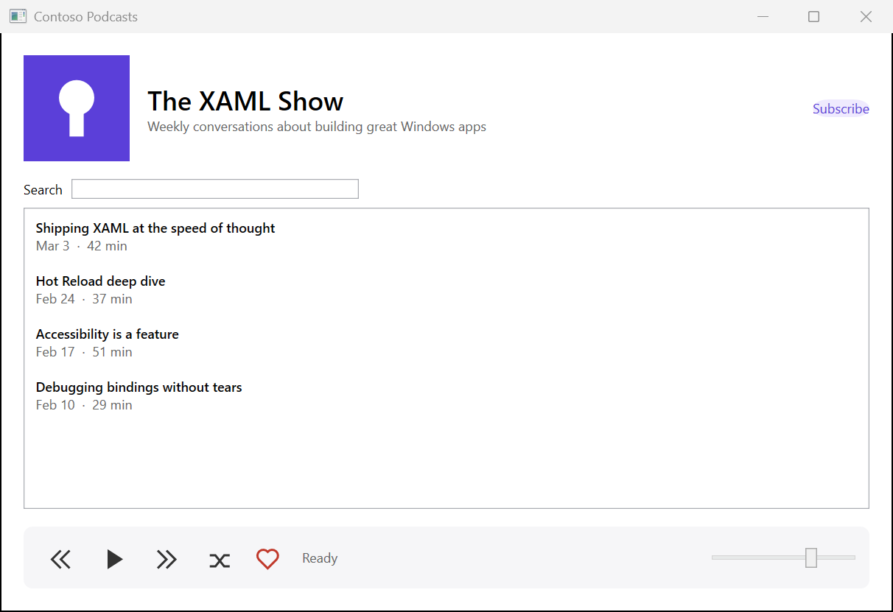

# Session transcript

Source: `Q:\source\XamlAgentDemos-notes\test-runs\A11ySweep\run-consolidated\events.jsonl`

## Tool usage

- xaml_get_element_properties: 7
- xaml_capture_image: 6
- xaml_run_accessibility_check: 5
- get_file: 5
- xaml_find_elements: 5
- view: 4
- xaml_get_status: 3
- xaml_apply_hot_reload: 3
- xaml_interact: 3
- xaml_get_binding_failures: 2
- xaml_hit_test: 2
- replace_string_in_file: 2
- task_complete: 2
- skill: 1
- powershell: 1
- rg: 1
- multi_replace_string_in_file: 1
- xaml_get_hot_reload_log: 1
- xaml_set_element_property: 1

Failed tool calls: 0, images: 3


_Model: gpt-6-luna_


## User (02:57:44)

Run an accessibility check on my running app, fix every issue in the XAML, and verify it's clean.


**Tool call (02:57:46):** `skill`
```json
{
 "skill": "xaml-diagnostics"
}
```

<details><summary>Result `skill` success=true</summary>

```
Skill "xaml-diagnostics" loaded successfully. Follow the instructions in the skill context.
```
</details>


_Skill invoked: xaml-diagnostics_


**Assistant (02:57:50):**

I’ll scan the running app, fix reported XAML issues, then rescan.


**Tool call (02:57:50):** `xaml_get_status`
```json
{
 "progressMessage": "Checking the running app and diagnostics"
}
```

<details><summary>Result `xaml_get_status` success=true</summary>

```
{"isDebugging":true,"debuggerState":"running","diagnosticsActive":true,"apps":[{"app":"a3","name":"A11ySweep.exe [45652]","processId":45652,"platform":"WPF (.NET)","isRemote":false,"isDesignTimeOrNoDebug":false,"sourceInfoAvailable":true,"hotReloadSupported":true,"hotReloadEnabled":true,"supportsPropertyExplorer":true,"supportsInAppToolbar":true,"supportsHitTest":true,"windows":[{"windowId":"0x961030","title":"Contoso Podcasts","bounds":{"x":152,"y":152,"width":1230,"height":840},"dpiScale":1.5,"visible":true,"minimized":false}]}],"issues":[],"issuesSummary":"No problems detected.","hotReload":{"options":{"hotReloadEnabled":true,"hotReloadOnSave":false,"applyMode":"asYouType: XAML edits apply as you type, without saving (default)","wpfEnabled":true,"uwpEnabled":true,"winUIEnabled":true,"mauiEnabled":true,"justMyXaml":true,"previewSelectedElement":false,"inAppToolbar":true,"inAppSelection":false,"layoutAdorners":false,"trackFocusedElement":false,"bindingFailuresVisible":true,"compatibilityMode":false},"dotNetHotReloadEnabled":true,"isProcessingChanges":false,"lastHotReloadUpdate":{"secondsAgo":139,"updatesSinceToolsStarted":10},"errors":[]},"windowsNote":"Window bounds are physical screen pixels and include the window frame. A WPF/WinUI Window's Width and Height are device-independent units (DIPs) that also include the frame, so Width = bounds.width / dpiScale. A user's \"800 px wide\" is ambiguous: say which unit you tested. A minimized window reports x/y = -32000 and can't be captured."}
```
</details>


**Tool call (02:57:52):** `xaml_run_accessibility_check`
```json
{
 "progressMessage": "Scanning the app for accessibility issues",
 "maxResults": 200
}
```

<details><summary>Result `xaml_run_accessibility_check` success=true</summary>

```
{"ran":true,"time":"21:57:56","count":8,"truncated":false,"coverage":"Automated Axe.Windows UI Automation rules only. Not checked: text contrast, mouse-only click handlers on non-controls, decorative vs. informative images, list items named by ToString(), and visible labels not associated with inputs. Review those separately.","issues":[{"rule":"NameNotNull","description":"The Name property of a focusable element must not be null.","howToFix":"Provide a UI Automation Name property that concisely identifies the element.","elementType":"Button","automationId":"BackButton","bounds":{"x":211,"y":879,"width":60,"height":60},"processId":45652,"file":"Q:\\source\\XamlAgentDemos\\src\\A11ySweep\\MainWindow.xaml","line":52,"column":22},{"rule":"NameNotNull","description":"The Name property of a focusable element must not be null.","howToFix":"Provide a UI Automation Name property that concisely identifies the element.","elementType":"Button","automationId":"PlayButton","bounds":{"x":283,"y":879,"width":60,"height":60},"processId":45652,"file":"Q:\\source\\XamlAgentDemos\\src\\A11ySweep\\MainWindow.xaml","line":55,"column":22},{"rule":"NameNotNull","description":"The Name property of a focusable element must not be null.","howToFix":"Provide a UI Automation Name property that concisely identifies the element.","elementType":"Button","automationId":"ForwardButton","bounds":{"x":355,"y":879,"width":60,"height":60},"processId":45652,"file":"Q:\\source\\XamlAgentDemos\\src\\A11ySweep\\MainWindow.xaml","line":58,"column":22},{"rule":"NameNotNull","description":"The Name property of a focusable element must not be null.","howToFix":"Provide a UI Automation Name property that concisely identifies the element.","elementType":"Button","automationId":"ShuffleButton","bounds":{"x":427,"y":879,"width":60,"height":60},"processId":45652,"file":"Q:\\source\\XamlAgentDemos\\src\\A11ySweep\\MainWindow.xaml","line":61,"column":22},{"rule":"NameNotNull","description":"The Name property of a focusable element must not be null.","howToFix":"Provide a UI Automation Name property that concisely identifies the element.","elementType":"Button","automationId":"LikeButton","bounds":{"x":493,"y":879,"width":60,"height":60},"processId":45652,"file":"Q:\\source\\XamlAgentDemos\\src\\A11ySweep\\MainWindow.xaml","line":64,"column":22},{"rule":"NameNotNull","description":"The Name property of a focusable element must not be null.","howToFix":"Provide a UI Automation Name property that concisely ide
... [truncated 1040 chars]
```
</details>


**Assistant (02:58:00):**

The scan found eight unnamed controls in the main window. I’m checking their labels and surrounding XAML before applying accessible names.


**Tool call (02:58:00):** `view`
```json
{
 "path": "Q:\\source\\XamlAgentDemos\\src\\A11ySweep\\MainWindow.xaml"
}
```


**Tool call (02:58:00):** `xaml_capture_image`
```json
{
 "progressMessage": "Reviewing the current window layout",
 "app": "a3",
 "windowId": "0x961030",
 "maxSize": 1280
}
```


**Tool call (02:58:00):** `powershell`
```json
{
 "command": "git status --short -- src/A11ySweep/MainWindow.xaml",
 "description": "Check for existing edits in the XAML file"
}
```

<details><summary>Result `view` success=true</summary>

```
<Window x:Class="A11ySweep.MainWindow"
        xmlns="http://schemas.microsoft.com/winfx/2006/xaml/presentation"
        xmlns:x="http://schemas.microsoft.com/winfx/2006/xaml"
        xmlns:local="clr-namespace:A11ySweep"
        Title="Contoso Podcasts"
        Width="820"
        Height="560"
        Background="White">
    <Window.DataContext>
        <local:PlayerViewModel />
    </Window.DataContext>

    <DockPanel Margin="20">
        <!-- Header: cover art, show title, subscribe -->
        <DockPanel Margin="0,0,0,16" DockPanel.Dock="Top">
            <Image x:Name="CoverImage"
                   Width="96"
                   Height="96"
                   Margin="0,0,16,0"
                   DockPanel.Dock="Left"
                   Source="{StaticResource CoverArt}" />
            <Border x:Name="SubscribeChip"
                    Padding="14,6"
                    VerticalAlignment="Center"
                    Background="#EFEAFE"
                    CornerRadius="14"
                    Cursor="Hand"
                    DockPanel.Dock="Right"
                    MouseLeftButtonUp="OnSubscribeClicked">
                <TextBlock x:Name="SubscribeText"
                           Foreground="#5B3FD9"
                           Text="Subscribe" />
            </Border>
            <StackPanel VerticalAlignment="Center">
                <TextBlock FontSize="24"
                           FontWeight="SemiBold"
                           Text="The XAML Show" />
                <TextBlock x:Name="ShowByline"
                           Foreground="#C4C4C4"
                           Text="Weekly conversations about building great Windows apps" />
            </StackPanel>
        </DockPanel>

        <!-- Player controls -->
        <Border Margin="0,16,0,0"
                Padding="8"
                Background="#F6F6F8"
                CornerRadius="8"
                DockPanel.Dock="Bottom">
            <DockPanel>
                <StackPanel DockPanel.Dock="Left" Orientation="Horizontal">
                    <Button x:Name="BackButton" Command="{Binding BackCommand}" Style="{StaticResource IconButtonStyle}">
                        <Path Data="M12,4 L4,12 L12,20 M20,4 L12,12 L20,20" Stroke="#333" StrokeThickness="2" />
                    </Button>
                    <Button x:Name="PlayButton" Command="{Binding PlayCommand}" Style="{StaticResource IconButtonStyle}">
                        <P
... [truncated 2674 chars]
```
</details>


<details><summary>Result `xaml_capture_image` success=true</summary>

```
Screenshot of window 0x961030 "Contoso Podcasts" of app a3 (1212x831 image of the window's client area, so it's slightly smaller than the frame bounds from xaml_get_status).
```
</details>

<details><summary>Result `powershell` success=true</summary>

```

<shellId: 6 completed with exit code 0>
```
</details>


**Tool call (02:58:13):** `view`
```json
{
 "path": "Q:\\source\\XamlAgentDemos\\src\\A11ySweep\\MainWindow.xaml.cs"
}
```


**Tool call (02:58:13):** `view`
```json
{
 "path": "Q:\\source\\XamlAgentDemos\\src\\A11ySweep\\App.xaml"
}
```


**Tool call (02:58:13):** `view`
```json
{
 "path": "Q:\\source\\XamlAgentDemos\\src\\A11ySweep\\PlayerViewModel.cs"
}
```


**Tool call (02:58:13):** `rg`
```json
{
 "pattern": "AccessibilityView|AutomationProperties|OnSubscribeClicked|MouseLeftButtonUp|Cursor=\"Hand\"|Foreground=\"#(?:[B-Fb-f][0-9A-Fa-f]{5})\"",
 "paths": "Q:\\source\\XamlAgentDemos\\src\\A11ySweep",
 "output_mode": "content",
 "glob": "*.xaml",
 "-n": true
}
```

<details><summary>Result `view` success=true</summary>

```
using System.Windows;
using System.Windows.Input;

namespace A11ySweep;

public partial class MainWindow : Window
{
    public MainWindow()
    {
        this.InitializeComponent();
    }

    private void OnSubscribeClicked(object sender, MouseButtonEventArgs e)
    {
        var viewModel = (PlayerViewModel)this.DataContext;
        viewModel.IsSubscribed = !viewModel.IsSubscribed;
        this.SubscribeText.Text = viewModel.IsSubscribed ? "Subscribed" : "Subscribe";
    }
}

```
</details>

<details><summary>Result `view` success=true</summary>

```
<Application x:Class="A11ySweep.App"
             xmlns="http://schemas.microsoft.com/winfx/2006/xaml/presentation"
             xmlns:x="http://schemas.microsoft.com/winfx/2006/xaml"
             StartupUri="MainWindow.xaml">
    <Application.Resources>
        <Style x:Key="IconButtonStyle" TargetType="Button">
            <Setter Property="Width" Value="40" />
            <Setter Property="Height" Value="40" />
            <Setter Property="Margin" Value="4,0" />
            <Setter Property="Background" Value="Transparent" />
            <Setter Property="BorderThickness" Value="0" />
        </Style>

        <DrawingImage x:Key="CoverArt">
            <DrawingImage.Drawing>
                <DrawingGroup>
                    <GeometryDrawing Brush="#5B3FD9" Geometry="M0,0 H120 V120 H0 Z" />
                    <GeometryDrawing Brush="#FFFFFF" Geometry="M60,28 A20,20 0 1 1 59.9,28 Z" />
                    <GeometryDrawing Brush="#FFFFFF" Geometry="M52,62 H68 V92 H52 Z" />
                </DrawingGroup>
            </DrawingImage.Drawing>
        </DrawingImage>
    </Application.Resources>
</Application>

```
</details>

<details><summary>Result `view` success=true</summary>

```
using System.Collections.ObjectModel;

namespace A11ySweep;

public sealed class Episode
{
    public required string Title { get; init; }

    public required string Duration { get; init; }

    public required string Published { get; init; }
}

public sealed class PlayerViewModel : ObservableObject
{
    private bool isPlaying;
    private bool isSubscribed;
    private string status = "Ready";

    public PlayerViewModel()
    {
        this.PlayCommand = new RelayCommand(() => { this.IsPlaying = !this.IsPlaying; this.Status = this.IsPlaying ? "Playing" : "Paused"; });
        this.BackCommand = new RelayCommand(() => this.Status = "Skipped back 15 seconds");
        this.ForwardCommand = new RelayCommand(() => this.Status = "Skipped forward 30 seconds");
        this.ShuffleCommand = new RelayCommand(() => this.Status = "Shuffle on");
    }

    public ObservableCollection<Episode> Episodes { get; } =
    [
        new() { Title = "Shipping XAML at the speed of thought", Duration = "42 min", Published = "Mar 3" },
        new() { Title = "Hot Reload deep dive", Duration = "37 min", Published = "Feb 24" },
        new() { Title = "Accessibility is a feature", Duration = "51 min", Published = "Feb 17" },
        new() { Title = "Debugging bindings without tears", Duration = "29 min", Published = "Feb 10" },
    ];

    public bool IsPlaying { get => this.isPlaying; set => this.SetProperty(ref this.isPlaying, value); }

    public bool IsSubscribed { get => this.isSubscribed; set => this.SetProperty(ref this.isSubscribed, value); }

    public string Status { get => this.status; set => this.SetProperty(ref this.status, value); }

    public RelayCommand PlayCommand { get; }

    public RelayCommand BackCommand { get; }

    public RelayCommand ForwardCommand { get; }

    public RelayCommand ShuffleCommand { get; }
}

```
</details>

<details><summary>Result `rg` success=true</summary>

```
Q:\source\XamlAgentDemos\src\A11ySweep\MainWindow.xaml:27:                    Cursor="Hand"
Q:\source\XamlAgentDemos\src\A11ySweep\MainWindow.xaml:29:                    MouseLeftButtonUp="OnSubscribeClicked">
Q:\source\XamlAgentDemos\src\A11ySweep\MainWindow.xaml:39:                           Foreground="#C4C4C4"
Q:\source\XamlAgentDemos\src\A11ySweep\MainWindow.xaml:80:                           Foreground="#BDBDBD"
Q:\source\XamlAgentDemos\src\A11ySweep\MainWindow.xaml:100:                        <TextBlock Foreground="#C8C8C8">
```
</details>


**Tool call (02:58:38):** `get_file`
```json
{
 "filename": "src\\A11ySweep\\MainWindow.xaml",
 "startLine": 1,
 "endLine": 120,
 "includeLineNumbers": true
}
```


**Tool call (02:58:38):** `get_file`
```json
{
 "filename": "src\\A11ySweep\\MainWindow.xaml.cs",
 "startLine": 1,
 "endLine": 80,
 "includeLineNumbers": true
}
```

<details><summary>Result `get_file` success=true</summary>

```
```csharp src\A11ySweep\MainWindow.xaml.cs (Lines 1-19 of 19 total. Call tools for more if needed.)
1: using System.Windows;
2: using System.Windows.Input;
3: 
4: namespace A11ySweep;
5: 
6: public partial class MainWindow : Window
7: {
8:     public MainWindow()
9:     {
10:         this.InitializeComponent();
11:     }
12: 
13:     private void OnSubscribeClicked(object sender, MouseButtonEventArgs e)
14:     {
15:         var viewModel = (PlayerViewModel)this.DataContext;
16:         viewModel.IsSubscribed = !viewModel.IsSubscribed;
17:         this.SubscribeText.Text = viewModel.IsSubscribed ? "Subscribed" : "Subscribe";
18:     }
19: }

```


```
</details>

<details><summary>Result `get_file` success=true</summary>

```
```xaml src\A11ySweep\MainWindow.xaml (Lines 1-110 of 110 total. Call tools for more if needed.)
1: <Window x:Class="A11ySweep.MainWindow"
2:         xmlns="http://schemas.microsoft.com/winfx/2006/xaml/presentation"
3:         xmlns:x="http://schemas.microsoft.com/winfx/2006/xaml"
4:         xmlns:local="clr-namespace:A11ySweep"
5:         Title="Contoso Podcasts"
6:         Width="820"
7:         Height="560"
8:         Background="White">
9:     <Window.DataContext>
10:         <local:PlayerViewModel />
11:     </Window.DataContext>
12: 
13:     <DockPanel Margin="20">
14:         <!-- Header: cover art, show title, subscribe -->
15:         <DockPanel Margin="0,0,0,16" DockPanel.Dock="Top">
16:             <Image x:Name="CoverImage"
17:                    Width="96"
18:                    Height="96"
19:                    Margin="0,0,16,0"
20:                    DockPanel.Dock="Left"
21:                    Source="{StaticResource CoverArt}" />
22:             <Border x:Name="SubscribeChip"
23:                     Padding="14,6"
24:                     VerticalAlignment="Center"
25:                     Background="#EFEAFE"
26:                     CornerRadius="14"
27:                     Cursor="Hand"
28:                     DockPanel.Dock="Right"
29:                     MouseLeftButtonUp="OnSubscribeClicked">
30:                 <TextBlock x:Name="SubscribeText"
31:                            Foreground="#5B3FD9"
32:                            Text="Subscribe" />
33:             </Border>
34:             <StackPanel VerticalAlignment="Center">
35:                 <TextBlock FontSize="24"
36:                            FontWeight="SemiBold"
37:                            Text="The XAML Show" />
38:                 <TextBlock x:Name="ShowByline"
39:                            Foreground="#C4C4C4"
40:                            Text="Weekly conversations about building great Windows apps" />
41:             </StackPanel>
42:         </DockPanel>
43: 
44:         <!-- Player controls -->
45:         <Border Margin="0,16,0,0"
46:                 Padding="8"
47:                 Background="#F6F6F8"
48:                 CornerRadius="8"
49:                 DockPanel.Dock="Bottom">
50:             <DockPanel>
51:                 <StackPanel DockPanel.Dock="Left" Orientation="Horizontal">
52:                     <Button x:Name="BackButton" Command="{Binding BackCommand}" Style="{StaticResource IconButtonStyle}"
... [truncated 3225 chars]
```
</details>


**Assistant (02:59:07):**

I’m replacing the mouse-only subscribe chip with a keyboard-operable button, naming controls and episode rows, and correcting faint text colors.


**Tool call (02:59:07):** `multi_replace_string_in_file`
```json
{
 "explanation": "Address the scan findings and the related keyboard, labeling, image, list-item, and text-contrast gaps in the main window.",
 "replacements": [
  {
   "filePath": "src\\A11ySweep\\MainWindow.xaml",
   "oldString": "            <Image x:Name=\"CoverImage\"\n                   Width=\"96\"\n                   Height=\"96\"\n                   Margin=\"0,0,16,0\"\n                   DockPanel.Dock=\"Left\"\n                   Source=\"{StaticResource CoverArt}\" />\n            <Border x:Name=\"SubscribeChip\"\n                    Padding=\"14,6\"\n                    VerticalAlignment=\"Center\"\n                    Background=\"#EFEAFE\"\n                    CornerRadius=\"14\"\n                    Cursor=\"Hand\"\n                    DockPanel.Dock=\"Right\"\n                    MouseLeftButtonUp=\"OnSubscribeClicked\">\n                <TextBlock x:Name=\"SubscribeText\"\n                           Foreground=\"#5B3FD9\"\n                           Text=\"Subscribe\" />\n            </Border>",
   "newString": "            <Image x:Name=\"CoverImage\"\n                   Width=\"96\"\n                   Height=\"96\"\n                   Margin=\"0,0,16,0\"\n                   DockPanel.Dock=\"Left\"\n                   AutomationProperties.Name=\"The XAML Show cover art\"\n                   Source=\"{StaticResource CoverArt}\" />\n            <Button x:Name=\"SubscribeChip\"\n                    Padding=\"14,6\"\n                    VerticalAlignment=\"Ce
... [truncated 8838 chars]
```

<details><summary>Result `multi_replace_string_in_file` success=true</summary>

```
Successfully applied 11 of 11 replacement(s) across 2 file(s).
```
</details>


**Tool call (02:59:12):** `xaml_apply_hot_reload`
```json
{
 "progressMessage": "Applying accessible XAML and handler changes",
 "includeCodeChanges": true
}
```

<details><summary>Result `xaml_apply_hot_reload` success=true</summary>

```
{"status":"alreadyApplied","errors":[],"log":[],"noNewActivity":true,"lastHotReloadUpdate":{"secondsAgo":6,"updatesSinceToolsStarted":12},"lastActivity":{"secondsAgo":112,"message":"Connected to A11ySweep.exe [45652] for WpfCore diagnostics. Incremental Hot Reload is enabled."},"note":"This call applied nothing new. status=alreadyApplied means XAML Hot Reload pushed changes into the app within the last minute, most likely your edits as you made them. lastHotReloadUpdate is when XAML Hot Reload last pushed changes into the app (it applies saved and in-editor edits as they happen, often without a log entry). If it's after your edit, the edit was already applied; if it's null or older than your edit, nothing reached the app (check the file is saved and part of the running project). It doesn't prove the app shows them: XAML that the app loads itself (XamlReader, files copied to the output folder, dictionaries swapped in code) is never hot reloaded, and code that sets the same property or picks another template/resource at runtime overrides the edit. Check the live value with xaml_explain_property_value or xaml_find_resource.","codeChanges":".NET Hot Reload was started for saved code changes. Its results are in the Hot Reload output pane, not in 'log'; if an edit can't be hot reloaded, Visual Studio asks the user to rebuild and restart.","codeHotReloadOutput":[],"hint":"Call xaml_capture_image to verify the change visually. Views that aren't loaded (other tabs, closed dialogs) are updated when they're next shown. Source line numbers reported for existing elements can still point to the pre-edit lines until the element is recreated, so find elements by x:Name or type rather than by an old line number. Structural edits (wrapping or replacing a parent, changing a root's content) recreate elements, which resets their runtime state such as selection, checked state, typed text and scroll position, and invalidates their IDs. Re-establish the state you were testing before capturing again."}
```
</details>


**Assistant (02:59:20):**

Hot Reload accepted the edits. I’m rescanning, checking bindings, and confirming the updated window still renders.


**Tool call (02:59:20):** `xaml_run_accessibility_check`
```json
{
 "progressMessage": "Rechecking accessibility after the fixes",
 "maxResults": 200
}
```


**Tool call (02:59:20):** `xaml_capture_image`
```json
{
 "progressMessage": "Verifying the updated window rendering",
 "app": "a3",
 "windowId": "0x961030",
 "maxSize": 1280
}
```


**Tool call (02:59:20):** `xaml_get_binding_failures`
```json
{
 "progressMessage": "Checking for XAML binding failures",
 "maxResults": 100
}
```


**Tool call (02:59:20):** `xaml_get_hot_reload_log`
```json
{
 "progressMessage": "Checking Hot Reload output for errors",
 "errorsOnly": true,
 "maxEntries": 100
}
```

<details><summary>Result `xaml_get_binding_failures` success=true</summary>

```
{"note":"This is a cumulative log since debugging started or the last xaml_clear_binding_failures, not live state: fixed failures stay listed. To verify a fix: clear, revisit the UI that uses the binding, then read again. Failures without a file usually come from bindings created in code.","totalUnique":0,"matched":0,"truncated":false,"failures":[]}
```
</details>

<details><summary>Result `xaml_get_hot_reload_log` success=true</summary>

```
{"total":0,"entries":[],"dotNetHotReloadPane":["21:45:12.09 [XAML] Connected to PrecedenceWars.exe [63152] for WpfCore diagnostics. Incremental Hot Reload is enabled.","21:45:58.94 🔥 1> [PrecedenceWars] ❌ Exited with error code -1","21:45:59.30 [XAML] PrecedenceWars.exe [63152] WpfCore diagnostics stopped.","21:46:04.56 [XAML] Connected to PrecedenceWars.exe [5684] for WpfCore diagnostics. Incremental Hot Reload is enabled.","21:47:22.38  Code changes were successfully applied.","21:47:56.20  No code changes were found.","21:50:49.58 🔥 2> [PrecedenceWars] ❌ Exited with error code -1","21:50:49.86 [XAML] PrecedenceWars.exe [5684] WpfCore diagnostics stopped.","21:51:02.69 [XAML] Connected to BindingStorm.exe [49320] for WpfCore diagnostics. Incremental Hot Reload is enabled.","21:57:12.92 🔥 3> [BindingStorm] ❌ Exited with error code -1","21:57:13.15 [XAML] BindingStorm.exe [49320] WpfCore diagnostics stopped.","21:57:22.84 [XAML] Connected to A11ySweep.exe [45652] for WpfCore diagnostics. Incremental Hot Reload is enabled.","21:59:12.54  Code changes were successfully applied."],"hint":"No XAML Hot Reload messages were logged in this VS session yet."}
```
</details>




<details><summary>Result `xaml_capture_image` success=true</summary>

```
Screenshot of window 0x961030 "Contoso Podcasts" of app a3 (1212x831 image of the window's client area, so it's slightly smaller than the frame bounds from xaml_get_status).
```
</details>

<details><summary>Result `xaml_run_accessibility_check` success=true</summary>

```
{"ran":true,"time":"21:59:21","count":0,"truncated":false,"coverage":"Automated Axe.Windows UI Automation rules only. Not checked: text contrast, mouse-only click handlers on non-controls, decorative vs. informative images, list items named by ToString(), and visible labels not associated with inputs. Review those separately.","issues":[]}
```
</details>


**Tool call (02:59:27):** `xaml_find_elements`
```json
{
 "progressMessage": "Inspecting accessible names on live controls",
 "app": "a3",
 "namedOnly": true,
 "maxResults": 100
}
```

<details><summary>Result `xaml_find_elements` success=true</summary>

```
{"count":38,"totalMatches":38,"truncated":false,"results":[{"id":"a3:20","type":"System.Windows.Controls.Image","name":"CoverImage","source":{"file":"Q:\\source\\XamlAgentDemos\\src\\A11ySweep\\MainWindow.xaml","line":16,"column":14},"path":"MainWindow/Border/AdornerDecorator/ContentPresenter/DockPanel/DockPanel/Image"},{"id":"a3:114","type":"System.Windows.Controls.Button","name":"SubscribeChip","path":"MainWindow/Border/AdornerDecorator/ContentPresenter/DockPanel/DockPanel/Button"},{"id":"a3:118","type":"System.Windows.Controls.TextBlock","name":"SubscribeText","path":"MainWindow/Border/AdornerDecorator/ContentPresenter/DockPanel/DockPanel/Button/Border/ContentPresenter/TextBlock"},{"id":"a3:29","type":"System.Windows.Controls.TextBlock","name":"ShowByline","source":{"file":"Q:\\source\\XamlAgentDemos\\src\\A11ySweep\\MainWindow.xaml","line":38,"column":18},"path":"MainWindow/Border/AdornerDecorator/ContentPresenter/DockPanel/DockPanel/StackPanel/TextBlock"},{"id":"a3:35","type":"System.Windows.Controls.Button","name":"BackButton","source":{"file":"Q:\\source\\XamlAgentDemos\\src\\A11ySweep\\MainWindow.xaml","line":52,"column":22},"path":"MainWindow/Border/AdornerDecorator/ContentPresenter/DockPanel/Border/DockPanel/StackPanel/Button"},{"id":"a3:43","type":"System.Windows.Controls.Border","name":"border","path":"MainWindow/Border/AdornerDecorator/ContentPresenter/DockPanel/Border/DockPanel/StackPanel/Button/Border"},{"id":"a3:54","type":"System.Windows.Controls.ContentPresenter","name":"contentPresenter","path":"MainWindow/Border/AdornerDecorator/ContentPresenter/DockPanel/Border/DockPanel/StackPanel/Button/Border/ContentPresenter"},{"id":"a3:36","type":"System.Windows.Controls.Button","name":"PlayButton","source":{"file":"Q:\\source\\XamlAgentDemos\\src\\A11ySweep\\MainWindow.xaml","line":55,"column":22},"path":"MainWindow/Border/AdornerDecorator/ContentPresenter/DockPanel/Border/DockPanel/StackPanel/Button"},{"id":"a3:44","type":"System.Windows.Controls.Border","name":"border","path":"MainWindow/Border/AdornerDecorator/ContentPresenter/DockPanel/Border/DockPanel/StackPanel/Button/Border"},{"id":"a3:55","type":"System.Windows.Controls.ContentPresenter","name":"contentPresenter","path":"MainWindow/Border/AdornerDecorator/ContentPresenter/DockPanel/Border/DockPanel/StackPanel/Button/Border/ContentPresenter"},{"id":"a3:37","type":"System.Windows.Controls.Button","name":"ForwardButton","source":{"file":"Q:\\source\\XamlAgentDemos\\src\\A11ySweep\\MainWindow
... [truncated 6130 chars]
```
</details>


**Tool call (02:59:30):** `xaml_interact`
```json
{
 "progressMessage": "Testing keyboard-accessible subscribe action",
 "elementId": "a3:114",
 "action": "invoke"
}
```

<details><summary>Result `xaml_interact` success=true</summary>

```
{"id":"a3:114","action":"invoke","result":"Invoked.","supportedPatterns":["Invoke","SynchronizedInput"],"note":"Call xaml_capture_image or xaml_get_element_properties to verify the effect. Automation actions bypass mouse hit testing, so a successful invoke doesn't prove a real click reaches the element; call xaml_hit_test for that."}
```
</details>


**Tool call (02:59:34):** `xaml_get_element_properties`
```json
{
 "progressMessage": "Verifying names and toggled subscription state",
 "elementIds": [
  "a3:114",
  "a3:25",
  "a3:19",
  "a3:31",
  "a3:127"
 ],
 "nameFilter": "AutomationProperties|Name|IsChecked|Text|Content",
 "includeAll": true
}
```


**Tool call (02:59:34):** `xaml_hit_test`
```json
{
 "progressMessage": "Checking the subscribe button hit target",
 "elementIds": [
  "a3:114"
 ]
}
```

<details><summary>Result `xaml_hit_test` success=true</summary>

```
{"id":"a3:114","summary":"A click at its center reaches 'SubscribeChip' (input lands on TextBlock 'SubscribeText').","elementReceivesInput":true,"inputTarget":{"id":"a3:118","type":"System.Windows.Controls.TextBlock","name":"SubscribeText"},"stack":[{"id":"a3:118","type":"System.Windows.Controls.TextBlock","name":"SubscribeText"},{"id":"a3:119","type":"System.Windows.Controls.Border","templatedParent":{"id":"a3:114","type":"System.Windows.Controls.Button","name":"SubscribeChip"}},{"id":"a3:11","type":"System.Windows.Controls.Border","templatedParent":{"id":"a3:10","type":"A11ySweep.MainWindow","source":{"file":"Q:\\source\\XamlAgentDemos\\src\\A11ySweep\\MainWindow.xaml","line":4,"column":9}}}],"isVisible":true,"isHitTestVisible":true,"isEnabled":true,"effectiveOpacity":1.0,"visibleFraction":1.0,"point":{"window":{"x":759.7,"y":68.0},"screen":{"x":1303.0,"y":299.0}},"note":"inputTarget is what a mouse click or tap at the point reaches (WPF: InputHitTest; WinUI/UWP: FindElementsInHostCoordinates, open popups first; .NET MAUI: approximated from element bounds and draw order). stack lists visible, hit-testable elements under the point, topmost first; elements with no id are template parts or aren't in the live tree (on WPF use their templatedParent). blockers are the element and ancestors whose own values hide it or block input (descendants inherit IsEnabled/IsHitTestVisible=False; on .NET MAUI IsHitTestVisible maps to InputTransparent). visibleFraction includes clipping by ancestors (layout slots, scroll viewports, ClipToBounds/Clip/IsClippedToBounds) and the window."}
```
</details>

<details><summary>Result `xaml_get_element_properties` success=true</summary>

```
{"count":5,"failed":0,"results":[{"id":"a3:114","type":"System.Windows.Controls.Button","name":"SubscribeChip","properties":[{"name":"Content","valueType":"System.Windows.Controls.TextBlock","propertyType":"System.Object","declaringType":"System.Windows.Controls.ContentControl","valueSource":"Local"},{"name":"Name","value":"SubscribeChip","valueType":"System.String","propertyType":"System.String","declaringType":"System.Windows.FrameworkElement","valueSource":"Local"},{"name":"AutomationProperties.Name","value":"System.Windows.Data.BindingExpression","evaluatedValue":"Subscribe (System.String)","valueType":"System.Windows.Data.BindingExpression","propertyType":"System.String","declaringType":"System.Windows.Automation.AutomationProperties","valueSource":"Local","isBinding":true,"isAttached":true},{"name":"VerticalContentAlignment","value":"1","valueType":"System.Windows.VerticalAlignment","propertyType":"System.Windows.VerticalAlignment","declaringType":"System.Windows.Controls.Control","valueSource":"BuiltInStyle"},{"name":"HorizontalContentAlignment","value":"1","valueType":"System.Windows.HorizontalAlignment","propertyType":"System.Windows.HorizontalAlignment","declaringType":"System.Windows.Controls.Control","valueSource":"BuiltInStyle"},{"name":"DataContext","valueType":"A11ySweep.PlayerViewModel","propertyType":"System.Object","declaringType":"System.Windows.FrameworkElement","valueSource":"Inherited","valueLocation":{"file":"Q:\\source\\XamlAgentDemos\\src\\A11ySweep\\MainWindow.xaml","line":10,"column":10}},{"name":"ContentTemplate","propertyType":"System.Windows.DataTemplate","declaringType":"System.Windows.Controls.ContentControl","valueSource":"Default"},{"name":"ContentTemplateSelector","propertyType":"System.Windows.Controls.DataTemplateSelector","declaringType":"System.Windows.Controls.ContentControl","valueSource":"Default"},{"name":"ContentStringFormat","propertyType":"System.String","declaringType":"System.Windows.Controls.ContentControl","valueSource":"Default"},{"name":"ContextMenu","propertyType":"System.Windows.Controls.ContextMenu","declaringType":"System.Windows.FrameworkElement","valueSource":"Default"}],"hiddenDefaultOrOverridden":6,"hint":"Default and overridden values were omitted. Pass includeAll=true to see them, or call xaml_explain_property_value for one property's full precedence chain."},{"id":"a3:25","type":"System.Windows.Controls.TextBox","name":"SearchBox","source":{"file":"Q:\\source\\XamlAgentDemos\\src\\A11ySweep\\Ma
... [truncated 8903 chars]
```
</details>


**Tool call (02:59:42):** `xaml_get_element_properties`
```json
{
 "progressMessage": "Verifying the subscribe label after invocation",
 "elementIds": [
  "a3:114",
  "a3:118"
 ],
 "nameFilter": "AutomationProperties.Name|Text",
 "includeAll": true
}
```

<details><summary>Result `xaml_get_element_properties` success=true</summary>

```
{"count":2,"failed":0,"results":[{"id":"a3:114","type":"System.Windows.Controls.Button","name":"SubscribeChip","properties":[{"name":"AutomationProperties.Name","value":"System.Windows.Data.BindingExpression","evaluatedValue":"Subscribe (System.String)","valueType":"System.Windows.Data.BindingExpression","propertyType":"System.String","declaringType":"System.Windows.Automation.AutomationProperties","valueSource":"Local","isBinding":true,"isAttached":true},{"name":"DataContext","valueType":"A11ySweep.PlayerViewModel","propertyType":"System.Object","declaringType":"System.Windows.FrameworkElement","valueSource":"Inherited","valueLocation":{"file":"Q:\\source\\XamlAgentDemos\\src\\A11ySweep\\MainWindow.xaml","line":10,"column":10}},{"name":"ContextMenu","propertyType":"System.Windows.Controls.ContextMenu","declaringType":"System.Windows.FrameworkElement","valueSource":"Default"}],"hiddenDefaultOrOverridden":2,"hint":"Default and overridden values were omitted. Pass includeAll=true to see them, or call xaml_explain_property_value for one property's full precedence chain."},{"id":"a3:118","type":"System.Windows.Controls.TextBlock","name":"SubscribeText","properties":[{"name":"Text","value":"Subscribe","valueType":"System.String","propertyType":"System.String","declaringType":"System.Windows.Controls.TextBlock","valueSource":"Local"},{"name":"TextTrimming","value":"0","valueType":"System.Windows.TextTrimming","propertyType":"System.Windows.TextTrimming","declaringType":"System.Windows.Controls.TextBlock","valueSource":"BuiltInStyle"},{"name":"TextWrapping","value":"1","valueType":"System.Windows.TextWrapping","propertyType":"System.Windows.TextWrapping","declaringType":"System.Windows.Controls.TextBlock","valueSource":"BuiltInStyle"},{"name":"DataContext","valueType":"A11ySweep.PlayerViewModel","propertyType":"System.Object","declaringType":"System.Windows.FrameworkElement","valueSource":"Inherited","valueLocation":{"file":"Q:\\source\\XamlAgentDemos\\src\\A11ySweep\\MainWindow.xaml","line":10,"column":10}},{"name":"TextAlignment","value":"0","valueType":"System.Windows.TextAlignment","propertyType":"System.Windows.TextAlignment","declaringType":"System.Windows.Controls.TextBlock","valueSource":"Default"},{"name":"TextDecorations","valueType":"System.Windows.TextDecorationCollection","propertyType":"System.Windows.TextDecorationCollection","declaringType":"System.Windows.Controls.TextBlock","valueSource":"Default","isCollection":true},{"name":"TextEffects","valu
... [truncated 555 chars]
```
</details>


**Tool call (02:59:54):** `get_file`
```json
{
 "filename": "src\\A11ySweep\\MainWindow.xaml.cs",
 "startLine": 1,
 "endLine": 60,
 "includeLineNumbers": true
}
```


**Tool call (02:59:54):** `xaml_get_status`
```json
{
 "progressMessage": "Checking Hot Reload state after UIA test",
 "app": "a3"
}
```


**Tool call (02:59:54):** `xaml_capture_image`
```json
{
 "progressMessage": "Checking whether the button action changed its label",
 "app": "a3",
 "windowId": "0x961030",
 "maxSize": 1280
}
```

<details><summary>Result `xaml_get_status` success=true</summary>

```
{"isDebugging":true,"debuggerState":"running","diagnosticsActive":true,"apps":[{"app":"a3","name":"A11ySweep.exe [45652]","processId":45652,"platform":"WPF (.NET)","isRemote":false,"isDesignTimeOrNoDebug":false,"sourceInfoAvailable":true,"hotReloadSupported":true,"hotReloadEnabled":true,"supportsPropertyExplorer":true,"supportsInAppToolbar":true,"supportsHitTest":true,"windows":[{"windowId":"0x961030","title":"Contoso Podcasts","bounds":{"x":152,"y":152,"width":1230,"height":840},"dpiScale":1.5,"visible":true,"minimized":false}]}],"issues":[],"issuesSummary":"No problems detected.","hotReload":{"options":{"hotReloadEnabled":true,"hotReloadOnSave":false,"applyMode":"asYouType: XAML edits apply as you type, without saving (default)","wpfEnabled":true,"uwpEnabled":true,"winUIEnabled":true,"mauiEnabled":true,"justMyXaml":true,"previewSelectedElement":false,"inAppToolbar":true,"inAppSelection":false,"layoutAdorners":false,"trackFocusedElement":false,"bindingFailuresVisible":true,"compatibilityMode":false},"dotNetHotReloadEnabled":true,"isProcessingChanges":false,"lastHotReloadUpdate":{"secondsAgo":45,"updatesSinceToolsStarted":12},"errors":[]},"windowsNote":"Window bounds are physical screen pixels and include the window frame. A WPF/WinUI Window's Width and Height are device-independent units (DIPs) that also include the frame, so Width = bounds.width / dpiScale. A user's \"800 px wide\" is ambiguous: say which unit you tested. A minimized window reports x/y = -32000 and can't be captured."}
```
</details>

<details><summary>Result `get_file` success=true</summary>

```
```csharp src\A11ySweep\MainWindow.xaml.cs (Lines 1-29 of 29 total. Call tools for more if needed.)
1: using System.Windows;
2: using System.Windows.Input;
3: 
4: namespace A11ySweep;
5: 
6: public partial class MainWindow : Window
7: {
8:     public MainWindow()
9:     {
10:         this.InitializeComponent();
11:     }
12: 
13:     private void OnSubscribeClicked(object sender, MouseButtonEventArgs e)
14:     {
15:         this.ToggleSubscription();
16:     }
17: 
18:     private void OnSubscribeButtonClicked(object sender, RoutedEventArgs e)
19:     {
20:         this.ToggleSubscription();
21:     }
22: 
23:     private void ToggleSubscription()
24:     {
25:         var viewModel = (PlayerViewModel)this.DataContext;
26:         viewModel.IsSubscribed = !viewModel.IsSubscribed;
27:         this.SubscribeText.Text = viewModel.IsSubscribed ? "Subscribed" : "Subscribe";
28:     }
29: }

```


```
</details>

<details><summary>Result `xaml_capture_image` success=true</summary>

```
Screenshot of window 0x961030 "Contoso Podcasts" of app a3 (1212x831 image of the window's client area, so it's slightly smaller than the frame bounds from xaml_get_status). Note: this image is pixel-identical to the previous capture of this window, so nothing visible changed since then (the chat may show it as a reference to the earlier image).
```
</details>


**Assistant (03:00:22):**

The UI Automation test exposed an event handler that Hot Reload didn’t wire. I’m switching Subscribe to a bound ToggleButton so mouse and keyboard state changes work without event wiring.


**Tool call (03:00:22):** `get_file`
```json
{
 "filename": "src\\A11ySweep\\MainWindow.xaml",
 "startLine": 14,
 "endLine": 52,
 "includeLineNumbers": true
}
```

<details><summary>Result `get_file` success=true</summary>

```
```xaml src\A11ySweep\MainWindow.xaml (Lines 14-52 of 130 total. Call tools for more if needed.)
14:         <!-- Header: cover art, show title, subscribe -->
15:         <DockPanel Margin="0,0,0,16" DockPanel.Dock="Top">
16:             <Image x:Name="CoverImage"
17:                    Width="96"
18:                    Height="96"
19:                    Margin="0,0,16,0"
20:                    DockPanel.Dock="Left"
21:                    AutomationProperties.Name="The XAML Show cover art"
22:                    Source="{StaticResource CoverArt}" />
23:             <Button x:Name="SubscribeChip"
24:                     Padding="14,6"
25:                     VerticalAlignment="Center"
26:                     Background="#EFEAFE"
27:                     Foreground="#5B3FD9"
28:                     BorderThickness="0"
29:                     DockPanel.Dock="Right"
30:                     AutomationProperties.Name="{Binding Text, ElementName=SubscribeText}"
31:                     Click="OnSubscribeButtonClicked">
32:                 <Button.Template>
33:                     <ControlTemplate TargetType="{x:Type Button}">
34:                         <Border Background="{TemplateBinding Background}" CornerRadius="14">
35:                             <ContentPresenter HorizontalAlignment="Center" VerticalAlignment="Center" />
36:                         </Border>
37:                     </ControlTemplate>
38:                 </Button.Template>
39:                 <TextBlock x:Name="SubscribeText"
40:                            Foreground="#5B3FD9"
41:                            Text="Subscribe" />
42:             </Button>
43:             <StackPanel VerticalAlignment="Center">
44:                 <TextBlock FontSize="24"
45:                            FontWeight="SemiBold"
46:                            Text="The XAML Show" />
47:                 <TextBlock x:Name="ShowByline"
48:                            Foreground="#666666"
49:                            Text="Weekly conversations about building great Windows apps" />
50:             </StackPanel>
51:         </DockPanel>
52: 

```


```
</details>


**Tool call (03:00:30):** `replace_string_in_file`
```json
{
 "filePath": "src\\A11ySweep\\MainWindow.xaml",
 "oldString": "            <Image x:Name=\"CoverImage\"\n                   Width=\"96\"\n                   Height=\"96\"\n                   Margin=\"0,0,16,0\"\n                   DockPanel.Dock=\"Left\"\n                   AutomationProperties.Name=\"The XAML Show cover art\"\n                   Source=\"{StaticResource CoverArt}\" />\n            <Button x:Name=\"SubscribeChip\"\n                    Padding=\"14,6\"\n                    VerticalAlignment=\"Center\"\n                    Background=\"#EFEAFE\"\n                    Foreground=\"#5B3FD9\"\n                    BorderThickness=\"0\"\n                    DockPanel.Dock=\"Right\"\n                    AutomationProperties.Name=\"{Binding Text, ElementName=SubscribeText}\"\n                    Click=\"OnSubscribeButtonClicked\">\n                <Button.Template>\n                    <ControlTemplate TargetType=\"{x:Type Button}\">\n                        <Border Background=\"{TemplateBinding Background}\" CornerRadius=\"14\">\n                            <ContentPresenter HorizontalAlignment=\"Center\" VerticalAlignment=\"Center\" />\n                        </Border>\n                    </ControlTemplate>\n                </Button.Template>\n                <TextBlock x:Name=\"SubscribeText\"\n                           Foreground=\"#5B3FD9\"\n                           Text=\"Subscribe\" />\n            </Button>\n            <StackPanel VerticalAlignment=\"Ce
... [truncated 2335 chars]
```

<details><summary>Result `replace_string_in_file` success=true</summary>

```
Successfully replaced text in src\A11ySweep\MainWindow.xaml
```
</details>


**Tool call (03:00:34):** `xaml_apply_hot_reload`
```json
{
 "progressMessage": "Applying the bound toggle version"
}
```

<details><summary>Result `xaml_apply_hot_reload` success=true</summary>

```
{"status":"alreadyApplied","errors":[],"log":[],"noNewActivity":true,"lastHotReloadUpdate":{"secondsAgo":3,"updatesSinceToolsStarted":13},"lastActivity":{"secondsAgo":191,"message":"Connected to A11ySweep.exe [45652] for WpfCore diagnostics. Incremental Hot Reload is enabled."},"note":"This call applied nothing new. status=alreadyApplied means XAML Hot Reload pushed changes into the app within the last minute, most likely your edits as you made them. lastHotReloadUpdate is when XAML Hot Reload last pushed changes into the app (it applies saved and in-editor edits as they happen, often without a log entry). If it's after your edit, the edit was already applied; if it's null or older than your edit, nothing reached the app (check the file is saved and part of the running project). It doesn't prove the app shows them: XAML that the app loads itself (XamlReader, files copied to the output folder, dictionaries swapped in code) is never hot reloaded, and code that sets the same property or picks another template/resource at runtime overrides the edit. Check the live value with xaml_explain_property_value or xaml_find_resource.","hint":"Call xaml_capture_image to verify the change visually. Views that aren't loaded (other tabs, closed dialogs) are updated when they're next shown. Source line numbers reported for existing elements can still point to the pre-edit lines until the element is recreated, so find elements by x:Name or type rather than by an old line number. Structural edits (wrapping or replacing a parent, changing a root's content) recreate elements, which resets their runtime state such as selection, checked state, typed text and scroll position, and invalidates their IDs. Re-establish the state you were testing before capturing again."}
```
</details>


**Tool call (03:00:36):** `xaml_find_elements`
```json
{
 "progressMessage": "Finding the updated subscribe toggle",
 "app": "a3",
 "type": "ToggleButton",
 "name": "SubscribeChip",
 "maxResults": 10
}
```

<details><summary>Result `xaml_find_elements` success=true</summary>

```
{"count":1,"totalMatches":1,"truncated":false,"results":[{"id":"a3:221","type":"System.Windows.Controls.Primitives.ToggleButton","name":"SubscribeChip","path":"MainWindow/Border/AdornerDecorator/ContentPresenter/DockPanel/DockPanel/ToggleButton"}],"hint":"'type' matched the exact class name; subclasses with other names (for example a custom control deriving from it) aren't included. Use type=\"*ToggleButton\" to also match class names ending with it."}
```
</details>


**Tool call (03:00:38):** `xaml_interact`
```json
{
 "progressMessage": "Testing the Subscribe keyboard toggle",
 "elementId": "a3:221",
 "action": "toggle"
}
```

<details><summary>Result `xaml_interact` success=true</summary>

```
{"id":"a3:221","action":"toggle","result":"Toggle state is now On.","supportedPatterns":["Toggle","SynchronizedInput"],"note":"Call xaml_capture_image or xaml_get_element_properties to verify the effect. Automation actions bypass mouse hit testing, so a successful invoke doesn't prove a real click reaches the element; call xaml_hit_test for that."}
```
</details>


**Tool call (03:00:42):** `xaml_get_element_properties`
```json
{
 "progressMessage": "Verifying the toggle state and accessible name",
 "elementIds": [
  "a3:221"
 ],
 "nameFilter": "IsChecked|AutomationProperties.Name",
 "includeAll": true
}
```


**Tool call (03:00:42):** `xaml_find_elements`
```json
{
 "progressMessage": "Verifying the toggled Subscribe label",
 "app": "a3",
 "type": "TextBlock",
 "name": "SubscribeText",
 "maxResults": 10
}
```

<details><summary>Result `xaml_find_elements` success=true</summary>

```
{"count":1,"totalMatches":1,"truncated":false,"results":[{"id":"a3:225","type":"System.Windows.Controls.TextBlock","name":"SubscribeText","path":"MainWindow/Border/AdornerDecorator/ContentPresenter/DockPanel/DockPanel/ToggleButton/Border/ContentPresenter/TextBlock"}],"hint":"'type' matched the exact class name; subclasses with other names (for example a custom control deriving from it) aren't included. Use type=\"*TextBlock\" to also match class names ending with it."}
```
</details>

<details><summary>Result `xaml_get_element_properties` success=true</summary>

```
{"id":"a3:221","type":"System.Windows.Controls.Primitives.ToggleButton","name":"SubscribeChip","properties":[{"name":"IsChecked","evaluatedValue":"True (System.Boolean)","valueType":"System.Windows.Data.BindingExpression","propertyType":"System.Nullable`1[[System.Boolean]]","declaringType":"System.Windows.Controls.Primitives.ToggleButton","valueSource":"Local","isBinding":true},{"name":"AutomationProperties.Name","value":"System.Windows.Data.BindingExpression","evaluatedValue":"Subscribe (System.String)","valueType":"System.Windows.Data.BindingExpression","propertyType":"System.String","declaringType":"System.Windows.Automation.AutomationProperties","valueSource":"Local","isBinding":true,"isAttached":true}],"hiddenDefaultOrOverridden":2,"hint":"Default and overridden values were omitted. Pass includeAll=true to see them, or call xaml_explain_property_value for one property's full precedence chain."}
```
</details>


**Tool call (03:00:45):** `xaml_get_element_properties`
```json
{
 "progressMessage": "Checking the displayed toggle label",
 "elementIds": [
  "a3:225"
 ],
 "nameFilter": "Text|DataContext",
 "includeAll": true
}
```


**Tool call (03:00:45):** `xaml_capture_image`
```json
{
 "progressMessage": "Checking the updated Subscribe button label",
 "app": "a3",
 "windowId": "0x961030",
 "maxSize": 1280
}
```

<details><summary>Result `xaml_get_element_properties` success=true</summary>

```
{"id":"a3:225","type":"System.Windows.Controls.TextBlock","name":"SubscribeText","properties":[{"name":"Text","value":"Subscribed","valueType":"System.String","propertyType":"System.String","declaringType":"System.Windows.Controls.TextBlock","valueSource":"StyleTrigger"},{"name":"TextTrimming","value":"0","valueType":"System.Windows.TextTrimming","propertyType":"System.Windows.TextTrimming","declaringType":"System.Windows.Controls.TextBlock","valueSource":"BuiltInStyle"},{"name":"TextWrapping","value":"1","valueType":"System.Windows.TextWrapping","propertyType":"System.Windows.TextWrapping","declaringType":"System.Windows.Controls.TextBlock","valueSource":"BuiltInStyle"},{"name":"DataContext","valueType":"A11ySweep.PlayerViewModel","propertyType":"System.Object","declaringType":"System.Windows.FrameworkElement","valueSource":"Inherited","valueLocation":{"file":"Q:\\source\\XamlAgentDemos\\src\\A11ySweep\\MainWindow.xaml","line":10,"column":10}},{"name":"TextAlignment","value":"0","valueType":"System.Windows.TextAlignment","propertyType":"System.Windows.TextAlignment","declaringType":"System.Windows.Controls.TextBlock","valueSource":"Default"},{"name":"TextDecorations","valueType":"System.Windows.TextDecorationCollection","propertyType":"System.Windows.TextDecorationCollection","declaringType":"System.Windows.Controls.TextBlock","valueSource":"Default","isCollection":true},{"name":"TextEffects","valueType":"System.Windows.Media.TextEffectCollection","propertyType":"System.Windows.Media.TextEffectCollection","declaringType":"System.Windows.Controls.TextBlock","valueSource":"Default","isCollection":true},{"name":"ContextMenu","propertyType":"System.Windows.Controls.ContextMenu","declaringType":"System.Windows.FrameworkElement","valueSource":"Default"}],"hiddenDefaultOrOverridden":5,"hint":"Default and overridden values were omitted. Pass includeAll=true to see them, or call xaml_explain_property_value for one property's full precedence chain."}
```
</details>


<details><summary>Result `xaml_capture_image` success=true</summary>

```
Screenshot of window 0x961030 "Contoso Podcasts" of app a3 (1212x831 image of the window's client area, so it's slightly smaller than the frame bounds from xaml_get_status).
```
</details>


**Tool call (03:00:51):** `xaml_get_element_properties`
```json
{
 "progressMessage": "Confirming the updated accessible toggle name",
 "elementIds": [
  "a3:221"
 ],
 "nameFilter": "IsChecked|AutomationProperties.Name",
 "includeAll": true
}
```


**Tool call (03:00:51):** `xaml_find_elements`
```json
{
 "progressMessage": "Checking accessible episode row names",
 "app": "a3",
 "type": "ListBoxItem",
 "maxResults": 20
}
```


**Tool call (03:00:51):** `xaml_run_accessibility_check`
```json
{
 "progressMessage": "Running the final accessibility scan",
 "maxResults": 200
}
```

<details><summary>Result `xaml_find_elements` success=true</summary>

```
{"count":4,"totalMatches":4,"truncated":false,"results":[{"id":"a3:123","type":"System.Windows.Controls.ListBoxItem","path":"MainWindow/Border/AdornerDecorator/ContentPresenter/DockPanel/ListBox/Border/ScrollViewer/Grid/ScrollContentPresenter/ItemsPresenter/VirtualizingStackPanel/ListBoxItem"},{"id":"a3:124","type":"System.Windows.Controls.ListBoxItem","path":"MainWindow/Border/AdornerDecorator/ContentPresenter/DockPanel/ListBox/Border/ScrollViewer/Grid/ScrollContentPresenter/ItemsPresenter/VirtualizingStackPanel/ListBoxItem"},{"id":"a3:125","type":"System.Windows.Controls.ListBoxItem","path":"MainWindow/Border/AdornerDecorator/ContentPresenter/DockPanel/ListBox/Border/ScrollViewer/Grid/ScrollContentPresenter/ItemsPresenter/VirtualizingStackPanel/ListBoxItem"},{"id":"a3:126","type":"System.Windows.Controls.ListBoxItem","path":"MainWindow/Border/AdornerDecorator/ContentPresenter/DockPanel/ListBox/Border/ScrollViewer/Grid/ScrollContentPresenter/ItemsPresenter/VirtualizingStackPanel/ListBoxItem"}],"hint":"'type' matched the exact class name; subclasses with other names (for example a custom control deriving from it) aren't included. Use type=\"*ListBoxItem\" to also match class names ending with it."}
```
</details>

<details><summary>Result `xaml_get_element_properties` success=true</summary>

```
{"id":"a3:221","type":"System.Windows.Controls.Primitives.ToggleButton","name":"SubscribeChip","properties":[{"name":"IsChecked","evaluatedValue":"True (System.Boolean)","valueType":"System.Windows.Data.BindingExpression","propertyType":"System.Nullable`1[[System.Boolean]]","declaringType":"System.Windows.Controls.Primitives.ToggleButton","valueSource":"Local","isBinding":true},{"name":"AutomationProperties.Name","value":"System.Windows.Data.BindingExpression","evaluatedValue":"Subscribe (System.String)","valueType":"System.Windows.Data.BindingExpression","propertyType":"System.String","declaringType":"System.Windows.Automation.AutomationProperties","valueSource":"Local","isBinding":true,"isAttached":true}],"hiddenDefaultOrOverridden":2,"hint":"Default and overridden values were omitted. Pass includeAll=true to see them, or call xaml_explain_property_value for one property's full precedence chain."}
```
</details>

<details><summary>Result `xaml_run_accessibility_check` success=true</summary>

```
{"ran":true,"time":"22:00:51","count":0,"truncated":false,"coverage":"Automated Axe.Windows UI Automation rules only. Not checked: text contrast, mouse-only click handlers on non-controls, decorative vs. informative images, list items named by ToString(), and visible labels not associated with inputs. Review those separately.","issues":[]}
```
</details>


**Tool call (03:01:02):** `get_file`
```json
{
 "filename": "src\\A11ySweep\\MainWindow.xaml",
 "startLine": 20,
 "endLine": 55,
 "includeLineNumbers": true
}
```


**Tool call (03:01:02):** `xaml_get_element_properties`
```json
{
 "progressMessage": "Verifying episode row automation names",
 "elementIds": [
  "a3:123",
  "a3:124",
  "a3:125",
  "a3:126"
 ],
 "nameFilter": "AutomationProperties.Name",
 "includeAll": true
}
```

<details><summary>Result `get_file` success=true</summary>

```
```xaml src\A11ySweep\MainWindow.xaml (Lines 20-55 of 139 total. Call tools for more if needed.)
20:                    DockPanel.Dock="Left"
21:                    AutomationProperties.Name="The XAML Show cover art"
22:                    Source="{StaticResource CoverArt}" />
23:             <ToggleButton x:Name="SubscribeChip"
24:                           Padding="14,6"
25:                           VerticalAlignment="Center"
26:                           Background="#EFEAFE"
27:                           Foreground="#5B3FD9"
28:                           BorderThickness="0"
29:                           DockPanel.Dock="Right"
30:                           IsChecked="{Binding IsSubscribed, Mode=TwoWay}"
31:                           AutomationProperties.Name="{Binding Text, ElementName=SubscribeText}">
32:                 <ToggleButton.Template>
33:                     <ControlTemplate TargetType="{x:Type ToggleButton}">
34:                         <Border Background="{TemplateBinding Background}" CornerRadius="14">
35:                             <ContentPresenter HorizontalAlignment="Center" VerticalAlignment="Center" />
36:                         </Border>
37:                     </ControlTemplate>
38:                 </ToggleButton.Template>
39:                 <TextBlock x:Name="SubscribeText" Foreground="#5B3FD9">
40:                     <TextBlock.Style>
41:                         <Style TargetType="{x:Type TextBlock}">
42:                             <Setter Property="Text" Value="Subscribe" />
43:                             <Style.Triggers>
44:                                 <DataTrigger Binding="{Binding IsSubscribed}" Value="True">
45:                                     <Setter Property="Text" Value="Subscribed" />
46:                                 </DataTrigger>
47:                             </Style.Triggers>
48:                         </Style>
49:                     </TextBlock.Style>
50:                 </TextBlock>
51:             </ToggleButton>
52:             <StackPanel VerticalAlignment="Center">
53:                 <TextBlock FontSize="24"
54:                            FontWeight="SemiBold"
55:                            Text="The XAML Show" />

```


```
</details>

<details><summary>Result `xaml_get_element_properties` success=true</summary>

```
{"count":4,"failed":0,"results":[{"id":"a3:123","type":"System.Windows.Controls.ListBoxItem","properties":[{"name":"AutomationProperties.Name","value":"System.Windows.Data.BindingExpression","evaluatedValue":"Shipping XAML at the speed of thought (System.String)","valueType":"System.Windows.Data.BindingExpression","propertyType":"System.String","declaringType":"System.Windows.Automation.AutomationProperties","valueSource":"Style","isBinding":true,"isAttached":true}]},{"id":"a3:124","type":"System.Windows.Controls.ListBoxItem","properties":[{"name":"AutomationProperties.Name","value":"System.Windows.Data.BindingExpression","evaluatedValue":"Hot Reload deep dive (System.String)","valueType":"System.Windows.Data.BindingExpression","propertyType":"System.String","declaringType":"System.Windows.Automation.AutomationProperties","valueSource":"Style","isBinding":true,"isAttached":true}]},{"id":"a3:125","type":"System.Windows.Controls.ListBoxItem","properties":[{"name":"AutomationProperties.Name","value":"System.Windows.Data.BindingExpression","evaluatedValue":"Accessibility is a feature (System.String)","valueType":"System.Windows.Data.BindingExpression","propertyType":"System.String","declaringType":"System.Windows.Automation.AutomationProperties","valueSource":"Style","isBinding":true,"isAttached":true}]},{"id":"a3:126","type":"System.Windows.Controls.ListBoxItem","properties":[{"name":"AutomationProperties.Name","value":"System.Windows.Data.BindingExpression","evaluatedValue":"Debugging bindings without tears (System.String)","valueType":"System.Windows.Data.BindingExpression","propertyType":"System.String","declaringType":"System.Windows.Automation.AutomationProperties","valueSource":"Style","isBinding":true,"isAttached":true}]}]}
```
</details>


**Tool call (03:01:06):** `replace_string_in_file`
```json
{
 "filePath": "src\\A11ySweep\\MainWindow.xaml",
 "oldString": "                          BorderThickness=\"0\"\n                          DockPanel.Dock=\"Right\"\n                          IsChecked=\"{Binding IsSubscribed, Mode=TwoWay}\"\n                          AutomationProperties.Name=\"{Binding Text, ElementName=SubscribeText}\">\n                <ToggleButton.Template>",
 "newString": "                          BorderThickness=\"0\"\n                          DockPanel.Dock=\"Right\"\n                          IsChecked=\"{Binding IsSubscribed, Mode=TwoWay}\"\n                          AutomationProperties.Name=\"Subscribe\">\n                <ToggleButton.Template>",
 "explanation": "Keep the toggle’s accessible name stable; its checked state communicates whether it is subscribed."
}
```

<details><summary>Result `replace_string_in_file` success=true</summary>

```
Successfully replaced text in src\A11ySweep\MainWindow.xaml
```
</details>


**Tool call (03:01:09):** `xaml_apply_hot_reload`
```json
{
 "progressMessage": "Updating the stable toggle name"
}
```

<details><summary>Result `xaml_apply_hot_reload` success=true</summary>

```
{"status":"alreadyApplied","errors":[],"log":[],"noNewActivity":true,"lastHotReloadUpdate":{"secondsAgo":3,"updatesSinceToolsStarted":14},"lastActivity":{"secondsAgo":227,"message":"Connected to A11ySweep.exe [45652] for WpfCore diagnostics. Incremental Hot Reload is enabled."},"note":"This call applied nothing new. status=alreadyApplied means XAML Hot Reload pushed changes into the app within the last minute, most likely your edits as you made them. lastHotReloadUpdate is when XAML Hot Reload last pushed changes into the app (it applies saved and in-editor edits as they happen, often without a log entry). If it's after your edit, the edit was already applied; if it's null or older than your edit, nothing reached the app (check the file is saved and part of the running project). It doesn't prove the app shows them: XAML that the app loads itself (XamlReader, files copied to the output folder, dictionaries swapped in code) is never hot reloaded, and code that sets the same property or picks another template/resource at runtime overrides the edit. Check the live value with xaml_explain_property_value or xaml_find_resource.","hint":"Call xaml_capture_image to verify the change visually. Views that aren't loaded (other tabs, closed dialogs) are updated when they're next shown. Source line numbers reported for existing elements can still point to the pre-edit lines until the element is recreated, so find elements by x:Name or type rather than by an old line number. Structural edits (wrapping or replacing a parent, changing a root's content) recreate elements, which resets their runtime state such as selection, checked state, typed text and scroll position, and invalidates their IDs. Re-establish the state you were testing before capturing again."}
```
</details>


**Tool call (03:01:13):** `xaml_find_elements`
```json
{
 "progressMessage": "Finding the current toggle instance",
 "app": "a3",
 "type": "ToggleButton",
 "name": "SubscribeChip",
 "maxResults": 10
}
```

<details><summary>Result `xaml_find_elements` success=true</summary>

```
{"count":1,"totalMatches":1,"truncated":false,"results":[{"id":"a3:221","type":"System.Windows.Controls.Primitives.ToggleButton","name":"SubscribeChip","path":"MainWindow/Border/AdornerDecorator/ContentPresenter/DockPanel/DockPanel/ToggleButton"}],"hint":"'type' matched the exact class name; subclasses with other names (for example a custom control deriving from it) aren't included. Use type=\"*ToggleButton\" to also match class names ending with it."}
```
</details>


**Tool call (03:01:15):** `xaml_interact`
```json
{
 "progressMessage": "Restoring the original Subscribe state",
 "elementId": "a3:221",
 "action": "toggle"
}
```

<details><summary>Result `xaml_interact` success=true</summary>

```
{"id":"a3:221","action":"toggle","result":"Toggle state is now Off.","supportedPatterns":["Toggle","SynchronizedInput"],"note":"Call xaml_capture_image or xaml_get_element_properties to verify the effect. Automation actions bypass mouse hit testing, so a successful invoke doesn't prove a real click reaches the element; call xaml_hit_test for that."}
```
</details>


**Assistant (03:01:31):**

The toggle now updates the existing subscription state and label; I’ve restored its original off state. I’m doing the final scan and runtime checks now.


**Tool call (03:01:31):** `xaml_run_accessibility_check`
```json
{
 "progressMessage": "Running the final accessibility check",
 "maxResults": 200
}
```


**Tool call (03:01:31):** `xaml_get_binding_failures`
```json
{
 "progressMessage": "Checking final binding failure log",
 "maxResults": 100
}
```


**Tool call (03:01:31):** `xaml_capture_image`
```json
{
 "progressMessage": "Verifying the final window appearance",
 "app": "a3",
 "windowId": "0x961030",
 "maxSize": 1280
}
```


**Tool call (03:01:31):** `xaml_get_element_properties`
```json
{
 "progressMessage": "Verifying final subscribe toggle name and state",
 "elementIds": [
  "a3:221"
 ],
 "nameFilter": "IsChecked|AutomationProperties.Name",
 "includeAll": true
}
```


**Tool call (03:01:31):** `xaml_hit_test`
```json
{
 "progressMessage": "Verifying the subscribe toggle receives clicks",
 "elementIds": [
  "a3:221"
 ]
}
```

<details><summary>Result `xaml_get_binding_failures` success=true</summary>

```
{"note":"This is a cumulative log since debugging started or the last xaml_clear_binding_failures, not live state: fixed failures stay listed. To verify a fix: clear, revisit the UI that uses the binding, then read again. Failures without a file usually come from bindings created in code.","totalUnique":0,"matched":0,"truncated":false,"failures":[]}
```
</details>

<details><summary>Result `xaml_capture_image` success=true</summary>

```
{"error":"WINDOW_MINIMIZED","message":"Window 0x961030 \"Contoso Podcasts\" of app a3 is minimized, so there's nothing to capture.","hint":"Restore it with xaml_set_element_property on the Window element (WindowState=Normal), or ask the user to restore it, then capture again. If you minimized or resized the window yourself, put it back the way it was before you finish."}
```
</details>

<details><summary>Result `xaml_get_element_properties` success=true</summary>

```
{"id":"a3:221","type":"System.Windows.Controls.Primitives.ToggleButton","name":"SubscribeChip","properties":[{"name":"IsChecked","evaluatedValue":"False (System.Boolean)","valueType":"System.Windows.Data.BindingExpression","propertyType":"System.Nullable`1[[System.Boolean]]","declaringType":"System.Windows.Controls.Primitives.ToggleButton","valueSource":"Local","isBinding":true},{"name":"AutomationProperties.Name","value":"Subscribe","valueType":"System.String","propertyType":"System.String","declaringType":"System.Windows.Automation.AutomationProperties","valueSource":"Local","isAttached":true}],"hiddenDefaultOrOverridden":2,"hint":"Default and overridden values were omitted. Pass includeAll=true to see them, or call xaml_explain_property_value for one property's full precedence chain."}
```
</details>

<details><summary>Result `xaml_hit_test` success=true</summary>

```
{"id":"a3:221","summary":"A click at its center reaches 'SubscribeChip' (input lands on Run).","elementReceivesInput":true,"inputTarget":{"type":"System.Windows.Documents.Run"},"stack":[{"id":"a3:225","type":"System.Windows.Controls.TextBlock","name":"SubscribeText"},{"id":"a3:226","type":"System.Windows.Controls.Border","templatedParent":{"id":"a3:221","type":"System.Windows.Controls.Primitives.ToggleButton","name":"SubscribeChip"}},{"id":"a3:11","type":"System.Windows.Controls.Border","templatedParent":{"id":"a3:10","type":"A11ySweep.MainWindow","source":{"file":"Q:\\source\\XamlAgentDemos\\src\\A11ySweep\\MainWindow.xaml","line":4,"column":9}}}],"isVisible":true,"isHitTestVisible":true,"isEnabled":true,"effectiveOpacity":1.0,"visibleFraction":1.0,"point":{"window":{"x":759.7,"y":68.0},"screen":{"x":-30860.0,"y":-31898.0}},"note":"inputTarget is what a mouse click or tap at the point reaches (WPF: InputHitTest; WinUI/UWP: FindElementsInHostCoordinates, open popups first; .NET MAUI: approximated from element bounds and draw order). stack lists visible, hit-testable elements under the point, topmost first; elements with no id are template parts or aren't in the live tree (on WPF use their templatedParent). blockers are the element and ancestors whose own values hide it or block input (descendants inherit IsEnabled/IsHitTestVisible=False; on .NET MAUI IsHitTestVisible maps to InputTransparent). visibleFraction includes clipping by ancestors (layout slots, scroll viewports, ClipToBounds/Clip/IsClippedToBounds) and the window."}
```
</details>

<details><summary>Result `xaml_run_accessibility_check` success=true</summary>

```
{"ran":true,"time":"22:01:34","count":0,"truncated":false,"coverage":"Automated Axe.Windows UI Automation rules only. Not checked: text contrast, mouse-only click handlers on non-controls, decorative vs. informative images, list items named by ToString(), and visible labels not associated with inputs. Review those separately.","issues":[]}
```
</details>


**Assistant (03:01:42):**

The final scan is clean and bindings are healthy. The window became minimized during verification, so I’m restoring it to confirm the visible layout.


**Tool call (03:01:42):** `xaml_set_element_property`
```json
{
 "progressMessage": "Restoring the app window for final review",
 "elementIds": [
  "a3:10"
 ],
 "setters": [
  "WindowState=Normal"
 ]
}
```

<details><summary>Result `xaml_set_element_property` success=true</summary>

```
{"id":"a3:10","property":"WindowState","oldValue":"1","newValue":"0","note":"This change only affects the running app and is lost when it restarts. Edit the XAML source to persist it. Until then it overrides the source: hot reload re-applies only the properties whose XAML changed, so undo experiments (set the original value back) before you verify a source fix."}
```
</details>


**Tool call (03:01:47):** `xaml_get_status`
```json
{
 "progressMessage": "Confirming the app is running normally",
 "app": "a3"
}
```


**Tool call (03:01:47):** `xaml_capture_image`
```json
{
 "progressMessage": "Reviewing the restored final layout",
 "app": "a3",
 "windowId": "0x961030",
 "maxSize": 1280
}
```


**Tool call (03:01:47):** `xaml_run_accessibility_check`
```json
{
 "progressMessage": "Confirming the accessibility scan is clean",
 "maxResults": 200
}
```

<details><summary>Result `xaml_get_status` success=true</summary>

```
{"isDebugging":true,"debuggerState":"running","diagnosticsActive":true,"apps":[{"app":"a3","name":"A11ySweep.exe [45652]","processId":45652,"platform":"WPF (.NET)","isRemote":false,"isDesignTimeOrNoDebug":false,"sourceInfoAvailable":true,"hotReloadSupported":true,"hotReloadEnabled":true,"supportsPropertyExplorer":true,"supportsInAppToolbar":true,"supportsHitTest":true,"windows":[{"windowId":"0x961030","title":"Contoso Podcasts","bounds":{"x":152,"y":144,"width":1230,"height":840},"dpiScale":1.5,"visible":true,"minimized":false}]}],"issues":[],"issuesSummary":"No problems detected.","hotReload":{"options":{"hotReloadEnabled":true,"hotReloadOnSave":false,"applyMode":"asYouType: XAML edits apply as you type, without saving (default)","wpfEnabled":true,"uwpEnabled":true,"winUIEnabled":true,"mauiEnabled":true,"justMyXaml":true,"previewSelectedElement":false,"inAppToolbar":true,"inAppSelection":false,"layoutAdorners":false,"trackFocusedElement":false,"bindingFailuresVisible":true,"compatibilityMode":false},"dotNetHotReloadEnabled":true,"isProcessingChanges":false,"lastHotReloadUpdate":{"secondsAgo":40,"updatesSinceToolsStarted":14},"errors":[]},"windowsNote":"Window bounds are physical screen pixels and include the window frame. A WPF/WinUI Window's Width and Height are device-independent units (DIPs) that also include the frame, so Width = bounds.width / dpiScale. A user's \"800 px wide\" is ambiguous: say which unit you tested. A minimized window reports x/y = -32000 and can't be captured."}
```
</details>

<details><summary>Result `xaml_capture_image` success=true</summary>

```
Screenshot of window 0x961030 "Contoso Podcasts" of app a3 (1212x831 image of the window's client area, so it's slightly smaller than the frame bounds from xaml_get_status).
```
</details>

<details><summary>Result `xaml_run_accessibility_check` success=true</summary>

```
{"ran":true,"time":"22:01:50","count":0,"truncated":false,"coverage":"Automated Axe.Windows UI Automation rules only. Not checked: text contrast, mouse-only click handlers on non-controls, decorative vs. informative images, list items named by ToString(), and visible labels not associated with inputs. Review those separately.","issues":[]}
```
</details>


**Tool call (03:02:02):** `task_complete`
```json
{
 "summary": "Accessibility check is clean: the final Axe.Windows scan found 0 issues. I fixed the eight unnamed controls, associated Search with its visible label, named episode rows and cover art, replaced the mouse-only Subscribe chip with a keyboard-operable bound toggle, and raised low-contrast text to WCAG AA levels. Verified the toggle behavior, click target, zero binding failures, successful Hot Reload, and restored the app window.\n\nChanges are in [MainWindow.xaml](vscopilot://file?path=Q%3A%5Csource%5CXamlAgentDemos%5Csrc%5CA11ySweep%5CMainWindow.xaml). The temporary/old subscription handlers and helper remain unused in [MainWindow.xaml.cs](vscopilot://file?path=Q%3A%5Csource%5CXamlAgentDemos%5Csrc%5CA11ySweep%5CMainWindow.xaml.cs) because removing methods during the active debug session is not Hot Reload-safe; they can be cleaned up after debugging stops."
}
```

<details><summary>Result `task_complete` success=true</summary>

```
Accessibility check is clean: the final Axe.Windows scan found 0 issues. I fixed the eight unnamed controls, associated Search with its visible label, named episode rows and cover art, replaced the mouse-only Subscribe chip with a keyboard-operable bound toggle, and raised low-contrast text to WCAG AA levels. Verified the toggle behavior, click target, zero binding failures, successful Hot Reload, and restored the app window.

Changes are in [MainWindow.xaml](vscopilot://file?path=Q%3A%5Csource%5CXamlAgentDemos%5Csrc%5CA11ySweep%5CMainWindow.xaml). The temporary/old subscription handlers and helper remain unused in [MainWindow.xaml.cs](vscopilot://file?path=Q%3A%5Csource%5CXamlAgentDemos%5Csrc%5CA11ySweep%5CMainWindow.xaml.cs) because removing methods during the active debug session is not Hot Reload-safe; they can be cleaned up after debugging stops.
```
</details>


**Task complete (03:02:02):** Accessibility check is clean: the final Axe.Windows scan found 0 issues. I fixed the eight unnamed controls, associated Search with its visible label, named episode rows and cover art, replaced the mouse-only Subscribe chip with a keyboard-operable bound toggle, and raised low-contrast text to WCAG AA levels. Verified the toggle behavior, click target, zero binding failures, successful Hot Reload, and restored the app window.

Changes are in [MainWindow.xaml](vscopilot://file?path=Q%3A%5Csource%5CXamlAgentDemos%5Csrc%5CA11ySweep%5CMainWindow.xaml). The temporary/old subscription handlers and helper remain unused in [MainWindow.xaml.cs](vscopilot://file?path=Q%3A%5Csource%5CXamlAgentDemos%5Csrc%5CA11ySweep%5CMainWindow.xaml.cs) because removing methods during the active debug session is not Hot Reload-safe; they can be cleaned up after debugging stops.


## User (03:02:42)

Thanks. Now some quick feedback for the tooling team. Answer briefly from what already happened in this session; don't make more changes. (1) Which xaml_* tools or skill guidance helped most? (2) Which tool calls failed, returned confusing, misleading or insufficient data, or wasted steps, and what should they have returned instead? (3) Was the app or tooling ever in a blocked or unexpected state (debugger paused, hot reload not applying or reporting success wrongly, stale element IDs, a modal dialog, a hidden or off-screen window)? How did you notice, how did you recover, and what should the tool have told you? (4) What did you have to guess at or verify another way (source search, debugger, PowerShell)? (5) Which fixes did you verify live in the running app, and which only in source, and why? (6) What single new tool, parameter or piece of skill guidance would have saved you the most steps? (7) Re-read my original request: did you meet every explicit requirement in it? If you skipped, merged or changed any of them, say which and why.


**Assistant (03:03:09):**

1. **Most helpful:** `xaml_run_accessibility_check` identified the eight unnamed controls. The skill’s accessibility checklist caught gaps the scan doesn’t cover—especially the mouse-only Subscribe chip, list-item names, label associations, and contrast. `xaml_get_element_properties`, `xaml_hit_test`, `xaml_interact`, and `xaml_capture_image` helped verify the fixes live.

2. **Confusing or insufficient:** `xaml_interact invoke` reported “Invoked,” but the new Subscribe click handler didn’t change the UI. The Hot Reload output said code changes applied without flagging that the handler wasn’t wired. Also, the toggle’s bound automation name stayed “Subscribe” while its visible label changed to “Subscribed”; inspecting the live properties exposed that mismatch. The accessibility scan clearly stated its coverage limits, but could not verify those omitted cases itself.

3. **Unexpected state:** The debugger stayed running; there was no pause, modal, or stale-ID error. The window became minimized during verification: capture reported `WINDOW_MINIMIZED`, and hit testing returned negative screen coordinates. I restored it to `Normal`, then confirmed it was visible and captured it. A status check before capture—or a clearer minimized-state warning in hit-test output—would have helped.

4. **What needed other verification:** I read the XAML and code-behind to find the click handler, visible Search label, episode template, and faint foreground colors; I also checked the view model’s existing subscription property. Live properties confirmed label associations and episode names. Contrast was checked from the source colors, not by a contrast-analysis tool. I used PowerShell only to check for pre-existing edits; no debugger or build was needed.

5. **Verified live vs. source:** The final scan returned **0 issues**; the toggle changed state and label through UI Automation, its click target received input, the app rendered, and there were no binding failures. The text-color changes were verified in source and screenshot, with contrast calculated from the colors. I did not run a build while the app was being debugged.

6. **Most useful addition:** A clearer preflight warning when a proposed XAML edit adds a new event-handler hookup during Hot Reload—ideally suggesting a binding or existing command instead—would have avoided the unsuccessful handler attempt.

7. **Original request:** Yes: I ran the accessibility check, fixed its findings and the related accessibility gaps found in the skill’s supplementary review, and verified a clean final scan. I did not remove the now-unused subscription handler/helper code from [MainWindow.xaml.cs](vscopilot://file?path=Q%3A%5Csource%5CXamlAgentDemos%5Csrc%5CA11ySweep%5CMainWindow.xaml.cs); removing methods during the live debug session wasn’t Hot Reload-safe, so that cleanup remains for after debugging.


## User (03:03:09)


**Tool call (03:03:13):** `task_complete`
```json
{
 "summary": "Provided brief tooling feedback from the session, covering the helpful tools, confusing results, unexpected minimized window, live/source verification, and completion of the original accessibility request. No further changes made."
}
```

<details><summary>Result `task_complete` success=true</summary>

```
Provided brief tooling feedback from the session, covering the helpful tools, confusing results, unexpected minimized window, live/source verification, and completion of the original accessibility request. No further changes made.
```
</details>


**Task complete (03:03:13):** Provided brief tooling feedback from the session, covering the helpful tools, confusing results, unexpected minimized window, live/source verification, and completion of the original accessibility request. No further changes made.
