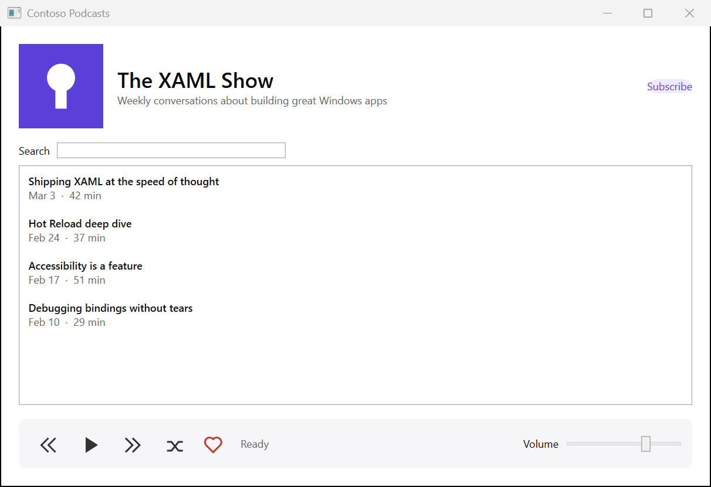

# Session transcript

Source: `Q:\source\XamlAgentDemos-notes\test-runs\A11ySweep\run-feedback\events.jsonl`

## Tool usage

- get_file: 8
- xaml_run_accessibility_check: 5
- xaml_capture_image: 5
- xaml_get_element_properties: 5
- xaml_find_elements: 4
- powershell: 3
- xaml_apply_hot_reload: 3
- xaml_interact: 3
- multi_replace_string_in_file: 2
- xaml_hit_test: 2
- task_complete: 2
- skill: 1
- xaml_get_status: 1
- xaml_get_visual_tree: 1
- rg: 1
- xaml_get_hot_reload_log: 1
- replace_string_in_file: 1
- xaml_get_binding_failures: 1

Failed tool calls: 0, images: 3


_Model: gpt-6-luna_


## User (03:38:18)

Run an accessibility check on my running app, fix every issue in the XAML, and verify it's clean.


**Tool call (03:38:20):** `skill`
```json
{
 "skill": "xaml-diagnostics"
}
```

<details><summary>Result `skill` success=true</summary>

```
Skill "xaml-diagnostics" loaded successfully. Follow the instructions in the skill context.
```
</details>


_Skill invoked: xaml-diagnostics_


**Tool call (03:38:23):** `xaml_get_status`
```json
{
 "progressMessage": "Checking running app and diagnostics availability"
}
```

<details><summary>Result `xaml_get_status` success=true</summary>

```
{"isDebugging":true,"debuggerState":"running","diagnosticsActive":true,"apps":[{"app":"a3","name":"A11ySweep.exe [16740]","processId":16740,"platform":"WPF (.NET)","isRemote":false,"isDesignTimeOrNoDebug":false,"sourceInfoAvailable":true,"hotReloadSupported":true,"hotReloadEnabled":true,"supportsPropertyExplorer":true,"supportsInAppToolbar":true,"supportsHitTest":true,"windows":[{"windowId":"0x18709A4","title":"Contoso Podcasts","bounds":{"x":304,"y":304,"width":1230,"height":840},"dpiScale":1.5,"visible":true,"minimized":false}]}],"issues":[],"issuesSummary":"No problems detected.","hotReload":{"options":{"hotReloadEnabled":true,"hotReloadOnSave":false,"applyMode":"asYouType: XAML edits apply as you type, without saving (default)","wpfEnabled":true,"uwpEnabled":true,"winUIEnabled":true,"mauiEnabled":true,"justMyXaml":true,"previewSelectedElement":false,"inAppToolbar":true,"inAppSelection":false,"layoutAdorners":false,"trackFocusedElement":false,"bindingFailuresVisible":true,"compatibilityMode":false},"dotNetHotReloadEnabled":true,"isProcessingChanges":false,"lastHotReloadUpdate":{"secondsAgo":119,"updatesSinceToolsStarted":7},"errors":[]},"windowsNote":"Window bounds are physical screen pixels and include the window frame. A WPF/WinUI Window's Width and Height are device-independent units (DIPs) that also include the frame, so Width = bounds.width / dpiScale. A user's \"800 px wide\" is ambiguous: say which unit you tested. A minimized window reports x/y = -32000 and can't be captured."}
```
</details>


**Tool call (03:38:27):** `xaml_run_accessibility_check`
```json
{
 "progressMessage": "Scanning the running app for accessibility issues",
 "maxResults": 100
}
```

<details><summary>Result `xaml_run_accessibility_check` success=true</summary>

```
{"ran":true,"time":"22:38:30","count":8,"truncated":false,"coverage":"Automated Axe.Windows UI Automation rules only. Not checked: text contrast, mouse-only click handlers on non-controls, decorative vs. informative images, list items named by ToString(), and visible labels not associated with inputs. Review those separately.","issues":[{"rule":"NameNotNull","description":"The Name property of a focusable element must not be null.","howToFix":"Provide a UI Automation Name property that concisely identifies the element.","elementType":"Button","automationId":"BackButton","bounds":{"x":363,"y":1031,"width":60,"height":60},"processId":16740,"file":"Q:\\source\\XamlAgentDemos\\src\\A11ySweep\\MainWindow.xaml","line":52,"column":22},{"rule":"NameNotNull","description":"The Name property of a focusable element must not be null.","howToFix":"Provide a UI Automation Name property that concisely identifies the element.","elementType":"Button","automationId":"PlayButton","bounds":{"x":435,"y":1031,"width":60,"height":60},"processId":16740,"file":"Q:\\source\\XamlAgentDemos\\src\\A11ySweep\\MainWindow.xaml","line":55,"column":22},{"rule":"NameNotNull","description":"The Name property of a focusable element must not be null.","howToFix":"Provide a UI Automation Name property that concisely identifies the element.","elementType":"Button","automationId":"ForwardButton","bounds":{"x":507,"y":1031,"width":60,"height":60},"processId":16740,"file":"Q:\\source\\XamlAgentDemos\\src\\A11ySweep\\MainWindow.xaml","line":58,"column":22},{"rule":"NameNotNull","description":"The Name property of a focusable element must not be null.","howToFix":"Provide a UI Automation Name property that concisely identifies the element.","elementType":"Button","automationId":"ShuffleButton","bounds":{"x":579,"y":1031,"width":60,"height":60},"processId":16740,"file":"Q:\\source\\XamlAgentDemos\\src\\A11ySweep\\MainWindow.xaml","line":61,"column":22},{"rule":"NameNotNull","description":"The Name property of a focusable element must not be null.","howToFix":"Provide a UI Automation Name property that concisely identifies the element.","elementType":"Button","automationId":"LikeButton","bounds":{"x":645,"y":1031,"width":60,"height":60},"processId":16740,"file":"Q:\\source\\XamlAgentDemos\\src\\A11ySweep\\MainWindow.xaml","line":64,"column":22},{"rule":"NameNotNull","description":"The Name property of a focusable element must not be null.","howToFix":"Provide a UI Automation Name property that concisel
... [truncated 1046 chars]
```
</details>


**Assistant (03:38:34):**

The scan found eight unnamed controls. I’m checking the XAML for related accessibility gaps before editing.


**Tool call (03:38:34):** `get_file`
```json
{
 "filename": "Q:\\source\\XamlAgentDemos\\src\\A11ySweep\\MainWindow.xaml",
 "startLine": 1,
 "endLine": 240,
 "includeLineNumbers": true
}
```


**Tool call (03:38:34):** `xaml_capture_image`
```json
{
 "progressMessage": "Inspecting the running app’s visible controls",
 "app": "a3",
 "windowId": "0x18709A4",
 "maxSize": 1280
}
```


**Tool call (03:38:34):** `xaml_get_visual_tree`
```json
{
 "progressMessage": "Inspecting the app’s interactive elements",
 "app": "a3",
 "depth": 5,
 "maxNodes": 300
}
```

<details><summary>Result `xaml_get_visual_tree` success=true</summary>

```
{"app":"a3","platform":"WPF (.NET)","sourceInfoAvailable":true,"nodeCount":57,"truncated":false,"depthLimitedNodes":3,"hint":"3 node(s) have children beyond the requested depth (childCount > 0, no children listed). Raise depth or pass rootElementId to expand them.","nodes":[{"id":"a3:10","type":"A11ySweep.MainWindow","source":{"file":"Q:\\source\\XamlAgentDemos\\src\\A11ySweep\\MainWindow.xaml","line":4,"column":9},"childCount":1,"children":[{"id":"a3:11","type":"System.Windows.Controls.Border","childCount":1,"children":[{"id":"a3:12","type":"System.Windows.Documents.AdornerDecorator","childCount":2,"children":[{"id":"a3:13","type":"System.Windows.Controls.ContentPresenter","childCount":1,"children":[{"id":"a3:15","type":"System.Windows.Controls.DockPanel","source":{"file":"Q:\\source\\XamlAgentDemos\\src\\A11ySweep\\MainWindow.xaml","line":13,"column":6},"childCount":4,"children":[{"id":"a3:16","type":"System.Windows.Controls.DockPanel","source":{"file":"Q:\\source\\XamlAgentDemos\\src\\A11ySweep\\MainWindow.xaml","line":15,"column":10},"childCount":3,"children":[{"id":"a3:20","type":"System.Windows.Controls.Image","name":"CoverImage","source":{"file":"Q:\\source\\XamlAgentDemos\\src\\A11ySweep\\MainWindow.xaml","line":16,"column":14},"childCount":0},{"id":"a3:21","type":"System.Windows.Controls.Border","name":"SubscribeChip","source":{"file":"Q:\\source\\XamlAgentDemos\\src\\A11ySweep\\MainWindow.xaml","line":22,"column":14},"childCount":1,"children":[{"id":"a3:27","type":"System.Windows.Controls.TextBlock","name":"SubscribeText","source":{"file":"Q:\\source\\XamlAgentDemos\\src\\A11ySweep\\MainWindow.xaml","line":30,"column":18},"childCount":0}]},{"id":"a3:22","type":"System.Windows.Controls.StackPanel","source":{"file":"Q:\\source\\XamlAgentDemos\\src\\A11ySweep\\MainWindow.xaml","line":34,"column":14},"childCount":2,"children":[{"id":"a3:28","type":"System.Windows.Controls.TextBlock","source":{"file":"Q:\\source\\XamlAgentDemos\\src\\A11ySweep\\MainWindow.xaml","line":35,"column":18},"childCount":0},{"id":"a3:29","type":"System.Windows.Controls.TextBlock","name":"ShowByline","source":{"file":"Q:\\source\\XamlAgentDemos\\src\\A11ySweep\\MainWindow.xaml","line":38,"column":18},"childCount":0}]}]},{"id":"a3:17","type":"System.Windows.Controls.Border","source":{"file":"Q:\\source\\XamlAgentDemos\\src\\A11ySweep\\MainWindow.xaml","line":45,"column":10},"childCount":1,"children":[{"id":"a3:23","type":"System.Windows.Controls.DockPanel","source":{"file":"Q:\
... [truncated 5752 chars]
```
</details>

<details><summary>Result `get_file` success=true</summary>

```
```xaml src\A11ySweep\MainWindow.xaml (Lines 1-110 of 110 total. Call tools for more if needed.)
1: <Window x:Class="A11ySweep.MainWindow"
2:         xmlns="http://schemas.microsoft.com/winfx/2006/xaml/presentation"
3:         xmlns:x="http://schemas.microsoft.com/winfx/2006/xaml"
4:         xmlns:local="clr-namespace:A11ySweep"
5:         Title="Contoso Podcasts"
6:         Width="820"
7:         Height="560"
8:         Background="White">
9:     <Window.DataContext>
10:         <local:PlayerViewModel />
11:     </Window.DataContext>
12: 
13:     <DockPanel Margin="20">
14:         <!-- Header: cover art, show title, subscribe -->
15:         <DockPanel Margin="0,0,0,16" DockPanel.Dock="Top">
16:             <Image x:Name="CoverImage"
17:                    Width="96"
18:                    Height="96"
19:                    Margin="0,0,16,0"
20:                    DockPanel.Dock="Left"
21:                    Source="{StaticResource CoverArt}" />
22:             <Border x:Name="SubscribeChip"
23:                     Padding="14,6"
24:                     VerticalAlignment="Center"
25:                     Background="#EFEAFE"
26:                     CornerRadius="14"
27:                     Cursor="Hand"
28:                     DockPanel.Dock="Right"
29:                     MouseLeftButtonUp="OnSubscribeClicked">
30:                 <TextBlock x:Name="SubscribeText"
31:                            Foreground="#5B3FD9"
32:                            Text="Subscribe" />
33:             </Border>
34:             <StackPanel VerticalAlignment="Center">
35:                 <TextBlock FontSize="24"
36:                            FontWeight="SemiBold"
37:                            Text="The XAML Show" />
38:                 <TextBlock x:Name="ShowByline"
39:                            Foreground="#C4C4C4"
40:                            Text="Weekly conversations about building great Windows apps" />
41:             </StackPanel>
42:         </DockPanel>
43: 
44:         <!-- Player controls -->
45:         <Border Margin="0,16,0,0"
46:                 Padding="8"
47:                 Background="#F6F6F8"
48:                 CornerRadius="8"
49:                 DockPanel.Dock="Bottom">
50:             <DockPanel>
51:                 <StackPanel DockPanel.Dock="Left" Orientation="Horizontal">
52:                     <Button x:Name="BackButton" Command="{Binding BackCommand}" Style="{StaticResource IconButtonStyle}"
... [truncated 3225 chars]
```
</details>


<details><summary>Result `xaml_capture_image` success=true</summary>

```
Screenshot of window 0x18709A4 "Contoso Podcasts" of app a3 (1212x831 image of the window's client area, so it's slightly smaller than the frame bounds from xaml_get_status).
```
</details>


**Tool call (03:38:43):** `rg`
```json
{
 "pattern": "IconButtonStyle|OnSubscribeClicked|CoverArt|AutomationProperties",
 "paths": "Q:\\source\\XamlAgentDemos\\src\\A11ySweep",
 "output_mode": "content",
 "glob": "*.{xaml,cs}",
 "-n": true,
 "-C": 3
}
```


**Tool call (03:38:43):** `powershell`
```json
{
 "command": "@'\ncolors = ['C4C4C4','BDBDBD','C8C8C8']\ndef lum(h):\n c=[int(h[i:i+2],16)/255 for i in (0,2,4)]\n c=[v/12.92 if v<=.04045 else ((v+.055)/1.055)**2.4 for v in c]\n return .2126*c[0]+.7152*c[1]+.0722*c[2]\nfor x in colors:\n print(f'#{x} on white: {(1.05)/(lum(x)+.05):.2f}:1')\nprint(f'#BDBDBD on #F6F6F8: {(lum(\"F6F6F8\")+.05)/(lum(\"BDBDBD\")+.05):.2f}:1')\n'@ | python -",
 "description": "Calculates contrast of existing light text colors"
}
```

<details><summary>Result `rg` success=true</summary>

```
[grep content: 9 matches across 3 file(s) under Q:/source/XamlAgentDemos/src/A11ySweep; delimited groups]

App.xaml (2 match(es)):
  3-              xmlns:x="http://schemas.microsoft.com/winfx/2006/xaml"
  4-              StartupUri="MainWindow.xaml">
  5-     <Application.Resources>
  6:         <Style x:Key="IconButtonStyle" TargetType="Button">
  7-             <Setter Property="Width" Value="40" />
  8-             <Setter Property="Height" Value="40" />
  9-             <Setter Property="Margin" Value="4,0" />
  11-             <Setter Property="BorderThickness" Value="0" />
  12-         </Style>
  13- 
  14:         <DrawingImage x:Key="CoverArt">
  15-             <DrawingImage.Drawing>
  16-                 <DrawingGroup>
  17-                     <GeometryDrawing Brush="#5B3FD9" Geometry="M0,0 H120 V120 H0 Z" />

MainWindow.xaml (6 match(es)):
  18-                    Height="96"
  19-                    Margin="0,0,16,0"
  20-                    DockPanel.Dock="Left"
  21:                    Source="{StaticResource CoverArt}" />
  22-             <Border x:Name="SubscribeChip"
  23-                     Padding="14,6"
  24-                     VerticalAlignment="Center"
  26-                     CornerRadius="14"
  27-                     Cursor="Hand"
  28-                     DockPanel.Dock="Right"
  29:                     MouseLeftButtonUp="OnSubscribeClicked">
  30-                 <TextBlock x:Name="SubscribeText"
  31-                            Foreground="#5B3FD9"
  32-                            Text="Subscribe" />
  49-                 DockPanel.Dock="Bottom">
  50-             <DockPanel>
  51-                 <StackPanel DockPanel.Dock="Left" Orientation="Horizontal">
  52:                     <Button x:Name="BackButton" Command="{Binding BackCommand}" Style="{StaticResource IconButtonStyle}">
  53-                         <Path Data="M12,4 L4,12 L12,20 M20,4 L12,12 L20,20" Stroke="#333" StrokeThickness="2" />
  54-                     </Button>
  55:                     <Button x:Name="PlayButton" Command="{Binding PlayCommand}" Style="{StaticResource IconButtonStyle}">
  56-                         <Path Data="M6,3 L20,12 L6,21 Z" Fill="#333" />
  57-                     </Button>
  58:                     <Button x:Name="ForwardButton" Command="{Binding ForwardCommand}" Style="{StaticResource IconButtonStyle}">
  59-                         <Path Data="M4,4 L12,12 L4,20 M12,4 L20,12 L12,20" Stroke="#333" StrokeThickness="2" />
  6
... [truncated 698 chars]
```
</details>

<details><summary>Result `powershell` success=true</summary>

```
Python was not found; run without arguments to install from the Microsoft Store, or disable this shortcut from Settings > Apps > Advanced app settings > App execution aliases.
<shellId: 2 completed with exit code 9009>
```
</details>


**Tool call (03:38:47):** `get_file`
```json
{
 "filename": "Q:\\source\\XamlAgentDemos\\src\\A11ySweep\\MainWindow.xaml.cs",
 "startLine": 1,
 "endLine": 120,
 "includeLineNumbers": true
}
```


**Tool call (03:38:47):** `get_file`
```json
{
 "filename": "Q:\\source\\XamlAgentDemos\\src\\A11ySweep\\App.xaml",
 "startLine": 1,
 "endLine": 100,
 "includeLineNumbers": true
}
```


**Tool call (03:38:47):** `get_file`
```json
{
 "filename": "Q:\\source\\XamlAgentDemos\\src\\A11ySweep\\PlayerViewModel.cs",
 "startLine": 1,
 "endLine": 220,
 "includeLineNumbers": true
}
```

<details><summary>Result `get_file` success=true</summary>

```
```csharp src\A11ySweep\MainWindow.xaml.cs (Lines 1-19 of 19 total. Call tools for more if needed.)
1: using System.Windows;
2: using System.Windows.Input;
3: 
4: namespace A11ySweep;
5: 
6: public partial class MainWindow : Window
7: {
8:     public MainWindow()
9:     {
10:         this.InitializeComponent();
11:     }
12: 
13:     private void OnSubscribeClicked(object sender, MouseButtonEventArgs e)
14:     {
15:         var viewModel = (PlayerViewModel)this.DataContext;
16:         viewModel.IsSubscribed = !viewModel.IsSubscribed;
17:         this.SubscribeText.Text = viewModel.IsSubscribed ? "Subscribed" : "Subscribe";
18:     }
19: }

```


```
</details>

<details><summary>Result `get_file` success=true</summary>

```
```csharp src\A11ySweep\PlayerViewModel.cs (Lines 1-49 of 49 total. Call tools for more if needed.)
1: using System.Collections.ObjectModel;
2: 
3: namespace A11ySweep;
4: 
5: public sealed class Episode
6: {
7:     public required string Title { get; init; }
8: 
9:     public required string Duration { get; init; }
10: 
11:     public required string Published { get; init; }
12: }
13: 
14: public sealed class PlayerViewModel : ObservableObject
15: {
16:     private bool isPlaying;
17:     private bool isSubscribed;
18:     private string status = "Ready";
19: 
20:     public PlayerViewModel()
21:     {
22:         this.PlayCommand = new RelayCommand(() => { this.IsPlaying = !this.IsPlaying; this.Status = this.IsPlaying ? "Playing" : "Paused"; });
23:         this.BackCommand = new RelayCommand(() => this.Status = "Skipped back 15 seconds");
24:         this.ForwardCommand = new RelayCommand(() => this.Status = "Skipped forward 30 seconds");
25:         this.ShuffleCommand = new RelayCommand(() => this.Status = "Shuffle on");
26:     }
27: 
28:     public ObservableCollection<Episode> Episodes { get; } =
29:     [
30:         new() { Title = "Shipping XAML at the speed of thought", Duration = "42 min", Published = "Mar 3" },
31:         new() { Title = "Hot Reload deep dive", Duration = "37 min", Published = "Feb 24" },
32:         new() { Title = "Accessibility is a feature", Duration = "51 min", Published = "Feb 17" },
33:         new() { Title = "Debugging bindings without tears", Duration = "29 min", Published = "Feb 10" },
34:     ];
35: 
36:     public bool IsPlaying { get => this.isPlaying; set => this.SetProperty(ref this.isPlaying, value); }
37: 
38:     public bool IsSubscribed { get => this.isSubscribed; set => this.SetProperty(ref this.isSubscribed, value); }
39: 
40:     public string Status { get => this.status; set => this.SetProperty(ref this.status, value); }
41: 
42:     public RelayCommand PlayCommand { get; }
43: 
44:     public RelayCommand BackCommand { get; }
45: 
46:     public RelayCommand ForwardCommand { get; }
47: 
48:     public RelayCommand ShuffleCommand { get; }
49: }

```


```
</details>

<details><summary>Result `get_file` success=true</summary>

```
```xaml src\A11ySweep\App.xaml (Lines 1-24 of 24 total. Call tools for more if needed.)
1: <Application x:Class="A11ySweep.App"
2:              xmlns="http://schemas.microsoft.com/winfx/2006/xaml/presentation"
3:              xmlns:x="http://schemas.microsoft.com/winfx/2006/xaml"
4:              StartupUri="MainWindow.xaml">
5:     <Application.Resources>
6:         <Style x:Key="IconButtonStyle" TargetType="Button">
7:             <Setter Property="Width" Value="40" />
8:             <Setter Property="Height" Value="40" />
9:             <Setter Property="Margin" Value="4,0" />
10:             <Setter Property="Background" Value="Transparent" />
11:             <Setter Property="BorderThickness" Value="0" />
12:         </Style>
13: 
14:         <DrawingImage x:Key="CoverArt">
15:             <DrawingImage.Drawing>
16:                 <DrawingGroup>
17:                     <GeometryDrawing Brush="#5B3FD9" Geometry="M0,0 H120 V120 H0 Z" />
18:                     <GeometryDrawing Brush="#FFFFFF" Geometry="M60,28 A20,20 0 1 1 59.9,28 Z" />
19:                     <GeometryDrawing Brush="#FFFFFF" Geometry="M52,62 H68 V92 H52 Z" />
20:                 </DrawingGroup>
21:             </DrawingImage.Drawing>
22:         </DrawingImage>
23:     </Application.Resources>
24: </Application>

```


```
</details>


**Assistant (03:39:34):**

I found additional issues beyond the automated scan: a mouse-only subscribe chip, unassociated labels, unnamed episode items, and low-contrast metadata. I’m fixing those alongside the eight reported names.


**Tool call (03:39:34):** `multi_replace_string_in_file`
```json
{
 "explanation": "Add accessible names and label associations, keyboard-operable subscribe control, named episode items, and readable text contrast.",
 "replacements": [
  {
   "filePath": "src\\A11ySweep\\MainWindow.xaml",
   "oldString": "            <Image x:Name=\"CoverImage\"\n                   Width=\"96\"\n                   Height=\"96\"\n                   Margin=\"0,0,16,0\"\n                   DockPanel.Dock=\"Left\"\n                   Source=\"{StaticResource CoverArt}\" />\n            <Border x:Name=\"SubscribeChip\"\n                    Padding=\"14,6\"\n                    VerticalAlignment=\"Center\"\n                    Background=\"#EFEAFE\"\n                    CornerRadius=\"14\"\n                    Cursor=\"Hand\"\n                    DockPanel.Dock=\"Right\"\n                    MouseLeftButtonUp=\"OnSubscribeClicked\">\n                <TextBlock x:Name=\"SubscribeText\"\n                           Foreground=\"#5B3FD9\"\n                           Text=\"Subscribe\" />\n            </Border>",
   "newString": "            <Image x:Name=\"CoverImage\"\n                   Width=\"96\"\n                   Height=\"96\"\n                   Margin=\"0,0,16,0\"\n                   DockPanel.Dock=\"Left\"\n                   AutomationProperties.Name=\"The XAML Show cover art\"\n                   Source=\"{StaticResource CoverArt}\" />\n            <Button x:Name=\"SubscribeButton\"\n                    Padding=\"14,6\"\n                    VerticalAlig
... [truncated 9478 chars]
```

<details><summary>Result `multi_replace_string_in_file` success=true</summary>

```
Successfully applied 9 of 9 replacement(s) across 2 file(s).
```
</details>


**Tool call (03:39:38):** `xaml_apply_hot_reload`
```json
{
 "progressMessage": "Applying accessible XAML and button handler updates",
 "includeCodeChanges": true
}
```

<details><summary>Result `xaml_apply_hot_reload` success=true</summary>

```
{"status":"alreadyApplied","errors":[],"log":[],"noNewActivity":true,"lastHotReloadUpdate":{"secondsAgo":5,"updatesSinceToolsStarted":9},"lastActivity":{"secondsAgo":105,"message":"Connected to A11ySweep.exe [16740] for WpfCore diagnostics. Incremental Hot Reload is enabled."},"note":"This call applied nothing new. status=alreadyApplied means XAML Hot Reload pushed changes into the app within the last minute, most likely your edits as you made them. lastHotReloadUpdate is when XAML Hot Reload last pushed changes into the app (it applies saved and in-editor edits as they happen, often without a log entry). If it's after your edit, the edit was already applied; if it's null or older than your edit, nothing reached the app (check the file is saved and part of the running project). It doesn't prove the app shows them: XAML that the app loads itself (XamlReader, files copied to the output folder, dictionaries swapped in code) is never hot reloaded, and code that sets the same property or picks another template/resource at runtime overrides the edit. Values that code already set (for example in a constructor or Loaded handler) stay in place, and startup code isn't re-run by hot reload, so a fix in that code needs the view reopened or a restart to take effect. Check the live value with xaml_explain_property_value (a Local value that isn't in your XAML was set by code) or xaml_find_resource.","codeChanges":".NET Hot Reload was started for saved code changes. Its results are in the Hot Reload output pane, not in 'log'; if an edit can't be hot reloaded, Visual Studio asks the user to rebuild and restart.","codeHotReloadOutput":[],"hint":"Call xaml_capture_image to verify the change visually. Views that aren't loaded (other tabs, closed dialogs) are updated when they're next shown. Source line numbers reported for existing elements can still point to the pre-edit lines until the element is recreated, so find elements by x:Name or type rather than by an old line number. Structural edits (wrapping or replacing a parent, changing a root's content) recreate elements, which resets their runtime state such as selection, checked state, typed text and scroll position, and invalidates their IDs. Re-establish the state you were testing before capturing again."}
```
</details>


**Tool call (03:39:46):** `xaml_run_accessibility_check`
```json
{
 "progressMessage": "Rechecking accessibility after the fixes",
 "maxResults": 100
}
```


**Tool call (03:39:46):** `xaml_capture_image`
```json
{
 "progressMessage": "Verifying the updated running app",
 "app": "a3",
 "windowId": "0x18709A4",
 "maxSize": 1280
}
```


**Tool call (03:39:46):** `xaml_get_hot_reload_log`
```json
{
 "progressMessage": "Checking hot reload for XAML or code errors",
 "maxEntries": 100,
 "errorsOnly": true
}
```

<details><summary>Result `xaml_get_hot_reload_log` success=true</summary>

```
{"total":0,"entries":[],"dotNetHotReloadPane":["22:28:19.68 [XAML] Connected to VanishingSave.exe [58248] for WpfCore diagnostics. Incremental Hot Reload is enabled.","22:29:55.85 🔣  ⚠ [Q:\\source\\XamlAgentDemos\\src\\VanishingSave\\VanishingSave.csproj ({4EB184D2-643F-45DC-A2E0-9645EA07CD15})]: Q:\\source\\XamlAgentDemos\\src\\VanishingSave\\FooterSettings.cs(9,5): warning ENC0118: Changing 'auto-property' might not have any effect until the application is restarted.","22:29:56.15  ⚠ Q:\\source\\XamlAgentDemos\\src\\VanishingSave\\FooterSettings.cs (line 9): warning ENC0118: Changing 'auto-property' might not have any effect until the application is restarted.","22:29:56.85  Code changes were successfully applied.","22:32:12.50  Code changes were successfully applied.","22:34:11.17 🔥 1> [VanishingSave] ❌ Exited with error code -1","22:34:11.55 [XAML] VanishingSave.exe [58248] WpfCore diagnostics stopped.","22:34:21.55 [XAML] Connected to StyleMaze.exe [19356] for WpfCore diagnostics. Incremental Hot Reload is enabled.","22:37:46.44 🔥 2> [StyleMaze] ❌ Exited with error code -1","22:37:46.66 [XAML] StyleMaze.exe [19356] WpfCore diagnostics stopped.","22:37:56.61 [XAML] Connected to A11ySweep.exe [16740] for WpfCore diagnostics. Incremental Hot Reload is enabled.","22:39:39.37  Code changes were successfully applied."],"dotNetHotReloadPaneNote":"Raw lines from the Hot Reload output pane: they cover every project and earlier debug sessions in this VS instance, and only textFilter applies to them. Use the project names in the lines to pick the ones for your app.","hint":"No XAML Hot Reload messages were logged in this VS session yet."}
```
</details>




<details><summary>Result `xaml_capture_image` success=true</summary>

```
Screenshot of window 0x18709A4 "Contoso Podcasts" of app a3 (1212x831 image of the window's client area, so it's slightly smaller than the frame bounds from xaml_get_status).
```
</details>

<details><summary>Result `xaml_run_accessibility_check` success=true</summary>

```
{"ran":true,"time":"22:39:48","count":0,"truncated":false,"coverage":"Automated Axe.Windows UI Automation rules only. Not checked: text contrast, mouse-only click handlers on non-controls, decorative vs. informative images, list items named by ToString(), and visible labels not associated with inputs. Review those separately.","issues":[]}
```
</details>


**Assistant (03:39:54):**

The automated scan is now clean. I’m verifying the live label/name associations and the new keyboard-operable subscribe control.


**Tool call (03:39:54):** `xaml_find_elements`
```json
{
 "progressMessage": "Locating updated accessibility controls",
 "app": "a3",
 "name": "SubscribeButton|BackButton|PlayButton|ForwardButton|ShuffleButton|LikeButton|VolumeSlider|SearchBox|EpisodeList|CoverImage|VolumeLabel|SearchLabel",
 "namedOnly": true,
 "maxResults": 50
}
```


**Tool call (03:39:54):** `xaml_find_elements`
```json
{
 "progressMessage": "Checking accessible episode item containers",
 "app": "a3",
 "type": "ListBoxItem",
 "maxResults": 20
}
```

<details><summary>Result `xaml_find_elements` success=true</summary>

```
{"count":12,"totalMatches":12,"truncated":false,"results":[{"id":"a3:20","type":"System.Windows.Controls.Image","name":"CoverImage","source":{"file":"Q:\\source\\XamlAgentDemos\\src\\A11ySweep\\MainWindow.xaml","line":16,"column":14},"path":"MainWindow/Border/AdornerDecorator/ContentPresenter/DockPanel/DockPanel/Image"},{"id":"a3:114","type":"System.Windows.Controls.Button","name":"SubscribeButton","path":"MainWindow/Border/AdornerDecorator/ContentPresenter/DockPanel/DockPanel/Button"},{"id":"a3:122","type":"System.Windows.Controls.Button","name":"BackButton","path":"MainWindow/Border/AdornerDecorator/ContentPresenter/DockPanel/Border/DockPanel/StackPanel/Button"},{"id":"a3:124","type":"System.Windows.Controls.Button","name":"PlayButton","path":"MainWindow/Border/AdornerDecorator/ContentPresenter/DockPanel/Border/DockPanel/StackPanel/Button"},{"id":"a3:126","type":"System.Windows.Controls.Button","name":"ForwardButton","path":"MainWindow/Border/AdornerDecorator/ContentPresenter/DockPanel/Border/DockPanel/StackPanel/Button"},{"id":"a3:128","type":"System.Windows.Controls.Button","name":"ShuffleButton","path":"MainWindow/Border/AdornerDecorator/ContentPresenter/DockPanel/Border/DockPanel/StackPanel/Button"},{"id":"a3:130","type":"System.Windows.Controls.Primitives.ToggleButton","name":"LikeButton","path":"MainWindow/Border/AdornerDecorator/ContentPresenter/DockPanel/Border/DockPanel/StackPanel/ToggleButton"},{"id":"a3:132","type":"System.Windows.Controls.Slider","name":"VolumeSlider","path":"MainWindow/Border/AdornerDecorator/ContentPresenter/DockPanel/Border/DockPanel/Slider"},{"id":"a3:133","type":"System.Windows.Controls.TextBlock","name":"VolumeLabel","path":"MainWindow/Border/AdornerDecorator/ContentPresenter/DockPanel/Border/DockPanel/TextBlock"},{"id":"a3:24","type":"System.Windows.Controls.TextBlock","name":"SearchLabel","source":{"file":"Q:\\source\\XamlAgentDemos\\src\\A11ySweep\\MainWindow.xaml","line":89,"column":14},"path":"MainWindow/Border/AdornerDecorator/ContentPresenter/DockPanel/StackPanel/TextBlock"},{"id":"a3:25","type":"System.Windows.Controls.TextBox","name":"SearchBox","source":{"file":"Q:\\source\\XamlAgentDemos\\src\\A11ySweep\\MainWindow.xaml","line":92,"column":14},"path":"MainWindow/Border/AdornerDecorator/ContentPresenter/DockPanel/StackPanel/TextBox"},{"id":"a3:19","type":"System.Windows.Controls.ListBox","name":"EpisodeList","source":{"file":"Q:\\source\\XamlAgentDemos\\src\\A11ySweep\\MainWindow.xaml","line":95,"column":10},"
... [truncated 80 chars]
```
</details>

<details><summary>Result `xaml_find_elements` success=true</summary>

```
{"count":4,"totalMatches":4,"truncated":false,"results":[{"id":"a3:137","type":"System.Windows.Controls.ListBoxItem","path":"MainWindow/Border/AdornerDecorator/ContentPresenter/DockPanel/ListBox/Border/ScrollViewer/Grid/ScrollContentPresenter/ItemsPresenter/VirtualizingStackPanel/ListBoxItem"},{"id":"a3:138","type":"System.Windows.Controls.ListBoxItem","path":"MainWindow/Border/AdornerDecorator/ContentPresenter/DockPanel/ListBox/Border/ScrollViewer/Grid/ScrollContentPresenter/ItemsPresenter/VirtualizingStackPanel/ListBoxItem"},{"id":"a3:139","type":"System.Windows.Controls.ListBoxItem","path":"MainWindow/Border/AdornerDecorator/ContentPresenter/DockPanel/ListBox/Border/ScrollViewer/Grid/ScrollContentPresenter/ItemsPresenter/VirtualizingStackPanel/ListBoxItem"},{"id":"a3:140","type":"System.Windows.Controls.ListBoxItem","path":"MainWindow/Border/AdornerDecorator/ContentPresenter/DockPanel/ListBox/Border/ScrollViewer/Grid/ScrollContentPresenter/ItemsPresenter/VirtualizingStackPanel/ListBoxItem"}],"hint":"'type' matched the exact class name; subclasses with other names (for example a custom control deriving from it) aren't included. Use type=\"*ListBoxItem\" to also match class names ending with it."}
```
</details>


**Tool call (03:39:59):** `xaml_get_element_properties`
```json
{
 "progressMessage": "Verifying live accessible names and label bindings",
 "elementIds": [
  "a3:20",
  "a3:114",
  "a3:122",
  "a3:124",
  "a3:126",
  "a3:128",
  "a3:130",
  "a3:132",
  "a3:133",
  "a3:24",
  "a3:25",
  "a3:19",
  "a3:137",
  "a3:138",
  "a3:139",
  "a3:140"
 ],
 "nameFilter": "Name|LabeledBy",
 "includeAll": true
}
```

<details><summary>Result `xaml_get_element_properties` success=true</summary>

```
{"count":16,"failed":0,"results":[{"id":"a3:20","type":"System.Windows.Controls.Image","name":"CoverImage","source":{"file":"Q:\\source\\XamlAgentDemos\\src\\A11ySweep\\MainWindow.xaml","line":16,"column":14},"properties":[{"name":"Name","value":"CoverImage","valueType":"System.String","propertyType":"System.String","declaringType":"System.Windows.FrameworkElement","valueSource":"Local","valueSourceLocation":{"file":"Q:\\source\\XamlAgentDemos\\src\\A11ySweep\\MainWindow.xaml","line":16,"column":14}},{"name":"AutomationProperties.Name","value":"The XAML Show cover art","valueType":"System.String","propertyType":"System.String","declaringType":"System.Windows.Automation.AutomationProperties","valueSource":"Local","valueSourceLocation":{"file":"Q:\\source\\XamlAgentDemos\\src\\A11ySweep\\MainWindow.xaml","line":16,"column":14},"isAttached":true}],"hiddenDefaultOrOverridden":2,"hint":"Default and overridden values were omitted. Pass includeAll=true to see them, or call xaml_explain_property_value for one property's full precedence chain."},{"id":"a3:114","type":"System.Windows.Controls.Button","name":"SubscribeButton","properties":[{"name":"Name","value":"SubscribeButton","valueType":"System.String","propertyType":"System.String","declaringType":"System.Windows.FrameworkElement","valueSource":"Local"},{"name":"AutomationProperties.Name","value":"System.Windows.Data.BindingExpression","evaluatedValue":"Subscribe (System.String)","valueType":"System.Windows.Data.BindingExpression","propertyType":"System.String","declaringType":"System.Windows.Automation.AutomationProperties","valueSource":"Local","isBinding":true,"isAttached":true}],"hiddenDefaultOrOverridden":2,"hint":"Default and overridden values were omitted. Pass includeAll=true to see them, or call xaml_explain_property_value for one property's full precedence chain."},{"id":"a3:122","type":"System.Windows.Controls.Button","name":"BackButton","properties":[{"name":"Name","value":"BackButton","valueType":"System.String","propertyType":"System.String","declaringType":"System.Windows.FrameworkElement","valueSource":"Local"},{"name":"AutomationProperties.Name","value":"Skip back 15 seconds","valueType":"System.String","propertyType":"System.String","declaringType":"System.Windows.Automation.AutomationProperties","valueSource":"Local","isAttached":true}],"hiddenDefaultOrOverridden":2,"hint":"Default and overridden values were omitted. Pass includeAll=true to see them, or call xaml_explain_property_value for on
... [truncated 9151 chars]
```
</details>


**Tool call (03:40:02):** `xaml_interact`
```json
{
 "progressMessage": "Testing keyboard-accessible subscribe activation",
 "elementId": "a3:114",
 "action": "invoke"
}
```

<details><summary>Result `xaml_interact` success=true</summary>

```
{"id":"a3:114","action":"invoke","result":"Invoked.","supportedPatterns":["Invoke","SynchronizedInput"],"note":"Call xaml_capture_image or xaml_get_element_properties to verify the effect. Automation actions bypass mouse hit testing, so a successful invoke doesn't prove a real click reaches the element; call xaml_hit_test for that."}
```
</details>


**Tool call (03:40:06):** `xaml_get_element_properties`
```json
{
 "progressMessage": "Verifying subscription name updates after activation",
 "elementIds": [
  "a3:114"
 ],
 "nameFilter": "AutomationProperties.Name|Content",
 "includeAll": true
}
```


**Tool call (03:40:06):** `xaml_hit_test`
```json
{
 "progressMessage": "Confirming the subscribe button receives mouse input",
 "elementIds": [
  "a3:114"
 ]
}
```

<details><summary>Result `xaml_get_element_properties` success=true</summary>

```
{"id":"a3:114","type":"System.Windows.Controls.Button","name":"SubscribeButton","properties":[{"name":"Content","valueType":"System.Windows.Controls.TextBlock","propertyType":"System.Object","declaringType":"System.Windows.Controls.ContentControl","valueSource":"Local"},{"name":"AutomationProperties.Name","value":"System.Windows.Data.BindingExpression","evaluatedValue":"Subscribe (System.String)","valueType":"System.Windows.Data.BindingExpression","propertyType":"System.String","declaringType":"System.Windows.Automation.AutomationProperties","valueSource":"Local","isBinding":true,"isAttached":true},{"name":"VerticalContentAlignment","value":"1","valueType":"System.Windows.VerticalAlignment","propertyType":"System.Windows.VerticalAlignment","declaringType":"System.Windows.Controls.Control","valueSource":"BuiltInStyle"},{"name":"HorizontalContentAlignment","value":"1","valueType":"System.Windows.HorizontalAlignment","propertyType":"System.Windows.HorizontalAlignment","declaringType":"System.Windows.Controls.Control","valueSource":"BuiltInStyle"},{"name":"ContentTemplate","propertyType":"System.Windows.DataTemplate","declaringType":"System.Windows.Controls.ContentControl","valueSource":"Default"},{"name":"ContentTemplateSelector","propertyType":"System.Windows.Controls.DataTemplateSelector","declaringType":"System.Windows.Controls.ContentControl","valueSource":"Default"},{"name":"ContentStringFormat","propertyType":"System.String","declaringType":"System.Windows.Controls.ContentControl","valueSource":"Default"}],"hiddenDefaultOrOverridden":4,"hint":"Default and overridden values were omitted. Pass includeAll=true to see them, or call xaml_explain_property_value for one property's full precedence chain."}
```
</details>

<details><summary>Result `xaml_hit_test` success=true</summary>

```
{"id":"a3:114","summary":"A click at its center reaches 'SubscribeButton' (input lands on TextBlock 'SubscribeText').","elementReceivesInput":true,"inputTarget":{"id":"a3:118","type":"System.Windows.Controls.TextBlock","name":"SubscribeText"},"stack":[{"id":"a3:118","type":"System.Windows.Controls.TextBlock","name":"SubscribeText"},{"id":"a3:119","type":"System.Windows.Controls.Border","templatedParent":{"id":"a3:114","type":"System.Windows.Controls.Button","name":"SubscribeButton"}},{"id":"a3:11","type":"System.Windows.Controls.Border","templatedParent":{"id":"a3:10","type":"A11ySweep.MainWindow","source":{"file":"Q:\\source\\XamlAgentDemos\\src\\A11ySweep\\MainWindow.xaml","line":4,"column":9}}}],"isVisible":true,"isHitTestVisible":true,"isEnabled":true,"effectiveOpacity":1.0,"visibleFraction":1.0,"point":{"window":{"x":759.7,"y":68.0},"screen":{"x":1455.0,"y":451.0}},"note":"inputTarget is what a mouse click or tap at the point reaches (WPF: InputHitTest; WinUI/UWP: FindElementsInHostCoordinates, open popups first; .NET MAUI: approximated from element bounds and draw order). stack lists visible, hit-testable elements under the point, topmost first; elements with no id are template parts or aren't in the live tree (on WPF use their templatedParent). blockers are the element and ancestors whose own values hide it or block input (descendants inherit IsEnabled/IsHitTestVisible=False; on .NET MAUI IsHitTestVisible maps to InputTransparent). visibleFraction includes clipping by ancestors (layout slots, scroll viewports, ClipToBounds/Clip/IsClippedToBounds) and the window."}
```
</details>


**Tool call (03:40:09):** `xaml_capture_image`
```json
{
 "progressMessage": "Checking whether subscribe activation updated the app",
 "app": "a3",
 "windowId": "0x18709A4",
 "maxSize": 1280
}
```

<details><summary>Result `xaml_capture_image` success=true</summary>

```
Screenshot of window 0x18709A4 "Contoso Podcasts" of app a3 (1212x831 image of the window's client area, so it's slightly smaller than the frame bounds from xaml_get_status). Note: this image is pixel-identical to the previous capture of this window, so nothing visible changed since then (the chat may show it as a reference to the earlier image).
```
</details>


**Assistant (03:40:30):**

The new XAML event handler didn’t activate in the running session, so I’m switching the chip to a bound ToggleButton. That keeps it keyboard-operable and makes its state work without relying on a newly wired event.


**Tool call (03:40:30):** `get_file`
```json
{
 "filename": "Q:\\source\\XamlAgentDemos\\src\\A11ySweep\\MainWindow.xaml",
 "startLine": 14,
 "endLine": 52,
 "includeLineNumbers": true
}
```


**Tool call (03:40:30):** `get_file`
```json
{
 "filename": "Q:\\source\\XamlAgentDemos\\src\\A11ySweep\\MainWindow.xaml.cs",
 "startLine": 1,
 "endLine": 80,
 "includeLineNumbers": true
}
```

<details><summary>Result `get_file` success=true</summary>

```
```csharp src\A11ySweep\MainWindow.xaml.cs (Lines 1-29 of 29 total. Call tools for more if needed.)
1: using System.Windows;
2: using System.Windows.Input;
3: 
4: namespace A11ySweep;
5: 
6: public partial class MainWindow : Window
7: {
8:     public MainWindow()
9:     {
10:         this.InitializeComponent();
11:     }
12: 
13:     private void OnSubscribeClicked(object sender, MouseButtonEventArgs e)
14:     {
15:         this.ToggleSubscription();
16:     }
17: 
18:     private void OnSubscribeButtonClicked(object sender, RoutedEventArgs e)
19:     {
20:         this.ToggleSubscription();
21:     }
22: 
23:     private void ToggleSubscription()
24:     {
25:         var viewModel = (PlayerViewModel)this.DataContext;
26:         viewModel.IsSubscribed = !viewModel.IsSubscribed;
27:         this.SubscribeText.Text = viewModel.IsSubscribed ? "Subscribed" : "Subscribe";
28:     }
29: }

```


```
</details>

<details><summary>Result `get_file` success=true</summary>

```
```xaml src\A11ySweep\MainWindow.xaml (Lines 14-52 of 135 total. Call tools for more if needed.)
14:         <!-- Header: cover art, show title, subscribe -->
15:         <DockPanel Margin="0,0,0,16" DockPanel.Dock="Top">
16:             <Image x:Name="CoverImage"
17:                    Width="96"
18:                    Height="96"
19:                    Margin="0,0,16,0"
20:                    DockPanel.Dock="Left"
21:                    AutomationProperties.Name="The XAML Show cover art"
22:                    Source="{StaticResource CoverArt}" />
23:             <Button x:Name="SubscribeButton"
24:                     Padding="14,6"
25:                     VerticalAlignment="Center"
26:                     Background="#EFEAFE"
27:                     Foreground="#5B3FD9"
28:                     BorderThickness="0"
29:                     DockPanel.Dock="Right"
30:                     AutomationProperties.Name="{Binding Text, ElementName=SubscribeText}"
31:                     Click="OnSubscribeButtonClicked">
32:                 <Button.Template>
33:                     <ControlTemplate TargetType="Button">
34:                         <Border Background="{TemplateBinding Background}" CornerRadius="14">
35:                             <ContentPresenter HorizontalAlignment="{TemplateBinding HorizontalContentAlignment}"
36:                                               VerticalAlignment="{TemplateBinding VerticalContentAlignment}" />
37:                         </Border>
38:                     </ControlTemplate>
39:                 </Button.Template>
40:                 <TextBlock x:Name="SubscribeText" Text="Subscribe" />
41:             </Button>
42:             <StackPanel VerticalAlignment="Center">
43:                 <TextBlock FontSize="24"
44:                            FontWeight="SemiBold"
45:                            Text="The XAML Show" />
46:                 <TextBlock x:Name="ShowByline"
47:                            Foreground="#666666"
48:                            Text="Weekly conversations about building great Windows apps" />
49:             </StackPanel>
50:         </DockPanel>
51: 
52:         <!-- Player controls -->

```


```
</details>


**Tool call (03:40:37):** `multi_replace_string_in_file`
```json
{
 "explanation": "Use the existing IsSubscribed binding as the accessible subscribe toggle, avoiding dependence on a newly hot-reloaded event handler, and remove temporary code-behind edits.",
 "replacements": [
  {
   "filePath": "src\\A11ySweep\\MainWindow.xaml",
   "oldString": "            <Button x:Name=\"SubscribeButton\"\n                    Padding=\"14,6\"\n                    VerticalAlignment=\"Center\"\n                    Background=\"#EFEAFE\"\n                    Foreground=\"#5B3FD9\"\n                    BorderThickness=\"0\"\n                    DockPanel.Dock=\"Right\"\n                    AutomationProperties.Name=\"{Binding Text, ElementName=SubscribeText}\"\n                    Click=\"OnSubscribeButtonClicked\">\n                <Button.Template>\n                    <ControlTemplate TargetType=\"Button\">\n                        <Border Background=\"{TemplateBinding Background}\" CornerRadius=\"14\">\n                            <ContentPresenter HorizontalAlignment=\"{TemplateBinding HorizontalContentAlignment}\"\n                                              VerticalAlignment=\"{TemplateBinding VerticalContentAlignment}\" />\n                        </Border>\n                    </ControlTemplate>\n                </Button.Template>\n                <TextBlock x:Name=\"SubscribeText\" Text=\"Subscribe\" />\n            </Button>",
   "newString": "            <ToggleButton x:Name=\"SubscribeButton\"\n                          Padding=\"14,6\"\n   
... [truncated 2834 chars]
```

<details><summary>Result `multi_replace_string_in_file` success=true</summary>

```
Successfully applied 2 of 2 replacement(s) across 2 file(s).
```
</details>


**Tool call (03:40:41):** `xaml_apply_hot_reload`
```json
{
 "progressMessage": "Applying the bound subscribe toggle update"
}
```

<details><summary>Result `xaml_apply_hot_reload` success=true</summary>

```
{"status":"alreadyApplied","errors":[],"log":[],"noNewActivity":true,"lastHotReloadUpdate":{"secondsAgo":2,"updatesSinceToolsStarted":10},"lastActivity":{"secondsAgo":164,"message":"Connected to A11ySweep.exe [16740] for WpfCore diagnostics. Incremental Hot Reload is enabled."},"note":"This call applied nothing new. status=alreadyApplied means XAML Hot Reload pushed changes into the app within the last minute, most likely your edits as you made them. lastHotReloadUpdate is when XAML Hot Reload last pushed changes into the app (it applies saved and in-editor edits as they happen, often without a log entry). If it's after your edit, the edit was already applied; if it's null or older than your edit, nothing reached the app (check the file is saved and part of the running project). It doesn't prove the app shows them: XAML that the app loads itself (XamlReader, files copied to the output folder, dictionaries swapped in code) is never hot reloaded, and code that sets the same property or picks another template/resource at runtime overrides the edit. Values that code already set (for example in a constructor or Loaded handler) stay in place, and startup code isn't re-run by hot reload, so a fix in that code needs the view reopened or a restart to take effect. Check the live value with xaml_explain_property_value (a Local value that isn't in your XAML was set by code) or xaml_find_resource.","hint":"Call xaml_capture_image to verify the change visually. Views that aren't loaded (other tabs, closed dialogs) are updated when they're next shown. Source line numbers reported for existing elements can still point to the pre-edit lines until the element is recreated, so find elements by x:Name or type rather than by an old line number. Structural edits (wrapping or replacing a parent, changing a root's content) recreate elements, which resets their runtime state such as selection, checked state, typed text and scroll position, and invalidates their IDs. Re-establish the state you were testing before capturing again."}
```
</details>


**Tool call (03:40:45):** `xaml_run_accessibility_check`
```json
{
 "progressMessage": "Scanning the revised accessibility controls",
 "maxResults": 100
}
```


**Tool call (03:40:45):** `xaml_find_elements`
```json
{
 "progressMessage": "Locating the bound subscribe toggle",
 "app": "a3",
 "name": "SubscribeButton",
 "maxResults": 10
}
```

<details><summary>Result `xaml_find_elements` success=true</summary>

```
{"count":1,"totalMatches":1,"truncated":false,"results":[{"id":"a3:318","type":"System.Windows.Controls.Primitives.ToggleButton","name":"SubscribeButton","path":"MainWindow/Border/AdornerDecorator/ContentPresenter/DockPanel/DockPanel/ToggleButton"}]}
```
</details>

<details><summary>Result `xaml_run_accessibility_check` success=true</summary>

```
{"ran":true,"time":"22:40:47","count":0,"truncated":false,"coverage":"Automated Axe.Windows UI Automation rules only. Not checked: text contrast, mouse-only click handlers on non-controls, decorative vs. informative images, list items named by ToString(), and visible labels not associated with inputs. Review those separately.","issues":[]}
```
</details>


**Tool call (03:40:50):** `xaml_interact`
```json
{
 "progressMessage": "Activating subscribe through its toggle pattern",
 "elementId": "a3:318",
 "action": "toggle"
}
```

<details><summary>Result `xaml_interact` success=true</summary>

```
{"id":"a3:318","action":"toggle","result":"Toggle state is now On.","supportedPatterns":["Toggle","SynchronizedInput"],"note":"Call xaml_capture_image or xaml_get_element_properties to verify the effect. Automation actions bypass mouse hit testing, so a successful invoke doesn't prove a real click reaches the element; call xaml_hit_test for that."}
```
</details>


**Tool call (03:40:52):** `xaml_get_element_properties`
```json
{
 "progressMessage": "Confirming the subscription state and accessible name",
 "elementIds": [
  "a3:318"
 ],
 "nameFilter": "IsChecked|AutomationProperties.Name",
 "includeAll": true
}
```


**Tool call (03:40:52):** `xaml_capture_image`
```json
{
 "progressMessage": "Verifying the subscribed visual state",
 "app": "a3",
 "windowId": "0x18709A4",
 "maxSize": 1280
}
```


**Tool call (03:40:52):** `xaml_hit_test`
```json
{
 "progressMessage": "Confirming the toggle remains mouse accessible",
 "elementIds": [
  "a3:318"
 ]
}
```

<details><summary>Result `xaml_get_element_properties` success=true</summary>

```
{"id":"a3:318","type":"System.Windows.Controls.Primitives.ToggleButton","name":"SubscribeButton","properties":[{"name":"IsChecked","evaluatedValue":"True (System.Boolean)","valueType":"System.Windows.Data.BindingExpression","propertyType":"System.Nullable`1[[System.Boolean]]","declaringType":"System.Windows.Controls.Primitives.ToggleButton","valueSource":"Local","isBinding":true},{"name":"AutomationProperties.Name","value":"System.Windows.Data.BindingExpression","evaluatedValue":"Subscribe (System.String)","valueType":"System.Windows.Data.BindingExpression","propertyType":"System.String","declaringType":"System.Windows.Automation.AutomationProperties","valueSource":"Local","isBinding":true,"isAttached":true}],"hiddenDefaultOrOverridden":2,"hint":"Default and overridden values were omitted. Pass includeAll=true to see them, or call xaml_explain_property_value for one property's full precedence chain."}
```
</details>

<details><summary>Result `xaml_hit_test` success=true</summary>

```
{"id":"a3:318","summary":"A click at its center reaches 'SubscribeButton' (input lands on TextBlock 'SubscribeText').","elementReceivesInput":true,"inputTarget":{"id":"a3:322","type":"System.Windows.Controls.TextBlock","name":"SubscribeText"},"stack":[{"id":"a3:322","type":"System.Windows.Controls.TextBlock","name":"SubscribeText"},{"id":"a3:323","type":"System.Windows.Controls.Border","templatedParent":{"id":"a3:318","type":"System.Windows.Controls.Primitives.ToggleButton","name":"SubscribeButton"}},{"id":"a3:11","type":"System.Windows.Controls.Border","templatedParent":{"id":"a3:10","type":"A11ySweep.MainWindow","source":{"file":"Q:\\source\\XamlAgentDemos\\src\\A11ySweep\\MainWindow.xaml","line":4,"column":9}}}],"isVisible":true,"isHitTestVisible":true,"isEnabled":true,"effectiveOpacity":1.0,"visibleFraction":1.0,"point":{"window":{"x":756.17,"y":68.0},"screen":{"x":1449.0,"y":451.0}},"note":"inputTarget is what a mouse click or tap at the point reaches (WPF: InputHitTest; WinUI/UWP: FindElementsInHostCoordinates, open popups first; .NET MAUI: approximated from element bounds and draw order). stack lists visible, hit-testable elements under the point, topmost first; elements with no id are template parts or aren't in the live tree (on WPF use their templatedParent). blockers are the element and ancestors whose own values hide it or block input (descendants inherit IsEnabled/IsHitTestVisible=False; on .NET MAUI IsHitTestVisible maps to InputTransparent). visibleFraction includes clipping by ancestors (layout slots, scroll viewports, ClipToBounds/Clip/IsClippedToBounds) and the window."}
```
</details>


<details><summary>Result `xaml_capture_image` success=true</summary>

```
Screenshot of window 0x18709A4 "Contoso Podcasts" of app a3 (1212x831 image of the window's client area, so it's slightly smaller than the frame bounds from xaml_get_status).
```
</details>


**Assistant (03:41:04):**

The toggle now updates visually, but its accessible name stayed “Subscribe.” I’m making the toggle name stable across checked states; assistive technology announces the checked state separately.


**Tool call (03:41:04):** `get_file`
```json
{
 "filename": "Q:\\source\\XamlAgentDemos\\src\\A11ySweep\\MainWindow.xaml",
 "startLine": 20,
 "endLine": 60,
 "includeLineNumbers": true
}
```

<details><summary>Result `get_file` success=true</summary>

```
```xaml src\A11ySweep\MainWindow.xaml (Lines 20-60 of 146 total. Call tools for more if needed.)
20:                    DockPanel.Dock="Left"
21:                    AutomationProperties.Name="The XAML Show cover art"
22:                    Source="{StaticResource CoverArt}" />
23:             <ToggleButton x:Name="SubscribeButton"
24:                           Padding="14,6"
25:                           VerticalAlignment="Center"
26:                           Background="#EFEAFE"
27:                           Foreground="#5B3FD9"
28:                           BorderThickness="0"
29:                           DockPanel.Dock="Right"
30:                           IsChecked="{Binding IsSubscribed, Mode=TwoWay}"
31:                           AutomationProperties.Name="{Binding Text, ElementName=SubscribeText}">
32:                 <ToggleButton.Template>
33:                     <ControlTemplate TargetType="ToggleButton">
34:                         <Border Background="{TemplateBinding Background}" CornerRadius="14">
35:                             <ContentPresenter HorizontalAlignment="{TemplateBinding HorizontalContentAlignment}"
36:                                               VerticalAlignment="{TemplateBinding VerticalContentAlignment}" />
37:                         </Border>
38:                     </ControlTemplate>
39:                 </ToggleButton.Template>
40:                 <TextBlock x:Name="SubscribeText">
41:                     <TextBlock.Style>
42:                         <Style TargetType="TextBlock">
43:                             <Setter Property="Text" Value="Subscribe" />
44:                             <Style.Triggers>
45:                                 <DataTrigger Binding="{Binding IsSubscribed}" Value="True">
46:                                     <Setter Property="Text" Value="Subscribed" />
47:                                 </DataTrigger>
48:                             </Style.Triggers>
49:                         </Style>
50:                     </TextBlock.Style>
51:                 </TextBlock>
52:             </ToggleButton>
53:             <StackPanel VerticalAlignment="Center">
54:                 <TextBlock FontSize="24"
55:                            FontWeight="SemiBold"
56:                            Text="The XAML Show" />
57:                 <TextBlock x:Name="ShowByline"
58:                            Foreground="#666666"
59:                            Text="Weekly convers
... [truncated 88 chars]
```
</details>


**Tool call (03:41:06):** `replace_string_in_file`
```json
{
 "filePath": "src\\A11ySweep\\MainWindow.xaml",
 "oldString": "                          BorderThickness=\"0\"\n                          DockPanel.Dock=\"Right\"\n                          IsChecked=\"{Binding IsSubscribed, Mode=TwoWay}\"\n                          AutomationProperties.Name=\"{Binding Text, ElementName=SubscribeText}\">\n                <ToggleButton.Template>",
 "newString": "                          BorderThickness=\"0\"\n                          DockPanel.Dock=\"Right\"\n                          IsChecked=\"{Binding IsSubscribed, Mode=TwoWay}\"\n                          AutomationProperties.Name=\"Subscribe to The XAML Show\">\n                <ToggleButton.Template>"
}
```

<details><summary>Result `replace_string_in_file` success=true</summary>

```
Successfully replaced text in src\A11ySweep\MainWindow.xaml
```
</details>


**Tool call (03:41:08):** `xaml_apply_hot_reload`
```json
{
 "progressMessage": "Updating the stable accessible toggle name"
}
```

<details><summary>Result `xaml_apply_hot_reload` success=true</summary>

```
{"status":"alreadyApplied","errors":[],"log":[],"noNewActivity":true,"lastHotReloadUpdate":{"secondsAgo":1,"updatesSinceToolsStarted":11},"lastActivity":{"secondsAgo":192,"message":"Connected to A11ySweep.exe [16740] for WpfCore diagnostics. Incremental Hot Reload is enabled."},"note":"This call applied nothing new. status=alreadyApplied means XAML Hot Reload pushed changes into the app within the last minute, most likely your edits as you made them. lastHotReloadUpdate is when XAML Hot Reload last pushed changes into the app (it applies saved and in-editor edits as they happen, often without a log entry). If it's after your edit, the edit was already applied; if it's null or older than your edit, nothing reached the app (check the file is saved and part of the running project). It doesn't prove the app shows them: XAML that the app loads itself (XamlReader, files copied to the output folder, dictionaries swapped in code) is never hot reloaded, and code that sets the same property or picks another template/resource at runtime overrides the edit. Values that code already set (for example in a constructor or Loaded handler) stay in place, and startup code isn't re-run by hot reload, so a fix in that code needs the view reopened or a restart to take effect. Check the live value with xaml_explain_property_value (a Local value that isn't in your XAML was set by code) or xaml_find_resource.","hint":"Call xaml_capture_image to verify the change visually. Views that aren't loaded (other tabs, closed dialogs) are updated when they're next shown. Source line numbers reported for existing elements can still point to the pre-edit lines until the element is recreated, so find elements by x:Name or type rather than by an old line number. Structural edits (wrapping or replacing a parent, changing a root's content) recreate elements, which resets their runtime state such as selection, checked state, typed text and scroll position, and invalidates their IDs. Re-establish the state you were testing before capturing again."}
```
</details>


**Tool call (03:41:12):** `xaml_run_accessibility_check`
```json
{
 "progressMessage": "Running final accessibility scan",
 "maxResults": 100
}
```


**Tool call (03:41:12):** `xaml_find_elements`
```json
{
 "progressMessage": "Checking the final subscribe toggle",
 "app": "a3",
 "name": "SubscribeButton",
 "maxResults": 10
}
```

<details><summary>Result `xaml_find_elements` success=true</summary>

```
{"count":1,"totalMatches":1,"truncated":false,"results":[{"id":"a3:318","type":"System.Windows.Controls.Primitives.ToggleButton","name":"SubscribeButton","path":"MainWindow/Border/AdornerDecorator/ContentPresenter/DockPanel/DockPanel/ToggleButton"}]}
```
</details>

<details><summary>Result `xaml_run_accessibility_check` success=true</summary>

```
{"ran":true,"time":"22:41:13","count":0,"truncated":false,"coverage":"Automated Axe.Windows UI Automation rules only. Not checked: text contrast, mouse-only click handlers on non-controls, decorative vs. informative images, list items named by ToString(), and visible labels not associated with inputs. Review those separately.","issues":[]}
```
</details>


**Tool call (03:41:16):** `xaml_get_element_properties`
```json
{
 "progressMessage": "Verifying the stable toggle name and checked state",
 "elementIds": [
  "a3:318"
 ],
 "nameFilter": "IsChecked|AutomationProperties.Name",
 "includeAll": true
}
```

<details><summary>Result `xaml_get_element_properties` success=true</summary>

```
{"id":"a3:318","type":"System.Windows.Controls.Primitives.ToggleButton","name":"SubscribeButton","properties":[{"name":"IsChecked","evaluatedValue":"True (System.Boolean)","valueType":"System.Windows.Data.BindingExpression","propertyType":"System.Nullable`1[[System.Boolean]]","declaringType":"System.Windows.Controls.Primitives.ToggleButton","valueSource":"Local","isBinding":true},{"name":"AutomationProperties.Name","value":"Subscribe to The XAML Show","valueType":"System.String","propertyType":"System.String","declaringType":"System.Windows.Automation.AutomationProperties","valueSource":"Local","isAttached":true}],"hiddenDefaultOrOverridden":2,"hint":"Default and overridden values were omitted. Pass includeAll=true to see them, or call xaml_explain_property_value for one property's full precedence chain."}
```
</details>


**Tool call (03:41:19):** `xaml_interact`
```json
{
 "progressMessage": "Restoring the original subscription state",
 "elementId": "a3:318",
 "action": "toggle"
}
```

<details><summary>Result `xaml_interact` success=true</summary>

```
{"id":"a3:318","action":"toggle","result":"Toggle state is now Off.","supportedPatterns":["Toggle","SynchronizedInput"],"note":"Call xaml_capture_image or xaml_get_element_properties to verify the effect. Automation actions bypass mouse hit testing, so a successful invoke doesn't prove a real click reaches the element; call xaml_hit_test for that."}
```
</details>


**Tool call (03:41:25):** `xaml_get_element_properties`
```json
{
 "progressMessage": "Verifying restored subscribe text and toggle state",
 "elementIds": [
  "a3:318",
  "a3:322"
 ],
 "nameFilter": "IsChecked|AutomationProperties.Name|Text",
 "includeAll": true
}
```


**Tool call (03:41:25):** `xaml_capture_image`
```json
{
 "progressMessage": "Checking the final app appearance",
 "app": "a3",
 "windowId": "0x18709A4",
 "maxSize": 1280
}
```


**Tool call (03:41:25):** `xaml_run_accessibility_check`
```json
{
 "progressMessage": "Confirming the final scan remains clean",
 "maxResults": 100
}
```


**Tool call (03:41:25):** `powershell`
```json
{
 "command": "function Get-Luminance([string]$hex) { $s=$hex.TrimStart('#'); $c=@(0,2,4 | ForEach-Object { [Convert]::ToInt32($s.Substring($_,2),16)/255.0 }); $c=@($c | ForEach-Object { if ($_ -le 0.04045) { $_ / 12.92 } else { [Math]::Pow(($_ + 0.055) / 1.055, 2.4) } }); return 0.2126*$c[0]+0.7152*$c[1]+0.0722*$c[2] }; function Get-Contrast([string]$a,[string]$b) { $x=Get-Luminance $a; $y=Get-Luminance $b; if ($x -lt $y) { $t=$x; $x=$y; $y=$t }; return [Math]::Round(($x+0.05)/($y+0.05),2) }; '#666666 on #FFFFFF: ' + (Get-Contrast '#666666' '#FFFFFF'); '#666666 on #F6F6F8: ' + (Get-Contrast '#666666' '#F6F6F8'); '#5B3FD9 on #EFEAFE: ' + (Get-Contrast '#5B3FD9' '#EFEAFE')",
 "description": "Validates text color contrast against WCAG AA thresholds"
}
```

<details><summary>Result `xaml_get_element_properties` success=true</summary>

```
{"count":2,"failed":0,"results":[{"id":"a3:318","type":"System.Windows.Controls.Primitives.ToggleButton","name":"SubscribeButton","properties":[{"name":"IsChecked","evaluatedValue":"False (System.Boolean)","valueType":"System.Windows.Data.BindingExpression","propertyType":"System.Nullable`1[[System.Boolean]]","declaringType":"System.Windows.Controls.Primitives.ToggleButton","valueSource":"Local","isBinding":true},{"name":"AutomationProperties.Name","value":"Subscribe to The XAML Show","valueType":"System.String","propertyType":"System.String","declaringType":"System.Windows.Automation.AutomationProperties","valueSource":"Local","isAttached":true},{"name":"DataContext","valueType":"A11ySweep.PlayerViewModel","propertyType":"System.Object","declaringType":"System.Windows.FrameworkElement","valueSource":"Inherited","valueLocation":{"file":"Q:\\source\\XamlAgentDemos\\src\\A11ySweep\\MainWindow.xaml","line":10,"column":10}},{"name":"ContextMenu","propertyType":"System.Windows.Controls.ContextMenu","declaringType":"System.Windows.FrameworkElement","valueSource":"Default"}],"hiddenDefaultOrOverridden":3,"hint":"Default and overridden values were omitted. Pass includeAll=true to see them, or call xaml_explain_property_value for one property's full precedence chain."},{"id":"a3:322","type":"System.Windows.Controls.TextBlock","name":"SubscribeText","properties":[{"name":"Text","value":"Subscribe","valueType":"System.String","propertyType":"System.String","declaringType":"System.Windows.Controls.TextBlock","valueSource":"Style"},{"name":"TextTrimming","value":"0","valueType":"System.Windows.TextTrimming","propertyType":"System.Windows.TextTrimming","declaringType":"System.Windows.Controls.TextBlock","valueSource":"BuiltInStyle"},{"name":"TextWrapping","value":"1","valueType":"System.Windows.TextWrapping","propertyType":"System.Windows.TextWrapping","declaringType":"System.Windows.Controls.TextBlock","valueSource":"BuiltInStyle"},{"name":"DataContext","valueType":"A11ySweep.PlayerViewModel","propertyType":"System.Object","declaringType":"System.Windows.FrameworkElement","valueSource":"Inherited","valueLocation":{"file":"Q:\\source\\XamlAgentDemos\\src\\A11ySweep\\MainWindow.xaml","line":10,"column":10}},{"name":"TextAlignment","value":"0","valueType":"System.Windows.TextAlignment","propertyType":"System.Windows.TextAlignment","declaringType":"System.Windows.Controls.TextBlock","valueSource":"Default"},{"name":"TextDecorations","valueType":"System.Windows.TextDecorati
... [truncated 750 chars]
```
</details>

<details><summary>Result `xaml_capture_image` success=true</summary>

```
Screenshot of window 0x18709A4 "Contoso Podcasts" of app a3 (1212x831 image of the window's client area, so it's slightly smaller than the frame bounds from xaml_get_status).
```
</details>

<details><summary>Result `powershell` success=true</summary>

```
#666666 on #FFFFFF: 5.74
#666666 on #F6F6F8: 5.32
#5B3FD9 on #EFEAFE: 5.66
<shellId: 3 completed with exit code 0>
```
</details>

<details><summary>Result `xaml_run_accessibility_check` success=true</summary>

```
{"ran":true,"time":"22:41:27","count":0,"truncated":false,"coverage":"Automated Axe.Windows UI Automation rules only. Not checked: text contrast, mouse-only click handlers on non-controls, decorative vs. informative images, list items named by ToString(), and visible labels not associated with inputs. Review those separately.","issues":[]}
```
</details>


**Tool call (03:41:34):** `get_file`
```json
{
 "filename": "Q:\\source\\XamlAgentDemos\\src\\A11ySweep\\MainWindow.xaml",
 "startLine": 1,
 "endLine": 180,
 "includeLineNumbers": true
}
```


**Tool call (03:41:34):** `xaml_get_binding_failures`
```json
{
 "progressMessage": "Checking the running app for binding failures",
 "maxResults": 100
}
```


**Tool call (03:41:34):** `powershell`
```json
{
 "command": "git --no-pager diff -- src\\A11ySweep\\MainWindow.xaml src\\A11ySweep\\MainWindow.xaml.cs",
 "description": "Reviews the final accessibility-related diff"
}
```

<details><summary>Result `xaml_get_binding_failures` success=true</summary>

```
{"note":"This is a cumulative log since debugging started or the last xaml_clear_binding_failures, not live state: fixed failures stay listed. To verify a fix: clear, revisit the UI that uses the binding, then read again. Failures without a file usually come from bindings created in code.","totalUnique":0,"matched":0,"truncated":false,"failures":[]}
```
</details>

<details><summary>Result `get_file` success=true</summary>

```
```xaml src\A11ySweep\MainWindow.xaml (Lines 1-146 of 146 total. Call tools for more if needed.)
1: <Window x:Class="A11ySweep.MainWindow"
2:         xmlns="http://schemas.microsoft.com/winfx/2006/xaml/presentation"
3:         xmlns:x="http://schemas.microsoft.com/winfx/2006/xaml"
4:         xmlns:local="clr-namespace:A11ySweep"
5:         Title="Contoso Podcasts"
6:         Width="820"
7:         Height="560"
8:         Background="White">
9:     <Window.DataContext>
10:         <local:PlayerViewModel />
11:     </Window.DataContext>
12: 
13:     <DockPanel Margin="20">
14:         <!-- Header: cover art, show title, subscribe -->
15:         <DockPanel Margin="0,0,0,16" DockPanel.Dock="Top">
16:             <Image x:Name="CoverImage"
17:                    Width="96"
18:                    Height="96"
19:                    Margin="0,0,16,0"
20:                    DockPanel.Dock="Left"
21:                    AutomationProperties.Name="The XAML Show cover art"
22:                    Source="{StaticResource CoverArt}" />
23:             <ToggleButton x:Name="SubscribeButton"
24:                           Padding="14,6"
25:                           VerticalAlignment="Center"
26:                           Background="#EFEAFE"
27:                           Foreground="#5B3FD9"
28:                           BorderThickness="0"
29:                           DockPanel.Dock="Right"
30:                           IsChecked="{Binding IsSubscribed, Mode=TwoWay}"
31:                           AutomationProperties.Name="Subscribe to The XAML Show">
32:                 <ToggleButton.Template>
33:                     <ControlTemplate TargetType="ToggleButton">
34:                         <Border Background="{TemplateBinding Background}" CornerRadius="14">
35:                             <ContentPresenter HorizontalAlignment="{TemplateBinding HorizontalContentAlignment}"
36:                                               VerticalAlignment="{TemplateBinding VerticalContentAlignment}" />
37:                         </Border>
38:                     </ControlTemplate>
39:                 </ToggleButton.Template>
40:                 <TextBlock x:Name="SubscribeText">
41:                     <TextBlock.Style>
42:                         <Style TargetType="TextBlock">
43:                             <Setter Property="Text" Value="Subscribe" />
44:                             <Style.Triggers>
45:                                 <DataT
... [truncated 5738 chars]
```
</details>

<details><summary>Result `powershell` success=true</summary>

```
diff --git a/src/A11ySweep/MainWindow.xaml b/src/A11ySweep/MainWindow.xaml
index 1674c74..18b3732 100644
--- a/src/A11ySweep/MainWindow.xaml
+++ b/src/A11ySweep/MainWindow.xaml
@@ -18,25 +18,44 @@
                    Height="96"
                    Margin="0,0,16,0"
                    DockPanel.Dock="Left"
+                   AutomationProperties.Name="The XAML Show cover art"
                    Source="{StaticResource CoverArt}" />
-            <Border x:Name="SubscribeChip"
-                    Padding="14,6"
-                    VerticalAlignment="Center"
-                    Background="#EFEAFE"
-                    CornerRadius="14"
-                    Cursor="Hand"
-                    DockPanel.Dock="Right"
-                    MouseLeftButtonUp="OnSubscribeClicked">
-                <TextBlock x:Name="SubscribeText"
-                           Foreground="#5B3FD9"
-                           Text="Subscribe" />
-            </Border>
+            <ToggleButton x:Name="SubscribeButton"
+                          Padding="14,6"
+                          VerticalAlignment="Center"
+                          Background="#EFEAFE"
+                          Foreground="#5B3FD9"
+                          BorderThickness="0"
+                          DockPanel.Dock="Right"
+                          IsChecked="{Binding IsSubscribed, Mode=TwoWay}"
+                          AutomationProperties.Name="Subscribe to The XAML Show">
+                <ToggleButton.Template>
+                    <ControlTemplate TargetType="ToggleButton">
+                        <Border Background="{TemplateBinding Background}" CornerRadius="14">
+                            <ContentPresenter HorizontalAlignment="{TemplateBinding HorizontalContentAlignment}"
+                                              VerticalAlignment="{TemplateBinding VerticalContentAlignment}" />
+                        </Border>
+                    </ControlTemplate>
+                </ToggleButton.Template>
+                <TextBlock x:Name="SubscribeText">
+                    <TextBlock.Style>
+                        <Style TargetType="TextBlock">
+                            <Setter Property="Text" Value="Subscribe" />
+                            <Style.Triggers>
+                                <DataTrigger Binding="{Binding IsSubscribed}" Value="True">
+                                    <Setter Property="Text" Value="Subscribed" />
+                                </DataTrigger>
+      
... [truncated 5622 chars]
```
</details>


**Tool call (03:41:45):** `task_complete`
```json
{
 "summary": "Fixed accessibility issues in [MainWindow.xaml](vscopilot://file?path=Q%3A%5Csource%5CXamlAgentDemos%5Csrc%5CA11ySweep%5CMainWindow.xaml&line=23): named controls and cover art, associated visible labels, named episode items, replaced the mouse-only subscribe chip with a bound keyboard-operable toggle, and raised low-contrast text colors. Verified the running toggle and label bindings, no binding failures, contrast ratios of at least 5.32:1, and a final accessibility scan with 0 issues. Did not build because the app is being debugged."
}
```

<details><summary>Result `task_complete` success=true</summary>

```
Fixed accessibility issues in [MainWindow.xaml](vscopilot://file?path=Q%3A%5Csource%5CXamlAgentDemos%5Csrc%5CA11ySweep%5CMainWindow.xaml&line=23): named controls and cover art, associated visible labels, named episode items, replaced the mouse-only subscribe chip with a bound keyboard-operable toggle, and raised low-contrast text colors. Verified the running toggle and label bindings, no binding failures, contrast ratios of at least 5.32:1, and a final accessibility scan with 0 issues. Did not build because the app is being debugged.
```
</details>


**Task complete (03:41:45):** Fixed accessibility issues in [MainWindow.xaml](vscopilot://file?path=Q%3A%5Csource%5CXamlAgentDemos%5Csrc%5CA11ySweep%5CMainWindow.xaml&line=23): named controls and cover art, associated visible labels, named episode items, replaced the mouse-only subscribe chip with a bound keyboard-operable toggle, and raised low-contrast text colors. Verified the running toggle and label bindings, no binding failures, contrast ratios of at least 5.32:1, and a final accessibility scan with 0 issues. Did not build because the app is being debugged.


## User (03:42:28)

Thanks. Now some quick feedback for the tooling team. Answer briefly from what already happened in this session; don't make more changes. (1) Which xaml_* tools or skill guidance helped most? (2) Which tool calls failed, returned confusing, misleading or insufficient data, or wasted steps, and what should they have returned instead? (3) Was the app or tooling ever in a blocked or unexpected state (debugger paused, hot reload not applying or reporting success wrongly, stale element IDs, a modal dialog, a hidden or off-screen window)? How did you notice, how did you recover, and what should the tool have told you? (4) What did you have to guess at or verify another way (source search, debugger, PowerShell)? (5) Which fixes did you verify live in the running app, and which only in source, and why? (6) What single new tool, parameter or piece of skill guidance would have saved you the most steps? (7) Re-read my original request: did you meet every explicit requirement in it? If you skipped, merged or changed any of them, say which and why.


**Tool call (03:42:43):** `task_complete`
```json
{
 "summary": "1. **Most helpful:** `xaml_run_accessibility_check` surfaced the eight missing names; `xaml_get_element_properties`, `xaml_hit_test`, and `xaml_capture_image` verified names/labels, click targeting, and visual changes. The skill’s manual checklist caught contrast, item naming, and the mouse-only subscribe chip.\n2. **Confusing/insufficient:** `xaml_interact invoke` said “Invoked” even though the newly added Click handler had no effect. Hot Reload’s `alreadyApplied`/`noNewActivity` response also didn’t establish that this handler worked. A post-interaction state assertion would be clearer. My first contrast command failed because Python wasn’t installed; PowerShell worked.\n3. **Unexpected state:** Debugger stayed running; no modal, stale-ID error, or hidden window. The handler issue was found by checking the live property and screenshot. I replaced the handler dependency with a bound ToggleButton and verified it toggled on and back off. The tool should distinguish “automation invoked the control” from “the resulting app behavior changed.”\n4. **Other verification:** Source search/read established the existing event handler, view-model state, and styles. PowerShell calculated the contrast ratios. I avoided building while the app was being debugged.\n5. **Live vs. source:** The final scan returned 0 issues; label bindings and episode names were inspected live; the subscribe toggle was exercised and hit-tested; the updated screen was captured. Contrast was calcula
... [truncated 594 chars]
```

<details><summary>Result `task_complete` success=true</summary>

```
1. **Most helpful:** `xaml_run_accessibility_check` surfaced the eight missing names; `xaml_get_element_properties`, `xaml_hit_test`, and `xaml_capture_image` verified names/labels, click targeting, and visual changes. The skill’s manual checklist caught contrast, item naming, and the mouse-only subscribe chip.
2. **Confusing/insufficient:** `xaml_interact invoke` said “Invoked” even though the newly added Click handler had no effect. Hot Reload’s `alreadyApplied`/`noNewActivity` response also didn’t establish that this handler worked. A post-interaction state assertion would be clearer. My first contrast command failed because Python wasn’t installed; PowerShell worked.
3. **Unexpected state:** Debugger stayed running; no modal, stale-ID error, or hidden window. The handler issue was found by checking the live property and screenshot. I replaced the handler dependency with a bound ToggleButton and verified it toggled on and back off. The tool should distinguish “automation invoked the control” from “the resulting app behavior changed.”
4. **Other verification:** Source search/read established the existing event handler, view-model state, and styles. PowerShell calculated the contrast ratios. I avoided building while the app was being debugged.
5. **Live vs. source:** The final scan returned 0 issues; label bindings and episode names were inspected live; the subscribe toggle was exercised and hit-tested; the updated screen was captured. Contrast was calculated from the source colors, not checked by Axe. I did not perform a manual screen-reader or physical keyboard/focus-order audit.
6. **Most useful addition:** Let `xaml_interact` optionally assert a post-action property/state, so an invocation that does nothing is reported instead of looking successful.
7. **Original request:** Yes—the running app was scanned, the detected and manually reviewed XAML issues were addressed, and a final scan was clean. That means the automated rules plus the skill’s listed source/runtime checks; it is not a claim of a complete human accessibility audit.
```
</details>


**Task complete (03:42:43):** 1. **Most helpful:** `xaml_run_accessibility_check` surfaced the eight missing names; `xaml_get_element_properties`, `xaml_hit_test`, and `xaml_capture_image` verified names/labels, click targeting, and visual changes. The skill’s manual checklist caught contrast, item naming, and the mouse-only subscribe chip.
2. **Confusing/insufficient:** `xaml_interact invoke` said “Invoked” even though the newly added Click handler had no effect. Hot Reload’s `alreadyApplied`/`noNewActivity` response also didn’t establish that this handler worked. A post-interaction state assertion would be clearer. My first contrast command failed because Python wasn’t installed; PowerShell worked.
3. **Unexpected state:** Debugger stayed running; no modal, stale-ID error, or hidden window. The handler issue was found by checking the live property and screenshot. I replaced the handler dependency with a bound ToggleButton and verified it toggled on and back off. The tool should distinguish “automation invoked the control” from “the resulting app behavior changed.”
4. **Other verification:** Source search/read established the existing event handler, view-model state, and styles. PowerShell calculated the contrast ratios. I avoided building while the app was being debugged.
5. **Live vs. source:** The final scan returned 0 issues; label bindings and episode names were inspected live; the subscribe toggle was exercised and hit-tested; the updated screen was captured. Contrast was calculated from the source colors, not checked by Axe. I did not perform a manual screen-reader or physical keyboard/focus-order audit.
6. **Most useful addition:** Let `xaml_interact` optionally assert a post-action property/state, so an invocation that does nothing is reported instead of looking successful.
7. **Original request:** Yes—the running app was scanned, the detected and manually reviewed XAML issues were addressed, and a final scan was clean. That means the automated rules plus the skill’s listed source/runtime checks; it is not a claim of a complete human accessibility audit.
