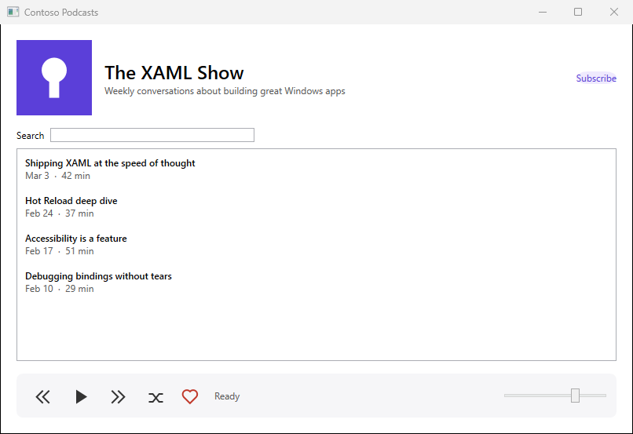

# Session transcript

Source: `Q:\source\XamlAgentDemos-notes\test-runs\A11ySweep\run-final2\events.jsonl`

## Tool usage

- get_file: 6
- xaml_run_accessibility_check: 5
- xaml_interact: 5
- xaml_capture_image: 4
- rg: 3
- multi_replace_string_in_file: 3
- xaml_find_elements: 3
- xaml_get_status: 2
- xaml_apply_hot_reload: 2
- xaml_get_element_properties: 2
- xaml_hit_test: 2
- xaml_get_binding_failures: 2
- task_complete: 2
- skill: 1
- xaml_get_hot_reload_log: 1
- xaml_clear_binding_failures: 1

Failed tool calls: 0, images: 1


_Model: gpt-6-luna_


## User (04:40:03)

Run an accessibility check on my running app, fix every issue in the XAML, and verify it's clean.


**Tool call (04:40:06):** `skill`
```json
{
 "skill": "xaml-diagnostics"
}
```

<details><summary>Result `skill` success=true</summary>

```
Skill "xaml-diagnostics" loaded successfully. Follow the instructions in the skill context.
```
</details>


_Skill invoked: xaml-diagnostics_


**Tool call (04:40:08):** `xaml_get_status`
```json
{
 "progressMessage": "Checking the running app and diagnostics status",
 "app": null
}
```

<details><summary>Result `xaml_get_status` success=true</summary>

```
{"isDebugging":true,"debuggerState":"running","diagnosticsActive":true,"apps":[{"app":"a1","name":"A11ySweep.exe [39112]","processId":39112,"platform":"WPF (.NET)","isRemote":false,"isDesignTimeOrNoDebug":false,"sourceInfoAvailable":true,"hotReloadSupported":true,"hotReloadEnabled":true,"supportsPropertyExplorer":true,"supportsInAppToolbar":true,"supportsHitTest":true,"windows":[{"windowId":"0x6210FE","title":"Contoso Podcasts","bounds":{"x":26,"y":26,"width":820,"height":560},"dpiScale":1.0,"visible":true,"minimized":false}]}],"issues":[],"issuesSummary":"No problems detected.","hotReload":{"options":{"hotReloadEnabled":true,"hotReloadOnSave":false,"applyMode":"asYouType: XAML edits apply as you type, without saving (default)","wpfEnabled":true,"uwpEnabled":true,"winUIEnabled":true,"mauiEnabled":true,"justMyXaml":true,"previewSelectedElement":false,"inAppToolbar":true,"inAppSelection":false,"layoutAdorners":false,"trackFocusedElement":false,"bindingFailuresVisible":true,"compatibilityMode":false},"dotNetHotReloadEnabled":true,"isProcessingChanges":false,"errors":[]},"windowsNote":"Window bounds are physical screen pixels and include the window frame. A WPF/WinUI Window's Width and Height are device-independent units (DIPs) that also include the frame, so Width = bounds.width / dpiScale. A user's \"800 px wide\" is ambiguous: say which unit you tested. A minimized window reports x/y = -32000 and can't be captured."}
```
</details>


**Tool call (04:40:09):** `xaml_run_accessibility_check`
```json
{
 "progressMessage": "Scanning the running app for accessibility issues",
 "maxResults": 100
}
```

<details><summary>Result `xaml_run_accessibility_check` success=true</summary>

```
{"ran":true,"time":"23:40:12","count":8,"truncated":false,"coverage":"Automated Axe.Windows UI Automation rules only. Not checked: text contrast, mouse-only click handlers on non-controls, decorative vs. informative images, list items named by ToString(), and visible labels not associated with inputs. Review those separately.","issues":[{"rule":"NameNotNull","description":"The Name property of a focusable element must not be null.","howToFix":"Provide a UI Automation Name property that concisely identifies the element.","elementType":"Button","automationId":"BackButton","bounds":{"x":66,"y":510,"width":40,"height":40},"processId":39112,"file":"Q:\\source\\XamlAgentDemos\\src\\A11ySweep\\MainWindow.xaml","line":52,"column":22},{"rule":"NameNotNull","description":"The Name property of a focusable element must not be null.","howToFix":"Provide a UI Automation Name property that concisely identifies the element.","elementType":"Button","automationId":"PlayButton","bounds":{"x":114,"y":510,"width":40,"height":40},"processId":39112,"file":"Q:\\source\\XamlAgentDemos\\src\\A11ySweep\\MainWindow.xaml","line":55,"column":22},{"rule":"NameNotNull","description":"The Name property of a focusable element must not be null.","howToFix":"Provide a UI Automation Name property that concisely identifies the element.","elementType":"Button","automationId":"ForwardButton","bounds":{"x":162,"y":510,"width":40,"height":40},"processId":39112,"file":"Q:\\source\\XamlAgentDemos\\src\\A11ySweep\\MainWindow.xaml","line":58,"column":22},{"rule":"NameNotNull","description":"The Name property of a focusable element must not be null.","howToFix":"Provide a UI Automation Name property that concisely identifies the element.","elementType":"Button","automationId":"ShuffleButton","bounds":{"x":210,"y":510,"width":40,"height":40},"processId":39112,"file":"Q:\\source\\XamlAgentDemos\\src\\A11ySweep\\MainWindow.xaml","line":61,"column":22},{"rule":"NameNotNull","description":"The Name property of a focusable element must not be null.","howToFix":"Provide a UI Automation Name property that concisely identifies the element.","elementType":"Button","automationId":"LikeButton","bounds":{"x":254,"y":510,"width":40,"height":40},"processId":39112,"file":"Q:\\source\\XamlAgentDemos\\src\\A11ySweep\\MainWindow.xaml","line":64,"column":22},{"rule":"NameNotNull","description":"The Name property of a focusable element must not be null.","howToFix":"Provide a UI Automation Name property that concisely iden
... [truncated 1035 chars]
```
</details>


**Assistant (04:40:15):**

The scan found eight unnamed controls. I’m checking their XAML plus the additional accessibility areas the automated scan doesn’t cover.


**Tool call (04:40:15):** `get_file`
```json
{
 "filename": "Q:\\source\\XamlAgentDemos\\src\\A11ySweep\\MainWindow.xaml",
 "startLine": 1,
 "endLine": 240,
 "includeLineNumbers": true
}
```


**Tool call (04:40:15):** `rg`
```json
{
 "pattern": "(MouseLeftButtonUp|Tapped|PointerPressed|Cursor=\"Hand\"|<Image|<ListBox|<TextBox|<Slider|Foreground=)",
 "paths": "Q:\\source\\XamlAgentDemos\\src\\A11ySweep",
 "glob": "*.xaml",
 "output_mode": "content",
 "-n": true,
 "head_limit": 100
}
```

<details><summary>Result `rg` success=true</summary>

```
Q:\source\XamlAgentDemos\src\A11ySweep\MainWindow.xaml:16:            <Image x:Name="CoverImage"
Q:\source\XamlAgentDemos\src\A11ySweep\MainWindow.xaml:27:                    Cursor="Hand"
Q:\source\XamlAgentDemos\src\A11ySweep\MainWindow.xaml:29:                    MouseLeftButtonUp="OnSubscribeClicked">
Q:\source\XamlAgentDemos\src\A11ySweep\MainWindow.xaml:31:                           Foreground="#5B3FD9"
Q:\source\XamlAgentDemos\src\A11ySweep\MainWindow.xaml:39:                           Foreground="#C4C4C4"
Q:\source\XamlAgentDemos\src\A11ySweep\MainWindow.xaml:72:                <Slider x:Name="VolumeSlider"
Q:\source\XamlAgentDemos\src\A11ySweep\MainWindow.xaml:80:                           Foreground="#BDBDBD"
Q:\source\XamlAgentDemos\src\A11ySweep\MainWindow.xaml:92:            <TextBox x:Name="SearchBox" Width="260" />
Q:\source\XamlAgentDemos\src\A11ySweep\MainWindow.xaml:95:        <ListBox x:Name="EpisodeList" ItemsSource="{Binding Episodes}">
Q:\source\XamlAgentDemos\src\A11ySweep\MainWindow.xaml:96:            <ListBox.ItemTemplate>
Q:\source\XamlAgentDemos\src\A11ySweep\MainWindow.xaml:100:                        <TextBlock Foreground="#C8C8C8">
```
</details>

<details><summary>Result `get_file` success=true</summary>

```
```xaml src\A11ySweep\MainWindow.xaml (Lines 1-110 of 110 total. Call tools for more if needed.)
1: <Window x:Class="A11ySweep.MainWindow"
2:         xmlns="http://schemas.microsoft.com/winfx/2006/xaml/presentation"
3:         xmlns:x="http://schemas.microsoft.com/winfx/2006/xaml"
4:         xmlns:local="clr-namespace:A11ySweep"
5:         Title="Contoso Podcasts"
6:         Width="820"
7:         Height="560"
8:         Background="White">
9:     <Window.DataContext>
10:         <local:PlayerViewModel />
11:     </Window.DataContext>
12: 
13:     <DockPanel Margin="20">
14:         <!-- Header: cover art, show title, subscribe -->
15:         <DockPanel Margin="0,0,0,16" DockPanel.Dock="Top">
16:             <Image x:Name="CoverImage"
17:                    Width="96"
18:                    Height="96"
19:                    Margin="0,0,16,0"
20:                    DockPanel.Dock="Left"
21:                    Source="{StaticResource CoverArt}" />
22:             <Border x:Name="SubscribeChip"
23:                     Padding="14,6"
24:                     VerticalAlignment="Center"
25:                     Background="#EFEAFE"
26:                     CornerRadius="14"
27:                     Cursor="Hand"
28:                     DockPanel.Dock="Right"
29:                     MouseLeftButtonUp="OnSubscribeClicked">
30:                 <TextBlock x:Name="SubscribeText"
31:                            Foreground="#5B3FD9"
32:                            Text="Subscribe" />
33:             </Border>
34:             <StackPanel VerticalAlignment="Center">
35:                 <TextBlock FontSize="24"
36:                            FontWeight="SemiBold"
37:                            Text="The XAML Show" />
38:                 <TextBlock x:Name="ShowByline"
39:                            Foreground="#C4C4C4"
40:                            Text="Weekly conversations about building great Windows apps" />
41:             </StackPanel>
42:         </DockPanel>
43: 
44:         <!-- Player controls -->
45:         <Border Margin="0,16,0,0"
46:                 Padding="8"
47:                 Background="#F6F6F8"
48:                 CornerRadius="8"
49:                 DockPanel.Dock="Bottom">
50:             <DockPanel>
51:                 <StackPanel DockPanel.Dock="Left" Orientation="Horizontal">
52:                     <Button x:Name="BackButton" Command="{Binding BackCommand}" Style="{StaticResource IconButtonStyle}"
... [truncated 3225 chars]
```
</details>


**Tool call (04:40:23):** `get_file`
```json
{
 "filename": "Q:\\source\\XamlAgentDemos\\src\\A11ySweep\\MainWindow.xaml.cs",
 "startLine": 1,
 "endLine": 200,
 "includeLineNumbers": true
}
```


**Tool call (04:40:23):** `rg`
```json
{
 "pattern": "IconButtonStyle|CoverArt|OnSubscribeClicked|class Episode|Episodes|Published|Duration|Status",
 "paths": "Q:\\source\\XamlAgentDemos\\src\\A11ySweep",
 "glob": "*.{xaml,cs}",
 "output_mode": "content",
 "-n": true,
 "head_limit": 120
}
```

<details><summary>Result `get_file` success=true</summary>

```
```csharp src\A11ySweep\MainWindow.xaml.cs (Lines 1-19 of 19 total. Call tools for more if needed.)
1: using System.Windows;
2: using System.Windows.Input;
3: 
4: namespace A11ySweep;
5: 
6: public partial class MainWindow : Window
7: {
8:     public MainWindow()
9:     {
10:         this.InitializeComponent();
11:     }
12: 
13:     private void OnSubscribeClicked(object sender, MouseButtonEventArgs e)
14:     {
15:         var viewModel = (PlayerViewModel)this.DataContext;
16:         viewModel.IsSubscribed = !viewModel.IsSubscribed;
17:         this.SubscribeText.Text = viewModel.IsSubscribed ? "Subscribed" : "Subscribe";
18:     }
19: }

```


```
</details>

<details><summary>Result `rg` success=true</summary>

```
[grep content: 26 matches across 4 file(s) under Q:/source/XamlAgentDemos/src/A11ySweep; delimited groups]

App.xaml (2 match(es)):
  6:         <Style x:Key="IconButtonStyle" TargetType="Button">
  14:         <DrawingImage x:Key="CoverArt">

MainWindow.xaml (10 match(es)):
  21:                    Source="{StaticResource CoverArt}" />
  29:                     MouseLeftButtonUp="OnSubscribeClicked">
  52:                     <Button x:Name="BackButton" Command="{Binding BackCommand}" Style="{StaticResource IconButtonStyle}">
  55:                     <Button x:Name="PlayButton" Command="{Binding PlayCommand}" Style="{StaticResource IconButtonStyle}">
  58:                     <Button x:Name="ForwardButton" Command="{Binding ForwardCommand}" Style="{StaticResource IconButtonStyle}">
  61:                     <Button x:Name="ShuffleButton" Command="{Binding ShuffleCommand}" Style="{StaticResource IconButtonStyle}">
  81:                            Text="{Binding Status}" />
  95:         <ListBox x:Name="EpisodeList" ItemsSource="{Binding Episodes}">
  101:                             <Run Text="{Binding Published}" />
  103:                             <Run Text="{Binding Duration}" />

PlayerViewModel.cs (13 match(es)):
  5: public sealed class Episode
  9:     public required string Duration { get; init; }
  11:     public required string Published { get; init; }
  22:         this.PlayCommand = new RelayCommand(() => { this.IsPlaying = !this.IsPlaying; this.Status = this.IsPlaying ? "Playing" : "Paused"; });
  23:         this.BackCommand = new RelayCommand(() => this.Status = "Skipped back 15 seconds");
  24:         this.ForwardCommand = new RelayCommand(() => this.Status = "Skipped forward 30 seconds");
  25:         this.ShuffleCommand = new RelayCommand(() => this.Status = "Shuffle on");
  28:     public ObservableCollection<Episode> Episodes { get; } =
  30:         new() { Title = "Shipping XAML at the speed of thought", Duration = "42 min", Published = "Mar 3" },
  31:         new() { Title = "Hot Reload deep dive", Duration = "37 min", Published = "Feb 24" },
  32:         new() { Title = "Accessibility is a feature", Duration = "51 min", Published = "Feb 17" },
  33:         new() { Title = "Debugging bindings without tears", Duration = "29 min", Published = "Feb 10" },
  40:     public string Status { get => this.status; set => this.SetProperty(ref this.status, value); }

MainWindow.xaml.cs:13:     private void OnSubscribeClicked(object send
... [truncated 27 chars]
```
</details>


**Tool call (04:40:29):** `get_file`
```json
{
 "filename": "Q:\\source\\XamlAgentDemos\\src\\A11ySweep\\PlayerViewModel.cs",
 "startLine": 1,
 "endLine": 120,
 "includeLineNumbers": true
}
```


**Tool call (04:40:29):** `get_file`
```json
{
 "filename": "Q:\\source\\XamlAgentDemos\\src\\A11ySweep\\App.xaml",
 "startLine": 1,
 "endLine": 120,
 "includeLineNumbers": true
}
```


**Tool call (04:40:29):** `get_file`
```json
{
 "filename": "Q:\\source\\XamlAgentDemos\\src\\A11ySweep\\MainWindow.xaml",
 "startLine": 1,
 "endLine": 110,
 "includeLineNumbers": true
}
```

<details><summary>Result `get_file` success=true</summary>

```
```xaml src\A11ySweep\App.xaml (Lines 1-24 of 24 total. Call tools for more if needed.)
1: <Application x:Class="A11ySweep.App"
2:              xmlns="http://schemas.microsoft.com/winfx/2006/xaml/presentation"
3:              xmlns:x="http://schemas.microsoft.com/winfx/2006/xaml"
4:              StartupUri="MainWindow.xaml">
5:     <Application.Resources>
6:         <Style x:Key="IconButtonStyle" TargetType="Button">
7:             <Setter Property="Width" Value="40" />
8:             <Setter Property="Height" Value="40" />
9:             <Setter Property="Margin" Value="4,0" />
10:             <Setter Property="Background" Value="Transparent" />
11:             <Setter Property="BorderThickness" Value="0" />
12:         </Style>
13: 
14:         <DrawingImage x:Key="CoverArt">
15:             <DrawingImage.Drawing>
16:                 <DrawingGroup>
17:                     <GeometryDrawing Brush="#5B3FD9" Geometry="M0,0 H120 V120 H0 Z" />
18:                     <GeometryDrawing Brush="#FFFFFF" Geometry="M60,28 A20,20 0 1 1 59.9,28 Z" />
19:                     <GeometryDrawing Brush="#FFFFFF" Geometry="M52,62 H68 V92 H52 Z" />
20:                 </DrawingGroup>
21:             </DrawingImage.Drawing>
22:         </DrawingImage>
23:     </Application.Resources>
24: </Application>

```


```
</details>

<details><summary>Result `get_file` success=true</summary>

```
```xaml src\A11ySweep\MainWindow.xaml (Lines 1-110 of 110 total. Call tools for more if needed.)
1: <Window x:Class="A11ySweep.MainWindow"
2:         xmlns="http://schemas.microsoft.com/winfx/2006/xaml/presentation"
3:         xmlns:x="http://schemas.microsoft.com/winfx/2006/xaml"
4:         xmlns:local="clr-namespace:A11ySweep"
5:         Title="Contoso Podcasts"
6:         Width="820"
7:         Height="560"
8:         Background="White">
9:     <Window.DataContext>
10:         <local:PlayerViewModel />
11:     </Window.DataContext>
12: 
13:     <DockPanel Margin="20">
14:         <!-- Header: cover art, show title, subscribe -->
15:         <DockPanel Margin="0,0,0,16" DockPanel.Dock="Top">
16:             <Image x:Name="CoverImage"
17:                    Width="96"
18:                    Height="96"
19:                    Margin="0,0,16,0"
20:                    DockPanel.Dock="Left"
21:                    Source="{StaticResource CoverArt}" />
22:             <Border x:Name="SubscribeChip"
23:                     Padding="14,6"
24:                     VerticalAlignment="Center"
25:                     Background="#EFEAFE"
26:                     CornerRadius="14"
27:                     Cursor="Hand"
28:                     DockPanel.Dock="Right"
29:                     MouseLeftButtonUp="OnSubscribeClicked">
30:                 <TextBlock x:Name="SubscribeText"
31:                            Foreground="#5B3FD9"
32:                            Text="Subscribe" />
33:             </Border>
34:             <StackPanel VerticalAlignment="Center">
35:                 <TextBlock FontSize="24"
36:                            FontWeight="SemiBold"
37:                            Text="The XAML Show" />
38:                 <TextBlock x:Name="ShowByline"
39:                            Foreground="#C4C4C4"
40:                            Text="Weekly conversations about building great Windows apps" />
41:             </StackPanel>
42:         </DockPanel>
43: 
44:         <!-- Player controls -->
45:         <Border Margin="0,16,0,0"
46:                 Padding="8"
47:                 Background="#F6F6F8"
48:                 CornerRadius="8"
49:                 DockPanel.Dock="Bottom">
50:             <DockPanel>
51:                 <StackPanel DockPanel.Dock="Left" Orientation="Horizontal">
52:                     <Button x:Name="BackButton" Command="{Binding BackCommand}" Style="{StaticResource IconButtonStyle}"
... [truncated 3225 chars]
```
</details>

<details><summary>Result `get_file` success=true</summary>

```
```csharp src\A11ySweep\PlayerViewModel.cs (Lines 1-49 of 49 total. Call tools for more if needed.)
1: using System.Collections.ObjectModel;
2: 
3: namespace A11ySweep;
4: 
5: public sealed class Episode
6: {
7:     public required string Title { get; init; }
8: 
9:     public required string Duration { get; init; }
10: 
11:     public required string Published { get; init; }
12: }
13: 
14: public sealed class PlayerViewModel : ObservableObject
15: {
16:     private bool isPlaying;
17:     private bool isSubscribed;
18:     private string status = "Ready";
19: 
20:     public PlayerViewModel()
21:     {
22:         this.PlayCommand = new RelayCommand(() => { this.IsPlaying = !this.IsPlaying; this.Status = this.IsPlaying ? "Playing" : "Paused"; });
23:         this.BackCommand = new RelayCommand(() => this.Status = "Skipped back 15 seconds");
24:         this.ForwardCommand = new RelayCommand(() => this.Status = "Skipped forward 30 seconds");
25:         this.ShuffleCommand = new RelayCommand(() => this.Status = "Shuffle on");
26:     }
27: 
28:     public ObservableCollection<Episode> Episodes { get; } =
29:     [
30:         new() { Title = "Shipping XAML at the speed of thought", Duration = "42 min", Published = "Mar 3" },
31:         new() { Title = "Hot Reload deep dive", Duration = "37 min", Published = "Feb 24" },
32:         new() { Title = "Accessibility is a feature", Duration = "51 min", Published = "Feb 17" },
33:         new() { Title = "Debugging bindings without tears", Duration = "29 min", Published = "Feb 10" },
34:     ];
35: 
36:     public bool IsPlaying { get => this.isPlaying; set => this.SetProperty(ref this.isPlaying, value); }
37: 
38:     public bool IsSubscribed { get => this.isSubscribed; set => this.SetProperty(ref this.isSubscribed, value); }
39: 
40:     public string Status { get => this.status; set => this.SetProperty(ref this.status, value); }
41: 
42:     public RelayCommand PlayCommand { get; }
43: 
44:     public RelayCommand BackCommand { get; }
45: 
46:     public RelayCommand ForwardCommand { get; }
47: 
48:     public RelayCommand ShuffleCommand { get; }
49: }

```


```
</details>


**Tool call (04:40:59):** `multi_replace_string_in_file`
```json
{
 "explanation": "Add accessible names and label associations, replace mouse-only subscribe chip with a keyboard-accessible button, and raise low-contrast metadata colors.",
 "replacements": [
  {
   "filePath": "src\\A11ySweep\\MainWindow.xaml",
   "oldString": "            <Image x:Name=\"CoverImage\"\n                   Width=\"96\"\n                   Height=\"96\"\n                   Margin=\"0,0,16,0\"\n                   DockPanel.Dock=\"Left\"\n                   Source=\"{StaticResource CoverArt}\" />\n            <Border x:Name=\"SubscribeChip\"\n                    Padding=\"14,6\"\n                    VerticalAlignment=\"Center\"\n                    Background=\"#EFEAFE\"\n                    CornerRadius=\"14\"\n                    Cursor=\"Hand\"\n                    DockPanel.Dock=\"Right\"\n                    MouseLeftButtonUp=\"OnSubscribeClicked\">\n                <TextBlock x:Name=\"SubscribeText\"\n                           Foreground=\"#5B3FD9\"\n                           Text=\"Subscribe\" />\n            </Border>\n            <StackPanel VerticalAlignment=\"Center\">",
   "newString": "            <Image x:Name=\"CoverImage\"\n                   Width=\"96\"\n                   Height=\"96\"\n                   Margin=\"0,0,16,0\"\n                   DockPanel.Dock=\"Left\"\n                   AutomationProperties.Name=\"The XAML Show cover art\"\n                   Source=\"{StaticResource CoverArt}\" />\n            <Button x:Name=\"SubscribeCh
... [truncated 8663 chars]
```

<details><summary>Result `multi_replace_string_in_file` success=true</summary>

```
Successfully applied 7 of 7 replacement(s) across 2 file(s).
```
</details>


**Tool call (04:41:11):** `xaml_apply_hot_reload`
```json
{
 "progressMessage": "Applying accessible XAML and subscribe-button changes",
 "includeCodeChanges": true
}
```

<details><summary>Result `xaml_apply_hot_reload` success=true</summary>

```
{"summary":"Applied with no new errors.","applied":true,"status":"applied","errors":[],"log":[],"lastHotReloadUpdate":{"secondsAgo":3,"updatesSinceToolsStarted":2},"codeChanges":".NET Hot Reload was started for saved code changes. Its results are in the Hot Reload output pane, not in 'log'; if an edit can't be hot reloaded, Visual Studio asks the user to rebuild and restart.","codeHotReloadOutput":["23:41:12.61  ❌ Q:\\source\\XamlAgentDemos\\src\\A11ySweep\\MainWindow.xaml.cs (line 27): error CS1061: 'Border' does not contain a definition for 'Content' and no accessible extension method 'Content' accepting a first argument of type 'Border' could be found (are you missing a using directive or an assembly reference?)","23:41:12.61  Invalid changes were found. Please refer to the Error List window to fix those issues."],"visualStudioPromptOpen":true,"hint":"Visual Studio is showing a modal prompt, most likely 'Hot Reload - Changes not supported' because a code edit can't be applied while running (for example deleting or renaming a type, member or field, or changing a signature). Tell the user and let them choose; don't keep calling tools that need Visual Studio until they do. To avoid this, prefer additive code edits during a live session and leave unused members in place."}
```
</details>


**Assistant (04:41:23):**

I fixed the reported XAML issues and addressed the scanner’s uncovered checks, including keyboard access for Subscribe, accessible names and labels, episode item names, and low-contrast metadata.

I can’t verify the running app yet: Visual Studio opened a Hot Reload prompt because changing Subscribe from a `Border` to a `Button` also changes its generated type, which Hot Reload can’t apply. Please resolve the prompt by rebuilding and restarting the app; then I can rerun the accessibility check and confirm it’s clean.


## User (04:41:23)


**Assistant (04:41:32):**

The source changes are in place, but Visual Studio’s Hot Reload prompt still needs a selection before I can safely continue or verify the running app. Please accept the rebuild/restart option; then I can rerun the scan.


## User (04:41:32)


**Assistant (04:41:37):**

I can’t continue safely while the Hot Reload modal is open; it requires a choice in Visual Studio before diagnostics can run again. Select rebuild/restart there, and I can finish the verification.


## User (04:41:37)


**Assistant (04:41:41):**

Verification is still blocked by the open Visual Studio Hot Reload prompt. I won’t mark the task complete until the app can be restarted and the accessibility scan rerun.


## User (04:41:41)


**Assistant (04:41:51):**

I’m unable to finish verification until the Hot Reload prompt is resolved. No clean scan has been confirmed yet.


## User (04:41:51)


**Tool call (04:41:55):** `xaml_get_status`
```json
{
 "progressMessage": "Rechecking app status before accessibility verification",
 "app": null
}
```

<details><summary>Result `xaml_get_status` success=true</summary>

```
{"isDebugging":true,"debuggerState":"running","diagnosticsActive":true,"apps":[{"app":"a1","name":"A11ySweep.exe [39112]","processId":39112,"platform":"WPF (.NET)","isRemote":false,"isDesignTimeOrNoDebug":false,"sourceInfoAvailable":true,"hotReloadSupported":true,"hotReloadEnabled":true,"supportsPropertyExplorer":true,"supportsInAppToolbar":true,"supportsHitTest":true,"windows":[{"windowId":"0x6210FE","title":"Contoso Podcasts","bounds":{"x":26,"y":26,"width":820,"height":560},"dpiScale":1.0,"visible":true,"minimized":false}]}],"issues":[],"issuesSummary":"No problems detected.","hotReload":{"options":{"hotReloadEnabled":true,"hotReloadOnSave":false,"applyMode":"asYouType: XAML edits apply as you type, without saving (default)","wpfEnabled":true,"uwpEnabled":true,"winUIEnabled":true,"mauiEnabled":true,"justMyXaml":true,"previewSelectedElement":false,"inAppToolbar":true,"inAppSelection":false,"layoutAdorners":false,"trackFocusedElement":false,"bindingFailuresVisible":true,"compatibilityMode":false},"dotNetHotReloadEnabled":true,"isProcessingChanges":false,"lastHotReloadUpdate":{"secondsAgo":45,"updatesSinceToolsStarted":2},"errors":[]},"windowsNote":"Window bounds are physical screen pixels and include the window frame. A WPF/WinUI Window's Width and Height are device-independent units (DIPs) that also include the frame, so Width = bounds.width / dpiScale. A user's \"800 px wide\" is ambiguous: say which unit you tested. A minimized window reports x/y = -32000 and can't be captured."}
```
</details>


**Tool call (04:41:57):** `xaml_run_accessibility_check`
```json
{
 "progressMessage": "Rerunning the accessibility scan after Hot Reload",
 "maxResults": 100
}
```

<details><summary>Result `xaml_run_accessibility_check` success=true</summary>

```
{"ran":true,"time":"23:41:58","count":0,"truncated":false,"coverage":"Automated Axe.Windows UI Automation rules only. Not checked: text contrast, mouse-only click handlers on non-controls, decorative vs. informative images, list items named by ToString(), and visible labels not associated with inputs. Review those separately.","issues":[]}
```
</details>


**Assistant (04:42:06):**

The automated scan is now clean. I’m verifying the live controls and reviewing the XAML-only items the scan doesn’t cover before wrapping up.


**Tool call (04:42:06):** `xaml_find_elements`
```json
{
 "progressMessage": "Inspecting named controls in the live app",
 "app": "a1",
 "name": "BackButton|PlayButton|ForwardButton|ShuffleButton|LikeButton|VolumeSlider|SearchBox|EpisodeList|SubscribeChip|CoverImage",
 "namedOnly": true,
 "maxResults": 50
}
```


**Tool call (04:42:06):** `xaml_capture_image`
```json
{
 "progressMessage": "Capturing the updated app for visual verification",
 "app": "a1",
 "windowId": "0x6210FE",
 "maxSize": 1280
}
```


**Tool call (04:42:06):** `get_file`
```json
{
 "filename": "Q:\\source\\XamlAgentDemos\\src\\A11ySweep\\MainWindow.xaml",
 "startLine": 1,
 "endLine": 160,
 "includeLineNumbers": true
}
```

<details><summary>Result `xaml_find_elements` success=true</summary>

```
{"count":10,"totalMatches":10,"truncated":false,"results":[{"id":"a1:20","type":"System.Windows.Controls.Image","name":"CoverImage","source":{"file":"Q:\\source\\XamlAgentDemos\\src\\A11ySweep\\MainWindow.xaml","line":16,"column":14},"path":"MainWindow/Border/AdornerDecorator/ContentPresenter/DockPanel/DockPanel/Image"},{"id":"a1:114","type":"System.Windows.Controls.Button","name":"SubscribeChip","path":"MainWindow/Border/AdornerDecorator/ContentPresenter/DockPanel/DockPanel/Button"},{"id":"a1:35","type":"System.Windows.Controls.Button","name":"BackButton","source":{"file":"Q:\\source\\XamlAgentDemos\\src\\A11ySweep\\MainWindow.xaml","line":52,"column":22},"path":"MainWindow/Border/AdornerDecorator/ContentPresenter/DockPanel/Border/DockPanel/StackPanel/Button"},{"id":"a1:36","type":"System.Windows.Controls.Button","name":"PlayButton","source":{"file":"Q:\\source\\XamlAgentDemos\\src\\A11ySweep\\MainWindow.xaml","line":55,"column":22},"path":"MainWindow/Border/AdornerDecorator/ContentPresenter/DockPanel/Border/DockPanel/StackPanel/Button"},{"id":"a1:37","type":"System.Windows.Controls.Button","name":"ForwardButton","source":{"file":"Q:\\source\\XamlAgentDemos\\src\\A11ySweep\\MainWindow.xaml","line":58,"column":22},"path":"MainWindow/Border/AdornerDecorator/ContentPresenter/DockPanel/Border/DockPanel/StackPanel/Button"},{"id":"a1:38","type":"System.Windows.Controls.Button","name":"ShuffleButton","source":{"file":"Q:\\source\\XamlAgentDemos\\src\\A11ySweep\\MainWindow.xaml","line":61,"column":22},"path":"MainWindow/Border/AdornerDecorator/ContentPresenter/DockPanel/Border/DockPanel/StackPanel/Button"},{"id":"a1:39","type":"System.Windows.Controls.Primitives.ToggleButton","name":"LikeButton","source":{"file":"Q:\\source\\XamlAgentDemos\\src\\A11ySweep\\MainWindow.xaml","line":64,"column":22},"path":"MainWindow/Border/AdornerDecorator/ContentPresenter/DockPanel/Border/DockPanel/StackPanel/ToggleButton"},{"id":"a1:31","type":"System.Windows.Controls.Slider","name":"VolumeSlider","source":{"file":"Q:\\source\\XamlAgentDemos\\src\\A11ySweep\\MainWindow.xaml","line":72,"column":18},"path":"MainWindow/Border/AdornerDecorator/ContentPresenter/DockPanel/Border/DockPanel/Slider"},{"id":"a1:25","type":"System.Windows.Controls.TextBox","name":"SearchBox","source":{"file":"Q:\\source\\XamlAgentDemos\\src\\A11ySweep\\MainWindow.xaml","line":92,"column":14},"path":"MainWindow/Border/AdornerDecorator/ContentPresenter/DockPanel/StackPanel/TextBox"},{"id":"a1:19","type":"Syst
... [truncated 233 chars]
```
</details>

<details><summary>Result `get_file` success=true</summary>

```
```xaml src\A11ySweep\MainWindow.xaml (Lines 1-135 of 135 total. Call tools for more if needed.)
1: <Window x:Class="A11ySweep.MainWindow"
2:         xmlns="http://schemas.microsoft.com/winfx/2006/xaml/presentation"
3:         xmlns:x="http://schemas.microsoft.com/winfx/2006/xaml"
4:         xmlns:local="clr-namespace:A11ySweep"
5:         Title="Contoso Podcasts"
6:         Width="820"
7:         Height="560"
8:         Background="White">
9:     <Window.DataContext>
10:         <local:PlayerViewModel />
11:     </Window.DataContext>
12: 
13:     <DockPanel Margin="20">
14:         <!-- Header: cover art, show title, subscribe -->
15:         <DockPanel Margin="0,0,0,16" DockPanel.Dock="Top">
16:             <Image x:Name="CoverImage"
17:                    Width="96"
18:                    Height="96"
19:                    Margin="0,0,16,0"
20:                    DockPanel.Dock="Left"
21:                    AutomationProperties.Name="The XAML Show cover art"
22:                    Source="{StaticResource CoverArt}" />
23:             <Button x:Name="SubscribeChip"
24:                     AutomationProperties.Name="{Binding RelativeSource={RelativeSource Self}, Path=Content}"
25:                     Click="OnSubscribeButtonClicked"
26:                     Padding="14,6"
27:                     VerticalAlignment="Center"
28:                     Background="#EFEAFE"
29:                     Foreground="#5B3FD9"
30:                     BorderThickness="0"
31:                     DockPanel.Dock="Right">
32:                 <Button.Template>
33:                     <ControlTemplate TargetType="Button">
34:                         <Border x:Name="ChipBorder" Background="{TemplateBinding Background}" CornerRadius="14">
35:                             <ContentPresenter HorizontalAlignment="Center" VerticalAlignment="Center" />
36:                         </Border>
37:                         <ControlTemplate.Triggers>
38:                             <Trigger Property="IsKeyboardFocused" Value="True">
39:                                 <Setter TargetName="ChipBorder" Property="BorderBrush" Value="#333333" />
40:                                 <Setter TargetName="ChipBorder" Property="BorderThickness" Value="2" />
41:                             </Trigger>
42:                         </ControlTemplate.Triggers>
43:                     </ControlTemplate>
44:                 </Button.Template>
45:                 Subscri
... [truncated 5062 chars]
```
</details>




<details><summary>Result `xaml_capture_image` success=true</summary>

```
Screenshot of window 0x6210FE "Contoso Podcasts" of app a1 (806x553 image of the window's client area, so it's slightly smaller than the frame bounds from xaml_get_status).
```
</details>


**Tool call (04:42:14):** `xaml_get_element_properties`
```json
{
 "progressMessage": "Checking accessible names and label associations",
 "elementIds": [
  "a1:20",
  "a1:114",
  "a1:35",
  "a1:36",
  "a1:37",
  "a1:38",
  "a1:39",
  "a1:31",
  "a1:25",
  "a1:19"
 ],
 "nameFilter": "AutomationProperties.Name|AutomationProperties.LabeledBy|Content|IsChecked"
}
```


**Tool call (04:42:14):** `xaml_find_elements`
```json
{
 "progressMessage": "Checking episode list automation containers",
 "app": "a1",
 "type": "ListBoxItem",
 "maxResults": 20
}
```


**Tool call (04:42:14):** `xaml_interact`
```json
{
 "progressMessage": "Testing the Subscribe button accessibility action",
 "elementId": "a1:114",
 "action": "invoke",
 "checkProperties": "Content|AutomationProperties.Name"
}
```

<details><summary>Result `xaml_find_elements` success=true</summary>

```
{"count":4,"totalMatches":4,"truncated":false,"results":[{"id":"a1:125","type":"System.Windows.Controls.ListBoxItem","path":"MainWindow/Border/AdornerDecorator/ContentPresenter/DockPanel/ListBox/Border/ScrollViewer/Grid/ScrollContentPresenter/ItemsPresenter/VirtualizingStackPanel/ListBoxItem"},{"id":"a1:126","type":"System.Windows.Controls.ListBoxItem","path":"MainWindow/Border/AdornerDecorator/ContentPresenter/DockPanel/ListBox/Border/ScrollViewer/Grid/ScrollContentPresenter/ItemsPresenter/VirtualizingStackPanel/ListBoxItem"},{"id":"a1:127","type":"System.Windows.Controls.ListBoxItem","path":"MainWindow/Border/AdornerDecorator/ContentPresenter/DockPanel/ListBox/Border/ScrollViewer/Grid/ScrollContentPresenter/ItemsPresenter/VirtualizingStackPanel/ListBoxItem"},{"id":"a1:128","type":"System.Windows.Controls.ListBoxItem","path":"MainWindow/Border/AdornerDecorator/ContentPresenter/DockPanel/ListBox/Border/ScrollViewer/Grid/ScrollContentPresenter/ItemsPresenter/VirtualizingStackPanel/ListBoxItem"}],"hint":"'type' matched the exact class name; subclasses with other names (for example a custom control deriving from it) aren't included. Use type=\"*ListBoxItem\" to also match class names ending with it."}
```
</details>

<details><summary>Result `xaml_get_element_properties` success=true</summary>

```
{"count":10,"failed":0,"results":[{"id":"a1:20","type":"System.Windows.Controls.Image","name":"CoverImage","source":{"file":"Q:\\source\\XamlAgentDemos\\src\\A11ySweep\\MainWindow.xaml","line":16,"column":14},"properties":[{"name":"AutomationProperties.Name","value":"The XAML Show cover art","valueType":"System.String","propertyType":"System.String","declaringType":"System.Windows.Automation.AutomationProperties","valueSource":"Local","valueSourceLocation":{"file":"Q:\\source\\XamlAgentDemos\\src\\A11ySweep\\MainWindow.xaml","line":16,"column":14},"isAttached":true}],"hiddenDefaultOrOverridden":1,"hint":"Default and overridden values were omitted. Pass includeAll=true to see them, or call xaml_explain_property_value for one property's full precedence chain."},{"id":"a1:114","type":"System.Windows.Controls.Button","name":"SubscribeChip","properties":[{"name":"Content","value":"Subscribe","valueType":"System.String","propertyType":"System.Object","declaringType":"System.Windows.Controls.ContentControl","valueSource":"Local"},{"name":"AutomationProperties.Name","value":"System.Windows.Data.BindingExpression","evaluatedValue":"Subscribe (System.String)","valueType":"System.Windows.Data.BindingExpression","propertyType":"System.String","declaringType":"System.Windows.Automation.AutomationProperties","valueSource":"Local","isBinding":true,"isAttached":true},{"name":"VerticalContentAlignment","value":"1","valueType":"System.Windows.VerticalAlignment","propertyType":"System.Windows.VerticalAlignment","declaringType":"System.Windows.Controls.Control","valueSource":"BuiltInStyle"},{"name":"HorizontalContentAlignment","value":"1","valueType":"System.Windows.HorizontalAlignment","propertyType":"System.Windows.HorizontalAlignment","declaringType":"System.Windows.Controls.Control","valueSource":"BuiltInStyle"},{"name":"ContentTemplate","propertyType":"System.Windows.DataTemplate","declaringType":"System.Windows.Controls.ContentControl","valueSource":"Default"},{"name":"ContentTemplateSelector","propertyType":"System.Windows.Controls.DataTemplateSelector","declaringType":"System.Windows.Controls.ContentControl","valueSource":"Default"},{"name":"ContentStringFormat","propertyType":"System.String","declaringType":"System.Windows.Controls.ContentControl","valueSource":"Default"}],"hiddenDefaultOrOverridden":4,"hint":"Default and overridden values were omitted. Pass includeAll=true to see them, or call xaml_explain_property_value for one property's full precedence chain."},{
... [truncated 14296 chars]
```
</details>

<details><summary>Result `xaml_interact` success=true</summary>

```
{"id":"a1:114","action":"invoke","result":"Invoked.","supportedPatterns":["Invoke","SynchronizedInput"],"checks":[{"id":"a1:114","changed":false,"before":[{"name":"Content","value":"Subscribe","evaluatedValue":null,"valueType":"System.String","propertyType":"System.Object","declaringType":"System.Windows.Controls.ContentControl","valueSource":"Local","valueSourceName":null,"valueSourceLocation":null,"valueLocation":null,"isBinding":null,"isCollection":null,"isAttached":null,"readOnly":null,"overridden":null},{"name":"AutomationProperties.Name","value":"System.Windows.Data.BindingExpression","evaluatedValue":"Subscribe (System.String)","valueType":"System.Windows.Data.BindingExpression","propertyType":"System.String","declaringType":"System.Windows.Automation.AutomationProperties","valueSource":"Local","valueSourceName":null,"valueSourceLocation":null,"valueLocation":null,"isBinding":true,"isCollection":null,"isAttached":true,"readOnly":null,"overridden":null},{"name":"VerticalContentAlignment","value":"1","evaluatedValue":null,"valueType":"System.Windows.VerticalAlignment","propertyType":"System.Windows.VerticalAlignment","declaringType":"System.Windows.Controls.Control","valueSource":"BuiltInStyle","valueSourceName":null,"valueSourceLocation":null,"valueLocation":null,"isBinding":null,"isCollection":null,"isAttached":null,"readOnly":null,"overridden":null},{"name":"HorizontalContentAlignment","value":"1","evaluatedValue":null,"valueType":"System.Windows.HorizontalAlignment","propertyType":"System.Windows.HorizontalAlignment","declaringType":"System.Windows.Controls.Control","valueSource":"BuiltInStyle","valueSourceName":null,"valueSourceLocation":null,"valueLocation":null,"isBinding":null,"isCollection":null,"isAttached":null,"readOnly":null,"overridden":null},{"name":"ContentTemplate","value":null,"evaluatedValue":null,"valueType":null,"propertyType":"System.Windows.DataTemplate","declaringType":"System.Windows.Controls.ContentControl","valueSource":"Default","valueSourceName":null,"valueSourceLocation":null,"valueLocation":null,"isBinding":null,"isCollection":null,"isAttached":null,"readOnly":null,"overridden":null},{"name":"ContentTemplateSelector","value":null,"evaluatedValue":null,"valueType":null,"propertyType":"System.Windows.Controls.DataTemplateSelector","declaringType":"System.Windows.Controls.ContentControl","valueSource":"Default","valueSourceName":null,"valueSourceLocation":null,"valueLocation":null,"isBinding":null,"isCollection":null,"isAtt
... [truncated 3745 chars]
```
</details>


**Tool call (04:42:28):** `xaml_get_hot_reload_log`
```json
{
 "progressMessage": "Checking why the Subscribe action did not update",
 "maxEntries": 40,
 "errorsOnly": false,
 "textFilter": null
}
```


**Tool call (04:42:28):** `xaml_get_element_properties`
```json
{
 "progressMessage": "Verifying episode names from item bindings",
 "elementIds": [
  "a1:125",
  "a1:126",
  "a1:127",
  "a1:128"
 ],
 "nameFilter": "AutomationProperties.Name"
}
```


**Tool call (04:42:28):** `xaml_hit_test`
```json
{
 "progressMessage": "Checking real input reaches Subscribe",
 "elementIds": [
  "a1:114"
 ],
 "points": null
}
```

<details><summary>Result `xaml_get_hot_reload_log` success=true</summary>

```
{"total":1,"entries":[{"time":"23:39:41.154","level":"Info","project":"XAML","message":"Connected to A11ySweep.exe [39112] for WpfCore diagnostics. Incremental Hot Reload is enabled."}],"dotNetHotReloadPane":["23:39:41.15 [XAML] Connected to A11ySweep.exe [39112] for WpfCore diagnostics. Incremental Hot Reload is enabled.","23:41:12.39 🔣  ❌ [Q:\\source\\XamlAgentDemos\\src\\A11ySweep\\A11ySweep.csproj ({92AAE293-0AFD-438A-8681-F5EC68E63D4A})]: Q:\\source\\XamlAgentDemos\\src\\A11ySweep\\MainWindow.xaml.cs(27,28): error CS1061: 'Border' does not contain a definition for 'Content' and no accessible extension method 'Content' accepting a first argument of type 'Border' could be found (are you missing a using directive or an assembly reference?)","23:41:12.61  ❌ Q:\\source\\XamlAgentDemos\\src\\A11ySweep\\MainWindow.xaml.cs (line 27): error CS1061: 'Border' does not contain a definition for 'Content' and no accessible extension method 'Content' accepting a first argument of type 'Border' could be found (are you missing a using directive or an assembly reference?)","23:41:12.61  Invalid changes were found. Please refer to the Error List window to fix those issues.","23:41:23.78  Hot Reload has been disabled for the rest of the session."],"dotNetHotReloadPaneNote":"Raw lines from the Hot Reload output pane: they cover every project and earlier debug sessions in this VS instance, and only textFilter applies to them. Use the project names in the lines to pick the ones for your app."}
```
</details>

<details><summary>Result `xaml_hit_test` success=true</summary>

```
{"id":"a1:114","summary":"A click at its center reaches 'SubscribeChip' (input lands on TextBlock (in the template of Button 'SubscribeChip')).","elementReceivesInput":true,"inputTarget":{"id":"a1:137","type":"System.Windows.Controls.TextBlock","templatedParent":{"id":"a1:114","type":"System.Windows.Controls.Button","name":"SubscribeChip"}},"stack":[{"id":"a1:137","type":"System.Windows.Controls.TextBlock","templatedParent":{"id":"a1:114","type":"System.Windows.Controls.Button","name":"SubscribeChip"}},{"id":"a1:121","type":"System.Windows.Controls.Border","name":"ChipBorder","templatedParent":{"id":"a1:114","type":"System.Windows.Controls.Button","name":"SubscribeChip"}},{"id":"a1:11","type":"System.Windows.Controls.Border","templatedParent":{"id":"a1:10","type":"A11ySweep.MainWindow","source":{"file":"Q:\\source\\XamlAgentDemos\\src\\A11ySweep\\MainWindow.xaml","line":4,"column":9}}}],"isVisible":true,"isHitTestVisible":true,"isEnabled":true,"effectiveOpacity":1.0,"visibleFraction":1.0,"point":{"window":{"x":758.37,"y":68.0},"screen":{"x":792.0,"y":125.0}},"note":"inputTarget is what a mouse click or tap at the point reaches (WPF: InputHitTest; WinUI/UWP: FindElementsInHostCoordinates, open popups first; .NET MAUI: approximated from element bounds and draw order). stack lists visible, hit-testable elements under the point, topmost first; elements with no id are template parts or aren't in the live tree (on WPF use their templatedParent). blockers are the element and ancestors whose own values hide it or block input (descendants inherit IsEnabled/IsHitTestVisible=False; on .NET MAUI IsHitTestVisible maps to InputTransparent). visibleFraction includes clipping by ancestors (layout slots, scroll viewports, ClipToBounds/Clip/IsClippedToBounds) and the window."}
```
</details>

<details><summary>Result `xaml_get_element_properties` success=true</summary>

```
{"count":4,"failed":0,"results":[{"id":"a1:125","type":"System.Windows.Controls.ListBoxItem","properties":[{"name":"AutomationProperties.Name","value":"System.Windows.Data.BindingExpression","evaluatedValue":"Shipping XAML at the speed of thought (System.String)","valueType":"System.Windows.Data.BindingExpression","propertyType":"System.String","declaringType":"System.Windows.Automation.AutomationProperties","valueSource":"Style","isBinding":true,"isAttached":true}]},{"id":"a1:126","type":"System.Windows.Controls.ListBoxItem","properties":[{"name":"AutomationProperties.Name","value":"System.Windows.Data.BindingExpression","evaluatedValue":"Hot Reload deep dive (System.String)","valueType":"System.Windows.Data.BindingExpression","propertyType":"System.String","declaringType":"System.Windows.Automation.AutomationProperties","valueSource":"Style","isBinding":true,"isAttached":true}]},{"id":"a1:127","type":"System.Windows.Controls.ListBoxItem","properties":[{"name":"AutomationProperties.Name","value":"System.Windows.Data.BindingExpression","evaluatedValue":"Accessibility is a feature (System.String)","valueType":"System.Windows.Data.BindingExpression","propertyType":"System.String","declaringType":"System.Windows.Automation.AutomationProperties","valueSource":"Style","isBinding":true,"isAttached":true}]},{"id":"a1:128","type":"System.Windows.Controls.ListBoxItem","properties":[{"name":"AutomationProperties.Name","value":"System.Windows.Data.BindingExpression","evaluatedValue":"Debugging bindings without tears (System.String)","valueType":"System.Windows.Data.BindingExpression","propertyType":"System.String","declaringType":"System.Windows.Automation.AutomationProperties","valueSource":"Style","isBinding":true,"isAttached":true}]}]}
```
</details>


**Assistant (04:42:43):**

I found one remaining behavior issue: the Subscribe button’s new handler wasn’t applied by .NET Hot Reload. I’m switching it to a XAML-bound toggle so its accessible action and label update without code-behind reload.


**Tool call (04:42:43):** `multi_replace_string_in_file`
```json
{
 "explanation": "Make Subscribe a bound ToggleButton with a XAML trigger so the label and subscription state update without relying on the failed .NET Hot Reload handler.",
 "replacements": [
  {
   "filePath": "src\\A11ySweep\\MainWindow.xaml",
   "oldString": "            <Button x:Name=\"SubscribeChip\"\n                    AutomationProperties.Name=\"{Binding RelativeSource={RelativeSource Self}, Path=Content}\"\n                    Click=\"OnSubscribeButtonClicked\"\n                    Padding=\"14,6\"\n                    VerticalAlignment=\"Center\"\n                    Background=\"#EFEAFE\"\n                    Foreground=\"#5B3FD9\"\n                    BorderThickness=\"0\"\n                    DockPanel.Dock=\"Right\">\n                <Button.Template>\n                    <ControlTemplate TargetType=\"Button\">\n                        <Border x:Name=\"ChipBorder\" Background=\"{TemplateBinding Background}\" CornerRadius=\"14\">\n                            <ContentPresenter HorizontalAlignment=\"Center\" VerticalAlignment=\"Center\" />\n                        </Border>\n                        <ControlTemplate.Triggers>\n                            <Trigger Property=\"IsKeyboardFocused\" Value=\"True\">\n                                <Setter TargetName=\"ChipBorder\" Property=\"BorderBrush\" Value=\"#333333\" />\n                                <Setter TargetName=\"ChipBorder\" Property=\"BorderThickness\" Value=\"2\" />\n                            </Tri
... [truncated 2228 chars]
```

<details><summary>Result `multi_replace_string_in_file` success=true</summary>

```
Successfully applied 1 of 1 replacement(s) across 1 file(s).
```
</details>


**Tool call (04:42:45):** `xaml_apply_hot_reload`
```json
{
 "progressMessage": "Applying the XAML-only Subscribe toggle update",
 "includeCodeChanges": false
}
```

<details><summary>Result `xaml_apply_hot_reload` success=true</summary>

```
{"summary":"Already applied: XAML Hot Reload last pushed changes into the app 1 s ago, so your saved edits most likely reached the app before this call and there was nothing left to apply.","status":"alreadyApplied","errors":[],"log":[],"noNewActivity":true,"lastHotReloadUpdate":{"secondsAgo":1,"updatesSinceToolsStarted":3},"lastActivity":{"secondsAgo":184,"message":"Connected to A11ySweep.exe [39112] for WpfCore diagnostics. Incremental Hot Reload is enabled."},"note":"This call applied nothing new. status=alreadyApplied means XAML Hot Reload pushed changes into the app within the last minute, most likely your edits as you made them. lastHotReloadUpdate is when XAML Hot Reload last pushed changes into the app (it applies saved and in-editor edits as they happen, often without a log entry). If it's after your edit, the edit was already applied; if it's null or older than your edit, nothing reached the app (check the file is saved and part of the running project). It doesn't prove the app shows them: XAML that the app loads itself (XamlReader, files copied to the output folder, dictionaries swapped in code) is never hot reloaded, and code that sets the same property or picks another template/resource at runtime overrides the edit. Values that code already set (for example in a constructor or Loaded handler) stay in place, and startup code isn't re-run by hot reload, so a fix in that code needs the view reopened or a restart to take effect. Check the live value with xaml_explain_property_value (a Local value that isn't in your XAML was set by code) or xaml_find_resource.","hint":"Call xaml_capture_image to verify the change visually. Views that aren't loaded (other tabs, closed dialogs) are updated when they're next shown. Source line numbers reported for existing elements can still point to the pre-edit lines until the element is recreated, so find elements by x:Name or type rather than by an old line number. Structural edits (wrapping or replacing a parent, changing a root's content) recreate elements, which resets their runtime state such as selection, checked state, typed text and scroll position, and invalidates their IDs. Re-establish the state you were testing before capturing again."}
```
</details>


**Tool call (04:42:49):** `xaml_find_elements`
```json
{
 "progressMessage": "Finding the updated Subscribe toggle in the live tree",
 "app": "a1",
 "name": "SubscribeChip",
 "maxResults": 10
}
```


**Tool call (04:42:49):** `xaml_run_accessibility_check`
```json
{
 "progressMessage": "Rerunning automated accessibility checks",
 "maxResults": 100
}
```


**Tool call (04:42:49):** `xaml_capture_image`
```json
{
 "progressMessage": "Checking the updated Subscribe appearance",
 "app": "a1",
 "windowId": "0x6210FE",
 "maxSize": 1280
}
```

<details><summary>Result `xaml_find_elements` success=true</summary>

```
{"count":1,"totalMatches":1,"truncated":false,"results":[{"id":"a1:265","type":"System.Windows.Controls.Primitives.ToggleButton","name":"SubscribeChip","path":"MainWindow/Border/AdornerDecorator/ContentPresenter/DockPanel/DockPanel/ToggleButton"}]}
```
</details>

<details><summary>Result `xaml_capture_image` success=true</summary>

```
Screenshot of window 0x6210FE "Contoso Podcasts" of app a1 (806x553 image of the window's client area, so it's slightly smaller than the frame bounds from xaml_get_status). Note: this image is pixel-identical to the previous capture of this window, so nothing visible changed since then (the chat may show it as a reference to the earlier image).
```
</details>

<details><summary>Result `xaml_run_accessibility_check` success=true</summary>

```
{"ran":true,"time":"23:42:50","count":0,"truncated":false,"coverage":"Automated Axe.Windows UI Automation rules only. Not checked: text contrast, mouse-only click handlers on non-controls, decorative vs. informative images, list items named by ToString(), and visible labels not associated with inputs. Review those separately.","issues":[]}
```
</details>


**Tool call (04:42:53):** `xaml_interact`
```json
{
 "progressMessage": "Testing Subscribe toggle state and accessible name",
 "elementId": "a1:265",
 "action": "toggle",
 "checkProperties": "IsChecked|Content|AutomationProperties.Name"
}
```

<details><summary>Result `xaml_interact` success=true</summary>

```
{"id":"a1:265","action":"toggle","result":"Toggle state is now On.","supportedPatterns":["Toggle","SynchronizedInput"],"checks":[{"id":"a1:265","changed":true,"before":[{"name":"IsChecked","value":null,"evaluatedValue":"False (System.Boolean)","valueType":"System.Windows.Data.BindingExpression","propertyType":"System.Nullable`1[[System.Boolean]]","declaringType":"System.Windows.Controls.Primitives.ToggleButton","valueSource":"Local","valueSourceName":null,"valueSourceLocation":null,"valueLocation":null,"isBinding":true,"isCollection":null,"isAttached":null,"readOnly":null,"overridden":null},{"name":"AutomationProperties.Name","value":"System.Windows.Data.BindingExpression","evaluatedValue":"Subscribe (System.String)","valueType":"System.Windows.Data.BindingExpression","propertyType":"System.String","declaringType":"System.Windows.Automation.AutomationProperties","valueSource":"Local","valueSourceName":null,"valueSourceLocation":null,"valueLocation":null,"isBinding":true,"isCollection":null,"isAttached":true,"readOnly":null,"overridden":null},{"name":"Content","value":"Subscribe","evaluatedValue":null,"valueType":"System.String","propertyType":"System.Object","declaringType":"System.Windows.Controls.ContentControl","valueSource":"Style","valueSourceName":null,"valueSourceLocation":null,"valueLocation":null,"isBinding":null,"isCollection":null,"isAttached":null,"readOnly":null,"overridden":null},{"name":"VerticalContentAlignment","value":"1","evaluatedValue":null,"valueType":"System.Windows.VerticalAlignment","propertyType":"System.Windows.VerticalAlignment","declaringType":"System.Windows.Controls.Control","valueSource":"BuiltInStyle","valueSourceName":null,"valueSourceLocation":null,"valueLocation":null,"isBinding":null,"isCollection":null,"isAttached":null,"readOnly":null,"overridden":null},{"name":"HorizontalContentAlignment","value":"1","evaluatedValue":null,"valueType":"System.Windows.HorizontalAlignment","propertyType":"System.Windows.HorizontalAlignment","declaringType":"System.Windows.Controls.Control","valueSource":"BuiltInStyle","valueSourceName":null,"valueSourceLocation":null,"valueLocation":null,"isBinding":null,"isCollection":null,"isAttached":null,"readOnly":null,"overridden":null},{"name":"ContentTemplate","value":null,"evaluatedValue":null,"valueType":null,"propertyType":"System.Windows.DataTemplate","declaringType":"System.Windows.Controls.ContentControl","valueSource":"Default","valueSourceName":null,"valueSourceLocation":null,"valueLocat
... [truncated 4625 chars]
```
</details>


**Tool call (04:42:56):** `xaml_interact`
```json
{
 "progressMessage": "Restoring Subscribe to its original state",
 "elementId": "a1:265",
 "action": "toggle",
 "checkProperties": "IsChecked|Content|AutomationProperties.Name"
}
```

<details><summary>Result `xaml_interact` success=true</summary>

```
{"id":"a1:265","action":"toggle","result":"Toggle state is now Off.","supportedPatterns":["Toggle","SynchronizedInput"],"checks":[{"id":"a1:265","changed":true,"before":[{"name":"IsChecked","value":null,"evaluatedValue":"True (System.Boolean)","valueType":"System.Windows.Data.BindingExpression","propertyType":"System.Nullable`1[[System.Boolean]]","declaringType":"System.Windows.Controls.Primitives.ToggleButton","valueSource":"Local","valueSourceName":null,"valueSourceLocation":null,"valueLocation":null,"isBinding":true,"isCollection":null,"isAttached":null,"readOnly":null,"overridden":null},{"name":"AutomationProperties.Name","value":"System.Windows.Data.BindingExpression","evaluatedValue":"Subscribed (System.String)","valueType":"System.Windows.Data.BindingExpression","propertyType":"System.String","declaringType":"System.Windows.Automation.AutomationProperties","valueSource":"Local","valueSourceName":null,"valueSourceLocation":null,"valueLocation":null,"isBinding":true,"isCollection":null,"isAttached":true,"readOnly":null,"overridden":null},{"name":"Content","value":"Subscribed","evaluatedValue":null,"valueType":"System.String","propertyType":"System.Object","declaringType":"System.Windows.Controls.ContentControl","valueSource":"StyleTrigger","valueSourceName":null,"valueSourceLocation":null,"valueLocation":null,"isBinding":null,"isCollection":null,"isAttached":null,"readOnly":null,"overridden":null},{"name":"VerticalContentAlignment","value":"1","evaluatedValue":null,"valueType":"System.Windows.VerticalAlignment","propertyType":"System.Windows.VerticalAlignment","declaringType":"System.Windows.Controls.Control","valueSource":"BuiltInStyle","valueSourceName":null,"valueSourceLocation":null,"valueLocation":null,"isBinding":null,"isCollection":null,"isAttached":null,"readOnly":null,"overridden":null},{"name":"HorizontalContentAlignment","value":"1","evaluatedValue":null,"valueType":"System.Windows.HorizontalAlignment","propertyType":"System.Windows.HorizontalAlignment","declaringType":"System.Windows.Controls.Control","valueSource":"BuiltInStyle","valueSourceName":null,"valueSourceLocation":null,"valueLocation":null,"isBinding":null,"isCollection":null,"isAttached":null,"readOnly":null,"overridden":null},{"name":"ContentTemplate","value":null,"evaluatedValue":null,"valueType":null,"propertyType":"System.Windows.DataTemplate","declaringType":"System.Windows.Controls.ContentControl","valueSource":"Default","valueSourceName":null,"valueSourceLocation":null,"v
... [truncated 4626 chars]
```
</details>


**Tool call (04:43:15):** `xaml_run_accessibility_check`
```json
{
 "progressMessage": "Performing the final accessibility scan",
 "maxResults": 100
}
```


**Tool call (04:43:15):** `xaml_hit_test`
```json
{
 "progressMessage": "Confirming Subscribe receives real input",
 "elementIds": [
  "a1:265"
 ],
 "points": null
}
```


**Tool call (04:43:15):** `xaml_capture_image`
```json
{
 "progressMessage": "Verifying the restored final app appearance",
 "app": "a1",
 "windowId": "0x6210FE",
 "maxSize": 1280
}
```


**Tool call (04:43:15):** `rg`
```json
{
 "pattern": "(MouseLeftButtonUp|Tapped|PointerPressed|Cursor=\"Hand\")",
 "paths": "Q:\\source\\XamlAgentDemos\\src\\A11ySweep",
 "glob": "*.xaml",
 "output_mode": "content",
 "-n": true,
 "head_limit": 50
}
```


**Tool call (04:43:15):** `xaml_get_binding_failures`
```json
{
 "progressMessage": "Checking for XAML binding failures",
 "textFilter": null,
 "maxResults": 50
}
```

<details><summary>Result `xaml_get_binding_failures` success=true</summary>

```
{"note":"This is a cumulative log since debugging started or the last xaml_clear_binding_failures, not live state: fixed failures stay listed. To verify a fix: clear, revisit the UI that uses the binding, then read again. Failures without a file usually come from bindings created in code.","totalUnique":2,"matched":2,"truncated":false,"failures":[{"severity":"Error","count":1,"errorCode":"5","description":"Value 'null' cannot be assigned to property Button.Name, Name='SubscribeChip' (type String).","bindingPath":"Content","target":"Button.(AutomationProperties.Name), Name='SubscribeChip'","targetName":"SubscribeChip","targetPropertyType":"String","dataContextType":"Button, Name='SubscribeChip'","dataContextName":"SubscribeChip","file":"Q:\\source\\XamlAgentDemos\\src\\A11ySweep\\MainWindow.xaml","line":1,"column":1,"originalError":"System.Windows.Data Error: 5 : Value produced by BindingExpression is not valid for target property. null BindingExpression:Path=Content; DataItem='Button' (Name='SubscribeChip'); target element is 'Button' (Name='SubscribeChip'); target property is 'Name' (type 'String')"},{"severity":"Error","count":1,"errorCode":"5","description":"Value 'null' cannot be assigned to property ToggleButton.Name, Name='SubscribeChip' (type String).","bindingPath":"Content","target":"ToggleButton.(AutomationProperties.Name), Name='SubscribeChip'","targetName":"SubscribeChip","targetPropertyType":"String","dataContextType":"ToggleButton, Name='SubscribeChip'","dataContextName":"SubscribeChip","file":"Q:\\source\\XamlAgentDemos\\src\\A11ySweep\\MainWindow.xaml","line":1,"column":1,"originalError":"System.Windows.Data Error: 5 : Value produced by BindingExpression is not valid for target property. null BindingExpression:Path=Content; DataItem='ToggleButton' (Name='SubscribeChip'); target element is 'ToggleButton' (Name='SubscribeChip'); target property is 'Name' (type 'String')"}]}
```
</details>

<details><summary>Result `xaml_hit_test` success=true</summary>

```
{"id":"a1:265","summary":"A click at its center reaches 'SubscribeChip' (input lands on TextBlock (in the template of ToggleButton 'SubscribeChip')).","elementReceivesInput":true,"inputTarget":{"id":"a1:278","type":"System.Windows.Controls.TextBlock","templatedParent":{"id":"a1:265","type":"System.Windows.Controls.Primitives.ToggleButton","name":"SubscribeChip"}},"stack":[{"id":"a1:278","type":"System.Windows.Controls.TextBlock","templatedParent":{"id":"a1:265","type":"System.Windows.Controls.Primitives.ToggleButton","name":"SubscribeChip"}},{"id":"a1:276","type":"System.Windows.Controls.Border","name":"ChipBorder","templatedParent":{"id":"a1:265","type":"System.Windows.Controls.Primitives.ToggleButton","name":"SubscribeChip"}},{"id":"a1:11","type":"System.Windows.Controls.Border","templatedParent":{"id":"a1:10","type":"A11ySweep.MainWindow","source":{"file":"Q:\\source\\XamlAgentDemos\\src\\A11ySweep\\MainWindow.xaml","line":4,"column":9}}}],"isVisible":true,"isHitTestVisible":true,"isEnabled":true,"effectiveOpacity":1.0,"visibleFraction":1.0,"point":{"window":{"x":758.37,"y":68.0},"screen":{"x":792.0,"y":125.0}},"note":"inputTarget is what a mouse click or tap at the point reaches (WPF: InputHitTest; WinUI/UWP: FindElementsInHostCoordinates, open popups first; .NET MAUI: approximated from element bounds and draw order). stack lists visible, hit-testable elements under the point, topmost first; elements with no id are template parts or aren't in the live tree (on WPF use their templatedParent). blockers are the element and ancestors whose own values hide it or block input (descendants inherit IsEnabled/IsHitTestVisible=False; on .NET MAUI IsHitTestVisible maps to InputTransparent). visibleFraction includes clipping by ancestors (layout slots, scroll viewports, ClipToBounds/Clip/IsClippedToBounds) and the window."}
```
</details>

<details><summary>Result `xaml_capture_image` success=true</summary>

```
Screenshot of window 0x6210FE "Contoso Podcasts" of app a1 (806x553 image of the window's client area, so it's slightly smaller than the frame bounds from xaml_get_status). Note: this image is pixel-identical to the previous capture of this window, so nothing visible changed since then (the chat may show it as a reference to the earlier image).
```
</details>

<details><summary>Result `rg` success=true</summary>

```
No matches found.
```
</details>

<details><summary>Result `xaml_run_accessibility_check` success=true</summary>

```
{"ran":true,"time":"23:43:16","count":0,"truncated":false,"coverage":"Automated Axe.Windows UI Automation rules only. Not checked: text contrast, mouse-only click handlers on non-controls, decorative vs. informative images, list items named by ToString(), and visible labels not associated with inputs. Review those separately.","issues":[]}
```
</details>


**Assistant (04:43:26):**

The final binding review exposed a transient null-name binding on Subscribe. I’m replacing it with a stable action name, then I’ll clear and recheck binding failures and accessibility.


**Tool call (04:43:26):** `multi_replace_string_in_file`
```json
{
 "explanation": "Remove the transient null AutomationProperties.Name binding while retaining a clear, stable toggle name.",
 "replacements": [
  {
   "filePath": "src\\A11ySweep\\MainWindow.xaml",
   "oldString": "            <ToggleButton x:Name=\"SubscribeChip\"\n                          AutomationProperties.Name=\"{Binding RelativeSource={RelativeSource Self}, Path=Content}\"\n                          IsChecked=\"{Binding IsSubscribed, Mode=TwoWay}\"\n                          Padding=\"14,6\"",
   "newString": "            <ToggleButton x:Name=\"SubscribeChip\"\n                          AutomationProperties.Name=\"Subscribe to or unsubscribe from this show\"\n                          IsChecked=\"{Binding IsSubscribed, Mode=TwoWay}\"\n                          Padding=\"14,6\""
  }
 ]
}
```

<details><summary>Result `multi_replace_string_in_file` success=true</summary>

```
Successfully applied 1 of 1 replacement(s) across 1 file(s).
```
</details>


**Tool call (04:43:30):** `xaml_clear_binding_failures`
```json
{
 "progressMessage": "Clearing prior binding errors before retesting"
}
```

<details><summary>Result `xaml_clear_binding_failures` success=true</summary>

```
{"cleared":2}
```
</details>


**Tool call (04:43:32):** `xaml_interact`
```json
{
 "progressMessage": "Retesting Subscribe after fixing its accessible name",
 "elementId": "a1:265",
 "action": "toggle",
 "checkProperties": "IsChecked|Content|AutomationProperties.Name"
}
```

<details><summary>Result `xaml_interact` success=true</summary>

```
{"id":"a1:265","action":"toggle","result":"Toggle state is now On.","supportedPatterns":["Toggle","SynchronizedInput"],"checks":[{"id":"a1:265","changed":true,"before":[{"name":"IsChecked","value":null,"evaluatedValue":"False (System.Boolean)","valueType":"System.Windows.Data.BindingExpression","propertyType":"System.Nullable`1[[System.Boolean]]","declaringType":"System.Windows.Controls.Primitives.ToggleButton","valueSource":"Local","valueSourceName":null,"valueSourceLocation":null,"valueLocation":null,"isBinding":true,"isCollection":null,"isAttached":null,"readOnly":null,"overridden":null},{"name":"AutomationProperties.Name","value":"Subscribe to or unsubscribe from this show","evaluatedValue":null,"valueType":"System.String","propertyType":"System.String","declaringType":"System.Windows.Automation.AutomationProperties","valueSource":"Local","valueSourceName":null,"valueSourceLocation":null,"valueLocation":null,"isBinding":null,"isCollection":null,"isAttached":true,"readOnly":null,"overridden":null},{"name":"Content","value":"Subscribe","evaluatedValue":null,"valueType":"System.String","propertyType":"System.Object","declaringType":"System.Windows.Controls.ContentControl","valueSource":"Style","valueSourceName":null,"valueSourceLocation":null,"valueLocation":null,"isBinding":null,"isCollection":null,"isAttached":null,"readOnly":null,"overridden":null},{"name":"VerticalContentAlignment","value":"1","evaluatedValue":null,"valueType":"System.Windows.VerticalAlignment","propertyType":"System.Windows.VerticalAlignment","declaringType":"System.Windows.Controls.Control","valueSource":"BuiltInStyle","valueSourceName":null,"valueSourceLocation":null,"valueLocation":null,"isBinding":null,"isCollection":null,"isAttached":null,"readOnly":null,"overridden":null},{"name":"HorizontalContentAlignment","value":"1","evaluatedValue":null,"valueType":"System.Windows.HorizontalAlignment","propertyType":"System.Windows.HorizontalAlignment","declaringType":"System.Windows.Controls.Control","valueSource":"BuiltInStyle","valueSourceName":null,"valueSourceLocation":null,"valueLocation":null,"isBinding":null,"isCollection":null,"isAttached":null,"readOnly":null,"overridden":null},{"name":"ContentTemplate","value":null,"evaluatedValue":null,"valueType":null,"propertyType":"System.Windows.DataTemplate","declaringType":"System.Windows.Controls.ContentControl","valueSource":"Default","valueSourceName":null,"valueSourceLocation":null,"valueLocation":null,"isBinding":null,"isCollection":
... [truncated 4540 chars]
```
</details>


**Tool call (04:43:35):** `xaml_interact`
```json
{
 "progressMessage": "Restoring Subscribe to its original state",
 "elementId": "a1:265",
 "action": "toggle",
 "checkProperties": "IsChecked|Content|AutomationProperties.Name"
}
```

<details><summary>Result `xaml_interact` success=true</summary>

```
{"id":"a1:265","action":"toggle","result":"Toggle state is now Off.","supportedPatterns":["Toggle","SynchronizedInput"],"checks":[{"id":"a1:265","changed":true,"before":[{"name":"IsChecked","value":null,"evaluatedValue":"True (System.Boolean)","valueType":"System.Windows.Data.BindingExpression","propertyType":"System.Nullable`1[[System.Boolean]]","declaringType":"System.Windows.Controls.Primitives.ToggleButton","valueSource":"Local","valueSourceName":null,"valueSourceLocation":null,"valueLocation":null,"isBinding":true,"isCollection":null,"isAttached":null,"readOnly":null,"overridden":null},{"name":"AutomationProperties.Name","value":"Subscribe to or unsubscribe from this show","evaluatedValue":null,"valueType":"System.String","propertyType":"System.String","declaringType":"System.Windows.Automation.AutomationProperties","valueSource":"Local","valueSourceName":null,"valueSourceLocation":null,"valueLocation":null,"isBinding":null,"isCollection":null,"isAttached":true,"readOnly":null,"overridden":null},{"name":"Content","value":"Subscribed","evaluatedValue":null,"valueType":"System.String","propertyType":"System.Object","declaringType":"System.Windows.Controls.ContentControl","valueSource":"StyleTrigger","valueSourceName":null,"valueSourceLocation":null,"valueLocation":null,"isBinding":null,"isCollection":null,"isAttached":null,"readOnly":null,"overridden":null},{"name":"VerticalContentAlignment","value":"1","evaluatedValue":null,"valueType":"System.Windows.VerticalAlignment","propertyType":"System.Windows.VerticalAlignment","declaringType":"System.Windows.Controls.Control","valueSource":"BuiltInStyle","valueSourceName":null,"valueSourceLocation":null,"valueLocation":null,"isBinding":null,"isCollection":null,"isAttached":null,"readOnly":null,"overridden":null},{"name":"HorizontalContentAlignment","value":"1","evaluatedValue":null,"valueType":"System.Windows.HorizontalAlignment","propertyType":"System.Windows.HorizontalAlignment","declaringType":"System.Windows.Controls.Control","valueSource":"BuiltInStyle","valueSourceName":null,"valueSourceLocation":null,"valueLocation":null,"isBinding":null,"isCollection":null,"isAttached":null,"readOnly":null,"overridden":null},{"name":"ContentTemplate","value":null,"evaluatedValue":null,"valueType":null,"propertyType":"System.Windows.DataTemplate","declaringType":"System.Windows.Controls.ContentControl","valueSource":"Default","valueSourceName":null,"valueSourceLocation":null,"valueLocation":null,"isBinding":null,"isColl
... [truncated 4541 chars]
```
</details>


**Tool call (04:43:40):** `xaml_run_accessibility_check`
```json
{
 "progressMessage": "Confirming zero accessibility issues",
 "maxResults": 100
}
```


**Tool call (04:43:40):** `xaml_get_binding_failures`
```json
{
 "progressMessage": "Confirming no binding failures remain",
 "textFilter": null,
 "maxResults": 50
}
```


**Tool call (04:43:40):** `xaml_capture_image`
```json
{
 "progressMessage": "Checking final Subscribe state visually",
 "app": "a1",
 "windowId": "0x6210FE",
 "maxSize": 1280
}
```

<details><summary>Result `xaml_get_binding_failures` success=true</summary>

```
{"note":"This is a cumulative log since debugging started or the last xaml_clear_binding_failures, not live state: fixed failures stay listed. To verify a fix: clear, revisit the UI that uses the binding, then read again. Failures without a file usually come from bindings created in code.","totalUnique":0,"matched":0,"truncated":false,"failures":[]}
```
</details>

<details><summary>Result `xaml_capture_image` success=true</summary>

```
Screenshot of window 0x6210FE "Contoso Podcasts" of app a1 (806x553 image of the window's client area, so it's slightly smaller than the frame bounds from xaml_get_status). Note: this image is pixel-identical to the previous capture of this window, so nothing visible changed since then (the chat may show it as a reference to the earlier image).
```
</details>

<details><summary>Result `xaml_run_accessibility_check` success=true</summary>

```
{"ran":true,"time":"23:43:43","count":0,"truncated":false,"coverage":"Automated Axe.Windows UI Automation rules only. Not checked: text contrast, mouse-only click handlers on non-controls, decorative vs. informative images, list items named by ToString(), and visible labels not associated with inputs. Review those separately.","issues":[]}
```
</details>


**Tool call (04:43:52):** `task_complete`
```json
{
 "summary": "Accessibility work is verified. The final Axe.Windows scan found 0 issues, and a cleared/retested binding log has 0 failures. Updated [MainWindow.xaml](vscopilot://file?path=Q%3A%5Csource%5CXamlAgentDemos%5Csrc%5CA11ySweep%5CMainWindow.xaml&line=23) with accessible names, a Search label association, episode item names, a keyboard-operable XAML-bound Subscribe toggle, and higher-contrast metadata. Also reviewed the uncovered accessibility areas, hit-tested Subscribe, exercised its toggle and restored its original state, and captured the final UI. The running app was not built; .NET Hot Reload had been disabled for this session, so now-unused subscribe handlers remain in [MainWindow.xaml.cs](vscopilot://file?path=Q%3A%5Csource%5CXamlAgentDemos%5Csrc%5CA11ySweep%5CMainWindow.xaml.cs&line=13) for cleanup after the debug session."
}
```

<details><summary>Result `task_complete` success=true</summary>

```
Accessibility work is verified. The final Axe.Windows scan found 0 issues, and a cleared/retested binding log has 0 failures. Updated [MainWindow.xaml](vscopilot://file?path=Q%3A%5Csource%5CXamlAgentDemos%5Csrc%5CA11ySweep%5CMainWindow.xaml&line=23) with accessible names, a Search label association, episode item names, a keyboard-operable XAML-bound Subscribe toggle, and higher-contrast metadata. Also reviewed the uncovered accessibility areas, hit-tested Subscribe, exercised its toggle and restored its original state, and captured the final UI. The running app was not built; .NET Hot Reload had been disabled for this session, so now-unused subscribe handlers remain in [MainWindow.xaml.cs](vscopilot://file?path=Q%3A%5Csource%5CXamlAgentDemos%5Csrc%5CA11ySweep%5CMainWindow.xaml.cs&line=13) for cleanup after the debug session.
```
</details>


**Task complete (04:43:52):** Accessibility work is verified. The final Axe.Windows scan found 0 issues, and a cleared/retested binding log has 0 failures. Updated [MainWindow.xaml](vscopilot://file?path=Q%3A%5Csource%5CXamlAgentDemos%5Csrc%5CA11ySweep%5CMainWindow.xaml&line=23) with accessible names, a Search label association, episode item names, a keyboard-operable XAML-bound Subscribe toggle, and higher-contrast metadata. Also reviewed the uncovered accessibility areas, hit-tested Subscribe, exercised its toggle and restored its original state, and captured the final UI. The running app was not built; .NET Hot Reload had been disabled for this session, so now-unused subscribe handlers remain in [MainWindow.xaml.cs](vscopilot://file?path=Q%3A%5Csource%5CXamlAgentDemos%5Csrc%5CA11ySweep%5CMainWindow.xaml.cs&line=13) for cleanup after the debug session.


## User (04:44:21)

Thanks. Now some quick feedback for the tooling team. Answer briefly from what already happened in this session; don't make more changes. (1) Which xaml_* tools or skill guidance helped most? (2) Which tool calls failed, returned confusing, misleading or insufficient data, or wasted steps, and what should they have returned instead? (3) Was the app or tooling ever in a blocked or unexpected state (debugger paused, hot reload not applying or reporting success wrongly, stale element IDs, a modal dialog, a hidden or off-screen window)? How did you notice, how did you recover, and what should the tool have told you? (4) What did you have to guess at or verify another way (source search, debugger, PowerShell)? (5) Which fixes did you verify live in the running app, and which only in source, and why? (6) What single new tool, parameter or piece of skill guidance would have saved you the most steps? (7) Re-read my original request: did you meet every explicit requirement in it? If you skipped, merged or changed any of them, say which and why.


**Tool call (04:44:42):** `task_complete`
```json
{
 "summary": "1. Most useful: `xaml_run_accessibility_check`, `xaml_get_element_properties`, `xaml_interact`, and `xaml_hit_test`; the skill’s reminder to review scan exclusions caught contrast, item naming, and mouse-only controls.\n2. `xaml_apply_hot_reload` said “Applied with no new errors” while its .NET output reported CS1061 and a modal prompt. `xaml_interact invoke` said “Invoked” although `changed=false`; that correctly signaled the handler had no effect. The cumulative binding log included an early transient error, so clearing it was needed to verify the final state.\n3. The debugger stayed running, not paused. A Visual Studio Hot Reload modal appeared (`visualStudioPromptOpen:true`); later status showed it gone. XAML edits applied, but .NET Hot Reload was disabled for the rest of the session. Separate XAML/.NET apply status and event-wiring confirmation would have made this clearer.\n4. I used source search to check for mouse-only XAML handlers and images, and manually reviewed contrast and the label/item bindings. No PowerShell or debugger was needed.\n5. The final XAML changes were live-verified: scan returned 0 issues, bindings returned 0 failures, Subscribe toggled its state/name and was restored, and hit testing showed input reached it. The code-behind edits were not Hot Reloaded; their handlers are now unused. No build was run while the app was debugging.\n6. Most helpful improvement: have Hot Reload report separate XAML and .NET outcomes, including whether n
... [truncated 269 chars]
```

<details><summary>Result `task_complete` success=true</summary>

```
1. Most useful: `xaml_run_accessibility_check`, `xaml_get_element_properties`, `xaml_interact`, and `xaml_hit_test`; the skill’s reminder to review scan exclusions caught contrast, item naming, and mouse-only controls.
2. `xaml_apply_hot_reload` said “Applied with no new errors” while its .NET output reported CS1061 and a modal prompt. `xaml_interact invoke` said “Invoked” although `changed=false`; that correctly signaled the handler had no effect. The cumulative binding log included an early transient error, so clearing it was needed to verify the final state.
3. The debugger stayed running, not paused. A Visual Studio Hot Reload modal appeared (`visualStudioPromptOpen:true`); later status showed it gone. XAML edits applied, but .NET Hot Reload was disabled for the rest of the session. Separate XAML/.NET apply status and event-wiring confirmation would have made this clearer.
4. I used source search to check for mouse-only XAML handlers and images, and manually reviewed contrast and the label/item bindings. No PowerShell or debugger was needed.
5. The final XAML changes were live-verified: scan returned 0 issues, bindings returned 0 failures, Subscribe toggled its state/name and was restored, and hit testing showed input reached it. The code-behind edits were not Hot Reloaded; their handlers are now unused. No build was run while the app was debugging.
6. Most helpful improvement: have Hot Reload report separate XAML and .NET outcomes, including whether new/changed XAML event handlers were actually connected.
7. Yes—the running app’s accessibility scan is clean and the uncovered checks were reviewed. The scan is not a full WCAG audit, so I manually checked contrast; I did not build the app during the debug session.
```
</details>


**Task complete (04:44:42):** 1. Most useful: `xaml_run_accessibility_check`, `xaml_get_element_properties`, `xaml_interact`, and `xaml_hit_test`; the skill’s reminder to review scan exclusions caught contrast, item naming, and mouse-only controls.
2. `xaml_apply_hot_reload` said “Applied with no new errors” while its .NET output reported CS1061 and a modal prompt. `xaml_interact invoke` said “Invoked” although `changed=false`; that correctly signaled the handler had no effect. The cumulative binding log included an early transient error, so clearing it was needed to verify the final state.
3. The debugger stayed running, not paused. A Visual Studio Hot Reload modal appeared (`visualStudioPromptOpen:true`); later status showed it gone. XAML edits applied, but .NET Hot Reload was disabled for the rest of the session. Separate XAML/.NET apply status and event-wiring confirmation would have made this clearer.
4. I used source search to check for mouse-only XAML handlers and images, and manually reviewed contrast and the label/item bindings. No PowerShell or debugger was needed.
5. The final XAML changes were live-verified: scan returned 0 issues, bindings returned 0 failures, Subscribe toggled its state/name and was restored, and hit testing showed input reached it. The code-behind edits were not Hot Reloaded; their handlers are now unused. No build was run while the app was debugging.
6. Most helpful improvement: have Hot Reload report separate XAML and .NET outcomes, including whether new/changed XAML event handlers were actually connected.
7. Yes—the running app’s accessibility scan is clean and the uncovered checks were reviewed. The scan is not a full WCAG audit, so I manually checked contrast; I did not build the app during the debug session.
