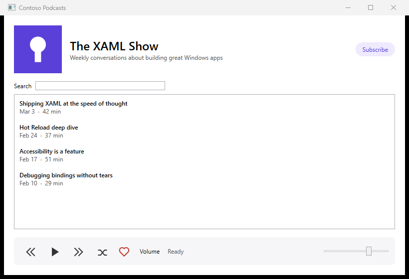
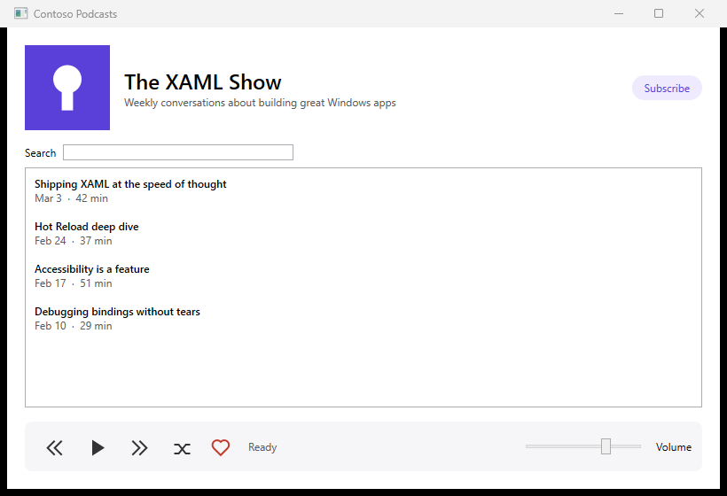
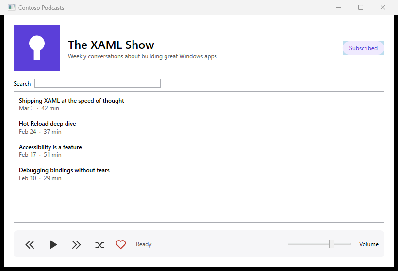

# Session transcript

Source: `Q:\source\XamlAgentDemos-notes\test-runs\A11ySweep\run4\events.jsonl`

## Tool usage

- get_file: 5
- xaml_capture_image: 5
- xaml_run_accessibility_check: 4
- xaml_interact: 3
- multi_replace_string_in_file: 2
- xaml_apply_hot_reload: 2
- xaml_clear_binding_failures: 2
- xaml_get_binding_failures: 2
- powershell: 2
- task_complete: 2
- skill: 1
- xaml_list_apps: 1
- xaml_get_visual_tree: 1
- view: 1
- replace_string_in_file: 1
- xaml_find_elements: 1
- xaml_get_element_properties: 1

Failed tool calls: 1, images: 4


_Model: gpt-6-luna_


## User (12:55:50)

Run an accessibility check on my running app, fix every issue in the XAML, and verify it's clean.


**Tool call (12:55:53):** `skill`
```json
{
 "skill": "xaml-diagnostics"
}
```

<details><summary>Result `skill` success=true</summary>

```
Skill "xaml-diagnostics" loaded successfully. Follow the instructions in the skill context.
```
</details>


_Skill invoked: xaml-diagnostics_


**Tool call (12:55:57):** `xaml_list_apps`
```json
{
 "progressMessage": "Checking running XAML apps"
}
```

<details><summary>Result `xaml_list_apps` success=true</summary>

```
{"isDebugging":true,"diagnosticsActive":true,"apps":[{"app":"a1","name":"A11ySweep.exe [66848]","processId":66848,"platform":"WPF (.NET)","isRemote":false,"isDesignTimeOrNoDebug":false,"sourceInfoAvailable":true,"hotReloadSupported":true,"hotReloadEnabled":true,"supportsPropertyExplorer":true,"supportsInAppToolbar":true,"windowCount":1}]}
```
</details>


**Tool call (12:56:01):** `xaml_run_accessibility_check`
```json
{
 "progressMessage": "Scanning the running app for accessibility issues"
}
```

<details><summary>Result `xaml_run_accessibility_check` success=true</summary>

```
{"ran":true,"time":"07:56:03","count":8,"truncated":false,"coverage":"Automated Axe.Windows UI Automation rules only. Not checked: text contrast, mouse-only click handlers on non-controls, decorative vs. informative images, list items named by ToString(), and visible labels not associated with inputs. Review those separately.","issues":[{"rule":"NameNotNull","description":"The Name property of a focusable element must not be null.","howToFix":"Provide a UI Automation Name property that concisely identifies the element.","elementType":"Button","automationId":"BackButton","bounds":{"x":118,"y":562,"width":40,"height":40},"processId":66848,"file":"Q:\\source\\XamlAgentDemos\\src\\A11ySweep\\MainWindow.xaml","line":52,"column":22},{"rule":"NameNotNull","description":"The Name property of a focusable element must not be null.","howToFix":"Provide a UI Automation Name property that concisely identifies the element.","elementType":"Button","automationId":"PlayButton","bounds":{"x":166,"y":562,"width":40,"height":40},"processId":66848,"file":"Q:\\source\\XamlAgentDemos\\src\\A11ySweep\\MainWindow.xaml","line":55,"column":22},{"rule":"NameNotNull","description":"The Name property of a focusable element must not be null.","howToFix":"Provide a UI Automation Name property that concisely identifies the element.","elementType":"Button","automationId":"ForwardButton","bounds":{"x":214,"y":562,"width":40,"height":40},"processId":66848,"file":"Q:\\source\\XamlAgentDemos\\src\\A11ySweep\\MainWindow.xaml","line":58,"column":22},{"rule":"NameNotNull","description":"The Name property of a focusable element must not be null.","howToFix":"Provide a UI Automation Name property that concisely identifies the element.","elementType":"Button","automationId":"ShuffleButton","bounds":{"x":262,"y":562,"width":40,"height":40},"processId":66848,"file":"Q:\\source\\XamlAgentDemos\\src\\A11ySweep\\MainWindow.xaml","line":61,"column":22},{"rule":"NameNotNull","description":"The Name property of a focusable element must not be null.","howToFix":"Provide a UI Automation Name property that concisely identifies the element.","elementType":"Button","automationId":"LikeButton","bounds":{"x":306,"y":562,"width":40,"height":40},"processId":66848,"file":"Q:\\source\\XamlAgentDemos\\src\\A11ySweep\\MainWindow.xaml","line":64,"column":22},{"rule":"NameNotNull","description":"The Name property of a focusable element must not be null.","howToFix":"Provide a UI Automation Name property that concisely ide
... [truncated 1038 chars]
```
</details>


**Assistant (12:56:07):**

The scanner found eight unnamed controls. I’ll inspect the XAML and live view for issues the automated scan does not cover.


**Tool call (12:56:07):** `get_file`
```json
{
 "filename": "Q:\\source\\XamlAgentDemos\\src\\A11ySweep\\MainWindow.xaml",
 "startLine": 1,
 "endLine": 240,
 "includeLineNumbers": true
}
```


**Tool call (12:56:07):** `xaml_capture_image`
```json
{
 "progressMessage": "Inspecting the current app interface",
 "app": "a1",
 "maxSize": 1280
}
```


**Tool call (12:56:07):** `xaml_get_visual_tree`
```json
{
 "progressMessage": "Reviewing visible controls and hierarchy",
 "app": "a1",
 "depth": 5,
 "maxNodes": 400
}
```

<details><summary>Result `xaml_get_visual_tree` success=true</summary>

```
{"app":"a1","platform":"WPF (.NET)","sourceInfoAvailable":true,"nodeCount":6,"truncated":false,"nodes":[{"id":"a1:10","type":"A11ySweep.MainWindow","source":{"file":"Q:\\source\\XamlAgentDemos\\src\\A11ySweep\\MainWindow.xaml","line":4,"column":9},"childCount":1,"children":[{"id":"a1:11","type":"System.Windows.Controls.Border","childCount":1,"children":[{"id":"a1:12","type":"System.Windows.Documents.AdornerDecorator","childCount":2,"children":[{"id":"a1:13","type":"System.Windows.Controls.ContentPresenter","childCount":1,"children":[{"id":"a1:15","type":"System.Windows.Controls.DockPanel","source":{"file":"Q:\\source\\XamlAgentDemos\\src\\A11ySweep\\MainWindow.xaml","line":13,"column":6},"childCount":4}]},{"id":"a1:14","type":"System.Windows.Documents.AdornerLayer","childCount":0}]}]}]}]}
```
</details>


<details><summary>Result `xaml_capture_image` success=true</summary>

```
Screenshot of window 0x15907CE "Contoso Podcasts" of app a1 (820x560).
```
</details>

<details><summary>Result `get_file` success=true</summary>

```
```xaml src\A11ySweep\MainWindow.xaml (Lines 1-110 of 110 total. Call tools for more if needed.)
1: <Window x:Class="A11ySweep.MainWindow"
2:         xmlns="http://schemas.microsoft.com/winfx/2006/xaml/presentation"
3:         xmlns:x="http://schemas.microsoft.com/winfx/2006/xaml"
4:         xmlns:local="clr-namespace:A11ySweep"
5:         Title="Contoso Podcasts"
6:         Width="820"
7:         Height="560"
8:         Background="White">
9:     <Window.DataContext>
10:         <local:PlayerViewModel />
11:     </Window.DataContext>
12: 
13:     <DockPanel Margin="20">
14:         <!-- Header: cover art, show title, subscribe -->
15:         <DockPanel Margin="0,0,0,16" DockPanel.Dock="Top">
16:             <Image x:Name="CoverImage"
17:                    Width="96"
18:                    Height="96"
19:                    Margin="0,0,16,0"
20:                    DockPanel.Dock="Left"
21:                    Source="{StaticResource CoverArt}" />
22:             <Border x:Name="SubscribeChip"
23:                     Padding="14,6"
24:                     VerticalAlignment="Center"
25:                     Background="#EFEAFE"
26:                     CornerRadius="14"
27:                     Cursor="Hand"
28:                     DockPanel.Dock="Right"
29:                     MouseLeftButtonUp="OnSubscribeClicked">
30:                 <TextBlock x:Name="SubscribeText"
31:                            Foreground="#5B3FD9"
32:                            Text="Subscribe" />
33:             </Border>
34:             <StackPanel VerticalAlignment="Center">
35:                 <TextBlock FontSize="24"
36:                            FontWeight="SemiBold"
37:                            Text="The XAML Show" />
38:                 <TextBlock x:Name="ShowByline"
39:                            Foreground="#C4C4C4"
40:                            Text="Weekly conversations about building great Windows apps" />
41:             </StackPanel>
42:         </DockPanel>
43: 
44:         <!-- Player controls -->
45:         <Border Margin="0,16,0,0"
46:                 Padding="8"
47:                 Background="#F6F6F8"
48:                 CornerRadius="8"
49:                 DockPanel.Dock="Bottom">
50:             <DockPanel>
51:                 <StackPanel DockPanel.Dock="Left" Orientation="Horizontal">
52:                     <Button x:Name="BackButton" Command="{Binding BackCommand}" Style="{StaticResource IconButtonStyle}"
... [truncated 3225 chars]
```
</details>


**Tool call (12:56:22):** `get_file`
```json
{
 "filename": "Q:\\source\\XamlAgentDemos\\src\\A11ySweep\\MainWindow.xaml.cs",
 "startLine": 1,
 "endLine": 200,
 "includeLineNumbers": true
}
```


**Tool call (12:56:22):** `get_file`
```json
{
 "filename": "Q:\\source\\XamlAgentDemos\\src\\A11ySweep\\App.xaml",
 "startLine": 1,
 "endLine": 200,
 "includeLineNumbers": true
}
```


**Tool call (12:56:22):** `view`
```json
{
 "path": "C:\\vs\\fastmain\\common7\\ide\\commonextensions\\microsoft\\xamldiagnostics\\AgentTools\\skills\\xaml-diagnostics\\references\\xaml-authoring.md"
}
```

<details><summary>Result `get_file` success=true</summary>

```
```xaml src\A11ySweep\App.xaml (Lines 1-24 of 24 total. Call tools for more if needed.)
1: <Application x:Class="A11ySweep.App"
2:              xmlns="http://schemas.microsoft.com/winfx/2006/xaml/presentation"
3:              xmlns:x="http://schemas.microsoft.com/winfx/2006/xaml"
4:              StartupUri="MainWindow.xaml">
5:     <Application.Resources>
6:         <Style x:Key="IconButtonStyle" TargetType="Button">
7:             <Setter Property="Width" Value="40" />
8:             <Setter Property="Height" Value="40" />
9:             <Setter Property="Margin" Value="4,0" />
10:             <Setter Property="Background" Value="Transparent" />
11:             <Setter Property="BorderThickness" Value="0" />
12:         </Style>
13: 
14:         <DrawingImage x:Key="CoverArt">
15:             <DrawingImage.Drawing>
16:                 <DrawingGroup>
17:                     <GeometryDrawing Brush="#5B3FD9" Geometry="M0,0 H120 V120 H0 Z" />
18:                     <GeometryDrawing Brush="#FFFFFF" Geometry="M60,28 A20,20 0 1 1 59.9,28 Z" />
19:                     <GeometryDrawing Brush="#FFFFFF" Geometry="M52,62 H68 V92 H52 Z" />
20:                 </DrawingGroup>
21:             </DrawingImage.Drawing>
22:         </DrawingImage>
23:     </Application.Resources>
24: </Application>

```


```
</details>

<details><summary>Result `get_file` success=true</summary>

```
```csharp src\A11ySweep\MainWindow.xaml.cs (Lines 1-19 of 19 total. Call tools for more if needed.)
1: using System.Windows;
2: using System.Windows.Input;
3: 
4: namespace A11ySweep;
5: 
6: public partial class MainWindow : Window
7: {
8:     public MainWindow()
9:     {
10:         this.InitializeComponent();
11:     }
12: 
13:     private void OnSubscribeClicked(object sender, MouseButtonEventArgs e)
14:     {
15:         var viewModel = (PlayerViewModel)this.DataContext;
16:         viewModel.IsSubscribed = !viewModel.IsSubscribed;
17:         this.SubscribeText.Text = viewModel.IsSubscribed ? "Subscribed" : "Subscribe";
18:     }
19: }

```


```
</details>

<details><summary>Result `view` success=true</summary>

```
# XAML authoring guidance

Follow these rules when writing or changing XAML so it works well with XAML Hot Reload, the XAML designer, and XAML Diagnostics.

## Design-time data

- Declare `xmlns:d="http://schemas.microsoft.com/expression/blend/2008"` and `xmlns:mc="http://schemas.openxmlformats.org/markup-compatibility/2006"` with `mc:Ignorable="d"`.
- Use `d:DataContext="{d:DesignInstance Type=vm:MyViewModel, IsDesignTimeCreatable=False}"` (WPF/UWP) so the designer and IntelliSense know binding paths.
- Use `d:` properties (for example `d:Text="Sample"`) for sample values that appear only at design time.
- .NET MAUI: set `x:DataType` on pages and `DataTemplate`s. It enables compiled bindings and turns many binding failures into build errors.
- WinUI/UWP: prefer `x:Bind` for compile-time checked bindings when the view owns the view model.

## Bindings

- Bind with explicit paths. Avoid string-built paths in code-behind.
- Keep the `DataContext` chain simple. Use `ElementName` or `RelativeSource` only at real scope boundaries (for example inside a `DataTemplate` that needs the page's view model).
- Expose bound properties as public properties that raise `PropertyChanged`. Fields and non-public properties don't bind.
- Use `FallbackValue` and `TargetNullValue` for expected missing values instead of hiding binding errors.

## Hot reload and designer friendly code

- Keep control and page constructors cheap. Don't call services, open files, or start network calls in constructors or `InitializeComponent` paths. The designer and hot reload create instances again.
- Keep a public parameterless constructor on custom controls.
- Guard runtime-only work with `DesignerProperties.GetIsInDesignMode(this)` (WPF) or `Windows.ApplicationModel.DesignMode.DesignModeEnabled` (UWP/WinUI).
- Put styles, templates, and visual states in XAML, not code-behind. Hot reload can't update UI built in code.
- Don't walk the visual tree from code-behind to change visuals. Use bindings, triggers, and visual states.
- Use `x:Name` only for elements code-behind needs. Don't rename `x:Class` while the app is running.

## Resources

- Put shared resources in `App.xaml` merged dictionaries or the closest scope that uses them.
- A `StaticResource` must be defined earlier in load order. Use `DynamicResource` (WPF) or `ThemeResource` (UWP/WinUI) for theme values that change at runtime.
- To check where a key resolves at runtime, or whether a dictionary is merged a
... [truncated 618 chars]
```
</details>


**Assistant (12:56:59):**

I found additional contrast problems, a mouse-only subscribe action, and unnamed episode rows. I’ll fix those in the XAML, including the small event-signature change needed to make Subscribe keyboard-operable.


**Tool call (12:56:59):** `multi_replace_string_in_file`
```json
{
 "explanation": "Add accessible names and label associations, replace the mouse-only subscribe surface with a Button, name episode rows, and correct low-contrast text.",
 "replacements": [
  {
   "filePath": "src\\A11ySweep\\MainWindow.xaml",
   "oldString": "            <Image x:Name=\"CoverImage\"\n                   Width=\"96\"\n                   Height=\"96\"\n                   Margin=\"0,0,16,0\"\n                   DockPanel.Dock=\"Left\"\n                   Source=\"{StaticResource CoverArt}\" />\n            <Border x:Name=\"SubscribeChip\"\n                    Padding=\"14,6\"\n                    VerticalAlignment=\"Center\"\n                    Background=\"#EFEAFE\"\n                    CornerRadius=\"14\"\n                    Cursor=\"Hand\"\n                    DockPanel.Dock=\"Right\"\n                    MouseLeftButtonUp=\"OnSubscribeClicked\">\n                <TextBlock x:Name=\"SubscribeText\"\n                           Foreground=\"#5B3FD9\"\n                           Text=\"Subscribe\" />\n            </Border>\n            <StackPanel VerticalAlignment=\"Center\">\n                <TextBlock FontSize=\"24\"\n                           FontWeight=\"SemiBold\"\n                           Text=\"The XAML Show\" />\n                <TextBlock x:Name=\"ShowByline\"\n                           Foreground=\"#C4C4C4\"",
   "newString": "            <Image x:Name=\"CoverImage\"\n                   Width=\"96\"\n                   Height=\"96\"\n          
... [truncated 8171 chars]
```

<details><summary>Result `multi_replace_string_in_file` success=true</summary>

```
Successfully applied 6 of 6 replacement(s) across 2 file(s).
```
</details>


**Tool call (12:57:20):** `get_file`
```json
{
 "filename": "Q:\\source\\XamlAgentDemos\\src\\A11ySweep\\PlayerViewModel.cs",
 "startLine": 1,
 "endLine": 240,
 "includeLineNumbers": true
}
```

<details><summary>Result `get_file` success=true</summary>

```
```csharp src\A11ySweep\PlayerViewModel.cs (Lines 1-49 of 49 total. Call tools for more if needed.)
1: using System.Collections.ObjectModel;
2: 
3: namespace A11ySweep;
4: 
5: public sealed class Episode
6: {
7:     public required string Title { get; init; }
8: 
9:     public required string Duration { get; init; }
10: 
11:     public required string Published { get; init; }
12: }
13: 
14: public sealed class PlayerViewModel : ObservableObject
15: {
16:     private bool isPlaying;
17:     private bool isSubscribed;
18:     private string status = "Ready";
19: 
20:     public PlayerViewModel()
21:     {
22:         this.PlayCommand = new RelayCommand(() => { this.IsPlaying = !this.IsPlaying; this.Status = this.IsPlaying ? "Playing" : "Paused"; });
23:         this.BackCommand = new RelayCommand(() => this.Status = "Skipped back 15 seconds");
24:         this.ForwardCommand = new RelayCommand(() => this.Status = "Skipped forward 30 seconds");
25:         this.ShuffleCommand = new RelayCommand(() => this.Status = "Shuffle on");
26:     }
27: 
28:     public ObservableCollection<Episode> Episodes { get; } =
29:     [
30:         new() { Title = "Shipping XAML at the speed of thought", Duration = "42 min", Published = "Mar 3" },
31:         new() { Title = "Hot Reload deep dive", Duration = "37 min", Published = "Feb 24" },
32:         new() { Title = "Accessibility is a feature", Duration = "51 min", Published = "Feb 17" },
33:         new() { Title = "Debugging bindings without tears", Duration = "29 min", Published = "Feb 10" },
34:     ];
35: 
36:     public bool IsPlaying { get => this.isPlaying; set => this.SetProperty(ref this.isPlaying, value); }
37: 
38:     public bool IsSubscribed { get => this.isSubscribed; set => this.SetProperty(ref this.isSubscribed, value); }
39: 
40:     public string Status { get => this.status; set => this.SetProperty(ref this.status, value); }
41: 
42:     public RelayCommand PlayCommand { get; }
43: 
44:     public RelayCommand BackCommand { get; }
45: 
46:     public RelayCommand ForwardCommand { get; }
47: 
48:     public RelayCommand ShuffleCommand { get; }
49: }

```


```
</details>


**Assistant (12:57:34):**

The subscribe state is already bindable in the view model, so I can keep this XAML-only: use a keyboard-operable toggle and bind its checked state and label text.


**Tool call (12:57:34):** `multi_replace_string_in_file`
```json
{
 "explanation": "Keep the subscribe interaction in XAML using the existing IsSubscribed property, avoiding a runtime-incompatible code-behind signature change.",
 "replacements": [
  {
   "filePath": "src\\A11ySweep\\MainWindow.xaml",
   "oldString": "            <Button x:Name=\"SubscribeButton\"\n                    Padding=\"0\"\n                    VerticalAlignment=\"Center\"\n                    Background=\"Transparent\"\n                    BorderThickness=\"0\"\n                    Cursor=\"Hand\"\n                    DockPanel.Dock=\"Right\"\n                    Click=\"OnSubscribeClicked\"\n                    AutomationProperties.LabeledBy=\"{Binding ElementName=SubscribeText}\">\n                <Border Padding=\"14,6\"\n                        Background=\"#EFEAFE\"\n                        CornerRadius=\"14\">\n                    <TextBlock x:Name=\"SubscribeText\"\n                               Foreground=\"#5B3FD9\"\n                               Text=\"Subscribe\" />\n                </Border>\n            </Button>",
   "newString": "            <ToggleButton x:Name=\"SubscribeButton\"\n                          Padding=\"0\"\n                          VerticalAlignment=\"Center\"\n                          Background=\"Transparent\"\n                          BorderThickness=\"0\"\n                          Cursor=\"Hand\"\n                          DockPanel.Dock=\"Right\"\n                          IsChecked=\"{Binding IsSubscribed, Mode=TwoWay}\"\n
... [truncated 1658 chars]
```

<details><summary>Result `multi_replace_string_in_file` success=true</summary>

```
Successfully applied 3 of 3 replacement(s) across 2 file(s).
```
</details>


**Tool call (12:57:37):** `xaml_apply_hot_reload`
```json
{
 "progressMessage": "Applying the XAML accessibility fixes"
}
```

<details><summary>Result `xaml_apply_hot_reload` success=true</summary>

```
{"applied":true,"errors":[],"log":[],"hint":"Call xaml_capture_image to verify the change visually. Views that aren't loaded (other tabs, closed dialogs) are updated when they're next shown."}
```
</details>


**Tool call (12:57:42):** `xaml_clear_binding_failures`
```json
{
 "progressMessage": "Resetting binding diagnostics before verification"
}
```

<details><summary>Result `xaml_clear_binding_failures` success=true</summary>

```
{"cleared":0}
```
</details>


**Tool call (12:57:44):** `xaml_run_accessibility_check`
```json
{
 "progressMessage": "Rechecking accessibility after the XAML fixes",
 "maxResults": 200
}
```


**Tool call (12:57:44):** `xaml_capture_image`
```json
{
 "progressMessage": "Verifying the updated app appearance",
 "app": "a1",
 "maxSize": 1280
}
```


**Tool call (12:57:44):** `xaml_get_binding_failures`
```json
{
 "progressMessage": "Checking for new XAML binding failures",
 "maxResults": 100
}
```

<details><summary>Result `xaml_get_binding_failures` success=true</summary>

```
{"note":"This is a cumulative log since debugging started or the last xaml_clear_binding_failures, not live state: fixed failures stay listed. To verify a fix: clear, revisit the UI that uses the binding, then read again. Failures without a file usually come from bindings created in code.","totalUnique":0,"matched":0,"truncated":false,"failures":[]}
```
</details>




<details><summary>Result `xaml_capture_image` success=true</summary>

```
Screenshot of window 0x15907CE "Contoso Podcasts" of app a1 (820x560).
```
</details>

<details><summary>Result `xaml_run_accessibility_check` success=true</summary>

```
{"ran":true,"time":"07:57:45","count":0,"truncated":false,"coverage":"Automated Axe.Windows UI Automation rules only. Not checked: text contrast, mouse-only click handlers on non-controls, decorative vs. informative images, list items named by ToString(), and visible labels not associated with inputs. Review those separately.","issues":[]}
```
</details>


**Tool call (12:57:55):** `get_file`
```json
{
 "filename": "Q:\\source\\XamlAgentDemos\\src\\A11ySweep\\MainWindow.xaml",
 "startLine": 70,
 "endLine": 102,
 "includeLineNumbers": true
}
```

<details><summary>Result `get_file` success=true</summary>

```
```xaml src\A11ySweep\MainWindow.xaml (Lines 70-102 of 142 total. Call tools for more if needed.)
70:                     </Button>
71:                     <Button x:Name="PlayButton" Command="{Binding PlayCommand}" Style="{StaticResource IconButtonStyle}" AutomationProperties.Name="Play or pause">
72:                         <Path Data="M6,3 L20,12 L6,21 Z" Fill="#333" />
73:                     </Button>
74:                     <Button x:Name="ForwardButton" Command="{Binding ForwardCommand}" Style="{StaticResource IconButtonStyle}" AutomationProperties.Name="Next episode">
75:                         <Path Data="M4,4 L12,12 L4,20 M12,4 L20,12 L12,20" Stroke="#333" StrokeThickness="2" />
76:                     </Button>
77:                     <Button x:Name="ShuffleButton" Command="{Binding ShuffleCommand}" Style="{StaticResource IconButtonStyle}" AutomationProperties.Name="Shuffle episodes">
78:                         <Path Data="M3,7 H8 L16,17 H21 M3,17 H8 L16,7 H21" Stroke="#333" StrokeThickness="2" />
79:                     </Button>
80:                     <ToggleButton x:Name="LikeButton"
81:                                   Width="40"
82:                                   Height="40"
83:                                   Background="Transparent"
84:                                   BorderThickness="0"
85:                                   AutomationProperties.Name="Like episode">
86:                         <Path Data="M12,21 L4,13 A4.5,4.5 0 0 1 12,6 A4.5,4.5 0 0 1 20,13 Z" Stroke="#C0392B" StrokeThickness="2" />
87:                     </ToggleButton>
88:                 </StackPanel>
89:                 <TextBlock x:Name="VolumeLabel"
90:                            Margin="12,0,4,0"
91:                            VerticalAlignment="Center"
92:                            Text="Volume" />
93:                 <Slider x:Name="VolumeSlider"
94:                         Width="140"
95:                         VerticalAlignment="Center"
96:                         DockPanel.Dock="Right"
97:                         Maximum="100"
98:                         Value="70"
99:                         AutomationProperties.LabeledBy="{Binding ElementName=VolumeLabel}" />
100:                 <TextBlock Margin="12,0"
101:                            VerticalAlignment="Center"
102:                            Foreground="#595959"

```


```
</details>


**Tool call (12:57:58):** `replace_string_in_file`
```json
{
 "filePath": "src\\A11ySweep\\MainWindow.xaml",
 "oldString": "                <TextBlock x:Name=\"VolumeLabel\"\n                           Margin=\"12,0,4,0\"\n                           VerticalAlignment=\"Center\"\n                           Text=\"Volume\" />\n                <Slider x:Name=\"VolumeSlider\"",
 "newString": "                <TextBlock x:Name=\"VolumeLabel\"\n                           Margin=\"12,0,4,0\"\n                           VerticalAlignment=\"Center\"\n                           DockPanel.Dock=\"Right\"\n                           Text=\"Volume\" />\n                <Slider x:Name=\"VolumeSlider\""
}
```

<details><summary>Result `replace_string_in_file` success=true</summary>

```
Successfully replaced text in src\A11ySweep\MainWindow.xaml
```
</details>


**Tool call (12:58:01):** `xaml_apply_hot_reload`
```json
{
 "progressMessage": "Aligning the volume label and slider"
}
```

<details><summary>Result `xaml_apply_hot_reload` success=true</summary>

```
{"applied":true,"errors":[],"log":[],"hint":"Call xaml_capture_image to verify the change visually. Views that aren't loaded (other tabs, closed dialogs) are updated when they're next shown."}
```
</details>


**Tool call (12:58:10):** `xaml_run_accessibility_check`
```json
{
 "progressMessage": "Confirming the updated app is accessibility-clean",
 "maxResults": 200
}
```


**Tool call (12:58:10):** `xaml_capture_image`
```json
{
 "progressMessage": "Checking final control layout",
 "app": "a1",
 "maxSize": 1280
}
```




<details><summary>Result `xaml_capture_image` success=true</summary>

```
Screenshot of window 0x15907CE "Contoso Podcasts" of app a1 (820x560).
```
</details>

<details><summary>Result `xaml_run_accessibility_check` success=true</summary>

```
{"ran":true,"time":"07:58:11","count":0,"truncated":false,"coverage":"Automated Axe.Windows UI Automation rules only. Not checked: text contrast, mouse-only click handlers on non-controls, decorative vs. informative images, list items named by ToString(), and visible labels not associated with inputs. Review those separately.","issues":[]}
```
</details>


**Tool call (12:58:22):** `xaml_find_elements`
```json
{
 "progressMessage": "Locating the subscribe toggle for interaction verification",
 "app": "a1",
 "type": "ToggleButton",
 "name": "SubscribeButton",
 "maxResults": 10
}
```


**Tool call (12:58:22):** `powershell`
```json
{
 "command": "function L([string]$h) { $v=@(); for($i=1;$i -lt 7;$i+=2) { $c=[Convert]::ToInt32($h.Substring($i,2),16)/255.0; if($c -le 0.04045) { $v += $c/12.92 } else { $v += [Math]::Pow(($c+0.055)/1.055,2.4) } }; return 0.2126*$v[0]+0.7152*$v[1]+0.0722*$v[2] }; $pairs=@([pscustomobject]@{Name='Subscribe';Foreground='#5B3FD9';Background='#EFEAFE'},[pscustomobject]@{Name='Byline and episode metadata';Foreground='#595959';Background='#FFFFFF'},[pscustomobject]@{Name='Status';Foreground='#595959';Background='#F6F6F8'}); foreach($p in $pairs) { $a=L $p.Foreground; $b=L $p.Background; $ratio=([Math]::Max($a,$b)+0.05)/([Math]::Min($a,$b)+0.05); '{0}: {1:N2}:1' -f $p.Name,$ratio }",
 "description": "Calculating WCAG text contrast ratios"
}
```

<details><summary>Result `xaml_find_elements` success=true</summary>

```
{"count":1,"truncated":false,"results":[{"id":"a1:184","type":"System.Windows.Controls.Primitives.ToggleButton","name":"SubscribeButton","path":"MainWindow/Border/AdornerDecorator/ContentPresenter/DockPanel/DockPanel/ToggleButton"}]}
```
</details>

<details><summary>Result `powershell` success=true</summary>

```
Subscribe: 5.66:1
Byline and episode metadata: 7.00:1
Status: 6.49:1
<shellId: 0 completed with exit code 0>
```
</details>


**Tool call (12:58:27):** `xaml_interact`
```json
{
 "progressMessage": "Testing keyboard-accessible subscribe toggle behavior",
 "elementId": "a1:184",
 "action": "toggle"
}
```

<details><summary>Result `xaml_interact` success=true</summary>

```
{"id":"a1:184","action":"toggle","result":"Toggle state is now On.","supportedPatterns":["Toggle","SynchronizedInput"],"note":"Call xaml_capture_image or xaml_get_element_properties to verify the effect."}
```
</details>


**Tool call (12:58:31):** `xaml_capture_image`
```json
{
 "progressMessage": "Verifying the subscribed label updates",
 "app": "a1",
 "maxSize": 1280
}
```


**Tool call (12:58:31):** `xaml_get_element_properties`
```json
{
 "progressMessage": "Checking the toggle state and accessible name",
 "elementId": "a1:184",
 "includeAll": true
}
```




<details><summary>Result `xaml_capture_image` success=true</summary>

```
Screenshot of window 0x15907CE "Contoso Podcasts" of app a1 (820x560).
```
</details>

<details><summary>Result `xaml_get_element_properties` success=true</summary>

```
Output too large to read at once (21.4 KB). Saved to: C:\Users\peterspa\AppData\Local\Microsoft\VisualStudio\CopilotCli\8538386e-cbb5-4982-9f74-c479a3ebb7d9\temp\1794661111696-copilot-tool-output-bae24be3e6614882bd7c12fcbc880ffe.txt
Consider using tools like rg (for searching), head/tail (for viewing start/end), view with view_range (for specific sections), or jq (for JSON) to examine portions of the output.

Preview (first 500 chars):
{"id":"a1:184","type":"System.Windows.Controls.Primitives.ToggleButton","name":"SubscribeButton","properties":[{"name":"IsChecked","evaluatedValue":"True (System.Boolean)","valueType":"System.Windows.Data.BindingExpression","propertyType":"System.Nullable`1[[System.Boolean]]","declaringType":"System.Windows.Controls.Primitives.ToggleButton","valueSource":"Local","isBinding":true},{"name":"Content","valueType":"System.Windows.Controls.Border","propertyType":"System.Object","declaringType":"System
```
</details>


**Tool call (12:58:36):** `xaml_interact`
```json
{
 "progressMessage": "Restoring the original subscribe state"
}
```

<details><summary>Result `xaml_interact` success=false</summary>

```
{
 "message": "A RemoteInvocationException was thrown when calling tool xaml_interact, its message: \"Invalid arguments to method, missing parameter elementId.\". Consider what you were trying to do, why, and whether you should continue or stop and ask for guidance.",
 "code": "failure"
}
```
</details>


**Tool call (12:58:40):** `xaml_interact`
```json
{
 "progressMessage": "Restoring the original subscribe state",
 "elementId": "a1:184",
 "action": "toggle"
}
```

<details><summary>Result `xaml_interact` success=true</summary>

```
{"id":"a1:184","action":"toggle","result":"Toggle state is now Off.","supportedPatterns":["Toggle","SynchronizedInput"],"note":"Call xaml_capture_image or xaml_get_element_properties to verify the effect."}
```
</details>


**Tool call (12:58:41):** `xaml_clear_binding_failures`
```json
{
 "progressMessage": "Resetting binding diagnostics for the final check"
}
```

<details><summary>Result `xaml_clear_binding_failures` success=true</summary>

```
{"cleared":0}
```
</details>


**Tool call (12:58:49):** `xaml_run_accessibility_check`
```json
{
 "progressMessage": "Running the final accessibility scan",
 "maxResults": 200
}
```


**Tool call (12:58:49):** `xaml_capture_image`
```json
{
 "progressMessage": "Verifying the restored final interface",
 "app": "a1",
 "maxSize": 1280
}
```


**Tool call (12:58:49):** `xaml_get_binding_failures`
```json
{
 "progressMessage": "Checking final binding diagnostics",
 "maxResults": 100
}
```


**Tool call (12:58:49):** `powershell`
```json
{
 "command": "git --no-pager status --short; git --no-pager diff -- \"src\\A11ySweep\\MainWindow.xaml\" \"src\\A11ySweep\\MainWindow.xaml.cs\"",
 "description": "Reviewing the final XAML diff"
}
```

<details><summary>Result `xaml_get_binding_failures` success=true</summary>

```
{"note":"This is a cumulative log since debugging started or the last xaml_clear_binding_failures, not live state: fixed failures stay listed. To verify a fix: clear, revisit the UI that uses the binding, then read again. Failures without a file usually come from bindings created in code.","totalUnique":0,"matched":0,"truncated":false,"failures":[]}
```
</details>

<details><summary>Result `xaml_capture_image` success=true</summary>

```
Screenshot of window 0x15907CE "Contoso Podcasts" of app a1 (820x560).
```
</details>

<details><summary>Result `powershell` success=true</summary>

```
M src/A11ySweep/MainWindow.xaml
diff --git a/src/A11ySweep/MainWindow.xaml b/src/A11ySweep/MainWindow.xaml
index 1674c74..b6141ed 100644
--- a/src/A11ySweep/MainWindow.xaml
+++ b/src/A11ySweep/MainWindow.xaml
@@ -18,25 +18,41 @@
                    Height="96"
                    Margin="0,0,16,0"
                    DockPanel.Dock="Left"
-                   Source="{StaticResource CoverArt}" />
-            <Border x:Name="SubscribeChip"
-                    Padding="14,6"
-                    VerticalAlignment="Center"
-                    Background="#EFEAFE"
-                    CornerRadius="14"
-                    Cursor="Hand"
-                    DockPanel.Dock="Right"
-                    MouseLeftButtonUp="OnSubscribeClicked">
-                <TextBlock x:Name="SubscribeText"
-                           Foreground="#5B3FD9"
-                           Text="Subscribe" />
-            </Border>
+                   Source="{StaticResource CoverArt}"
+                   AutomationProperties.Name="The XAML Show cover art" />
+            <ToggleButton x:Name="SubscribeButton"
+                          Padding="0"
+                          VerticalAlignment="Center"
+                          Background="Transparent"
+                          BorderThickness="0"
+                          Cursor="Hand"
+                          DockPanel.Dock="Right"
+                          IsChecked="{Binding IsSubscribed, Mode=TwoWay}"
+                          AutomationProperties.LabeledBy="{Binding ElementName=SubscribeText}">
+                <Border Padding="14,6"
+                        Background="#EFEAFE"
+                        CornerRadius="14">
+                    <TextBlock x:Name="SubscribeText"
+                               Foreground="#5B3FD9">
+                        <TextBlock.Style>
+                            <Style TargetType="TextBlock">
+                                <Setter Property="Text" Value="Subscribe" />
+                                <Style.Triggers>
+                                    <DataTrigger Binding="{Binding IsSubscribed}" Value="True">
+                                        <Setter Property="Text" Value="Subscribed" />
+                                    </DataTrigger>
+                                </Style.Triggers>
+                            </Style>
+                        </TextBlock.Style>
+                    </TextBlock>
+                </Border>
+            </ToggleButton>
             <S
... [truncated 5501 chars]
```
</details>

<details><summary>Result `xaml_run_accessibility_check` success=true</summary>

```
{"ran":true,"time":"07:58:50","count":0,"truncated":false,"coverage":"Automated Axe.Windows UI Automation rules only. Not checked: text contrast, mouse-only click handlers on non-controls, decorative vs. informative images, list items named by ToString(), and visible labels not associated with inputs. Review those separately.","issues":[]}
```
</details>


**Tool call (12:59:04):** `task_complete`
```json
{
 "summary": "Fixed the XAML accessibility issues in [MainWindow.xaml](vscopilot://file?path=Q%3A%5Csource%5CXamlAgentDemos%5Csrc%5CA11ySweep%5CMainWindow.xaml&line=16): named icon controls and cover art, associated the search and volume labels, named episode rows, replaced the mouse-only Subscribe chip with a keyboard-operable toggle, and raised low-contrast text colors to WCAG AA ratios. Verified the toggle updates its label and restored its original state. Final Axe.Windows scan: 0 issues; binding failures: 0. Contrast checks passed (minimum measured 5.66:1). Changes applied and verified with Hot Reload; no build was run while the app was being debugged."
}
```

<details><summary>Result `task_complete` success=true</summary>

```
Fixed the XAML accessibility issues in [MainWindow.xaml](vscopilot://file?path=Q%3A%5Csource%5CXamlAgentDemos%5Csrc%5CA11ySweep%5CMainWindow.xaml&line=16): named icon controls and cover art, associated the search and volume labels, named episode rows, replaced the mouse-only Subscribe chip with a keyboard-operable toggle, and raised low-contrast text colors to WCAG AA ratios. Verified the toggle updates its label and restored its original state. Final Axe.Windows scan: 0 issues; binding failures: 0. Contrast checks passed (minimum measured 5.66:1). Changes applied and verified with Hot Reload; no build was run while the app was being debugged.
```
</details>


**Task complete (12:59:04):** Fixed the XAML accessibility issues in [MainWindow.xaml](vscopilot://file?path=Q%3A%5Csource%5CXamlAgentDemos%5Csrc%5CA11ySweep%5CMainWindow.xaml&line=16): named icon controls and cover art, associated the search and volume labels, named episode rows, replaced the mouse-only Subscribe chip with a keyboard-operable toggle, and raised low-contrast text colors to WCAG AA ratios. Verified the toggle updates its label and restored its original state. Final Axe.Windows scan: 0 issues; binding failures: 0. Contrast checks passed (minimum measured 5.66:1). Changes applied and verified with Hot Reload; no build was run while the app was being debugged.


## User (12:59:40)

Thanks. Now some quick feedback for the tooling team. Answer briefly from what already happened in this session; don't make more changes. (1) Which xaml_* tools or skill guidance helped most? (2) Which tool calls failed, returned confusing, misleading or insufficient data, or wasted steps, and what should they have returned? (3) What did you have to guess at or verify another way? (4) What, if anything, could you not verify in the running app, and why?


**Tool call (12:59:49):** `task_complete`
```json
{
 "summary": "1. Most useful: `xaml_run_accessibility_check` gave actionable findings with XAML locations; Hot Reload, screenshot capture, and binding-failure tools let me apply and verify the fixes. The skill’s reminder to review contrast, mouse-only actions, and list-item names beyond Axe’s coverage was important.\n2. Issues: One `xaml_interact` call failed because I omitted required `elementId` and `action`; the error should ideally identify both missing fields. `xaml_get_element_properties` returned an oversized payload saved to a file instead of a concise property summary. `xaml_get_visual_tree` returned only six nodes despite the requested depth, so it wasn’t useful for inspecting descendants.\n3. I had to infer DockPanel ordering and verify it with screenshots. Since Axe doesn’t check contrast, I calculated the WCAG ratios separately. I also used interaction plus a screenshot to confirm the Subscribe label followed its toggle state.\n4. I verified the active window, but not a manual screen-reader session or full keyboard-only traversal. Axe’s scan also does not cover UI that wasn’t loaded; its reported limitations made that scope clear."
}
```

<details><summary>Result `task_complete` success=true</summary>

```
1. Most useful: `xaml_run_accessibility_check` gave actionable findings with XAML locations; Hot Reload, screenshot capture, and binding-failure tools let me apply and verify the fixes. The skill’s reminder to review contrast, mouse-only actions, and list-item names beyond Axe’s coverage was important.
2. Issues: One `xaml_interact` call failed because I omitted required `elementId` and `action`; the error should ideally identify both missing fields. `xaml_get_element_properties` returned an oversized payload saved to a file instead of a concise property summary. `xaml_get_visual_tree` returned only six nodes despite the requested depth, so it wasn’t useful for inspecting descendants.
3. I had to infer DockPanel ordering and verify it with screenshots. Since Axe doesn’t check contrast, I calculated the WCAG ratios separately. I also used interaction plus a screenshot to confirm the Subscribe label followed its toggle state.
4. I verified the active window, but not a manual screen-reader session or full keyboard-only traversal. Axe’s scan also does not cover UI that wasn’t loaded; its reported limitations made that scope clear.
```
</details>


**Task complete (12:59:49):** 1. Most useful: `xaml_run_accessibility_check` gave actionable findings with XAML locations; Hot Reload, screenshot capture, and binding-failure tools let me apply and verify the fixes. The skill’s reminder to review contrast, mouse-only actions, and list-item names beyond Axe’s coverage was important.
2. Issues: One `xaml_interact` call failed because I omitted required `elementId` and `action`; the error should ideally identify both missing fields. `xaml_get_element_properties` returned an oversized payload saved to a file instead of a concise property summary. `xaml_get_visual_tree` returned only six nodes despite the requested depth, so it wasn’t useful for inspecting descendants.
3. I had to infer DockPanel ordering and verify it with screenshots. Since Axe doesn’t check contrast, I calculated the WCAG ratios separately. I also used interaction plus a screenshot to confirm the Subscribe label followed its toggle state.
4. I verified the active window, but not a manual screen-reader session or full keyboard-only traversal. Axe’s scan also does not cover UI that wasn’t loaded; its reported limitations made that scope clear.
