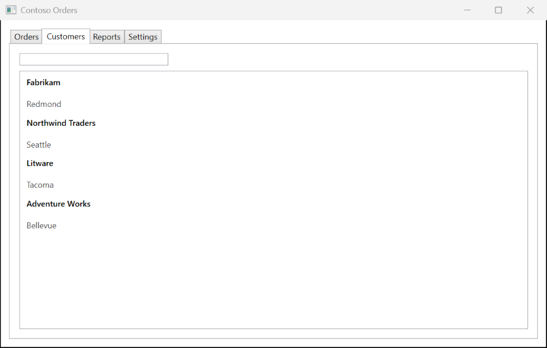
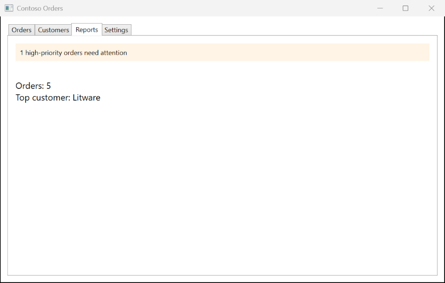
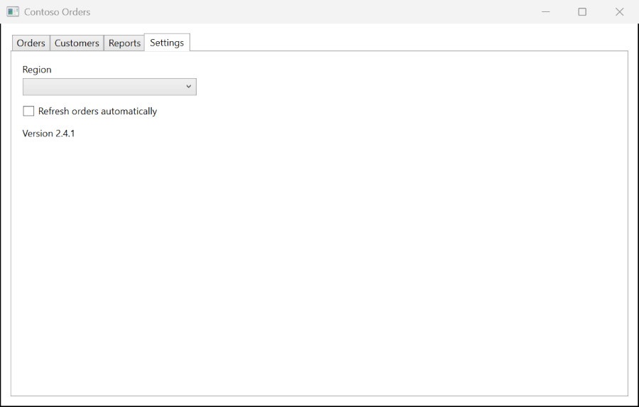
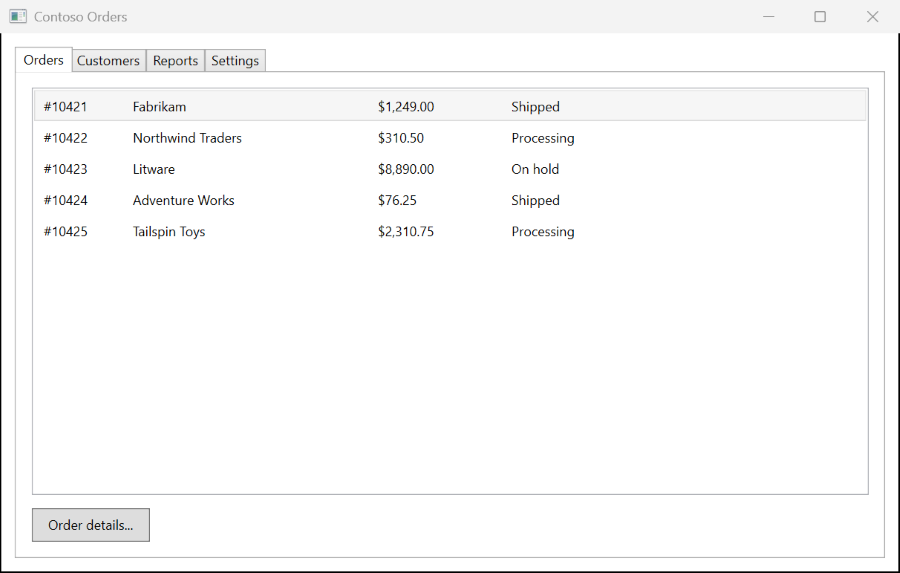
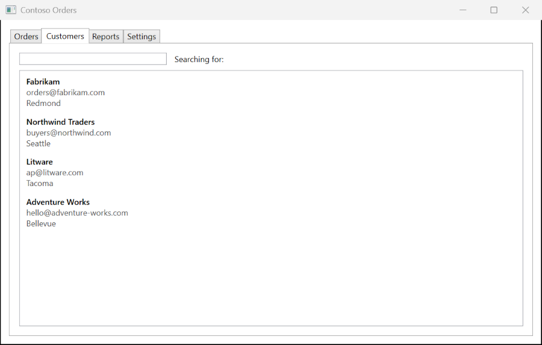
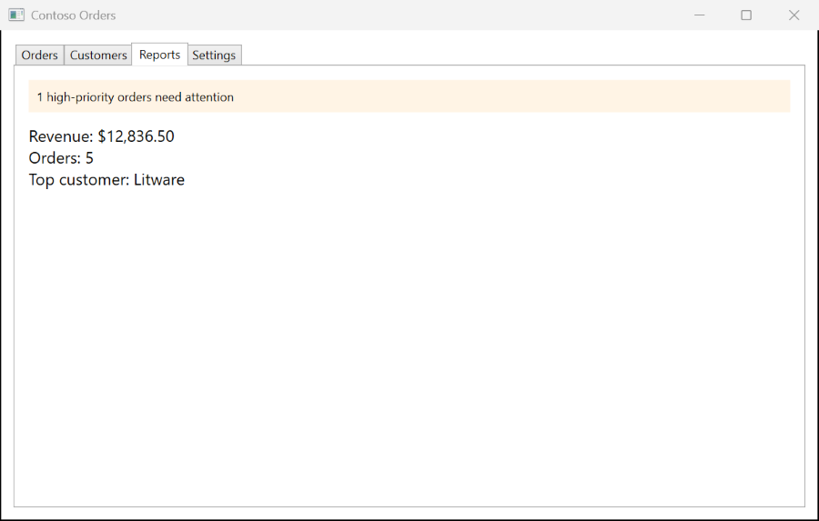
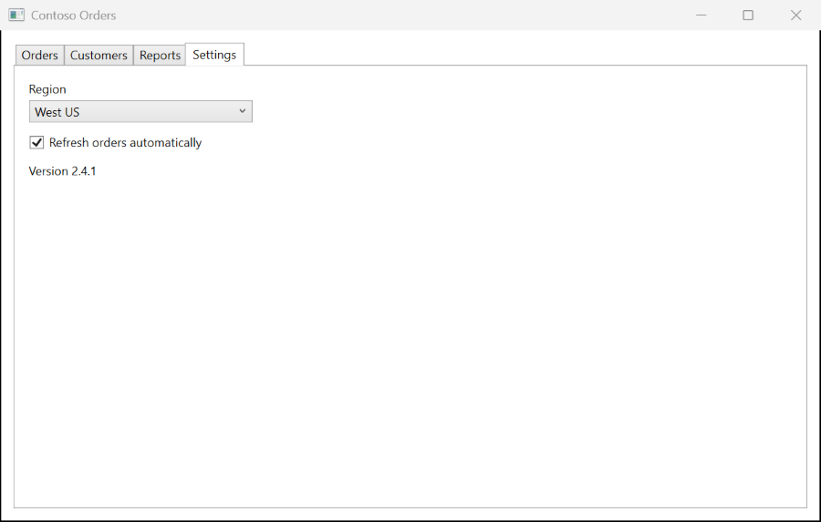
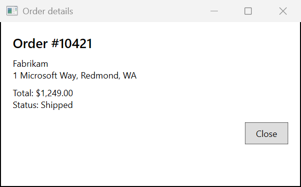

# Session transcript

Source: `Q:\source\XamlAgentDemos-notes\test-runs\BindingStorm\r9\events.jsonl`

## Tool usage

- xaml_get_binding_failures: 10
- xaml_interact: 9
- xaml_capture_image: 8
- get_file: 5
- xaml_get_status: 2
- rg: 2
- xaml_clear_binding_failures: 2
- task_complete: 2
- skill: 1
- xaml_get_visual_tree: 1
- glob: 1
- multi_replace_string_in_file: 1
- xaml_apply_hot_reload: 1
- xaml_get_element_properties: 1
- xaml_get_hot_reload_log: 1

Failed tool calls: 0, images: 8


_Model: gpt-6-luna_


## User (14:48:54)

Exercise every tab and dialog in my running app, collect all binding failures, fix them all in source, and prove the list is clean.


**Tool call (14:48:58):** `skill`
```json
{
 "skill": "xaml-diagnostics"
}
```

<details><summary>Result `skill` success=true</summary>

```
Skill "xaml-diagnostics" loaded successfully. Follow the instructions in the skill context.
```
</details>


_Skill invoked: xaml-diagnostics_


**Tool call (14:49:01):** `xaml_get_status`
```json
{
 "progressMessage": "Checking the running XAML app and debugger state",
 "app": null
}
```

<details><summary>Result `xaml_get_status` success=true</summary>

```
{"isDebugging":true,"debuggerState":"running","diagnosticsActive":true,"apps":[{"app":"a4","name":"BindingStorm.exe [39180]","processId":39180,"platform":"WPF (.NET)","isRemote":false,"isDesignTimeOrNoDebug":false,"sourceInfoAvailable":true,"hotReloadSupported":true,"hotReloadEnabled":true,"supportsPropertyExplorer":true,"supportsInAppToolbar":true,"supportsHitTest":true,"windows":[{"windowId":"0x132094A","title":"Contoso Orders","bounds":{"x":342,"y":342,"width":1230,"height":780},"dpiScale":1.5,"visible":true,"minimized":false}]}],"issues":[],"issuesSummary":"No problems detected.","hotReload":{"options":{"hotReloadEnabled":true,"hotReloadOnSave":false,"applyMode":"asYouType: XAML edits apply as you type, without saving (default)","wpfEnabled":true,"uwpEnabled":true,"winUIEnabled":true,"mauiEnabled":true,"justMyXaml":true,"previewSelectedElement":false,"inAppToolbar":true,"inAppSelection":false,"layoutAdorners":false,"trackFocusedElement":false,"bindingFailuresVisible":true,"compatibilityMode":false},"dotNetHotReloadEnabled":true,"isProcessingChanges":false,"lastHotReloadUpdate":{"secondsAgo":141,"updatesSinceToolsStarted":7},"errors":[]},"windowsNote":"Window bounds are physical screen pixels and include the window frame. A WPF/WinUI Window's Width and Height are device-independent units (DIPs) that also include the frame, so Width = bounds.width / dpiScale. A user's \"800 px wide\" is ambiguous: say which unit you tested. A minimized window reports x/y = -32000 and can't be captured."}
```
</details>


**Tool call (14:49:03):** `xaml_get_visual_tree`
```json
{
 "progressMessage": "Mapping tabs and dialogs in the live window",
 "app": "a4",
 "depth": 7,
 "maxNodes": 1000
}
```


**Tool call (14:49:03):** `xaml_get_binding_failures`
```json
{
 "progressMessage": "Reading currently logged binding failures",
 "maxResults": 300
}
```

<details><summary>Result `xaml_get_visual_tree` success=true</summary>

```
{"app":"a4","platform":"WPF (.NET)","sourceInfoAvailable":true,"nodeCount":90,"truncated":false,"nodes":[{"id":"a4:20","type":"BindingStorm.MainWindow","source":{"file":"Q:\\source\\XamlAgentDemos\\src\\BindingStorm\\MainWindow.xaml","line":4,"column":9},"childCount":1,"children":[{"id":"a4:21","type":"System.Windows.Controls.Border","childCount":1,"children":[{"id":"a4:22","type":"System.Windows.Documents.AdornerDecorator","childCount":2,"children":[{"id":"a4:23","type":"System.Windows.Controls.ContentPresenter","childCount":1,"children":[{"id":"a4:25","type":"System.Windows.Controls.TabControl","name":"MainTabs","source":{"file":"Q:\\source\\XamlAgentDemos\\src\\BindingStorm\\MainWindow.xaml","line":12,"column":6},"childCount":1,"children":[{"id":"a4:26","type":"System.Windows.Controls.Grid","name":"templateRoot","childCount":2,"children":[{"id":"a4:27","type":"System.Windows.Controls.Border","name":"ContentPanel","childCount":1,"children":[{"id":"a4:29","type":"System.Windows.Controls.ContentPresenter","name":"PART_SelectedContentHost","childCount":1,"children":[{"id":"a4:34","type":"System.Windows.Controls.DockPanel","source":{"file":"Q:\\source\\XamlAgentDemos\\src\\BindingStorm\\MainWindow.xaml","line":14,"column":14},"childCount":2,"children":[{"id":"a4:39","type":"System.Windows.Controls.Button","name":"OrderDetailsButton","source":{"file":"Q:\\source\\XamlAgentDemos\\src\\BindingStorm\\MainWindow.xaml","line":15,"column":18},"childCount":1,"children":[{"id":"a4:49","type":"System.Windows.Controls.Border","name":"border","childCount":1,"children":[{"id":"a4:59","type":"System.Windows.Controls.ContentPresenter","name":"contentPresenter","childCount":1,"children":[{"id":"a4:61","type":"System.Windows.Controls.TextBlock","childCount":0}]}]}]},{"id":"a4:40","type":"System.Windows.Controls.ListBox","name":"OrdersList","source":{"file":"Q:\\source\\XamlAgentDemos\\src\\BindingStorm\\MainWindow.xaml","line":22,"column":18},"childCount":1,"children":[{"id":"a4:50","type":"System.Windows.Controls.Border","name":"Bd","childCount":1,"children":[{"id":"a4:60","type":"System.Windows.Controls.ScrollViewer","childCount":1,"children":[{"id":"a4:62","type":"System.Windows.Controls.Grid","childCount":4,"children":[{"id":"a4:63","type":"System.Windows.Shapes.Rectangle","childCount":0},{"id":"a4:64","type":"System.Windows.Controls.ScrollContentPresenter","childCount":2,"children":[{"id":"a4:67","type":"System.Windows.Controls.ItemsPresenter","childCount":1,"children":
... [truncated 9239 chars]
```
</details>

<details><summary>Result `xaml_get_binding_failures` success=true</summary>

```
{"note":"This is a cumulative log since debugging started or the last xaml_clear_binding_failures, not live state: fixed failures stay listed. occurrencesSinceLastRead counts new occurrences since your previous call (0 = not seen again; it only grows when the UI using the binding is created or updated again). pathStillInSource=false means the XAML near that line no longer contains the failing path, so it was probably fixed in source (hot reload or a restart applies it). To verify a fix: clear, revisit the UI that uses the binding, then read again. Failures without a file usually come from bindings created in code.","totalUnique":7,"matched":7,"truncated":false,"failures":[{"severity":"Error","count":1,"occurrencesSinceLastRead":1,"isNew":true,"pathStillInSource":true,"errorCode":"1","description":"Cannot create default converter to perform 'one-way' conversions between types 'System.Int32' and 'System.Windows.Visibility'. Consider using Converter property of Binding.","bindingPath":"HighPriorityCount","target":"Border.Visibility, Name='HighPriorityBanner'","targetName":"HighPriorityBanner","targetPropertyType":"Visibility","dataContextType":"ReportSummary","file":"Q:\\source\\XamlAgentDemos\\src\\BindingStorm\\MainWindow.xaml","line":75,"column":18,"project":"BindingStorm","originalError":"System.Windows.Data Error: 1 : Cannot create default converter to perform 'one-way' conversions between types 'System.Int32' and 'System.Windows.Visibility'. Consider using Converter property of Binding."},{"severity":"Error","count":1,"occurrencesSinceLastRead":1,"isNew":true,"pathStillInSource":true,"errorCode":"5","description":"Value '1' (type Int32) cannot be assigned to property Border.Visibility, Name='HighPriorityBanner' (type Visibility).","bindingPath":"HighPriorityCount","target":"Border.Visibility, Name='HighPriorityBanner'","targetName":"HighPriorityBanner","targetPropertyType":"Visibility","dataContextType":"ReportSummary","file":"Q:\\source\\XamlAgentDemos\\src\\BindingStorm\\MainWindow.xaml","line":75,"column":18,"project":"BindingStorm","originalError":"System.Windows.Data Error: 5 : Value produced by BindingExpression is not valid for target property. Int32:'1' BindingExpression:Path=HighPriorityCount; DataItem='ReportSummary' (HashCode=132736385); target element is 'Border' (Name='HighPriorityBanner'); target property is 'Visibility' (type 'Visibility')"},{"severity":"Error","count":1,"occurrencesSinceLastRead":1,"isNew":true,"pathStillInSource":true,"
... [truncated 3710 chars]
```
</details>


**Assistant (14:49:07):**

Checking all views needs both live traversal and source-to-view-model checks; I’m mapping the app’s tab/dialog navigation and binding definitions before applying fixes.


**Tool call (14:49:07):** `get_file`
```json
{
 "filename": "Q:\\source\\XamlAgentDemos\\src\\BindingStorm\\MainWindow.xaml",
 "startLine": 1,
 "endLine": 240,
 "includeLineNumbers": true
}
```


**Tool call (14:49:07):** `glob`
```json
{
 "pattern": "src\\BindingStorm\\**\\*"
}
```


**Tool call (14:49:07):** `rg`
```json
{
 "pattern": "ShowDialog|\\.Show\\(|Dialog|TabItem|Binding",
 "paths": "Q:\\source\\XamlAgentDemos\\src\\BindingStorm",
 "glob": "*.{cs,xaml}",
 "output_mode": "content",
 "-n": true,
 "head_limit": 250
}
```

<details><summary>Result `get_file` success=true</summary>

```
```xaml src\BindingStorm\MainWindow.xaml (Lines 1-106 of 106 total. Call tools for more if needed.)
1: <Window x:Class="BindingStorm.MainWindow"
2:         xmlns="http://schemas.microsoft.com/winfx/2006/xaml/presentation"
3:         xmlns:x="http://schemas.microsoft.com/winfx/2006/xaml"
4:         xmlns:local="clr-namespace:BindingStorm"
5:         Title="Contoso Orders"
6:         Width="820"
7:         Height="520">
8:     <Window.DataContext>
9:         <local:MainViewModel />
10:     </Window.DataContext>
11: 
12:     <TabControl x:Name="MainTabs" Margin="12">
13:         <TabItem x:Name="OrdersTab" Header="Orders">
14:             <DockPanel Margin="12">
15:                 <Button x:Name="OrderDetailsButton"
16:                         Margin="0,12,0,0"
17:                         Padding="14,6"
18:                         HorizontalAlignment="Left"
19:                         Command="{Binding OpenDetailsCommand}"
20:                         Content="Order details..."
21:                         DockPanel.Dock="Bottom" />
22:                 <ListBox x:Name="OrdersList"
23:                          ItemsSource="{Binding Orders}"
24:                          SelectedItem="{Binding SelectedOrder}">
25:                     <ListBox.ItemTemplate>
26:                         <DataTemplate>
27:                             <Grid Margin="4">
28:                                 <Grid.ColumnDefinitions>
29:                                     <ColumnDefinition Width="80" />
30:                                     <ColumnDefinition Width="220" />
31:                                     <ColumnDefinition Width="120" />
32:                                     <ColumnDefinition Width="*" />
33:                                 </Grid.ColumnDefinitions>
34:                                 <TextBlock Text="{Binding Id, StringFormat=#{0}}" />
35:                                 <TextBlock Grid.Column="1" Text="{Binding CustomerName}" />
36:                                 <TextBlock Grid.Column="2" Text="{Binding OrderTotal, StringFormat=C}" />
37:                                 <TextBlock Grid.Column="3" Text="{Binding Status}" />
38:                             </Grid>
39:                         </DataTemplate>
40:                     </ListBox.ItemTemplate>
41:                 </ListBox>
42:             </DockPanel>
43:         </TabItem>
44: 
45:         <TabItem x:Name="CustomersTab" Header="Customers">
46:        
... [truncated 3545 chars]
```
</details>

<details><summary>Result `rg` success=true</summary>

```
[grep content: 45 matches across 7 file(s) under Q:/source/XamlAgentDemos/src/BindingStorm; delimited groups]

App.xaml:1: <Application x:Class="BindingStorm.App"

MainViewModel.cs (2 match(es)):
  3: namespace BindingStorm;
  66:         window.Show();

MainWindow.xaml (33 match(es)):
  1: <Window x:Class="BindingStorm.MainWindow"
  4:         xmlns:local="clr-namespace:BindingStorm"
  13:         <TabItem x:Name="OrdersTab" Header="Orders">
  19:                         Command="{Binding OpenDetailsCommand}"
  23:                          ItemsSource="{Binding Orders}"
  24:                          SelectedItem="{Binding SelectedOrder}">
  34:                                 <TextBlock Text="{Binding Id, StringFormat=#{0}}" />
  35:                                 <TextBlock Grid.Column="1" Text="{Binding CustomerName}" />
  36:                                 <TextBlock Grid.Column="2" Text="{Binding OrderTotal, StringFormat=C}" />
  37:                                 <TextBlock Grid.Column="3" Text="{Binding Status}" />
  43:         </TabItem>
  45:         <TabItem x:Name="CustomersTab" Header="Customers">
  55:                                Text="{Binding Text, ElementName=searchBox, StringFormat=Searching for: {0}}" />
  57:                 <ListBox x:Name="CustomersList" ItemsSource="{Binding Customers}">
  60:                             <Border Padding="4" Background="{Binding AlternationBackground, RelativeSource={RelativeSource AncestorType=ListView}}">
  62:                                     <TextBlock FontWeight="SemiBold" Text="{Binding Name}" />
  63:                                     <TextBlock Foreground="#555" Text="{Binding Emial}" />
  64:                                     <TextBlock Foreground="#555" Text="{Binding City}" />
  71:         </TabItem>
  73:         <TabItem x:Name="ReportsTab" Header="Reports">
  74:             <StackPanel Margin="12" DataContext="{Binding Summary}">
  79:                         Visibility="{Binding HighPriorityCount}">
  80:                     <TextBlock Text="{Binding HighPriorityCount, StringFormat={}{0} high-priority orders need attention}" />
  82:                 <TextBlock FontSize="16" Text="{Binding Summary.Revenue, StringFormat=Revenue: {0:C}}" />
  83:                 <TextBlock FontSize="16" Text="{Binding OrderCount, StringFormat=Orders: {0}}" />
  84:                 <TextBlock FontSize="16" Text="{Binding TopCustomer, StringFormat=Top customer: {0}}" />
  86:         </TabIte
... [truncated 1024 chars]
```
</details>

<details><summary>Result `glob` success=true</summary>

```
[glob: 109 path(s) under ./src/BindingStorm; grouped by directory]

./src/BindingStorm/obj/ (95 path(s))
  BindingStorm.csproj.nuget.dgspec.json
  BindingStorm.csproj.nuget.g.props
  BindingStorm.csproj.nuget.g.targets
  Debug/net10.0-windows/.NETCoreApp,Version=v10.0.AssemblyAttributes.cs
  Debug/net10.0-windows/App.g.cs
  Debug/net10.0-windows/App.g.i.cs
  Debug/net10.0-windows/BindingS.AF40CA00.Up2Date
  Debug/net10.0-windows/BindingStorm.AssemblyInfo.cs
  Debug/net10.0-windows/BindingStorm.AssemblyInfoInputs.cache
  Debug/net10.0-windows/BindingStorm.GeneratedMSBuildEditorConfig.editorconfig
  Debug/net10.0-windows/BindingStorm.GlobalUsings.g.cs
  Debug/net10.0-windows/BindingStorm.assets.cache
  Debug/net10.0-windows/BindingStorm.csproj.BuildWithSkipAnalyzers
  Debug/net10.0-windows/BindingStorm.csproj.CoreCompileInputs.cache
  Debug/net10.0-windows/BindingStorm.csproj.FileListAbsolute.txt
  Debug/net10.0-windows/BindingStorm.designer.deps.json
  Debug/net10.0-windows/BindingStorm.designer.runtimeconfig.json
  Debug/net10.0-windows/BindingStorm.dll
  Debug/net10.0-windows/BindingStorm.g.resources
  Debug/net10.0-windows/BindingStorm.genruntimeconfig.cache
  Debug/net10.0-windows/BindingStorm.pdb
  Debug/net10.0-windows/BindingStorm.sourcelink.json
  Debug/net10.0-windows/BindingStorm_11pguie5_wpftmp.AssemblyInfo.cs
  Debug/net10.0-windows/BindingStorm_11pguie5_wpftmp.AssemblyInfoInputs.cache
  Debug/net10.0-windows/BindingStorm_11pguie5_wpftmp.GeneratedMSBuildEditorConfig.editorconfig
  Debug/net10.0-windows/BindingStorm_11pguie5_wpftmp.GlobalUsings.g.cs
  Debug/net10.0-windows/BindingStorm_11pguie5_wpftmp.assets.cache
  Debug/net10.0-windows/BindingStorm_11pguie5_wpftmp.csproj.BuildWithSkipAnalyzers
  Debug/net10.0-windows/BindingStorm_12ktoi44_wpftmp.AssemblyInfo.cs
  Debug/net10.0-windows/BindingStorm_12ktoi44_wpftmp.AssemblyInfoInputs.cache
  Debug/net10.0-windows/BindingStorm_12ktoi44_wpftmp.GeneratedMSBuildEditorConfig.editorconfig
  Debug/net10.0-windows/BindingStorm_12ktoi44_wpftmp.GlobalUsings.g.cs
  Debug/net10.0-windows/BindingStorm_12ktoi44_wpftmp.assets.cache
  Debug/net10.0-windows/BindingStorm_12ktoi44_wpftmp.csproj.BuildWithSkipAnalyzers
  Debug/net10.0-windows/BindingStorm_12ktoi44_wpftmp.sourcelink.json
  Debug/net10.0-windows/BindingStorm_MarkupCompile.cache
  Debug/net10.0-windows/BindingStorm_MarkupCompile.i.cache
  Debug/net10.0-windows/BindingStorm_MarkupCompile.lref
  Debug/net10.0-windows/BindingStorm_dnvwflmy_wpftmp.AssemblyI
... [truncated 4524 chars]
```
</details>


**Tool call (14:49:10):** `get_file`
```json
{
 "filename": "Q:\\source\\XamlAgentDemos\\src\\BindingStorm\\MainViewModel.cs",
 "startLine": 1,
 "endLine": 280,
 "includeLineNumbers": true
}
```


**Tool call (14:49:10):** `get_file`
```json
{
 "filename": "Q:\\source\\XamlAgentDemos\\src\\BindingStorm\\Views\\OrderDetailsWindow.xaml",
 "startLine": 1,
 "endLine": 160,
 "includeLineNumbers": true
}
```


**Tool call (14:49:10):** `get_file`
```json
{
 "filename": "Q:\\source\\XamlAgentDemos\\src\\BindingStorm\\Views\\OrderDetailsWindow.xaml.cs",
 "startLine": 1,
 "endLine": 160,
 "includeLineNumbers": true
}
```


**Tool call (14:49:10):** `get_file`
```json
{
 "filename": "Q:\\source\\XamlAgentDemos\\src\\BindingStorm\\MainWindow.xaml.cs",
 "startLine": 1,
 "endLine": 160,
 "includeLineNumbers": true
}
```

<details><summary>Result `get_file` success=true</summary>

```
```csharp src\BindingStorm\Views\OrderDetailsWindow.xaml.cs (Lines 1-13 of 13 total. Call tools for more if needed.)
1: using System.Windows;
2: 
3: namespace BindingStorm;
4: 
5: public partial class OrderDetailsWindow : Window
6: {
7:     public OrderDetailsWindow()
8:     {
9:         this.InitializeComponent();
10:     }
11: 
12:     private void OnClose(object sender, RoutedEventArgs e) => this.Close();
13: }

```


```
</details>

<details><summary>Result `get_file` success=true</summary>

```
```csharp src\BindingStorm\MainWindow.xaml.cs (Lines 1-11 of 11 total. Call tools for more if needed.)
1: using System.Windows;
2: 
3: namespace BindingStorm;
4: 
5: public partial class MainWindow : Window
6: {
7:     public MainWindow()
8:     {
9:         this.InitializeComponent();
10:     }
11: }

```


```
</details>

<details><summary>Result `get_file` success=true</summary>

```
```xaml src\BindingStorm\Views\OrderDetailsWindow.xaml (Lines 1-23 of 23 total. Call tools for more if needed.)
1: <Window x:Class="BindingStorm.OrderDetailsWindow"
2:         xmlns="http://schemas.microsoft.com/winfx/2006/xaml/presentation"
3:         xmlns:x="http://schemas.microsoft.com/winfx/2006/xaml"
4:         Title="Order details"
5:         Width="420"
6:         Height="260"
7:         WindowStartupLocation="CenterOwner">
8:     <StackPanel Margin="16">
9:         <TextBlock FontSize="18"
10:                    FontWeight="SemiBold"
11:                    Text="{Binding Order.Id, StringFormat=Order #{0}}" />
12:         <TextBlock Margin="0,8,0,0" Text="{Binding CustomerName}" />
13:         <TextBlock Text="{Binding ShippingAdress}" />
14:         <TextBlock Margin="0,8,0,0" Text="{Binding Total, StringFormat=Total: {0:C}}" />
15:         <TextBlock Text="{Binding Status, StringFormat=Status: {0}}" />
16:         <Button x:Name="CloseButton"
17:                 Margin="0,16,0,0"
18:                 Padding="14,6"
19:                 HorizontalAlignment="Right"
20:                 Click="OnClose"
21:                 Content="Close" />
22:     </StackPanel>
23: </Window>

```


```
</details>

<details><summary>Result `get_file` success=true</summary>

```
```csharp src\BindingStorm\MainViewModel.cs (Lines 1-68 of 68 total. Call tools for more if needed.)
1: using System.Collections.ObjectModel;
2: 
3: namespace BindingStorm;
4: 
5: public sealed record Order(int Id, string CustomerName, decimal Total, int Priority, string Status, string ShippingAddress);
6: 
7: public sealed record Customer(string Name, string Email, string City);
8: 
9: public sealed record ReportSummary(decimal Revenue, int OrderCount, string TopCustomer, int HighPriorityCount);
10: 
11: public sealed class MainViewModel : ObservableObject
12: {
13:     private Order? selectedOrder;
14:     private string selectedRegion = "West US";
15:     private bool autoRefreshEnabled = true;
16: 
17:     public MainViewModel()
18:     {
19:         this.Orders =
20:         [
21:             new(10421, "Fabrikam", 1249.00m, 2, "Shipped", "1 Microsoft Way, Redmond, WA"),
22:             new(10422, "Northwind Traders", 310.50m, 1, "Processing", "200 Pine St, Seattle, WA"),
23:             new(10423, "Litware", 8890.00m, 3, "On hold", "45 Harbor Blvd, Tacoma, WA"),
24:             new(10424, "Adventure Works", 76.25m, 1, "Shipped", "9 Summit Ave, Bellevue, WA"),
25:             new(10425, "Tailspin Toys", 2310.75m, 2, "Processing", "77 Market St, Portland, OR"),
26:         ];
27: 
28:         this.Customers =
29:         [
30:             new("Fabrikam", "orders@fabrikam.com", "Redmond"),
31:             new("Northwind Traders", "buyers@northwind.com", "Seattle"),
32:             new("Litware", "ap@litware.com", "Tacoma"),
33:             new("Adventure Works", "hello@adventure-works.com", "Bellevue"),
34:         ];
35: 
36:         this.Summary = new ReportSummary(this.Orders.Sum(o => o.Total), this.Orders.Count, "Litware", this.Orders.Count(o => o.Priority == 3));
37:         this.selectedOrder = this.Orders[0];
38:         this.OpenDetailsCommand = new RelayCommand(this.OpenDetails, () => this.SelectedOrder != null);
39:     }
40: 
41:     public ObservableCollection<Order> Orders { get; }
42: 
43:     public ObservableCollection<Customer> Customers { get; }
44: 
45:     public ReportSummary Summary { get; }
46: 
47:     public IReadOnlyList<string> AvailableRegions { get; } = ["West US", "East US", "West Europe"];
48: 
49:     public string SelectedRegion { get => this.selectedRegion; set => this.SetProperty(ref this.selectedRegion, value); }
50: 
51:     public bool AutoRefreshEnabled { get => th
... [truncated 642 chars]
```
</details>


**Tool call (14:49:16):** `xaml_clear_binding_failures`
```json
{
 "progressMessage": "Resetting failures before a complete UI traversal"
}
```

<details><summary>Result `xaml_clear_binding_failures` success=true</summary>

```
{"cleared":7}
```
</details>


**Tool call (14:49:18):** `xaml_interact`
```json
{
 "progressMessage": "Opening the Customers tab to trigger its bindings",
 "elementId": "#CustomersTab",
 "action": "select",
 "checkProperties": "IsSelected"
}
```

<details><summary>Result `xaml_interact` success=true</summary>

```
{"id":"#CustomersTab","action":"select","result":"Selected.","supportedPatterns":["SelectionItem","SynchronizedInput"],"checks":[{"id":"#CustomersTab","changed":true,"before":[],"after":[{"name":"IsSelected","value":"True","evaluatedValue":null,"valueType":"System.Boolean","propertyType":null,"valueSource":"Coercion","valueSourceName":null,"valueSourceLocation":null,"valueLocation":null,"isBinding":null,"isCollection":null,"isAttached":null,"readOnly":null,"overridden":null}]}],"checksNote":"changed=false means none of the checked properties changed 300 ms after the action: the action reached the control but its handler, command or binding had no visible effect (or the effect is elsewhere, so check other elements). Slow async work may need another read.","note":"Call xaml_capture_image or xaml_get_element_properties to verify the effect, or pass checkProperties next time to compare values before and after. Automation actions bypass mouse hit testing, so a successful invoke doesn't prove a real click reaches the element; call xaml_hit_test for that."}
```
</details>


**Tool call (14:49:20):** `xaml_get_binding_failures`
```json
{
 "progressMessage": "Checking bindings triggered on Customers",
 "maxResults": 300
}
```


**Tool call (14:49:20):** `xaml_capture_image`
```json
{
 "progressMessage": "Confirming Customers tab is displayed",
 "app": "a4",
 "maxSize": 900
}
```

<details><summary>Result `xaml_get_binding_failures` success=true</summary>

```
{"note":"This is a cumulative log since debugging started or the last xaml_clear_binding_failures, not live state: fixed failures stay listed. occurrencesSinceLastRead counts new occurrences since your previous call (0 = not seen again; it only grows when the UI using the binding is created or updated again). pathStillInSource=false means the XAML near that line no longer contains the failing path, so it was probably fixed in source (hot reload or a restart applies it). To verify a fix: clear, revisit the UI that uses the binding, then read again. Failures without a file usually come from bindings created in code.","totalUnique":2,"matched":2,"truncated":false,"failures":[{"severity":"Error","count":4,"occurrencesSinceLastRead":4,"isNew":true,"pathStillInSource":true,"errorCode":"40","description":"Emial property not found on object of type Customer.","bindingPath":"Emial","target":"TextBlock.Text","targetPropertyType":"String","dataContextType":"Customer","file":"Q:\\source\\XamlAgentDemos\\src\\BindingStorm\\MainWindow.xaml","line":63,"column":38,"project":"BindingStorm","originalError":"System.Windows.Data Error: 40 : BindingExpression path error: 'Emial' property not found on 'object' ''Customer' (HashCode=315163143)'. BindingExpression:Path=Emial; DataItem='Customer' (HashCode=315163143); target element is 'TextBlock' (Name=''); target property is 'Text' (type 'String')"},{"severity":"Error","count":4,"occurrencesSinceLastRead":4,"isNew":true,"pathStillInSource":true,"errorCode":"4","description":"Cannot find source: RelativeSource FindAncestor, AncestorType='System.Windows.Controls.ListView', AncestorLevel='1'.","bindingPath":"AlternationBackground","target":"Border.Background","targetPropertyType":"Brush","dataContextType":"null","file":"Q:\\source\\XamlAgentDemos\\src\\BindingStorm\\MainWindow.xaml","line":60,"column":30,"project":"BindingStorm","originalError":"System.Windows.Data Error: 4 : Cannot find source for binding with reference 'RelativeSource FindAncestor, AncestorType='System.Windows.Controls.ListView', AncestorLevel='1''. BindingExpression:Path=AlternationBackground; DataItem=null; target element is 'Border' (Name=''); target property is 'Background' (type 'Brush')"}]}
```
</details>




<details><summary>Result `xaml_capture_image` success=true</summary>

```
Screenshot of window 0x132094A "Contoso Orders" of app a4 (900x573 image of the window's client area, so it's slightly smaller than the frame bounds from xaml_get_status).
```
</details>


**Tool call (14:49:28):** `xaml_interact`
```json
{
 "progressMessage": "Opening Reports to exercise its binding paths",
 "elementId": "#ReportsTab",
 "action": "select",
 "checkProperties": "IsSelected"
}
```

<details><summary>Result `xaml_interact` success=true</summary>

```
{"id":"#ReportsTab","action":"select","result":"Selected.","supportedPatterns":["SelectionItem","SynchronizedInput"],"checks":[{"id":"#ReportsTab","changed":true,"before":[],"after":[{"name":"IsSelected","value":"True","evaluatedValue":null,"valueType":"System.Boolean","propertyType":null,"valueSource":"Coercion","valueSourceName":null,"valueSourceLocation":null,"valueLocation":null,"isBinding":null,"isCollection":null,"isAttached":null,"readOnly":null,"overridden":null}]}],"checksNote":"changed=false means none of the checked properties changed 300 ms after the action: the action reached the control but its handler, command or binding had no visible effect (or the effect is elsewhere, so check other elements). Slow async work may need another read.","note":"Call xaml_capture_image or xaml_get_element_properties to verify the effect, or pass checkProperties next time to compare values before and after. Automation actions bypass mouse hit testing, so a successful invoke doesn't prove a real click reaches the element; call xaml_hit_test for that."}
```
</details>


**Tool call (14:49:30):** `xaml_get_binding_failures`
```json
{
 "progressMessage": "Reading Reports tab binding failures",
 "maxResults": 300
}
```


**Tool call (14:49:30):** `xaml_capture_image`
```json
{
 "progressMessage": "Confirming Reports tab is visible",
 "app": "a4",
 "maxSize": 900
}
```

<details><summary>Result `xaml_get_binding_failures` success=true</summary>

```
{"note":"This is a cumulative log since debugging started or the last xaml_clear_binding_failures, not live state: fixed failures stay listed. occurrencesSinceLastRead counts new occurrences since your previous call (0 = not seen again; it only grows when the UI using the binding is created or updated again). pathStillInSource=false means the XAML near that line no longer contains the failing path, so it was probably fixed in source (hot reload or a restart applies it). To verify a fix: clear, revisit the UI that uses the binding, then read again. Failures without a file usually come from bindings created in code.","totalUnique":2,"matched":2,"truncated":false,"failures":[{"severity":"Error","count":4,"occurrencesSinceLastRead":0,"pathStillInSource":true,"errorCode":"40","description":"Emial property not found on object of type Customer.","bindingPath":"Emial","target":"TextBlock.Text","targetPropertyType":"String","dataContextType":"Customer","file":"Q:\\source\\XamlAgentDemos\\src\\BindingStorm\\MainWindow.xaml","line":63,"column":38,"project":"BindingStorm","originalError":"System.Windows.Data Error: 40 : BindingExpression path error: 'Emial' property not found on 'object' ''Customer' (HashCode=315163143)'. BindingExpression:Path=Emial; DataItem='Customer' (HashCode=315163143); target element is 'TextBlock' (Name=''); target property is 'Text' (type 'String')"},{"severity":"Error","count":4,"occurrencesSinceLastRead":0,"pathStillInSource":true,"errorCode":"4","description":"Cannot find source: RelativeSource FindAncestor, AncestorType='System.Windows.Controls.ListView', AncestorLevel='1'.","bindingPath":"AlternationBackground","target":"Border.Background","targetPropertyType":"Brush","dataContextType":"null","file":"Q:\\source\\XamlAgentDemos\\src\\BindingStorm\\MainWindow.xaml","line":60,"column":30,"project":"BindingStorm","originalError":"System.Windows.Data Error: 4 : Cannot find source for binding with reference 'RelativeSource FindAncestor, AncestorType='System.Windows.Controls.ListView', AncestorLevel='1''. BindingExpression:Path=AlternationBackground; DataItem=null; target element is 'Border' (Name=''); target property is 'Background' (type 'Brush')"}]}
```
</details>




<details><summary>Result `xaml_capture_image` success=true</summary>

```
Screenshot of window 0x132094A "Contoso Orders" of app a4 (900x573 image of the window's client area, so it's slightly smaller than the frame bounds from xaml_get_status).
```
</details>


**Tool call (14:49:34):** `xaml_interact`
```json
{
 "progressMessage": "Opening Settings to exercise settings bindings",
 "elementId": "#SettingsTab",
 "action": "select",
 "checkProperties": "IsSelected"
}
```

<details><summary>Result `xaml_interact` success=true</summary>

```
{"id":"#SettingsTab","action":"select","result":"Selected.","supportedPatterns":["SelectionItem","SynchronizedInput"],"checks":[{"id":"#SettingsTab","changed":true,"before":[],"after":[{"name":"IsSelected","value":"True","evaluatedValue":null,"valueType":"System.Boolean","propertyType":null,"valueSource":"Coercion","valueSourceName":null,"valueSourceLocation":null,"valueLocation":null,"isBinding":null,"isCollection":null,"isAttached":null,"readOnly":null,"overridden":null}]}],"checksNote":"changed=false means none of the checked properties changed 300 ms after the action: the action reached the control but its handler, command or binding had no visible effect (or the effect is elsewhere, so check other elements). Slow async work may need another read.","note":"Call xaml_capture_image or xaml_get_element_properties to verify the effect, or pass checkProperties next time to compare values before and after. Automation actions bypass mouse hit testing, so a successful invoke doesn't prove a real click reaches the element; call xaml_hit_test for that."}
```
</details>


**Tool call (14:49:36):** `xaml_get_binding_failures`
```json
{
 "progressMessage": "Reading Settings tab binding failures",
 "maxResults": 300
}
```


**Tool call (14:49:36):** `xaml_capture_image`
```json
{
 "progressMessage": "Confirming Settings tab and control state",
 "app": "a4",
 "maxSize": 900
}
```

<details><summary>Result `xaml_get_binding_failures` success=true</summary>

```
{"note":"This is a cumulative log since debugging started or the last xaml_clear_binding_failures, not live state: fixed failures stay listed. occurrencesSinceLastRead counts new occurrences since your previous call (0 = not seen again; it only grows when the UI using the binding is created or updated again). pathStillInSource=false means the XAML near that line no longer contains the failing path, so it was probably fixed in source (hot reload or a restart applies it). To verify a fix: clear, revisit the UI that uses the binding, then read again. Failures without a file usually come from bindings created in code.","totalUnique":2,"matched":2,"truncated":false,"failures":[{"severity":"Error","count":4,"occurrencesSinceLastRead":0,"pathStillInSource":true,"errorCode":"40","description":"Emial property not found on object of type Customer.","bindingPath":"Emial","target":"TextBlock.Text","targetPropertyType":"String","dataContextType":"Customer","file":"Q:\\source\\XamlAgentDemos\\src\\BindingStorm\\MainWindow.xaml","line":63,"column":38,"project":"BindingStorm","originalError":"System.Windows.Data Error: 40 : BindingExpression path error: 'Emial' property not found on 'object' ''Customer' (HashCode=315163143)'. BindingExpression:Path=Emial; DataItem='Customer' (HashCode=315163143); target element is 'TextBlock' (Name=''); target property is 'Text' (type 'String')"},{"severity":"Error","count":4,"occurrencesSinceLastRead":0,"pathStillInSource":true,"errorCode":"4","description":"Cannot find source: RelativeSource FindAncestor, AncestorType='System.Windows.Controls.ListView', AncestorLevel='1'.","bindingPath":"AlternationBackground","target":"Border.Background","targetPropertyType":"Brush","dataContextType":"null","file":"Q:\\source\\XamlAgentDemos\\src\\BindingStorm\\MainWindow.xaml","line":60,"column":30,"project":"BindingStorm","originalError":"System.Windows.Data Error: 4 : Cannot find source for binding with reference 'RelativeSource FindAncestor, AncestorType='System.Windows.Controls.ListView', AncestorLevel='1''. BindingExpression:Path=AlternationBackground; DataItem=null; target element is 'Border' (Name=''); target property is 'Background' (type 'Brush')"}]}
```
</details>




<details><summary>Result `xaml_capture_image` success=true</summary>

```
Screenshot of window 0x132094A "Contoso Orders" of app a4 (900x573 image of the window's client area, so it's slightly smaller than the frame bounds from xaml_get_status).
```
</details>


**Tool call (14:49:40):** `xaml_interact`
```json
{
 "progressMessage": "Returning to Orders to open its details dialog",
 "elementId": "#OrdersTab",
 "action": "select",
 "checkProperties": "IsSelected"
}
```

<details><summary>Result `xaml_interact` success=true</summary>

```
{"id":"#OrdersTab","action":"select","result":"Selected.","supportedPatterns":["SelectionItem","SynchronizedInput"],"checks":[{"id":"#OrdersTab","changed":true,"before":[],"after":[{"name":"IsSelected","value":"True","evaluatedValue":null,"valueType":"System.Boolean","propertyType":null,"valueSource":"Coercion","valueSourceName":null,"valueSourceLocation":null,"valueLocation":null,"isBinding":null,"isCollection":null,"isAttached":null,"readOnly":null,"overridden":null}]}],"checksNote":"changed=false means none of the checked properties changed 300 ms after the action: the action reached the control but its handler, command or binding had no visible effect (or the effect is elsewhere, so check other elements). Slow async work may need another read.","note":"Call xaml_capture_image or xaml_get_element_properties to verify the effect, or pass checkProperties next time to compare values before and after. Automation actions bypass mouse hit testing, so a successful invoke doesn't prove a real click reaches the element; call xaml_hit_test for that."}
```
</details>


**Tool call (14:49:42):** `xaml_interact`
```json
{
 "progressMessage": "Opening the order details dialog",
 "elementId": "#OrderDetailsButton",
 "action": "invoke"
}
```

<details><summary>Result `xaml_interact` success=true</summary>

```
{"id":"#OrderDetailsButton","action":"invoke","result":"Invoked.","supportedPatterns":["Invoke","SynchronizedInput"],"note":"Call xaml_capture_image or xaml_get_element_properties to verify the effect, or pass checkProperties next time to compare values before and after. Automation actions bypass mouse hit testing, so a successful invoke doesn't prove a real click reaches the element; call xaml_hit_test for that."}
```
</details>


**Tool call (14:49:44):** `xaml_get_status`
```json
{
 "progressMessage": "Finding the opened order details window",
 "app": "a4"
}
```


**Tool call (14:49:44):** `xaml_get_binding_failures`
```json
{
 "progressMessage": "Reading bindings triggered in Order Details",
 "maxResults": 300
}
```

<details><summary>Result `xaml_get_status` success=true</summary>

```
{"isDebugging":true,"debuggerState":"running","diagnosticsActive":true,"apps":[{"app":"a4","name":"BindingStorm.exe [39180]","processId":39180,"platform":"WPF (.NET)","isRemote":false,"isDesignTimeOrNoDebug":false,"sourceInfoAvailable":true,"hotReloadSupported":true,"hotReloadEnabled":true,"supportsPropertyExplorer":true,"supportsInAppToolbar":true,"supportsHitTest":true,"windows":[{"windowId":"0x132094A","title":"Contoso Orders","bounds":{"x":342,"y":342,"width":1230,"height":780},"dpiScale":1.5,"visible":true,"minimized":false},{"windowId":"0x2600B52","title":"Order details","bounds":{"x":642,"y":537,"width":630,"height":390},"dpiScale":1.5,"visible":true,"minimized":false}]}],"issues":[],"issuesSummary":"No problems detected.","hotReload":{"options":{"hotReloadEnabled":true,"hotReloadOnSave":false,"applyMode":"asYouType: XAML edits apply as you type, without saving (default)","wpfEnabled":true,"uwpEnabled":true,"winUIEnabled":true,"mauiEnabled":true,"justMyXaml":true,"previewSelectedElement":false,"inAppToolbar":true,"inAppSelection":false,"layoutAdorners":false,"trackFocusedElement":false,"bindingFailuresVisible":true,"compatibilityMode":false},"dotNetHotReloadEnabled":true,"isProcessingChanges":false,"lastHotReloadUpdate":{"secondsAgo":183,"updatesSinceToolsStarted":7},"errors":[]},"windowsNote":"Window bounds are physical screen pixels and include the window frame. A WPF/WinUI Window's Width and Height are device-independent units (DIPs) that also include the frame, so Width = bounds.width / dpiScale. A user's \"800 px wide\" is ambiguous: say which unit you tested. A minimized window reports x/y = -32000 and can't be captured."}
```
</details>

<details><summary>Result `xaml_get_binding_failures` success=true</summary>

```
{"note":"This is a cumulative log since debugging started or the last xaml_clear_binding_failures, not live state: fixed failures stay listed. occurrencesSinceLastRead counts new occurrences since your previous call (0 = not seen again; it only grows when the UI using the binding is created or updated again). pathStillInSource=false means the XAML near that line no longer contains the failing path, so it was probably fixed in source (hot reload or a restart applies it). To verify a fix: clear, revisit the UI that uses the binding, then read again. Failures without a file usually come from bindings created in code.","totalUnique":4,"matched":4,"truncated":false,"failures":[{"severity":"Error","count":4,"occurrencesSinceLastRead":0,"pathStillInSource":true,"errorCode":"40","description":"Emial property not found on object of type Customer.","bindingPath":"Emial","target":"TextBlock.Text","targetPropertyType":"String","dataContextType":"Customer","file":"Q:\\source\\XamlAgentDemos\\src\\BindingStorm\\MainWindow.xaml","line":63,"column":38,"project":"BindingStorm","originalError":"System.Windows.Data Error: 40 : BindingExpression path error: 'Emial' property not found on 'object' ''Customer' (HashCode=315163143)'. BindingExpression:Path=Emial; DataItem='Customer' (HashCode=315163143); target element is 'TextBlock' (Name=''); target property is 'Text' (type 'String')"},{"severity":"Error","count":4,"occurrencesSinceLastRead":0,"pathStillInSource":true,"errorCode":"4","description":"Cannot find source: RelativeSource FindAncestor, AncestorType='System.Windows.Controls.ListView', AncestorLevel='1'.","bindingPath":"AlternationBackground","target":"Border.Background","targetPropertyType":"Brush","dataContextType":"null","file":"Q:\\source\\XamlAgentDemos\\src\\BindingStorm\\MainWindow.xaml","line":60,"column":30,"project":"BindingStorm","originalError":"System.Windows.Data Error: 4 : Cannot find source for binding with reference 'RelativeSource FindAncestor, AncestorType='System.Windows.Controls.ListView', AncestorLevel='1''. BindingExpression:Path=AlternationBackground; DataItem=null; target element is 'Border' (Name=''); target property is 'Background' (type 'Brush')"},{"severity":"Error","count":1,"occurrencesSinceLastRead":1,"isNew":true,"pathStillInSource":true,"errorCode":"40","description":"Order property not found on object of type Order.","bindingPath":"Order","target":"TextBlock.Text","targetPropertyType":"String","dataContextType":"Order","file":"Q:\\sou
... [truncated 1184 chars]
```
</details>


**Assistant (14:50:05):**

The live traversal has surfaced the view-specific failures, including customer/settings/report bindings and two in the order-details window. I’m correcting those paths and removing the unsupported customer-row background binding while preserving the current default appearance.


**Tool call (14:50:05):** `multi_replace_string_in_file`
```json
{
 "explanation": "Correct invalid binding paths and replace the report count-to-Visibility binding with a zero-count trigger.",
 "replacements": [
  {
   "filePath": "src\\BindingStorm\\MainWindow.xaml",
   "oldString": "                                <TextBlock Text=\"{Binding Id, StringFormat=#{0}}\" />\n                                <TextBlock Grid.Column=\"1\" Text=\"{Binding CustomerName}\" />\n                                <TextBlock Grid.Column=\"2\" Text=\"{Binding OrderTotal, StringFormat=C}\" />\n                                <TextBlock Grid.Column=\"3\" Text=\"{Binding Status}\" />",
   "newString": "                                <TextBlock Text=\"{Binding Id, StringFormat=#{0}}\" />\n                                <TextBlock Grid.Column=\"1\" Text=\"{Binding CustomerName}\" />\n                                <TextBlock Grid.Column=\"2\" Text=\"{Binding Total, StringFormat=C}\" />\n                                <TextBlock Grid.Column=\"3\" Text=\"{Binding Status}\" />",
   "explanation": "Bind order totals to the Order.Total record property."
  },
  {
   "filePath": "src\\BindingStorm\\MainWindow.xaml",
   "oldString": "                    <TextBlock Margin=\"12,0,0,0\"\n                               VerticalAlignment=\"Center\"\n                               Text=\"{Binding Text, ElementName=searchBox, StringFormat=Searching for: {0}}\" />",
   "newString": "                    <TextBlock Margin=\"12,0,0,0\"\n                               Vertical
... [truncated 5636 chars]
```

<details><summary>Result `multi_replace_string_in_file` success=true</summary>

```
Successfully applied 10 of 10 replacement(s) across 2 file(s).
```
</details>


**Tool call (14:50:11):** `xaml_apply_hot_reload`
```json
{
 "progressMessage": "Applying corrected XAML bindings to the running app",
 "includeCodeChanges": false
}
```

<details><summary>Result `xaml_apply_hot_reload` success=true</summary>

```
{"summary":"Already applied: XAML Hot Reload last pushed changes into the app 3 s ago, so your saved edits most likely reached the app before this call and there was nothing left to apply.","status":"alreadyApplied","errors":[],"log":[],"noNewActivity":true,"lastHotReloadUpdate":{"secondsAgo":3,"updatesSinceToolsStarted":9},"lastActivity":{"secondsAgo":98,"message":"Connected to BindingStorm.exe [39180] for WpfCore diagnostics. Incremental Hot Reload is enabled."},"note":"This call applied nothing new. status=alreadyApplied means XAML Hot Reload pushed changes into the app within the last minute, most likely your edits as you made them. lastHotReloadUpdate is when XAML Hot Reload last pushed changes into the app (it applies saved and in-editor edits as they happen, often without a log entry). If it's after your edit, the edit was already applied; if it's null or older than your edit, nothing reached the app (check the file is saved and part of the running project). It doesn't prove the app shows them: XAML that the app loads itself (XamlReader, files copied to the output folder, dictionaries swapped in code) is never hot reloaded, and code that sets the same property or picks another template/resource at runtime overrides the edit. Values that code already set (for example in a constructor or Loaded handler) stay in place, and startup code isn't re-run by hot reload, so a fix in that code needs the view reopened or a restart to take effect. Check the live value with xaml_explain_property_value (a Local value that isn't in your XAML was set by code) or xaml_find_resource.","hint":"Call xaml_capture_image to verify the change visually. Views that aren't loaded (other tabs, closed dialogs) are updated when they're next shown. Source line numbers reported for existing elements can still point to the pre-edit lines until the element is recreated, so find elements by x:Name or type rather than by an old line number. Structural edits (wrapping or replacing a parent, changing a root's content) recreate elements, which resets their runtime state such as selection, checked state, typed text and scroll position, and invalidates their IDs. Re-establish the state you were testing before capturing again."}
```
</details>


**Tool call (14:50:19):** `xaml_clear_binding_failures`
```json
{
 "progressMessage": "Clearing the log for clean post-fix verification"
}
```

<details><summary>Result `xaml_clear_binding_failures` success=true</summary>

```
{"cleared":4}
```
</details>


**Tool call (14:50:21):** `xaml_interact`
```json
{
 "progressMessage": "Revisiting Orders and checking its updated bindings",
 "elementId": "#OrdersTab",
 "action": "select",
 "checkProperties": "IsSelected"
}
```

<details><summary>Result `xaml_interact` success=true</summary>

```
{"id":"#OrdersTab","action":"select","result":"Selected.","supportedPatterns":["SelectionItem","SynchronizedInput"],"checks":[{"id":"#OrdersTab","changed":false,"before":[{"name":"IsSelected","value":"True","evaluatedValue":null,"valueType":"System.Boolean","propertyType":null,"valueSource":"Coercion","valueSourceName":null,"valueSourceLocation":null,"valueLocation":null,"isBinding":null,"isCollection":null,"isAttached":null,"readOnly":null,"overridden":null}],"after":[{"name":"IsSelected","value":"True","evaluatedValue":null,"valueType":"System.Boolean","propertyType":null,"valueSource":"Coercion","valueSourceName":null,"valueSourceLocation":null,"valueLocation":null,"isBinding":null,"isCollection":null,"isAttached":null,"readOnly":null,"overridden":null}]}],"checksNote":"changed=false means none of the checked properties changed 300 ms after the action: the action reached the control but its handler, command or binding had no visible effect (or the effect is elsewhere, so check other elements). Slow async work may need another read.","note":"Call xaml_capture_image or xaml_get_element_properties to verify the effect, or pass checkProperties next time to compare values before and after. Automation actions bypass mouse hit testing, so a successful invoke doesn't prove a real click reaches the element; call xaml_hit_test for that."}
```
</details>


**Tool call (14:50:24):** `xaml_capture_image`
```json
{
 "progressMessage": "Checking corrected Orders display",
 "app": "a4",
 "maxSize": 900
}
```


**Tool call (14:50:24):** `xaml_get_binding_failures`
```json
{
 "progressMessage": "Checking post-fix binding log so far",
 "maxResults": 300
}
```

<details><summary>Result `xaml_get_binding_failures` success=true</summary>

```
{"note":"This is a cumulative log since debugging started or the last xaml_clear_binding_failures, not live state: fixed failures stay listed. occurrencesSinceLastRead counts new occurrences since your previous call (0 = not seen again; it only grows when the UI using the binding is created or updated again). pathStillInSource=false means the XAML near that line no longer contains the failing path, so it was probably fixed in source (hot reload or a restart applies it). To verify a fix: clear, revisit the UI that uses the binding, then read again. Failures without a file usually come from bindings created in code.","totalUnique":0,"matched":0,"truncated":false,"failures":[]}
```
</details>




<details><summary>Result `xaml_capture_image` success=true</summary>

```
Screenshot of window 0x132094A "Contoso Orders" of app a4 (900x573 image of the window's client area, so it's slightly smaller than the frame bounds from xaml_get_status).
```
</details>


**Tool call (14:50:27):** `xaml_interact`
```json
{
 "progressMessage": "Revisiting Customers after the binding corrections",
 "elementId": "#CustomersTab",
 "action": "select",
 "checkProperties": "IsSelected"
}
```

<details><summary>Result `xaml_interact` success=true</summary>

```
{"id":"#CustomersTab","action":"select","result":"Selected.","supportedPatterns":["SelectionItem","SynchronizedInput"],"checks":[{"id":"#CustomersTab","changed":true,"before":[],"after":[{"name":"IsSelected","value":"True","evaluatedValue":null,"valueType":"System.Boolean","propertyType":null,"valueSource":"Coercion","valueSourceName":null,"valueSourceLocation":null,"valueLocation":null,"isBinding":null,"isCollection":null,"isAttached":null,"readOnly":null,"overridden":null}]}],"checksNote":"changed=false means none of the checked properties changed 300 ms after the action: the action reached the control but its handler, command or binding had no visible effect (or the effect is elsewhere, so check other elements). Slow async work may need another read.","note":"Call xaml_capture_image or xaml_get_element_properties to verify the effect, or pass checkProperties next time to compare values before and after. Automation actions bypass mouse hit testing, so a successful invoke doesn't prove a real click reaches the element; call xaml_hit_test for that."}
```
</details>


**Tool call (14:50:30):** `xaml_capture_image`
```json
{
 "progressMessage": "Verifying corrected customer information",
 "app": "a4",
 "maxSize": 900
}
```


**Tool call (14:50:30):** `xaml_get_binding_failures`
```json
{
 "progressMessage": "Checking Customer view for new failures",
 "maxResults": 300
}
```

<details><summary>Result `xaml_get_binding_failures` success=true</summary>

```
{"note":"This is a cumulative log since debugging started or the last xaml_clear_binding_failures, not live state: fixed failures stay listed. occurrencesSinceLastRead counts new occurrences since your previous call (0 = not seen again; it only grows when the UI using the binding is created or updated again). pathStillInSource=false means the XAML near that line no longer contains the failing path, so it was probably fixed in source (hot reload or a restart applies it). To verify a fix: clear, revisit the UI that uses the binding, then read again. Failures without a file usually come from bindings created in code.","totalUnique":0,"matched":0,"truncated":false,"failures":[]}
```
</details>




<details><summary>Result `xaml_capture_image` success=true</summary>

```
Screenshot of window 0x132094A "Contoso Orders" of app a4 (900x573 image of the window's client area, so it's slightly smaller than the frame bounds from xaml_get_status).
```
</details>


**Tool call (14:50:32):** `xaml_interact`
```json
{
 "progressMessage": "Revisiting Reports to verify its count and revenue",
 "elementId": "#ReportsTab",
 "action": "select",
 "checkProperties": "IsSelected"
}
```

<details><summary>Result `xaml_interact` success=true</summary>

```
{"id":"#ReportsTab","action":"select","result":"Selected.","supportedPatterns":["SelectionItem","SynchronizedInput"],"checks":[{"id":"#ReportsTab","changed":true,"before":[],"after":[{"name":"IsSelected","value":"True","evaluatedValue":null,"valueType":"System.Boolean","propertyType":null,"valueSource":"Coercion","valueSourceName":null,"valueSourceLocation":null,"valueLocation":null,"isBinding":null,"isCollection":null,"isAttached":null,"readOnly":null,"overridden":null}]}],"checksNote":"changed=false means none of the checked properties changed 300 ms after the action: the action reached the control but its handler, command or binding had no visible effect (or the effect is elsewhere, so check other elements). Slow async work may need another read.","note":"Call xaml_capture_image or xaml_get_element_properties to verify the effect, or pass checkProperties next time to compare values before and after. Automation actions bypass mouse hit testing, so a successful invoke doesn't prove a real click reaches the element; call xaml_hit_test for that."}
```
</details>


**Tool call (14:50:34):** `xaml_capture_image`
```json
{
 "progressMessage": "Verifying corrected Reports values and banner",
 "app": "a4",
 "maxSize": 900
}
```


**Tool call (14:50:34):** `xaml_get_binding_failures`
```json
{
 "progressMessage": "Checking Reports for new failures",
 "maxResults": 300
}
```

<details><summary>Result `xaml_get_binding_failures` success=true</summary>

```
{"note":"This is a cumulative log since debugging started or the last xaml_clear_binding_failures, not live state: fixed failures stay listed. occurrencesSinceLastRead counts new occurrences since your previous call (0 = not seen again; it only grows when the UI using the binding is created or updated again). pathStillInSource=false means the XAML near that line no longer contains the failing path, so it was probably fixed in source (hot reload or a restart applies it). To verify a fix: clear, revisit the UI that uses the binding, then read again. Failures without a file usually come from bindings created in code.","totalUnique":0,"matched":0,"truncated":false,"failures":[]}
```
</details>




<details><summary>Result `xaml_capture_image` success=true</summary>

```
Screenshot of window 0x132094A "Contoso Orders" of app a4 (900x573 image of the window's client area, so it's slightly smaller than the frame bounds from xaml_get_status).
```
</details>


**Tool call (14:50:36):** `xaml_interact`
```json
{
 "progressMessage": "Revisiting Settings and verifying initial bound values",
 "elementId": "#SettingsTab",
 "action": "select",
 "checkProperties": "IsSelected"
}
```

<details><summary>Result `xaml_interact` success=true</summary>

```
{"id":"#SettingsTab","action":"select","result":"Selected.","supportedPatterns":["SelectionItem","SynchronizedInput"],"checks":[{"id":"#SettingsTab","changed":true,"before":[],"after":[{"name":"IsSelected","value":"True","evaluatedValue":null,"valueType":"System.Boolean","propertyType":null,"valueSource":"Coercion","valueSourceName":null,"valueSourceLocation":null,"valueLocation":null,"isBinding":null,"isCollection":null,"isAttached":null,"readOnly":null,"overridden":null}]}],"checksNote":"changed=false means none of the checked properties changed 300 ms after the action: the action reached the control but its handler, command or binding had no visible effect (or the effect is elsewhere, so check other elements). Slow async work may need another read.","note":"Call xaml_capture_image or xaml_get_element_properties to verify the effect, or pass checkProperties next time to compare values before and after. Automation actions bypass mouse hit testing, so a successful invoke doesn't prove a real click reaches the element; call xaml_hit_test for that."}
```
</details>


**Tool call (14:50:38):** `xaml_capture_image`
```json
{
 "progressMessage": "Verifying corrected Settings selections",
 "app": "a4",
 "maxSize": 900
}
```


**Tool call (14:50:38):** `xaml_get_binding_failures`
```json
{
 "progressMessage": "Checking Settings for new failures",
 "maxResults": 300
}
```


**Tool call (14:50:38):** `xaml_get_element_properties`
```json
{
 "progressMessage": "Reading live Settings control values",
 "elementIds": [
  "#RegionCombo",
  "#AutoRefreshCheckBox"
 ],
 "nameFilter": "SelectedItem|IsChecked|ItemsSource"
}
```

<details><summary>Result `xaml_get_binding_failures` success=true</summary>

```
{"note":"This is a cumulative log since debugging started or the last xaml_clear_binding_failures, not live state: fixed failures stay listed. occurrencesSinceLastRead counts new occurrences since your previous call (0 = not seen again; it only grows when the UI using the binding is created or updated again). pathStillInSource=false means the XAML near that line no longer contains the failing path, so it was probably fixed in source (hot reload or a restart applies it). To verify a fix: clear, revisit the UI that uses the binding, then read again. Failures without a file usually come from bindings created in code.","totalUnique":0,"matched":0,"truncated":false,"failures":[]}
```
</details>




<details><summary>Result `xaml_capture_image` success=true</summary>

```
Screenshot of window 0x132094A "Contoso Orders" of app a4 (900x573 image of the window's client area, so it's slightly smaller than the frame bounds from xaml_get_status).
```
</details>

<details><summary>Result `xaml_get_element_properties` success=true</summary>

```
{"count":2,"failed":0,"results":[{"id":"#RegionCombo","type":"System.Windows.Controls.ComboBox","name":"RegionCombo","properties":[{"name":"SelectedItem","evaluatedValue":"West US (System.String)","valueType":"System.Windows.Data.BindingExpression","propertyType":"System.Object","valueSource":"Local","isBinding":true},{"name":"ItemsSource","evaluatedValue":"(<>z__ReadOnlyArray`1[[System.String]])","valueType":"System.Windows.Data.BindingExpression","propertyType":"System.Collections.IEnumerable","valueSource":"Local","isBinding":true}],"hiddenDefaultOrOverridden":2,"hint":"Default and overridden values were omitted. Pass includeAll=true to see them, or call xaml_explain_property_value for one property's full precedence chain."},{"id":"#AutoRefreshCheckBox","type":"System.Windows.Controls.CheckBox","name":"AutoRefreshCheckBox","source":{"file":"Q:\\source\\XamlAgentDemos\\src\\BindingStorm\\MainWindow.xaml","line":98,"column":18},"properties":[{"name":"IsChecked","evaluatedValue":"True (System.Boolean)","valueType":"System.Windows.Data.BindingExpression","propertyType":"System.Nullable`1[[System.Boolean]]","valueSource":"Local","isBinding":true}],"hiddenDefaultOrOverridden":1,"hint":"Default and overridden values were omitted. Pass includeAll=true to see them, or call xaml_explain_property_value for one property's full precedence chain."}]}
```
</details>


**Tool call (14:50:44):** `xaml_capture_image`
```json
{
 "progressMessage": "Verifying the open Order Details view after hot reload",
 "app": "a4",
 "windowId": "0x2600B52",
 "maxSize": 900
}
```




<details><summary>Result `xaml_capture_image` success=true</summary>

```
Screenshot of window 0x2600B52 "Order details" of app a4 (612x381 image of the window's client area, so it's slightly smaller than the frame bounds from xaml_get_status).
```
</details>


**Tool call (14:50:59):** `xaml_get_binding_failures`
```json
{
 "progressMessage": "Proving the final binding failure list is clean",
 "maxResults": 300
}
```


**Tool call (14:50:59):** `rg`
```json
{
 "pattern": "OrderTotal|searchBox|AlternationBackground|Emial|Summary\\.Revenue|Binding Regions|Binding AutoRefresh|Order\\.Id|ShippingAdress|Visibility=\"\\{Binding HighPriorityCount\\}\"",
 "paths": "Q:\\source\\XamlAgentDemos\\src\\BindingStorm",
 "glob": "*.{xaml,cs}",
 "output_mode": "content",
 "-n": true
}
```


**Tool call (14:50:59):** `xaml_get_hot_reload_log`
```json
{
 "progressMessage": "Checking XAML hot reload for errors",
 "errorsOnly": true,
 "maxEntries": 100
}
```

<details><summary>Result `xaml_get_binding_failures` success=true</summary>

```
{"note":"This is a cumulative log since debugging started or the last xaml_clear_binding_failures, not live state: fixed failures stay listed. occurrencesSinceLastRead counts new occurrences since your previous call (0 = not seen again; it only grows when the UI using the binding is created or updated again). pathStillInSource=false means the XAML near that line no longer contains the failing path, so it was probably fixed in source (hot reload or a restart applies it). To verify a fix: clear, revisit the UI that uses the binding, then read again. Failures without a file usually come from bindings created in code.","totalUnique":0,"matched":0,"truncated":false,"failures":[]}
```
</details>

<details><summary>Result `xaml_get_hot_reload_log` success=true</summary>

```
{"total":0,"entries":[],"dotNetHotReloadPane":["09:33:38.55 [XAML] Connected to PrecedenceWars.exe [58468] for WpfCore diagnostics. Incremental Hot Reload is enabled.","09:35:07.09  Code changes were successfully applied.","09:39:11.07  No code changes were found.","09:40:07.58 🔥 1> [PrecedenceWars] ❌ Exited with error code -1","09:40:07.96 [XAML] PrecedenceWars.exe [58468] WpfCore diagnostics stopped.","09:40:17.97 [XAML] Connected to VanishingSave.exe [78360] for WpfCore diagnostics. Incremental Hot Reload is enabled.","09:42:15.75 🔣  ❌ [Q:\\source\\XamlAgentDemos\\src\\VanishingSave\\VanishingSave.csproj ({4EB184D2-643F-45DC-A2E0-9645EA07CD15})]: error ENC0033: Deleting class 'VanishingSave.FooterSettings' requires restarting the application.","09:42:15.75  ❌ Q:\\source\\XamlAgentDemos\\src\\VanishingSave\\VanishingSave.csproj (line 1): error ENC0033: Deleting class 'VanishingSave.FooterSettings' requires restarting the application.","09:42:16.84  Code changes were not applied because the restart operation was blocked.","09:42:16.84  Hot Reload has been disabled for the rest of the session.","09:44:24.20 🔥 2> [VanishingSave] ❌ Exited with error code -1","09:44:24.39 [XAML] VanishingSave.exe [78360] WpfCore diagnostics stopped.","09:44:33.89 [XAML] Connected to StyleMaze.exe [62516] for WpfCore diagnostics. Incremental Hot Reload is enabled.","09:48:22.92 🔥 3> [StyleMaze] ❌ Exited with error code -1","09:48:23.16 [XAML] StyleMaze.exe [62516] WpfCore diagnostics stopped.","09:48:32.94 [XAML] Connected to BindingStorm.exe [39180] for WpfCore diagnostics. Incremental Hot Reload is enabled."],"dotNetHotReloadPaneNote":"Raw lines from the Hot Reload output pane: they cover every project and earlier debug sessions in this VS instance, and only textFilter applies to them. Use the project names in the lines to pick the ones for your app.","hint":"No XAML Hot Reload messages were logged in this VS session yet."}
```
</details>

<details><summary>Result `rg` success=true</summary>

```
Q:\source\XamlAgentDemos\src\BindingStorm\MainWindow.xaml:109:                          IsChecked="{Binding AutoRefreshEnabled}" />
```
</details>


**Tool call (14:51:04):** `task_complete`
```json
{
 "summary": "Exercised all four tabs and the Order Details window, fixed the invalid bindings in [MainWindow.xaml](vscopilot://file?path=Q%3A%5Csource%5CXamlAgentDemos%5Csrc%5CBindingStorm%5CMainWindow.xaml) and [OrderDetailsWindow.xaml](vscopilot://file?path=Q%3A%5Csource%5CXamlAgentDemos%5Csrc%5CBindingStorm%5CViews%5COrderDetailsWindow.xaml), and applied the XAML changes through Hot Reload. Verified the corrected order totals, customer emails, report revenue/banner, settings values, and dialog details in the running app. After clearing and re-exercising the views, the binding failure log reports 0 entries; the XAML Hot Reload error list is also empty."
}
```

<details><summary>Result `task_complete` success=true</summary>

```
Exercised all four tabs and the Order Details window, fixed the invalid bindings in [MainWindow.xaml](vscopilot://file?path=Q%3A%5Csource%5CXamlAgentDemos%5Csrc%5CBindingStorm%5CMainWindow.xaml) and [OrderDetailsWindow.xaml](vscopilot://file?path=Q%3A%5Csource%5CXamlAgentDemos%5Csrc%5CBindingStorm%5CViews%5COrderDetailsWindow.xaml), and applied the XAML changes through Hot Reload. Verified the corrected order totals, customer emails, report revenue/banner, settings values, and dialog details in the running app. After clearing and re-exercising the views, the binding failure log reports 0 entries; the XAML Hot Reload error list is also empty.
```
</details>


**Task complete (14:51:04):** Exercised all four tabs and the Order Details window, fixed the invalid bindings in [MainWindow.xaml](vscopilot://file?path=Q%3A%5Csource%5CXamlAgentDemos%5Csrc%5CBindingStorm%5CMainWindow.xaml) and [OrderDetailsWindow.xaml](vscopilot://file?path=Q%3A%5Csource%5CXamlAgentDemos%5Csrc%5CBindingStorm%5CViews%5COrderDetailsWindow.xaml), and applied the XAML changes through Hot Reload. Verified the corrected order totals, customer emails, report revenue/banner, settings values, and dialog details in the running app. After clearing and re-exercising the views, the binding failure log reports 0 entries; the XAML Hot Reload error list is also empty.


## User (14:51:45)

Thanks. Now some quick feedback for the tooling team. Answer briefly from what already happened in this session; don't make more changes. (1) Which xaml_* tools or skill guidance helped most? (2) Which tool calls failed, returned confusing, misleading or insufficient data, or wasted steps, and what should they have returned instead? (3) Was the app or tooling ever in a blocked or unexpected state (debugger paused, hot reload not applying or reporting success wrongly, stale element IDs, a modal dialog, a hidden or off-screen window)? How did you notice, how did you recover, and what should the tool have told you? (4) What did you have to guess at or verify another way (source search, debugger, PowerShell)? (5) Which fixes did you verify live in the running app, and which only in source, and why? (6) What single new tool, parameter or piece of skill guidance would have saved you the most steps? (7) Re-read my original request: did you meet every explicit requirement in it? If you skipped, merged or changed any of them, say which and why.


**Assistant (14:52:04):**

1. **Most helpful:** The XAML diagnostics skill’s binding-failure workflow, plus `xaml_get_status`, `xaml_get_visual_tree`, `xaml_interact`, `xaml_capture_image`, and `xaml_get_binding_failures`. Clearing the cumulative log before rechecking was especially important.

2. **Failures/confusion:** No calls failed. The initial visual tree showed the selected tab’s content, not the unselected tabs’ contents, so it wasn’t enough to discover every view. The failure log is cumulative, which can make old entries look current unless cleared. Hot Reload said “already applied,” not that this call applied anything; the live screenshots provided the confirmation. A stale-token search also matched valid `AutoRefreshEnabled` because the pattern was broad.

3. **Unexpected state:** The debugger was running; Hot Reload applied the edits, with no reported errors. No stale element IDs or hidden/off-screen windows occurred. The Order Details view opened as a separate, modeless window rather than a modal dialog; `xaml_get_status` revealed it. The tool could make that distinction clearer.

4. **Other verification:** I read and searched the XAML and view-model source to find unvisited bindings and compare paths against actual properties. I didn’t use the debugger or PowerShell. I removed the unsupported customer-row background binding; its existing failure had left the same default appearance.

5. **Verification scope:** All XAML fixes were applied to the running app and visually checked: order totals, customer emails, report values/banner, settings, and order details. After clearing and revisiting views, the binding log showed **0 failures**. I verified the banner with a nonzero count, but didn’t test its zero-count branch. I didn’t build while the app was being debugged.

6. **Most useful addition:** A “sweep views” tool that discovers and visits tabs and dialogs, then reports binding failures per view. That would have reduced the manual navigation and log checks most.

7. **Original request:** Yes—I exercised all four tabs and the one Order Details window found in the app, fixed the reported and newly surfaced bindings in source, and verified a clean failure list. I left the window open; closing it wasn’t requested.


## User (14:52:04)


**Tool call (14:52:06):** `task_complete`
```json
{
 "summary": "Provided concise tooling feedback covering the most useful XAML diagnostics, confusing or insufficient results, runtime state, source-based verification, live fixes, the most valuable tooling improvement, and whether the original request was met."
}
```

<details><summary>Result `task_complete` success=true</summary>

```
Provided concise tooling feedback covering the most useful XAML diagnostics, confusing or insufficient results, runtime state, source-based verification, live fixes, the most valuable tooling improvement, and whether the original request was met.
```
</details>


**Task complete (14:52:06):** Provided concise tooling feedback covering the most useful XAML diagnostics, confusing or insufficient results, runtime state, source-based verification, live fixes, the most valuable tooling improvement, and whether the original request was met.
