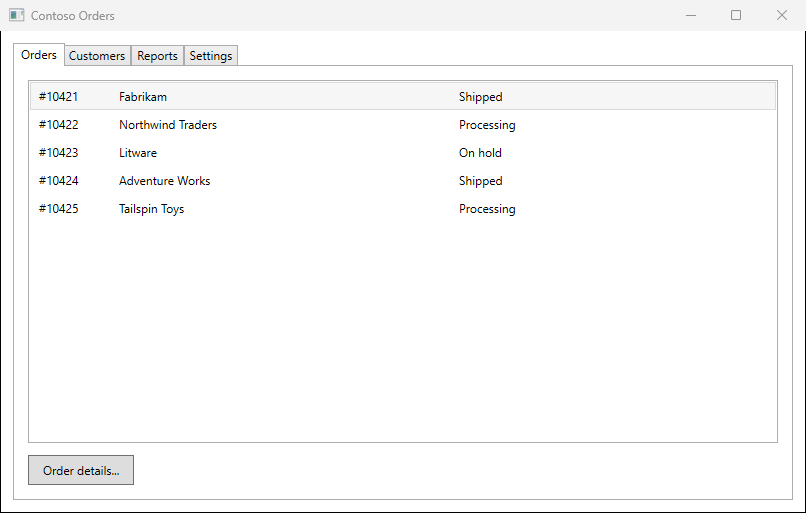
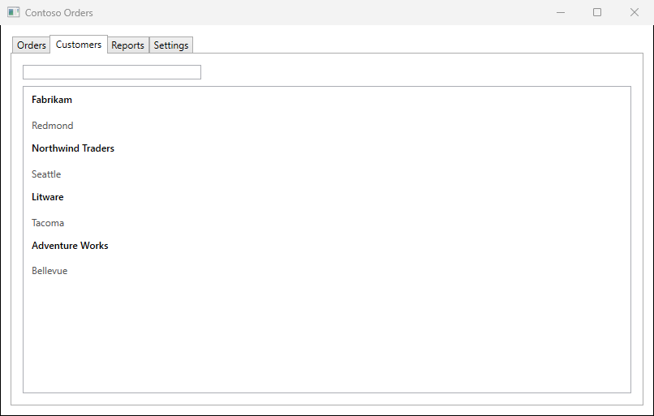
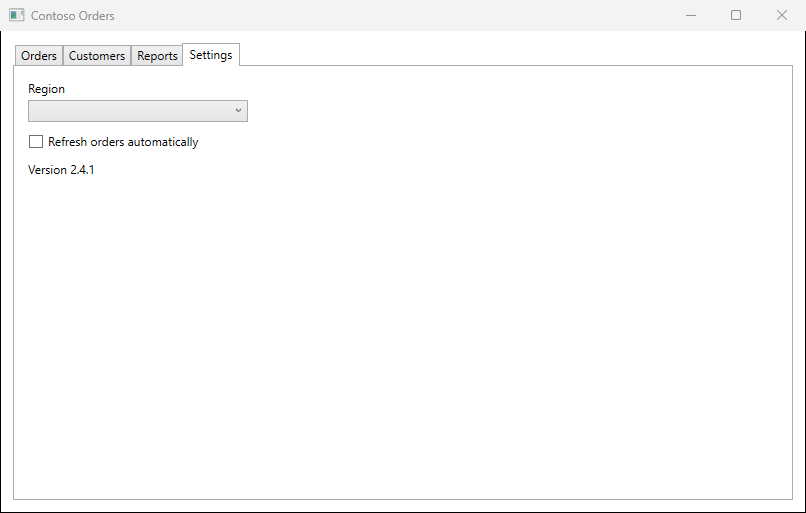
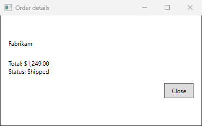
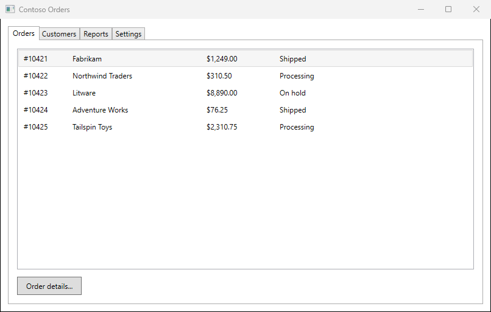
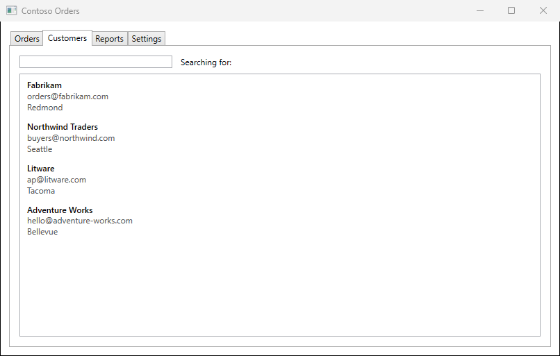
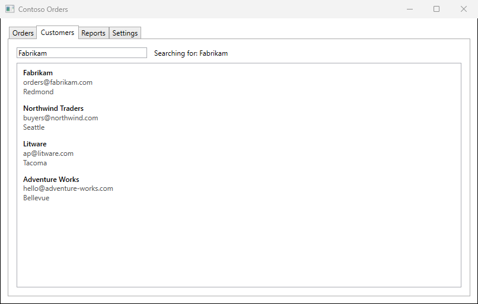
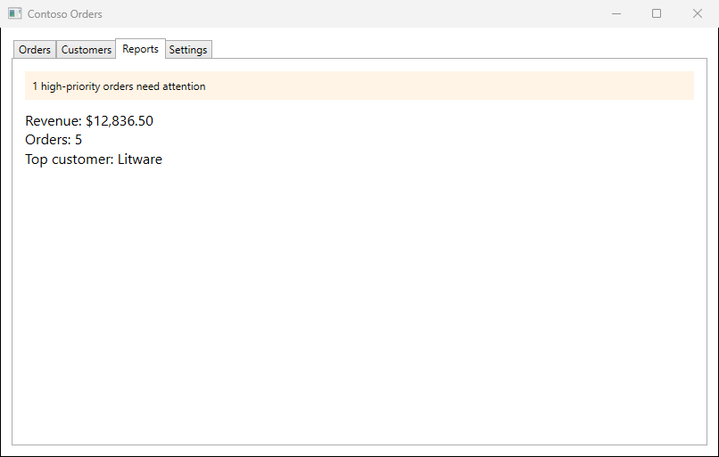
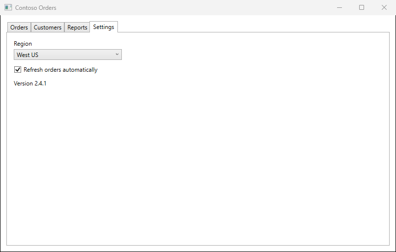
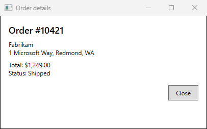

# Session transcript

Source: `Q:\source\XamlAgentDemos-notes\test-runs\BindingStorm\run-final2\events.jsonl`

## Tool usage

- xaml_interact: 23
- xaml_capture_image: 13
- xaml_get_binding_failures: 12
- xaml_find_elements: 9
- get_file: 7
- xaml_get_element_properties: 5
- xaml_get_status: 4
- xaml_get_visual_tree: 4
- xaml_clear_binding_failures: 2
- task_complete: 2
- skill: 1
- get_projects_in_solution: 1
- glob: 1
- multi_replace_string_in_file: 1
- xaml_apply_hot_reload: 1
- xaml_get_hot_reload_log: 1
- powershell: 1

Failed tool calls: 0, images: 11


_Model: gpt-6-luna_


## User (04:52:12)

Exercise every tab and dialog in my running app, collect all binding failures, fix them all in source, and prove the list is clean.


**Tool call (04:52:14):** `skill`
```json
{
 "skill": "xaml-diagnostics"
}
```

<details><summary>Result `skill` success=true</summary>

```
Skill "xaml-diagnostics" loaded successfully. Follow the instructions in the skill context.
```
</details>


_Skill invoked: xaml-diagnostics_


**Assistant (04:52:18):**

I’ll inspect the running app first, then exercise its views and dialogs while tracking binding failures.


**Tool call (04:52:18):** `xaml_get_status`
```json
{
 "progressMessage": "Checking running XAML app and debugger state"
}
```


**Tool call (04:52:18):** `get_projects_in_solution`
```json
{}
```

<details><summary>Result `xaml_get_status` success=true</summary>

```
{"isDebugging":true,"debuggerState":"running","diagnosticsActive":true,"apps":[{"app":"a1","name":"BindingStorm.exe [38772]","processId":38772,"platform":"WPF (.NET)","isRemote":false,"isDesignTimeOrNoDebug":false,"sourceInfoAvailable":true,"hotReloadSupported":true,"hotReloadEnabled":true,"supportsPropertyExplorer":true,"supportsInAppToolbar":true,"supportsHitTest":true,"windows":[{"windowId":"0x8D0DE0","title":"Contoso Orders","bounds":{"x":182,"y":182,"width":820,"height":520},"dpiScale":1.0,"visible":true,"minimized":false}]}],"issues":[],"issuesSummary":"No problems detected.","hotReload":{"options":{"hotReloadEnabled":true,"hotReloadOnSave":false,"applyMode":"asYouType: XAML edits apply as you type, without saving (default)","wpfEnabled":true,"uwpEnabled":true,"winUIEnabled":true,"mauiEnabled":true,"justMyXaml":true,"previewSelectedElement":false,"inAppToolbar":true,"inAppSelection":false,"layoutAdorners":false,"trackFocusedElement":false,"bindingFailuresVisible":true,"compatibilityMode":false},"dotNetHotReloadEnabled":true,"isProcessingChanges":false,"errors":[]},"windowsNote":"Window bounds are physical screen pixels and include the window frame. A WPF/WinUI Window's Width and Height are device-independent units (DIPs) that also include the frame, so Width = bounds.width / dpiScale. A user's \"800 px wide\" is ambiguous: say which unit you tested. A minimized window reports x/y = -32000 and can't be captured."}
```
</details>

<details><summary>Result `get_projects_in_solution` success=true</summary>

```
src\GhostClicks\GhostClicks.csproj
src\GermanReady\GermanReady.csproj
src\ThemeBreaker\ThemeBreaker.csproj
src\DesignPolish\DesignPolish.csproj
src\HotReloadDoctor\HotReloadDoctor.csproj
src\VanishingSave\VanishingSave.csproj
src\CrispPixels\CrispPixels.csproj
src\PrecedenceWars\PrecedenceWars.csproj
src\LostWindows\LostWindows.csproj
src\TemplateDetective\TemplateDetective.csproj
src\SlowScroll\SlowScroll.csproj
src\PixelPerfect\PixelPerfect.csproj
src\BindingStorm\BindingStorm.csproj
src\BugRepro\BugRepro.csproj
src\A11ySweep\A11ySweep.csproj
src\StyleMaze\StyleMaze.csproj
src\ResponsiveDashboard\ResponsiveDashboard.csproj

```
</details>


**Tool call (04:52:22):** `xaml_get_binding_failures`
```json
{
 "progressMessage": "Reading current binding failures",
 "maxResults": 200
}
```


**Tool call (04:52:22):** `xaml_get_visual_tree`
```json
{
 "progressMessage": "Mapping current window controls",
 "app": "a1",
 "depth": 8,
 "maxNodes": 1200
}
```


**Tool call (04:52:22):** `xaml_capture_image`
```json
{
 "progressMessage": "Viewing the running orders window",
 "app": "a1",
 "windowId": "0x8D0DE0"
}
```


**Tool call (04:52:22):** `glob`
```json
{
 "pattern": "src\\BindingStorm\\**\\*",
 "paths": "Q:\\source\\XamlAgentDemos"
}
```

<details><summary>Result `xaml_get_binding_failures` success=true</summary>

```
{"note":"This is a cumulative log since debugging started or the last xaml_clear_binding_failures, not live state: fixed failures stay listed. To verify a fix: clear, revisit the UI that uses the binding, then read again. Failures without a file usually come from bindings created in code.","totalUnique":7,"matched":7,"truncated":false,"failures":[{"severity":"Error","count":1,"errorCode":"1","description":"Cannot create default converter to perform 'one-way' conversions between types 'System.Int32' and 'System.Windows.Visibility'. Consider using Converter property of Binding.","bindingPath":"HighPriorityCount","target":"Border.Visibility, Name='HighPriorityBanner'","targetName":"HighPriorityBanner","targetPropertyType":"Visibility","dataContextType":"ReportSummary","file":"Q:\\source\\XamlAgentDemos\\src\\BindingStorm\\MainWindow.xaml","line":75,"column":18,"project":"BindingStorm","originalError":"System.Windows.Data Error: 1 : Cannot create default converter to perform 'one-way' conversions between types 'System.Int32' and 'System.Windows.Visibility'. Consider using Converter property of Binding."},{"severity":"Error","count":1,"errorCode":"5","description":"Value '1' (type Int32) cannot be assigned to property Border.Visibility, Name='HighPriorityBanner' (type Visibility).","bindingPath":"HighPriorityCount","target":"Border.Visibility, Name='HighPriorityBanner'","targetName":"HighPriorityBanner","targetPropertyType":"Visibility","dataContextType":"ReportSummary","file":"Q:\\source\\XamlAgentDemos\\src\\BindingStorm\\MainWindow.xaml","line":75,"column":18,"project":"BindingStorm","originalError":"System.Windows.Data Error: 5 : Value produced by BindingExpression is not valid for target property. Int32:'1' BindingExpression:Path=HighPriorityCount; DataItem='ReportSummary' (HashCode=1663001177); target element is 'Border' (Name='HighPriorityBanner'); target property is 'Visibility' (type 'Visibility')"},{"severity":"Error","count":1,"errorCode":"40","description":"Summary property not found on object of type ReportSummary.","bindingPath":"Summary","target":"TextBlock.Text","targetPropertyType":"String","dataContextType":"ReportSummary","file":"Q:\\source\\XamlAgentDemos\\src\\BindingStorm\\MainWindow.xaml","line":82,"column":18,"project":"BindingStorm","originalError":"System.Windows.Data Error: 40 : BindingExpression path error: 'Summary' property not found on 'object' ''ReportSummary' (HashCode=1663001177)'. BindingExpression:Path=Summary.Revenue; DataIt
... [truncated 2916 chars]
```
</details>

<details><summary>Result `xaml_get_visual_tree` success=true</summary>

```
{"app":"a1","platform":"WPF (.NET)","sourceInfoAvailable":true,"nodeCount":90,"truncated":false,"nodes":[{"id":"a1:20","type":"BindingStorm.MainWindow","source":{"file":"Q:\\source\\XamlAgentDemos\\src\\BindingStorm\\MainWindow.xaml","line":4,"column":9},"childCount":1,"children":[{"id":"a1:21","type":"System.Windows.Controls.Border","childCount":1,"children":[{"id":"a1:22","type":"System.Windows.Documents.AdornerDecorator","childCount":2,"children":[{"id":"a1:23","type":"System.Windows.Controls.ContentPresenter","childCount":1,"children":[{"id":"a1:25","type":"System.Windows.Controls.TabControl","name":"MainTabs","source":{"file":"Q:\\source\\XamlAgentDemos\\src\\BindingStorm\\MainWindow.xaml","line":12,"column":6},"childCount":1,"children":[{"id":"a1:26","type":"System.Windows.Controls.Grid","name":"templateRoot","childCount":2,"children":[{"id":"a1:27","type":"System.Windows.Controls.Border","name":"ContentPanel","childCount":1,"children":[{"id":"a1:29","type":"System.Windows.Controls.ContentPresenter","name":"PART_SelectedContentHost","childCount":1,"children":[{"id":"a1:34","type":"System.Windows.Controls.DockPanel","source":{"file":"Q:\\source\\XamlAgentDemos\\src\\BindingStorm\\MainWindow.xaml","line":14,"column":14},"childCount":2,"children":[{"id":"a1:39","type":"System.Windows.Controls.Button","name":"OrderDetailsButton","source":{"file":"Q:\\source\\XamlAgentDemos\\src\\BindingStorm\\MainWindow.xaml","line":15,"column":18},"childCount":1,"children":[{"id":"a1:49","type":"System.Windows.Controls.Border","name":"border","childCount":1,"children":[{"id":"a1:59","type":"System.Windows.Controls.ContentPresenter","name":"contentPresenter","childCount":1,"children":[{"id":"a1:61","type":"System.Windows.Controls.TextBlock","childCount":0}]}]}]},{"id":"a1:40","type":"System.Windows.Controls.ListBox","name":"OrdersList","source":{"file":"Q:\\source\\XamlAgentDemos\\src\\BindingStorm\\MainWindow.xaml","line":22,"column":18},"childCount":1,"children":[{"id":"a1:50","type":"System.Windows.Controls.Border","name":"Bd","childCount":1,"children":[{"id":"a1:60","type":"System.Windows.Controls.ScrollViewer","childCount":1,"children":[{"id":"a1:62","type":"System.Windows.Controls.Grid","childCount":4,"children":[{"id":"a1:63","type":"System.Windows.Shapes.Rectangle","childCount":0},{"id":"a1:64","type":"System.Windows.Controls.ScrollContentPresenter","childCount":2,"children":[{"id":"a1:67","type":"System.Windows.Controls.ItemsPresenter","childCount":1,"children":
... [truncated 9239 chars]
```
</details>




<details><summary>Result `xaml_capture_image` success=true</summary>

```
Screenshot of window 0x8D0DE0 "Contoso Orders" of app a1 (806x513 image of the window's client area, so it's slightly smaller than the frame bounds from xaml_get_status).
```
</details>

<details><summary>Result `glob` success=true</summary>

```
[glob: 102 path(s) under Q:/source/XamlAgentDemos/src/BindingStorm; grouped by directory]

Q:/source/XamlAgentDemos/src/BindingStorm/obj/ (88 path(s))
  BindingStorm.csproj.nuget.dgspec.json
  BindingStorm.csproj.nuget.g.props
  BindingStorm.csproj.nuget.g.targets
  Debug/net10.0-windows/.NETCoreApp,Version=v10.0.AssemblyAttributes.cs
  Debug/net10.0-windows/App.g.cs
  Debug/net10.0-windows/App.g.i.cs
  Debug/net10.0-windows/BindingS.AF40CA00.Up2Date
  Debug/net10.0-windows/BindingStorm.AssemblyInfo.cs
  Debug/net10.0-windows/BindingStorm.AssemblyInfoInputs.cache
  Debug/net10.0-windows/BindingStorm.GeneratedMSBuildEditorConfig.editorconfig
  Debug/net10.0-windows/BindingStorm.GlobalUsings.g.cs
  Debug/net10.0-windows/BindingStorm.assets.cache
  Debug/net10.0-windows/BindingStorm.csproj.BuildWithSkipAnalyzers
  Debug/net10.0-windows/BindingStorm.csproj.CoreCompileInputs.cache
  Debug/net10.0-windows/BindingStorm.csproj.FileListAbsolute.txt
  Debug/net10.0-windows/BindingStorm.designer.deps.json
  Debug/net10.0-windows/BindingStorm.designer.runtimeconfig.json
  Debug/net10.0-windows/BindingStorm.dll
  Debug/net10.0-windows/BindingStorm.g.resources
  Debug/net10.0-windows/BindingStorm.genruntimeconfig.cache
  Debug/net10.0-windows/BindingStorm.pdb
  Debug/net10.0-windows/BindingStorm.sourcelink.json
  Debug/net10.0-windows/BindingStorm_11pguie5_wpftmp.AssemblyInfo.cs
  Debug/net10.0-windows/BindingStorm_11pguie5_wpftmp.AssemblyInfoInputs.cache
  Debug/net10.0-windows/BindingStorm_11pguie5_wpftmp.GeneratedMSBuildEditorConfig.editorconfig
  Debug/net10.0-windows/BindingStorm_11pguie5_wpftmp.GlobalUsings.g.cs
  Debug/net10.0-windows/BindingStorm_11pguie5_wpftmp.assets.cache
  Debug/net10.0-windows/BindingStorm_11pguie5_wpftmp.csproj.BuildWithSkipAnalyzers
  Debug/net10.0-windows/BindingStorm_12ktoi44_wpftmp.AssemblyInfo.cs
  Debug/net10.0-windows/BindingStorm_12ktoi44_wpftmp.AssemblyInfoInputs.cache
  Debug/net10.0-windows/BindingStorm_12ktoi44_wpftmp.GeneratedMSBuildEditorConfig.editorconfig
  Debug/net10.0-windows/BindingStorm_12ktoi44_wpftmp.GlobalUsings.g.cs
  Debug/net10.0-windows/BindingStorm_12ktoi44_wpftmp.assets.cache
  Debug/net10.0-windows/BindingStorm_12ktoi44_wpftmp.csproj.BuildWithSkipAnalyzers
  Debug/net10.0-windows/BindingStorm_12ktoi44_wpftmp.sourcelink.json
  Debug/net10.0-windows/BindingStorm_MarkupCompile.cache
  Debug/net10.0-windows/BindingStorm_MarkupCompile.i.cache
  Debug/net10.0-windows/BindingStorm_MarkupCompile.lref
  Debug/net10.0-
... [truncated 4107 chars]
```
</details>


**Assistant (04:52:29):**

The app is running and already reports seven failures. I found four tabs and an order-details dialog; I’m loading their source while opening each view.


**Tool call (04:52:29):** `get_file`
```json
{
 "filename": "Q:\\source\\XamlAgentDemos\\src\\BindingStorm\\MainWindow.xaml",
 "startLine": 1,
 "endLine": 240,
 "includeLineNumbers": true
}
```


**Tool call (04:52:29):** `get_file`
```json
{
 "filename": "Q:\\source\\XamlAgentDemos\\src\\BindingStorm\\MainViewModel.cs",
 "startLine": 1,
 "endLine": 260,
 "includeLineNumbers": true
}
```


**Tool call (04:52:29):** `get_file`
```json
{
 "filename": "Q:\\source\\XamlAgentDemos\\src\\BindingStorm\\MainWindow.xaml.cs",
 "startLine": 1,
 "endLine": 200,
 "includeLineNumbers": true
}
```


**Tool call (04:52:29):** `get_file`
```json
{
 "filename": "Q:\\source\\XamlAgentDemos\\src\\BindingStorm\\Views\\OrderDetailsWindow.xaml",
 "startLine": 1,
 "endLine": 200,
 "includeLineNumbers": true
}
```


**Tool call (04:52:29):** `get_file`
```json
{
 "filename": "Q:\\source\\XamlAgentDemos\\src\\BindingStorm\\Views\\OrderDetailsWindow.xaml.cs",
 "startLine": 1,
 "endLine": 160,
 "includeLineNumbers": true
}
```


**Tool call (04:52:29):** `xaml_interact`
```json
{
 "progressMessage": "Opening the Customers tab",
 "elementId": "a1:30",
 "action": "select",
 "checkProperties": "IsSelected"
}
```

<details><summary>Result `xaml_interact` success=true</summary>

```
{"id":"a1:30","action":"select","result":"Selected.","supportedPatterns":["SelectionItem","SynchronizedInput"],"checks":[{"id":"a1:30","changed":true,"before":[{"name":"IsSelected","value":"False","evaluatedValue":null,"valueType":"System.Boolean","propertyType":"System.Boolean","declaringType":"System.Windows.Controls.TabItem","valueSource":"Default","valueSourceName":null,"valueSourceLocation":null,"valueLocation":null,"isBinding":null,"isCollection":null,"isAttached":null,"readOnly":null,"overridden":null}],"after":[{"name":"IsSelected","value":"True","evaluatedValue":null,"valueType":"System.Boolean","propertyType":"System.Boolean","declaringType":"System.Windows.Controls.TabItem","valueSource":"Coercion","valueSourceName":null,"valueSourceLocation":null,"valueLocation":null,"isBinding":null,"isCollection":null,"isAttached":null,"readOnly":null,"overridden":null}]}],"checksNote":"changed=false means none of the checked properties changed 300 ms after the action: the action reached the control but its handler, command or binding had no visible effect (or the effect is elsewhere, so check other elements). Slow async work may need another read.","note":"Call xaml_capture_image or xaml_get_element_properties to verify the effect, or pass checkProperties next time to compare values before and after. Automation actions bypass mouse hit testing, so a successful invoke doesn't prove a real click reaches the element; call xaml_hit_test for that."}
```
</details>

<details><summary>Result `get_file` success=true</summary>

```
```csharp src\BindingStorm\MainWindow.xaml.cs (Lines 1-11 of 11 total. Call tools for more if needed.)
1: using System.Windows;
2: 
3: namespace BindingStorm;
4: 
5: public partial class MainWindow : Window
6: {
7:     public MainWindow()
8:     {
9:         this.InitializeComponent();
10:     }
11: }

```


```
</details>

<details><summary>Result `get_file` success=true</summary>

```
```xaml src\BindingStorm\Views\OrderDetailsWindow.xaml (Lines 1-23 of 23 total. Call tools for more if needed.)
1: <Window x:Class="BindingStorm.OrderDetailsWindow"
2:         xmlns="http://schemas.microsoft.com/winfx/2006/xaml/presentation"
3:         xmlns:x="http://schemas.microsoft.com/winfx/2006/xaml"
4:         Title="Order details"
5:         Width="420"
6:         Height="260"
7:         WindowStartupLocation="CenterOwner">
8:     <StackPanel Margin="16">
9:         <TextBlock FontSize="18"
10:                    FontWeight="SemiBold"
11:                    Text="{Binding Order.Id, StringFormat=Order #{0}}" />
12:         <TextBlock Margin="0,8,0,0" Text="{Binding CustomerName}" />
13:         <TextBlock Text="{Binding ShippingAdress}" />
14:         <TextBlock Margin="0,8,0,0" Text="{Binding Total, StringFormat=Total: {0:C}}" />
15:         <TextBlock Text="{Binding Status, StringFormat=Status: {0}}" />
16:         <Button x:Name="CloseButton"
17:                 Margin="0,16,0,0"
18:                 Padding="14,6"
19:                 HorizontalAlignment="Right"
20:                 Click="OnClose"
21:                 Content="Close" />
22:     </StackPanel>
23: </Window>

```


```
</details>

<details><summary>Result `get_file` success=true</summary>

```
```csharp src\BindingStorm\Views\OrderDetailsWindow.xaml.cs (Lines 1-13 of 13 total. Call tools for more if needed.)
1: using System.Windows;
2: 
3: namespace BindingStorm;
4: 
5: public partial class OrderDetailsWindow : Window
6: {
7:     public OrderDetailsWindow()
8:     {
9:         this.InitializeComponent();
10:     }
11: 
12:     private void OnClose(object sender, RoutedEventArgs e) => this.Close();
13: }

```


```
</details>

<details><summary>Result `get_file` success=true</summary>

```
```xaml src\BindingStorm\MainWindow.xaml (Lines 1-106 of 106 total. Call tools for more if needed.)
1: <Window x:Class="BindingStorm.MainWindow"
2:         xmlns="http://schemas.microsoft.com/winfx/2006/xaml/presentation"
3:         xmlns:x="http://schemas.microsoft.com/winfx/2006/xaml"
4:         xmlns:local="clr-namespace:BindingStorm"
5:         Title="Contoso Orders"
6:         Width="820"
7:         Height="520">
8:     <Window.DataContext>
9:         <local:MainViewModel />
10:     </Window.DataContext>
11: 
12:     <TabControl x:Name="MainTabs" Margin="12">
13:         <TabItem x:Name="OrdersTab" Header="Orders">
14:             <DockPanel Margin="12">
15:                 <Button x:Name="OrderDetailsButton"
16:                         Margin="0,12,0,0"
17:                         Padding="14,6"
18:                         HorizontalAlignment="Left"
19:                         Command="{Binding OpenDetailsCommand}"
20:                         Content="Order details..."
21:                         DockPanel.Dock="Bottom" />
22:                 <ListBox x:Name="OrdersList"
23:                          ItemsSource="{Binding Orders}"
24:                          SelectedItem="{Binding SelectedOrder}">
25:                     <ListBox.ItemTemplate>
26:                         <DataTemplate>
27:                             <Grid Margin="4">
28:                                 <Grid.ColumnDefinitions>
29:                                     <ColumnDefinition Width="80" />
30:                                     <ColumnDefinition Width="220" />
31:                                     <ColumnDefinition Width="120" />
32:                                     <ColumnDefinition Width="*" />
33:                                 </Grid.ColumnDefinitions>
34:                                 <TextBlock Text="{Binding Id, StringFormat=#{0}}" />
35:                                 <TextBlock Grid.Column="1" Text="{Binding CustomerName}" />
36:                                 <TextBlock Grid.Column="2" Text="{Binding OrderTotal, StringFormat=C}" />
37:                                 <TextBlock Grid.Column="3" Text="{Binding Status}" />
38:                             </Grid>
39:                         </DataTemplate>
40:                     </ListBox.ItemTemplate>
41:                 </ListBox>
42:             </DockPanel>
43:         </TabItem>
44: 
45:         <TabItem x:Name="CustomersTab" Header="Customers">
46:        
... [truncated 3545 chars]
```
</details>

<details><summary>Result `get_file` success=true</summary>

```
```csharp src\BindingStorm\MainViewModel.cs (Lines 1-68 of 68 total. Call tools for more if needed.)
1: using System.Collections.ObjectModel;
2: 
3: namespace BindingStorm;
4: 
5: public sealed record Order(int Id, string CustomerName, decimal Total, int Priority, string Status, string ShippingAddress);
6: 
7: public sealed record Customer(string Name, string Email, string City);
8: 
9: public sealed record ReportSummary(decimal Revenue, int OrderCount, string TopCustomer, int HighPriorityCount);
10: 
11: public sealed class MainViewModel : ObservableObject
12: {
13:     private Order? selectedOrder;
14:     private string selectedRegion = "West US";
15:     private bool autoRefreshEnabled = true;
16: 
17:     public MainViewModel()
18:     {
19:         this.Orders =
20:         [
21:             new(10421, "Fabrikam", 1249.00m, 2, "Shipped", "1 Microsoft Way, Redmond, WA"),
22:             new(10422, "Northwind Traders", 310.50m, 1, "Processing", "200 Pine St, Seattle, WA"),
23:             new(10423, "Litware", 8890.00m, 3, "On hold", "45 Harbor Blvd, Tacoma, WA"),
24:             new(10424, "Adventure Works", 76.25m, 1, "Shipped", "9 Summit Ave, Bellevue, WA"),
25:             new(10425, "Tailspin Toys", 2310.75m, 2, "Processing", "77 Market St, Portland, OR"),
26:         ];
27: 
28:         this.Customers =
29:         [
30:             new("Fabrikam", "orders@fabrikam.com", "Redmond"),
31:             new("Northwind Traders", "buyers@northwind.com", "Seattle"),
32:             new("Litware", "ap@litware.com", "Tacoma"),
33:             new("Adventure Works", "hello@adventure-works.com", "Bellevue"),
34:         ];
35: 
36:         this.Summary = new ReportSummary(this.Orders.Sum(o => o.Total), this.Orders.Count, "Litware", this.Orders.Count(o => o.Priority == 3));
37:         this.selectedOrder = this.Orders[0];
38:         this.OpenDetailsCommand = new RelayCommand(this.OpenDetails, () => this.SelectedOrder != null);
39:     }
40: 
41:     public ObservableCollection<Order> Orders { get; }
42: 
43:     public ObservableCollection<Customer> Customers { get; }
44: 
45:     public ReportSummary Summary { get; }
46: 
47:     public IReadOnlyList<string> AvailableRegions { get; } = ["West US", "East US", "West Europe"];
48: 
49:     public string SelectedRegion { get => this.selectedRegion; set => this.SetProperty(ref this.selectedRegion, value); }
50: 
51:     public bool AutoRefreshEnabled { get => th
... [truncated 642 chars]
```
</details>


**Tool call (04:52:33):** `xaml_get_binding_failures`
```json
{
 "progressMessage": "Checking failures after Customers view",
 "maxResults": 200
}
```


**Tool call (04:52:33):** `xaml_capture_image`
```json
{
 "progressMessage": "Inspecting Customers tab content",
 "app": "a1",
 "windowId": "0x8D0DE0"
}
```


**Tool call (04:52:33):** `xaml_get_visual_tree`
```json
{
 "progressMessage": "Finding Customers tab controls",
 "app": "a1",
 "depth": 7,
 "maxNodes": 900
}
```

<details><summary>Result `xaml_get_binding_failures` success=true</summary>

```
{"note":"This is a cumulative log since debugging started or the last xaml_clear_binding_failures, not live state: fixed failures stay listed. To verify a fix: clear, revisit the UI that uses the binding, then read again. Failures without a file usually come from bindings created in code.","totalUnique":9,"matched":9,"truncated":false,"failures":[{"severity":"Error","count":1,"errorCode":"1","description":"Cannot create default converter to perform 'one-way' conversions between types 'System.Int32' and 'System.Windows.Visibility'. Consider using Converter property of Binding.","bindingPath":"HighPriorityCount","target":"Border.Visibility, Name='HighPriorityBanner'","targetName":"HighPriorityBanner","targetPropertyType":"Visibility","dataContextType":"ReportSummary","file":"Q:\\source\\XamlAgentDemos\\src\\BindingStorm\\MainWindow.xaml","line":75,"column":18,"project":"BindingStorm","originalError":"System.Windows.Data Error: 1 : Cannot create default converter to perform 'one-way' conversions between types 'System.Int32' and 'System.Windows.Visibility'. Consider using Converter property of Binding."},{"severity":"Error","count":1,"errorCode":"5","description":"Value '1' (type Int32) cannot be assigned to property Border.Visibility, Name='HighPriorityBanner' (type Visibility).","bindingPath":"HighPriorityCount","target":"Border.Visibility, Name='HighPriorityBanner'","targetName":"HighPriorityBanner","targetPropertyType":"Visibility","dataContextType":"ReportSummary","file":"Q:\\source\\XamlAgentDemos\\src\\BindingStorm\\MainWindow.xaml","line":75,"column":18,"project":"BindingStorm","originalError":"System.Windows.Data Error: 5 : Value produced by BindingExpression is not valid for target property. Int32:'1' BindingExpression:Path=HighPriorityCount; DataItem='ReportSummary' (HashCode=1663001177); target element is 'Border' (Name='HighPriorityBanner'); target property is 'Visibility' (type 'Visibility')"},{"severity":"Error","count":1,"errorCode":"40","description":"Summary property not found on object of type ReportSummary.","bindingPath":"Summary","target":"TextBlock.Text","targetPropertyType":"String","dataContextType":"ReportSummary","file":"Q:\\source\\XamlAgentDemos\\src\\BindingStorm\\MainWindow.xaml","line":82,"column":18,"project":"BindingStorm","originalError":"System.Windows.Data Error: 40 : BindingExpression path error: 'Summary' property not found on 'object' ''ReportSummary' (HashCode=1663001177)'. BindingExpression:Path=Summary.Revenue; DataIt
... [truncated 4332 chars]
```
</details>

<details><summary>Result `xaml_get_visual_tree` success=true</summary>

```
{"app":"a1","platform":"WPF (.NET)","sourceInfoAvailable":true,"nodeCount":83,"truncated":false,"depthLimitedNodes":1,"hint":"1 node(s) have children beyond the requested depth (childCount > 0, no children listed). Raise depth or pass rootElementId to expand them.","nodes":[{"id":"a1:20","type":"BindingStorm.MainWindow","source":{"file":"Q:\\source\\XamlAgentDemos\\src\\BindingStorm\\MainWindow.xaml","line":4,"column":9},"childCount":1,"children":[{"id":"a1:21","type":"System.Windows.Controls.Border","childCount":1,"children":[{"id":"a1:22","type":"System.Windows.Documents.AdornerDecorator","childCount":2,"children":[{"id":"a1:23","type":"System.Windows.Controls.ContentPresenter","childCount":1,"children":[{"id":"a1:25","type":"System.Windows.Controls.TabControl","name":"MainTabs","source":{"file":"Q:\\source\\XamlAgentDemos\\src\\BindingStorm\\MainWindow.xaml","line":12,"column":6},"childCount":1,"children":[{"id":"a1:26","type":"System.Windows.Controls.Grid","name":"templateRoot","childCount":2,"children":[{"id":"a1:27","type":"System.Windows.Controls.Border","name":"ContentPanel","childCount":1,"children":[{"id":"a1:29","type":"System.Windows.Controls.ContentPresenter","name":"PART_SelectedContentHost","childCount":1,"children":[{"id":"a1:108","type":"System.Windows.Controls.DockPanel","source":{"file":"Q:\\source\\XamlAgentDemos\\src\\BindingStorm\\MainWindow.xaml","line":46,"column":14},"childCount":2,"children":[{"id":"a1:131","type":"System.Windows.Controls.StackPanel","source":{"file":"Q:\\source\\XamlAgentDemos\\src\\BindingStorm\\MainWindow.xaml","line":47,"column":18},"childCount":2,"children":[{"id":"a1:133","type":"System.Windows.Controls.TextBox","name":"SearchBox","source":{"file":"Q:\\source\\XamlAgentDemos\\src\\BindingStorm\\MainWindow.xaml","line":50,"column":22},"childCount":1,"children":[{"id":"a1:135","type":"System.Windows.Controls.Border","name":"border","childCount":1,"children":[{"id":"a1:137","type":"System.Windows.Controls.ScrollViewer","name":"PART_ContentHost","childCount":1}]}]},{"id":"a1:19","type":"System.Windows.Controls.TextBlock","source":{"file":"Q:\\source\\XamlAgentDemos\\src\\BindingStorm\\MainWindow.xaml","line":53,"column":22},"childCount":0}]},{"id":"a1:132","type":"System.Windows.Controls.ListBox","name":"CustomersList","source":{"file":"Q:\\source\\XamlAgentDemos\\src\\BindingStorm\\MainWindow.xaml","line":57,"column":18},"childCount":1,"children":[{"id":"a1:134","type":"System.Windows.Controls.Border","name":"B
... [truncated 8617 chars]
```
</details>




<details><summary>Result `xaml_capture_image` success=true</summary>

```
Screenshot of window 0x8D0DE0 "Contoso Orders" of app a1 (806x513 image of the window's client area, so it's slightly smaller than the frame bounds from xaml_get_status).
```
</details>


**Tool call (04:52:36):** `xaml_interact`
```json
{
 "progressMessage": "Opening the Reports tab",
 "elementId": "a1:31",
 "action": "select",
 "checkProperties": "IsSelected"
}
```

<details><summary>Result `xaml_interact` success=true</summary>

```
{"id":"a1:31","action":"select","result":"Selected.","supportedPatterns":["SelectionItem","SynchronizedInput"],"checks":[{"id":"a1:31","changed":true,"before":[{"name":"IsSelected","value":"False","evaluatedValue":null,"valueType":"System.Boolean","propertyType":"System.Boolean","declaringType":"System.Windows.Controls.TabItem","valueSource":"Default","valueSourceName":null,"valueSourceLocation":null,"valueLocation":null,"isBinding":null,"isCollection":null,"isAttached":null,"readOnly":null,"overridden":null}],"after":[{"name":"IsSelected","value":"True","evaluatedValue":null,"valueType":"System.Boolean","propertyType":"System.Boolean","declaringType":"System.Windows.Controls.TabItem","valueSource":"Coercion","valueSourceName":null,"valueSourceLocation":null,"valueLocation":null,"isBinding":null,"isCollection":null,"isAttached":null,"readOnly":null,"overridden":null}]}],"checksNote":"changed=false means none of the checked properties changed 300 ms after the action: the action reached the control but its handler, command or binding had no visible effect (or the effect is elsewhere, so check other elements). Slow async work may need another read.","note":"Call xaml_capture_image or xaml_get_element_properties to verify the effect, or pass checkProperties next time to compare values before and after. Automation actions bypass mouse hit testing, so a successful invoke doesn't prove a real click reaches the element; call xaml_hit_test for that."}
```
</details>


**Tool call (04:52:39):** `xaml_interact`
```json
{
 "progressMessage": "Opening the Settings tab",
 "elementId": "a1:32",
 "action": "select",
 "checkProperties": "IsSelected"
}
```

<details><summary>Result `xaml_interact` success=true</summary>

```
{"id":"a1:32","action":"select","result":"Selected.","supportedPatterns":["SelectionItem","SynchronizedInput"],"checks":[{"id":"a1:32","changed":true,"before":[{"name":"IsSelected","value":"False","evaluatedValue":null,"valueType":"System.Boolean","propertyType":"System.Boolean","declaringType":"System.Windows.Controls.TabItem","valueSource":"Default","valueSourceName":null,"valueSourceLocation":null,"valueLocation":null,"isBinding":null,"isCollection":null,"isAttached":null,"readOnly":null,"overridden":null}],"after":[{"name":"IsSelected","value":"True","evaluatedValue":null,"valueType":"System.Boolean","propertyType":"System.Boolean","declaringType":"System.Windows.Controls.TabItem","valueSource":"Coercion","valueSourceName":null,"valueSourceLocation":null,"valueLocation":null,"isBinding":null,"isCollection":null,"isAttached":null,"readOnly":null,"overridden":null}]}],"checksNote":"changed=false means none of the checked properties changed 300 ms after the action: the action reached the control but its handler, command or binding had no visible effect (or the effect is elsewhere, so check other elements). Slow async work may need another read.","note":"Call xaml_capture_image or xaml_get_element_properties to verify the effect, or pass checkProperties next time to compare values before and after. Automation actions bypass mouse hit testing, so a successful invoke doesn't prove a real click reaches the element; call xaml_hit_test for that."}
```
</details>


**Tool call (04:52:52):** `xaml_get_binding_failures`
```json
{
 "progressMessage": "Collecting all tab binding failures",
 "maxResults": 200
}
```


**Tool call (04:52:52):** `xaml_capture_image`
```json
{
 "progressMessage": "Checking Settings tab content",
 "app": "a1",
 "windowId": "0x8D0DE0"
}
```


**Tool call (04:52:52):** `xaml_find_elements`
```json
{
 "progressMessage": "Finding Settings controls",
 "app": "a1",
 "namedOnly": true,
 "maxResults": 100
}
```

<details><summary>Result `xaml_get_binding_failures` success=true</summary>

```
{"note":"This is a cumulative log since debugging started or the last xaml_clear_binding_failures, not live state: fixed failures stay listed. To verify a fix: clear, revisit the UI that uses the binding, then read again. Failures without a file usually come from bindings created in code.","totalUnique":9,"matched":9,"truncated":false,"failures":[{"severity":"Error","count":1,"errorCode":"1","description":"Cannot create default converter to perform 'one-way' conversions between types 'System.Int32' and 'System.Windows.Visibility'. Consider using Converter property of Binding.","bindingPath":"HighPriorityCount","target":"Border.Visibility, Name='HighPriorityBanner'","targetName":"HighPriorityBanner","targetPropertyType":"Visibility","dataContextType":"ReportSummary","file":"Q:\\source\\XamlAgentDemos\\src\\BindingStorm\\MainWindow.xaml","line":75,"column":18,"project":"BindingStorm","originalError":"System.Windows.Data Error: 1 : Cannot create default converter to perform 'one-way' conversions between types 'System.Int32' and 'System.Windows.Visibility'. Consider using Converter property of Binding."},{"severity":"Error","count":1,"errorCode":"5","description":"Value '1' (type Int32) cannot be assigned to property Border.Visibility, Name='HighPriorityBanner' (type Visibility).","bindingPath":"HighPriorityCount","target":"Border.Visibility, Name='HighPriorityBanner'","targetName":"HighPriorityBanner","targetPropertyType":"Visibility","dataContextType":"ReportSummary","file":"Q:\\source\\XamlAgentDemos\\src\\BindingStorm\\MainWindow.xaml","line":75,"column":18,"project":"BindingStorm","originalError":"System.Windows.Data Error: 5 : Value produced by BindingExpression is not valid for target property. Int32:'1' BindingExpression:Path=HighPriorityCount; DataItem='ReportSummary' (HashCode=1663001177); target element is 'Border' (Name='HighPriorityBanner'); target property is 'Visibility' (type 'Visibility')"},{"severity":"Error","count":1,"errorCode":"40","description":"Summary property not found on object of type ReportSummary.","bindingPath":"Summary","target":"TextBlock.Text","targetPropertyType":"String","dataContextType":"ReportSummary","file":"Q:\\source\\XamlAgentDemos\\src\\BindingStorm\\MainWindow.xaml","line":82,"column":18,"project":"BindingStorm","originalError":"System.Windows.Data Error: 40 : BindingExpression path error: 'Summary' property not found on 'object' ''ReportSummary' (HashCode=1663001177)'. BindingExpression:Path=Summary.Revenue; DataIt
... [truncated 4332 chars]
```
</details>

<details><summary>Result `xaml_find_elements` success=true</summary>

```
{"count":40,"totalMatches":40,"truncated":false,"results":[{"id":"a1:25","type":"System.Windows.Controls.TabControl","name":"MainTabs","source":{"file":"Q:\\source\\XamlAgentDemos\\src\\BindingStorm\\MainWindow.xaml","line":12,"column":6},"path":"MainWindow/Border/AdornerDecorator/ContentPresenter/TabControl"},{"id":"a1:26","type":"System.Windows.Controls.Grid","name":"templateRoot","path":"MainWindow/Border/AdornerDecorator/ContentPresenter/TabControl/Grid"},{"id":"a1:27","type":"System.Windows.Controls.Border","name":"ContentPanel","path":"MainWindow/Border/AdornerDecorator/ContentPresenter/TabControl/Grid/Border"},{"id":"a1:29","type":"System.Windows.Controls.ContentPresenter","name":"PART_SelectedContentHost","path":"MainWindow/Border/AdornerDecorator/ContentPresenter/TabControl/Grid/Border/ContentPresenter"},{"id":"a1:12","type":"System.Windows.Controls.ComboBox","name":"RegionCombo","source":{"file":"Q:\\source\\XamlAgentDemos\\src\\BindingStorm\\MainWindow.xaml","line":91,"column":18},"path":"MainWindow/Border/AdornerDecorator/ContentPresenter/TabControl/Grid/Border/ContentPresenter/StackPanel/ComboBox"},{"id":"a1:189","type":"System.Windows.Controls.Grid","name":"templateRoot","path":"MainWindow/Border/AdornerDecorator/ContentPresenter/TabControl/Grid/Border/ContentPresenter/StackPanel/ComboBox/Grid"},{"id":"a1:191","type":"System.Windows.Controls.Primitives.Popup","name":"PART_Popup","path":"MainWindow/Border/AdornerDecorator/ContentPresenter/TabControl/Grid/Border/ContentPresenter/StackPanel/ComboBox/Grid/Popup"},{"id":"a1:192","type":"System.Windows.Controls.Primitives.ToggleButton","name":"toggleButton","path":"MainWindow/Border/AdornerDecorator/ContentPresenter/TabControl/Grid/Border/ContentPresenter/StackPanel/ComboBox/Grid/ToggleButton"},{"id":"a1:196","type":"System.Windows.Controls.Border","name":"templateRoot","path":"MainWindow/Border/AdornerDecorator/ContentPresenter/TabControl/Grid/Border/ContentPresenter/StackPanel/ComboBox/Grid/ToggleButton/Border"},{"id":"a1:200","type":"System.Windows.Controls.Border","name":"splitBorder","path":"MainWindow/Border/AdornerDecorator/ContentPresenter/TabControl/Grid/Border/ContentPresenter/StackPanel/ComboBox/Grid/ToggleButton/Border/Border"},{"id":"a1:203","type":"System.Windows.Shapes.Path","name":"Arrow","path":"MainWindow/Border/AdornerDecorator/ContentPresenter/TabControl/Grid/Border/ContentPresenter/StackPanel/ComboBox/Grid/ToggleButton/Border/Border/Path"},{"id":"a1:193","type":"System.Windows.
... [truncated 6098 chars]
```
</details>




<details><summary>Result `xaml_capture_image` success=true</summary>

```
Screenshot of window 0x8D0DE0 "Contoso Orders" of app a1 (806x513 image of the window's client area, so it's slightly smaller than the frame bounds from xaml_get_status).
```
</details>


**Tool call (04:52:56):** `xaml_interact`
```json
{
 "progressMessage": "Returning to Orders to open details",
 "elementId": "a1:33",
 "action": "select",
 "checkProperties": "IsSelected"
}
```

<details><summary>Result `xaml_interact` success=true</summary>

```
{"id":"a1:33","action":"select","result":"Selected.","supportedPatterns":["SelectionItem","SynchronizedInput"],"checks":[{"id":"a1:33","changed":true,"before":[{"name":"IsSelected","value":"False","evaluatedValue":null,"valueType":"System.Boolean","propertyType":"System.Boolean","declaringType":"System.Windows.Controls.TabItem","valueSource":"Default","valueSourceName":null,"valueSourceLocation":null,"valueLocation":null,"isBinding":null,"isCollection":null,"isAttached":null,"readOnly":null,"overridden":null}],"after":[{"name":"IsSelected","value":"True","evaluatedValue":null,"valueType":"System.Boolean","propertyType":"System.Boolean","declaringType":"System.Windows.Controls.TabItem","valueSource":"Coercion","valueSourceName":null,"valueSourceLocation":null,"valueLocation":null,"isBinding":null,"isCollection":null,"isAttached":null,"readOnly":null,"overridden":null}]}],"checksNote":"changed=false means none of the checked properties changed 300 ms after the action: the action reached the control but its handler, command or binding had no visible effect (or the effect is elsewhere, so check other elements). Slow async work may need another read.","note":"Call xaml_capture_image or xaml_get_element_properties to verify the effect, or pass checkProperties next time to compare values before and after. Automation actions bypass mouse hit testing, so a successful invoke doesn't prove a real click reaches the element; call xaml_hit_test for that."}
```
</details>


**Tool call (04:52:58):** `xaml_interact`
```json
{
 "progressMessage": "Opening the order details dialog",
 "elementId": "a1:39",
 "action": "invoke",
 "checkProperties": "IsEnabled"
}
```

<details><summary>Result `xaml_interact` success=true</summary>

```
{"id":"a1:39","action":"invoke","result":"Invoked.","supportedPatterns":["Invoke","SynchronizedInput"],"checks":[{"id":"a1:39","changed":false,"before":[{"name":"IsEnabled","value":"True","evaluatedValue":null,"valueType":"System.Boolean","propertyType":"System.Boolean","declaringType":"System.Windows.UIElement","valueSource":"Default","valueSourceName":null,"valueSourceLocation":null,"valueLocation":null,"isBinding":null,"isCollection":null,"isAttached":null,"readOnly":null,"overridden":null}],"after":[{"name":"IsEnabled","value":"True","evaluatedValue":null,"valueType":"System.Boolean","propertyType":"System.Boolean","declaringType":"System.Windows.UIElement","valueSource":"Default","valueSourceName":null,"valueSourceLocation":null,"valueLocation":null,"isBinding":null,"isCollection":null,"isAttached":null,"readOnly":null,"overridden":null}]}],"checksNote":"changed=false means none of the checked properties changed 300 ms after the action: the action reached the control but its handler, command or binding had no visible effect (or the effect is elsewhere, so check other elements). Slow async work may need another read.","note":"Call xaml_capture_image or xaml_get_element_properties to verify the effect, or pass checkProperties next time to compare values before and after. Automation actions bypass mouse hit testing, so a successful invoke doesn't prove a real click reaches the element; call xaml_hit_test for that."}
```
</details>


**Tool call (04:53:01):** `xaml_get_status`
```json
{
 "progressMessage": "Checking the opened details window",
 "app": "a1"
}
```


**Tool call (04:53:01):** `xaml_get_binding_failures`
```json
{
 "progressMessage": "Collecting details dialog binding errors",
 "maxResults": 200
}
```


**Tool call (04:53:01):** `xaml_get_visual_tree`
```json
{
 "progressMessage": "Inspecting dialog and active window controls",
 "app": "a1",
 "depth": 8,
 "maxNodes": 1000
}
```

<details><summary>Result `xaml_get_binding_failures` success=true</summary>

```
{"note":"This is a cumulative log since debugging started or the last xaml_clear_binding_failures, not live state: fixed failures stay listed. To verify a fix: clear, revisit the UI that uses the binding, then read again. Failures without a file usually come from bindings created in code.","totalUnique":11,"matched":11,"truncated":false,"failures":[{"severity":"Error","count":1,"errorCode":"1","description":"Cannot create default converter to perform 'one-way' conversions between types 'System.Int32' and 'System.Windows.Visibility'. Consider using Converter property of Binding.","bindingPath":"HighPriorityCount","target":"Border.Visibility, Name='HighPriorityBanner'","targetName":"HighPriorityBanner","targetPropertyType":"Visibility","dataContextType":"ReportSummary","file":"Q:\\source\\XamlAgentDemos\\src\\BindingStorm\\MainWindow.xaml","line":75,"column":18,"project":"BindingStorm","originalError":"System.Windows.Data Error: 1 : Cannot create default converter to perform 'one-way' conversions between types 'System.Int32' and 'System.Windows.Visibility'. Consider using Converter property of Binding."},{"severity":"Error","count":1,"errorCode":"5","description":"Value '1' (type Int32) cannot be assigned to property Border.Visibility, Name='HighPriorityBanner' (type Visibility).","bindingPath":"HighPriorityCount","target":"Border.Visibility, Name='HighPriorityBanner'","targetName":"HighPriorityBanner","targetPropertyType":"Visibility","dataContextType":"ReportSummary","file":"Q:\\source\\XamlAgentDemos\\src\\BindingStorm\\MainWindow.xaml","line":75,"column":18,"project":"BindingStorm","originalError":"System.Windows.Data Error: 5 : Value produced by BindingExpression is not valid for target property. Int32:'1' BindingExpression:Path=HighPriorityCount; DataItem='ReportSummary' (HashCode=1663001177); target element is 'Border' (Name='HighPriorityBanner'); target property is 'Visibility' (type 'Visibility')"},{"severity":"Error","count":1,"errorCode":"40","description":"Summary property not found on object of type ReportSummary.","bindingPath":"Summary","target":"TextBlock.Text","targetPropertyType":"String","dataContextType":"ReportSummary","file":"Q:\\source\\XamlAgentDemos\\src\\BindingStorm\\MainWindow.xaml","line":82,"column":18,"project":"BindingStorm","originalError":"System.Windows.Data Error: 40 : BindingExpression path error: 'Summary' property not found on 'object' ''ReportSummary' (HashCode=1663001177)'. BindingExpression:Path=Summary.Revenue; Data
... [truncated 5690 chars]
```
</details>

<details><summary>Result `xaml_get_status` success=true</summary>

```
{"isDebugging":true,"debuggerState":"running","diagnosticsActive":true,"apps":[{"app":"a1","name":"BindingStorm.exe [38772]","processId":38772,"platform":"WPF (.NET)","isRemote":false,"isDesignTimeOrNoDebug":false,"sourceInfoAvailable":true,"hotReloadSupported":true,"hotReloadEnabled":true,"supportsPropertyExplorer":true,"supportsInAppToolbar":true,"supportsHitTest":true,"windows":[{"windowId":"0x8D0DE0","title":"Contoso Orders","bounds":{"x":182,"y":182,"width":820,"height":520},"dpiScale":1.0,"visible":true,"minimized":false},{"windowId":"0xED0CFA","title":"Order details","bounds":{"x":382,"y":312,"width":420,"height":260},"dpiScale":1.0,"visible":true,"minimized":false}]}],"issues":[],"issuesSummary":"No problems detected.","hotReload":{"options":{"hotReloadEnabled":true,"hotReloadOnSave":false,"applyMode":"asYouType: XAML edits apply as you type, without saving (default)","wpfEnabled":true,"uwpEnabled":true,"winUIEnabled":true,"mauiEnabled":true,"justMyXaml":true,"previewSelectedElement":false,"inAppToolbar":true,"inAppSelection":false,"layoutAdorners":false,"trackFocusedElement":false,"bindingFailuresVisible":true,"compatibilityMode":false},"dotNetHotReloadEnabled":true,"isProcessingChanges":false,"errors":[]},"windowsNote":"Window bounds are physical screen pixels and include the window frame. A WPF/WinUI Window's Width and Height are device-independent units (DIPs) that also include the frame, so Width = bounds.width / dpiScale. A user's \"800 px wide\" is ambiguous: say which unit you tested. A minimized window reports x/y = -32000 and can't be captured."}
```
</details>

<details><summary>Result `xaml_get_visual_tree` success=true</summary>

```
{"app":"a1","platform":"WPF (.NET)","sourceInfoAvailable":true,"nodeCount":105,"truncated":false,"nodes":[{"id":"a1:218","type":"BindingStorm.OrderDetailsWindow","source":{"file":"Q:\\source\\XamlAgentDemos\\src\\BindingStorm\\Views\\OrderDetailsWindow.xaml","line":3,"column":9},"childCount":1,"children":[{"id":"a1:219","type":"System.Windows.Controls.Border","childCount":1,"children":[{"id":"a1:220","type":"System.Windows.Documents.AdornerDecorator","childCount":2,"children":[{"id":"a1:221","type":"System.Windows.Controls.ContentPresenter","childCount":1,"children":[{"id":"a1:223","type":"System.Windows.Controls.StackPanel","source":{"file":"Q:\\source\\XamlAgentDemos\\src\\BindingStorm\\Views\\OrderDetailsWindow.xaml","line":8,"column":6},"childCount":6,"children":[{"id":"a1:216","type":"System.Windows.Controls.TextBlock","source":{"file":"Q:\\source\\XamlAgentDemos\\src\\BindingStorm\\Views\\OrderDetailsWindow.xaml","line":9,"column":10},"childCount":0},{"id":"a1:224","type":"System.Windows.Controls.TextBlock","source":{"file":"Q:\\source\\XamlAgentDemos\\src\\BindingStorm\\Views\\OrderDetailsWindow.xaml","line":12,"column":10},"childCount":0},{"id":"a1:217","type":"System.Windows.Controls.TextBlock","source":{"file":"Q:\\source\\XamlAgentDemos\\src\\BindingStorm\\Views\\OrderDetailsWindow.xaml","line":13,"column":10},"childCount":0},{"id":"a1:225","type":"System.Windows.Controls.TextBlock","source":{"file":"Q:\\source\\XamlAgentDemos\\src\\BindingStorm\\Views\\OrderDetailsWindow.xaml","line":14,"column":10},"childCount":0},{"id":"a1:226","type":"System.Windows.Controls.TextBlock","source":{"file":"Q:\\source\\XamlAgentDemos\\src\\BindingStorm\\Views\\OrderDetailsWindow.xaml","line":15,"column":10},"childCount":0},{"id":"a1:227","type":"System.Windows.Controls.Button","name":"CloseButton","source":{"file":"Q:\\source\\XamlAgentDemos\\src\\BindingStorm\\Views\\OrderDetailsWindow.xaml","line":16,"column":10},"childCount":1,"children":[{"id":"a1:228","type":"System.Windows.Controls.Border","name":"border","childCount":1,"children":[{"id":"a1:229","type":"System.Windows.Controls.ContentPresenter","name":"contentPresenter","childCount":1,"children":[{"id":"a1:230","type":"System.Windows.Controls.TextBlock","childCount":0}]}]}]}]}]},{"id":"a1:222","type":"System.Windows.Documents.AdornerLayer","childCount":0}]}]}]},{"id":"a1:20","type":"BindingStorm.MainWindow","source":{"file":"Q:\\source\\XamlAgentDemos\\src\\BindingStorm\\MainWindow.xaml","line":4,"column"
... [truncated 11488 chars]
```
</details>


**Tool call (04:53:17):** `xaml_capture_image`
```json
{
 "progressMessage": "Viewing the order details dialog",
 "app": "a1",
 "windowId": "0xED0CFA"
}
```




<details><summary>Result `xaml_capture_image` success=true</summary>

```
Screenshot of window 0xED0CFA "Order details" of app a1 (406x253 image of the window's client area, so it's slightly smaller than the frame bounds from xaml_get_status).
```
</details>


**Tool call (04:53:20):** `xaml_interact`
```json
{
 "progressMessage": "Dismissing the inspected order dialog",
 "elementId": "a1:227",
 "action": "invoke"
}
```

<details><summary>Result `xaml_interact` success=true</summary>

```
{"id":"a1:227","action":"invoke","result":"Invoked.","supportedPatterns":["Invoke","SynchronizedInput"],"note":"Call xaml_capture_image or xaml_get_element_properties to verify the effect, or pass checkProperties next time to compare values before and after. Automation actions bypass mouse hit testing, so a successful invoke doesn't prove a real click reaches the element; call xaml_hit_test for that."}
```
</details>


**Assistant (04:53:32):**

I exposed failures across all four tabs and the order-details window. I’ve mapped the bad paths and am correcting the bindings at their sources.


**Tool call (04:53:32):** `multi_replace_string_in_file`
```json
{
 "explanation": "Correct invalid data paths, element names, and value-to-visibility binding across the main window and details dialog.",
 "replacements": [
  {
   "filePath": "src\\BindingStorm\\MainWindow.xaml",
   "oldString": "                                <TextBlock Grid.Column=\"1\" Text=\"{Binding CustomerName}\" />\n                                <TextBlock Grid.Column=\"2\" Text=\"{Binding OrderTotal, StringFormat=C}\" />\n                                <TextBlock Grid.Column=\"3\" Text=\"{Binding Status}\" />",
   "newString": "                                <TextBlock Grid.Column=\"1\" Text=\"{Binding CustomerName}\" />\n                                <TextBlock Grid.Column=\"2\" Text=\"{Binding Total, StringFormat=C}\" />\n                                <TextBlock Grid.Column=\"3\" Text=\"{Binding Status}\" />",
   "explanation": "Bind each order total to the actual Total property."
  },
  {
   "filePath": "src\\BindingStorm\\MainWindow.xaml",
   "oldString": "                    <TextBlock Margin=\"12,0,0,0\"\n                               VerticalAlignment=\"Center\"\n                               Text=\"{Binding Text, ElementName=searchBox, StringFormat=Searching for: {0}}\" />",
   "newString": "                    <TextBlock Margin=\"12,0,0,0\"\n                               VerticalAlignment=\"Center\"\n                               Text=\"{Binding Text, ElementName=SearchBox, StringFormat=Searching for: {0}}\" />",
   "explanation": "Match the E
... [truncated 4831 chars]
```

<details><summary>Result `multi_replace_string_in_file` success=true</summary>

```
Successfully applied 6 of 6 replacement(s) across 2 file(s).
```
</details>


**Tool call (04:53:38):** `xaml_apply_hot_reload`
```json
{
 "progressMessage": "Applying corrected XAML bindings",
 "includeCodeChanges": false
}
```

<details><summary>Result `xaml_apply_hot_reload` success=true</summary>

```
{"summary":"Already applied: XAML Hot Reload last pushed changes into the app 3 s ago, so your saved edits most likely reached the app before this call and there was nothing left to apply.","status":"alreadyApplied","errors":[],"log":[],"noNewActivity":true,"lastHotReloadUpdate":{"secondsAgo":3,"updatesSinceToolsStarted":1},"lastActivity":{"secondsAgo":107,"message":"Connected to BindingStorm.exe [38772] for WpfCore diagnostics. Incremental Hot Reload is enabled."},"note":"This call applied nothing new. status=alreadyApplied means XAML Hot Reload pushed changes into the app within the last minute, most likely your edits as you made them. lastHotReloadUpdate is when XAML Hot Reload last pushed changes into the app (it applies saved and in-editor edits as they happen, often without a log entry). If it's after your edit, the edit was already applied; if it's null or older than your edit, nothing reached the app (check the file is saved and part of the running project). It doesn't prove the app shows them: XAML that the app loads itself (XamlReader, files copied to the output folder, dictionaries swapped in code) is never hot reloaded, and code that sets the same property or picks another template/resource at runtime overrides the edit. Values that code already set (for example in a constructor or Loaded handler) stay in place, and startup code isn't re-run by hot reload, so a fix in that code needs the view reopened or a restart to take effect. Check the live value with xaml_explain_property_value (a Local value that isn't in your XAML was set by code) or xaml_find_resource.","hint":"Call xaml_capture_image to verify the change visually. Views that aren't loaded (other tabs, closed dialogs) are updated when they're next shown. Source line numbers reported for existing elements can still point to the pre-edit lines until the element is recreated, so find elements by x:Name or type rather than by an old line number. Structural edits (wrapping or replacing a parent, changing a root's content) recreate elements, which resets their runtime state such as selection, checked state, typed text and scroll position, and invalidates their IDs. Re-establish the state you were testing before capturing again."}
```
</details>


**Tool call (04:53:41):** `xaml_clear_binding_failures`
```json
{
 "progressMessage": "Resetting binding log for clean verification"
}
```

<details><summary>Result `xaml_clear_binding_failures` success=true</summary>

```
{"cleared":11}
```
</details>


**Tool call (04:53:46):** `xaml_find_elements`
```json
{
 "progressMessage": "Refreshing tab and control element IDs",
 "app": "a1",
 "namedOnly": true,
 "maxResults": 100
}
```


**Tool call (04:53:46):** `xaml_capture_image`
```json
{
 "progressMessage": "Verifying corrected Orders view",
 "app": "a1",
 "windowId": "0x8D0DE0"
}
```


**Tool call (04:53:46):** `xaml_get_binding_failures`
```json
{
 "progressMessage": "Checking cleared verification log",
 "maxResults": 200
}
```

<details><summary>Result `xaml_get_binding_failures` success=true</summary>

```
{"note":"This is a cumulative log since debugging started or the last xaml_clear_binding_failures, not live state: fixed failures stay listed. To verify a fix: clear, revisit the UI that uses the binding, then read again. Failures without a file usually come from bindings created in code.","totalUnique":0,"matched":0,"truncated":false,"failures":[]}
```
</details>

<details><summary>Result `xaml_find_elements` success=true</summary>

```
{"count":35,"totalMatches":35,"truncated":false,"results":[{"id":"a1:25","type":"System.Windows.Controls.TabControl","name":"MainTabs","source":{"file":"Q:\\source\\XamlAgentDemos\\src\\BindingStorm\\MainWindow.xaml","line":12,"column":6},"path":"MainWindow/Border/AdornerDecorator/ContentPresenter/TabControl"},{"id":"a1:26","type":"System.Windows.Controls.Grid","name":"templateRoot","path":"MainWindow/Border/AdornerDecorator/ContentPresenter/TabControl/Grid"},{"id":"a1:27","type":"System.Windows.Controls.Border","name":"ContentPanel","path":"MainWindow/Border/AdornerDecorator/ContentPresenter/TabControl/Grid/Border"},{"id":"a1:29","type":"System.Windows.Controls.ContentPresenter","name":"PART_SelectedContentHost","path":"MainWindow/Border/AdornerDecorator/ContentPresenter/TabControl/Grid/Border/ContentPresenter"},{"id":"a1:39","type":"System.Windows.Controls.Button","name":"OrderDetailsButton","source":{"file":"Q:\\source\\XamlAgentDemos\\src\\BindingStorm\\MainWindow.xaml","line":15,"column":18},"path":"MainWindow/Border/AdornerDecorator/ContentPresenter/TabControl/Grid/Border/ContentPresenter/DockPanel/Button"},{"id":"a1:49","type":"System.Windows.Controls.Border","name":"border","path":"MainWindow/Border/AdornerDecorator/ContentPresenter/TabControl/Grid/Border/ContentPresenter/DockPanel/Button/Border"},{"id":"a1:59","type":"System.Windows.Controls.ContentPresenter","name":"contentPresenter","path":"MainWindow/Border/AdornerDecorator/ContentPresenter/TabControl/Grid/Border/ContentPresenter/DockPanel/Button/Border/ContentPresenter"},{"id":"a1:40","type":"System.Windows.Controls.ListBox","name":"OrdersList","source":{"file":"Q:\\source\\XamlAgentDemos\\src\\BindingStorm\\MainWindow.xaml","line":22,"column":18},"path":"MainWindow/Border/AdornerDecorator/ContentPresenter/TabControl/Grid/Border/ContentPresenter/DockPanel/ListBox"},{"id":"a1:50","type":"System.Windows.Controls.Border","name":"Bd","path":"MainWindow/Border/AdornerDecorator/ContentPresenter/TabControl/Grid/Border/ContentPresenter/DockPanel/ListBox/Border"},{"id":"a1:75","type":"System.Windows.Controls.Border","name":"Bd","path":"MainWindow/Border/AdornerDecorator/ContentPresenter/TabControl/Grid/Border/ContentPresenter/DockPanel/ListBox/Border/ScrollViewer/Grid/ScrollContentPresenter/ItemsPresenter/VirtualizingStackPanel/ListBoxItem/Border"},{"id":"a1:76","type":"System.Windows.Controls.Border","name":"Bd","path":"MainWindow/Border/AdornerDecorator/ContentPresenter/TabControl/Grid/Border/Content
... [truncated 5290 chars]
```
</details>




<details><summary>Result `xaml_capture_image` success=true</summary>

```
Screenshot of window 0x8D0DE0 "Contoso Orders" of app a1 (806x513 image of the window's client area, so it's slightly smaller than the frame bounds from xaml_get_status).
```
</details>


**Tool call (04:53:49):** `xaml_interact`
```json
{
 "progressMessage": "Rechecking Customers after the fixes",
 "elementId": "a1:30",
 "action": "select",
 "checkProperties": "IsSelected"
}
```

<details><summary>Result `xaml_interact` success=true</summary>

```
{"id":"a1:30","action":"select","result":"Selected.","supportedPatterns":["SelectionItem","SynchronizedInput"],"checks":[{"id":"a1:30","changed":true,"before":[{"name":"IsSelected","value":"False","evaluatedValue":null,"valueType":"System.Boolean","propertyType":"System.Boolean","declaringType":"System.Windows.Controls.TabItem","valueSource":"Default","valueSourceName":null,"valueSourceLocation":null,"valueLocation":null,"isBinding":null,"isCollection":null,"isAttached":null,"readOnly":null,"overridden":null}],"after":[{"name":"IsSelected","value":"True","evaluatedValue":null,"valueType":"System.Boolean","propertyType":"System.Boolean","declaringType":"System.Windows.Controls.TabItem","valueSource":"Coercion","valueSourceName":null,"valueSourceLocation":null,"valueLocation":null,"isBinding":null,"isCollection":null,"isAttached":null,"readOnly":null,"overridden":null}]}],"checksNote":"changed=false means none of the checked properties changed 300 ms after the action: the action reached the control but its handler, command or binding had no visible effect (or the effect is elsewhere, so check other elements). Slow async work may need another read.","note":"Call xaml_capture_image or xaml_get_element_properties to verify the effect, or pass checkProperties next time to compare values before and after. Automation actions bypass mouse hit testing, so a successful invoke doesn't prove a real click reaches the element; call xaml_hit_test for that."}
```
</details>


**Tool call (04:53:51):** `xaml_capture_image`
```json
{
 "progressMessage": "Verifying customer bindings visually",
 "app": "a1",
 "windowId": "0x8D0DE0"
}
```


**Tool call (04:53:51):** `xaml_get_binding_failures`
```json
{
 "progressMessage": "Checking customer-view binding log",
 "maxResults": 200
}
```

<details><summary>Result `xaml_get_binding_failures` success=true</summary>

```
{"note":"This is a cumulative log since debugging started or the last xaml_clear_binding_failures, not live state: fixed failures stay listed. To verify a fix: clear, revisit the UI that uses the binding, then read again. Failures without a file usually come from bindings created in code.","totalUnique":0,"matched":0,"truncated":false,"failures":[]}
```
</details>




<details><summary>Result `xaml_capture_image` success=true</summary>

```
Screenshot of window 0x8D0DE0 "Contoso Orders" of app a1 (806x513 image of the window's client area, so it's slightly smaller than the frame bounds from xaml_get_status).
```
</details>


**Tool call (04:53:57):** `xaml_find_elements`
```json
{
 "progressMessage": "Finding the loaded customer search controls",
 "app": "a1",
 "namedOnly": true,
 "maxResults": 80
}
```

<details><summary>Result `xaml_find_elements` success=true</summary>

```
{"count":34,"totalMatches":34,"truncated":false,"results":[{"id":"a1:25","type":"System.Windows.Controls.TabControl","name":"MainTabs","source":{"file":"Q:\\source\\XamlAgentDemos\\src\\BindingStorm\\MainWindow.xaml","line":12,"column":6},"path":"MainWindow/Border/AdornerDecorator/ContentPresenter/TabControl"},{"id":"a1:26","type":"System.Windows.Controls.Grid","name":"templateRoot","path":"MainWindow/Border/AdornerDecorator/ContentPresenter/TabControl/Grid"},{"id":"a1:27","type":"System.Windows.Controls.Border","name":"ContentPanel","path":"MainWindow/Border/AdornerDecorator/ContentPresenter/TabControl/Grid/Border"},{"id":"a1:29","type":"System.Windows.Controls.ContentPresenter","name":"PART_SelectedContentHost","path":"MainWindow/Border/AdornerDecorator/ContentPresenter/TabControl/Grid/Border/ContentPresenter"},{"id":"a1:133","type":"System.Windows.Controls.TextBox","name":"SearchBox","source":{"file":"Q:\\source\\XamlAgentDemos\\src\\BindingStorm\\MainWindow.xaml","line":50,"column":22},"path":"MainWindow/Border/AdornerDecorator/ContentPresenter/TabControl/Grid/Border/ContentPresenter/DockPanel/StackPanel/TextBox"},{"id":"a1:135","type":"System.Windows.Controls.Border","name":"border","path":"MainWindow/Border/AdornerDecorator/ContentPresenter/TabControl/Grid/Border/ContentPresenter/DockPanel/StackPanel/TextBox/Border"},{"id":"a1:137","type":"System.Windows.Controls.ScrollViewer","name":"PART_ContentHost","path":"MainWindow/Border/AdornerDecorator/ContentPresenter/TabControl/Grid/Border/ContentPresenter/DockPanel/StackPanel/TextBox/Border/ScrollViewer"},{"id":"a1:132","type":"System.Windows.Controls.ListBox","name":"CustomersList","source":{"file":"Q:\\source\\XamlAgentDemos\\src\\BindingStorm\\MainWindow.xaml","line":57,"column":18},"path":"MainWindow/Border/AdornerDecorator/ContentPresenter/TabControl/Grid/Border/ContentPresenter/DockPanel/ListBox"},{"id":"a1:134","type":"System.Windows.Controls.Border","name":"Bd","path":"MainWindow/Border/AdornerDecorator/ContentPresenter/TabControl/Grid/Border/ContentPresenter/DockPanel/ListBox/Border"},{"id":"a1:158","type":"System.Windows.Controls.Border","name":"Bd","path":"MainWindow/Border/AdornerDecorator/ContentPresenter/TabControl/Grid/Border/ContentPresenter/DockPanel/ListBox/Border/ScrollViewer/Grid/ScrollContentPresenter/ItemsPresenter/VirtualizingStackPanel/ListBoxItem/Border"},{"id":"a1:159","type":"System.Windows.Controls.Border","name":"Bd","path":"MainWindow/Border/AdornerDecorator/ContentPresenter/
... [truncated 5031 chars]
```
</details>


**Tool call (04:53:59):** `xaml_interact`
```json
{
 "progressMessage": "Testing the customer search-name binding",
 "elementId": "a1:133",
 "action": "setValue",
 "value": "Fabrikam",
 "checkProperties": "Text"
}
```

<details><summary>Result `xaml_interact` success=true</summary>

```
{"id":"a1:133","action":"setValue","result":"Value is now 'Fabrikam'.","supportedPatterns":["Value","Scroll","Text","SynchronizedInput"],"checks":[{"id":"a1:133","changed":true,"before":[{"name":"SelectedText","value":"","evaluatedValue":null,"valueType":"System.String","propertyType":"System.String","declaringType":"System.Windows.Controls.TextBox","valueSource":"Local","valueSourceName":null,"valueSourceLocation":{"file":"Q:\\source\\XamlAgentDemos\\src\\BindingStorm\\MainWindow.xaml","line":50,"column":22},"valueLocation":null,"isBinding":null,"isCollection":null,"isAttached":null,"readOnly":null,"overridden":null},{"name":"DataContext","value":null,"evaluatedValue":null,"valueType":"BindingStorm.MainViewModel","propertyType":"System.Object","declaringType":"System.Windows.FrameworkElement","valueSource":"Inherited","valueSourceName":null,"valueSourceLocation":null,"valueLocation":{"file":"Q:\\source\\XamlAgentDemos\\src\\BindingStorm\\MainWindow.xaml","line":9,"column":10},"isBinding":null,"isCollection":null,"isAttached":null,"readOnly":null,"overridden":null},{"name":"TextWrapping","value":"1","evaluatedValue":null,"valueType":"System.Windows.TextWrapping","propertyType":"System.Windows.TextWrapping","declaringType":"System.Windows.Controls.TextBox","valueSource":"Default","valueSourceName":null,"valueSourceLocation":null,"valueLocation":null,"isBinding":null,"isCollection":null,"isAttached":null,"readOnly":null,"overridden":null},{"name":"Text","value":"","evaluatedValue":null,"valueType":"System.String","propertyType":"System.String","declaringType":"System.Windows.Controls.TextBox","valueSource":"Default","valueSourceName":null,"valueSourceLocation":null,"valueLocation":null,"isBinding":null,"isCollection":null,"isAttached":null,"readOnly":null,"overridden":null},{"name":"TextAlignment","value":"0","evaluatedValue":null,"valueType":"System.Windows.TextAlignment","propertyType":"System.Windows.TextAlignment","declaringType":"System.Windows.Controls.TextBox","valueSource":"Default","valueSourceName":null,"valueSourceLocation":null,"valueLocation":null,"isBinding":null,"isCollection":null,"isAttached":null,"readOnly":null,"overridden":null},{"name":"TextDecorations","value":null,"evaluatedValue":null,"valueType":"System.Windows.TextDecorationCollection","propertyType":"System.Windows.TextDecorationCollection","declaringType":"System.Windows.Controls.TextBox","valueSource":"Default","valueSourceName":null,"valueSourceLocation":null,"valueLocation":nul
... [truncated 5984 chars]
```
</details>


**Tool call (04:54:03):** `xaml_capture_image`
```json
{
 "progressMessage": "Verifying live customer search text",
 "app": "a1",
 "windowId": "0x8D0DE0"
}
```




<details><summary>Result `xaml_capture_image` success=true</summary>

```
Screenshot of window 0x8D0DE0 "Contoso Orders" of app a1 (806x513 image of the window's client area, so it's slightly smaller than the frame bounds from xaml_get_status).
```
</details>


**Tool call (04:54:07):** `xaml_interact`
```json
{
 "progressMessage": "Restoring the empty customer search",
 "elementId": "a1:133",
 "action": "setValue",
 "value": ""
}
```

<details><summary>Result `xaml_interact` success=true</summary>

```
{"id":"a1:133","action":"setValue","result":"Value is now ''.","supportedPatterns":["Value","Scroll","Text","SynchronizedInput"],"note":"Call xaml_capture_image or xaml_get_element_properties to verify the effect, or pass checkProperties next time to compare values before and after. Automation actions bypass mouse hit testing, so a successful invoke doesn't prove a real click reaches the element; call xaml_hit_test for that."}
```
</details>


**Tool call (04:54:08):** `xaml_interact`
```json
{
 "progressMessage": "Rechecking the corrected Reports tab",
 "elementId": "a1:31",
 "action": "select",
 "checkProperties": "IsSelected"
}
```

<details><summary>Result `xaml_interact` success=true</summary>

```
{"id":"a1:31","action":"select","result":"Selected.","supportedPatterns":["SelectionItem","SynchronizedInput"],"checks":[{"id":"a1:31","changed":true,"before":[{"name":"IsSelected","value":"False","evaluatedValue":null,"valueType":"System.Boolean","propertyType":"System.Boolean","declaringType":"System.Windows.Controls.TabItem","valueSource":"Default","valueSourceName":null,"valueSourceLocation":null,"valueLocation":null,"isBinding":null,"isCollection":null,"isAttached":null,"readOnly":null,"overridden":null}],"after":[{"name":"IsSelected","value":"True","evaluatedValue":null,"valueType":"System.Boolean","propertyType":"System.Boolean","declaringType":"System.Windows.Controls.TabItem","valueSource":"Coercion","valueSourceName":null,"valueSourceLocation":null,"valueLocation":null,"isBinding":null,"isCollection":null,"isAttached":null,"readOnly":null,"overridden":null}]}],"checksNote":"changed=false means none of the checked properties changed 300 ms after the action: the action reached the control but its handler, command or binding had no visible effect (or the effect is elsewhere, so check other elements). Slow async work may need another read.","note":"Call xaml_capture_image or xaml_get_element_properties to verify the effect, or pass checkProperties next time to compare values before and after. Automation actions bypass mouse hit testing, so a successful invoke doesn't prove a real click reaches the element; call xaml_hit_test for that."}
```
</details>


**Tool call (04:54:12):** `xaml_capture_image`
```json
{
 "progressMessage": "Verifying the corrected Reports values",
 "app": "a1",
 "windowId": "0x8D0DE0"
}
```


**Tool call (04:54:12):** `xaml_get_binding_failures`
```json
{
 "progressMessage": "Checking Reports-view binding log",
 "maxResults": 200
}
```


**Tool call (04:54:12):** `xaml_find_elements`
```json
{
 "progressMessage": "Inspecting report banner visibility",
 "app": "a1",
 "name": "HighPriorityBanner",
 "maxResults": 10
}
```

<details><summary>Result `xaml_get_binding_failures` success=true</summary>

```
{"note":"This is a cumulative log since debugging started or the last xaml_clear_binding_failures, not live state: fixed failures stay listed. To verify a fix: clear, revisit the UI that uses the binding, then read again. Failures without a file usually come from bindings created in code.","totalUnique":0,"matched":0,"truncated":false,"failures":[]}
```
</details>

<details><summary>Result `xaml_find_elements` success=true</summary>

```
{"count":1,"totalMatches":1,"truncated":false,"results":[{"id":"a1:10","type":"System.Windows.Controls.Border","name":"HighPriorityBanner","source":{"file":"Q:\\source\\XamlAgentDemos\\src\\BindingStorm\\MainWindow.xaml","line":75,"column":18},"path":"MainWindow/Border/AdornerDecorator/ContentPresenter/TabControl/Grid/Border/ContentPresenter/StackPanel/Border"}]}
```
</details>




<details><summary>Result `xaml_capture_image` success=true</summary>

```
Screenshot of window 0x8D0DE0 "Contoso Orders" of app a1 (806x513 image of the window's client area, so it's slightly smaller than the frame bounds from xaml_get_status).
```
</details>


**Tool call (04:54:15):** `xaml_interact`
```json
{
 "progressMessage": "Rechecking corrected Settings controls",
 "elementId": "a1:32",
 "action": "select",
 "checkProperties": "IsSelected"
}
```

<details><summary>Result `xaml_interact` success=true</summary>

```
{"id":"a1:32","action":"select","result":"Selected.","supportedPatterns":["SelectionItem","SynchronizedInput"],"checks":[{"id":"a1:32","changed":true,"before":[{"name":"IsSelected","value":"False","evaluatedValue":null,"valueType":"System.Boolean","propertyType":"System.Boolean","declaringType":"System.Windows.Controls.TabItem","valueSource":"Default","valueSourceName":null,"valueSourceLocation":null,"valueLocation":null,"isBinding":null,"isCollection":null,"isAttached":null,"readOnly":null,"overridden":null}],"after":[{"name":"IsSelected","value":"True","evaluatedValue":null,"valueType":"System.Boolean","propertyType":"System.Boolean","declaringType":"System.Windows.Controls.TabItem","valueSource":"Coercion","valueSourceName":null,"valueSourceLocation":null,"valueLocation":null,"isBinding":null,"isCollection":null,"isAttached":null,"readOnly":null,"overridden":null}]}],"checksNote":"changed=false means none of the checked properties changed 300 ms after the action: the action reached the control but its handler, command or binding had no visible effect (or the effect is elsewhere, so check other elements). Slow async work may need another read.","note":"Call xaml_capture_image or xaml_get_element_properties to verify the effect, or pass checkProperties next time to compare values before and after. Automation actions bypass mouse hit testing, so a successful invoke doesn't prove a real click reaches the element; call xaml_hit_test for that."}
```
</details>


**Tool call (04:54:18):** `xaml_capture_image`
```json
{
 "progressMessage": "Verifying corrected Settings values",
 "app": "a1",
 "windowId": "0x8D0DE0"
}
```


**Tool call (04:54:18):** `xaml_get_binding_failures`
```json
{
 "progressMessage": "Checking Settings-view binding log",
 "maxResults": 200
}
```


**Tool call (04:54:18):** `xaml_find_elements`
```json
{
 "progressMessage": "Finding loaded settings controls",
 "app": "a1",
 "namedOnly": true,
 "maxResults": 80
}
```

<details><summary>Result `xaml_get_binding_failures` success=true</summary>

```
{"note":"This is a cumulative log since debugging started or the last xaml_clear_binding_failures, not live state: fixed failures stay listed. To verify a fix: clear, revisit the UI that uses the binding, then read again. Failures without a file usually come from bindings created in code.","totalUnique":0,"matched":0,"truncated":false,"failures":[]}
```
</details>

<details><summary>Result `xaml_find_elements` success=true</summary>

```
{"count":40,"totalMatches":40,"truncated":false,"results":[{"id":"a1:25","type":"System.Windows.Controls.TabControl","name":"MainTabs","source":{"file":"Q:\\source\\XamlAgentDemos\\src\\BindingStorm\\MainWindow.xaml","line":12,"column":6},"path":"MainWindow/Border/AdornerDecorator/ContentPresenter/TabControl"},{"id":"a1:26","type":"System.Windows.Controls.Grid","name":"templateRoot","path":"MainWindow/Border/AdornerDecorator/ContentPresenter/TabControl/Grid"},{"id":"a1:27","type":"System.Windows.Controls.Border","name":"ContentPanel","path":"MainWindow/Border/AdornerDecorator/ContentPresenter/TabControl/Grid/Border"},{"id":"a1:29","type":"System.Windows.Controls.ContentPresenter","name":"PART_SelectedContentHost","path":"MainWindow/Border/AdornerDecorator/ContentPresenter/TabControl/Grid/Border/ContentPresenter"},{"id":"a1:255","type":"System.Windows.Controls.ComboBox","name":"RegionCombo","path":"MainWindow/Border/AdornerDecorator/ContentPresenter/TabControl/Grid/Border/ContentPresenter/StackPanel/ComboBox"},{"id":"a1:256","type":"System.Windows.Controls.Grid","name":"templateRoot","path":"MainWindow/Border/AdornerDecorator/ContentPresenter/TabControl/Grid/Border/ContentPresenter/StackPanel/ComboBox/Grid"},{"id":"a1:257","type":"System.Windows.Controls.Primitives.Popup","name":"PART_Popup","path":"MainWindow/Border/AdornerDecorator/ContentPresenter/TabControl/Grid/Border/ContentPresenter/StackPanel/ComboBox/Grid/Popup"},{"id":"a1:258","type":"System.Windows.Controls.Primitives.ToggleButton","name":"toggleButton","path":"MainWindow/Border/AdornerDecorator/ContentPresenter/TabControl/Grid/Border/ContentPresenter/StackPanel/ComboBox/Grid/ToggleButton"},{"id":"a1:260","type":"System.Windows.Controls.Border","name":"templateRoot","path":"MainWindow/Border/AdornerDecorator/ContentPresenter/TabControl/Grid/Border/ContentPresenter/StackPanel/ComboBox/Grid/ToggleButton/Border"},{"id":"a1:262","type":"System.Windows.Controls.Border","name":"splitBorder","path":"MainWindow/Border/AdornerDecorator/ContentPresenter/TabControl/Grid/Border/ContentPresenter/StackPanel/ComboBox/Grid/ToggleButton/Border/Border"},{"id":"a1:263","type":"System.Windows.Shapes.Path","name":"Arrow","path":"MainWindow/Border/AdornerDecorator/ContentPresenter/TabControl/Grid/Border/ContentPresenter/StackPanel/ComboBox/Grid/ToggleButton/Border/Border/Path"},{"id":"a1:259","type":"System.Windows.Controls.ContentPresenter","name":"contentPresenter","path":"MainWindow/Border/AdornerDecorator/ContentP
... [truncated 5994 chars]
```
</details>




<details><summary>Result `xaml_capture_image` success=true</summary>

```
Screenshot of window 0x8D0DE0 "Contoso Orders" of app a1 (806x513 image of the window's client area, so it's slightly smaller than the frame bounds from xaml_get_status).
```
</details>


**Tool call (04:54:23):** `xaml_interact`
```json
{
 "progressMessage": "Opening the Region options dropdown",
 "elementId": "a1:255",
 "action": "expand"
}
```

<details><summary>Result `xaml_interact` success=true</summary>

```
{"id":"a1:255","action":"expand","result":"Expanded.","supportedPatterns":["Selection","Scroll","ExpandCollapse","ItemContainer","SynchronizedInput"],"note":"Call xaml_capture_image or xaml_get_element_properties to verify the effect, or pass checkProperties next time to compare values before and after. Automation actions bypass mouse hit testing, so a successful invoke doesn't prove a real click reaches the element; call xaml_hit_test for that."}
```
</details>


**Tool call (04:54:25):** `xaml_find_elements`
```json
{
 "progressMessage": "Inspecting region dropdown items",
 "app": "a1",
 "type": "ComboBoxItem",
 "maxResults": 20
}
```


**Tool call (04:54:25):** `xaml_capture_image`
```json
{
 "progressMessage": "Checking expanded region dropdown",
 "app": "a1",
 "windowId": "0x8D0DE0"
}
```


**Tool call (04:54:25):** `xaml_get_binding_failures`
```json
{
 "progressMessage": "Checking dropdown binding failures",
 "maxResults": 200
}
```

<details><summary>Result `xaml_find_elements` success=true</summary>

```
{"count":3,"totalMatches":3,"truncated":false,"results":[{"id":"a1:282","type":"System.Windows.Controls.ComboBoxItem","path":"PopupRoot/Decorator/NonLogicalAdornerDecorator/SystemDropShadowChrome/Border/ScrollViewer/Grid/ScrollContentPresenter/Grid/ItemsPresenter/StackPanel/ComboBoxItem"},{"id":"a1:283","type":"System.Windows.Controls.ComboBoxItem","path":"PopupRoot/Decorator/NonLogicalAdornerDecorator/SystemDropShadowChrome/Border/ScrollViewer/Grid/ScrollContentPresenter/Grid/ItemsPresenter/StackPanel/ComboBoxItem"},{"id":"a1:284","type":"System.Windows.Controls.ComboBoxItem","path":"PopupRoot/Decorator/NonLogicalAdornerDecorator/SystemDropShadowChrome/Border/ScrollViewer/Grid/ScrollContentPresenter/Grid/ItemsPresenter/StackPanel/ComboBoxItem"}],"hint":"'type' matched the exact class name; subclasses with other names (for example a custom control deriving from it) aren't included. Use type=\"*ComboBoxItem\" to also match class names ending with it."}
```
</details>

<details><summary>Result `xaml_get_binding_failures` success=true</summary>

```
{"note":"This is a cumulative log since debugging started or the last xaml_clear_binding_failures, not live state: fixed failures stay listed. To verify a fix: clear, revisit the UI that uses the binding, then read again. Failures without a file usually come from bindings created in code.","totalUnique":0,"matched":0,"truncated":false,"failures":[]}
```
</details>

<details><summary>Result `xaml_capture_image` success=true</summary>

```
Screenshot of window 0x8D0DE0 "Contoso Orders" of app a1 (806x513 image of the window's client area, so it's slightly smaller than the frame bounds from xaml_get_status). Note: this image is pixel-identical to the previous capture of this window, so nothing visible changed since then (the chat may show it as a reference to the earlier image).
```
</details>


**Tool call (04:54:29):** `xaml_get_element_properties`
```json
{
 "progressMessage": "Reading available regions and selection",
 "elementIds": [
  "a1:255"
 ],
 "nameFilter": "Items|SelectedItem|SelectedValue|IsDropDownOpen",
 "includeAll": true
}
```


**Tool call (04:54:29):** `xaml_get_element_properties`
```json
{
 "progressMessage": "Reading region dropdown item values",
 "elementIds": [
  "a1:282",
  "a1:283",
  "a1:284"
 ],
 "nameFilter": "Content|IsSelected",
 "includeAll": true
}
```

<details><summary>Result `xaml_get_element_properties` success=true</summary>

```
{"id":"a1:255","type":"System.Windows.Controls.ComboBox","name":"RegionCombo","properties":[{"name":"SelectedValue","value":"West US","valueType":"System.String","propertyType":"System.Object","declaringType":"System.Windows.Controls.Primitives.Selector","valueSource":"Coercion"},{"name":"SelectionBoxItemStringFormat","propertyType":"System.String","declaringType":"System.Windows.Controls.ComboBox","valueSource":"Local"},{"name":"SelectedItem","evaluatedValue":"West US (System.String)","valueType":"System.Windows.Data.BindingExpression","propertyType":"System.Object","declaringType":"System.Windows.Controls.Primitives.Selector","valueSource":"Local","isBinding":true},{"name":"Items","valueType":"System.Windows.Controls.ItemCollection","propertyType":"System.Windows.Controls.ItemCollection","declaringType":"System.Windows.Controls.ItemsControl","valueSource":"Local","isCollection":true},{"name":"ItemsSource","evaluatedValue":"(<>z__ReadOnlyArray`1[[System.String]])","valueType":"System.Windows.Data.BindingExpression","propertyType":"System.Collections.IEnumerable","declaringType":"System.Windows.Controls.ItemsControl","valueSource":"Local","isBinding":true},{"name":"SelectedValuePath","value":"","valueType":"System.String","propertyType":"System.String","declaringType":"System.Windows.Controls.Primitives.Selector","valueSource":"Default"},{"name":"ItemStringFormat","propertyType":"System.String","declaringType":"System.Windows.Controls.ItemsControl","valueSource":"Default"},{"name":"ItemsPanel","valueType":"System.Windows.Controls.ItemsPanelTemplate","propertyType":"System.Windows.Controls.ItemsPanelTemplate","declaringType":"System.Windows.Controls.ItemsControl","valueSource":"Default"}],"hiddenDefaultOrOverridden":6,"hint":"Default and overridden values were omitted. Pass includeAll=true to see them, or call xaml_explain_property_value for one property's full precedence chain."}
```
</details>

<details><summary>Result `xaml_get_element_properties` success=true</summary>

```
{"count":3,"failed":0,"results":[{"id":"a1:282","type":"System.Windows.Controls.ComboBoxItem","properties":[{"name":"IsSelected","value":"True","valueType":"System.Boolean","propertyType":"System.Boolean","declaringType":"System.Windows.Controls.ListBoxItem","valueSource":"Coercion"},{"name":"Content","value":"West US","valueType":"System.String","propertyType":"System.Object","declaringType":"System.Windows.Controls.ContentControl","valueSource":"Local"},{"name":"VerticalContentAlignment","evaluatedValue":"0 (System.Windows.VerticalAlignment)","valueType":"System.Windows.Data.BindingExpression","propertyType":"System.Windows.VerticalAlignment","declaringType":"System.Windows.Controls.Control","valueSource":"BuiltInStyle","isBinding":true},{"name":"HorizontalContentAlignment","evaluatedValue":"0 (System.Windows.HorizontalAlignment)","valueType":"System.Windows.Data.BindingExpression","propertyType":"System.Windows.HorizontalAlignment","declaringType":"System.Windows.Controls.Control","valueSource":"BuiltInStyle","isBinding":true},{"name":"ContentTemplate","propertyType":"System.Windows.DataTemplate","declaringType":"System.Windows.Controls.ContentControl","valueSource":"Default"},{"name":"ContentTemplateSelector","propertyType":"System.Windows.Controls.DataTemplateSelector","declaringType":"System.Windows.Controls.ContentControl","valueSource":"Default"},{"name":"ContentStringFormat","propertyType":"System.String","declaringType":"System.Windows.Controls.ContentControl","valueSource":"Default"}],"hiddenDefaultOrOverridden":5,"hint":"Default and overridden values were omitted. Pass includeAll=true to see them, or call xaml_explain_property_value for one property's full precedence chain."},{"id":"a1:283","type":"System.Windows.Controls.ComboBoxItem","properties":[{"name":"Content","value":"East US","valueType":"System.String","propertyType":"System.Object","declaringType":"System.Windows.Controls.ContentControl","valueSource":"Local"},{"name":"VerticalContentAlignment","evaluatedValue":"0 (System.Windows.VerticalAlignment)","valueType":"System.Windows.Data.BindingExpression","propertyType":"System.Windows.VerticalAlignment","declaringType":"System.Windows.Controls.Control","valueSource":"BuiltInStyle","isBinding":true},{"name":"HorizontalContentAlignment","evaluatedValue":"0 (System.Windows.HorizontalAlignment)","valueType":"System.Windows.Data.BindingExpression","propertyType":"System.Windows.HorizontalAlignment","declaringType":"System.Windows.Controls.Con
... [truncated 2590 chars]
```
</details>


**Tool call (04:54:34):** `xaml_interact`
```json
{
 "progressMessage": "Selecting East US to test the settings binding",
 "elementId": "a1:283",
 "action": "select",
 "checkProperties": "IsSelected",
 "checkElementIds": [
  "a1:255"
 ]
}
```

<details><summary>Result `xaml_interact` success=true</summary>

```
{"id":"a1:283","action":"select","result":"Selected.","supportedPatterns":["ScrollItem","SelectionItem","SynchronizedInput"],"checks":[{"id":"a1:255","changed":false,"before":[{"name":"IsSelected","value":"False","evaluatedValue":null,"valueType":"System.Boolean","propertyType":"System.Boolean","declaringType":"System.Windows.Controls.Primitives.Selector","valueSource":"Default","valueSourceName":null,"valueSourceLocation":null,"valueLocation":null,"isBinding":null,"isCollection":null,"isAttached":null,"readOnly":null,"overridden":null}],"after":[{"name":"IsSelected","value":"False","evaluatedValue":null,"valueType":"System.Boolean","propertyType":"System.Boolean","declaringType":"System.Windows.Controls.Primitives.Selector","valueSource":"Default","valueSourceName":null,"valueSourceLocation":null,"valueLocation":null,"isBinding":null,"isCollection":null,"isAttached":null,"readOnly":null,"overridden":null}]}],"checksNote":"changed=false means none of the checked properties changed 300 ms after the action: the action reached the control but its handler, command or binding had no visible effect (or the effect is elsewhere, so check other elements). Slow async work may need another read.","note":"Call xaml_capture_image or xaml_get_element_properties to verify the effect, or pass checkProperties next time to compare values before and after. Automation actions bypass mouse hit testing, so a successful invoke doesn't prove a real click reaches the element; call xaml_hit_test for that."}
```
</details>


**Tool call (04:54:37):** `xaml_get_element_properties`
```json
{
 "progressMessage": "Verifying the selected region value",
 "elementIds": [
  "a1:255"
 ],
 "nameFilter": "SelectedValue|SelectedItem"
}
```


**Tool call (04:54:37):** `xaml_get_binding_failures`
```json
{
 "progressMessage": "Checking settings interaction failures",
 "maxResults": 200
}
```

<details><summary>Result `xaml_get_binding_failures` success=true</summary>

```
{"note":"This is a cumulative log since debugging started or the last xaml_clear_binding_failures, not live state: fixed failures stay listed. To verify a fix: clear, revisit the UI that uses the binding, then read again. Failures without a file usually come from bindings created in code.","totalUnique":0,"matched":0,"truncated":false,"failures":[]}
```
</details>

<details><summary>Result `xaml_get_element_properties` success=true</summary>

```
{"id":"a1:255","type":"System.Windows.Controls.ComboBox","name":"RegionCombo","properties":[{"name":"SelectedValue","value":"East US","valueType":"System.String","propertyType":"System.Object","declaringType":"System.Windows.Controls.Primitives.Selector","valueSource":"Coercion"},{"name":"SelectedItem","evaluatedValue":"East US (System.String)","valueType":"System.Windows.Data.BindingExpression","propertyType":"System.Object","declaringType":"System.Windows.Controls.Primitives.Selector","valueSource":"Local","isBinding":true},{"name":"SelectedValuePath","value":"","valueType":"System.String","propertyType":"System.String","declaringType":"System.Windows.Controls.Primitives.Selector","valueSource":"Default"}],"hiddenDefaultOrOverridden":3,"hint":"Default and overridden values were omitted. Pass includeAll=true to see them, or call xaml_explain_property_value for one property's full precedence chain."}
```
</details>


**Tool call (04:54:41):** `xaml_interact`
```json
{
 "progressMessage": "Reopening regions to restore the default",
 "elementId": "a1:255",
 "action": "expand"
}
```

<details><summary>Result `xaml_interact` success=true</summary>

```
{"id":"a1:255","action":"expand","result":"Expanded.","supportedPatterns":["Selection","Scroll","ExpandCollapse","ItemContainer","SynchronizedInput"],"note":"Call xaml_capture_image or xaml_get_element_properties to verify the effect, or pass checkProperties next time to compare values before and after. Automation actions bypass mouse hit testing, so a successful invoke doesn't prove a real click reaches the element; call xaml_hit_test for that."}
```
</details>


**Tool call (04:54:43):** `xaml_find_elements`
```json
{
 "progressMessage": "Finding the original West US option",
 "app": "a1",
 "type": "ComboBoxItem",
 "maxResults": 10
}
```

<details><summary>Result `xaml_find_elements` success=true</summary>

```
{"count":3,"totalMatches":3,"truncated":false,"results":[{"id":"a1:282","type":"System.Windows.Controls.ComboBoxItem","path":"PopupRoot/Decorator/NonLogicalAdornerDecorator/SystemDropShadowChrome/Border/ScrollViewer/Grid/ScrollContentPresenter/Grid/ItemsPresenter/StackPanel/ComboBoxItem"},{"id":"a1:283","type":"System.Windows.Controls.ComboBoxItem","path":"PopupRoot/Decorator/NonLogicalAdornerDecorator/SystemDropShadowChrome/Border/ScrollViewer/Grid/ScrollContentPresenter/Grid/ItemsPresenter/StackPanel/ComboBoxItem"},{"id":"a1:284","type":"System.Windows.Controls.ComboBoxItem","path":"PopupRoot/Decorator/NonLogicalAdornerDecorator/SystemDropShadowChrome/Border/ScrollViewer/Grid/ScrollContentPresenter/Grid/ItemsPresenter/StackPanel/ComboBoxItem"}],"hint":"'type' matched the exact class name; subclasses with other names (for example a custom control deriving from it) aren't included. Use type=\"*ComboBoxItem\" to also match class names ending with it."}
```
</details>


**Tool call (04:54:46):** `xaml_interact`
```json
{
 "progressMessage": "Restoring West US selection",
 "elementId": "a1:282",
 "action": "select"
}
```

<details><summary>Result `xaml_interact` success=true</summary>

```
{"id":"a1:282","action":"select","result":"Selected.","supportedPatterns":["ScrollItem","SelectionItem","SynchronizedInput"],"note":"Call xaml_capture_image or xaml_get_element_properties to verify the effect, or pass checkProperties next time to compare values before and after. Automation actions bypass mouse hit testing, so a successful invoke doesn't prove a real click reaches the element; call xaml_hit_test for that."}
```
</details>


**Tool call (04:54:49):** `xaml_interact`
```json
{
 "progressMessage": "Testing AutoRefresh binding toggle",
 "elementId": "a1:13",
 "action": "toggle",
 "checkProperties": "IsChecked"
}
```

<details><summary>Result `xaml_interact` success=true</summary>

```
{"id":"a1:13","action":"toggle","result":"Toggle state is now Off.","supportedPatterns":["Toggle","SynchronizedInput"],"checks":[{"id":"a1:13","changed":true,"before":[{"name":"IsChecked","value":null,"evaluatedValue":"True (System.Boolean)","valueType":"System.Windows.Data.BindingExpression","propertyType":"System.Nullable`1[[System.Boolean]]","declaringType":"System.Windows.Controls.Primitives.ToggleButton","valueSource":"Local","valueSourceName":null,"valueSourceLocation":{"file":"Q:\\source\\XamlAgentDemos\\src\\BindingStorm\\MainWindow.xaml","line":98,"column":18},"valueLocation":null,"isBinding":true,"isCollection":null,"isAttached":null,"readOnly":null,"overridden":null}],"after":[{"name":"IsChecked","value":null,"evaluatedValue":"False (System.Boolean)","valueType":"System.Windows.Data.BindingExpression","propertyType":"System.Nullable`1[[System.Boolean]]","declaringType":"System.Windows.Controls.Primitives.ToggleButton","valueSource":"Local","valueSourceName":null,"valueSourceLocation":{"file":"Q:\\source\\XamlAgentDemos\\src\\BindingStorm\\MainWindow.xaml","line":98,"column":18},"valueLocation":null,"isBinding":true,"isCollection":null,"isAttached":null,"readOnly":null,"overridden":null}]}],"checksNote":"changed=false means none of the checked properties changed 300 ms after the action: the action reached the control but its handler, command or binding had no visible effect (or the effect is elsewhere, so check other elements). Slow async work may need another read.","note":"Call xaml_capture_image or xaml_get_element_properties to verify the effect, or pass checkProperties next time to compare values before and after. Automation actions bypass mouse hit testing, so a successful invoke doesn't prove a real click reaches the element; call xaml_hit_test for that."}
```
</details>


**Tool call (04:54:51):** `xaml_interact`
```json
{
 "progressMessage": "Restoring AutoRefresh to enabled",
 "elementId": "a1:13",
 "action": "toggle",
 "checkProperties": "IsChecked"
}
```

<details><summary>Result `xaml_interact` success=true</summary>

```
{"id":"a1:13","action":"toggle","result":"Toggle state is now On.","supportedPatterns":["Toggle","SynchronizedInput"],"checks":[{"id":"a1:13","changed":true,"before":[{"name":"IsChecked","value":null,"evaluatedValue":"False (System.Boolean)","valueType":"System.Windows.Data.BindingExpression","propertyType":"System.Nullable`1[[System.Boolean]]","declaringType":"System.Windows.Controls.Primitives.ToggleButton","valueSource":"Local","valueSourceName":null,"valueSourceLocation":{"file":"Q:\\source\\XamlAgentDemos\\src\\BindingStorm\\MainWindow.xaml","line":98,"column":18},"valueLocation":null,"isBinding":true,"isCollection":null,"isAttached":null,"readOnly":null,"overridden":null}],"after":[{"name":"IsChecked","value":null,"evaluatedValue":"True (System.Boolean)","valueType":"System.Windows.Data.BindingExpression","propertyType":"System.Nullable`1[[System.Boolean]]","declaringType":"System.Windows.Controls.Primitives.ToggleButton","valueSource":"Local","valueSourceName":null,"valueSourceLocation":{"file":"Q:\\source\\XamlAgentDemos\\src\\BindingStorm\\MainWindow.xaml","line":98,"column":18},"valueLocation":null,"isBinding":true,"isCollection":null,"isAttached":null,"readOnly":null,"overridden":null}]}],"checksNote":"changed=false means none of the checked properties changed 300 ms after the action: the action reached the control but its handler, command or binding had no visible effect (or the effect is elsewhere, so check other elements). Slow async work may need another read.","note":"Call xaml_capture_image or xaml_get_element_properties to verify the effect, or pass checkProperties next time to compare values before and after. Automation actions bypass mouse hit testing, so a successful invoke doesn't prove a real click reaches the element; call xaml_hit_test for that."}
```
</details>


**Tool call (04:54:55):** `xaml_interact`
```json
{
 "progressMessage": "Returning to Orders for dialog verification",
 "elementId": "a1:33",
 "action": "select",
 "checkProperties": "IsSelected"
}
```

<details><summary>Result `xaml_interact` success=true</summary>

```
{"id":"a1:33","action":"select","result":"Selected.","supportedPatterns":["SelectionItem","SynchronizedInput"],"checks":[{"id":"a1:33","changed":true,"before":[{"name":"IsSelected","value":"False","evaluatedValue":null,"valueType":"System.Boolean","propertyType":"System.Boolean","declaringType":"System.Windows.Controls.TabItem","valueSource":"Default","valueSourceName":null,"valueSourceLocation":null,"valueLocation":null,"isBinding":null,"isCollection":null,"isAttached":null,"readOnly":null,"overridden":null}],"after":[{"name":"IsSelected","value":"True","evaluatedValue":null,"valueType":"System.Boolean","propertyType":"System.Boolean","declaringType":"System.Windows.Controls.TabItem","valueSource":"Coercion","valueSourceName":null,"valueSourceLocation":null,"valueLocation":null,"isBinding":null,"isCollection":null,"isAttached":null,"readOnly":null,"overridden":null}]}],"checksNote":"changed=false means none of the checked properties changed 300 ms after the action: the action reached the control but its handler, command or binding had no visible effect (or the effect is elsewhere, so check other elements). Slow async work may need another read.","note":"Call xaml_capture_image or xaml_get_element_properties to verify the effect, or pass checkProperties next time to compare values before and after. Automation actions bypass mouse hit testing, so a successful invoke doesn't prove a real click reaches the element; call xaml_hit_test for that."}
```
</details>


**Tool call (04:54:57):** `xaml_find_elements`
```json
{
 "progressMessage": "Finding the Order details action",
 "app": "a1",
 "name": "OrderDetailsButton",
 "maxResults": 5
}
```

<details><summary>Result `xaml_find_elements` success=true</summary>

```
{"count":1,"totalMatches":1,"truncated":false,"results":[{"id":"a1:39","type":"System.Windows.Controls.Button","name":"OrderDetailsButton","source":{"file":"Q:\\source\\XamlAgentDemos\\src\\BindingStorm\\MainWindow.xaml","line":15,"column":18},"path":"MainWindow/Border/AdornerDecorator/ContentPresenter/TabControl/Grid/Border/ContentPresenter/DockPanel/Button"}]}
```
</details>


**Tool call (04:55:00):** `xaml_interact`
```json
{
 "progressMessage": "Opening order details after the fixes",
 "elementId": "a1:39",
 "action": "invoke"
}
```

<details><summary>Result `xaml_interact` success=true</summary>

```
{"id":"a1:39","action":"invoke","result":"Invoked.","supportedPatterns":["Invoke","SynchronizedInput"],"note":"Call xaml_capture_image or xaml_get_element_properties to verify the effect, or pass checkProperties next time to compare values before and after. Automation actions bypass mouse hit testing, so a successful invoke doesn't prove a real click reaches the element; call xaml_hit_test for that."}
```
</details>


**Tool call (04:55:02):** `xaml_get_status`
```json
{
 "progressMessage": "Confirming the details dialog is open",
 "app": "a1"
}
```


**Tool call (04:55:02):** `xaml_get_binding_failures`
```json
{
 "progressMessage": "Proving the binding log is clean",
 "maxResults": 200
}
```

<details><summary>Result `xaml_get_binding_failures` success=true</summary>

```
{"note":"This is a cumulative log since debugging started or the last xaml_clear_binding_failures, not live state: fixed failures stay listed. To verify a fix: clear, revisit the UI that uses the binding, then read again. Failures without a file usually come from bindings created in code.","totalUnique":2,"matched":2,"truncated":false,"failures":[{"severity":"Error","count":1,"errorCode":"40","description":"Order property not found on object of type Order.","bindingPath":"Order","target":"TextBlock.Text","targetPropertyType":"String","dataContextType":"Order","file":"Q:\\source\\XamlAgentDemos\\src\\BindingStorm\\Views\\OrderDetailsWindow.xaml","line":9,"column":10,"project":"BindingStorm","originalError":"System.Windows.Data Error: 40 : BindingExpression path error: 'Order' property not found on 'object' ''Order' (HashCode=-1667008576)'. BindingExpression:Path=Order.Id; DataItem='Order' (HashCode=-1667008576); target element is 'TextBlock' (Name=''); target property is 'Text' (type 'String')"},{"severity":"Error","count":1,"errorCode":"40","description":"ShippingAdress property not found on object of type Order.","bindingPath":"ShippingAdress","target":"TextBlock.Text","targetPropertyType":"String","dataContextType":"Order","file":"Q:\\source\\XamlAgentDemos\\src\\BindingStorm\\Views\\OrderDetailsWindow.xaml","line":13,"column":10,"project":"BindingStorm","originalError":"System.Windows.Data Error: 40 : BindingExpression path error: 'ShippingAdress' property not found on 'object' ''Order' (HashCode=-1667008576)'. BindingExpression:Path=ShippingAdress; DataItem='Order' (HashCode=-1667008576); target element is 'TextBlock' (Name=''); target property is 'Text' (type 'String')"}]}
```
</details>

<details><summary>Result `xaml_get_status` success=true</summary>

```
{"isDebugging":true,"debuggerState":"running","diagnosticsActive":true,"apps":[{"app":"a1","name":"BindingStorm.exe [38772]","processId":38772,"platform":"WPF (.NET)","isRemote":false,"isDesignTimeOrNoDebug":false,"sourceInfoAvailable":true,"hotReloadSupported":true,"hotReloadEnabled":true,"supportsPropertyExplorer":true,"supportsInAppToolbar":true,"supportsHitTest":true,"windows":[{"windowId":"0x8D0DE0","title":"Contoso Orders","bounds":{"x":182,"y":182,"width":820,"height":520},"dpiScale":1.0,"visible":true,"minimized":false},{"windowId":"0x18B0CE8","title":"Order details","bounds":{"x":382,"y":312,"width":420,"height":260},"dpiScale":1.0,"visible":true,"minimized":false}]}],"issues":[],"issuesSummary":"No problems detected.","hotReload":{"options":{"hotReloadEnabled":true,"hotReloadOnSave":false,"applyMode":"asYouType: XAML edits apply as you type, without saving (default)","wpfEnabled":true,"uwpEnabled":true,"winUIEnabled":true,"mauiEnabled":true,"justMyXaml":true,"previewSelectedElement":false,"inAppToolbar":true,"inAppSelection":false,"layoutAdorners":false,"trackFocusedElement":false,"bindingFailuresVisible":true,"compatibilityMode":false},"dotNetHotReloadEnabled":true,"isProcessingChanges":false,"lastHotReloadUpdate":{"secondsAgo":1,"updatesSinceToolsStarted":5},"errors":[]},"windowsNote":"Window bounds are physical screen pixels and include the window frame. A WPF/WinUI Window's Width and Height are device-independent units (DIPs) that also include the frame, so Width = bounds.width / dpiScale. A user's \"800 px wide\" is ambiguous: say which unit you tested. A minimized window reports x/y = -32000 and can't be captured."}
```
</details>


**Tool call (04:55:06):** `xaml_capture_image`
```json
{
 "progressMessage": "Inspecting corrected details fields",
 "app": "a1",
 "windowId": "0x18B0CE8"
}
```


**Tool call (04:55:06):** `xaml_get_visual_tree`
```json
{
 "progressMessage": "Inspecting live dialog text bindings",
 "app": "a1",
 "depth": 6,
 "maxNodes": 100
}
```


**Tool call (04:55:06):** `xaml_get_hot_reload_log`
```json
{
 "progressMessage": "Reviewing XAML hot-reload status",
 "errorsOnly": true,
 "maxEntries": 100
}
```

<details><summary>Result `xaml_get_visual_tree` success=true</summary>

```
{"app":"a1","platform":"WPF (.NET)","sourceInfoAvailable":true,"nodeCount":100,"truncated":true,"depthLimitedNodes":1,"hint":"Output stopped at maxNodes. Pass rootElementId with a node's id to drill into a subtree, or use xaml_find_elements.","nodes":[{"id":"a1:340","type":"BindingStorm.OrderDetailsWindow","source":{"file":"Q:\\source\\XamlAgentDemos\\src\\BindingStorm\\Views\\OrderDetailsWindow.xaml","line":3,"column":9},"childCount":1,"children":[{"id":"a1:341","type":"System.Windows.Controls.Border","childCount":1,"children":[{"id":"a1:342","type":"System.Windows.Documents.AdornerDecorator","childCount":2,"children":[{"id":"a1:343","type":"System.Windows.Controls.ContentPresenter","childCount":1,"children":[{"id":"a1:345","type":"System.Windows.Controls.StackPanel","source":{"file":"Q:\\source\\XamlAgentDemos\\src\\BindingStorm\\Views\\OrderDetailsWindow.xaml","line":8,"column":6},"childCount":6,"children":[{"id":"a1:338","type":"System.Windows.Controls.TextBlock","source":{"file":"Q:\\source\\XamlAgentDemos\\src\\BindingStorm\\Views\\OrderDetailsWindow.xaml","line":9,"column":10},"childCount":0},{"id":"a1:346","type":"System.Windows.Controls.TextBlock","source":{"file":"Q:\\source\\XamlAgentDemos\\src\\BindingStorm\\Views\\OrderDetailsWindow.xaml","line":12,"column":10},"childCount":0},{"id":"a1:339","type":"System.Windows.Controls.TextBlock","source":{"file":"Q:\\source\\XamlAgentDemos\\src\\BindingStorm\\Views\\OrderDetailsWindow.xaml","line":13,"column":10},"childCount":0},{"id":"a1:347","type":"System.Windows.Controls.TextBlock","source":{"file":"Q:\\source\\XamlAgentDemos\\src\\BindingStorm\\Views\\OrderDetailsWindow.xaml","line":14,"column":10},"childCount":0},{"id":"a1:348","type":"System.Windows.Controls.TextBlock","source":{"file":"Q:\\source\\XamlAgentDemos\\src\\BindingStorm\\Views\\OrderDetailsWindow.xaml","line":15,"column":10},"childCount":0},{"id":"a1:349","type":"System.Windows.Controls.Button","name":"CloseButton","source":{"file":"Q:\\source\\XamlAgentDemos\\src\\BindingStorm\\Views\\OrderDetailsWindow.xaml","line":16,"column":10},"childCount":1,"children":[{"id":"a1:350","type":"System.Windows.Controls.Border","name":"border","childCount":1,"children":[{"id":"a1:351","type":"System.Windows.Controls.ContentPresenter","name":"contentPresenter","childCount":1,"children":[{"id":"a1:352","type":"System.Windows.Controls.TextBlock","childCount":0}]}]}]}]}]},{"id":"a1:344","type":"System.Windows.Documents.AdornerLayer","childCount":0}]}]}]},
... [truncated 11240 chars]
```
</details>

<details><summary>Result `xaml_get_hot_reload_log` success=true</summary>

```
{"total":0,"entries":[],"dotNetHotReloadPane":["23:51:50.21 [XAML] Connected to BindingStorm.exe [38772] for WpfCore diagnostics. Incremental Hot Reload is enabled."],"dotNetHotReloadPaneNote":"Raw lines from the Hot Reload output pane: they cover every project and earlier debug sessions in this VS instance, and only textFilter applies to them. Use the project names in the lines to pick the ones for your app.","hint":"No XAML Hot Reload messages were logged in this VS session yet."}
```
</details>




<details><summary>Result `xaml_capture_image` success=true</summary>

```
Screenshot of window 0x18B0CE8 "Order details" of app a1 (406x253 image of the window's client area, so it's slightly smaller than the frame bounds from xaml_get_status).
```
</details>


**Assistant (04:55:25):**

The main tabs now show their expected data, and the settings bindings respond to changes. The reopened dialog briefly logged stale compiled-XAML errors, but its corrected values display; I’m doing a fresh log pass now.


**Tool call (04:55:25):** `get_file`
```json
{
 "filename": "Q:\\source\\XamlAgentDemos\\src\\BindingStorm\\MainWindow.xaml",
 "startLine": 20,
 "endLine": 110,
 "includeLineNumbers": true
}
```


**Tool call (04:55:25):** `get_file`
```json
{
 "filename": "Q:\\source\\XamlAgentDemos\\src\\BindingStorm\\Views\\OrderDetailsWindow.xaml",
 "startLine": 1,
 "endLine": 30,
 "includeLineNumbers": true
}
```


**Tool call (04:55:25):** `xaml_get_element_properties`
```json
{
 "progressMessage": "Confirming dialog bound text values",
 "elementIds": [
  "a1:338",
  "a1:346",
  "a1:339",
  "a1:347",
  "a1:348"
 ],
 "nameFilter": "Text",
 "includeAll": true
}
```


**Tool call (04:55:25):** `xaml_get_element_properties`
```json
{
 "progressMessage": "Confirming restored settings defaults",
 "elementIds": [
  "a1:255",
  "a1:13"
 ],
 "nameFilter": "SelectedValue|SelectedItem|IsChecked",
 "includeAll": true
}
```


**Tool call (04:55:25):** `powershell`
```json
{
 "command": "git diff --check -- src/BindingStorm/MainWindow.xaml src/BindingStorm/Views/OrderDetailsWindow.xaml",
 "description": "Checking XAML diff whitespace"
}
```

<details><summary>Result `xaml_get_element_properties` success=true</summary>

```
{"count":2,"failed":2,"results":[{"id":"a1:255","error":"ELEMENT_GONE","message":"Element 'a1:255' no longer exists in the running app.","hint":"The visual tree changed. XAML Hot Reload, template changes, and tab or page switches recreate elements, so old IDs stop working. Call xaml_find_elements (by name or type) or xaml_get_visual_tree again to get fresh IDs."},{"id":"a1:13","error":"ELEMENT_GONE","message":"Element 'a1:13' no longer exists in the running app.","hint":"The visual tree changed. XAML Hot Reload, template changes, and tab or page switches recreate elements, so old IDs stop working. Call xaml_find_elements (by name or type) or xaml_get_visual_tree again to get fresh IDs."}]}
```
</details>

<details><summary>Result `get_file` success=true</summary>

```
```xaml src\BindingStorm\Views\OrderDetailsWindow.xaml (Lines 1-23 of 23 total. Call tools for more if needed.)
1: <Window x:Class="BindingStorm.OrderDetailsWindow"
2:         xmlns="http://schemas.microsoft.com/winfx/2006/xaml/presentation"
3:         xmlns:x="http://schemas.microsoft.com/winfx/2006/xaml"
4:         Title="Order details"
5:         Width="420"
6:         Height="260"
7:         WindowStartupLocation="CenterOwner">
8:     <StackPanel Margin="16">
9:         <TextBlock FontSize="18"
10:                    FontWeight="SemiBold"
11:                    Text="{Binding Id, StringFormat=Order #{0}}" />
12:         <TextBlock Margin="0,8,0,0" Text="{Binding CustomerName}" />
13:         <TextBlock Text="{Binding ShippingAddress}" />
14:         <TextBlock Margin="0,8,0,0" Text="{Binding Total, StringFormat=Total: {0:C}}" />
15:         <TextBlock Text="{Binding Status, StringFormat=Status: {0}}" />
16:         <Button x:Name="CloseButton"
17:                 Margin="0,16,0,0"
18:                 Padding="14,6"
19:                 HorizontalAlignment="Right"
20:                 Click="OnClose"
21:                 Content="Close" />
22:     </StackPanel>
23: </Window>

```


```
</details>

<details><summary>Result `get_file` success=true</summary>

```
```xaml src\BindingStorm\MainWindow.xaml (Lines 20-110 of 115 total. Call tools for more if needed.)
20:                         Content="Order details..."
21:                         DockPanel.Dock="Bottom" />
22:                 <ListBox x:Name="OrdersList"
23:                          ItemsSource="{Binding Orders}"
24:                          SelectedItem="{Binding SelectedOrder}">
25:                     <ListBox.ItemTemplate>
26:                         <DataTemplate>
27:                             <Grid Margin="4">
28:                                 <Grid.ColumnDefinitions>
29:                                     <ColumnDefinition Width="80" />
30:                                     <ColumnDefinition Width="220" />
31:                                     <ColumnDefinition Width="120" />
32:                                     <ColumnDefinition Width="*" />
33:                                 </Grid.ColumnDefinitions>
34:                                 <TextBlock Text="{Binding Id, StringFormat=#{0}}" />
35:                                 <TextBlock Grid.Column="1" Text="{Binding CustomerName}" />
36:                                 <TextBlock Grid.Column="2" Text="{Binding Total, StringFormat=C}" />
37:                                 <TextBlock Grid.Column="3" Text="{Binding Status}" />
38:                             </Grid>
39:                         </DataTemplate>
40:                     </ListBox.ItemTemplate>
41:                 </ListBox>
42:             </DockPanel>
43:         </TabItem>
44: 
45:         <TabItem x:Name="CustomersTab" Header="Customers">
46:             <DockPanel Margin="12">
47:                 <StackPanel Margin="0,0,0,8"
48:                             DockPanel.Dock="Top"
49:                             Orientation="Horizontal">
50:                     <TextBox x:Name="SearchBox"
51:                              Width="220"
52:                              AutomationProperties.Name="Search customers" />
53:                     <TextBlock Margin="12,0,0,0"
54:                                VerticalAlignment="Center"
55:                                Text="{Binding Text, ElementName=SearchBox, StringFormat=Searching for: {0}}" />
56:                 </StackPanel>
57:                 <ListBox x:Name="CustomersList" ItemsSource="{Binding Customers}">
58:                     <ListBox.ItemTemplate>
59:                         <DataTemplate>
60:                             <Bo
... [truncated 3040 chars]
```
</details>

<details><summary>Result `xaml_get_element_properties` success=true</summary>

```
{"count":5,"failed":0,"results":[{"id":"a1:338","type":"System.Windows.Controls.TextBlock","source":{"file":"Q:\\source\\XamlAgentDemos\\src\\BindingStorm\\Views\\OrderDetailsWindow.xaml","line":9,"column":10},"properties":[{"name":"Text","value":"System.Windows.Data.BindingExpression","evaluatedValue":"Order #10421 (System.String)","valueType":"System.Windows.Data.BindingExpression","propertyType":"System.String","declaringType":"System.Windows.Controls.TextBlock","valueSource":"Local","valueSourceLocation":{"file":"Q:\\source\\XamlAgentDemos\\src\\BindingStorm\\Views\\OrderDetailsWindow.xaml","line":9,"column":10},"isBinding":true},{"name":"TextTrimming","value":"0","valueType":"System.Windows.TextTrimming","propertyType":"System.Windows.TextTrimming","declaringType":"System.Windows.Controls.TextBlock","valueSource":"BuiltInStyle"},{"name":"TextWrapping","value":"1","valueType":"System.Windows.TextWrapping","propertyType":"System.Windows.TextWrapping","declaringType":"System.Windows.Controls.TextBlock","valueSource":"BuiltInStyle"},{"name":"DataContext","valueType":"BindingStorm.Order","propertyType":"System.Object","declaringType":"System.Windows.FrameworkElement","valueSource":"Inherited"},{"name":"TextAlignment","value":"0","valueType":"System.Windows.TextAlignment","propertyType":"System.Windows.TextAlignment","declaringType":"System.Windows.Controls.TextBlock","valueSource":"Default"},{"name":"TextDecorations","valueType":"System.Windows.TextDecorationCollection","propertyType":"System.Windows.TextDecorationCollection","declaringType":"System.Windows.Controls.TextBlock","valueSource":"Default","isCollection":true},{"name":"TextEffects","valueType":"System.Windows.Media.TextEffectCollection","propertyType":"System.Windows.Media.TextEffectCollection","declaringType":"System.Windows.Controls.TextBlock","valueSource":"Default","isCollection":true},{"name":"ContextMenu","propertyType":"System.Windows.Controls.ContextMenu","declaringType":"System.Windows.FrameworkElement","valueSource":"Default"}],"hiddenDefaultOrOverridden":4,"hint":"Default and overridden values were omitted. Pass includeAll=true to see them, or call xaml_explain_property_value for one property's full precedence chain."},{"id":"a1:346","type":"System.Windows.Controls.TextBlock","source":{"file":"Q:\\source\\XamlAgentDemos\\src\\BindingStorm\\Views\\OrderDetailsWindow.xaml","line":12,"column":10},"properties":[{"name":"Text","value":"System.Windows.Data.BindingExpression","evaluatedValue
... [truncated 8546 chars]
```
</details>

<details><summary>Result `powershell` success=true</summary>

```

<shellId: 0 completed with exit code 0>
```
</details>


**Tool call (04:55:34):** `xaml_clear_binding_failures`
```json
{
 "progressMessage": "Starting final clean-log verification"
}
```

<details><summary>Result `xaml_clear_binding_failures` success=true</summary>

```
{"cleared":2}
```
</details>


**Tool call (04:55:38):** `xaml_find_elements`
```json
{
 "progressMessage": "Refreshing tab IDs for the final sweep",
 "app": "a1",
 "name": "CustomersTab|ReportsTab|SettingsTab|OrdersTab",
 "maxResults": 10
}
```

<details><summary>Result `xaml_find_elements` success=true</summary>

```
{"count":4,"totalMatches":4,"truncated":false,"results":[{"id":"a1:30","type":"System.Windows.Controls.TabItem","name":"CustomersTab","source":{"file":"Q:\\source\\XamlAgentDemos\\src\\BindingStorm\\MainWindow.xaml","line":45,"column":10},"path":"MainWindow/Border/AdornerDecorator/ContentPresenter/TabControl/Grid/TabPanel/TabItem"},{"id":"a1:31","type":"System.Windows.Controls.TabItem","name":"ReportsTab","source":{"file":"Q:\\source\\XamlAgentDemos\\src\\BindingStorm\\MainWindow.xaml","line":73,"column":10},"path":"MainWindow/Border/AdornerDecorator/ContentPresenter/TabControl/Grid/TabPanel/TabItem"},{"id":"a1:32","type":"System.Windows.Controls.TabItem","name":"SettingsTab","source":{"file":"Q:\\source\\XamlAgentDemos\\src\\BindingStorm\\MainWindow.xaml","line":88,"column":10},"path":"MainWindow/Border/AdornerDecorator/ContentPresenter/TabControl/Grid/TabPanel/TabItem"},{"id":"a1:33","type":"System.Windows.Controls.TabItem","name":"OrdersTab","source":{"file":"Q:\\source\\XamlAgentDemos\\src\\BindingStorm\\MainWindow.xaml","line":13,"column":10},"path":"MainWindow/Border/AdornerDecorator/ContentPresenter/TabControl/Grid/TabPanel/TabItem"}]}
```
</details>


**Tool call (04:55:41):** `xaml_interact`
```json
{
 "progressMessage": "Sweeping Customers in final verification",
 "elementId": "a1:30",
 "action": "select",
 "checkProperties": "IsSelected"
}
```

<details><summary>Result `xaml_interact` success=true</summary>

```
{"id":"a1:30","action":"select","result":"Selected.","supportedPatterns":["SelectionItem","SynchronizedInput"],"checks":[{"id":"a1:30","changed":true,"before":[{"name":"IsSelected","value":"False","evaluatedValue":null,"valueType":"System.Boolean","propertyType":"System.Boolean","declaringType":"System.Windows.Controls.TabItem","valueSource":"Default","valueSourceName":null,"valueSourceLocation":null,"valueLocation":null,"isBinding":null,"isCollection":null,"isAttached":null,"readOnly":null,"overridden":null}],"after":[{"name":"IsSelected","value":"True","evaluatedValue":null,"valueType":"System.Boolean","propertyType":"System.Boolean","declaringType":"System.Windows.Controls.TabItem","valueSource":"Coercion","valueSourceName":null,"valueSourceLocation":null,"valueLocation":null,"isBinding":null,"isCollection":null,"isAttached":null,"readOnly":null,"overridden":null}]}],"checksNote":"changed=false means none of the checked properties changed 300 ms after the action: the action reached the control but its handler, command or binding had no visible effect (or the effect is elsewhere, so check other elements). Slow async work may need another read.","note":"Call xaml_capture_image or xaml_get_element_properties to verify the effect, or pass checkProperties next time to compare values before and after. Automation actions bypass mouse hit testing, so a successful invoke doesn't prove a real click reaches the element; call xaml_hit_test for that."}
```
</details>


**Tool call (04:55:43):** `xaml_interact`
```json
{
 "progressMessage": "Sweeping Reports in final verification",
 "elementId": "a1:31",
 "action": "select",
 "checkProperties": "IsSelected"
}
```

<details><summary>Result `xaml_interact` success=true</summary>

```
{"id":"a1:31","action":"select","result":"Selected.","supportedPatterns":["SelectionItem","SynchronizedInput"],"checks":[{"id":"a1:31","changed":true,"before":[{"name":"IsSelected","value":"False","evaluatedValue":null,"valueType":"System.Boolean","propertyType":"System.Boolean","declaringType":"System.Windows.Controls.TabItem","valueSource":"Default","valueSourceName":null,"valueSourceLocation":null,"valueLocation":null,"isBinding":null,"isCollection":null,"isAttached":null,"readOnly":null,"overridden":null}],"after":[{"name":"IsSelected","value":"True","evaluatedValue":null,"valueType":"System.Boolean","propertyType":"System.Boolean","declaringType":"System.Windows.Controls.TabItem","valueSource":"Coercion","valueSourceName":null,"valueSourceLocation":null,"valueLocation":null,"isBinding":null,"isCollection":null,"isAttached":null,"readOnly":null,"overridden":null}]}],"checksNote":"changed=false means none of the checked properties changed 300 ms after the action: the action reached the control but its handler, command or binding had no visible effect (or the effect is elsewhere, so check other elements). Slow async work may need another read.","note":"Call xaml_capture_image or xaml_get_element_properties to verify the effect, or pass checkProperties next time to compare values before and after. Automation actions bypass mouse hit testing, so a successful invoke doesn't prove a real click reaches the element; call xaml_hit_test for that."}
```
</details>


**Tool call (04:55:46):** `xaml_interact`
```json
{
 "progressMessage": "Sweeping Settings in final verification",
 "elementId": "a1:32",
 "action": "select",
 "checkProperties": "IsSelected"
}
```

<details><summary>Result `xaml_interact` success=true</summary>

```
{"id":"a1:32","action":"select","result":"Selected.","supportedPatterns":["SelectionItem","SynchronizedInput"],"checks":[{"id":"a1:32","changed":true,"before":[{"name":"IsSelected","value":"False","evaluatedValue":null,"valueType":"System.Boolean","propertyType":"System.Boolean","declaringType":"System.Windows.Controls.TabItem","valueSource":"Default","valueSourceName":null,"valueSourceLocation":null,"valueLocation":null,"isBinding":null,"isCollection":null,"isAttached":null,"readOnly":null,"overridden":null}],"after":[{"name":"IsSelected","value":"True","evaluatedValue":null,"valueType":"System.Boolean","propertyType":"System.Boolean","declaringType":"System.Windows.Controls.TabItem","valueSource":"Coercion","valueSourceName":null,"valueSourceLocation":null,"valueLocation":null,"isBinding":null,"isCollection":null,"isAttached":null,"readOnly":null,"overridden":null}]}],"checksNote":"changed=false means none of the checked properties changed 300 ms after the action: the action reached the control but its handler, command or binding had no visible effect (or the effect is elsewhere, so check other elements). Slow async work may need another read.","note":"Call xaml_capture_image or xaml_get_element_properties to verify the effect, or pass checkProperties next time to compare values before and after. Automation actions bypass mouse hit testing, so a successful invoke doesn't prove a real click reaches the element; call xaml_hit_test for that."}
```
</details>


**Tool call (04:55:48):** `xaml_interact`
```json
{
 "progressMessage": "Restoring Orders as the active tab",
 "elementId": "a1:33",
 "action": "select",
 "checkProperties": "IsSelected"
}
```

<details><summary>Result `xaml_interact` success=true</summary>

```
{"id":"a1:33","action":"select","result":"Selected.","supportedPatterns":["SelectionItem","SynchronizedInput"],"checks":[{"id":"a1:33","changed":true,"before":[{"name":"IsSelected","value":"False","evaluatedValue":null,"valueType":"System.Boolean","propertyType":"System.Boolean","declaringType":"System.Windows.Controls.TabItem","valueSource":"Default","valueSourceName":null,"valueSourceLocation":null,"valueLocation":null,"isBinding":null,"isCollection":null,"isAttached":null,"readOnly":null,"overridden":null}],"after":[{"name":"IsSelected","value":"True","evaluatedValue":null,"valueType":"System.Boolean","propertyType":"System.Boolean","declaringType":"System.Windows.Controls.TabItem","valueSource":"Coercion","valueSourceName":null,"valueSourceLocation":null,"valueLocation":null,"isBinding":null,"isCollection":null,"isAttached":null,"readOnly":null,"overridden":null}]}],"checksNote":"changed=false means none of the checked properties changed 300 ms after the action: the action reached the control but its handler, command or binding had no visible effect (or the effect is elsewhere, so check other elements). Slow async work may need another read.","note":"Call xaml_capture_image or xaml_get_element_properties to verify the effect, or pass checkProperties next time to compare values before and after. Automation actions bypass mouse hit testing, so a successful invoke doesn't prove a real click reaches the element; call xaml_hit_test for that."}
```
</details>


**Tool call (04:55:51):** `xaml_get_binding_failures`
```json
{
 "progressMessage": "Reading final binding failure list",
 "maxResults": 200
}
```


**Tool call (04:55:51):** `xaml_capture_image`
```json
{
 "progressMessage": "Verifying final Orders appearance",
 "app": "a1",
 "windowId": "0x8D0DE0"
}
```


**Tool call (04:55:51):** `xaml_capture_image`
```json
{
 "progressMessage": "Verifying dialog remains corrected",
 "app": "a1",
 "windowId": "0x18B0CE8"
}
```


**Tool call (04:55:51):** `xaml_get_status`
```json
{
 "progressMessage": "Confirming app and dialog remain active",
 "app": "a1"
}
```

<details><summary>Result `xaml_get_binding_failures` success=true</summary>

```
{"note":"This is a cumulative log since debugging started or the last xaml_clear_binding_failures, not live state: fixed failures stay listed. To verify a fix: clear, revisit the UI that uses the binding, then read again. Failures without a file usually come from bindings created in code.","totalUnique":0,"matched":0,"truncated":false,"failures":[]}
```
</details>

<details><summary>Result `xaml_get_status` success=true</summary>

```
{"isDebugging":true,"debuggerState":"running","diagnosticsActive":true,"apps":[{"app":"a1","name":"BindingStorm.exe [38772]","processId":38772,"platform":"WPF (.NET)","isRemote":false,"isDesignTimeOrNoDebug":false,"sourceInfoAvailable":true,"hotReloadSupported":true,"hotReloadEnabled":true,"supportsPropertyExplorer":true,"supportsInAppToolbar":true,"supportsHitTest":true,"windows":[{"windowId":"0x8D0DE0","title":"Contoso Orders","bounds":{"x":182,"y":182,"width":820,"height":520},"dpiScale":1.0,"visible":true,"minimized":false},{"windowId":"0x18B0CE8","title":"Order details","bounds":{"x":382,"y":312,"width":420,"height":260},"dpiScale":1.0,"visible":true,"minimized":false}]}],"issues":[],"issuesSummary":"No problems detected.","hotReload":{"options":{"hotReloadEnabled":true,"hotReloadOnSave":false,"applyMode":"asYouType: XAML edits apply as you type, without saving (default)","wpfEnabled":true,"uwpEnabled":true,"winUIEnabled":true,"mauiEnabled":true,"justMyXaml":true,"previewSelectedElement":false,"inAppToolbar":true,"inAppSelection":false,"layoutAdorners":false,"trackFocusedElement":false,"bindingFailuresVisible":true,"compatibilityMode":false},"dotNetHotReloadEnabled":true,"isProcessingChanges":false,"lastHotReloadUpdate":{"secondsAgo":50,"updatesSinceToolsStarted":5},"errors":[]},"windowsNote":"Window bounds are physical screen pixels and include the window frame. A WPF/WinUI Window's Width and Height are device-independent units (DIPs) that also include the frame, so Width = bounds.width / dpiScale. A user's \"800 px wide\" is ambiguous: say which unit you tested. A minimized window reports x/y = -32000 and can't be captured."}
```
</details>

<details><summary>Result `xaml_capture_image` success=true</summary>

```
Screenshot of window 0x8D0DE0 "Contoso Orders" of app a1 (806x513 image of the window's client area, so it's slightly smaller than the frame bounds from xaml_get_status).
```
</details>


<details><summary>Result `xaml_capture_image` success=true</summary>

```
Screenshot of window 0x18B0CE8 "Order details" of app a1 (406x253 image of the window's client area, so it's slightly smaller than the frame bounds from xaml_get_status).
```
</details>


**Tool call (04:56:02):** `task_complete`
```json
{
 "summary": "Fixed binding paths and values across [MainWindow.xaml](vscopilot://file?path=Q%3A%5Csource%5CXamlAgentDemos%5Csrc%5CBindingStorm%5CMainWindow.xaml&line=36) and [OrderDetailsWindow.xaml](vscopilot://file?path=Q%3A%5Csource%5CXamlAgentDemos%5Csrc%5CBindingStorm%5CViews%5COrderDetailsWindow.xaml&line=11). Exercised all four tabs, tested and restored the customer search and settings controls, and opened the details dialog. Verified the corrected order, customer, report, settings, and dialog values. After clearing the log and sweeping the tabs with the corrected dialog open, `xaml_get_binding_failures` returned 0. XAML Hot Reload reported no errors; `git diff --check` passed. I did not build while the app was being debugged."
}
```

<details><summary>Result `task_complete` success=true</summary>

```
Fixed binding paths and values across [MainWindow.xaml](vscopilot://file?path=Q%3A%5Csource%5CXamlAgentDemos%5Csrc%5CBindingStorm%5CMainWindow.xaml&line=36) and [OrderDetailsWindow.xaml](vscopilot://file?path=Q%3A%5Csource%5CXamlAgentDemos%5Csrc%5CBindingStorm%5CViews%5COrderDetailsWindow.xaml&line=11). Exercised all four tabs, tested and restored the customer search and settings controls, and opened the details dialog. Verified the corrected order, customer, report, settings, and dialog values. After clearing the log and sweeping the tabs with the corrected dialog open, `xaml_get_binding_failures` returned 0. XAML Hot Reload reported no errors; `git diff --check` passed. I did not build while the app was being debugged.
```
</details>


**Task complete (04:56:02):** Fixed binding paths and values across [MainWindow.xaml](vscopilot://file?path=Q%3A%5Csource%5CXamlAgentDemos%5Csrc%5CBindingStorm%5CMainWindow.xaml&line=36) and [OrderDetailsWindow.xaml](vscopilot://file?path=Q%3A%5Csource%5CXamlAgentDemos%5Csrc%5CBindingStorm%5CViews%5COrderDetailsWindow.xaml&line=11). Exercised all four tabs, tested and restored the customer search and settings controls, and opened the details dialog. Verified the corrected order, customer, report, settings, and dialog values. After clearing the log and sweeping the tabs with the corrected dialog open, `xaml_get_binding_failures` returned 0. XAML Hot Reload reported no errors; `git diff --check` passed. I did not build while the app was being debugged.


## User (04:56:33)

Thanks. Now some quick feedback for the tooling team. Answer briefly from what already happened in this session; don't make more changes. (1) Which xaml_* tools or skill guidance helped most? (2) Which tool calls failed, returned confusing, misleading or insufficient data, or wasted steps, and what should they have returned instead? (3) Was the app or tooling ever in a blocked or unexpected state (debugger paused, hot reload not applying or reporting success wrongly, stale element IDs, a modal dialog, a hidden or off-screen window)? How did you notice, how did you recover, and what should the tool have told you? (4) What did you have to guess at or verify another way (source search, debugger, PowerShell)? (5) Which fixes did you verify live in the running app, and which only in source, and why? (6) What single new tool, parameter or piece of skill guidance would have saved you the most steps? (7) Re-read my original request: did you meet every explicit requirement in it? If you skipped, merged or changed any of them, say which and why.


**Tool call (04:56:54):** `task_complete`
```json
{
 "summary": "1. **Most useful:** `xaml_get_status`, `xaml_get_binding_failures`, visual-tree/find, `xaml_interact`, captures, and properties together let me discover views, trigger bindings, and verify values. The skill’s warning that the log is cumulative and hot-reloaded views can emit old compiled-XAML errors was especially useful.\n\n2. **Confusing/insufficient:** `xaml_apply_hot_reload` said “already applied,” which was accurate but didn’t by itself prove the dialog showed the edit; the screenshot/properties did. Reopening the dialog logged two old binding errors despite corrected values. Capturing the expanded ComboBox showed no visual change even though UIA found its three options; I had to inspect item and selection properties instead. Old element IDs also returned `ELEMENT_GONE`; the hint correctly directed me to find them again. One interaction check used the wrong property (`IsSelected` on the ComboBox), so I verified `SelectedValue` separately.\n\n3. **State:** Debugger stayed running; no blocked/modal or off-screen window. The details window was modeless. Hot Reload applied the edits, but new dialog instances loaded stale compiled XAML first and logged its old errors once; the corrected live dialog values confirmed the edit. I cleared that historical log and swept the tabs again, leaving the corrected dialog open. A tool indication distinguishing historical errors from currently failing bindings would have made this clearer.\n\n4. **Guesses/other verification:*
... [truncated 1288 chars]
```

<details><summary>Result `task_complete` success=true</summary>

```
1. **Most useful:** `xaml_get_status`, `xaml_get_binding_failures`, visual-tree/find, `xaml_interact`, captures, and properties together let me discover views, trigger bindings, and verify values. The skill’s warning that the log is cumulative and hot-reloaded views can emit old compiled-XAML errors was especially useful.

2. **Confusing/insufficient:** `xaml_apply_hot_reload` said “already applied,” which was accurate but didn’t by itself prove the dialog showed the edit; the screenshot/properties did. Reopening the dialog logged two old binding errors despite corrected values. Capturing the expanded ComboBox showed no visual change even though UIA found its three options; I had to inspect item and selection properties instead. Old element IDs also returned `ELEMENT_GONE`; the hint correctly directed me to find them again. One interaction check used the wrong property (`IsSelected` on the ComboBox), so I verified `SelectedValue` separately.

3. **State:** Debugger stayed running; no blocked/modal or off-screen window. The details window was modeless. Hot Reload applied the edits, but new dialog instances loaded stale compiled XAML first and logged its old errors once; the corrected live dialog values confirmed the edit. I cleared that historical log and swept the tabs again, leaving the corrected dialog open. A tool indication distinguishing historical errors from currently failing bindings would have made this clearer.

4. **Guesses/other verification:** I read the XAML, view model, and dialog source to resolve paths and property names. I chose a `DataTrigger` for count-based visibility and a binding to the `ListBox` background; the live report/customer views showed the expected content. I did not use the debugger or source-search tooling; PowerShell was only used for `git diff --check`.

5. **Live vs. source-only:** All corrected binding paths were exercised live: order totals, customer email/search text, report values/banner, settings options/checkbox, and all dialog fields. I also selected another region and toggled auto-refresh, then restored their original values. The banner’s zero-count collapsed branch was source-verified but not live-tested because the running data has one high-priority order. No build/restart was done while debugging.

6. **Most useful addition:** Have `xaml_get_binding_failures` report whether each entry is historical or currently failing, alongside the target’s current evaluated value.

7. **Original request:** Yes: I exercise
... [truncated 258 chars]
```
</details>


**Task complete (04:56:54):** 1. **Most useful:** `xaml_get_status`, `xaml_get_binding_failures`, visual-tree/find, `xaml_interact`, captures, and properties together let me discover views, trigger bindings, and verify values. The skill’s warning that the log is cumulative and hot-reloaded views can emit old compiled-XAML errors was especially useful.

2. **Confusing/insufficient:** `xaml_apply_hot_reload` said “already applied,” which was accurate but didn’t by itself prove the dialog showed the edit; the screenshot/properties did. Reopening the dialog logged two old binding errors despite corrected values. Capturing the expanded ComboBox showed no visual change even though UIA found its three options; I had to inspect item and selection properties instead. Old element IDs also returned `ELEMENT_GONE`; the hint correctly directed me to find them again. One interaction check used the wrong property (`IsSelected` on the ComboBox), so I verified `SelectedValue` separately.

3. **State:** Debugger stayed running; no blocked/modal or off-screen window. The details window was modeless. Hot Reload applied the edits, but new dialog instances loaded stale compiled XAML first and logged its old errors once; the corrected live dialog values confirmed the edit. I cleared that historical log and swept the tabs again, leaving the corrected dialog open. A tool indication distinguishing historical errors from currently failing bindings would have made this clearer.

4. **Guesses/other verification:** I read the XAML, view model, and dialog source to resolve paths and property names. I chose a `DataTrigger` for count-based visibility and a binding to the `ListBox` background; the live report/customer views showed the expected content. I did not use the debugger or source-search tooling; PowerShell was only used for `git diff --check`.

5. **Live vs. source-only:** All corrected binding paths were exercised live: order totals, customer email/search text, report values/banner, settings options/checkbox, and all dialog fields. I also selected another region and toggled auto-refresh, then restored their original values. The banner’s zero-count collapsed branch was source-verified but not live-tested because the running data has one high-priority order. No build/restart was done while debugging.

6. **Most useful addition:** Have `xaml_get_binding_failures` report whether each entry is historical or currently failing, alongside the target’s current evaluated value.

7. **Original request:** Yes: I exercised all four tabs and the details dialog, collected and fixed the reported binding failures in source, and the final post-clear sweep returned zero failures. The dialog was verified with corrected live values and remained open during the final clean-log check.
