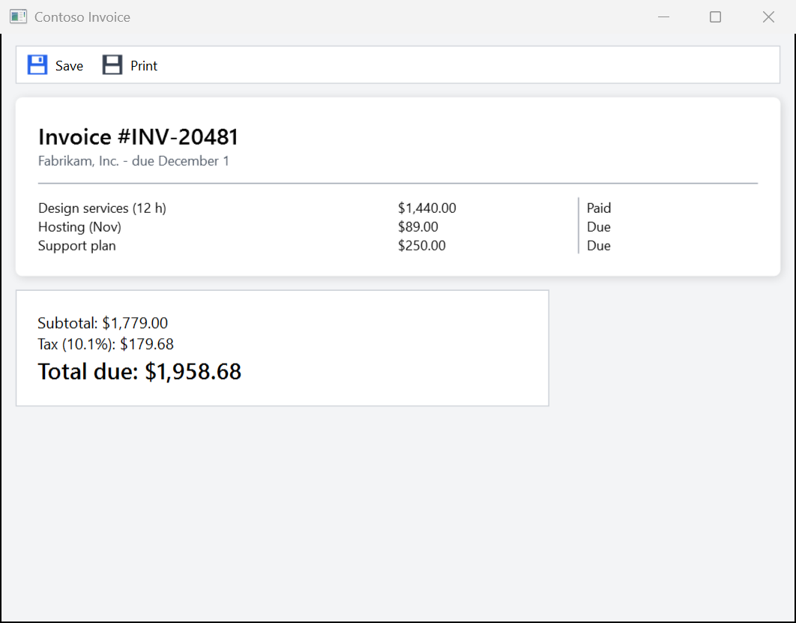
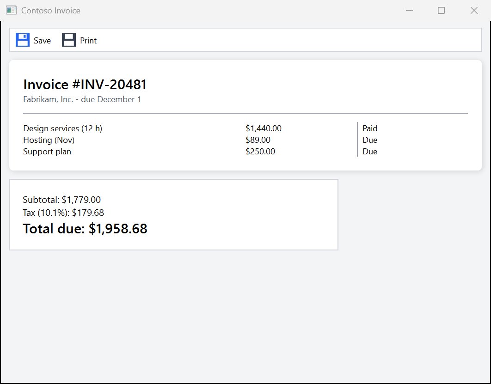
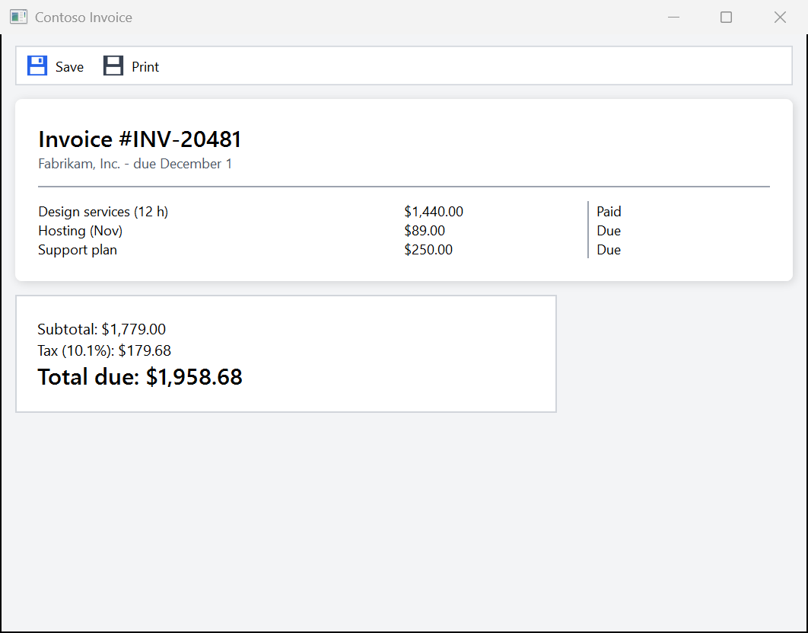
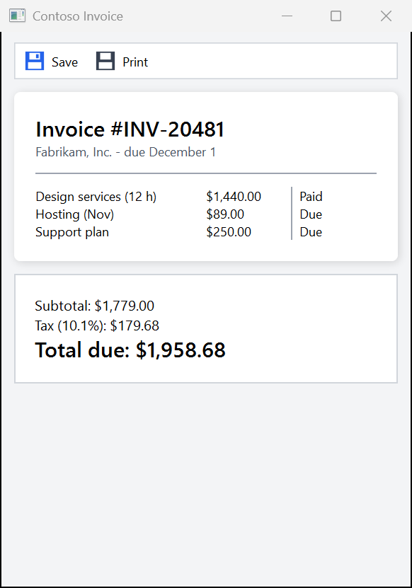

# Session transcript

Source: `Q:\source\XamlAgentDemos-notes\test-runs\CrispPixels\run3\events.jsonl`

## Tool usage

- xaml_get_element_properties: 9
- get_file: 5
- xaml_get_visual_tree: 4
- xaml_capture_image: 4
- xaml_get_element_bounds: 4
- xaml_find_elements: 3
- view: 2
- powershell: 2
- xaml_explain_property_value: 2
- multi_replace_string_in_file: 2
- xaml_apply_hot_reload: 2
- xaml_set_element_property: 2
- task_complete: 2
- skill: 1
- xaml_list_apps: 1
- xaml_list_windows: 1
- get_projects_in_solution: 1
- xaml_get_hot_reload_status: 1
- xaml_get_binding_failures: 1

Failed tool calls: 0, images: 4


_Model: gpt-6.1-terra_


## User (13:31:06)

My invoice screen looks blurry, especially the thin lines, the icons and the text. Find every cause in the running app and fix it.


**Tool call (13:31:09):** `skill`
```json
{
 "skill": "xaml-diagnostics"
}
```

<details><summary>Result `skill` success=true</summary>

```
Skill "xaml-diagnostics" loaded successfully. Follow the instructions in the skill context.
```
</details>


_Skill invoked: xaml-diagnostics_


**Assistant (13:31:13):**

I’ll inspect the live invoice view and its rendering properties, then fix and verify the causes in the running app.


**Tool call (13:31:13):** `xaml_list_apps`
```json
{
 "progressMessage": "Inspecting the running invoice app"
}
```

<details><summary>Result `xaml_list_apps` success=true</summary>

```
{"isDebugging":true,"diagnosticsActive":true,"apps":[{"app":"a1","name":"CrispPixels.exe [29620]","processId":29620,"platform":"WPF (.NET)","isRemote":false,"isDesignTimeOrNoDebug":false,"sourceInfoAvailable":true,"hotReloadSupported":true,"hotReloadEnabled":true,"supportsPropertyExplorer":true,"supportsInAppToolbar":true,"windowCount":1}]}
```
</details>


**Tool call (13:31:17):** `xaml_get_visual_tree`
```json
{
 "progressMessage": "Inspecting invoice visual tree",
 "app": "a1",
 "depth": 5,
 "maxNodes": 200
}
```


**Tool call (13:31:17):** `xaml_capture_image`
```json
{
 "progressMessage": "Inspecting invoice rendering",
 "app": "a1"
}
```


**Tool call (13:31:17):** `xaml_list_windows`
```json
{
 "progressMessage": "Inspecting invoice window",
 "app": "a1"
}
```


**Tool call (13:31:17):** `get_projects_in_solution`
```json
{}
```


**Tool call (13:31:17):** `view`
```json
{
 "path": "c:\\vs\\fastmain\\common7\\ide\\commonextensions\\microsoft\\xamldiagnostics\\AgentTools\\skills\\xaml-diagnostics\\references\\xaml-authoring.md"
}
```

<details><summary>Result `xaml_get_visual_tree` success=true</summary>

```
{"app":"a1","platform":"WPF (.NET)","sourceInfoAvailable":true,"nodeCount":22,"truncated":false,"depthLimitedNodes":2,"hint":"2 node(s) have children beyond the requested depth (childCount > 0, no children listed). Raise depth or pass rootElementId to expand them.","nodes":[{"id":"a1:10","type":"CrispPixels.MainWindow","source":{"file":"Q:\\source\\XamlAgentDemos\\src\\CrispPixels\\MainWindow.xaml","line":3,"column":9},"childCount":1,"children":[{"id":"a1:11","type":"System.Windows.Controls.Border","childCount":1,"children":[{"id":"a1:12","type":"System.Windows.Documents.AdornerDecorator","childCount":2,"children":[{"id":"a1:13","type":"System.Windows.Controls.ContentPresenter","childCount":1,"children":[{"id":"a1:15","type":"System.Windows.Controls.StackPanel","source":{"file":"Q:\\source\\XamlAgentDemos\\src\\CrispPixels\\MainWindow.xaml","line":9,"column":6},"childCount":3,"children":[{"id":"a1:16","type":"System.Windows.Controls.Border","name":"Toolbar","source":{"file":"Q:\\source\\XamlAgentDemos\\src\\CrispPixels\\MainWindow.xaml","line":11,"column":10},"childCount":1,"children":[{"id":"a1:19","type":"System.Windows.Controls.StackPanel","source":{"file":"Q:\\source\\XamlAgentDemos\\src\\CrispPixels\\MainWindow.xaml","line":16,"column":14},"childCount":4,"children":[{"id":"a1:22","type":"System.Windows.Controls.Image","name":"SaveIcon","source":{"file":"Q:\\source\\XamlAgentDemos\\src\\CrispPixels\\MainWindow.xaml","line":17,"column":18},"childCount":0},{"id":"a1:23","type":"System.Windows.Controls.TextBlock","source":{"file":"Q:\\source\\XamlAgentDemos\\src\\CrispPixels\\MainWindow.xaml","line":22,"column":18},"childCount":0},{"id":"a1:24","type":"System.Windows.Controls.Image","name":"PrintIcon","source":{"file":"Q:\\source\\XamlAgentDemos\\src\\CrispPixels\\MainWindow.xaml","line":23,"column":18},"childCount":0},{"id":"a1:25","type":"System.Windows.Controls.TextBlock","source":{"file":"Q:\\source\\XamlAgentDemos\\src\\CrispPixels\\MainWindow.xaml","line":28,"column":18},"childCount":0}]}]},{"id":"a1:17","type":"System.Windows.Controls.Border","name":"InvoiceCard","source":{"file":"Q:\\source\\XamlAgentDemos\\src\\CrispPixels\\MainWindow.xaml","line":33,"column":10},"childCount":1,"children":[{"id":"a1:20","type":"System.Windows.Controls.StackPanel","source":{"file":"Q:\\source\\XamlAgentDemos\\src\\CrispPixels\\MainWindow.xaml","line":43,"column":14},"childCount":4,"children":[{"id":"a1:26","type":"System.Windows.Controls.TextBlock","source":{"file
... [truncated 1448 chars]
```
</details>

<details><summary>Result `xaml_list_windows` success=true</summary>

```
{"windows":[{"windowId":"0x12A0856","app":"a1","title":"Contoso Invoice","bounds":{"x":190,"y":190,"width":1080,"height":840},"dpiScale":1.5,"visible":true,"minimized":false}]}
```
</details>

<details><summary>Result `get_projects_in_solution` success=true</summary>

```
src\GhostClicks\GhostClicks.csproj
src\GermanReady\GermanReady.csproj
src\ThemeBreaker\ThemeBreaker.csproj
src\DesignPolish\DesignPolish.csproj
src\HotReloadDoctor\HotReloadDoctor.csproj
src\VanishingSave\VanishingSave.csproj
src\CrispPixels\CrispPixels.csproj
src\PrecedenceWars\PrecedenceWars.csproj
src\LostWindows\LostWindows.csproj
src\TemplateDetective\TemplateDetective.csproj
src\SlowScroll\SlowScroll.csproj
src\PixelPerfect\PixelPerfect.csproj
src\BindingStorm\BindingStorm.csproj
src\BugRepro\BugRepro.csproj
src\A11ySweep\A11ySweep.csproj
src\StyleMaze\StyleMaze.csproj
src\ResponsiveDashboard\ResponsiveDashboard.csproj

```
</details>




<details><summary>Result `xaml_capture_image` success=true</summary>

```
Screenshot of window 0x12A0856 "Contoso Invoice" of app a1 (1062x831).
```
</details>

<details><summary>Result `view` success=true</summary>

```
# XAML authoring guidance

Follow these rules when writing or changing XAML so it works well with XAML Hot Reload, the XAML designer, and XAML Diagnostics.

## Design-time data

- Declare `xmlns:d="http://schemas.microsoft.com/expression/blend/2008"` and `xmlns:mc="http://schemas.openxmlformats.org/markup-compatibility/2006"` with `mc:Ignorable="d"`.
- Use `d:DataContext="{d:DesignInstance Type=vm:MyViewModel, IsDesignTimeCreatable=False}"` (WPF/UWP) so the designer and IntelliSense know binding paths.
- Use `d:` properties (for example `d:Text="Sample"`) for sample values that appear only at design time.
- .NET MAUI: set `x:DataType` on pages and `DataTemplate`s. It enables compiled bindings and turns many binding failures into build errors.
- WinUI/UWP: prefer `x:Bind` for compile-time checked bindings when the view owns the view model.

## Bindings

- Bind with explicit paths. Avoid string-built paths in code-behind.
- Keep the `DataContext` chain simple. Use `ElementName` or `RelativeSource` only at real scope boundaries (for example inside a `DataTemplate` that needs the page's view model).
- Expose bound properties as public properties that raise `PropertyChanged`. Fields and non-public properties don't bind.
- Use `FallbackValue` and `TargetNullValue` for expected missing values instead of hiding binding errors.

## Hot reload and designer friendly code

- Keep control and page constructors cheap. Don't call services, open files, or start network calls in constructors or `InitializeComponent` paths. The designer and hot reload create instances again.
- Keep a public parameterless constructor on custom controls.
- Guard runtime-only work with `DesignerProperties.GetIsInDesignMode(this)` (WPF) or `Windows.ApplicationModel.DesignMode.DesignModeEnabled` (UWP/WinUI).
- Put styles, templates, and visual states in XAML, not code-behind. Hot reload can't update UI built in code.
- Don't walk the visual tree from code-behind to change visuals. Use bindings, triggers, and visual states.
- Use `x:Name` only for elements code-behind needs. Don't rename `x:Class` while the app is running.

## Resources

- Put shared resources in `App.xaml` merged dictionaries or the closest scope that uses them.
- A `StaticResource` must be defined earlier in load order. Use `DynamicResource` (WPF) or `ThemeResource` (UWP/WinUI) for theme values that change at runtime.
- To check where a key resolves at runtime, or whether a dictionary is merged a
... [truncated 618 chars]
```
</details>


**Tool call (13:31:23):** `get_file`
```json
{
 "filename": "Q:\\source\\XamlAgentDemos\\src\\CrispPixels\\MainWindow.xaml",
 "startLine": 1,
 "endLine": 180,
 "includeLineNumbers": true
}
```


**Tool call (13:31:23):** `view`
```json
{
 "path": "Q:\\source\\XamlAgentDemos\\src\\CrispPixels"
}
```


**Tool call (13:31:23):** `xaml_get_element_properties`
```json
{
 "progressMessage": "Inspecting layout and text rendering",
 "elementId": "a1:10",
 "includeAll": false
}
```


**Tool call (13:31:23):** `xaml_get_element_properties`
```json
{
 "progressMessage": "Inspecting invoice card rendering",
 "elementId": "a1:17",
 "includeAll": false
}
```


**Tool call (13:31:23):** `xaml_get_element_properties`
```json
{
 "progressMessage": "Inspecting totals scaling",
 "elementId": "a1:18",
 "includeAll": false
}
```


**Tool call (13:31:23):** `xaml_get_element_properties`
```json
{
 "progressMessage": "Inspecting icon rendering",
 "elementId": "a1:22",
 "includeAll": false
}
```


**Tool call (13:31:23):** `xaml_get_element_bounds`
```json
{
 "progressMessage": "Checking pixel alignment",
 "elementIds": [
  "a1:10",
  "a1:15",
  "a1:16",
  "a1:17",
  "a1:18",
  "a1:22",
  "a1:24",
  "a1:28",
  "a1:29",
  "a1:30"
 ]
}
```


**Tool call (13:31:23):** `xaml_get_visual_tree`
```json
{
 "progressMessage": "Inspecting invoice details",
 "rootElementId": "a1:29",
 "depth": 4,
 "maxNodes": 100
}
```


**Tool call (13:31:23):** `powershell`
```json
{
 "command": "git status --short",
 "description": "Check working tree changes"
}
```

<details><summary>Result `view` success=true</summary>

```
App.xaml
App.xaml.cs
CrispPixels.csproj
MainWindow.xaml
MainWindow.xaml.cs
bin
obj
```
</details>

<details><summary>Result `xaml_get_visual_tree` success=true</summary>

```
{"app":"a1","platform":"WPF (.NET)","sourceInfoAvailable":true,"nodeCount":11,"truncated":false,"nodes":[{"id":"a1:29","type":"System.Windows.Controls.Grid","name":"LineItems","source":{"file":"Q:\\source\\XamlAgentDemos\\src\\CrispPixels\\MainWindow.xaml","line":52,"column":18},"childCount":10,"children":[{"id":"a1:31","type":"System.Windows.Controls.TextBlock","source":{"file":"Q:\\source\\XamlAgentDemos\\src\\CrispPixels\\MainWindow.xaml","line":63,"column":22},"childCount":0},{"id":"a1:32","type":"System.Windows.Controls.TextBlock","source":{"file":"Q:\\source\\XamlAgentDemos\\src\\CrispPixels\\MainWindow.xaml","line":64,"column":22},"childCount":0},{"id":"a1:33","type":"System.Windows.Shapes.Rectangle","name":"ColumnRule","source":{"file":"Q:\\source\\XamlAgentDemos\\src\\CrispPixels\\MainWindow.xaml","line":65,"column":22},"childCount":0},{"id":"a1:34","type":"System.Windows.Controls.TextBlock","source":{"file":"Q:\\source\\XamlAgentDemos\\src\\CrispPixels\\MainWindow.xaml","line":71,"column":22},"childCount":0},{"id":"a1:35","type":"System.Windows.Controls.TextBlock","source":{"file":"Q:\\source\\XamlAgentDemos\\src\\CrispPixels\\MainWindow.xaml","line":74,"column":22},"childCount":0},{"id":"a1:36","type":"System.Windows.Controls.TextBlock","source":{"file":"Q:\\source\\XamlAgentDemos\\src\\CrispPixels\\MainWindow.xaml","line":75,"column":22},"childCount":0},{"id":"a1:37","type":"System.Windows.Controls.TextBlock","source":{"file":"Q:\\source\\XamlAgentDemos\\src\\CrispPixels\\MainWindow.xaml","line":78,"column":22},"childCount":0},{"id":"a1:38","type":"System.Windows.Controls.TextBlock","source":{"file":"Q:\\source\\XamlAgentDemos\\src\\CrispPixels\\MainWindow.xaml","line":82,"column":22},"childCount":0},{"id":"a1:39","type":"System.Windows.Controls.TextBlock","source":{"file":"Q:\\source\\XamlAgentDemos\\src\\CrispPixels\\MainWindow.xaml","line":83,"column":22},"childCount":0},{"id":"a1:40","type":"System.Windows.Controls.TextBlock","source":{"file":"Q:\\source\\XamlAgentDemos\\src\\CrispPixels\\MainWindow.xaml","line":86,"column":22},"childCount":0}]}]}
```
</details>

<details><summary>Result `xaml_get_element_properties` success=true</summary>

```
{"id":"a1:10","type":"CrispPixels.MainWindow","source":{"file":"Q:\\source\\XamlAgentDemos\\src\\CrispPixels\\MainWindow.xaml","line":3,"column":9},"properties":[{"name":"Top","value":"126.66666666666666","valueType":"System.Double","propertyType":"System.Double","declaringType":"System.Windows.Window","valueSource":"Coercion"},{"name":"Left","value":"126.66666666666666","valueType":"System.Double","propertyType":"System.Double","declaringType":"System.Windows.Window","valueSource":"Coercion"},{"name":"Title","value":"Contoso Invoice","valueType":"System.String","propertyType":"System.String","declaringType":"System.Windows.Window","valueSource":"Local","valueSourceLocation":{"file":"Q:\\source\\XamlAgentDemos\\src\\CrispPixels\\MainWindow.xaml","line":3,"column":9}},{"name":"RestoreBounds","value":"126.66666666666666,126.66666666666666,720,560","valueType":"System.Windows.Rect","propertyType":"System.Windows.Rect","declaringType":"System.Windows.Window","valueSource":"Local","valueSourceLocation":{"file":"Q:\\source\\XamlAgentDemos\\src\\CrispPixels\\MainWindow.xaml","line":3,"column":9},"readOnly":true},{"name":"IsActive","value":"True","valueType":"System.Boolean","propertyType":"System.Boolean","declaringType":"System.Windows.Window","valueSource":"Local","valueSourceLocation":{"file":"Q:\\source\\XamlAgentDemos\\src\\CrispPixels\\MainWindow.xaml","line":3,"column":9},"readOnly":true},{"name":"Content","valueType":"System.Windows.Controls.StackPanel","propertyType":"System.Object","declaringType":"System.Windows.Controls.ContentControl","valueSource":"Local","valueSourceLocation":{"file":"Q:\\source\\XamlAgentDemos\\src\\CrispPixels\\MainWindow.xaml","line":3,"column":9},"valueLocation":{"file":"Q:\\source\\XamlAgentDemos\\src\\CrispPixels\\MainWindow.xaml","line":9,"column":6}},{"name":"Background","value":"#FFF3F4F6","valueType":"System.Windows.Media.SolidColorBrush","propertyType":"System.Windows.Media.Brush","declaringType":"System.Windows.Controls.Control","valueSource":"Local","valueSourceLocation":{"file":"Q:\\source\\XamlAgentDemos\\src\\CrispPixels\\MainWindow.xaml","line":3,"column":9}},{"name":"DataContext","valueType":"<>f__AnonymousType0`2[[System.Windows.Media.Imaging.BitmapSource],[System.Windows.Media.Imaging.BitmapSource]]","propertyType":"System.Object","declaringType":"System.Windows.FrameworkElement","valueSource":"Local","valueSourceLocation":{"file":"Q:\\source\\XamlAgentDemos\\src\\CrispPixels\\MainWindow.xaml","line":3,"column":
... [truncated 8321 chars]
```
</details>

<details><summary>Result `xaml_get_element_properties` success=true</summary>

```
{"id":"a1:17","type":"System.Windows.Controls.Border","name":"InvoiceCard","source":{"file":"Q:\\source\\XamlAgentDemos\\src\\CrispPixels\\MainWindow.xaml","line":33,"column":10},"properties":[{"name":"Padding","value":"20,20,20,20","valueType":"System.Windows.Thickness","propertyType":"System.Windows.Thickness","declaringType":"System.Windows.Controls.Border","valueSource":"Local","valueSourceLocation":{"file":"Q:\\source\\XamlAgentDemos\\src\\CrispPixels\\MainWindow.xaml","line":33,"column":10}},{"name":"CornerRadius","value":"6,6,6,6","valueType":"System.Windows.CornerRadius","propertyType":"System.Windows.CornerRadius","declaringType":"System.Windows.Controls.Border","valueSource":"Local","valueSourceLocation":{"file":"Q:\\source\\XamlAgentDemos\\src\\CrispPixels\\MainWindow.xaml","line":33,"column":10}},{"name":"Background","value":"#FFFFFFFF","valueType":"System.Windows.Media.SolidColorBrush","propertyType":"System.Windows.Media.Brush","declaringType":"System.Windows.Controls.Border","valueSource":"Local","valueSourceLocation":{"file":"Q:\\source\\XamlAgentDemos\\src\\CrispPixels\\MainWindow.xaml","line":33,"column":10}},{"name":"Child","valueType":"System.Windows.Controls.StackPanel","propertyType":"System.Windows.UIElement","declaringType":"System.Windows.Controls.Decorator","valueSource":"Local","valueSourceLocation":{"file":"Q:\\source\\XamlAgentDemos\\src\\CrispPixels\\MainWindow.xaml","line":33,"column":10},"valueLocation":{"file":"Q:\\source\\XamlAgentDemos\\src\\CrispPixels\\MainWindow.xaml","line":43,"column":14}},{"name":"Name","value":"InvoiceCard","valueType":"System.String","propertyType":"System.String","declaringType":"System.Windows.FrameworkElement","valueSource":"Local","valueSourceLocation":{"file":"Q:\\source\\XamlAgentDemos\\src\\CrispPixels\\MainWindow.xaml","line":33,"column":10}},{"name":"ActualWidth","value":"680.3333333333334","valueType":"System.Double","propertyType":"System.Double","declaringType":"System.Windows.FrameworkElement","valueSource":"Local","valueSourceLocation":{"file":"Q:\\source\\XamlAgentDemos\\src\\CrispPixels\\MainWindow.xaml","line":33,"column":10},"readOnly":true},{"name":"ActualHeight","value":"159","valueType":"System.Double","propertyType":"System.Double","declaringType":"System.Windows.FrameworkElement","valueSource":"Local","valueSourceLocation":{"file":"Q:\\source\\XamlAgentDemos\\src\\CrispPixels\\MainWindow.xaml","line":33,"column":10},"readOnly":true},{"name":"Margin","value":"0,12,0,0","value
... [truncated 4624 chars]
```
</details>

<details><summary>Result `xaml_get_element_properties` success=true</summary>

```
{"id":"a1:22","type":"System.Windows.Controls.Image","name":"SaveIcon","source":{"file":"Q:\\source\\XamlAgentDemos\\src\\CrispPixels\\MainWindow.xaml","line":17,"column":18},"properties":[{"name":"Source","evaluatedValue":"(System.Windows.Media.Imaging.RenderTargetBitmap)","valueType":"System.Windows.Data.BindingExpression","propertyType":"System.Windows.Media.ImageSource","declaringType":"System.Windows.Controls.Image","valueSource":"Local","valueSourceLocation":{"file":"Q:\\source\\XamlAgentDemos\\src\\CrispPixels\\MainWindow.xaml","line":17,"column":18},"isBinding":true},{"name":"Stretch","value":"1","valueType":"System.Windows.Media.Stretch","propertyType":"System.Windows.Media.Stretch","declaringType":"System.Windows.Controls.Image","valueSource":"Local","valueSourceLocation":{"file":"Q:\\source\\XamlAgentDemos\\src\\CrispPixels\\MainWindow.xaml","line":17,"column":18}},{"name":"Name","value":"SaveIcon","valueType":"System.String","propertyType":"System.String","declaringType":"System.Windows.FrameworkElement","valueSource":"Local","valueSourceLocation":{"file":"Q:\\source\\XamlAgentDemos\\src\\CrispPixels\\MainWindow.xaml","line":17,"column":18}},{"name":"ActualWidth","value":"20","valueType":"System.Double","propertyType":"System.Double","declaringType":"System.Windows.FrameworkElement","valueSource":"Local","valueSourceLocation":{"file":"Q:\\source\\XamlAgentDemos\\src\\CrispPixels\\MainWindow.xaml","line":17,"column":18},"readOnly":true},{"name":"ActualHeight","value":"20","valueType":"System.Double","propertyType":"System.Double","declaringType":"System.Windows.FrameworkElement","valueSource":"Local","valueSourceLocation":{"file":"Q:\\source\\XamlAgentDemos\\src\\CrispPixels\\MainWindow.xaml","line":17,"column":18},"readOnly":true},{"name":"Width","value":"20","valueType":"System.Double","propertyType":"System.Double","declaringType":"System.Windows.FrameworkElement","valueSource":"Local","valueSourceLocation":{"file":"Q:\\source\\XamlAgentDemos\\src\\CrispPixels\\MainWindow.xaml","line":17,"column":18}},{"name":"Height","value":"20","valueType":"System.Double","propertyType":"System.Double","declaringType":"System.Windows.FrameworkElement","valueSource":"Local","valueSourceLocation":{"file":"Q:\\source\\XamlAgentDemos\\src\\CrispPixels\\MainWindow.xaml","line":17,"column":18}},{"name":"IsInitialized","value":"True","valueType":"System.Boolean","propertyType":"System.Boolean","declaringType":"System.Windows.FrameworkElement","valueSource":"Local
... [truncated 4956 chars]
```
</details>

<details><summary>Result `xaml_get_element_bounds` success=true</summary>

```
{"note":"'screen' is in physical screen pixels. 'window' is in device-independent units relative to the element's root window (multiply by dpiScale for pixels). isVisible only reflects Visibility/opacity; insideWindowFraction < 1 (clippedByWindow) means part of the element is outside the window's client area, so the user can't see that part. Ancestor clipping (ScrollViewer, Grid cell, ClipToBounds) isn't included; compare with the parent's bounds or call xaml_capture_image.","bounds":[{"id":"a1:10","isVisible":true,"insideWindowFraction":0.91,"clippedByWindow":true,"windowHandle":"0x12A0856","dpiScale":1.5,"screen":{"x":201.0,"y":235.0,"width":1080.0,"height":840.0},"window":{"x":0.0,"y":0.0,"width":720.0,"height":560.0}},{"id":"a1:15","isVisible":true,"insideWindowFraction":1.0,"windowHandle":"0x12A0856","dpiScale":1.5,"screen":{"x":220.0,"y":251.0,"width":1020.0,"height":768.0},"window":{"x":12.5,"y":10.5,"width":680.3,"height":512.2}},{"id":"a1:16","isVisible":true,"insideWindowFraction":1.0,"windowHandle":"0x12A0856","dpiScale":1.5,"screen":{"x":220.0,"y":251.0,"width":1020.0,"height":51.0},"window":{"x":12.5,"y":10.5,"width":680.3,"height":34.0}},{"id":"a1:17","isVisible":true,"insideWindowFraction":1.0,"windowHandle":"0x12A0856","dpiScale":1.5,"screen":{"x":220.0,"y":320.0,"width":1020.0,"height":238.0},"window":{"x":12.5,"y":56.5,"width":680.3,"height":159.0}},{"id":"a1:18","isVisible":true,"insideWindowFraction":1.0,"windowHandle":"0x12A0856","dpiScale":1.5,"screen":{"x":220.0,"y":576.0,"width":712.0,"height":156.0},"window":{"x":12.5,"y":227.5,"width":474.8,"height":104.0}},{"id":"a1:22","isVisible":true,"insideWindowFraction":1.0,"windowHandle":"0x12A0856","dpiScale":1.5,"screen":{"x":234.0,"y":261.0,"width":30.0,"height":30.0},"window":{"x":22.0,"y":17.5,"width":20.0,"height":20.0}},{"id":"a1:24","isVisible":true,"insideWindowFraction":1.0,"windowHandle":"0x12A0856","dpiScale":1.5,"screen":{"x":334.0,"y":261.0,"width":30.0,"height":30.0},"window":{"x":88.7,"y":17.5,"width":20.0,"height":20.0}},{"id":"a1:28","isVisible":true,"insideWindowFraction":1.0,"windowHandle":"0x12A0856","dpiScale":1.5,"screen":{"x":250.0,"y":434.0,"width":960.0,"height":1.0},"window":{"x":32.5,"y":132.5,"width":640.3,"height":1.0}},{"id":"a1:29","isVisible":true,"insideWindowFraction":1.0,"windowHandle":"0x12A0856","dpiScale":1.5,"screen":{"x":250.0,"y":453.0,"width":960.0,"height":75.0},"window":{"x":32.5,"y":145.5,"width":640.3,"height":50.0}},{"id":"a1:30","isVisible":
... [truncated 195 chars]
```
</details>

<details><summary>Result `xaml_get_element_properties` success=true</summary>

```
{"id":"a1:18","type":"System.Windows.Controls.Viewbox","name":"TotalsViewbox","source":{"file":"Q:\\source\\XamlAgentDemos\\src\\CrispPixels\\MainWindow.xaml","line":95,"column":10},"properties":[{"name":"Child","valueType":"System.Windows.Controls.Border","propertyType":"System.Windows.UIElement","declaringType":"System.Windows.Controls.Viewbox","valueSource":"Local","valueSourceLocation":{"file":"Q:\\source\\XamlAgentDemos\\src\\CrispPixels\\MainWindow.xaml","line":95,"column":10},"valueLocation":{"file":"Q:\\source\\XamlAgentDemos\\src\\CrispPixels\\MainWindow.xaml","line":99,"column":14}},{"name":"Name","value":"TotalsViewbox","valueType":"System.String","propertyType":"System.String","declaringType":"System.Windows.FrameworkElement","valueSource":"Local","valueSourceLocation":{"file":"Q:\\source\\XamlAgentDemos\\src\\CrispPixels\\MainWindow.xaml","line":95,"column":10}},{"name":"ActualWidth","value":"474.78260869565213","valueType":"System.Double","propertyType":"System.Double","declaringType":"System.Windows.FrameworkElement","valueSource":"Local","valueSourceLocation":{"file":"Q:\\source\\XamlAgentDemos\\src\\CrispPixels\\MainWindow.xaml","line":95,"column":10},"readOnly":true},{"name":"ActualHeight","value":"103.99999999999999","valueType":"System.Double","propertyType":"System.Double","declaringType":"System.Windows.FrameworkElement","valueSource":"Local","valueSourceLocation":{"file":"Q:\\source\\XamlAgentDemos\\src\\CrispPixels\\MainWindow.xaml","line":95,"column":10},"readOnly":true},{"name":"Height","value":"104","valueType":"System.Double","propertyType":"System.Double","declaringType":"System.Windows.FrameworkElement","valueSource":"Local","valueSourceLocation":{"file":"Q:\\source\\XamlAgentDemos\\src\\CrispPixels\\MainWindow.xaml","line":95,"column":10}},{"name":"Margin","value":"0,12,0,0","valueType":"System.Windows.Thickness","propertyType":"System.Windows.Thickness","declaringType":"System.Windows.FrameworkElement","valueSource":"Local","valueSourceLocation":{"file":"Q:\\source\\XamlAgentDemos\\src\\CrispPixels\\MainWindow.xaml","line":95,"column":10}},{"name":"HorizontalAlignment","value":"0","valueType":"System.Windows.HorizontalAlignment","propertyType":"System.Windows.HorizontalAlignment","declaringType":"System.Windows.FrameworkElement","valueSource":"Local","valueSourceLocation":{"file":"Q:\\source\\XamlAgentDemos\\src\\CrispPixels\\MainWindow.xaml","line":95,"column":10}},{"name":"IsInitialized","value":"True","valueType":"System.
... [truncated 3908 chars]
```
</details>

<details><summary>Result `get_file` success=true</summary>

```
```xaml src\CrispPixels\MainWindow.xaml (Lines 1-115 of 115 total. Call tools for more if needed.)
1: <Window x:Class="CrispPixels.MainWindow"
2:         xmlns="http://schemas.microsoft.com/winfx/2006/xaml/presentation"
3:         xmlns:x="http://schemas.microsoft.com/winfx/2006/xaml"
4:         Title="Contoso Invoice"
5:         Width="720"
6:         Height="560"
7:         Background="#F3F4F6"
8:         TextOptions.TextFormattingMode="Display">
9:     <StackPanel Margin="12.5,10.5,12.5,0">
10:         <!-- Toolbar -->
11:         <Border x:Name="Toolbar"
12:                 Padding="8.5,6"
13:                 Background="White"
14:                 BorderBrush="#D1D5DB"
15:                 BorderThickness="1">
16:             <StackPanel Orientation="Horizontal">
17:                 <Image x:Name="SaveIcon"
18:                        Width="20"
19:                        Height="20"
20:                        Source="{Binding SaveIcon}"
21:                        Stretch="Fill" />
22:                 <TextBlock Margin="6,2,16,0" Text="Save" />
23:                 <Image x:Name="PrintIcon"
24:                        Width="20"
25:                        Height="20"
26:                        Source="{Binding PrintIcon}"
27:                        Stretch="Fill" />
28:                 <TextBlock Margin="6,2,0,0" Text="Print" />
29:             </StackPanel>
30:         </Border>
31: 
32:         <!-- Invoice card -->
33:         <Border x:Name="InvoiceCard"
34:                 Margin="0,12,0,0"
35:                 Padding="20"
36:                 Background="White"
37:                 CornerRadius="6">
38:             <Border.Effect>
39:                 <DropShadowEffect BlurRadius="12"
40:                                   Opacity="0.15"
41:                                   ShadowDepth="2" />
42:             </Border.Effect>
43:             <StackPanel>
44:                 <TextBlock FontSize="20"
45:                            FontWeight="SemiBold"
46:                            Text="Invoice #INV-20481" />
47:                 <TextBlock Foreground="#4B5563" Text="Fabrikam, Inc. - due December 1" />
48:                 <Rectangle x:Name="CardDivider"
49:                            Height="1"
50:                            Margin="0,12"
51:                            Fill="#9CA3AF" />
52:                 <Grid x:Name="LineItems">
53:                     <Grid.ColumnDefinitions>
54:                   
... [truncated 2982 chars]
```
</details>

<details><summary>Result `powershell` success=true</summary>

```

<shellId: 0 completed with exit code 0>
```
</details>


**Tool call (13:31:31):** `get_file`
```json
{
 "filename": "Q:\\source\\XamlAgentDemos\\src\\CrispPixels\\MainWindow.xaml.cs",
 "startLine": 1,
 "endLine": 200,
 "includeLineNumbers": true
}
```


**Tool call (13:31:31):** `get_file`
```json
{
 "filename": "Q:\\source\\XamlAgentDemos\\src\\CrispPixels\\App.xaml",
 "startLine": 1,
 "endLine": 120
}
```


**Tool call (13:31:31):** `get_file`
```json
{
 "filename": "Q:\\source\\XamlAgentDemos\\src\\CrispPixels\\CrispPixels.csproj",
 "startLine": 1,
 "endLine": 120
}
```


**Tool call (13:31:31):** `xaml_explain_property_value`
```json
{
 "progressMessage": "Checking pixel rounding",
 "elementId": "a1:33",
 "propertyName": "UseLayoutRounding"
}
```


**Tool call (13:31:31):** `xaml_get_element_bounds`
```json
{
 "progressMessage": "Checking rule and text alignment",
 "elementIds": [
  "a1:26",
  "a1:27",
  "a1:28",
  "a1:31",
  "a1:32",
  "a1:33",
  "a1:34"
 ]
}
```


**Tool call (13:31:31):** `xaml_get_visual_tree`
```json
{
 "progressMessage": "Inspecting totals text",
 "rootElementId": "a1:30",
 "depth": 4,
 "maxNodes": 30
}
```

<details><summary>Result `xaml_get_visual_tree` success=true</summary>

```
{"app":"a1","platform":"WPF (.NET)","sourceInfoAvailable":true,"nodeCount":5,"truncated":false,"nodes":[{"id":"a1:30","type":"System.Windows.Controls.Border","name":"TotalsCard","source":{"file":"Q:\\source\\XamlAgentDemos\\src\\CrispPixels\\MainWindow.xaml","line":99,"column":14},"childCount":1,"children":[{"id":"a1:41","type":"System.Windows.Controls.StackPanel","source":{"file":"Q:\\source\\XamlAgentDemos\\src\\CrispPixels\\MainWindow.xaml","line":105,"column":18},"childCount":3,"children":[{"id":"a1:42","type":"System.Windows.Controls.TextBlock","source":{"file":"Q:\\source\\XamlAgentDemos\\src\\CrispPixels\\MainWindow.xaml","line":106,"column":22},"childCount":0},{"id":"a1:43","type":"System.Windows.Controls.TextBlock","source":{"file":"Q:\\source\\XamlAgentDemos\\src\\CrispPixels\\MainWindow.xaml","line":107,"column":22},"childCount":0},{"id":"a1:44","type":"System.Windows.Controls.TextBlock","source":{"file":"Q:\\source\\XamlAgentDemos\\src\\CrispPixels\\MainWindow.xaml","line":108,"column":22},"childCount":0}]}]}]}
```
</details>

<details><summary>Result `get_file` success=true</summary>

```
``` src\CrispPixels\CrispPixels.csproj (Lines 1-5 of 5 total. Call tools for more if needed.)
<Project Sdk="Microsoft.NET.Sdk">
  <PropertyGroup>
    <RootNamespace>CrispPixels</RootNamespace>
  </PropertyGroup>
</Project>

```


```
</details>

<details><summary>Result `get_file` success=true</summary>

```
```csharp src\CrispPixels\MainWindow.xaml.cs (Lines 1-42 of 42 total. Call tools for more if needed.)
1: using System.Windows;
2: using System.Windows.Media;
3: using System.Windows.Media.Imaging;
4: 
5: namespace CrispPixels;
6: 
7: public partial class MainWindow : Window
8: {
9:     public MainWindow()
10:     {
11:         this.InitializeComponent();
12:         this.DataContext = new
13:         {
14:             SaveIcon = CreateIcon(Color.FromRgb(0x25, 0x63, 0xEB), drawSlot: true),
15:             PrintIcon = CreateIcon(Color.FromRgb(0x37, 0x41, 0x51), drawSlot: false),
16:         };
17:     }
18: 
19:     /// <summary>Draws a 16x16 pixel-art icon, like the bitmap icons the designers export.</summary>
20:     private static BitmapSource CreateIcon(Color color, bool drawSlot)
21:     {
22:         var visual = new DrawingVisual();
23:         using (DrawingContext dc = visual.RenderOpen())
24:         {
25:             var brush = new SolidColorBrush(color);
26:             dc.DrawRectangle(brush, null, new Rect(1, 1, 14, 14));
27:             dc.DrawRectangle(Brushes.White, null, new Rect(4, 2, 8, 5));
28:             if (drawSlot)
29:             {
30:                 dc.DrawRectangle(brush, null, new Rect(9, 3, 2, 3));
31:             }
32: 
33:             dc.DrawRectangle(Brushes.White, null, new Rect(3, 9, 10, 5));
34:         }
35: 
36:         var bitmap = new RenderTargetBitmap(16, 16, 96, 96, PixelFormats.Pbgra32);
37:         RenderOptions.SetEdgeMode(visual, EdgeMode.Aliased);
38:         bitmap.Render(visual);
39:         bitmap.Freeze();
40:         return bitmap;
41:     }
42: }

```


```
</details>

<details><summary>Result `get_file` success=true</summary>

```
```xaml src\CrispPixels\App.xaml (Lines 1-4 of 4 total. Call tools for more if needed.)
<Application x:Class="CrispPixels.App"
             xmlns="http://schemas.microsoft.com/winfx/2006/xaml/presentation"
             xmlns:x="http://schemas.microsoft.com/winfx/2006/xaml"
             StartupUri="MainWindow.xaml" />

```


```
</details>

<details><summary>Result `xaml_explain_property_value` success=true</summary>

```
{"id":"a1:33","type":"System.Windows.Shapes.Rectangle","property":"UseLayoutRounding","propertyType":"System.Boolean","effectiveValue":"False","effectiveSource":"Default","chain":[{"kind":"Default","description":"The property's default value; nothing sets it.","value":"False","valueType":"System.Boolean","effective":true}],"notes":["Nothing sets this property. Set it locally or in a style."]}
```
</details>

<details><summary>Result `xaml_get_element_bounds` success=true</summary>

```
{"note":"'screen' is in physical screen pixels. 'window' is in device-independent units relative to the element's root window (multiply by dpiScale for pixels). isVisible only reflects Visibility/opacity; insideWindowFraction < 1 (clippedByWindow) means part of the element is outside the window's client area, so the user can't see that part. Ancestor clipping (ScrollViewer, Grid cell, ClipToBounds) isn't included; compare with the parent's bounds or call xaml_capture_image.","bounds":[{"id":"a1:26","isVisible":true,"insideWindowFraction":1.0,"windowHandle":"0x12A0856","dpiScale":1.5,"screen":{"x":250.0,"y":350.0,"width":960.0,"height":41.0},"window":{"x":32.5,"y":76.5,"width":640.3,"height":27.3}},{"id":"a1:27","isVisible":true,"insideWindowFraction":1.0,"windowHandle":"0x12A0856","dpiScale":1.5,"screen":{"x":250.0,"y":391.0,"width":960.0,"height":25.0},"window":{"x":32.5,"y":103.8,"width":640.3,"height":16.7}},{"id":"a1:28","isVisible":true,"insideWindowFraction":1.0,"windowHandle":"0x12A0856","dpiScale":1.5,"screen":{"x":250.0,"y":434.0,"width":960.0,"height":1.0},"window":{"x":32.5,"y":132.5,"width":640.3,"height":1.0}},{"id":"a1:31","isVisible":true,"insideWindowFraction":1.0,"windowHandle":"0x12A0856","dpiScale":1.5,"screen":{"x":250.0,"y":453.0,"width":480.0,"height":25.0},"window":{"x":32.5,"y":145.5,"width":320.2,"height":16.7}},{"id":"a1:32","isVisible":true,"insideWindowFraction":1.0,"windowHandle":"0x12A0856","dpiScale":1.5,"screen":{"x":730.0,"y":453.0,"width":240.0,"height":25.0},"window":{"x":352.7,"y":145.5,"width":160.1,"height":16.7}},{"id":"a1:33","isVisible":true,"insideWindowFraction":1.0,"windowHandle":"0x12A0856","dpiScale":1.5,"screen":{"x":970.0,"y":453.0,"width":2.0,"height":75.0},"window":{"x":512.8,"y":145.5,"width":1.0,"height":50.0}},{"id":"a1:34","isVisible":true,"insideWindowFraction":1.0,"windowHandle":"0x12A0856","dpiScale":1.5,"screen":{"x":982.0,"y":453.0,"width":228.0,"height":25.0},"window":{"x":520.8,"y":145.5,"width":152.1,"height":16.7}}]}
```
</details>


**Assistant (13:31:55):**

The live view shows four contributors: unrounded layout, enlarged bitmap icons, a shadow applied to text, and scaled totals. I’ll remove those while preserving the screen’s appearance.


**Tool call (13:31:55):** `multi_replace_string_in_file`
```json
{
 "explanation": "Remove bitmap resampling, fractional layout and subtree effects and scaling from the invoice screen.",
 "replacements": [
  {
   "filePath": "src\\CrispPixels\\MainWindow.xaml",
   "oldString": "        Height=\"560\"\n        Background=\"#F3F4F6\"\n        TextOptions.TextFormattingMode=\"Display\">\n    <StackPanel Margin=\"12.5,10.5,12.5,0\">\n        <!-- Toolbar -->\n        <Border x:Name=\"Toolbar\"\n                Padding=\"8.5,6\"\n                Background=\"White\"\n                BorderBrush=\"#D1D5DB\"\n                BorderThickness=\"1\">\n            <StackPanel Orientation=\"Horizontal\">\n                <Image x:Name=\"SaveIcon\"\n                       Width=\"20\"\n                       Height=\"20\"\n                       Source=\"{Binding SaveIcon}\"\n                       Stretch=\"Fill\" />\n                <TextBlock Margin=\"6,2,16,0\" Text=\"Save\" />\n                <Image x:Name=\"PrintIcon\"\n                       Width=\"20\"\n                       Height=\"20\"\n                       Source=\"{Binding PrintIcon}\"\n                       Stretch=\"Fill\" />\n                <TextBlock Margin=\"6,2,0,0\" Text=\"Print\" />\n            </StackPanel>\n        </Border>",
   "newString": "        Height=\"560\"\n        Background=\"#F3F4F6\"\n        UseLayoutRounding=\"True\"\n        SnapsToDevicePixels=\"True\"\n        TextOptions.TextFormattingMode=\"Display\">\n    <StackPanel Margin=\"12,10,12,0\">\n        <
... [truncated 4997 chars]
```

<details><summary>Result `multi_replace_string_in_file` success=true</summary>

```
Successfully applied 3 of 3 replacement(s) across 1 file(s).
```
</details>


**Tool call (13:32:05):** `xaml_apply_hot_reload`
```json
{
 "progressMessage": "Applying invoice rendering fixes"
}
```

<details><summary>Result `xaml_apply_hot_reload` success=true</summary>

```
{"applied":true,"errors":[],"log":[],"hint":"Call xaml_capture_image to verify the change visually. Views that aren't loaded (other tabs, closed dialogs) are updated when they're next shown."}
```
</details>


**Tool call (13:32:08):** `xaml_capture_image`
```json
{
 "progressMessage": "Checking improved invoice rendering",
 "app": "a1"
}
```


**Tool call (13:32:08):** `xaml_get_visual_tree`
```json
{
 "progressMessage": "Checking updated invoice layout",
 "app": "a1",
 "depth": 7,
 "maxNodes": 100
}
```


**Tool call (13:32:08):** `get_file`
```json
{
 "filename": "Q:\\source\\XamlAgentDemos\\src\\CrispPixels\\MainWindow.xaml",
 "startLine": 1,
 "endLine": 155
}
```


**Tool call (13:32:08):** `xaml_get_hot_reload_status`
```json
{
 "progressMessage": "Checking hot reload status"
}
```

<details><summary>Result `xaml_get_visual_tree` success=true</summary>

```
{"app":"a1","platform":"WPF (.NET)","sourceInfoAvailable":true,"nodeCount":35,"truncated":false,"nodes":[{"id":"a1:10","type":"CrispPixels.MainWindow","source":{"file":"Q:\\source\\XamlAgentDemos\\src\\CrispPixels\\MainWindow.xaml","line":3,"column":9},"childCount":1,"children":[{"id":"a1:11","type":"System.Windows.Controls.Border","childCount":1,"children":[{"id":"a1:12","type":"System.Windows.Documents.AdornerDecorator","childCount":2,"children":[{"id":"a1:13","type":"System.Windows.Controls.ContentPresenter","childCount":1,"children":[{"id":"a1:15","type":"System.Windows.Controls.StackPanel","source":{"file":"Q:\\source\\XamlAgentDemos\\src\\CrispPixels\\MainWindow.xaml","line":9,"column":6},"childCount":3,"children":[{"id":"a1:16","type":"System.Windows.Controls.Border","name":"Toolbar","source":{"file":"Q:\\source\\XamlAgentDemos\\src\\CrispPixels\\MainWindow.xaml","line":11,"column":10},"childCount":1,"children":[{"id":"a1:19","type":"System.Windows.Controls.StackPanel","source":{"file":"Q:\\source\\XamlAgentDemos\\src\\CrispPixels\\MainWindow.xaml","line":16,"column":14},"childCount":4,"children":[{"id":"a1:22","type":"System.Windows.Controls.Image","name":"SaveIcon","source":{"file":"Q:\\source\\XamlAgentDemos\\src\\CrispPixels\\MainWindow.xaml","line":17,"column":18},"childCount":0},{"id":"a1:23","type":"System.Windows.Controls.TextBlock","source":{"file":"Q:\\source\\XamlAgentDemos\\src\\CrispPixels\\MainWindow.xaml","line":22,"column":18},"childCount":0},{"id":"a1:24","type":"System.Windows.Controls.Image","name":"PrintIcon","source":{"file":"Q:\\source\\XamlAgentDemos\\src\\CrispPixels\\MainWindow.xaml","line":23,"column":18},"childCount":0},{"id":"a1:25","type":"System.Windows.Controls.TextBlock","source":{"file":"Q:\\source\\XamlAgentDemos\\src\\CrispPixels\\MainWindow.xaml","line":28,"column":18},"childCount":0}]}]},{"id":"a1:87","type":"System.Windows.Controls.Grid","childCount":2,"children":[{"id":"a1:88","type":"System.Windows.Controls.Border","childCount":0},{"id":"a1:90","type":"System.Windows.Controls.Border","name":"InvoiceCard","childCount":1,"children":[{"id":"a1:91","type":"System.Windows.Controls.StackPanel","childCount":4,"children":[{"id":"a1:92","type":"System.Windows.Controls.TextBlock","childCount":0},{"id":"a1:93","type":"System.Windows.Controls.TextBlock","childCount":0},{"id":"a1:94","type":"System.Windows.Shapes.Rectangle","name":"CardDivider","childCount":0},{"id":"a1:95","type":"System.Windows.Controls.Grid","name":"Lin
... [truncated 1304 chars]
```
</details>

<details><summary>Result `xaml_get_hot_reload_status` success=true</summary>

```
{"options":{"hotReloadEnabled":true,"hotReloadOnSave":false,"wpfEnabled":true,"uwpEnabled":true,"winUIEnabled":true,"mauiEnabled":true,"justMyXaml":true,"previewSelectedElement":false,"inAppToolbar":true,"inAppSelection":false,"layoutAdorners":false,"trackFocusedElement":false,"bindingFailuresVisible":true,"compatibilityMode":false},"dotNetHotReloadEnabled":true,"isProcessingChanges":false,"apps":[{"app":"a1","platform":"WPF (.NET)","hotReloadSupported":true,"hotReloadEnabled":true,"sourceInfoAvailable":true}],"errors":[]}
```
</details>

<details><summary>Result `get_file` success=true</summary>

```
```xaml src\CrispPixels\MainWindow.xaml (Lines 1-132 of 132 total. Call tools for more if needed.)
<Window x:Class="CrispPixels.MainWindow"
        xmlns="http://schemas.microsoft.com/winfx/2006/xaml/presentation"
        xmlns:x="http://schemas.microsoft.com/winfx/2006/xaml"
        Title="Contoso Invoice"
        Width="720"
        Height="560"
        Background="#F3F4F6"
        UseLayoutRounding="True"
        SnapsToDevicePixels="True"
        TextOptions.TextFormattingMode="Display">
    <StackPanel Margin="12,10,12,0">
        <!-- Toolbar -->
        <Border x:Name="Toolbar"
                Padding="8,6"
                Background="White"
                BorderBrush="#D1D5DB"
                BorderThickness="1">
            <StackPanel Orientation="Horizontal">
                <Image x:Name="SaveIcon" Width="20" Height="20">
                    <Image.Source>
                        <DrawingImage>
                            <DrawingImage.Drawing>
                                <DrawingGroup>
                                    <GeometryDrawing Brush="#2563EB" Geometry="M 1,1 H 15 V 15 H 1 Z" />
                                    <GeometryDrawing Brush="White" Geometry="M 4,2 H 12 V 7 H 4 Z M 3,9 H 13 V 14 H 3 Z" />
                                    <GeometryDrawing Brush="#2563EB" Geometry="M 9,3 H 11 V 6 H 9 Z" />
                                </DrawingGroup>
                            </DrawingImage.Drawing>
                        </DrawingImage>
                    </Image.Source>
                </Image>
                <TextBlock Margin="6,2,16,0" Text="Save" />
                <Image x:Name="PrintIcon" Width="20" Height="20">
                    <Image.Source>
                        <DrawingImage>
                            <DrawingImage.Drawing>
                                <DrawingGroup>
                                    <GeometryDrawing Brush="#374151" Geometry="M 1,1 H 15 V 15 H 1 Z" />
                                    <GeometryDrawing Brush="White" Geometry="M 4,2 H 12 V 7 H 4 Z M 3,9 H 13 V 14 H 3 Z" />
                                </DrawingGroup>
                            </DrawingImage.Drawing>
                        </DrawingImage>
                    </Image.Source>
                </Image>
                <TextBlock Margin="6,2,0,0" Text="Print" />
            </StackPanel>
        </Border>

        <!-- Invoice card -->
        <Grid Margin="0,12,0,0">

... [truncated 3658 chars]
```
</details>




<details><summary>Result `xaml_capture_image` success=true</summary>

```
Screenshot of window 0x12A0856 "Contoso Invoice" of app a1 (1062x831).
```
</details>


**Tool call (13:32:34):** `multi_replace_string_in_file`
```json
{
 "explanation": "Preserve icon framing and responsive totals sizing, and align nested XAML formatting.",
 "replacements": [
  {
   "filePath": "src\\CrispPixels\\MainWindow.xaml",
   "oldString": "        SnapsToDevicePixels=\"True\"\n        TextOptions.TextFormattingMode=\"Display\">\n    <StackPanel Margin=\"12,10,12,0\">\n        <!-- Toolbar -->\n        <Border x:Name=\"Toolbar\"",
   "newString": "        SnapsToDevicePixels=\"True\"\n        TextOptions.TextFormattingMode=\"Display\">\n    <StackPanel x:Name=\"InvoiceLayout\" Margin=\"12,10,12,0\">\n        <!-- Toolbar -->\n        <Border x:Name=\"Toolbar\""
  },
  {
   "filePath": "src\\CrispPixels\\MainWindow.xaml",
   "oldString": "                            <DrawingImage.Drawing>\n                                <DrawingGroup>\n                                    <GeometryDrawing Brush=\"#2563EB\" Geometry=\"M 1,1 H 15 V 15 H 1 Z\" />\n                                    <GeometryDrawing Brush=\"White\" Geometry=\"M 4,2 H 12 V 7 H 4 Z M 3,9 H 13 V 14 H 3 Z\" />\n                                    <GeometryDrawing Brush=\"#2563EB\" Geometry=\"M 9,3 H 11 V 6 H 9 Z\" />",
   "newString": "                            <DrawingImage.Drawing>\n                                <DrawingGroup>\n                                    <GeometryDrawing Brush=\"Transparent\" Geometry=\"M 0,0 H 16 V 16 H 0 Z\" />\n                                    <GeometryDrawing Brush=\"#2563EB\" Geometry=\"M 1,1 H 15 V 15 H 1 Z\" />\n    
... [truncated 7763 chars]
```

<details><summary>Result `multi_replace_string_in_file` success=true</summary>

```
Successfully applied 5 of 5 replacement(s) across 1 file(s).
```
</details>


**Tool call (13:32:38):** `xaml_apply_hot_reload`
```json
{
 "progressMessage": "Applying final invoice adjustments"
}
```

<details><summary>Result `xaml_apply_hot_reload` success=true</summary>

```
{"applied":true,"errors":[],"log":[],"hint":"Call xaml_capture_image to verify the change visually. Views that aren't loaded (other tabs, closed dialogs) are updated when they're next shown."}
```
</details>


**Tool call (13:32:42):** `xaml_capture_image`
```json
{
 "progressMessage": "Verifying final invoice appearance",
 "app": "a1"
}
```


**Tool call (13:32:42):** `xaml_find_elements`
```json
{
 "progressMessage": "Inspecting updated invoice elements",
 "name": "TotalsCard",
 "app": "a1"
}
```


**Tool call (13:32:42):** `xaml_find_elements`
```json
{
 "progressMessage": "Inspecting updated divider",
 "name": "CardDivider",
 "app": "a1"
}
```


**Tool call (13:32:42):** `xaml_find_elements`
```json
{
 "progressMessage": "Inspecting updated column rule",
 "name": "ColumnRule",
 "app": "a1"
}
```


**Tool call (13:32:42):** `xaml_get_binding_failures`
```json
{
 "progressMessage": "Checking invoice bindings"
}
```


**Tool call (13:32:42):** `xaml_get_element_properties`
```json
{
 "progressMessage": "Checking vector icon source",
 "elementId": "a1:22",
 "nameFilter": "Source"
}
```


**Tool call (13:32:42):** `powershell`
```json
{
 "command": "git diff --check; git --no-pager diff --stat",
 "description": "Check changes for whitespace errors"
}
```

<details><summary>Result `xaml_find_elements` success=true</summary>

```
{"count":1,"truncated":false,"results":[{"id":"a1:104","type":"System.Windows.Shapes.Rectangle","name":"ColumnRule","path":"MainWindow/Border/AdornerDecorator/ContentPresenter/StackPanel/Grid/Border/StackPanel/Grid/Rectangle"}]}
```
</details>

<details><summary>Result `xaml_get_binding_failures` success=true</summary>

```
{"note":"This is a cumulative log since debugging started or the last xaml_clear_binding_failures, not live state: fixed failures stay listed. To verify a fix: clear, revisit the UI that uses the binding, then read again. Failures without a file usually come from bindings created in code.","totalUnique":0,"matched":0,"truncated":false,"failures":[]}
```
</details>

<details><summary>Result `xaml_find_elements` success=true</summary>

```
{"count":1,"truncated":false,"results":[{"id":"a1:112","type":"System.Windows.Controls.Border","name":"TotalsCard","path":"MainWindow/Border/AdornerDecorator/ContentPresenter/StackPanel/Border"}]}
```
</details>

<details><summary>Result `xaml_find_elements` success=true</summary>

```
{"count":1,"truncated":false,"results":[{"id":"a1:94","type":"System.Windows.Shapes.Rectangle","name":"CardDivider","path":"MainWindow/Border/AdornerDecorator/ContentPresenter/StackPanel/Grid/Border/StackPanel/Rectangle"}]}
```
</details>

<details><summary>Result `xaml_get_element_properties` success=true</summary>

```
{"id":"a1:22","type":"System.Windows.Controls.Image","name":"SaveIcon","source":{"file":"Q:\\source\\XamlAgentDemos\\src\\CrispPixels\\MainWindow.xaml","line":17,"column":18},"properties":[{"name":"Source","valueType":"System.Windows.Media.DrawingImage","propertyType":"System.Windows.Media.ImageSource","declaringType":"System.Windows.Controls.Image","valueSource":"Local","valueSourceLocation":{"file":"Q:\\source\\XamlAgentDemos\\src\\CrispPixels\\MainWindow.xaml","line":17,"column":18}},{"name":"Resources","propertyType":"System.Windows.ResourceDictionary","declaringType":"System.Windows.FrameworkElement","valueSource":"Default"}],"hiddenDefaultOrOverridden":1,"hint":"Default and overridden values were omitted. Pass includeAll=true to see them, or call xaml_explain_property_value for one property's full precedence chain."}
```
</details>




<details><summary>Result `xaml_capture_image` success=true</summary>

```
Screenshot of window 0x12A0856 "Contoso Invoice" of app a1 (1062x831).
```
</details>

<details><summary>Result `powershell` success=true</summary>

```
src/CrispPixels/MainWindow.xaml | 192 ++++++++++++++++++++++------------------
 1 file changed, 106 insertions(+), 86 deletions(-)
<shellId: 1 completed with exit code 0>
```
</details>


**Tool call (13:32:47):** `xaml_get_element_bounds`
```json
{
 "progressMessage": "Verifying pixel-aligned rules",
 "elementIds": [
  "a1:94",
  "a1:104",
  "a1:112"
 ]
}
```


**Tool call (13:32:47):** `xaml_explain_property_value`
```json
{
 "progressMessage": "Verifying layout rounding",
 "elementId": "a1:104",
 "propertyName": "UseLayoutRounding"
}
```


**Tool call (13:32:47):** `xaml_get_element_properties`
```json
{
 "progressMessage": "Checking responsive totals sizing",
 "elementId": "a1:112",
 "nameFilter": "MaxWidth"
}
```


**Tool call (13:32:47):** `xaml_get_element_properties`
```json
{
 "progressMessage": "Checking card effect isolation",
 "elementId": "a1:90",
 "nameFilter": "Effect",
 "includeAll": true
}
```


**Tool call (13:32:47):** `xaml_get_element_properties`
```json
{
 "progressMessage": "Checking print vector source",
 "elementId": "a1:24",
 "nameFilter": "Source"
}
```

<details><summary>Result `xaml_get_element_properties` success=true</summary>

```
{"id":"a1:24","type":"System.Windows.Controls.Image","name":"PrintIcon","source":{"file":"Q:\\source\\XamlAgentDemos\\src\\CrispPixels\\MainWindow.xaml","line":23,"column":18},"properties":[{"name":"Source","valueType":"System.Windows.Media.DrawingImage","propertyType":"System.Windows.Media.ImageSource","declaringType":"System.Windows.Controls.Image","valueSource":"Local","valueSourceLocation":{"file":"Q:\\source\\XamlAgentDemos\\src\\CrispPixels\\MainWindow.xaml","line":23,"column":18}},{"name":"Resources","propertyType":"System.Windows.ResourceDictionary","declaringType":"System.Windows.FrameworkElement","valueSource":"Default"}],"hiddenDefaultOrOverridden":1,"hint":"Default and overridden values were omitted. Pass includeAll=true to see them, or call xaml_explain_property_value for one property's full precedence chain."}
```
</details>

<details><summary>Result `xaml_get_element_properties` success=true</summary>

```
{"id":"a1:90","type":"System.Windows.Controls.Border","name":"InvoiceCard","properties":[{"name":"BitmapEffect","propertyType":"System.Windows.Media.Effects.BitmapEffect","declaringType":"System.Windows.UIElement","valueSource":"Default"},{"name":"Effect","propertyType":"System.Windows.Media.Effects.Effect","declaringType":"System.Windows.UIElement","valueSource":"Default"},{"name":"BitmapEffectInput","propertyType":"System.Windows.Media.Effects.BitmapEffectInput","declaringType":"System.Windows.UIElement","valueSource":"Default"}]}
```
</details>

<details><summary>Result `xaml_explain_property_value` success=true</summary>

```
{"id":"a1:104","type":"System.Windows.Shapes.Rectangle","property":"UseLayoutRounding","propertyType":"System.Boolean","effectiveValue":"True","effectiveSource":"Inherited","chain":[{"kind":"Inherited","description":"Inherited from an ancestor element (for example FontSize, Foreground, DataContext or FlowDirection).","value":"True","valueType":"System.Boolean","effective":true},{"kind":"Default","description":"The property's default value; nothing sets it.","value":"False","valueType":"System.Boolean","effective":false}],"notes":["Set the property on this element to override the inherited value, or change it on the ancestor that sets it."]}
```
</details>

<details><summary>Result `xaml_get_element_bounds` success=true</summary>

```
{"note":"'screen' is in physical screen pixels. 'window' is in device-independent units relative to the element's root window (multiply by dpiScale for pixels). isVisible only reflects Visibility/opacity; insideWindowFraction < 1 (clippedByWindow) means part of the element is outside the window's client area, so the user can't see that part. Ancestor clipping (ScrollViewer, Grid cell, ClipToBounds) isn't included; compare with the parent's bounds or call xaml_capture_image.","bounds":[{"id":"a1:94","isVisible":true,"insideWindowFraction":1.0,"windowHandle":"0x12A0856","dpiScale":1.5,"screen":{"x":249.0,"y":434.0,"width":962.0,"height":2.0},"window":{"x":32.0,"y":132.7,"width":641.3,"height":1.3}},{"id":"a1:104","isVisible":true,"insideWindowFraction":1.0,"windowHandle":"0x12A0856","dpiScale":1.5,"screen":{"x":971.0,"y":454.0,"width":2.0,"height":75.0},"window":{"x":513.3,"y":146.0,"width":1.3,"height":50.0}},{"id":"a1:112","isVisible":true,"insideWindowFraction":1.0,"windowHandle":"0x12A0856","dpiScale":1.5,"screen":{"x":219.0,"y":577.0,"width":712.0,"height":155.0},"window":{"x":12.0,"y":228.0,"width":474.7,"height":103.3}}]}
```
</details>

<details><summary>Result `xaml_get_element_properties` success=true</summary>

```
{"id":"a1:112","type":"System.Windows.Controls.Border","name":"TotalsCard","properties":[{"name":"MaxWidth","evaluatedValue":"681.3333333333334 (System.Double)","valueType":"System.Windows.Data.BindingExpression","propertyType":"System.Double","declaringType":"System.Windows.FrameworkElement","valueSource":"Local","isBinding":true}],"hiddenDefaultOrOverridden":1,"hint":"Default and overridden values were omitted. Pass includeAll=true to see them, or call xaml_explain_property_value for one property's full precedence chain."}
```
</details>


**Assistant (13:32:54):**

The updated view is sharper at the current 150% display scale. I’m checking that the unscaled totals still fit when the window narrows.


**Tool call (13:32:54):** `xaml_set_element_property`
```json
{
 "progressMessage": "Checking narrow-window layout",
 "elementId": "a1:10",
 "propertyName": "Width",
 "value": "400"
}
```

<details><summary>Result `xaml_set_element_property` success=true</summary>

```
{"id":"a1:10","property":"Width","oldValue":"720","newValue":"400","note":"This change only affects the running app and is lost when it restarts. Edit the XAML source to persist it."}
```
</details>


**Tool call (13:32:58):** `xaml_capture_image`
```json
{
 "progressMessage": "Inspecting narrow invoice layout",
 "app": "a1"
}
```


**Tool call (13:32:58):** `xaml_get_element_bounds`
```json
{
 "progressMessage": "Checking narrow totals bounds",
 "elementIds": [
  "a1:112"
 ]
}
```


**Tool call (13:32:58):** `xaml_get_element_properties`
```json
{
 "progressMessage": "Checking responsive width binding",
 "elementId": "a1:112",
 "nameFilter": "MaxWidth"
}
```

<details><summary>Result `xaml_get_element_bounds` success=true</summary>

```
{"note":"'screen' is in physical screen pixels. 'window' is in device-independent units relative to the element's root window (multiply by dpiScale for pixels). isVisible only reflects Visibility/opacity; insideWindowFraction < 1 (clippedByWindow) means part of the element is outside the window's client area, so the user can't see that part. Ancestor clipping (ScrollViewer, Grid cell, ClipToBounds) isn't included; compare with the parent's bounds or call xaml_capture_image.","bounds":[{"id":"a1:112","isVisible":true,"insideWindowFraction":1.0,"windowHandle":"0x12A0856","dpiScale":1.5,"screen":{"x":219.0,"y":577.0,"width":542.0,"height":155.0},"window":{"x":12.0,"y":228.0,"width":361.3,"height":103.3}}]}
```
</details>




<details><summary>Result `xaml_capture_image` success=true</summary>

```
Screenshot of window 0x12A0856 "Contoso Invoice" of app a1 (582x831).
```
</details>

<details><summary>Result `xaml_get_element_properties` success=true</summary>

```
{"id":"a1:112","type":"System.Windows.Controls.Border","name":"TotalsCard","properties":[{"name":"MaxWidth","evaluatedValue":"361.3333333333333 (System.Double)","valueType":"System.Windows.Data.BindingExpression","propertyType":"System.Double","declaringType":"System.Windows.FrameworkElement","valueSource":"Local","isBinding":true}],"hiddenDefaultOrOverridden":1,"hint":"Default and overridden values were omitted. Pass includeAll=true to see them, or call xaml_explain_property_value for one property's full precedence chain."}
```
</details>


**Tool call (13:33:01):** `xaml_set_element_property`
```json
{
 "progressMessage": "Restoring original window width",
 "elementId": "a1:10",
 "propertyName": "Width",
 "value": "720"
}
```

<details><summary>Result `xaml_set_element_property` success=true</summary>

```
{"id":"a1:10","property":"Width","oldValue":"400","newValue":"720","note":"This change only affects the running app and is lost when it restarts. Edit the XAML source to persist it."}
```
</details>


**Tool call (13:33:03):** `task_complete`
```json
{
 "summary": "Fixed pixel alignment, bitmap icon scaling, shadowed text, and scaled totals. Verified in the running app at normal and narrow widths. Build was avoided during debugging; the now-unused bitmap helper can be removed after the session."
}
```

<details><summary>Result `task_complete` success=true</summary>

```
Fixed pixel alignment, bitmap icon scaling, shadowed text, and scaled totals. Verified in the running app at normal and narrow widths. Build was avoided during debugging; the now-unused bitmap helper can be removed after the session.
```
</details>


**Task complete (13:33:03):** Fixed pixel alignment, bitmap icon scaling, shadowed text, and scaled totals. Verified in the running app at normal and narrow widths. Build was avoided during debugging; the now-unused bitmap helper can be removed after the session.


## User (13:33:34)

Thanks. Now some quick feedback for the tooling team. Answer briefly from what already happened in this session; don't make more changes. (1) Which xaml_* tools or skill guidance helped most? (2) Which tool calls failed, returned confusing, misleading or insufficient data, or wasted steps, and what should they have returned? (3) What did you have to guess at or verify another way? (4) What, if anything, could you not verify in the running app, and why?


**Tool call (13:33:39):** `task_complete`
```json
{
 "summary": "1. Live tree, properties, bounds, screenshots and hot reload helped most; the blur-specific skill guidance pointed to the right causes.\n2. No calls failed. Bounds rounded physical pixels, obscuring fractional alignment; exact coordinates would help. Hot reload reported success but retained stale source locations; refreshed locations and a detailed change log would help.\n3. I verified icon resolution from source and used screenshots and live properties to check the fixes; the intended vector appearance was inferred.\n4. I couldn't quantify sharpness or verify other DPI scales in the running app. I also avoided building while debugging."
}
```

<details><summary>Result `task_complete` success=true</summary>

```
1. Live tree, properties, bounds, screenshots and hot reload helped most; the blur-specific skill guidance pointed to the right causes.
2. No calls failed. Bounds rounded physical pixels, obscuring fractional alignment; exact coordinates would help. Hot reload reported success but retained stale source locations; refreshed locations and a detailed change log would help.
3. I verified icon resolution from source and used screenshots and live properties to check the fixes; the intended vector appearance was inferred.
4. I couldn't quantify sharpness or verify other DPI scales in the running app. I also avoided building while debugging.
```
</details>


**Task complete (13:33:39):** 1. Live tree, properties, bounds, screenshots and hot reload helped most; the blur-specific skill guidance pointed to the right causes.
2. No calls failed. Bounds rounded physical pixels, obscuring fractional alignment; exact coordinates would help. Hot reload reported success but retained stale source locations; refreshed locations and a detailed change log would help.
3. I verified icon resolution from source and used screenshots and live properties to check the fixes; the intended vector appearance was inferred.
4. I couldn't quantify sharpness or verify other DPI scales in the running app. I also avoided building while debugging.
