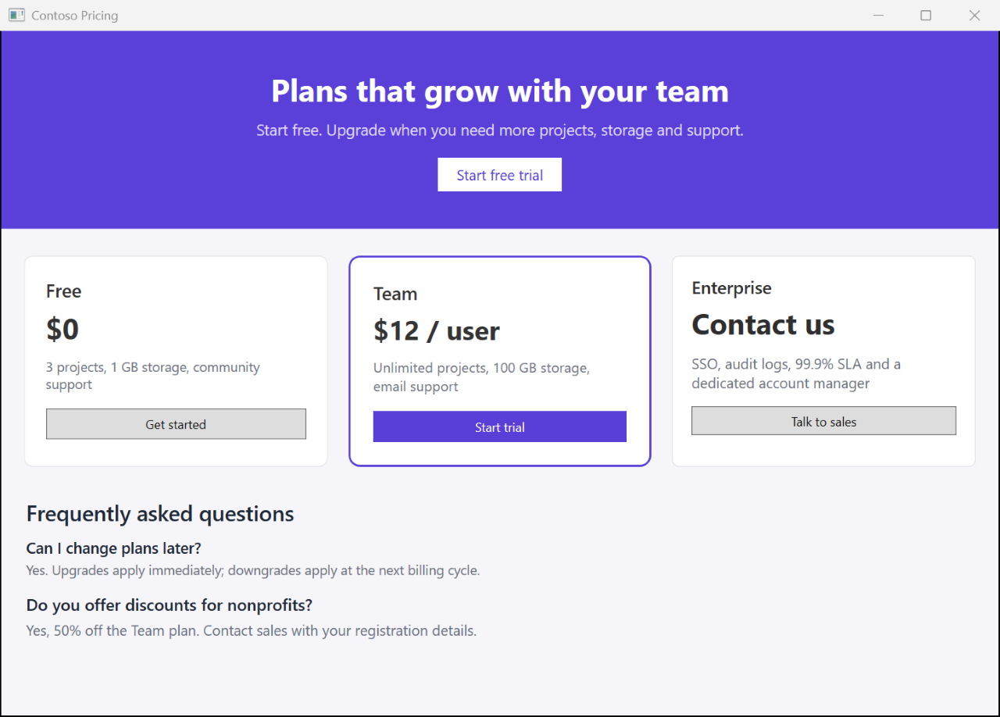
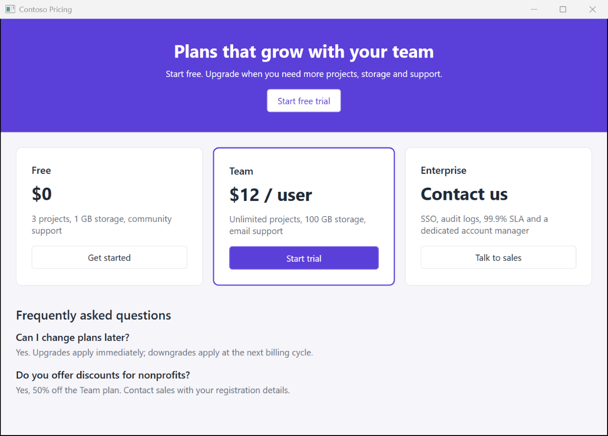

# Session transcript

Source: `Q:\source\XamlAgentDemos-notes\test-runs\DesignPolish\runA1\events.jsonl`

## Tool usage

- get_file: 6
- xaml_get_element_properties: 5
- view: 3
- xaml_get_visual_tree: 3
- powershell: 3
- xaml_capture_image: 2
- task_complete: 2
- skill: 1
- xaml_list_apps: 1
- get_projects_in_solution: 1
- glob: 1
- xaml_get_resource_dictionaries: 1
- replace_string_in_file: 1
- multi_replace_string_in_file: 1
- xaml_apply_hot_reload: 1
- xaml_get_hot_reload_status: 1
- xaml_get_binding_failures: 1
- xaml_find_elements: 1
- xaml_find_resource: 1
- xaml_get_hot_reload_log: 1

Failed tool calls: 0, images: 2


_Model: gpt-6.1-terra_


## User (13:35:54)

Audit my running pricing page against design-tokens.md. List every spacing, font size, color and corner radius that isn't a token, then fix the XAML to use token resources and show me before/after.


**Tool call (13:35:57):** `skill`
```json
{
 "skill": "xaml-diagnostics"
}
```

<details><summary>Result `skill` success=true</summary>

```
Skill "xaml-diagnostics" loaded successfully. Follow the instructions in the skill context.
```
</details>


_Skill invoked: xaml-diagnostics_


**Assistant (13:36:00):**

I’ll compare the running page and its XAML with the token specification, then apply and verify the changes.


**Tool call (13:36:00):** `xaml_list_apps`
```json
{
 "progressMessage": "Inspecting the running pricing page"
}
```


**Tool call (13:36:00):** `get_projects_in_solution`
```json
{}
```


**Tool call (13:36:00):** `glob`
```json
{
 "pattern": "**\\design-tokens.md"
}
```


**Tool call (13:36:00):** `view`
```json
{
 "path": "c:\\vs\\fastmain\\common7\\ide\\commonextensions\\microsoft\\xamldiagnostics\\AgentTools\\skills\\xaml-diagnostics\\references\\xaml-authoring.md"
}
```

<details><summary>Result `view` success=true</summary>

```
# XAML authoring guidance

Follow these rules when writing or changing XAML so it works well with XAML Hot Reload, the XAML designer, and XAML Diagnostics.

## Design-time data

- Declare `xmlns:d="http://schemas.microsoft.com/expression/blend/2008"` and `xmlns:mc="http://schemas.openxmlformats.org/markup-compatibility/2006"` with `mc:Ignorable="d"`.
- Use `d:DataContext="{d:DesignInstance Type=vm:MyViewModel, IsDesignTimeCreatable=False}"` (WPF/UWP) so the designer and IntelliSense know binding paths.
- Use `d:` properties (for example `d:Text="Sample"`) for sample values that appear only at design time.
- .NET MAUI: set `x:DataType` on pages and `DataTemplate`s. It enables compiled bindings and turns many binding failures into build errors.
- WinUI/UWP: prefer `x:Bind` for compile-time checked bindings when the view owns the view model.

## Bindings

- Bind with explicit paths. Avoid string-built paths in code-behind.
- Keep the `DataContext` chain simple. Use `ElementName` or `RelativeSource` only at real scope boundaries (for example inside a `DataTemplate` that needs the page's view model).
- Expose bound properties as public properties that raise `PropertyChanged`. Fields and non-public properties don't bind.
- Use `FallbackValue` and `TargetNullValue` for expected missing values instead of hiding binding errors.

## Hot reload and designer friendly code

- Keep control and page constructors cheap. Don't call services, open files, or start network calls in constructors or `InitializeComponent` paths. The designer and hot reload create instances again.
- Keep a public parameterless constructor on custom controls.
- Guard runtime-only work with `DesignerProperties.GetIsInDesignMode(this)` (WPF) or `Windows.ApplicationModel.DesignMode.DesignModeEnabled` (UWP/WinUI).
- Put styles, templates, and visual states in XAML, not code-behind. Hot reload can't update UI built in code.
- Don't walk the visual tree from code-behind to change visuals. Use bindings, triggers, and visual states.
- Use `x:Name` only for elements code-behind needs. Don't rename `x:Class` while the app is running.

## Resources

- Put shared resources in `App.xaml` merged dictionaries or the closest scope that uses them.
- A `StaticResource` must be defined earlier in load order. Use `DynamicResource` (WPF) or `ThemeResource` (UWP/WinUI) for theme values that change at runtime.
- To check where a key resolves at runtime, or whether a dictionary is merged a
... [truncated 618 chars]
```
</details>

<details><summary>Result `xaml_list_apps` success=true</summary>

```
{"isDebugging":true,"diagnosticsActive":true,"apps":[{"app":"a2","name":"DesignPolish.exe [76436]","processId":76436,"platform":"WPF (.NET)","isRemote":false,"isDesignTimeOrNoDebug":false,"sourceInfoAvailable":true,"hotReloadSupported":true,"hotReloadEnabled":true,"supportsPropertyExplorer":true,"supportsInAppToolbar":true,"windowCount":1}]}
```
</details>

<details><summary>Result `get_projects_in_solution` success=true</summary>

```
src\GhostClicks\GhostClicks.csproj
src\GermanReady\GermanReady.csproj
src\ThemeBreaker\ThemeBreaker.csproj
src\DesignPolish\DesignPolish.csproj
src\HotReloadDoctor\HotReloadDoctor.csproj
src\VanishingSave\VanishingSave.csproj
src\CrispPixels\CrispPixels.csproj
src\PrecedenceWars\PrecedenceWars.csproj
src\LostWindows\LostWindows.csproj
src\TemplateDetective\TemplateDetective.csproj
src\SlowScroll\SlowScroll.csproj
src\PixelPerfect\PixelPerfect.csproj
src\BindingStorm\BindingStorm.csproj
src\BugRepro\BugRepro.csproj
src\A11ySweep\A11ySweep.csproj
src\StyleMaze\StyleMaze.csproj
src\ResponsiveDashboard\ResponsiveDashboard.csproj

```
</details>

<details><summary>Result `glob` success=true</summary>

```
.\src\DesignPolish\design-tokens.md
```
</details>


**Tool call (13:36:03):** `view`
```json
{
 "path": "Q:\\source\\XamlAgentDemos\\src\\DesignPolish\\design-tokens.md"
}
```


**Tool call (13:36:03):** `view`
```json
{
 "path": "Q:\\source\\XamlAgentDemos\\src\\DesignPolish"
}
```


**Tool call (13:36:03):** `xaml_capture_image`
```json
{
 "progressMessage": "Capturing the page before changes",
 "app": "a2"
}
```


**Tool call (13:36:03):** `xaml_get_visual_tree`
```json
{
 "progressMessage": "Inspecting the pricing page tree",
 "app": "a2",
 "depth": 5,
 "maxNodes": 200
}
```


**Tool call (13:36:03):** `xaml_get_resource_dictionaries`
```json
{
 "progressMessage": "Inspecting loaded token resources",
 "app": "a2",
 "includeKeys": true
}
```


**Tool call (13:36:03):** `powershell`
```json
{
 "command": "git status --short",
 "description": "Check existing workspace changes"
}
```

<details><summary>Result `view` success=true</summary>

```
# Contoso design tokens

All UI must use these tokens. Anything else is a bug.

## Spacing (4 px grid)
4, 8, 12, 16, 24, 32, 48

## Corner radius
- Controls (buttons, inputs): 4
- Cards: 8

## Type ramp (FontSize)
| Token | Size | Weight |
|---|---|---|
| Caption | 12 | Normal |
| Body | 14 | Normal |
| Subtitle | 16 | SemiBold |
| Title | 20 | SemiBold |
| Display | 28 | Bold |

## Colors
| Token | Value |
|---|---|
| TextPrimary | #1F2937 |
| TextSecondary | #6B7280 |
| Accent | #5B3FD9 |
| Surface | #FFFFFF |
| Background | #F5F5FA |
| Border | #E5E7EB |

```
</details>

<details><summary>Result `view` success=true</summary>

```
App.xaml
App.xaml.cs
DesignPolish.csproj
MainWindow.xaml
MainWindow.xaml.cs
bin
design-tokens.md
obj
```
</details>

<details><summary>Result `xaml_get_visual_tree` success=true</summary>

```
{"app":"a2","platform":"WPF (.NET)","sourceInfoAvailable":true,"nodeCount":25,"truncated":false,"depthLimitedNodes":4,"hint":"4 node(s) have children beyond the requested depth (childCount > 0, no children listed). Raise depth or pass rootElementId to expand them.","nodes":[{"id":"a2:10","type":"DesignPolish.MainWindow","source":{"file":"Q:\\source\\XamlAgentDemos\\src\\DesignPolish\\MainWindow.xaml","line":3,"column":9},"childCount":1,"children":[{"id":"a2:11","type":"System.Windows.Controls.Border","childCount":1,"children":[{"id":"a2:12","type":"System.Windows.Documents.AdornerDecorator","childCount":2,"children":[{"id":"a2:13","type":"System.Windows.Controls.ContentPresenter","childCount":1,"children":[{"id":"a2:15","type":"System.Windows.Controls.ScrollViewer","source":{"file":"Q:\\source\\XamlAgentDemos\\src\\DesignPolish\\MainWindow.xaml","line":8,"column":6},"childCount":1,"children":[{"id":"a2:16","type":"System.Windows.Controls.Grid","childCount":4,"children":[{"id":"a2:17","type":"System.Windows.Shapes.Rectangle","childCount":0},{"id":"a2:18","type":"System.Windows.Controls.ScrollContentPresenter","childCount":2,"children":[{"id":"a2:21","type":"System.Windows.Controls.StackPanel","source":{"file":"Q:\\source\\XamlAgentDemos\\src\\DesignPolish\\MainWindow.xaml","line":9,"column":10},"childCount":3,"children":[{"id":"a2:23","type":"System.Windows.Controls.Border","name":"Hero","source":{"file":"Q:\\source\\XamlAgentDemos\\src\\DesignPolish\\MainWindow.xaml","line":11,"column":14},"childCount":1,"children":[{"id":"a2:26","type":"System.Windows.Controls.StackPanel","name":"HeroContent","source":{"file":"Q:\\source\\XamlAgentDemos\\src\\DesignPolish\\MainWindow.xaml","line":14,"column":18},"childCount":3}]},{"id":"a2:24","type":"System.Windows.Controls.Primitives.UniformGrid","name":"Plans","source":{"file":"Q:\\source\\XamlAgentDemos\\src\\DesignPolish\\MainWindow.xaml","line":40,"column":14},"childCount":3,"children":[{"id":"a2:27","type":"System.Windows.Controls.Border","name":"FreePlan","source":{"file":"Q:\\source\\XamlAgentDemos\\src\\DesignPolish\\MainWindow.xaml","line":43,"column":18},"childCount":1},{"id":"a2:28","type":"System.Windows.Controls.Border","name":"TeamPlan","source":{"file":"Q:\\source\\XamlAgentDemos\\src\\DesignPolish\\MainWindow.xaml","line":71,"column":18},"childCount":1},{"id":"a2:29","type":"System.Windows.Controls.Border","name":"EnterprisePlan","source":{"file":"Q:\\source\\XamlAgentDemos\\src\\DesignPolish\\MainWindow
... [truncated 1489 chars]
```
</details>

<details><summary>Result `xaml_get_resource_dictionaries` success=true</summary>

```
{"app":"a2","scope":"application","note":"Scopes are in lookup order (closest first). Within a dictionary, own keys win over theme dictionaries, then merged dictionaries from last to first.","scopes":[{"scope":"Application","ownerType":"DesignPolish.App","dictionary":{"path":"Application","type":"System.Windows.ResourceDictionary","keyCount":0,"keys":[]}}]}
```
</details>




<details><summary>Result `xaml_capture_image` success=true</summary>

```
Screenshot of window 0x790492 "Contoso Pricing" of app a2 (1280x918).
```
</details>

<details><summary>Result `powershell` success=true</summary>

```

<shellId: 2 completed with exit code 0>
```
</details>


**Tool call (13:36:08):** `get_file`
```json
{
 "filename": "src\\DesignPolish\\MainWindow.xaml",
 "startLine": 1,
 "endLine": 200
}
```


**Tool call (13:36:08):** `get_file`
```json
{
 "filename": "src\\DesignPolish\\App.xaml",
 "startLine": 1,
 "endLine": 100
}
```


**Tool call (13:36:08):** `get_file`
```json
{
 "filename": "src\\DesignPolish\\MainWindow.xaml.cs",
 "startLine": 1,
 "endLine": 150
}
```


**Tool call (13:36:08):** `get_file`
```json
{
 "filename": "src\\DesignPolish\\DesignPolish.csproj",
 "startLine": 1,
 "endLine": 100
}
```


**Tool call (13:36:08):** `xaml_get_visual_tree`
```json
{
 "progressMessage": "Inspecting page controls and templates",
 "app": "a2",
 "rootElementId": "a2:21",
 "depth": 12,
 "maxNodes": 300
}
```

<details><summary>Result `xaml_get_visual_tree` success=true</summary>

```
{"app":"a2","platform":"WPF (.NET)","sourceInfoAvailable":true,"nodeCount":43,"truncated":false,"nodes":[{"id":"a2:21","type":"System.Windows.Controls.StackPanel","source":{"file":"Q:\\source\\XamlAgentDemos\\src\\DesignPolish\\MainWindow.xaml","line":9,"column":10},"childCount":3,"children":[{"id":"a2:23","type":"System.Windows.Controls.Border","name":"Hero","source":{"file":"Q:\\source\\XamlAgentDemos\\src\\DesignPolish\\MainWindow.xaml","line":11,"column":14},"childCount":1,"children":[{"id":"a2:26","type":"System.Windows.Controls.StackPanel","name":"HeroContent","source":{"file":"Q:\\source\\XamlAgentDemos\\src\\DesignPolish\\MainWindow.xaml","line":14,"column":18},"childCount":3,"children":[{"id":"a2:35","type":"System.Windows.Controls.TextBlock","name":"HeroTitle","source":{"file":"Q:\\source\\XamlAgentDemos\\src\\DesignPolish\\MainWindow.xaml","line":15,"column":22},"childCount":0},{"id":"a2:36","type":"System.Windows.Controls.TextBlock","name":"HeroSubtitle","source":{"file":"Q:\\source\\XamlAgentDemos\\src\\DesignPolish\\MainWindow.xaml","line":21,"column":22},"childCount":0},{"id":"a2:37","type":"System.Windows.Controls.Button","name":"HeroCta","source":{"file":"Q:\\source\\XamlAgentDemos\\src\\DesignPolish\\MainWindow.xaml","line":27,"column":22},"childCount":1,"children":[{"id":"a2:41","type":"System.Windows.Controls.Border","name":"border","childCount":1,"children":[{"id":"a2:54","type":"System.Windows.Controls.ContentPresenter","name":"contentPresenter","childCount":1,"children":[{"id":"a2:58","type":"System.Windows.Controls.TextBlock","childCount":0}]}]}]}]}]},{"id":"a2:24","type":"System.Windows.Controls.Primitives.UniformGrid","name":"Plans","source":{"file":"Q:\\source\\XamlAgentDemos\\src\\DesignPolish\\MainWindow.xaml","line":40,"column":14},"childCount":3,"children":[{"id":"a2:27","type":"System.Windows.Controls.Border","name":"FreePlan","source":{"file":"Q:\\source\\XamlAgentDemos\\src\\DesignPolish\\MainWindow.xaml","line":43,"column":18},"childCount":1,"children":[{"id":"a2:38","type":"System.Windows.Controls.StackPanel","source":{"file":"Q:\\source\\XamlAgentDemos\\src\\DesignPolish\\MainWindow.xaml","line":50,"column":22},"childCount":4,"children":[{"id":"a2:42","type":"System.Windows.Controls.TextBlock","source":{"file":"Q:\\source\\XamlAgentDemos\\src\\DesignPolish\\MainWindow.xaml","line":51,"column":26},"childCount":0},{"id":"a2:43","type":"System.Windows.Controls.TextBlock","source":{"file":"Q:\\source\\XamlAgentDemos\\src\\D
... [truncated 4670 chars]
```
</details>

<details><summary>Result `get_file` success=true</summary>

```
```xaml src\DesignPolish\App.xaml (Lines 1-4 of 4 total. Call tools for more if needed.)
<Application x:Class="DesignPolish.App"
             xmlns="http://schemas.microsoft.com/winfx/2006/xaml/presentation"
             xmlns:x="http://schemas.microsoft.com/winfx/2006/xaml"
             StartupUri="MainWindow.xaml" />

```


```
</details>

<details><summary>Result `get_file` success=true</summary>

```
``` src\DesignPolish\DesignPolish.csproj (Lines 1-5 of 5 total. Call tools for more if needed.)
<Project Sdk="Microsoft.NET.Sdk">
  <PropertyGroup>
    <RootNamespace>DesignPolish</RootNamespace>
  </PropertyGroup>
</Project>

```


```
</details>

<details><summary>Result `get_file` success=true</summary>

```
```csharp src\DesignPolish\MainWindow.xaml.cs (Lines 1-8 of 8 total. Call tools for more if needed.)
using System.Windows;

namespace DesignPolish;

public partial class MainWindow : Window
{
    public MainWindow() => this.InitializeComponent();
}

```


```
</details>

<details><summary>Result `get_file` success=true</summary>

```
```xaml src\DesignPolish\MainWindow.xaml (Lines 1-158 of 158 total. Call tools for more if needed.)
<Window x:Class="DesignPolish.MainWindow"
        xmlns="http://schemas.microsoft.com/winfx/2006/xaml/presentation"
        xmlns:x="http://schemas.microsoft.com/winfx/2006/xaml"
        Title="Contoso Pricing"
        Width="980"
        Height="700"
        Background="#F5F5FA">
    <ScrollViewer VerticalScrollBarVisibility="Auto">
        <StackPanel>
            <!-- Hero -->
            <Border x:Name="Hero"
                    Padding="40,36"
                    Background="#5B3FD9">
                <StackPanel x:Name="HeroContent" HorizontalAlignment="Center">
                    <TextBlock x:Name="HeroTitle"
                               HorizontalAlignment="Center"
                               FontSize="30"
                               FontWeight="Bold"
                               Foreground="White"
                               Text="Plans that grow with your team" />
                    <TextBlock x:Name="HeroSubtitle"
                               Margin="0,9,0,0"
                               HorizontalAlignment="Center"
                               FontSize="15"
                               Foreground="#E0DBFF"
                               Text="Start free. Upgrade when you need more projects, storage and support." />
                    <Button x:Name="HeroCta"
                            Margin="0,18,0,0"
                            Padding="18,7"
                            HorizontalAlignment="Center"
                            Background="White"
                            BorderThickness="0"
                            Content="Start free trial"
                            FontSize="14"
                            Foreground="#5A3ED8" />
                </StackPanel>
            </Border>

            <!-- Plans -->
            <UniformGrid x:Name="Plans"
                         Margin="22,26,22,0"
                         Columns="3">
                <Border x:Name="FreePlan"
                        Margin="0,0,13,0"
                        Padding="20"
                        Background="White"
                        BorderBrush="#E5E7EB"
                        BorderThickness="1"
                        CornerRadius="8">
                    <StackPanel>
                        <TextBlock FontSize="18"
                                   FontWeight="SemiBold"
     
... [truncated 5221 chars]
```
</details>


**Assistant (13:36:22):**

The page has no token resources yet, and several buttons also inherit system colors and square corners. I’ll define the documented tokens and map each page element to them, including the button template.


**Tool call (13:36:22):** `get_file`
```json
{
 "filename": "src\\DesignPolish\\MainWindow.xaml",
 "startLine": 1,
 "endLine": 158
}
```

<details><summary>Result `get_file` success=true</summary>

```
```xaml src\DesignPolish\MainWindow.xaml (Lines 1-158 of 158 total. Call tools for more if needed.)
<Window x:Class="DesignPolish.MainWindow"
        xmlns="http://schemas.microsoft.com/winfx/2006/xaml/presentation"
        xmlns:x="http://schemas.microsoft.com/winfx/2006/xaml"
        Title="Contoso Pricing"
        Width="980"
        Height="700"
        Background="#F5F5FA">
    <ScrollViewer VerticalScrollBarVisibility="Auto">
        <StackPanel>
            <!-- Hero -->
            <Border x:Name="Hero"
                    Padding="40,36"
                    Background="#5B3FD9">
                <StackPanel x:Name="HeroContent" HorizontalAlignment="Center">
                    <TextBlock x:Name="HeroTitle"
                               HorizontalAlignment="Center"
                               FontSize="30"
                               FontWeight="Bold"
                               Foreground="White"
                               Text="Plans that grow with your team" />
                    <TextBlock x:Name="HeroSubtitle"
                               Margin="0,9,0,0"
                               HorizontalAlignment="Center"
                               FontSize="15"
                               Foreground="#E0DBFF"
                               Text="Start free. Upgrade when you need more projects, storage and support." />
                    <Button x:Name="HeroCta"
                            Margin="0,18,0,0"
                            Padding="18,7"
                            HorizontalAlignment="Center"
                            Background="White"
                            BorderThickness="0"
                            Content="Start free trial"
                            FontSize="14"
                            Foreground="#5A3ED8" />
                </StackPanel>
            </Border>

            <!-- Plans -->
            <UniformGrid x:Name="Plans"
                         Margin="22,26,22,0"
                         Columns="3">
                <Border x:Name="FreePlan"
                        Margin="0,0,13,0"
                        Padding="20"
                        Background="White"
                        BorderBrush="#E5E7EB"
                        BorderThickness="1"
                        CornerRadius="8">
                    <StackPanel>
                        <TextBlock FontSize="18"
                                   FontWeight="SemiBold"
     
... [truncated 5221 chars]
```
</details>


**Tool call (13:37:10):** `replace_string_in_file`
```json
{
 "filePath": "src\\DesignPolish\\MainWindow.xaml",
 "oldString": "<Window x:Class=\"DesignPolish.MainWindow\"\n        xmlns=\"http://schemas.microsoft.com/winfx/2006/xaml/presentation\"\n        xmlns:x=\"http://schemas.microsoft.com/winfx/2006/xaml\"\n        Title=\"Contoso Pricing\"\n        Width=\"980\"\n        Height=\"700\"\n        Background=\"#F5F5FA\">\n    <ScrollViewer VerticalScrollBarVisibility=\"Auto\">\n        <StackPanel>\n            <!-- Hero -->\n            <Border x:Name=\"Hero\"\n                    Padding=\"40,36\"\n                    Background=\"#5B3FD9\">\n                <StackPanel x:Name=\"HeroContent\" HorizontalAlignment=\"Center\">\n                    <TextBlock x:Name=\"HeroTitle\"\n                               HorizontalAlignment=\"Center\"\n                               FontSize=\"30\"\n                               FontWeight=\"Bold\"\n                               Foreground=\"White\"\n                               Text=\"Plans that grow with your team\" />\n                    <TextBlock x:Name=\"HeroSubtitle\"\n                               Margin=\"0,9,0,0\"\n                               HorizontalAlignment=\"Center\"\n                               FontSize=\"15\"\n                               Foreground=\"#E0DBFF\"\n                               Text=\"Start free. Upgrade when you need more projects, storage and support.\" />\n                    <Button x:Name=\"HeroCta\"\n                            Margin=\"0,
... [truncated 20225 chars]
```

<details><summary>Result `replace_string_in_file` success=true</summary>

```
Successfully replaced text in src\DesignPolish\MainWindow.xaml
```
</details>


**Tool call (13:37:16):** `get_file`
```json
{
 "filename": "src\\DesignPolish\\MainWindow.xaml",
 "startLine": 30,
 "endLine": 185
}
```

<details><summary>Result `get_file` success=true</summary>

```
```xaml src\DesignPolish\MainWindow.xaml (Lines 30-185 of 220 total. Call tools for more if needed.)
        <Thickness x:Key="FaqMargin">24,32,24,24</Thickness>
        <Thickness x:Key="TopSpace4">0,4,0,0</Thickness>
        <Thickness x:Key="TopSpace8">0,8,0,0</Thickness>
        <Thickness x:Key="TopSpace12">0,12,0,0</Thickness>
        <Thickness x:Key="TopSpace16">0,16,0,0</Thickness>
        <Thickness x:Key="ButtonPadding">16,8</Thickness>

        <Style TargetType="Button">
            <Setter Property="FontSize" Value="{StaticResource BodyFontSize}" />
            <Setter Property="Padding" Value="{StaticResource ButtonPadding}" />
            <Setter Property="Background" Value="{StaticResource SurfaceBrush}" />
            <Setter Property="Foreground" Value="{StaticResource TextPrimaryBrush}" />
            <Setter Property="BorderBrush" Value="{StaticResource BorderBrush}" />
            <Setter Property="BorderThickness" Value="1" />
            <Setter Property="HorizontalContentAlignment" Value="Center" />
            <Setter Property="VerticalContentAlignment" Value="Center" />
            <Setter Property="Template">
                <Setter.Value>
                    <ControlTemplate TargetType="Button">
                        <Border x:Name="ButtonBorder"
                                Background="{TemplateBinding Background}"
                                BorderBrush="{TemplateBinding BorderBrush}"
                                BorderThickness="{TemplateBinding BorderThickness}"
                                CornerRadius="{StaticResource ControlCornerRadius}">
                            <ContentPresenter Margin="{TemplateBinding Padding}"
                                              HorizontalAlignment="{TemplateBinding HorizontalContentAlignment}"
                                              VerticalAlignment="{TemplateBinding VerticalContentAlignment}"
                                              RecognizesAccessKey="True" />
                        </Border>
                        <ControlTemplate.Triggers>
                            <Trigger Property="IsMouseOver" Value="True">
                                <Setter TargetName="ButtonBorder" Property="BorderBrush" Value="{StaticResource AccentBrush}" />
                            </Trigger>
                            <Trigger Property="IsPressed" Value="True">
                                <Setter Property="Background" Value="{
... [truncated 7376 chars]
```
</details>


**Tool call (13:37:27):** `multi_replace_string_in_file`
```json
{
 "explanation": "Keep button state triggers effective for the hero and featured buttons.",
 "replacements": [
  {
   "filePath": "src\\DesignPolish\\MainWindow.xaml",
   "oldString": "                            <Trigger Property=\"IsMouseOver\" Value=\"True\">\n                                <Setter TargetName=\"ButtonBorder\" Property=\"BorderBrush\" Value=\"{StaticResource AccentBrush}\" />\n                            </Trigger>\n                            <Trigger Property=\"IsPressed\" Value=\"True\">\n                                <Setter Property=\"Background\" Value=\"{StaticResource AccentBrush}\" />\n                                <Setter Property=\"Foreground\" Value=\"{StaticResource SurfaceBrush}\" />\n                            </Trigger>",
   "newString": "                            <Trigger Property=\"IsMouseOver\" Value=\"True\">\n                                <Setter TargetName=\"ButtonBorder\" Property=\"BorderBrush\" Value=\"{StaticResource TextPrimaryBrush}\" />\n                            </Trigger>\n                            <Trigger Property=\"IsPressed\" Value=\"True\">\n                                <Setter Property=\"Background\" Value=\"{StaticResource AccentBrush}\" />\n                                <Setter Property=\"Foreground\" Value=\"{StaticResource SurfaceBrush}\" />\n                                <Setter TargetName=\"ButtonBorder\" Property=\"BorderBrush\" Value=\"{StaticResource TextPrimaryBrush}\" />\n                
... [truncated 3118 chars]
```

<details><summary>Result `multi_replace_string_in_file` success=true</summary>

```
Successfully applied 4 of 4 replacement(s) across 1 file(s).
```
</details>


**Tool call (13:37:29):** `xaml_apply_hot_reload`
```json
{
 "progressMessage": "Applying token resources to the running page"
}
```

<details><summary>Result `xaml_apply_hot_reload` success=true</summary>

```
{"applied":true,"errors":[],"log":[],"hint":"Call xaml_capture_image to verify the change visually. Views that aren't loaded (other tabs, closed dialogs) are updated when they're next shown."}
```
</details>


**Tool call (13:37:33):** `xaml_capture_image`
```json
{
 "progressMessage": "Capturing the page after changes",
 "app": "a2"
}
```


**Tool call (13:37:33):** `xaml_get_hot_reload_status`
```json
{
 "progressMessage": "Checking the hot reload result"
}
```


**Tool call (13:37:33):** `xaml_get_binding_failures`
```json
{
 "progressMessage": "Checking for new binding failures"
}
```


**Tool call (13:37:33):** `xaml_find_elements`
```json
{
 "progressMessage": "Finding the updated pricing controls",
 "app": "a2",
 "sourceFile": "MainWindow.xaml",
 "type": "Button"
}
```


**Tool call (13:37:33):** `powershell`
```json
{
 "command": "git diff --check; git --no-pager diff --stat; git --no-pager diff -- src\\DesignPolish\\MainWindow.xaml",
 "description": "Review token changes and whitespace"
}
```

<details><summary>Result `xaml_get_hot_reload_status` success=true</summary>

```
{"options":{"hotReloadEnabled":true,"hotReloadOnSave":false,"wpfEnabled":true,"uwpEnabled":true,"winUIEnabled":true,"mauiEnabled":true,"justMyXaml":true,"previewSelectedElement":false,"inAppToolbar":true,"inAppSelection":false,"layoutAdorners":false,"trackFocusedElement":false,"bindingFailuresVisible":true,"compatibilityMode":false},"dotNetHotReloadEnabled":true,"isProcessingChanges":false,"apps":[{"app":"a2","platform":"WPF (.NET)","hotReloadSupported":true,"hotReloadEnabled":true,"sourceInfoAvailable":true}],"errors":[]}
```
</details>

<details><summary>Result `xaml_find_elements` success=true</summary>

```
{"count":4,"truncated":false,"results":[{"id":"a2:37","type":"System.Windows.Controls.Button","name":"HeroCta","source":{"file":"Q:\\source\\XamlAgentDemos\\src\\DesignPolish\\MainWindow.xaml","line":27,"column":22},"path":"MainWindow/Border/AdornerDecorator/ContentPresenter/ScrollViewer/Grid/ScrollContentPresenter/StackPanel/Border/StackPanel/Button"},{"id":"a2:45","type":"System.Windows.Controls.Button","source":{"file":"Q:\\source\\XamlAgentDemos\\src\\DesignPolish\\MainWindow.xaml","line":65,"column":26},"path":"MainWindow/Border/AdornerDecorator/ContentPresenter/ScrollViewer/Grid/ScrollContentPresenter/StackPanel/UniformGrid/Border/StackPanel/Button"},{"id":"a2:49","type":"System.Windows.Controls.Button","source":{"file":"Q:\\source\\XamlAgentDemos\\src\\DesignPolish\\MainWindow.xaml","line":93,"column":26},"path":"MainWindow/Border/AdornerDecorator/ContentPresenter/ScrollViewer/Grid/ScrollContentPresenter/StackPanel/UniformGrid/Border/StackPanel/Button"},{"id":"a2:53","type":"System.Windows.Controls.Button","source":{"file":"Q:\\source\\XamlAgentDemos\\src\\DesignPolish\\MainWindow.xaml","line":124,"column":26},"path":"MainWindow/Border/AdornerDecorator/ContentPresenter/ScrollViewer/Grid/ScrollContentPresenter/StackPanel/UniformGrid/Border/StackPanel/Button"}]}
```
</details>

<details><summary>Result `xaml_get_binding_failures` success=true</summary>

```
{"note":"This is a cumulative log since debugging started or the last xaml_clear_binding_failures, not live state: fixed failures stay listed. To verify a fix: clear, revisit the UI that uses the binding, then read again. Failures without a file usually come from bindings created in code.","totalUnique":0,"matched":0,"truncated":false,"failures":[]}
```
</details>




<details><summary>Result `xaml_capture_image` success=true</summary>

```
Screenshot of window 0x790492 "Contoso Pricing" of app a2 (1280x918).
```
</details>

<details><summary>Result `powershell` success=true</summary>

```
src/DesignPolish/MainWindow.xaml | 225 +++++++++++++++++++++++++--------------
 1 file changed, 147 insertions(+), 78 deletions(-)
diff --git a/src/DesignPolish/MainWindow.xaml b/src/DesignPolish/MainWindow.xaml
index dad2c15..1f3a8fc 100644
--- a/src/DesignPolish/MainWindow.xaml
+++ b/src/DesignPolish/MainWindow.xaml
@@ -1,156 +1,225 @@
 <Window x:Class="DesignPolish.MainWindow"
         xmlns="http://schemas.microsoft.com/winfx/2006/xaml/presentation"
         xmlns:x="http://schemas.microsoft.com/winfx/2006/xaml"
+        xmlns:sys="clr-namespace:System;assembly=mscorlib"
         Title="Contoso Pricing"
         Width="980"
         Height="700"
-        Background="#F5F5FA">
+        Background="{DynamicResource BackgroundBrush}">
+    <Window.Resources>
+        <SolidColorBrush x:Key="TextPrimaryBrush" Color="#1F2937" />
+        <SolidColorBrush x:Key="TextSecondaryBrush" Color="#6B7280" />
+        <SolidColorBrush x:Key="AccentBrush" Color="#5B3FD9" />
+        <SolidColorBrush x:Key="SurfaceBrush" Color="#FFFFFF" />
+        <SolidColorBrush x:Key="BackgroundBrush" Color="#F5F5FA" />
+        <SolidColorBrush x:Key="BorderBrush" Color="#E5E7EB" />
+
+        <sys:Double x:Key="BodyFontSize">14</sys:Double>
+        <sys:Double x:Key="SubtitleFontSize">16</sys:Double>
+        <sys:Double x:Key="TitleFontSize">20</sys:Double>
+        <sys:Double x:Key="DisplayFontSize">28</sys:Double>
+        <CornerRadius x:Key="ControlCornerRadius">4</CornerRadius>
+        <CornerRadius x:Key="CardCornerRadius">8</CornerRadius>
+
+        <Thickness x:Key="HeroPadding">32</Thickness>
+        <Thickness x:Key="PlansMargin">24,24,24,0</Thickness>
+        <Thickness x:Key="FirstCardMargin">0,0,8,0</Thickness>
+        <Thickness x:Key="MiddleCardMargin">8,0,8,0</Thickness>
+        <Thickness x:Key="LastCardMargin">8,0,0,0</Thickness>
+        <Thickness x:Key="CardPadding">24</Thickness>
+        <Thickness x:Key="FaqMargin">24,32,24,24</Thickness>
+        <Thickness x:Key="TopSpace4">0,4,0,0</Thickness>
+        <Thickness x:Key="TopSpace8">0,8,0,0</Thickness>
+        <Thickness x:Key="TopSpace12">0,12,0,0</Thickness>
+        <Thickness x:Key="TopSpace16">0,16,0,0</Thickness>
+        <Thickness x:Key="ButtonPadding">16,8</Thickness>
+
+        <Style TargetType="Button">
+            <Setter Property="FontSize" Value="{StaticResource BodyFontSize}" />
+            <Setter Property="Padding" Value="{StaticResource ButtonPadding}" />
+            <Setter 
... [truncated 15537 chars]
```
</details>


**Tool call (13:37:39):** `xaml_find_resource`
```json
{
 "progressMessage": "Checking the window background token",
 "elementId": "a2:10",
 "key": "BackgroundBrush"
}
```


**Tool call (13:37:39):** `xaml_get_element_properties`
```json
{
 "progressMessage": "Checking the updated hero button",
 "elementId": "a2:37"
}
```


**Tool call (13:37:39):** `xaml_get_element_properties`
```json
{
 "progressMessage": "Checking the updated featured card",
 "elementId": "a2:28"
}
```


**Tool call (13:37:39):** `xaml_get_visual_tree`
```json
{
 "progressMessage": "Checking the button templates",
 "rootElementId": "a2:21",
 "depth": 12,
 "maxNodes": 150
}
```


**Tool call (13:37:39):** `xaml_get_hot_reload_log`
```json
{
 "progressMessage": "Checking hot reload errors",
 "errorsOnly": true
}
```

<details><summary>Result `xaml_get_visual_tree` success=true</summary>

```
{"app":"a2","platform":"WPF (.NET)","sourceInfoAvailable":true,"nodeCount":43,"truncated":false,"nodes":[{"id":"a2:21","type":"System.Windows.Controls.StackPanel","source":{"file":"Q:\\source\\XamlAgentDemos\\src\\DesignPolish\\MainWindow.xaml","line":9,"column":10},"childCount":3,"children":[{"id":"a2:23","type":"System.Windows.Controls.Border","name":"Hero","source":{"file":"Q:\\source\\XamlAgentDemos\\src\\DesignPolish\\MainWindow.xaml","line":11,"column":14},"childCount":1,"children":[{"id":"a2:26","type":"System.Windows.Controls.StackPanel","name":"HeroContent","source":{"file":"Q:\\source\\XamlAgentDemos\\src\\DesignPolish\\MainWindow.xaml","line":14,"column":18},"childCount":3,"children":[{"id":"a2:35","type":"System.Windows.Controls.TextBlock","name":"HeroTitle","source":{"file":"Q:\\source\\XamlAgentDemos\\src\\DesignPolish\\MainWindow.xaml","line":15,"column":22},"childCount":0},{"id":"a2:36","type":"System.Windows.Controls.TextBlock","name":"HeroSubtitle","source":{"file":"Q:\\source\\XamlAgentDemos\\src\\DesignPolish\\MainWindow.xaml","line":21,"column":22},"childCount":0},{"id":"a2:37","type":"System.Windows.Controls.Button","name":"HeroCta","source":{"file":"Q:\\source\\XamlAgentDemos\\src\\DesignPolish\\MainWindow.xaml","line":27,"column":22},"childCount":1,"children":[{"id":"a2:145","type":"System.Windows.Controls.Border","name":"ButtonBorder","childCount":1,"children":[{"id":"a2:146","type":"System.Windows.Controls.ContentPresenter","childCount":1,"children":[{"id":"a2:153","type":"System.Windows.Controls.TextBlock","childCount":0}]}]}]}]}]},{"id":"a2:24","type":"System.Windows.Controls.Primitives.UniformGrid","name":"Plans","source":{"file":"Q:\\source\\XamlAgentDemos\\src\\DesignPolish\\MainWindow.xaml","line":40,"column":14},"childCount":3,"children":[{"id":"a2:27","type":"System.Windows.Controls.Border","name":"FreePlan","source":{"file":"Q:\\source\\XamlAgentDemos\\src\\DesignPolish\\MainWindow.xaml","line":43,"column":18},"childCount":1,"children":[{"id":"a2:38","type":"System.Windows.Controls.StackPanel","source":{"file":"Q:\\source\\XamlAgentDemos\\src\\DesignPolish\\MainWindow.xaml","line":50,"column":22},"childCount":4,"children":[{"id":"a2:42","type":"System.Windows.Controls.TextBlock","source":{"file":"Q:\\source\\XamlAgentDemos\\src\\DesignPolish\\MainWindow.xaml","line":51,"column":26},"childCount":0},{"id":"a2:43","type":"System.Windows.Controls.TextBlock","source":{"file":"Q:\\source\\XamlAgentDemos\\src\\DesignPolish\\Main
... [truncated 4602 chars]
```
</details>

<details><summary>Result `xaml_get_hot_reload_log` success=true</summary>

```
{"total":0,"entries":[],"dotNetHotReloadPane":["08:29:16.96 [XAML] Connected to CrispPixels.exe [13424] for WpfCore diagnostics. Incremental Hot Reload is enabled.","08:30:06.49 🔥 1> [CrispPixels] ❌ Exited with error code -1","08:30:08.30 [XAML] CrispPixels.exe [13424] WpfCore diagnostics stopped.","08:30:29.54 [XAML] Connected to CrispPixels.exe [29620] for WpfCore diagnostics. Incremental Hot Reload is enabled.","08:33:49.29 🔥 2> [CrispPixels] ❌ Exited with error code -1","08:33:49.57 [XAML] CrispPixels.exe [29620] WpfCore diagnostics stopped.","08:35:18.51 [XAML] Connected to DesignPolish.exe [76436] for WpfCore diagnostics. Incremental Hot Reload is enabled."],"hint":"No XAML Hot Reload messages were logged in this VS session yet."}
```
</details>

<details><summary>Result `xaml_find_resource` success=true</summary>

```
{"app":"a2","scope":"a2:10","key":"BackgroundBrush","found":true,"definitions":[{"effective":true,"key":"BackgroundBrush","scope":"Element","owner":{"id":"a2:10","source":{"file":"Q:\\source\\XamlAgentDemos\\src\\DesignPolish\\MainWindow.xaml","line":3,"column":9}},"ownerType":"DesignPolish.MainWindow","dictionaryPath":"Element","valueType":"System.Windows.Media.SolidColorBrush","value":"SolidColorBrush #FFF5F5FA"}],"hint":"Edit the definition at 'location' (or in 'dictionarySource') to change this resource."}
```
</details>

<details><summary>Result `xaml_get_element_properties` success=true</summary>

```
{"id":"a2:28","type":"System.Windows.Controls.Border","name":"TeamPlan","source":{"file":"Q:\\source\\XamlAgentDemos\\src\\DesignPolish\\MainWindow.xaml","line":71,"column":18},"properties":[{"name":"BorderThickness","value":"2,2,2,2","valueType":"System.Windows.Thickness","propertyType":"System.Windows.Thickness","declaringType":"System.Windows.Controls.Border","valueSource":"Local","valueSourceLocation":{"file":"Q:\\source\\XamlAgentDemos\\src\\DesignPolish\\MainWindow.xaml","line":71,"column":18}},{"name":"Padding","value":"24,24,24,24","valueType":"System.Windows.Thickness","propertyType":"System.Windows.Thickness","declaringType":"System.Windows.Controls.Border","valueSource":"Local","valueSourceLocation":{"file":"Q:\\source\\XamlAgentDemos\\src\\DesignPolish\\MainWindow.xaml","line":71,"column":18}},{"name":"CornerRadius","value":"8,8,8,8","valueType":"System.Windows.CornerRadius","propertyType":"System.Windows.CornerRadius","declaringType":"System.Windows.Controls.Border","valueSource":"Local","valueSourceLocation":{"file":"Q:\\source\\XamlAgentDemos\\src\\DesignPolish\\MainWindow.xaml","line":71,"column":18}},{"name":"BorderBrush","value":"#FF5B3FD9","valueType":"System.Windows.Media.SolidColorBrush","propertyType":"System.Windows.Media.Brush","declaringType":"System.Windows.Controls.Border","valueSource":"Local","valueSourceLocation":{"file":"Q:\\source\\XamlAgentDemos\\src\\DesignPolish\\MainWindow.xaml","line":71,"column":18}},{"name":"Background","value":"#FFFFFFFF","valueType":"System.Windows.Media.SolidColorBrush","propertyType":"System.Windows.Media.Brush","declaringType":"System.Windows.Controls.Border","valueSource":"Local","valueSourceLocation":{"file":"Q:\\source\\XamlAgentDemos\\src\\DesignPolish\\MainWindow.xaml","line":71,"column":18}},{"name":"Child","valueType":"System.Windows.Controls.StackPanel","propertyType":"System.Windows.UIElement","declaringType":"System.Windows.Controls.Decorator","valueSource":"Local","valueSourceLocation":{"file":"Q:\\source\\XamlAgentDemos\\src\\DesignPolish\\MainWindow.xaml","line":71,"column":18},"valueLocation":{"file":"Q:\\source\\XamlAgentDemos\\src\\DesignPolish\\MainWindow.xaml","line":78,"column":22}},{"name":"Name","value":"TeamPlan","valueType":"System.String","propertyType":"System.String","declaringType":"System.Windows.FrameworkElement","valueSource":"Local","valueSourceLocation":{"file":"Q:\\source\\XamlAgentDemos\\src\\DesignPolish\\MainWindow.xaml","line":71,"column":18}},{"name":"ActualW
... [truncated 4679 chars]
```
</details>

<details><summary>Result `xaml_get_element_properties` success=true</summary>

```
{"id":"a2:37","type":"System.Windows.Controls.Button","name":"HeroCta","source":{"file":"Q:\\source\\XamlAgentDemos\\src\\DesignPolish\\MainWindow.xaml","line":27,"column":22},"properties":[{"name":"Content","value":"Start free trial","valueType":"System.String","propertyType":"System.Object","declaringType":"System.Windows.Controls.ContentControl","valueSource":"Local","valueSourceLocation":{"file":"Q:\\source\\XamlAgentDemos\\src\\DesignPolish\\MainWindow.xaml","line":27,"column":22}},{"name":"Style","value":"System.Windows.Style","valueType":"System.Windows.Style","propertyType":"System.Windows.Style","declaringType":"System.Windows.FrameworkElement","valueSource":"Local","valueSourceLocation":{"file":"Q:\\source\\XamlAgentDemos\\src\\DesignPolish\\MainWindow.xaml","line":27,"column":22},"readOnly":true},{"name":"Name","value":"HeroCta","valueType":"System.String","propertyType":"System.String","declaringType":"System.Windows.FrameworkElement","valueSource":"Local","valueSourceLocation":{"file":"Q:\\source\\XamlAgentDemos\\src\\DesignPolish\\MainWindow.xaml","line":27,"column":22}},{"name":"ActualWidth","value":"117.53333333333335","valueType":"System.Double","propertyType":"System.Double","declaringType":"System.Windows.FrameworkElement","valueSource":"Local","valueSourceLocation":{"file":"Q:\\source\\XamlAgentDemos\\src\\DesignPolish\\MainWindow.xaml","line":27,"column":22},"readOnly":true},{"name":"ActualHeight","value":"36.620000000000005","valueType":"System.Double","propertyType":"System.Double","declaringType":"System.Windows.FrameworkElement","valueSource":"Local","valueSourceLocation":{"file":"Q:\\source\\XamlAgentDemos\\src\\DesignPolish\\MainWindow.xaml","line":27,"column":22},"readOnly":true},{"name":"Margin","value":"0,16,0,0","valueType":"System.Windows.Thickness","propertyType":"System.Windows.Thickness","declaringType":"System.Windows.FrameworkElement","valueSource":"Local","valueSourceLocation":{"file":"Q:\\source\\XamlAgentDemos\\src\\DesignPolish\\MainWindow.xaml","line":27,"column":22}},{"name":"HorizontalAlignment","value":"1","valueType":"System.Windows.HorizontalAlignment","propertyType":"System.Windows.HorizontalAlignment","declaringType":"System.Windows.FrameworkElement","valueSource":"Local","valueSourceLocation":{"file":"Q:\\source\\XamlAgentDemos\\src\\DesignPolish\\MainWindow.xaml","line":27,"column":22}},{"name":"IsInitialized","value":"True","valueType":"System.Boolean","propertyType":"System.Boolean","declaringType":"Syst
... [truncated 6946 chars]
```
</details>


**Assistant (13:37:54):**

The tokenized page is now live. I’m checking the resolved button and card values and the saved XAML before summarizing every mismatch.


**Tool call (13:37:54):** `xaml_get_element_properties`
```json
{
 "progressMessage": "Verifying the button corner radius",
 "elementId": "a2:145",
 "nameFilter": "CornerRadius"
}
```


**Tool call (13:37:54):** `xaml_get_element_properties`
```json
{
 "progressMessage": "Verifying the featured button styling",
 "elementId": "a2:49",
 "nameFilter": "Foreground"
}
```


**Tool call (13:37:54):** `xaml_get_element_properties`
```json
{
 "progressMessage": "Verifying the updated type ramp",
 "elementId": "a2:35",
 "nameFilter": "FontSize"
}
```


**Tool call (13:37:54):** `powershell`
```json
{
 "command": "$xml = [xml](Get-Content -Raw 'src\\DesignPolish\\MainWindow.xaml'); $ns = [System.Xml.XmlNamespaceManager]::new($xml.NameTable); $ns.AddNamespace('p','http://schemas.microsoft.com/winfx/2006/xaml/presentation'); $sizes = @(14,16,20,28); $spacing = @(0,4,8,12,16,24,32,48); $allowedColors = @('#1F2937','#6B7280','#5B3FD9','#FFFFFF','#F5F5FA','#E5E7EB'); $failures = @(); foreach ($node in $xml.SelectNodes('//p:Thickness',$ns)) { foreach ($value in $node.InnerText.Split(',')) { if ([double]$value -notin $spacing) { $failures += \"Invalid spacing $value\" } } }; foreach ($node in $xml.SelectNodes('//p:SolidColorBrush',$ns)) { if ($node.Color -notin $allowedColors) { $failures += \"Invalid color $($node.Color)\" } }; foreach ($node in $xml.SelectNodes('//*[@FontSize or @Margin or @Padding or @CornerRadius or @Foreground or @Background or @BorderBrush]')) { foreach ($name in @('FontSize','Margin','Padding','CornerRadius','Foreground','Background','BorderBrush')) { if ($node.HasAttribute($name) -and $node.GetAttribute($name) -notmatch '^\\{(StaticResource|DynamicResource|TemplateBinding) ') { $failures += \"Literal $name on $($node.LocalName)\" } } }; if ($failures.Count) { $failures; exit 1 }; 'Token source audit passed: spacing, colors and property references.'; git diff --check",
 "description": "Validate token values and references in saved XAML"
}
```

<details><summary>Result `xaml_get_element_properties` success=true</summary>

```
{"id":"a2:49","type":"System.Windows.Controls.Button","source":{"file":"Q:\\source\\XamlAgentDemos\\src\\DesignPolish\\MainWindow.xaml","line":93,"column":26},"properties":[{"name":"Foreground","value":"#FFFFFFFF","valueType":"System.Windows.Media.SolidColorBrush","propertyType":"System.Windows.Media.Brush","declaringType":"System.Windows.Controls.Control","valueSource":"Style"}],"hiddenDefaultOrOverridden":3,"hint":"Default and overridden values were omitted. Pass includeAll=true to see them, or call xaml_explain_property_value for one property's full precedence chain."}
```
</details>

<details><summary>Result `xaml_get_element_properties` success=true</summary>

```
{"id":"a2:145","type":"System.Windows.Controls.Border","name":"ButtonBorder","properties":[{"name":"CornerRadius","value":"4,4,4,4","valueType":"System.Windows.CornerRadius","propertyType":"System.Windows.CornerRadius","declaringType":"System.Windows.Controls.Border","valueSource":"Local"}],"hiddenDefaultOrOverridden":1,"hint":"Default and overridden values were omitted. Pass includeAll=true to see them, or call xaml_explain_property_value for one property's full precedence chain."}
```
</details>

<details><summary>Result `xaml_get_element_properties` success=true</summary>

```
{"id":"a2:35","type":"System.Windows.Controls.TextBlock","name":"HeroTitle","source":{"file":"Q:\\source\\XamlAgentDemos\\src\\DesignPolish\\MainWindow.xaml","line":15,"column":22},"properties":[{"name":"FontSize","value":"28","valueType":"System.Double","propertyType":"System.Double","declaringType":"System.Windows.Controls.TextBlock","valueSource":"Local","valueSourceLocation":{"file":"Q:\\source\\XamlAgentDemos\\src\\DesignPolish\\MainWindow.xaml","line":15,"column":22}}],"hiddenDefaultOrOverridden":1,"hint":"Default and overridden values were omitted. Pass includeAll=true to see them, or call xaml_explain_property_value for one property's full precedence chain."}
```
</details>

<details><summary>Result `powershell` success=true</summary>

```
Token source audit passed: spacing, colors and property references.
<shellId: 4 completed with exit code 0>
```
</details>


**Tool call (13:38:05):** `task_complete`
```json
{
 "summary": "Updated [MainWindow.xaml](vscopilot://file?path=Q%3A%5Csource%5CXamlAgentDemos%5Csrc%5CDesignPolish%5CMainWindow.xaml); the before/after screenshots are above.\n\n**Audit: non-token values → tokens** (spacing and sizes in px):\n\n- **Spacing:** hero padding 40,36 → 32,32; subtitle gap 9 → 8; CTA gap 18 → 16 and padding 18,7 → 16,8. Plans margin 22,26,22 → 24,24,24; card margins 13/7/13 → 8; card padding 20/22/18 → 24. Price gaps 6/6/5 → 8; description gaps 10/10/11 → 12; button gaps 15/14 → 16 and padding 12,6 / 12,7 / 14,5 → 16,8. FAQ top margin 30 → 32; question gaps 10/14 → 12/16; answer gaps 3/5 → 4.\n- **Font sizes:** hero 30 → 28, subtitle 15 → 14; plan headings 18/17 → 16, Team price 26 → 28, descriptions 13/13.5 → 14; FAQ heading 21 → 20, question 15 → 16, answer 13 → 14.\n- **Colors:** #E0DBFF → Surface; #5A3ED8 and #5C40DA → Accent; #333333, #343434 and #2F2F2F → TextPrimary; #6E7380 and #6B6F7A → TextSecondary; #E4E6EA → Border. Default system button colors were replaced with token brushes.\n- **Radii:** Team 10 and Enterprise 6 → card radius 8; default square buttons → control radius 4.\n\nHot Reload succeeded; live values and the saved token references were checked. No build was run while the app was being debugged."
}
```

<details><summary>Result `task_complete` success=true</summary>

```
Updated [MainWindow.xaml](vscopilot://file?path=Q%3A%5Csource%5CXamlAgentDemos%5Csrc%5CDesignPolish%5CMainWindow.xaml); the before/after screenshots are above.

**Audit: non-token values → tokens** (spacing and sizes in px):

- **Spacing:** hero padding 40,36 → 32,32; subtitle gap 9 → 8; CTA gap 18 → 16 and padding 18,7 → 16,8. Plans margin 22,26,22 → 24,24,24; card margins 13/7/13 → 8; card padding 20/22/18 → 24. Price gaps 6/6/5 → 8; description gaps 10/10/11 → 12; button gaps 15/14 → 16 and padding 12,6 / 12,7 / 14,5 → 16,8. FAQ top margin 30 → 32; question gaps 10/14 → 12/16; answer gaps 3/5 → 4.
- **Font sizes:** hero 30 → 28, subtitle 15 → 14; plan headings 18/17 → 16, Team price 26 → 28, descriptions 13/13.5 → 14; FAQ heading 21 → 20, question 15 → 16, answer 13 → 14.
- **Colors:** #E0DBFF → Surface; #5A3ED8 and #5C40DA → Accent; #333333, #343434 and #2F2F2F → TextPrimary; #6E7380 and #6B6F7A → TextSecondary; #E4E6EA → Border. Default system button colors were replaced with token brushes.
- **Radii:** Team 10 and Enterprise 6 → card radius 8; default square buttons → control radius 4.

Hot Reload succeeded; live values and the saved token references were checked. No build was run while the app was being debugged.
```
</details>


**Task complete (13:38:05):** Updated [MainWindow.xaml](vscopilot://file?path=Q%3A%5Csource%5CXamlAgentDemos%5Csrc%5CDesignPolish%5CMainWindow.xaml); the before/after screenshots are above.

**Audit: non-token values → tokens** (spacing and sizes in px):

- **Spacing:** hero padding 40,36 → 32,32; subtitle gap 9 → 8; CTA gap 18 → 16 and padding 18,7 → 16,8. Plans margin 22,26,22 → 24,24,24; card margins 13/7/13 → 8; card padding 20/22/18 → 24. Price gaps 6/6/5 → 8; description gaps 10/10/11 → 12; button gaps 15/14 → 16 and padding 12,6 / 12,7 / 14,5 → 16,8. FAQ top margin 30 → 32; question gaps 10/14 → 12/16; answer gaps 3/5 → 4.
- **Font sizes:** hero 30 → 28, subtitle 15 → 14; plan headings 18/17 → 16, Team price 26 → 28, descriptions 13/13.5 → 14; FAQ heading 21 → 20, question 15 → 16, answer 13 → 14.
- **Colors:** #E0DBFF → Surface; #5A3ED8 and #5C40DA → Accent; #333333, #343434 and #2F2F2F → TextPrimary; #6E7380 and #6B6F7A → TextSecondary; #E4E6EA → Border. Default system button colors were replaced with token brushes.
- **Radii:** Team 10 and Enterprise 6 → card radius 8; default square buttons → control radius 4.

Hot Reload succeeded; live values and the saved token references were checked. No build was run while the app was being debugged.


## User (13:38:33)

Thanks. Now some quick feedback for the tooling team. Answer briefly from what already happened in this session; don't make more changes. (1) Which xaml_* tools or skill guidance helped most? (2) Which tool calls failed, returned confusing, misleading or insufficient data, or wasted steps, and what should they have returned? (3) What did you have to guess at or verify another way? (4) What, if anything, could you not verify in the running app, and why?


**Tool call (13:38:39):** `task_complete`
```json
{
 "summary": "1. **Most helpful:** screenshots, the live visual tree, property/resource inspection, and Hot Reload. The guidance to avoid rebuilding a debugged app was useful.\n2. **Confusing:** after Hot Reload, source locations still pointed to old line numbers. Resource dictionaries initially showed only the empty application scope, not the window’s resources. Hot Reload reported success but provided no change details. No calls failed.\n3. **Guessed:** mappings from off-token values to nearby tokens, and which palette colors best preserved the design. I verified representative resolved values in the live app and checked the saved XAML separately.\n4. **Not verified:** exact original system-button colors, interactive button states, other window sizes, or a fresh-start build. The app remained running under the debugger, and I didn’t exercise those states."
}
```

<details><summary>Result `task_complete` success=true</summary>

```
1. **Most helpful:** screenshots, the live visual tree, property/resource inspection, and Hot Reload. The guidance to avoid rebuilding a debugged app was useful.
2. **Confusing:** after Hot Reload, source locations still pointed to old line numbers. Resource dictionaries initially showed only the empty application scope, not the window’s resources. Hot Reload reported success but provided no change details. No calls failed.
3. **Guessed:** mappings from off-token values to nearby tokens, and which palette colors best preserved the design. I verified representative resolved values in the live app and checked the saved XAML separately.
4. **Not verified:** exact original system-button colors, interactive button states, other window sizes, or a fresh-start build. The app remained running under the debugger, and I didn’t exercise those states.
```
</details>


**Task complete (13:38:39):** 1. **Most helpful:** screenshots, the live visual tree, property/resource inspection, and Hot Reload. The guidance to avoid rebuilding a debugged app was useful.
2. **Confusing:** after Hot Reload, source locations still pointed to old line numbers. Resource dictionaries initially showed only the empty application scope, not the window’s resources. Hot Reload reported success but provided no change details. No calls failed.
3. **Guessed:** mappings from off-token values to nearby tokens, and which palette colors best preserved the design. I verified representative resolved values in the live app and checked the saved XAML separately.
4. **Not verified:** exact original system-button colors, interactive button states, other window sizes, or a fresh-start build. The app remained running under the debugger, and I didn’t exercise those states.
