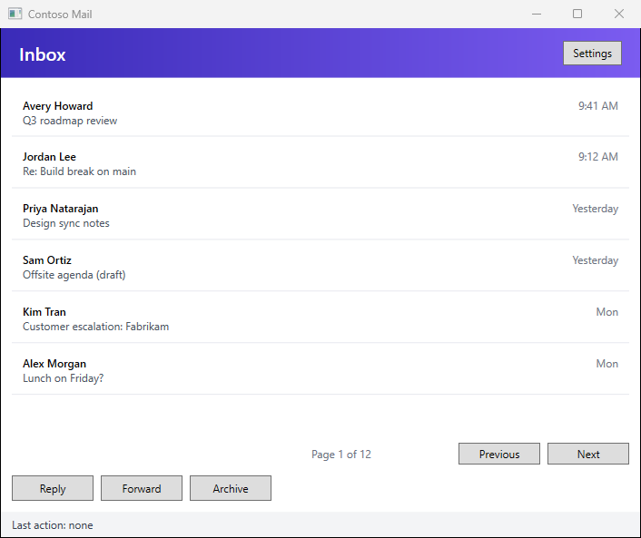

# Session transcript

Source: `Q:\source\XamlAgentDemos-notes\test-runs\GhostClicks\dpi1\events.jsonl`

## Tool usage

- xaml_interact: 5
- xaml_get_element_bounds: 3
- xaml_hit_test: 2
- xaml_get_element_properties: 2
- skill: 1
- xaml_get_status: 1
- xaml_find_elements: 1
- xaml_capture_image: 1
- get_file: 1
- task_complete: 1

Failed tool calls: 0, images: 1


_Model: gpt-6.1-sol_


## User (17:16:40)

Clicking some buttons in my app does nothing. Find out why using the running app (check element screen positions, hit testing and hover), but do not change any code.


**Tool call (17:16:46):** `skill`
```json
{
 "skill": "xaml-diagnostics"
}
```

<details><summary>Result `skill` success=true</summary>

```
Skill "xaml-diagnostics" loaded successfully. Follow the instructions in the skill context.
```
</details>


_Skill invoked: xaml-diagnostics_


**Assistant (17:16:50):**

I’ll inspect the live buttons’ positions and hit targets, then test hover. This will briefly move your mouse pointer; I won’t change code.


**Tool call (17:16:50):** `xaml_get_status`
```json
{
 "progressMessage": "Inspect running app and diagnostic capabilities"
}
```

<details><summary>Result `xaml_get_status` success=true</summary>

```
{"isDebugging":true,"debuggerState":"running","diagnosticsActive":true,"apps":[{"app":"a1","name":"GhostClicks.exe [22468]","processId":22468,"platform":"WPF (.NET)","isRemote":false,"isDesignTimeOrNoDebug":false,"sourceInfoAvailable":true,"hotReloadSupported":true,"hotReloadEnabled":true,"supportsPropertyExplorer":true,"supportsInAppToolbar":true,"supportsHitTest":true,"windows":[{"windowId":"0xDC0B6C","title":"Contoso Mail","bounds":{"x":182,"y":182,"width":720,"height":600},"dpiScale":1.0,"visible":true,"minimized":false}]}],"issues":[],"issuesSummary":"No problems detected.","hotReload":{"options":{"hotReloadEnabled":true,"hotReloadOnSave":false,"applyMode":"asYouType: XAML edits apply as you type, without saving (default)","wpfEnabled":true,"uwpEnabled":true,"winUIEnabled":true,"mauiEnabled":true,"justMyXaml":true,"previewSelectedElement":false,"inAppToolbar":true,"inAppSelection":false,"layoutAdorners":false,"trackFocusedElement":false,"bindingFailuresVisible":true,"compatibilityMode":false},"dotNetHotReloadEnabled":true,"isProcessingChanges":false,"errors":[]},"windowsNote":"Window bounds are physical pixels including the frame; Window.Width/Height are DIPs including the frame (= bounds.width / dpiScale), so say which unit you tested. Minimized windows report x/y = -32000 and can't be captured."}
```
</details>


**Tool call (17:16:58):** `xaml_find_elements`
```json
{
 "progressMessage": "Find live buttons and navigation controls",
 "app": "a1",
 "type": "*Button|TabItem",
 "maxResults": 100
}
```


**Tool call (17:16:58):** `xaml_capture_image`
```json
{
 "progressMessage": "Inspect current app screen",
 "app": "a1"
}
```

<details><summary>Result `xaml_find_elements` success=true</summary>

```
{"defaultSourceFile":"Q:\\source\\XamlAgentDemos\\src\\GhostClicks\\MainWindow.xaml","count":6,"totalMatches":6,"truncated":false,"results":[{"id":"a1:30","type":"Button","name":"SettingsButton","source":{"line":28,"column":18},"path":"MainWindow/Border/AdornerDecorator/ContentPresenter/Grid/Border/DockPanel/Button"},{"id":"a1:33","type":"Button","name":"PreviousButton","source":{"line":73,"column":18},"path":"MainWindow/Border/AdornerDecorator/ContentPresenter/Grid/Grid/StackPanel/Button"},{"id":"a1:34","type":"Button","name":"NextButton","source":{"line":78,"column":18},"path":"MainWindow/Border/AdornerDecorator/ContentPresenter/Grid/Grid/StackPanel/Button"},{"id":"a1:26","type":"Button","name":"ReplyButton","source":{"line":99,"column":14},"path":"MainWindow/Border/AdornerDecorator/ContentPresenter/Grid/StackPanel/Button"},{"id":"a1:27","type":"Button","name":"ForwardButton","source":{"line":104,"column":14},"path":"MainWindow/Border/AdornerDecorator/ContentPresenter/Grid/StackPanel/Button"},{"id":"a1:28","type":"Button","name":"ArchiveButton","source":{"line":110,"column":14},"path":"MainWindow/Border/AdornerDecorator/ContentPresenter/Grid/StackPanel/Button"}]}
```
</details>




<details><summary>Result `xaml_capture_image` success=true</summary>

```
Screenshot of window 0xDC0B6C "Contoso Mail" of app a1 (706x593 image of the window's client area, so it's slightly smaller than the frame bounds from xaml_get_status).
```
</details>


**Tool call (17:17:08):** `xaml_get_element_bounds`
```json
{
 "progressMessage": "Measure every button's screen position",
 "elementIds": [
  "#SettingsButton",
  "#PreviousButton",
  "#NextButton",
  "#ReplyButton",
  "#ForwardButton",
  "#ArchiveButton"
 ]
}
```


**Tool call (17:17:08):** `xaml_hit_test`
```json
{
 "progressMessage": "Check what receives clicks on each button",
 "elementIds": [
  "#SettingsButton",
  "#PreviousButton",
  "#NextButton",
  "#ReplyButton",
  "#ForwardButton",
  "#ArchiveButton"
 ]
}
```


**Tool call (17:17:08):** `xaml_get_element_properties`
```json
{
 "progressMessage": "Inspect button commands and input state",
 "elementIds": [
  "#SettingsButton",
  "#PreviousButton",
  "#NextButton",
  "#ReplyButton",
  "#ForwardButton",
  "#ArchiveButton"
 ],
 "nameFilter": "IsEnabled|IsHitTestVisible|IsMouseOver|Command|ToolTip|Background|Opacity",
 "includeAll": true
}
```

<details><summary>Result `xaml_get_element_bounds` success=true</summary>

```
{"note":"screen = physical pixels; window = DIPs relative to the root window (x dpiScale for pixels). Fractional screen pixels blur thin lines and text. isVisible ignores ancestor clipping (use xaml_hit_test's visibleFraction); insideWindowFraction < 1 means part is outside the window.","bounds":[{"id":"#SettingsButton","isVisible":true,"insideWindowFraction":1.0,"windowHandle":"0xDC0B6C","dpiScale":1.0,"screen":{"x":809.0,"y":227.0,"width":65.0,"height":27.0},"window":{"x":619.36,"y":14.0,"width":64.64,"height":26.6}},{"id":"#PreviousButton","isVisible":true,"insideWindowFraction":1.0,"windowHandle":"0xDC0B6C","dpiScale":1.0,"screen":{"x":694.0,"y":670.0,"width":90.0,"height":24.0},"window":{"x":504.0,"y":457.12,"width":90.0,"height":23.96}},{"id":"#NextButton","isVisible":true,"insideWindowFraction":1.0,"windowHandle":"0xDC0B6C","dpiScale":1.0,"screen":{"x":792.0,"y":670.0,"width":90.0,"height":24.0},"window":{"x":602.0,"y":457.12,"width":90.0,"height":23.96}},{"id":"#ReplyButton","isVisible":true,"insideWindowFraction":1.0,"windowHandle":"0xDC0B6C","dpiScale":1.0,"screen":{"x":202.0,"y":706.0,"width":90.0,"height":28.0},"window":{"x":12.0,"y":493.08,"width":90.0,"height":27.96}},{"id":"#ForwardButton","isVisible":true,"insideWindowFraction":1.0,"windowHandle":"0xDC0B6C","dpiScale":1.0,"screen":{"x":300.0,"y":706.0,"width":90.0,"height":28.0},"window":{"x":110.0,"y":493.08,"width":90.0,"height":27.96}},{"id":"#ArchiveButton","isVisible":true,"insideWindowFraction":1.0,"windowHandle":"0xDC0B6C","dpiScale":1.0,"screen":{"x":398.0,"y":706.0,"width":90.0,"height":28.0},"window":{"x":208.0,"y":493.08,"width":90.0,"height":27.96}}]}
```
</details>

<details><summary>Result `xaml_hit_test` success=true</summary>

```
{"defaultSourceFile":"Q:\\source\\XamlAgentDemos\\src\\GhostClicks\\MainWindow.xaml","count":6,"failed":0,"results":[{"id":"#SettingsButton","summary":"A click at its center does NOT reach 'SettingsButton': it lands on Border (in the template of MainWindow), which is above it at that point or covers it. Border 'HeaderBand' has IsHitTestVisible=False, which applies to 'SettingsButton' too.","elementReceivesInput":false,"inputTarget":{"id":"a1:11","type":"Border","templatedParent":{"id":"a1:10","type":"GhostClicks.MainWindow","source":{"line":3,"column":9}}},"stack":[{"id":"a1:11","type":"Border","templatedParent":{"id":"a1:10","type":"GhostClicks.MainWindow","source":{"line":3,"column":9}}}],"isVisible":true,"isHitTestVisible":false,"isEnabled":true,"effectiveOpacity":1.0,"blockers":[{"id":"a1:16","type":"Border","name":"HeaderBand","source":{"line":18,"column":10},"property":"IsHitTestVisible","value":"False"}],"visibleFraction":1.0,"point":{"window":{"x":651.68,"y":27.3},"screen":{"x":842.0,"y":240.0}}},{"id":"#PreviousButton","summary":"A click at its center reaches 'PreviousButton' (input lands on TextBlock (in the template of Button 'PreviousButton')).","elementReceivesInput":true,"inputTarget":{"id":"a1:65","type":"TextBlock","templatedParent":{"id":"a1:33","type":"Button","name":"PreviousButton","source":{"line":73,"column":18}}},"stack":[{"id":"a1:65","type":"TextBlock","templatedParent":{"id":"a1:33","type":"Button","name":"PreviousButton","source":{"line":73,"column":18}}},{"id":"a1:41","type":"Border","name":"border","templatedParent":{"id":"a1:33","type":"Button","name":"PreviousButton","source":{"line":73,"column":18}}},{"id":"a1:11","type":"Border","templatedParent":{"id":"a1:10","type":"GhostClicks.MainWindow","source":{"line":3,"column":9}}}],"isVisible":true,"isHitTestVisible":true,"isEnabled":true,"effectiveOpacity":1.0,"visibleFraction":1.0,"point":{"window":{"x":549.0,"y":469.1},"screen":{"x":739.0,"y":682.0}}},{"id":"#NextButton","summary":"A click at its center reaches 'NextButton' (input lands on TextBlock (in the template of Button 'NextButton')).","elementReceivesInput":true,"inputTarget":{"id":"a1:66","type":"TextBlock","templatedParent":{"id":"a1:34","type":"Button","name":"NextButton","source":{"line":78,"column":18}}},"stack":[{"id":"a1:66","type":"TextBlock","templatedParent":{"id":"a1:34","type":"Button","name":"NextButton","source":{"line":78,"column":18}}},{"id":"a1:42","type":"Border","name":"border","templatedParent":{"id"
... [truncated 3747 chars]
```
</details>

<details><summary>Result `xaml_get_element_properties` success=true</summary>

```
{"defaultSourceFile":"Q:\\source\\XamlAgentDemos\\src\\GhostClicks\\MainWindow.xaml","count":6,"failed":0,"results":[{"id":"#SettingsButton","type":"Button","name":"SettingsButton","source":{"line":28,"column":18},"properties":[{"name":"IsHitTestVisible","value":"False","valueType":"System.Boolean","valueSource":"Coercion"},{"name":"Background","value":"#FFDDDDDD","valueType":"System.Windows.Media.SolidColorBrush","propertyType":"System.Windows.Media.Brush","valueSource":"BuiltInStyle"}],"defaultValues":{"Command":null,"IsEnabled":"True","IsMouseOver":"False","Opacity":"1","ToolTip":null},"hiddenDefaultOrOverridden":2,"hint":"includeAll=true lists the omitted values; xaml_explain_property_value gives one property's precedence chain."},{"id":"#PreviousButton","type":"Button","name":"PreviousButton","source":{"line":73,"column":18},"properties":[{"name":"Background","value":"#FFDDDDDD","valueType":"System.Windows.Media.SolidColorBrush","propertyType":"System.Windows.Media.Brush","valueSource":"BuiltInStyle"}],"defaultValues":{"Command":null,"IsEnabled":"True","IsHitTestVisible":"True","IsMouseOver":"False","Opacity":"1","ToolTip":null},"hiddenDefaultOrOverridden":1,"hint":"includeAll=true lists the omitted values; xaml_explain_property_value gives one property's precedence chain."},{"id":"#NextButton","type":"Button","name":"NextButton","source":{"line":78,"column":18},"properties":[{"name":"Background","value":"#FFDDDDDD","valueType":"System.Windows.Media.SolidColorBrush","propertyType":"System.Windows.Media.Brush","valueSource":"BuiltInStyle"}],"defaultValues":{"Command":null,"IsEnabled":"True","IsHitTestVisible":"True","IsMouseOver":"False","Opacity":"1","ToolTip":null},"hiddenDefaultOrOverridden":1,"hint":"includeAll=true lists the omitted values; xaml_explain_property_value gives one property's precedence chain."},{"id":"#ReplyButton","type":"Button","name":"ReplyButton","source":{"line":99,"column":14},"properties":[{"name":"Background","value":"#FFDDDDDD","valueType":"System.Windows.Media.SolidColorBrush","propertyType":"System.Windows.Media.Brush","valueSource":"BuiltInStyle"}],"defaultValues":{"Command":null,"IsEnabled":"True","IsHitTestVisible":"True","IsMouseOver":"False","Opacity":"1","ToolTip":null},"hiddenDefaultOrOverridden":1,"hint":"includeAll=true lists the omitted values; xaml_explain_property_value gives one property's precedence chain."},{"id":"#ForwardButton","type":"Button","name":"ForwardButton","source":{"line":104,"column":14},"prop
... [truncated 1010 chars]
```
</details>


**Tool call (17:17:22):** `get_file`
```json
{
 "filename": "Q:\\source\\XamlAgentDemos\\src\\GhostClicks\\MainWindow.xaml",
 "startLine": 1,
 "endLine": 180,
 "includeLineNumbers": true
}
```


**Tool call (17:17:22):** `xaml_get_element_properties`
```json
{
 "progressMessage": "Inspect invisible overlay input and opacity settings",
 "elementIds": [
  "#HeaderBand",
  "#ToastHost",
  "#Toast"
 ],
 "nameFilter": "Background|Opacity|IsHitTestVisible|Visibility|ActualWidth|ActualHeight|Panel.ZIndex",
 "includeAll": true
}
```


**Tool call (17:17:22):** `xaml_get_element_bounds`
```json
{
 "progressMessage": "Measure overlay overlap with bottom buttons",
 "elementIds": [
  "#HeaderBand",
  "#ToastHost",
  "#Toast"
 ]
}
```


**Tool call (17:17:22):** `xaml_interact`
```json
{
 "progressMessage": "Test hover over blocked Reply button",
 "elementId": "#ReplyButton",
 "action": "hover",
 "checkProperties": "IsMouseOver|Background",
 "checkElementIds": [
  "#ReplyButton",
  "#ToastHost",
  "#Toast"
 ]
}
```

<details><summary>Result `xaml_get_element_bounds` success=true</summary>

```
{"note":"screen = physical pixels; window = DIPs relative to the root window (x dpiScale for pixels). Fractional screen pixels blur thin lines and text. isVisible ignores ancestor clipping (use xaml_hit_test's visibleFraction); insideWindowFraction < 1 means part is outside the window.","bounds":[{"id":"#HeaderBand","isVisible":true,"insideWindowFraction":1.0,"windowHandle":"0xDC0B6C","dpiScale":1.0,"screen":{"x":190.0,"y":213.0,"width":704.0,"height":55.0},"window":{"x":0.0,"y":0.0,"width":704.0,"height":54.6}},{"id":"#ToastHost","isVisible":true,"insideWindowFraction":1.0,"windowHandle":"0xDC0B6C","dpiScale":1.0,"screen":{"x":190.0,"y":702.0,"width":704.0,"height":44.0},"window":{"x":0.0,"y":489.08,"width":704.0,"height":43.96}},{"id":"#Toast","isVisible":true,"insideWindowFraction":1.0,"windowHandle":"0xDC0B6C","dpiScale":1.0,"screen":{"x":190.0,"y":702.0,"width":114.0,"height":32.0},"window":{"x":0.0,"y":489.08,"width":114.13,"height":31.96}}]}
```
</details>

<details><summary>Result `xaml_get_element_properties` success=true</summary>

```
{"defaultSourceFile":"Q:\\source\\XamlAgentDemos\\src\\GhostClicks\\MainWindow.xaml","count":3,"failed":0,"results":[{"id":"#HeaderBand","type":"Border","name":"HeaderBand","source":{"line":18,"column":10},"properties":[{"name":"Background","valueType":"System.Windows.Media.LinearGradientBrush","propertyType":"System.Windows.Media.Brush","valueSource":"Local","valueLocation":{"line":22,"column":18}},{"name":"ActualWidth","value":"704","valueType":"System.Double","valueSource":"Local","readOnly":true},{"name":"ActualHeight","value":"54.6","valueType":"System.Double","valueSource":"Local","readOnly":true},{"name":"IsHitTestVisible","value":"False","valueType":"System.Boolean","valueSource":"Local"}],"defaultValues":{"Opacity":"1","Visibility":"0"},"hiddenDefaultOrOverridden":4,"hint":"includeAll=true lists the omitted values; xaml_explain_property_value gives one property's precedence chain."},{"id":"#ToastHost","type":"Border","name":"ToastHost","source":{"line":119,"column":10},"properties":[{"name":"Background","value":"#00FFFFFF","valueType":"System.Windows.Media.SolidColorBrush","propertyType":"System.Windows.Media.Brush","valueSource":"Local"},{"name":"ActualWidth","value":"704","valueType":"System.Double","valueSource":"Local","readOnly":true},{"name":"ActualHeight","value":"43.96","valueType":"System.Double","valueSource":"Local","readOnly":true}],"defaultValues":{"IsHitTestVisible":"True","Opacity":"1","Visibility":"0"},"hiddenDefaultOrOverridden":3,"hint":"includeAll=true lists the omitted values; xaml_explain_property_value gives one property's precedence chain."},{"id":"#Toast","type":"Border","name":"Toast","source":{"line":122,"column":14},"properties":[{"name":"Opacity","value":"0","valueType":"System.Double","valueSource":"Animation"},{"name":"Background","value":"#FF1F2937","valueType":"System.Windows.Media.SolidColorBrush","propertyType":"System.Windows.Media.Brush","valueSource":"Local"},{"name":"ActualWidth","value":"114.12666666666667","valueType":"System.Double","valueSource":"Local","readOnly":true},{"name":"ActualHeight","value":"31.96","valueType":"System.Double","valueSource":"Local","readOnly":true}],"defaultValues":{"IsHitTestVisible":"True","Visibility":"0"},"hiddenDefaultOrOverridden":4,"hint":"includeAll=true lists the omitted values; xaml_explain_property_value gives one property's precedence chain."}]}
```
</details>

<details><summary>Result `get_file` success=true</summary>

```
```xaml src\GhostClicks\MainWindow.xaml (Lines 1-152 of 152 total. Call tools for more if needed.)
1: <Window x:Class="GhostClicks.MainWindow"
2:         xmlns="http://schemas.microsoft.com/winfx/2006/xaml/presentation"
3:         xmlns:x="http://schemas.microsoft.com/winfx/2006/xaml"
4:         Title="Contoso Mail"
5:         Width="720"
6:         Height="600"
7:         Background="White">
8:     <Grid>
9:         <Grid.RowDefinitions>
10:             <RowDefinition Height="Auto" />
11:             <RowDefinition Height="*" />
12:             <RowDefinition Height="Auto" />
13:             <RowDefinition Height="Auto" />
14:             <RowDefinition Height="Auto" />
15:         </Grid.RowDefinitions>
16: 
17:         <!-- Decorative header; clicks pass through to the window so it can be dragged. -->
18:         <Border x:Name="HeaderBand"
19:                 Padding="20,14"
20:                 IsHitTestVisible="False">
21:             <Border.Background>
22:                 <LinearGradientBrush StartPoint="0,0" EndPoint="1,0">
23:                     <GradientStop Offset="0" Color="#3A2BB8" />
24:                     <GradientStop Offset="1" Color="#7B5CF0" />
25:                 </LinearGradientBrush>
26:             </Border.Background>
27:             <DockPanel>
28:                 <Button x:Name="SettingsButton"
29:                         Padding="10,4"
30:                         Click="OnActionClick"
31:                         Content="Settings"
32:                         DockPanel.Dock="Right"
33:                         Tag="Settings" />
34:                 <TextBlock VerticalAlignment="Center"
35:                            FontSize="20"
36:                            FontWeight="SemiBold"
37:                            Foreground="White"
38:                            Text="Inbox" />
39:             </DockPanel>
40:         </Border>
41: 
42:         <ItemsControl x:Name="MessageList"
43:                       Grid.Row="1"
44:                       Margin="12"
45:                       ItemsSource="{Binding Messages}">
46:             <ItemsControl.ItemTemplate>
47:                 <DataTemplate>
48:                     <Border x:Name="MessageRow"
49:                             Margin="0,0,0,4"
50:                             Padding="12,10"
51:                             BorderBrush="#E6E8EE"
52:                             BorderThickness="0,0,0,1"
53:                             C
... [truncated 4582 chars]
```
</details>

<details><summary>Result `xaml_interact` success=true</summary>

```
{"id":"#ReplyButton","action":"hover","result":"Moved the real mouse cursor over the element's center. The app received real mouse-move input, so mouse-over triggers and PointerOver visual states apply as for a user. The cursor stays there (moving the real mouse or calling 'unhover' ends it); read properties now (or pass checkProperties) to see the hover values, then call 'unhover'.","cursorTarget":"A click at its center does NOT reach 'ReplyButton': it lands on TextBlock, which is above it at that point or covers it.","checks":[{"id":"#ReplyButton","changed":false,"values":[{"name":"Background","value":"#FFDDDDDD","valueSource":"BuiltInStyle"}]},{"id":"#ToastHost","changed":true,"before":[{"name":"Background","value":"#00FFFFFF","valueSource":"Local"}],"after":[{"name":"Background","value":"#00FFFFFF","valueSource":"Local"},{"name":"IsMouseOver","value":"True","valueSource":"Local"}]},{"id":"#Toast","changed":true,"before":[{"name":"Background","value":"#FF1F2937","valueSource":"Local"}],"after":[{"name":"Background","value":"#FF1F2937","valueSource":"Local"},{"name":"IsMouseOver","value":"True","valueSource":"Local"}]}],"checksNote":"changed=false: no checked property reacted to hover (no IsMouseOver trigger/PointerOver state sets it, a local value or animation outranks it, or the cursor hit another element; see cursorTarget).","note":"The real cursor moved. Capture or read properties now, then call 'unhover'."}
```
</details>


**Tool call (17:17:32):** `xaml_hit_test`
```json
{
 "progressMessage": "Test both edges of pagination buttons",
 "elementIds": [
  "#PreviousButton",
  "#NextButton"
 ],
 "points": [
  "5,12",
  "85,12"
 ]
}
```


**Tool call (17:17:32):** `xaml_get_element_bounds`
```json
{
 "progressMessage": "Locate page label overlapping pagination controls",
 "elementIds": [
  "#PageIndicator"
 ]
}
```


**Tool call (17:17:32):** `xaml_interact`
```json
{
 "progressMessage": "Test hover over Settings with disabled ancestor",
 "elementId": "#SettingsButton",
 "action": "hover",
 "checkProperties": "IsMouseOver|IsHitTestVisible",
 "checkElementIds": [
  "#SettingsButton",
  "#HeaderBand"
 ]
}
```

<details><summary>Result `xaml_get_element_bounds` success=true</summary>

```
{"note":"screen = physical pixels; window = DIPs relative to the root window (x dpiScale for pixels). Fractional screen pixels blur thin lines and text. isVisible ignores ancestor clipping (use xaml_hit_test's visibleFraction); insideWindowFraction < 1 means part is outside the window.","bounds":[{"id":"#PageIndicator","isVisible":true,"insideWindowFraction":1.0,"windowHandle":"0xDC0B6C","dpiScale":1.0,"screen":{"x":532.0,"y":670.0,"width":200.0,"height":24.0},"window":{"x":342.0,"y":457.12,"width":200.0,"height":23.96}}]}
```
</details>

<details><summary>Result `xaml_hit_test` success=true</summary>

```
{"defaultSourceFile":"Q:\\source\\XamlAgentDemos\\src\\GhostClicks\\MainWindow.xaml","count":4,"failed":0,"results":[{"id":"#PreviousButton","summary":"A click at (5,12) does NOT reach 'PreviousButton': it lands on TextBlock 'PageIndicator', which is above it at that point or covers it.","elementReceivesInput":false,"inputTarget":{"id":"a1:25","type":"TextBlock","name":"PageIndicator","source":{"line":85,"column":14}},"stack":[{"id":"a1:25","type":"TextBlock","name":"PageIndicator","source":{"line":85,"column":14}},{"id":"a1:41","type":"Border","name":"border","templatedParent":{"id":"a1:33","type":"Button","name":"PreviousButton","source":{"line":73,"column":18}}},{"id":"a1:11","type":"Border","templatedParent":{"id":"a1:10","type":"GhostClicks.MainWindow","source":{"line":3,"column":9}}}],"isVisible":true,"isHitTestVisible":true,"isEnabled":true,"effectiveOpacity":1.0,"visibleFraction":1.0,"point":{"window":{"x":509.0,"y":469.12},"screen":{"x":699.0,"y":682.0}}},{"id":"#PreviousButton","summary":"A click at (85,12) reaches 'PreviousButton' (input lands on Border 'border' (in the template of Button 'PreviousButton')).","elementReceivesInput":true,"inputTarget":{"id":"a1:41","type":"Border","name":"border","templatedParent":{"id":"a1:33","type":"Button","name":"PreviousButton","source":{"line":73,"column":18}}},"stack":[{"id":"a1:41","type":"Border","name":"border","templatedParent":{"id":"a1:33","type":"Button","name":"PreviousButton","source":{"line":73,"column":18}}},{"id":"a1:11","type":"Border","templatedParent":{"id":"a1:10","type":"GhostClicks.MainWindow","source":{"line":3,"column":9}}}],"isVisible":true,"isHitTestVisible":true,"isEnabled":true,"effectiveOpacity":1.0,"visibleFraction":1.0,"point":{"window":{"x":589.0,"y":469.12},"screen":{"x":779.0,"y":682.0}}},{"id":"#NextButton","summary":"A click at (5,12) reaches 'NextButton' (input lands on Border 'border' (in the template of Button 'NextButton')).","elementReceivesInput":true,"inputTarget":{"id":"a1:42","type":"Border","name":"border","templatedParent":{"id":"a1:34","type":"Button","name":"NextButton","source":{"line":78,"column":18}}},"stack":[{"id":"a1:42","type":"Border","name":"border","templatedParent":{"id":"a1:34","type":"Button","name":"NextButton","source":{"line":78,"column":18}}},{"id":"a1:11","type":"Border","templatedParent":{"id":"a1:10","type":"GhostClicks.MainWindow","source":{"line":3,"column":9}}}],"isVisible":true,"isHitTestVisible":true,"isEnabled":true,"effectiveOpacity":
... [truncated 1197 chars]
```
</details>

<details><summary>Result `xaml_interact` success=true</summary>

```
{"id":"#SettingsButton","action":"hover","result":"Moved the real mouse cursor over the element's center; the app window was brought to the front and activated first. The app received real mouse-move input, so mouse-over triggers and PointerOver visual states apply as for a user. The cursor stays there (moving the real mouse or calling 'unhover' ends it); read properties now (or pass checkProperties) to see the hover values, then call 'unhover'.","cursorTarget":"A click at its center does NOT reach 'SettingsButton': it lands on Border (in the template of MainWindow), which is above it at that point or covers it. Border 'HeaderBand' has IsHitTestVisible=False, which applies to 'SettingsButton' too.","checks":[{"id":"#SettingsButton","changed":false,"values":[{"name":"IsHitTestVisible","value":"False","valueSource":"Coercion"}]},{"id":"#HeaderBand","changed":false,"values":[{"name":"IsHitTestVisible","value":"False","valueSource":"Local"}]}],"checksNote":"changed=false: no checked property reacted to hover (no IsMouseOver trigger/PointerOver state sets it, a local value or animation outranks it, or the cursor hit another element; see cursorTarget).","note":"The real cursor moved. Capture or read properties now, then call 'unhover'."}
```
</details>


**Tool call (17:17:38):** `xaml_interact`
```json
{
 "progressMessage": "Test Previous hover in the obstructed left region",
 "elementId": "#PreviousButton",
 "action": "hover",
 "value": "5,12",
 "checkProperties": "IsMouseOver",
 "checkElementIds": [
  "#PreviousButton",
  "#PageIndicator"
 ]
}
```

<details><summary>Result `xaml_interact` success=true</summary>

```
{"id":"#PreviousButton","action":"hover","result":"Moved the real mouse cursor over the element at (5,12). The app received real mouse-move input, so mouse-over triggers and PointerOver visual states apply as for a user. The cursor stays there (moving the real mouse or calling 'unhover' ends it); read properties now (or pass checkProperties) to see the hover values, then call 'unhover'.","cursorTarget":"A click at (5,12) does NOT reach 'PreviousButton': it lands on TextBlock 'PageIndicator', which is above it at that point or covers it.","checks":[{"id":"#PreviousButton","changed":false,"values":[]},{"id":"#PageIndicator","changed":true,"before":[],"after":[{"name":"IsMouseOver","value":"True","valueSource":"Local"}]}],"checksNote":"changed=false: no checked property reacted to hover (no IsMouseOver trigger/PointerOver state sets it, a local value or animation outranks it, or the cursor hit another element; see cursorTarget).","note":"The real cursor moved. Capture or read properties now, then call 'unhover'."}
```
</details>


**Tool call (17:17:44):** `xaml_interact`
```json
{
 "progressMessage": "Compare Previous hover in the unobstructed right region",
 "elementId": "#PreviousButton",
 "action": "hover",
 "value": "85,12",
 "checkProperties": "IsMouseOver",
 "checkElementIds": [
  "#PreviousButton",
  "#PageIndicator"
 ]
}
```

<details><summary>Result `xaml_interact` success=true</summary>

```
{"id":"#PreviousButton","action":"hover","result":"Moved the real mouse cursor over the element at (85,12). The app received real mouse-move input, so mouse-over triggers and PointerOver visual states apply as for a user. The cursor stays there (moving the real mouse or calling 'unhover' ends it); read properties now (or pass checkProperties) to see the hover values, then call 'unhover'.","cursorTarget":"A click at (85,12) reaches 'PreviousButton' (input lands on Border 'border' (in the template of Button 'PreviousButton')).","checks":[{"id":"#PreviousButton","changed":true,"before":[],"after":[{"name":"IsMouseOver","value":"True","valueSource":"Local"}]},{"id":"#PageIndicator","changed":true,"before":[{"name":"IsMouseOver","value":"True","valueSource":"Local"}],"after":[]}],"note":"The real cursor moved. Capture or read properties now, then call 'unhover'."}
```
</details>


**Tool call (17:17:53):** `xaml_interact`
```json
{
 "progressMessage": "End hover testing and move pointer away",
 "elementId": "#PreviousButton",
 "action": "unhover",
 "checkProperties": "IsMouseOver"
}
```

<details><summary>Result `xaml_interact` success=true</summary>

```
{"id":"#PreviousButton","action":"unhover","result":"Moved the mouse cursor off the element (back to where it was before the first hover, if that's outside it), so mouse-over states end.","checks":[{"id":"#PreviousButton","changed":true,"before":[{"name":"IsMouseOver","value":"True","valueSource":"Local"}],"after":[]}],"note":"The real cursor moved. Capture or read properties now, then call 'unhover'."}
```
</details>


**Tool call (17:18:04):** `task_complete`
```json
{
 "summary": "Found **three input-blocking problems** in the running app using screen coordinates, hit testing, and real mouse hover:\n\n| Buttons | Live evidence | Cause |\n|---|---|---|\n| Settings | Center **(842, 240)** receives neither clicks nor hover. | Its parent disables hit testing for the entire subtree: [header setting](vscopilot://file?path=Q%3A%5Csource%5CXamlAgentDemos%5Csrc%5CGhostClicks%5CMainWindow.xaml&line=20). |\n| Reply, Forward, Archive | Centers **(247, 720)**, **(345, 720)**, **(443, 720)** hit the toast layer instead. Hover over Reply activates the invisible toast, not Reply. | The [transparent toast host](vscopilot://file?path=Q%3A%5Csource%5CXamlAgentDemos%5Csrc%5CGhostClicks%5CMainWindow.xaml&line=119) covers the action bar. The toast has animated opacity **0**, but remains hit-testable. Transparency does not make input pass through. |\n| Previous | Its leftmost **38 pixels** overlap the page label. At **(699, 682)**, clicks and hover reach the label; at **(779, 682)**, both reach Previous. | The [page label](vscopilot://file?path=Q%3A%5Csource%5CXamlAgentDemos%5Csrc%5CGhostClicks%5CMainWindow.xaml&line=85) has a transparent background and sits above part of the button. |\n\nNext passed hit testing at its center and both tested edges. All six buttons are enabled and fully inside the window; clipping isn’t the cause.\n\n**No code or runtime properties changed. Hover testing ended and the pointer was restored.**"
}
```

<details><summary>Result `task_complete` success=true</summary>

```
Found **three input-blocking problems** in the running app using screen coordinates, hit testing, and real mouse hover:

| Buttons | Live evidence | Cause |
|---|---|---|
| Settings | Center **(842, 240)** receives neither clicks nor hover. | Its parent disables hit testing for the entire subtree: [header setting](vscopilot://file?path=Q%3A%5Csource%5CXamlAgentDemos%5Csrc%5CGhostClicks%5CMainWindow.xaml&line=20). |
| Reply, Forward, Archive | Centers **(247, 720)**, **(345, 720)**, **(443, 720)** hit the toast layer instead. Hover over Reply activates the invisible toast, not Reply. | The [transparent toast host](vscopilot://file?path=Q%3A%5Csource%5CXamlAgentDemos%5Csrc%5CGhostClicks%5CMainWindow.xaml&line=119) covers the action bar. The toast has animated opacity **0**, but remains hit-testable. Transparency does not make input pass through. |
| Previous | Its leftmost **38 pixels** overlap the page label. At **(699, 682)**, clicks and hover reach the label; at **(779, 682)**, both reach Previous. | The [page label](vscopilot://file?path=Q%3A%5Csource%5CXamlAgentDemos%5Csrc%5CGhostClicks%5CMainWindow.xaml&line=85) has a transparent background and sits above part of the button. |

Next passed hit testing at its center and both tested edges. All six buttons are enabled and fully inside the window; clipping isn’t the cause.

**No code or runtime properties changed. Hover testing ended and the pointer was restored.**
```
</details>


**Task complete (17:18:04):** Found **three input-blocking problems** in the running app using screen coordinates, hit testing, and real mouse hover:

| Buttons | Live evidence | Cause |
|---|---|---|
| Settings | Center **(842, 240)** receives neither clicks nor hover. | Its parent disables hit testing for the entire subtree: [header setting](vscopilot://file?path=Q%3A%5Csource%5CXamlAgentDemos%5Csrc%5CGhostClicks%5CMainWindow.xaml&line=20). |
| Reply, Forward, Archive | Centers **(247, 720)**, **(345, 720)**, **(443, 720)** hit the toast layer instead. Hover over Reply activates the invisible toast, not Reply. | The [transparent toast host](vscopilot://file?path=Q%3A%5Csource%5CXamlAgentDemos%5Csrc%5CGhostClicks%5CMainWindow.xaml&line=119) covers the action bar. The toast has animated opacity **0**, but remains hit-testable. Transparency does not make input pass through. |
| Previous | Its leftmost **38 pixels** overlap the page label. At **(699, 682)**, clicks and hover reach the label; at **(779, 682)**, both reach Previous. | The [page label](vscopilot://file?path=Q%3A%5Csource%5CXamlAgentDemos%5Csrc%5CGhostClicks%5CMainWindow.xaml&line=85) has a transparent background and sits above part of the button. |

Next passed hit testing at its center and both tested edges. All six buttons are enabled and fully inside the window; clipping isn’t the cause.

**No code or runtime properties changed. Hover testing ended and the pointer was restored.**
