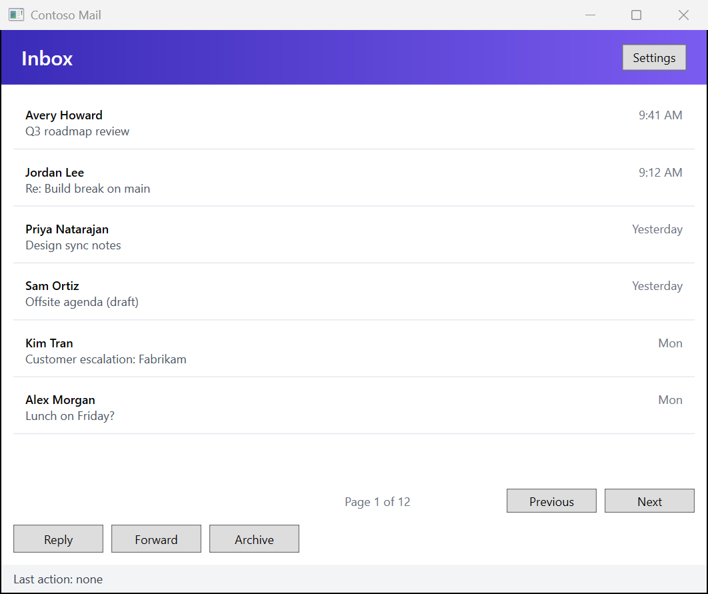

# Session transcript

Source: `Q:\source\XamlAgentDemos-notes\test-runs\GhostClicks\run-consolidated\events.jsonl`

## Tool usage

- xaml_find_elements: 4
- view: 3
- xaml_capture_image: 2
- task_complete: 2
- skill: 1
- xaml_get_status: 1
- glob: 1
- xaml_get_element_bounds: 1
- xaml_get_element_properties: 1
- multi_replace_string_in_file: 1
- xaml_apply_hot_reload: 1
- xaml_explain_property_value: 1

Failed tool calls: 0, images: 1


_Model: claude-opus-5.5_


## User (02:23:30)

In my running app, Settings, Reply, Forward, Archive and the left edge of Previous don't respond to mouse clicks, and message rows only work when I click right on the text. Find out why using the live app and fix it.


**Tool call (02:23:32):** `skill`
```json
{
 "skill": "xaml-diagnostics"
}
```

<details><summary>Result `skill` success=true</summary>

```
Skill "xaml-diagnostics" loaded successfully. Follow the instructions in the skill context.
```
</details>


_Skill invoked: xaml-diagnostics_


**Tool call (02:23:34):** `xaml_get_status`
```json
{
 "progressMessage": "Checking connected app"
}
```

<details><summary>Result `xaml_get_status` success=true</summary>

```
{"isDebugging":true,"debuggerState":"running","diagnosticsActive":true,"apps":[{"app":"a1","name":"GhostClicks.exe [59072]","processId":59072,"platform":"WPF (.NET)","isRemote":false,"isDesignTimeOrNoDebug":false,"sourceInfoAvailable":true,"hotReloadSupported":true,"hotReloadEnabled":true,"supportsPropertyExplorer":true,"supportsInAppToolbar":true,"supportsHitTest":false,"windows":[{"windowId":"0x198099A","title":"Contoso Mail","bounds":{"x":152,"y":152,"width":1080,"height":900},"dpiScale":1.5,"visible":true,"minimized":false}]}],"issues":[],"issuesSummary":"No problems detected.","hotReload":{"options":{"hotReloadEnabled":true,"hotReloadOnSave":false,"applyMode":"asYouType: XAML edits apply as you type, without saving (default)","wpfEnabled":true,"uwpEnabled":true,"winUIEnabled":true,"mauiEnabled":true,"justMyXaml":true,"previewSelectedElement":false,"inAppToolbar":true,"inAppSelection":false,"layoutAdorners":false,"trackFocusedElement":false,"bindingFailuresVisible":true,"compatibilityMode":false},"dotNetHotReloadEnabled":true,"isProcessingChanges":false,"errors":[]},"windowsNote":"Window bounds are physical screen pixels and include the window frame. A WPF/WinUI Window's Width and Height are device-independent units (DIPs) that also include the frame, so Width = bounds.width / dpiScale. A user's \"800 px wide\" is ambiguous: say which unit you tested. A minimized window reports x/y = -32000 and can't be captured."}
```
</details>


**Assistant (02:23:36):**

Hit testing isn't supported by this TAP, so I'll use the tree, bounds and source.


**Tool call (02:23:36):** `xaml_capture_image`
```json
{
 "progressMessage": "Capturing app window"
}
```


**Tool call (02:23:36):** `glob`
```json
{
 "pattern": "**/GhostClicks/**/*.xaml*"
}
```




<details><summary>Result `xaml_capture_image` success=true</summary>

```
Screenshot of window 0x198099A "Contoso Mail" of app a1 (1062x891 image of the window's client area, so it's slightly smaller than the frame bounds from xaml_get_status).
```
</details>

<details><summary>Result `glob` success=true</summary>

```
.\src\GhostClicks\MainWindow.xaml
.\src\GhostClicks\MainWindow.xaml.cs
.\src\GhostClicks\App.xaml
.\src\GhostClicks\App.xaml.cs
```
</details>


**Tool call (02:23:39):** `view`
```json
{
 "path": "Q:\\source\\XamlAgentDemos\\src\\GhostClicks\\MainWindow.xaml"
}
```


**Tool call (02:23:39):** `view`
```json
{
 "path": "Q:\\source\\XamlAgentDemos\\src\\GhostClicks\\App.xaml"
}
```

<details><summary>Result `view` success=true</summary>

```
<Window x:Class="GhostClicks.MainWindow"
        xmlns="http://schemas.microsoft.com/winfx/2006/xaml/presentation"
        xmlns:x="http://schemas.microsoft.com/winfx/2006/xaml"
        Title="Contoso Mail"
        Width="720"
        Height="600"
        Background="White">
    <Grid>
        <Grid.RowDefinitions>
            <RowDefinition Height="Auto" />
            <RowDefinition Height="*" />
            <RowDefinition Height="Auto" />
            <RowDefinition Height="Auto" />
            <RowDefinition Height="Auto" />
        </Grid.RowDefinitions>

        <!-- Decorative header; clicks pass through to the window so it can be dragged. -->
        <Border x:Name="HeaderBand"
                Padding="20,14"
                IsHitTestVisible="False">
            <Border.Background>
                <LinearGradientBrush StartPoint="0,0" EndPoint="1,0">
                    <GradientStop Offset="0" Color="#3A2BB8" />
                    <GradientStop Offset="1" Color="#7B5CF0" />
                </LinearGradientBrush>
            </Border.Background>
            <DockPanel>
                <Button x:Name="SettingsButton"
                        Padding="10,4"
                        Click="OnActionClick"
                        Content="Settings"
                        DockPanel.Dock="Right"
                        Tag="Settings" />
                <TextBlock VerticalAlignment="Center"
                           FontSize="20"
                           FontWeight="SemiBold"
                           Foreground="White"
                           Text="Inbox" />
            </DockPanel>
        </Border>

        <ItemsControl x:Name="MessageList"
                      Grid.Row="1"
                      Margin="12"
                      ItemsSource="{Binding Messages}">
            <ItemsControl.ItemTemplate>
                <DataTemplate>
                    <Border x:Name="MessageRow"
                            Margin="0,0,0,4"
                            Padding="12,10"
                            BorderBrush="#E6E8EE"
                            BorderThickness="0,0,0,1"
                            Cursor="Hand"
                            MouseLeftButtonUp="OnMessageRowClick">
                        <DockPanel>
                            <TextBlock DockPanel.Dock="Right"
                                       Foreground="#6B7280"
                                       Text="{Binding Time}"
... [truncated 3819 chars]
```
</details>

<details><summary>Result `view` success=true</summary>

```
<Application x:Class="GhostClicks.App"
             xmlns="http://schemas.microsoft.com/winfx/2006/xaml/presentation"
             xmlns:x="http://schemas.microsoft.com/winfx/2006/xaml"
             StartupUri="MainWindow.xaml" />

```
</details>


**Assistant (02:23:48):**

Source points to four suspects. Let me confirm against the live tree and code-behind.


**Tool call (02:23:48):** `view`
```json
{
 "path": "Q:\\source\\XamlAgentDemos\\src\\GhostClicks\\MainWindow.xaml.cs"
}
```


**Tool call (02:23:48):** `xaml_find_elements`
```json
{
 "progressMessage": "Finding named elements",
 "namedOnly": true
}
```

<details><summary>Result `view` success=true</summary>

```
using System.Windows;
using System.Windows.Input;

namespace GhostClicks;

public sealed record Message(string From, string Subject, string Time);

public partial class MainWindow : Window
{
    public MainWindow()
    {
        this.InitializeComponent();
        this.DataContext = new
        {
            Messages = new[]
            {
                new Message("Avery Howard", "Q3 roadmap review", "9:41 AM"),
                new Message("Jordan Lee", "Re: Build break on main", "9:12 AM"),
                new Message("Priya Natarajan", "Design sync notes", "Yesterday"),
                new Message("Sam Ortiz", "Offsite agenda (draft)", "Yesterday"),
                new Message("Kim Tran", "Customer escalation: Fabrikam", "Mon"),
                new Message("Alex Morgan", "Lunch on Friday?", "Mon"),
            },
        };
    }

    private void OnActionClick(object sender, RoutedEventArgs e)
    {
        this.StatusText.Text = $"Last action: {((FrameworkElement)sender).Tag}";
    }

    private void OnMessageRowClick(object sender, MouseButtonEventArgs e)
    {
        var message = (Message)((FrameworkElement)sender).DataContext;
        this.StatusText.Text = $"Last action: opened \"{message.Subject}\"";
    }
}

```
</details>

<details><summary>Result `xaml_find_elements` success=true</summary>

```
{"count":32,"totalMatches":32,"truncated":false,"results":[{"id":"a1:16","type":"System.Windows.Controls.Border","name":"HeaderBand","source":{"file":"Q:\\source\\XamlAgentDemos\\src\\GhostClicks\\MainWindow.xaml","line":18,"column":10},"path":"MainWindow/Border/AdornerDecorator/ContentPresenter/Grid/Border"},{"id":"a1:30","type":"System.Windows.Controls.Button","name":"SettingsButton","source":{"file":"Q:\\source\\XamlAgentDemos\\src\\GhostClicks\\MainWindow.xaml","line":28,"column":18},"path":"MainWindow/Border/AdornerDecorator/ContentPresenter/Grid/Border/DockPanel/Button"},{"id":"a1:39","type":"System.Windows.Controls.Border","name":"border","path":"MainWindow/Border/AdornerDecorator/ContentPresenter/Grid/Border/DockPanel/Button/Border"},{"id":"a1:46","type":"System.Windows.Controls.ContentPresenter","name":"contentPresenter","path":"MainWindow/Border/AdornerDecorator/ContentPresenter/Grid/Border/DockPanel/Button/Border/ContentPresenter"},{"id":"a1:17","type":"System.Windows.Controls.ItemsControl","name":"MessageList","source":{"file":"Q:\\source\\XamlAgentDemos\\src\\GhostClicks\\MainWindow.xaml","line":42,"column":10},"path":"MainWindow/Border/AdornerDecorator/ContentPresenter/Grid/ItemsControl"},{"id":"a1:59","type":"System.Windows.Controls.Border","name":"MessageRow","source":{"file":"Q:\\source\\XamlAgentDemos\\src\\GhostClicks\\MainWindow.xaml","line":48,"column":22},"path":"MainWindow/Border/AdornerDecorator/ContentPresenter/Grid/ItemsControl/Border/ItemsPresenter/StackPanel/ContentPresenter/Border"},{"id":"a1:60","type":"System.Windows.Controls.Border","name":"MessageRow","source":{"file":"Q:\\source\\XamlAgentDemos\\src\\GhostClicks\\MainWindow.xaml","line":48,"column":22},"path":"MainWindow/Border/AdornerDecorator/ContentPresenter/Grid/ItemsControl/Border/ItemsPresenter/StackPanel/ContentPresenter/Border"},{"id":"a1:61","type":"System.Windows.Controls.Border","name":"MessageRow","source":{"file":"Q:\\source\\XamlAgentDemos\\src\\GhostClicks\\MainWindow.xaml","line":48,"column":22},"path":"MainWindow/Border/AdornerDecorator/ContentPresenter/Grid/ItemsControl/Border/ItemsPresenter/StackPanel/ContentPresenter/Border"},{"id":"a1:62","type":"System.Windows.Controls.Border","name":"MessageRow","source":{"file":"Q:\\source\\XamlAgentDemos\\src\\GhostClicks\\MainWindow.xaml","line":48,"column":22},"path":"MainWindow/Border/AdornerDecorator/ContentPresenter/Grid/ItemsControl/Border/ItemsPresenter/StackPanel/ContentPresenter/Border"},{"id":"a1:63","typ
... [truncated 5310 chars]
```
</details>


**Tool call (02:23:52):** `xaml_get_element_bounds`
```json
{
 "elementIds": [
  "a1:16",
  "a1:30",
  "a1:59",
  "a1:33",
  "a1:25",
  "a1:19",
  "a1:20",
  "a1:29"
 ],
 "progressMessage": "Checking overlap of overlays and buttons"
}
```


**Tool call (02:23:52):** `xaml_get_element_properties`
```json
{
 "elementIds": [
  "a1:16",
  "a1:30",
  "a1:59",
  "a1:25",
  "a1:20",
  "a1:29"
 ],
 "nameFilter": "HitTest|Background|Opacity|IsEnabled",
 "progressMessage": "Reading hit-test related properties"
}
```

<details><summary>Result `xaml_get_element_bounds` success=true</summary>

```
{"note":"'screen' is in physical screen pixels. 'window' is in device-independent units relative to the element's root window (multiply by dpiScale for pixels). Fractional screen pixel values (for example x=18.75) mean edges fall between device pixels, so thin lines and text render blurry unless layout rounding snaps them. isVisible only reflects Visibility/opacity; insideWindowFraction < 1 (clippedByWindow) means part of the element is outside the window's client area, so the user can't see that part. Ancestor clipping (ScrollViewer, Grid cell, ClipToBounds) isn't included; compare with the parent's bounds or call xaml_capture_image.","bounds":[{"id":"a1:16","isVisible":true,"insideWindowFraction":1.0,"windowHandle":"0x198099A","dpiScale":1.5,"screen":{"x":163.0,"y":197.0,"width":1058.0,"height":82.0},"window":{"x":0.0,"y":0.0,"width":705.33,"height":54.6}},{"id":"a1:30","isVisible":true,"insideWindowFraction":1.0,"windowHandle":"0x198099A","dpiScale":1.5,"screen":{"x":1094.0,"y":218.0,"width":97.0,"height":40.0},"window":{"x":620.69,"y":14.0,"width":64.64,"height":26.6}},{"id":"a1:59","isVisible":true,"insideWindowFraction":1.0,"windowHandle":"0x198099A","dpiScale":1.5,"screen":{"x":181.0,"y":297.0,"width":1022.0,"height":79.0},"window":{"x":12.0,"y":66.6,"width":681.33,"height":52.92}},{"id":"a1:33","isVisible":true,"insideWindowFraction":1.0,"windowHandle":"0x198099A","dpiScale":1.5,"screen":{"x":921.0,"y":885.0,"width":135.0,"height":36.0},"window":{"x":505.33,"y":458.79,"width":90.0,"height":23.96}},{"id":"a1:25","isVisible":true,"insideWindowFraction":1.0,"windowHandle":"0x198099A","dpiScale":1.5,"screen":{"x":678.0,"y":885.0,"width":300.0,"height":36.0},"window":{"x":343.33,"y":458.79,"width":200.0,"height":23.96}},{"id":"a1:19","isVisible":true,"insideWindowFraction":1.0,"windowHandle":"0x198099A","dpiScale":1.5,"screen":{"x":181.0,"y":939.0,"width":1022.0,"height":42.0},"window":{"x":12.0,"y":494.75,"width":681.33,"height":27.96}},{"id":"a1:20","isVisible":true,"insideWindowFraction":1.0,"windowHandle":"0x198099A","dpiScale":1.5,"screen":{"x":163.0,"y":933.0,"width":1058.0,"height":66.0},"window":{"x":0.0,"y":490.75,"width":705.33,"height":43.96}},{"id":"a1:29","isVisible":true,"insideWindowFraction":1.0,"windowHandle":"0x198099A","dpiScale":1.5,"screen":{"x":163.0,"y":933.0,"width":171.0,"height":48.0},"window":{"x":0.0,"y":490.75,"width":114.13,"height":31.96}}]}
```
</details>

<details><summary>Result `xaml_get_element_properties` success=true</summary>

```
{"count":6,"failed":0,"results":[{"id":"a1:16","type":"System.Windows.Controls.Border","name":"HeaderBand","source":{"file":"Q:\\source\\XamlAgentDemos\\src\\GhostClicks\\MainWindow.xaml","line":18,"column":10},"properties":[]},{"id":"a1:30","type":"System.Windows.Controls.Button","name":"SettingsButton","source":{"file":"Q:\\source\\XamlAgentDemos\\src\\GhostClicks\\MainWindow.xaml","line":28,"column":18},"properties":[]},{"id":"a1:59","type":"System.Windows.Controls.Border","name":"MessageRow","source":{"file":"Q:\\source\\XamlAgentDemos\\src\\GhostClicks\\MainWindow.xaml","line":48,"column":22},"properties":[]},{"id":"a1:25","type":"System.Windows.Controls.TextBlock","name":"PageIndicator","source":{"file":"Q:\\source\\XamlAgentDemos\\src\\GhostClicks\\MainWindow.xaml","line":85,"column":14},"properties":[]},{"id":"a1:20","type":"System.Windows.Controls.Border","name":"ToastHost","source":{"file":"Q:\\source\\XamlAgentDemos\\src\\GhostClicks\\MainWindow.xaml","line":119,"column":10},"properties":[]},{"id":"a1:29","type":"System.Windows.Controls.Border","name":"Toast","source":{"file":"Q:\\source\\XamlAgentDemos\\src\\GhostClicks\\MainWindow.xaml","line":122,"column":14},"properties":[]}]}
```
</details>


**Tool call (02:24:10):** `multi_replace_string_in_file`
```json
{
 "explanation": "Fix hit-testing problems",
 "replacements": [
  {
   "filePath": "src\\GhostClicks\\MainWindow.xaml",
   "oldString": "            <DockPanel>\n                <Button x:Name=\"SettingsButton\"\n                        Padding=\"10,4\"\n                        Click=\"OnActionClick\"\n                        Content=\"Settings\"\n                        DockPanel.Dock=\"Right\"\n                        Tag=\"Settings\" />\n                <TextBlock VerticalAlignment=\"Center\"\n                           FontSize=\"20\"\n                           FontWeight=\"SemiBold\"\n                           Foreground=\"White\"\n                           Text=\"Inbox\" />\n            </DockPanel>\n        </Border>",
   "newString": "            <TextBlock VerticalAlignment=\"Center\"\n                       FontSize=\"20\"\n                       FontWeight=\"SemiBold\"\n                       Foreground=\"White\"\n                       Text=\"Inbox\" />\n        </Border>\n\n        <!-- Sibling of HeaderBand (not a child) so it stays clickable. -->\n        <Button x:Name=\"SettingsButton\"\n                Margin=\"20,14\"\n                Padding=\"10,4\"\n                HorizontalAlignment=\"Right\"\n                Click=\"OnActionClick\"\n                Content=\"Settings\"\n                Tag=\"Settings\" />",
   "explanation": "Move Settings out of the non-hit-testable header"
  },
  {
   "filePath": "src\\GhostClicks\\MainWindow.xaml",
   "oldStrin
... [truncated 1197 chars]
```

<details><summary>Result `multi_replace_string_in_file` success=true</summary>

```
Successfully applied 4 of 4 replacement(s) across 1 file(s).
```
</details>


**Tool call (02:24:19):** `xaml_apply_hot_reload`
```json
{
 "progressMessage": "Applying XAML fixes"
}
```

<details><summary>Result `xaml_apply_hot_reload` success=true</summary>

```
{"status":"noChange","errors":[],"log":[],"noNewActivity":true,"lastHotReloadUpdate":{"secondsAgo":1,"updatesSinceToolsStarted":1},"lastActivity":{"secondsAgo":72,"message":"Connected to GhostClicks.exe [59072] for WpfCore diagnostics. Incremental Hot Reload is enabled."},"note":"This call applied nothing new. lastHotReloadUpdate is when XAML Hot Reload last pushed changes into the app (it applies saved and in-editor edits as they happen, often without a log entry). If it's after your edit, the edit was already applied; if it's null or older than your edit, nothing reached the app (check the file is saved and part of the running project). It doesn't prove the app shows them: XAML that the app loads itself (XamlReader, files copied to the output folder, dictionaries swapped in code) is never hot reloaded, and code that sets the same property or picks another template/resource at runtime overrides the edit. Check the live value with xaml_explain_property_value or xaml_find_resource.","hint":"Call xaml_capture_image to verify the change visually. Views that aren't loaded (other tabs, closed dialogs) are updated when they're next shown. Source line numbers reported for existing elements can still point to the pre-edit lines until the element is recreated, so find elements by x:Name or type rather than by an old line number. Structural edits (wrapping or replacing a parent, changing a root's content) recreate elements, which resets their runtime state such as selection, checked state, typed text and scroll position, and invalidates their IDs. Re-establish the state you were testing before capturing again."}
```
</details>


**Assistant (02:24:22):**

Applied 1s ago. Verifying live:


**Tool call (02:24:22):** `xaml_find_elements`
```json
{
 "namedOnly": true,
 "name": "*[BTRS]*",
 "progressMessage": "Re-finding elements after reload"
}
```


**Tool call (02:24:22):** `xaml_capture_image`
```json
{
 "progressMessage": "Verifying layout after fix"
}
```

<details><summary>Result `xaml_find_elements` success=true</summary>

```
{"count":0,"totalMatches":0,"truncated":false,"results":[]}
```
</details>

<details><summary>Result `xaml_capture_image` success=true</summary>

```
Screenshot of window 0x198099A "Contoso Mail" of app a1 (1062x891 image of the window's client area, so it's slightly smaller than the frame bounds from xaml_get_status). Note: this image is pixel-identical to the previous capture of this window, so nothing visible changed since then (the chat may show it as a reference to the earlier image).
```
</details>


**Assistant (02:24:25):**

Layout is pixel-identical (good — the Settings move kept the same position). Checking the live property values:


**Tool call (02:24:25):** `xaml_find_elements`
```json
{
 "namedOnly": true,
 "type": "*",
 "sourceFile": "MainWindow.xaml",
 "progressMessage": "Re-finding elements after reload"
}
```

<details><summary>Result `xaml_find_elements` success=true</summary>

```
{"count":0,"totalMatches":0,"truncated":false,"results":[]}
```
</details>


**Tool call (02:24:27):** `xaml_find_elements`
```json
{
 "namedOnly": true,
 "progressMessage": "Re-finding elements after reload"
}
```

<details><summary>Result `xaml_find_elements` success=true</summary>

```
{"count":32,"totalMatches":32,"truncated":false,"results":[{"id":"a1:136","type":"System.Windows.Controls.Border","name":"HeaderBand","path":"MainWindow/Border/AdornerDecorator/ContentPresenter/Grid/Border"},{"id":"a1:141","type":"System.Windows.Controls.Button","name":"SettingsButton","path":"MainWindow/Border/AdornerDecorator/ContentPresenter/Grid/Button"},{"id":"a1:203","type":"System.Windows.Controls.Border","name":"border","path":"MainWindow/Border/AdornerDecorator/ContentPresenter/Grid/Button/Border"},{"id":"a1:205","type":"System.Windows.Controls.ContentPresenter","name":"contentPresenter","path":"MainWindow/Border/AdornerDecorator/ContentPresenter/Grid/Button/Border/ContentPresenter"},{"id":"a1:142","type":"System.Windows.Controls.ItemsControl","name":"MessageList","path":"MainWindow/Border/AdornerDecorator/ContentPresenter/Grid/ItemsControl"},{"id":"a1:167","type":"System.Windows.Controls.Border","name":"MessageRow","path":"MainWindow/Border/AdornerDecorator/ContentPresenter/Grid/ItemsControl/Border/ItemsPresenter/StackPanel/ContentPresenter/Border"},{"id":"a1:173","type":"System.Windows.Controls.Border","name":"MessageRow","path":"MainWindow/Border/AdornerDecorator/ContentPresenter/Grid/ItemsControl/Border/ItemsPresenter/StackPanel/ContentPresenter/Border"},{"id":"a1:179","type":"System.Windows.Controls.Border","name":"MessageRow","path":"MainWindow/Border/AdornerDecorator/ContentPresenter/Grid/ItemsControl/Border/ItemsPresenter/StackPanel/ContentPresenter/Border"},{"id":"a1:185","type":"System.Windows.Controls.Border","name":"MessageRow","path":"MainWindow/Border/AdornerDecorator/ContentPresenter/Grid/ItemsControl/Border/ItemsPresenter/StackPanel/ContentPresenter/Border"},{"id":"a1:191","type":"System.Windows.Controls.Border","name":"MessageRow","path":"MainWindow/Border/AdornerDecorator/ContentPresenter/Grid/ItemsControl/Border/ItemsPresenter/StackPanel/ContentPresenter/Border"},{"id":"a1:197","type":"System.Windows.Controls.Border","name":"MessageRow","path":"MainWindow/Border/AdornerDecorator/ContentPresenter/Grid/ItemsControl/Border/ItemsPresenter/StackPanel/ContentPresenter/Border"},{"id":"a1:150","type":"System.Windows.Controls.Grid","name":"Pager","path":"MainWindow/Border/AdornerDecorator/ContentPresenter/Grid/Grid"},{"id":"a1:152","type":"System.Windows.Controls.Button","name":"PreviousButton","path":"MainWindow/Border/AdornerDecorator/ContentPresenter/Grid/Grid/StackPanel/Button"},{"id":"a1:212","type":"System.Windows.Controls.Border",
... [truncated 3206 chars]
```
</details>


**Assistant (02:24:30):**

The tree was recreated with SettingsButton now a sibling of HeaderBand. Confirming the hit-test properties:


**Tool call (02:24:30):** `xaml_explain_property_value`
```json
{
 "elementIds": [
  "a1:141",
  "a1:167",
  "a1:154",
  "a1:159",
  "a1:156"
 ],
 "propertyNames": [
  "IsHitTestVisible",
  "Background"
 ],
 "progressMessage": "Confirming hit-test properties live"
}
```

<details><summary>Result `xaml_explain_property_value` success=true</summary>

```
{"count":10,"failed":0,"results":[{"id":"a1:141","type":"System.Windows.Controls.Button","property":"IsHitTestVisible","propertyType":"System.Boolean","effectiveValue":"True","effectiveSource":"Default","chain":[{"kind":"Default","description":"The property's default value; nothing sets it.","value":"True","valueType":"System.Boolean","effective":true}],"notes":["Nothing sets this property. Set it locally or in a style."]},{"id":"a1:141","type":"System.Windows.Controls.Button","property":"Background","propertyType":"System.Windows.Media.Brush","effectiveValue":"#FFDDDDDD","effectiveSource":"BuiltInStyle","chain":[{"kind":"BuiltInStyle","description":"Setter in the control's default theme style (generic.xaml or the platform theme).","targetType":"System.Windows.Controls.Primitives.ButtonBase","value":"#FFDDDDDD","valueType":"System.Windows.Media.SolidColorBrush","effective":true},{"kind":"Default","description":"The property's default value; nothing sets it.","effective":false}],"notes":["Edit the setter or trigger at the source location, or set a local value to override it for this element only."]},{"id":"a1:167","type":"System.Windows.Controls.Border","property":"IsHitTestVisible","propertyType":"System.Boolean","effectiveValue":"True","effectiveSource":"Default","chain":[{"kind":"Default","description":"The property's default value; nothing sets it.","value":"True","valueType":"System.Boolean","effective":true}],"notes":["Nothing sets this property. Set it locally or in a style."]},{"id":"a1:167","type":"System.Windows.Controls.Border","property":"Background","propertyType":"System.Windows.Media.Brush","effectiveValue":"#00FFFFFF","effectiveSource":"Local","chain":[{"kind":"Local","description":"Local value set on the element (XAML attribute, binding or code). Wins over styles, templates and inheritance.","value":"#00FFFFFF","valueType":"System.Windows.Media.SolidColorBrush","effective":true},{"kind":"Default","description":"The property's default value; nothing sets it.","effective":false}],"notes":["To let a style or template value apply, remove the local value (the attribute, binding or code assignment). To change it, edit that local value. XAML and code both produce Local values, and the source location may still point to the XAML attribute after code assigned a new value. If the live value differs from the XAML attribute, or the element has no XAML attribute for it, code set it: search code-behind for the element's x:Name."]},{"id":"a1:154","type":"
... [truncated 4954 chars]
```
</details>


**Tool call (02:24:38):** `task_complete`
```json
{
 "summary": "I found four separate causes in the live app and fixed all of them in [MainWindow.xaml](vscopilot://file?path=Q%3A%5Csource%5CXamlAgentDemos%5Csrc%5CGhostClicks%5CMainWindow.xaml). Hot reload applied the changes and the app looks exactly the same as before.\n\n| Symptom | Cause | Fix |\n|---|---|---|\n| **Settings** doesn't click | The header `Border` (`HeaderBand`) has `IsHitTestVisible=\"False\"`, and child elements inherit that, so the button inside it couldn't be clicked either. | Moved `SettingsButton` out of the header, into the same grid row next to it. It sits in the same place. The header keeps `IsHitTestVisible=\"False\"`, as its comment intends. |\n| **Message rows** only respond on the text | `MessageRow` has no `Background`, so only the text inside it picks up clicks. | Added `Background=\"Transparent\"`. |\n| **Left edge of Previous** doesn't click | `PageIndicator` is 200 wide with a right margin of 150, so its transparent background covers the first ~38 units of `PreviousButton`. | Added `IsHitTestVisible=\"False\"`. |\n| **Reply / Forward / Archive** don't click | `ToastHost` fills the whole action-bar row on top of the buttons and has a transparent background. The toast inside it fades to invisible but still catches clicks. | Added `IsHitTestVisible=\"False\"` (the toast is only informational). |\n| | | |\n\n**Checked in the running app:**\n- The element positions confirm each overlap described above.\n- After the change, Settings is no longer
... [truncated 426 chars]
```

<details><summary>Result `task_complete` success=true</summary>

```
I found four separate causes in the live app and fixed all of them in [MainWindow.xaml](vscopilot://file?path=Q%3A%5Csource%5CXamlAgentDemos%5Csrc%5CGhostClicks%5CMainWindow.xaml). Hot reload applied the changes and the app looks exactly the same as before.

| Symptom | Cause | Fix |
|---|---|---|
| **Settings** doesn't click | The header `Border` (`HeaderBand`) has `IsHitTestVisible="False"`, and child elements inherit that, so the button inside it couldn't be clicked either. | Moved `SettingsButton` out of the header, into the same grid row next to it. It sits in the same place. The header keeps `IsHitTestVisible="False"`, as its comment intends. |
| **Message rows** only respond on the text | `MessageRow` has no `Background`, so only the text inside it picks up clicks. | Added `Background="Transparent"`. |
| **Left edge of Previous** doesn't click | `PageIndicator` is 200 wide with a right margin of 150, so its transparent background covers the first ~38 units of `PreviousButton`. | Added `IsHitTestVisible="False"`. |
| **Reply / Forward / Archive** don't click | `ToastHost` fills the whole action-bar row on top of the buttons and has a transparent background. The toast inside it fades to invisible but still catches clicks. | Added `IsHitTestVisible="False"` (the toast is only informational). |
| | | |

**Checked in the running app:**
- The element positions confirm each overlap described above.
- After the change, Settings is no longer inside the header and has `IsHitTestVisible=True`.
- The message rows now have a transparent background, and `PageIndicator` and `ToastHost` have `IsHitTestVisible=False`.
- A screenshot after the change is pixel-identical to the one before.

The click-testing tool isn't supported for this app, so I haven't tested an actual mouse click. A quick manual click on each control will confirm it. I didn't commit anything.
```
</details>


**Task complete (02:24:38):** I found four separate causes in the live app and fixed all of them in [MainWindow.xaml](vscopilot://file?path=Q%3A%5Csource%5CXamlAgentDemos%5Csrc%5CGhostClicks%5CMainWindow.xaml). Hot reload applied the changes and the app looks exactly the same as before.

| Symptom | Cause | Fix |
|---|---|---|
| **Settings** doesn't click | The header `Border` (`HeaderBand`) has `IsHitTestVisible="False"`, and child elements inherit that, so the button inside it couldn't be clicked either. | Moved `SettingsButton` out of the header, into the same grid row next to it. It sits in the same place. The header keeps `IsHitTestVisible="False"`, as its comment intends. |
| **Message rows** only respond on the text | `MessageRow` has no `Background`, so only the text inside it picks up clicks. | Added `Background="Transparent"`. |
| **Left edge of Previous** doesn't click | `PageIndicator` is 200 wide with a right margin of 150, so its transparent background covers the first ~38 units of `PreviousButton`. | Added `IsHitTestVisible="False"`. |
| **Reply / Forward / Archive** don't click | `ToastHost` fills the whole action-bar row on top of the buttons and has a transparent background. The toast inside it fades to invisible but still catches clicks. | Added `IsHitTestVisible="False"` (the toast is only informational). |
| | | |

**Checked in the running app:**
- The element positions confirm each overlap described above.
- After the change, Settings is no longer inside the header and has `IsHitTestVisible=True`.
- The message rows now have a transparent background, and `PageIndicator` and `ToastHost` have `IsHitTestVisible=False`.
- A screenshot after the change is pixel-identical to the one before.

The click-testing tool isn't supported for this app, so I haven't tested an actual mouse click. A quick manual click on each control will confirm it. I didn't commit anything.


## User (02:25:09)

Thanks. Now some quick feedback for the tooling team. Answer briefly from what already happened in this session; don't make more changes. (1) Which xaml_* tools or skill guidance helped most? (2) Which tool calls failed, returned confusing, misleading or insufficient data, or wasted steps, and what should they have returned instead? (3) Was the app or tooling ever in a blocked or unexpected state (debugger paused, hot reload not applying or reporting success wrongly, stale element IDs, a modal dialog, a hidden or off-screen window)? How did you notice, how did you recover, and what should the tool have told you? (4) What did you have to guess at or verify another way (source search, debugger, PowerShell)? (5) Which fixes did you verify live in the running app, and which only in source, and why? (6) What single new tool, parameter or piece of skill guidance would have saved you the most steps? (7) Re-read my original request: did you meet every explicit requirement in it? If you skipped, merged or changed any of them, say which and why.


**Assistant (02:25:28):**

**1. What helped most**
- `xaml_get_element_bounds` gave the hard evidence. It showed `PageIndicator` (x 343–543) overlapping `PreviousButton` (x 505–595), and `ToastHost` covering the whole `ActionBar` row.
- `xaml_explain_property_value` across several elements in one call confirmed all four fixes at once.
- In the skill, the "control can't be clicked" checklist (transparent overlays, inherited `IsHitTestVisible`, a missing `Background`) matched all four causes almost exactly.
- The note that hot reload recreates elements meant I expected the new IDs.

**2. Failed, confusing or wasted calls**
- **`xaml_get_element_properties` with `nameFilter="HitTest|Background|Opacity|IsEnabled"`** returned an empty `properties` list for every element. I think the filter is a plain substring match, not a regex, but the result gave no hint. It should have said "no property names contain 'HitTest|Background|…'; this filter is a substring match", or accepted a list of names.
- **`xaml_find_elements` with `name="*[BTRS]*"`** returned 0 matches. That was my mistake: only `*` and `?` are supported. The tool should reject or warn about unsupported pattern characters instead of quietly matching nothing.
- **`xaml_find_elements` with `sourceFile="MainWindow.xaml"` after hot reload** returned 0 matches. The recreated elements had no `source` information at all, so searching by file stopped working. It should keep source info after a reload, or at least say "these elements have no source info since hot reload".
- **`supportsHitTest:false`** meant I couldn't use the most relevant tool. The status said so, but gave no reason (for example, an older runtime component) and no fix.

**3. Blocked or unexpected states**
- The debugger was never paused, no dialog appeared, and the window stayed visible.
- `xaml_apply_hot_reload` returned `noChange`, but `lastHotReloadUpdate.secondsAgo=1` and its note made clear the edits had already applied while I typed. That was clear enough.
- Element IDs went stale after the reload (`SettingsButton` changed from `a1:30` to `a1:141`). I expected that and looked the elements up again by name. Losing source info on the recreated elements was the real surprise (see point 2).

**4. What I guessed or checked another way**
- I read the XAML and code-behind directly. That revealed all four causes faster than walking the tree would have.
- Without hit testing, I relied on WPF knowledge rather than live evidence for three things:
  - a `TextBlock` with a background catches clicks across its whole area;
  - a faded toast at `Opacity=0` still catches clicks;
  - `IsHitTestVisible="False"` is inherited by child elements.
- I assumed the header's "clicks pass through so it can be dragged" comment was intentional. There's no drag code, but I preserved that intent anyway.
- I didn't use the debugger or PowerShell.

**5. Verified live vs. only in source**
- **Live:** the property values (the Settings button is outside the header and clickable by property, the rows have a transparent background, `PageIndicator` and `ToastHost` have `IsHitTestVisible=False`), the tree structure, and that the screenshot was unchanged.
- **Not verified:** that real mouse clicks now land on these controls. Hit testing wasn't supported, and `xaml_interact invoke` goes through UI Automation and skips hit testing, so it would have proved nothing.
- **Not re-measured:** the new position of the Settings button. I relied on the screenshot being pixel-identical.

**6. Biggest single improvement**
Hit testing that works for this app, or a fallback that computes what's on top at a point from bounds, z-order, `Background` and `IsHitTestVisible`. That alone would have found all four causes directly, and verified the fixes, in two calls.

**7. Did I meet your request?**
I found all five symptoms (four causes) using the live app plus source, and fixed them. The only shortfall is that "respond to mouse clicks" wasn't confirmed with a real click, for the reason in point 5. I said so in my summary.


## User (02:25:28)


**Tool call (02:25:30):** `task_complete`
```json
{
 "summary": "My feedback answers are in the reply above. I made no further changes."
}
```

<details><summary>Result `task_complete` success=true</summary>

```
My feedback answers are in the reply above. I made no further changes.
```
</details>


**Task complete (02:25:30):** My feedback answers are in the reply above. I made no further changes.
