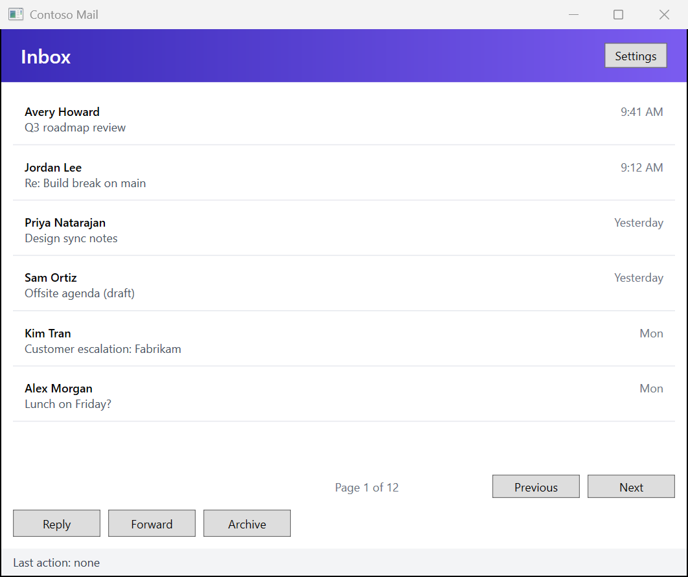

# Session transcript

Source: `Q:\source\XamlAgentDemos-notes\test-runs\GhostClicks\run-consolidated2\events.jsonl`

## Tool usage

- xaml_hit_test: 3
- xaml_find_elements: 2
- xaml_capture_image: 2
- task_complete: 2
- skill: 1
- xaml_get_status: 1
- view: 1
- grep: 1
- multi_replace_string_in_file: 1
- xaml_apply_hot_reload: 1

Failed tool calls: 0, images: 2


_Model: claude-opus-5.5_


## User (02:32:48)

In my running app, Settings, Reply, Forward, Archive and the left edge of Previous don't respond to mouse clicks, and message rows only work when I click right on the text. Find out why using the live app and fix it.


**Tool call (02:32:49):** `skill`
```json
{
 "skill": "xaml-diagnostics"
}
```

<details><summary>Result `skill` success=true</summary>

```
Skill "xaml-diagnostics" loaded successfully. Follow the instructions in the skill context.
```
</details>


_Skill invoked: xaml-diagnostics_


**Tool call (02:32:51):** `xaml_get_status`
```json
{
 "progressMessage": "Checking connected app"
}
```

<details><summary>Result `xaml_get_status` success=true</summary>

```
{"isDebugging":true,"debuggerState":"running","diagnosticsActive":true,"apps":[{"app":"a1","name":"GhostClicks.exe [25392]","processId":25392,"platform":"WPF (.NET)","isRemote":false,"isDesignTimeOrNoDebug":false,"sourceInfoAvailable":true,"hotReloadSupported":true,"hotReloadEnabled":true,"supportsPropertyExplorer":true,"supportsInAppToolbar":true,"supportsHitTest":true,"windows":[{"windowId":"0x2FC01C8","title":"Contoso Mail","bounds":{"x":76,"y":76,"width":1080,"height":900},"dpiScale":1.5,"visible":true,"minimized":false}]}],"issues":[],"issuesSummary":"No problems detected.","hotReload":{"options":{"hotReloadEnabled":true,"hotReloadOnSave":false,"applyMode":"asYouType: XAML edits apply as you type, without saving (default)","wpfEnabled":true,"uwpEnabled":true,"winUIEnabled":true,"mauiEnabled":true,"justMyXaml":true,"previewSelectedElement":false,"inAppToolbar":true,"inAppSelection":false,"layoutAdorners":false,"trackFocusedElement":false,"bindingFailuresVisible":true,"compatibilityMode":false},"dotNetHotReloadEnabled":true,"isProcessingChanges":false,"errors":[]},"windowsNote":"Window bounds are physical screen pixels and include the window frame. A WPF/WinUI Window's Width and Height are device-independent units (DIPs) that also include the frame, so Width = bounds.width / dpiScale. A user's \"800 px wide\" is ambiguous: say which unit you tested. A minimized window reports x/y = -32000 and can't be captured."}
```
</details>


**Tool call (02:32:53):** `xaml_find_elements`
```json
{
 "progressMessage": "Finding buttons and list items",
 "type": "*Button|ListBoxItem|ListViewItem"
}
```


**Tool call (02:32:53):** `xaml_capture_image`
```json
{
 "progressMessage": "Capturing app window"
}
```

<details><summary>Result `xaml_find_elements` success=true</summary>

```
{"count":6,"totalMatches":6,"truncated":false,"results":[{"id":"a1:30","type":"System.Windows.Controls.Button","name":"SettingsButton","source":{"file":"Q:\\source\\XamlAgentDemos\\src\\GhostClicks\\MainWindow.xaml","line":28,"column":18},"path":"MainWindow/Border/AdornerDecorator/ContentPresenter/Grid/Border/DockPanel/Button"},{"id":"a1:33","type":"System.Windows.Controls.Button","name":"PreviousButton","source":{"file":"Q:\\source\\XamlAgentDemos\\src\\GhostClicks\\MainWindow.xaml","line":73,"column":18},"path":"MainWindow/Border/AdornerDecorator/ContentPresenter/Grid/Grid/StackPanel/Button"},{"id":"a1:34","type":"System.Windows.Controls.Button","name":"NextButton","source":{"file":"Q:\\source\\XamlAgentDemos\\src\\GhostClicks\\MainWindow.xaml","line":78,"column":18},"path":"MainWindow/Border/AdornerDecorator/ContentPresenter/Grid/Grid/StackPanel/Button"},{"id":"a1:26","type":"System.Windows.Controls.Button","name":"ReplyButton","source":{"file":"Q:\\source\\XamlAgentDemos\\src\\GhostClicks\\MainWindow.xaml","line":99,"column":14},"path":"MainWindow/Border/AdornerDecorator/ContentPresenter/Grid/StackPanel/Button"},{"id":"a1:27","type":"System.Windows.Controls.Button","name":"ForwardButton","source":{"file":"Q:\\source\\XamlAgentDemos\\src\\GhostClicks\\MainWindow.xaml","line":104,"column":14},"path":"MainWindow/Border/AdornerDecorator/ContentPresenter/Grid/StackPanel/Button"},{"id":"a1:28","type":"System.Windows.Controls.Button","name":"ArchiveButton","source":{"file":"Q:\\source\\XamlAgentDemos\\src\\GhostClicks\\MainWindow.xaml","line":110,"column":14},"path":"MainWindow/Border/AdornerDecorator/ContentPresenter/Grid/StackPanel/Button"}]}
```
</details>


<details><summary>Result `xaml_capture_image` success=true</summary>

```
Screenshot of window 0x2FC01C8 "Contoso Mail" of app a1 (1062x891 image of the window's client area, so it's slightly smaller than the frame bounds from xaml_get_status).
```
</details>


**Assistant (02:32:56):**

Hit-testing the buttons now, including Previous's left edge.


**Tool call (02:32:56):** `xaml_hit_test`
```json
{
 "progressMessage": "Hit testing unresponsive buttons",
 "elementIds": [
  "a1:30",
  "a1:26",
  "a1:27",
  "a1:28",
  "a1:33",
  "a1:34"
 ],
 "points": [
  "5,10",
  "40,12"
 ]
}
```

<details><summary>Result `xaml_hit_test` success=true</summary>

```
{"count":12,"failed":0,"results":[{"id":"a1:30","summary":"A click at (5,10) does NOT reach 'SettingsButton': it lands on Border (in the template of MainWindow), which is above it at that point or covers it. Border 'HeaderBand' has IsHitTestVisible=False, which applies to 'SettingsButton' too.","elementReceivesInput":false,"inputTarget":{"id":"a1:11","type":"System.Windows.Controls.Border","templatedParent":{"id":"a1:10","type":"GhostClicks.MainWindow","source":{"file":"Q:\\source\\XamlAgentDemos\\src\\GhostClicks\\MainWindow.xaml","line":3,"column":9}}},"stack":[{"id":"a1:11","type":"System.Windows.Controls.Border","templatedParent":{"id":"a1:10","type":"GhostClicks.MainWindow","source":{"file":"Q:\\source\\XamlAgentDemos\\src\\GhostClicks\\MainWindow.xaml","line":3,"column":9}}}],"isVisible":true,"isHitTestVisible":false,"isEnabled":true,"effectiveOpacity":1.0,"blockers":[{"id":"a1:16","type":"System.Windows.Controls.Border","name":"HeaderBand","source":{"file":"Q:\\source\\XamlAgentDemos\\src\\GhostClicks\\MainWindow.xaml","line":18,"column":10},"property":"IsHitTestVisible","value":"False"}],"visibleFraction":1.0,"point":{"window":{"x":625.69,"y":24.0},"screen":{"x":1026.0,"y":157.0}}},{"id":"a1:30","summary":"A click at (40,12) does NOT reach 'SettingsButton': it lands on Border (in the template of MainWindow), which is above it at that point or covers it. Border 'HeaderBand' has IsHitTestVisible=False, which applies to 'SettingsButton' too.","elementReceivesInput":false,"inputTarget":{"id":"a1:11","type":"System.Windows.Controls.Border","templatedParent":{"id":"a1:10","type":"GhostClicks.MainWindow","source":{"file":"Q:\\source\\XamlAgentDemos\\src\\GhostClicks\\MainWindow.xaml","line":3,"column":9}}},"stack":[{"id":"a1:11","type":"System.Windows.Controls.Border","templatedParent":{"id":"a1:10","type":"GhostClicks.MainWindow","source":{"file":"Q:\\source\\XamlAgentDemos\\src\\GhostClicks\\MainWindow.xaml","line":3,"column":9}}}],"isVisible":true,"isHitTestVisible":false,"isEnabled":true,"effectiveOpacity":1.0,"blockers":[{"id":"a1:16","type":"System.Windows.Controls.Border","name":"HeaderBand","source":{"file":"Q:\\source\\XamlAgentDemos\\src\\GhostClicks\\MainWindow.xaml","line":18,"column":10},"property":"IsHitTestVisible","value":"False"}],"visibleFraction":1.0,"point":{"window":{"x":660.69,"y":26.0},"screen":{"x":1078.0,"y":160.0}}},{"id":"a1:26","summary":"A click at (5,10) does NOT reach 'ReplyButton': it lands on TextBlock, which is above it a
... [truncated 14544 chars]
```
</details>


**Assistant (02:32:59):**

Three causes identified so far: HeaderBand has `IsHitTestVisible=False`, an invisible ToastHost/Toast overlays the action buttons, and PageIndicator overlaps Previous. Now reading the XAML.


**Tool call (02:32:59):** `view`
```json
{
 "path": "Q:\\source\\XamlAgentDemos\\src\\GhostClicks\\MainWindow.xaml"
}
```

<details><summary>Result `view` success=true</summary>

```
<Window x:Class="GhostClicks.MainWindow"
        xmlns="http://schemas.microsoft.com/winfx/2006/xaml/presentation"
        xmlns:x="http://schemas.microsoft.com/winfx/2006/xaml"
        Title="Contoso Mail"
        Width="720"
        Height="600"
        Background="White">
    <Grid>
        <Grid.RowDefinitions>
            <RowDefinition Height="Auto" />
            <RowDefinition Height="*" />
            <RowDefinition Height="Auto" />
            <RowDefinition Height="Auto" />
            <RowDefinition Height="Auto" />
        </Grid.RowDefinitions>

        <!-- Decorative header; clicks pass through to the window so it can be dragged. -->
        <Border x:Name="HeaderBand"
                Padding="20,14"
                IsHitTestVisible="False">
            <Border.Background>
                <LinearGradientBrush StartPoint="0,0" EndPoint="1,0">
                    <GradientStop Offset="0" Color="#3A2BB8" />
                    <GradientStop Offset="1" Color="#7B5CF0" />
                </LinearGradientBrush>
            </Border.Background>
            <DockPanel>
                <Button x:Name="SettingsButton"
                        Padding="10,4"
                        Click="OnActionClick"
                        Content="Settings"
                        DockPanel.Dock="Right"
                        Tag="Settings" />
                <TextBlock VerticalAlignment="Center"
                           FontSize="20"
                           FontWeight="SemiBold"
                           Foreground="White"
                           Text="Inbox" />
            </DockPanel>
        </Border>

        <ItemsControl x:Name="MessageList"
                      Grid.Row="1"
                      Margin="12"
                      ItemsSource="{Binding Messages}">
            <ItemsControl.ItemTemplate>
                <DataTemplate>
                    <Border x:Name="MessageRow"
                            Margin="0,0,0,4"
                            Padding="12,10"
                            BorderBrush="#E6E8EE"
                            BorderThickness="0,0,0,1"
                            Cursor="Hand"
                            MouseLeftButtonUp="OnMessageRowClick">
                        <DockPanel>
                            <TextBlock DockPanel.Dock="Right"
                                       Foreground="#6B7280"
                                       Text="{Binding Time}"
... [truncated 3819 chars]
```
</details>


**Tool call (02:33:07):** `grep`
```json
{
 "pattern": "Drag|Header|Toast|MouseLeft",
 "paths": "Q:\\source\\XamlAgentDemos\\src\\GhostClicks",
 "glob": "*.cs",
 "output_mode": "content",
 "-n": true
}
```

<details><summary>Result `grep` success=true</summary>

```
No matches found.
```
</details>


**Tool call (02:33:20):** `multi_replace_string_in_file`
```json
{
 "explanation": "Fix hit-test blockers",
 "replacements": [
  {
   "filePath": "src\\GhostClicks\\MainWindow.xaml",
   "oldString": "            <DockPanel>\n                <Button x:Name=\"SettingsButton\"\n                        Padding=\"10,4\"\n                        Click=\"OnActionClick\"\n                        Content=\"Settings\"\n                        DockPanel.Dock=\"Right\"\n                        Tag=\"Settings\" />\n                <TextBlock VerticalAlignment=\"Center\"\n                           FontSize=\"20\"\n                           FontWeight=\"SemiBold\"\n                           Foreground=\"White\"\n                           Text=\"Inbox\" />\n            </DockPanel>\n        </Border>",
   "newString": "            <TextBlock VerticalAlignment=\"Center\"\n                       FontSize=\"20\"\n                       FontWeight=\"SemiBold\"\n                       Foreground=\"White\"\n                       Text=\"Inbox\" />\n        </Border>\n\n        <Button x:Name=\"SettingsButton\"\n                Margin=\"20,14\"\n                Padding=\"10,4\"\n                HorizontalAlignment=\"Right\"\n                VerticalAlignment=\"Center\"\n                Click=\"OnActionClick\"\n                Content=\"Settings\"\n                Tag=\"Settings\" />"
  },
  {
   "filePath": "src\\GhostClicks\\MainWindow.xaml",
   "oldString": "                            Padding=\"12,10\"\n                            BorderBrush",
   "newStr
... [truncated 809 chars]
```

<details><summary>Result `multi_replace_string_in_file` success=true</summary>

```
Successfully applied 4 of 4 replacement(s) across 1 file(s).
```
</details>


**Tool call (02:33:24):** `xaml_apply_hot_reload`
```json
{
 "progressMessage": "Applying XAML fixes to running app"
}
```

<details><summary>Result `xaml_apply_hot_reload` success=true</summary>

```
{"status":"noChange","errors":[],"log":[],"noNewActivity":true,"lastHotReloadUpdate":{"secondsAgo":1,"updatesSinceToolsStarted":1},"lastActivity":{"secondsAgo":58,"message":"Connected to GhostClicks.exe [25392] for WpfCore diagnostics. Incremental Hot Reload is enabled."},"note":"This call applied nothing new. lastHotReloadUpdate is when XAML Hot Reload last pushed changes into the app (it applies saved and in-editor edits as they happen, often without a log entry). If it's after your edit, the edit was already applied; if it's null or older than your edit, nothing reached the app (check the file is saved and part of the running project). It doesn't prove the app shows them: XAML that the app loads itself (XamlReader, files copied to the output folder, dictionaries swapped in code) is never hot reloaded, and code that sets the same property or picks another template/resource at runtime overrides the edit. Check the live value with xaml_explain_property_value or xaml_find_resource.","hint":"Call xaml_capture_image to verify the change visually. Views that aren't loaded (other tabs, closed dialogs) are updated when they're next shown. Source line numbers reported for existing elements can still point to the pre-edit lines until the element is recreated, so find elements by x:Name or type rather than by an old line number. Structural edits (wrapping or replacing a parent, changing a root's content) recreate elements, which resets their runtime state such as selection, checked state, typed text and scroll position, and invalidates their IDs. Re-establish the state you were testing before capturing again."}
```
</details>


**Assistant (02:33:26):**

Applied. Re-verifying with hit tests on fresh element IDs.


**Tool call (02:33:26):** `xaml_find_elements`
```json
{
 "progressMessage": "Re-finding elements after reload",
 "name": "*Button|MessageRow"
}
```

<details><summary>Result `xaml_find_elements` success=true</summary>

```
{"count":12,"totalMatches":12,"truncated":false,"results":[{"id":"a1:105","type":"System.Windows.Controls.Button","name":"SettingsButton","path":"MainWindow/Border/AdornerDecorator/ContentPresenter/Grid/Button"},{"id":"a1:131","type":"System.Windows.Controls.Border","name":"MessageRow","path":"MainWindow/Border/AdornerDecorator/ContentPresenter/Grid/ItemsControl/Border/ItemsPresenter/StackPanel/ContentPresenter/Border"},{"id":"a1:137","type":"System.Windows.Controls.Border","name":"MessageRow","path":"MainWindow/Border/AdornerDecorator/ContentPresenter/Grid/ItemsControl/Border/ItemsPresenter/StackPanel/ContentPresenter/Border"},{"id":"a1:143","type":"System.Windows.Controls.Border","name":"MessageRow","path":"MainWindow/Border/AdornerDecorator/ContentPresenter/Grid/ItemsControl/Border/ItemsPresenter/StackPanel/ContentPresenter/Border"},{"id":"a1:149","type":"System.Windows.Controls.Border","name":"MessageRow","path":"MainWindow/Border/AdornerDecorator/ContentPresenter/Grid/ItemsControl/Border/ItemsPresenter/StackPanel/ContentPresenter/Border"},{"id":"a1:155","type":"System.Windows.Controls.Border","name":"MessageRow","path":"MainWindow/Border/AdornerDecorator/ContentPresenter/Grid/ItemsControl/Border/ItemsPresenter/StackPanel/ContentPresenter/Border"},{"id":"a1:161","type":"System.Windows.Controls.Border","name":"MessageRow","path":"MainWindow/Border/AdornerDecorator/ContentPresenter/Grid/ItemsControl/Border/ItemsPresenter/StackPanel/ContentPresenter/Border"},{"id":"a1:116","type":"System.Windows.Controls.Button","name":"PreviousButton","path":"MainWindow/Border/AdornerDecorator/ContentPresenter/Grid/Grid/StackPanel/Button"},{"id":"a1:117","type":"System.Windows.Controls.Button","name":"NextButton","path":"MainWindow/Border/AdornerDecorator/ContentPresenter/Grid/Grid/StackPanel/Button"},{"id":"a1:120","type":"System.Windows.Controls.Button","name":"ReplyButton","path":"MainWindow/Border/AdornerDecorator/ContentPresenter/Grid/StackPanel/Button"},{"id":"a1:121","type":"System.Windows.Controls.Button","name":"ForwardButton","path":"MainWindow/Border/AdornerDecorator/ContentPresenter/Grid/StackPanel/Button"},{"id":"a1:122","type":"System.Windows.Controls.Button","name":"ArchiveButton","path":"MainWindow/Border/AdornerDecorator/ContentPresenter/Grid/StackPanel/Button"}]}
```
</details>


**Tool call (02:33:29):** `xaml_hit_test`
```json
{
 "elementIds": [
  "a1:105",
  "a1:116",
  "a1:120",
  "a1:121",
  "a1:122",
  "a1:131"
 ],
 "points": [
  "3,10",
  "40,12",
  "400,30"
 ],
 "progressMessage": "Verifying clicks now reach targets"
}
```

<details><summary>Result `xaml_hit_test` success=true</summary>

```
{"count":18,"failed":0,"results":[{"id":"a1:105","summary":"A click at (3,10) reaches 'SettingsButton' (input lands on Border 'border' (in the template of Button 'SettingsButton')).","elementReceivesInput":true,"inputTarget":{"id":"a1:167","type":"System.Windows.Controls.Border","name":"border","templatedParent":{"id":"a1:105","type":"System.Windows.Controls.Button","name":"SettingsButton"}},"stack":[{"id":"a1:167","type":"System.Windows.Controls.Border","name":"border","templatedParent":{"id":"a1:105","type":"System.Windows.Controls.Button","name":"SettingsButton"}},{"id":"a1:11","type":"System.Windows.Controls.Border","templatedParent":{"id":"a1:10","type":"GhostClicks.MainWindow","source":{"file":"Q:\\source\\XamlAgentDemos\\src\\GhostClicks\\MainWindow.xaml","line":3,"column":9}}}],"isVisible":true,"isHitTestVisible":true,"isEnabled":true,"effectiveOpacity":1.0,"visibleFraction":1.0,"point":{"window":{"x":623.69,"y":24.32},"screen":{"x":1023.0,"y":157.0}}},{"id":"a1:105","summary":"A click at (40,12) reaches 'SettingsButton' (input lands on TextBlock (in the template of Button 'SettingsButton')).","elementReceivesInput":true,"inputTarget":{"id":"a1:174","type":"System.Windows.Controls.TextBlock","templatedParent":{"id":"a1:105","type":"System.Windows.Controls.Button","name":"SettingsButton"}},"stack":[{"id":"a1:174","type":"System.Windows.Controls.TextBlock","templatedParent":{"id":"a1:105","type":"System.Windows.Controls.Button","name":"SettingsButton"}},{"id":"a1:167","type":"System.Windows.Controls.Border","name":"border","templatedParent":{"id":"a1:105","type":"System.Windows.Controls.Button","name":"SettingsButton"}},{"id":"a1:11","type":"System.Windows.Controls.Border","templatedParent":{"id":"a1:10","type":"GhostClicks.MainWindow","source":{"file":"Q:\\source\\XamlAgentDemos\\src\\GhostClicks\\MainWindow.xaml","line":3,"column":9}}}],"isVisible":true,"isHitTestVisible":true,"isEnabled":true,"effectiveOpacity":1.0,"visibleFraction":1.0,"point":{"window":{"x":660.69,"y":26.32},"screen":{"x":1078.0,"y":160.0}}},{"id":"a1:105","summary":"The point is outside 'SettingsButton''s bounds. Nothing receives a click at (400,30): 'SettingsButton' and everything under the point are invisible, IsHitTestVisible=False, or have no Background/Fill there (a null Background isn't hit-testable; Transparent is).","elementReceivesInput":false,"stack":[],"isVisible":true,"isHitTestVisible":true,"isEnabled":true,"effectiveOpacity":1.0,"visibleFraction":1.0,"point":{"win
... [truncated 14973 chars]
```
</details>


**Assistant (02:33:33):**

All targets now receive clicks. Checking an empty spot in a row and the visual layout.


**Tool call (02:33:33):** `xaml_hit_test`
```json
{
 "elementIds": [
  "a1:137"
 ],
 "points": [
  "450,40"
 ],
 "progressMessage": "Testing empty area of message row"
}
```


**Tool call (02:33:33):** `xaml_capture_image`
```json
{
 "progressMessage": "Verifying layout after fix"
}
```

<details><summary>Result `xaml_hit_test` success=true</summary>

```
{"id":"a1:137","summary":"A click at (450,40) reaches 'MessageRow' (input lands on TextBlock (in the template of ContentPresenter)).","elementReceivesInput":true,"inputTarget":{"id":"a1:142","type":"System.Windows.Controls.TextBlock","templatedParent":{"id":"a1:182","type":"System.Windows.Controls.ContentPresenter"}},"stack":[{"id":"a1:142","type":"System.Windows.Controls.TextBlock","templatedParent":{"id":"a1:182","type":"System.Windows.Controls.ContentPresenter"}},{"id":"a1:137","type":"System.Windows.Controls.Border","name":"MessageRow","templatedParent":{"id":"a1:182","type":"System.Windows.Controls.ContentPresenter"}},{"id":"a1:11","type":"System.Windows.Controls.Border","templatedParent":{"id":"a1:10","type":"GhostClicks.MainWindow","source":{"file":"Q:\\source\\XamlAgentDemos\\src\\GhostClicks\\MainWindow.xaml","line":3,"column":9}}}],"isVisible":true,"isHitTestVisible":true,"isEnabled":true,"effectiveOpacity":1.0,"visibleFraction":1.0,"point":{"window":{"x":462.0,"y":163.52},"screen":{"x":780.0,"y":366.0}},"note":"inputTarget is what a mouse click or tap at the point reaches (WPF: InputHitTest; WinUI/UWP: FindElementsInHostCoordinates, open popups first; .NET MAUI: approximated from element bounds and draw order). stack lists visible, hit-testable elements under the point, topmost first; elements with no id are template parts or aren't in the live tree (on WPF use their templatedParent). blockers are the element and ancestors whose own values hide it or block input (descendants inherit IsEnabled/IsHitTestVisible=False; on .NET MAUI IsHitTestVisible maps to InputTransparent). visibleFraction includes clipping by ancestors (layout slots, scroll viewports, ClipToBounds/Clip/IsClippedToBounds) and the window."}
```
</details>




<details><summary>Result `xaml_capture_image` success=true</summary>

```
Screenshot of window 0x2FC01C8 "Contoso Mail" of app a1 (1062x891 image of the window's client area, so it's slightly smaller than the frame bounds from xaml_get_status).
```
</details>


**Assistant (02:33:41):**

I found four separate causes in the live app using hit testing, fixed them all in [MainWindow.xaml](vscopilot://file?path=Q%3A%5Csource%5CXamlAgentDemos%5Csrc%5CGhostClicks%5CMainWindow.xaml), and hot reloaded the changes into the running app. Hit tests now show every click reaching its target, and the layout looks the same as before. I didn't do a real mouse click or a build, and I haven't committed anything.

| Symptom | Cause | Fix |
|---|---|---|
| **Settings** doesn't respond | It was inside `HeaderBand`, which has `IsHitTestVisible="False"` (meant to let clicks pass through the header), and that setting also applies to everything inside it. | Moved `SettingsButton` out of `HeaderBand` into the same grid cell, aligned to the right. The header still lets clicks pass through, as its comment intends. |
| **Reply / Forward / Archive** don't respond | `ToastHost` sits in the same grid row with `Background="Transparent"`, so it catches clicks. Also, the toast inside it fades to Opacity 0, but a fully faded element still catches clicks. | Removed the background from `ToastHost` and set `IsHitTestVisible="False"` on it. |
| **Previous** left edge doesn't respond | `PageIndicator` is 200 wide with a right margin of 150, so it overlaps the left part of Previous. Its `Background="Transparent"` makes that overlap catch clicks. | Removed the background from `PageIndicator` and set `IsHitTestVisible="False"` on it. The text stays in the same place. |
| **Message rows** only work on the text | The `MessageRow` border had no background, so only the text inside it could be clicked. | Added `Background="Transparent"` so the whole row is clickable. |


## User (02:33:42)


**Tool call (02:33:44):** `task_complete`
```json
{
 "summary": "All four click problems are fixed in MainWindow.xaml and hot reloaded into the running app. Hit tests show clicks now reach Settings, Reply, Forward, Archive, the left edge of Previous and empty areas of message rows. The layout looks unchanged. I didn't do a real mouse click or a build, and nothing is committed."
}
```

<details><summary>Result `task_complete` success=true</summary>

```
All four click problems are fixed in MainWindow.xaml and hot reloaded into the running app. Hit tests show clicks now reach Settings, Reply, Forward, Archive, the left edge of Previous and empty areas of message rows. The layout looks unchanged. I didn't do a real mouse click or a build, and nothing is committed.
```
</details>


**Task complete (02:33:44):** All four click problems are fixed in MainWindow.xaml and hot reloaded into the running app. Hit tests show clicks now reach Settings, Reply, Forward, Archive, the left edge of Previous and empty areas of message rows. The layout looks unchanged. I didn't do a real mouse click or a build, and nothing is committed.


## User (02:34:12)

Thanks. Now some quick feedback for the tooling team. Answer briefly from what already happened in this session; don't make more changes. (1) Which xaml_* tools or skill guidance helped most? (2) Which tool calls failed, returned confusing, misleading or insufficient data, or wasted steps, and what should they have returned instead? (3) Was the app or tooling ever in a blocked or unexpected state (debugger paused, hot reload not applying or reporting success wrongly, stale element IDs, a modal dialog, a hidden or off-screen window)? How did you notice, how did you recover, and what should the tool have told you? (4) What did you have to guess at or verify another way (source search, debugger, PowerShell)? (5) Which fixes did you verify live in the running app, and which only in source, and why? (6) What single new tool, parameter or piece of skill guidance would have saved you the most steps? (7) Re-read my original request: did you meet every explicit requirement in it? If you skipped, merged or changed any of them, say which and why.


**Assistant (02:34:33):**

1. **What helped most:** `xaml_hit_test` with several elements and points in one call. Its `blockers` and `stack` fields named all four causes, with the XAML file and line, in a single call. `xaml_find_elements` with a wildcard type and `xaml_capture_image` were the next most useful. The skill's "can't be clicked" workflow, including its warning that a null background isn't hit-testable but `Transparent` is, mapped straight onto the problems.

2. **Failed, confusing or wasted calls:**
   - Nothing failed outright.
   - `xaml_apply_hot_reload` returned `status: "noChange"` even though the edits had already been applied live (the as-you-type mode pushes them as you edit). The note explained this, but a status like `alreadyApplied` would have been clearer than "noChange".
   - My test point (400,30) fell outside the small buttons, which wasted about 10 results. The tool did say "outside bounds"; rejecting or flagging such points up front would have been better.
   - My first "empty area of a row" point landed on a TextBlock (it stretches across the row's width). So the empty-area proof came only from the row's padding point.
   - The output is very long. A short pass/fail table per element and point would help.

3. **Blocked or unexpected states:** None. The debugger was running, and there was no dialog and no hidden or off-screen window. Hot reload recreated the elements, so their IDs changed (for example, `a1:30` became `a1:105`). I expected that from the skill and found the elements again, so I never hit `ELEMENT_GONE`. It would help if the hot reload result listed which elements were recreated, or old-to-new ID mappings.

4. **Guessed or checked another way:**
   - I read the XAML directly to choose the fixes.
   - I searched the code-behind to check whether any drag handler depended on the header letting clicks through. There was none.
   - I guessed which points to test, especially the "left edge" of Previous and the empty areas of rows.
   - No debugger or PowerShell was needed.

5. **Verified live vs. in source:**
   - All four fixes were checked in the running app with `xaml_hit_test` after hot reload, plus a screenshot to confirm the layout hadn't changed.
   - I did not check that the click handlers actually run (for example, by watching the "Last action" status text). `xaml_interact` goes through UI Automation and skips hit testing, so it wouldn't prove a real click works. Only a real mouse click would.
   - I didn't build, because the app was being debugged.

6. **Biggest step-saver:** an option on `xaml_hit_test` that scans an element's whole area in a grid of points. It would report what share of the area is clickable and which elements cover the rest. That would have found the partial overlap on Previous and the dead areas in the rows without me guessing points. A "list everything blocking clicks in this window" tool would be the next best.

7. **Requirements check:** I found the causes in the live app and fixed all five reported symptoms. Two fixes took a different approach than the obvious one:
   - **Settings:** I didn't just remove `IsHitTestVisible="False"` from the header. I moved the button out of the header so the header's documented click-through intent still holds.
   - **Previous:** I made `PageIndicator` ignore clicks instead of changing its width and margin. Its layout box still overlaps the button but no longer blocks clicks, and the text doesn't move.

   I didn't commit, since you didn't ask me to.


## User (02:34:33)


**Tool call (02:34:34):** `task_complete`
```json
{
 "summary": "I answered all seven feedback questions from what happened in this session, and made no further changes."
}
```

<details><summary>Result `task_complete` success=true</summary>

```
I answered all seven feedback questions from what happened in this session, and made no further changes.
```
</details>


**Task complete (02:34:34):** I answered all seven feedback questions from what happened in this session, and made no further changes.
