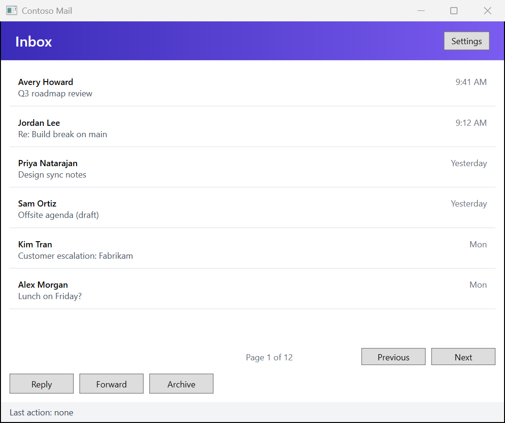

# Session transcript

Source: `Q:\source\XamlAgentDemos-notes\test-runs\GhostClicks\run3\events.jsonl`

## Tool usage

- xaml_hit_test: 12
- xaml_find_elements: 3
- xaml_capture_image: 2
- view: 2
- task_complete: 2
- skill: 1
- xaml_list_apps: 1
- multi_replace_string_in_file: 1
- xaml_apply_hot_reload: 1

Failed tool calls: 0, images: 1


_Model: claude-opus-5.5_


## User (19:57:04)

In my running app, Settings, Reply, Forward, Archive and the left edge of Previous don't respond to mouse clicks, and message rows only work when I click right on the text. Find out why using the live app and fix it.


**Tool call (19:57:05):** `skill`
```json
{
 "skill": "xaml-diagnostics"
}
```

<details><summary>Result `skill` success=true</summary>

```
Skill "xaml-diagnostics" loaded successfully. Follow the instructions in the skill context.
```
</details>


_Skill invoked: xaml-diagnostics_


**Tool call (19:57:07):** `xaml_list_apps`
```json
{
 "progressMessage": "Listing connected XAML apps"
}
```

<details><summary>Result `xaml_list_apps` success=true</summary>

```
{"isDebugging":true,"debuggerState":"running","diagnosticsActive":true,"apps":[{"app":"a1","name":"GhostClicks.exe [45132]","processId":45132,"platform":"WPF (.NET)","isRemote":false,"isDesignTimeOrNoDebug":false,"sourceInfoAvailable":true,"hotReloadSupported":true,"hotReloadEnabled":true,"supportsPropertyExplorer":true,"supportsInAppToolbar":true,"windowCount":1}]}
```
</details>


**Tool call (19:57:09):** `xaml_capture_image`
```json
{
 "progressMessage": "Capturing app window"
}
```


**Tool call (19:57:09):** `xaml_find_elements`
```json
{
 "progressMessage": "Finding buttons",
 "type": "*Button"
}
```

<details><summary>Result `xaml_find_elements` success=true</summary>

```
{"count":6,"totalMatches":6,"truncated":false,"results":[{"id":"a1:30","type":"System.Windows.Controls.Button","name":"SettingsButton","source":{"file":"Q:\\source\\XamlAgentDemos\\src\\GhostClicks\\MainWindow.xaml","line":28,"column":18},"path":"MainWindow/Border/AdornerDecorator/ContentPresenter/Grid/Border/DockPanel/Button"},{"id":"a1:33","type":"System.Windows.Controls.Button","name":"PreviousButton","source":{"file":"Q:\\source\\XamlAgentDemos\\src\\GhostClicks\\MainWindow.xaml","line":73,"column":18},"path":"MainWindow/Border/AdornerDecorator/ContentPresenter/Grid/Grid/StackPanel/Button"},{"id":"a1:34","type":"System.Windows.Controls.Button","name":"NextButton","source":{"file":"Q:\\source\\XamlAgentDemos\\src\\GhostClicks\\MainWindow.xaml","line":78,"column":18},"path":"MainWindow/Border/AdornerDecorator/ContentPresenter/Grid/Grid/StackPanel/Button"},{"id":"a1:26","type":"System.Windows.Controls.Button","name":"ReplyButton","source":{"file":"Q:\\source\\XamlAgentDemos\\src\\GhostClicks\\MainWindow.xaml","line":99,"column":14},"path":"MainWindow/Border/AdornerDecorator/ContentPresenter/Grid/StackPanel/Button"},{"id":"a1:27","type":"System.Windows.Controls.Button","name":"ForwardButton","source":{"file":"Q:\\source\\XamlAgentDemos\\src\\GhostClicks\\MainWindow.xaml","line":104,"column":14},"path":"MainWindow/Border/AdornerDecorator/ContentPresenter/Grid/StackPanel/Button"},{"id":"a1:28","type":"System.Windows.Controls.Button","name":"ArchiveButton","source":{"file":"Q:\\source\\XamlAgentDemos\\src\\GhostClicks\\MainWindow.xaml","line":110,"column":14},"path":"MainWindow/Border/AdornerDecorator/ContentPresenter/Grid/StackPanel/Button"}]}
```
</details>




<details><summary>Result `xaml_capture_image` success=true</summary>

```
Screenshot of window 0x2260A82 "Contoso Mail" of app a1 (1062x891 image of the window's client area, so it's slightly smaller than the frame bounds from xaml_list_windows).
```
</details>


**Assistant (19:57:14):**

Let me hit-test the affected buttons to see what intercepts clicks.


**Tool call (19:57:14):** `xaml_hit_test`
```json
{
 "progressMessage": "Hit testing Settings button",
 "elementId": "a1:30"
}
```


**Tool call (19:57:14):** `xaml_hit_test`
```json
{
 "progressMessage": "Hit testing Reply button",
 "elementId": "a1:26"
}
```


**Tool call (19:57:14):** `xaml_hit_test`
```json
{
 "progressMessage": "Hit testing Forward button",
 "elementId": "a1:27"
}
```


**Tool call (19:57:14):** `xaml_hit_test`
```json
{
 "progressMessage": "Hit testing Archive button",
 "elementId": "a1:28"
}
```


**Tool call (19:57:14):** `xaml_hit_test`
```json
{
 "progressMessage": "Hit testing Previous left edge",
 "elementId": "a1:33",
 "point": "5,15"
}
```

<details><summary>Result `xaml_hit_test` success=true</summary>

```
{"id":"a1:33","summary":"A click at (5,15) does NOT reach 'PreviousButton': it lands on TextBlock 'PageIndicator', which is above it at that point or covers it.","elementReceivesInput":false,"inputTarget":{"id":"a1:25","type":"System.Windows.Controls.TextBlock","name":"PageIndicator","source":{"file":"Q:\\source\\XamlAgentDemos\\src\\GhostClicks\\MainWindow.xaml","line":85,"column":14}},"stack":[{"id":"a1:25","type":"System.Windows.Controls.TextBlock","name":"PageIndicator","source":{"file":"Q:\\source\\XamlAgentDemos\\src\\GhostClicks\\MainWindow.xaml","line":85,"column":14}},{"id":"a1:41","type":"System.Windows.Controls.Border","name":"border","templatedParent":{"id":"a1:33","type":"System.Windows.Controls.Button","name":"PreviousButton","source":{"file":"Q:\\source\\XamlAgentDemos\\src\\GhostClicks\\MainWindow.xaml","line":73,"column":18}}},{"id":"a1:11","type":"System.Windows.Controls.Border","templatedParent":{"id":"a1:10","type":"GhostClicks.MainWindow","source":{"file":"Q:\\source\\XamlAgentDemos\\src\\GhostClicks\\MainWindow.xaml","line":3,"column":9}}}],"isVisible":true,"isHitTestVisible":true,"isEnabled":true,"effectiveOpacity":1.0,"visibleFraction":1.0,"point":{"window":{"x":510.33,"y":473.79},"screen":{"x":1081.0,"y":1060.0}},"note":"inputTarget is what the mouse hits (WPF InputHitTest). stack lists visible, hit-testable elements under the point, topmost first; elements with no id are template parts or aren't in the live tree, so use their templatedParent. blockers are the element and ancestors whose own values hide it or block input (descendants inherit IsEnabled/IsHitTestVisible=False). visibleFraction includes clipping by ancestors (layout slots, ScrollViewer viewports, ClipToBounds) and the window."}
```
</details>

<details><summary>Result `xaml_hit_test` success=true</summary>

```
{"id":"a1:28","summary":"A click at its center does NOT reach 'ArchiveButton': it lands on Border 'ToastHost', which is above it at that point or covers it.","elementReceivesInput":false,"inputTarget":{"id":"a1:20","type":"System.Windows.Controls.Border","name":"ToastHost","source":{"file":"Q:\\source\\XamlAgentDemos\\src\\GhostClicks\\MainWindow.xaml","line":119,"column":10}},"stack":[{"id":"a1:20","type":"System.Windows.Controls.Border","name":"ToastHost","source":{"file":"Q:\\source\\XamlAgentDemos\\src\\GhostClicks\\MainWindow.xaml","line":119,"column":10}},{"id":"a1:57","type":"System.Windows.Controls.TextBlock","templatedParent":{"id":"a1:28","type":"System.Windows.Controls.Button","name":"ArchiveButton","source":{"file":"Q:\\source\\XamlAgentDemos\\src\\GhostClicks\\MainWindow.xaml","line":110,"column":14}}},{"id":"a1:37","type":"System.Windows.Controls.Border","name":"border","templatedParent":{"id":"a1:28","type":"System.Windows.Controls.Button","name":"ArchiveButton","source":{"file":"Q:\\source\\XamlAgentDemos\\src\\GhostClicks\\MainWindow.xaml","line":110,"column":14}}},{"id":"a1:11","type":"System.Windows.Controls.Border","templatedParent":{"id":"a1:10","type":"GhostClicks.MainWindow","source":{"file":"Q:\\source\\XamlAgentDemos\\src\\GhostClicks\\MainWindow.xaml","line":3,"column":9}}}],"isVisible":true,"isHitTestVisible":true,"isEnabled":true,"effectiveOpacity":1.0,"visibleFraction":1.0,"point":{"window":{"x":253.0,"y":508.73},"screen":{"x":695.0,"y":1112.0}},"note":"inputTarget is what the mouse hits (WPF InputHitTest). stack lists visible, hit-testable elements under the point, topmost first; elements with no id are template parts or aren't in the live tree, so use their templatedParent. blockers are the element and ancestors whose own values hide it or block input (descendants inherit IsEnabled/IsHitTestVisible=False). visibleFraction includes clipping by ancestors (layout slots, ScrollViewer viewports, ClipToBounds) and the window."}
```
</details>

<details><summary>Result `xaml_hit_test` success=true</summary>

```
{"id":"a1:26","summary":"A click at its center does NOT reach 'ReplyButton': it lands on TextBlock, which is above it at that point or covers it.","elementReceivesInput":false,"inputTarget":{"id":"a1:38","type":"System.Windows.Controls.TextBlock","source":{"file":"Q:\\source\\XamlAgentDemos\\src\\GhostClicks\\MainWindow.xaml","line":141,"column":18}},"stack":[{"id":"a1:38","type":"System.Windows.Controls.TextBlock","source":{"file":"Q:\\source\\XamlAgentDemos\\src\\GhostClicks\\MainWindow.xaml","line":141,"column":18}},{"id":"a1:29","type":"System.Windows.Controls.Border","name":"Toast","source":{"file":"Q:\\source\\XamlAgentDemos\\src\\GhostClicks\\MainWindow.xaml","line":122,"column":14}},{"id":"a1:20","type":"System.Windows.Controls.Border","name":"ToastHost","source":{"file":"Q:\\source\\XamlAgentDemos\\src\\GhostClicks\\MainWindow.xaml","line":119,"column":10}},{"id":"a1:55","type":"System.Windows.Controls.TextBlock","templatedParent":{"id":"a1:26","type":"System.Windows.Controls.Button","name":"ReplyButton","source":{"file":"Q:\\source\\XamlAgentDemos\\src\\GhostClicks\\MainWindow.xaml","line":99,"column":14}}},{"id":"a1:35","type":"System.Windows.Controls.Border","name":"border","templatedParent":{"id":"a1:26","type":"System.Windows.Controls.Button","name":"ReplyButton","source":{"file":"Q:\\source\\XamlAgentDemos\\src\\GhostClicks\\MainWindow.xaml","line":99,"column":14}}},{"id":"a1:11","type":"System.Windows.Controls.Border","templatedParent":{"id":"a1:10","type":"GhostClicks.MainWindow","source":{"file":"Q:\\source\\XamlAgentDemos\\src\\GhostClicks\\MainWindow.xaml","line":3,"column":9}}}],"isVisible":true,"isHitTestVisible":true,"isEnabled":true,"effectiveOpacity":1.0,"visibleFraction":1.0,"point":{"window":{"x":57.0,"y":508.73},"screen":{"x":401.0,"y":1112.0}},"note":"inputTarget is what the mouse hits (WPF InputHitTest). stack lists visible, hit-testable elements under the point, topmost first; elements with no id are template parts or aren't in the live tree, so use their templatedParent. blockers are the element and ancestors whose own values hide it or block input (descendants inherit IsEnabled/IsHitTestVisible=False). visibleFraction includes clipping by ancestors (layout slots, ScrollViewer viewports, ClipToBounds) and the window."}
```
</details>

<details><summary>Result `xaml_hit_test` success=true</summary>

```
{"id":"a1:30","summary":"A click at its center does NOT reach 'SettingsButton': it lands on Border (in the template of MainWindow), which is above it at that point or covers it. Border 'HeaderBand' has IsHitTestVisible=False, which applies to 'SettingsButton' too.","elementReceivesInput":false,"inputTarget":{"id":"a1:11","type":"System.Windows.Controls.Border","templatedParent":{"id":"a1:10","type":"GhostClicks.MainWindow","source":{"file":"Q:\\source\\XamlAgentDemos\\src\\GhostClicks\\MainWindow.xaml","line":3,"column":9}}},"stack":[{"id":"a1:11","type":"System.Windows.Controls.Border","templatedParent":{"id":"a1:10","type":"GhostClicks.MainWindow","source":{"file":"Q:\\source\\XamlAgentDemos\\src\\GhostClicks\\MainWindow.xaml","line":3,"column":9}}}],"isVisible":true,"isHitTestVisible":false,"isEnabled":true,"effectiveOpacity":1.0,"blockers":[{"id":"a1:16","type":"System.Windows.Controls.Border","name":"HeaderBand","source":{"file":"Q:\\source\\XamlAgentDemos\\src\\GhostClicks\\MainWindow.xaml","line":18,"column":10},"property":"IsHitTestVisible","value":"False"}],"visibleFraction":1.0,"point":{"window":{"x":653.01,"y":27.3},"screen":{"x":1295.0,"y":390.0}},"note":"inputTarget is what the mouse hits (WPF InputHitTest). stack lists visible, hit-testable elements under the point, topmost first; elements with no id are template parts or aren't in the live tree, so use their templatedParent. blockers are the element and ancestors whose own values hide it or block input (descendants inherit IsEnabled/IsHitTestVisible=False). visibleFraction includes clipping by ancestors (layout slots, ScrollViewer viewports, ClipToBounds) and the window."}
```
</details>

<details><summary>Result `xaml_hit_test` success=true</summary>

```
{"id":"a1:27","summary":"A click at its center does NOT reach 'ForwardButton': it lands on Border 'ToastHost', which is above it at that point or covers it.","elementReceivesInput":false,"inputTarget":{"id":"a1:20","type":"System.Windows.Controls.Border","name":"ToastHost","source":{"file":"Q:\\source\\XamlAgentDemos\\src\\GhostClicks\\MainWindow.xaml","line":119,"column":10}},"stack":[{"id":"a1:20","type":"System.Windows.Controls.Border","name":"ToastHost","source":{"file":"Q:\\source\\XamlAgentDemos\\src\\GhostClicks\\MainWindow.xaml","line":119,"column":10}},{"id":"a1:56","type":"System.Windows.Controls.TextBlock","templatedParent":{"id":"a1:27","type":"System.Windows.Controls.Button","name":"ForwardButton","source":{"file":"Q:\\source\\XamlAgentDemos\\src\\GhostClicks\\MainWindow.xaml","line":104,"column":14}}},{"id":"a1:36","type":"System.Windows.Controls.Border","name":"border","templatedParent":{"id":"a1:27","type":"System.Windows.Controls.Button","name":"ForwardButton","source":{"file":"Q:\\source\\XamlAgentDemos\\src\\GhostClicks\\MainWindow.xaml","line":104,"column":14}}},{"id":"a1:11","type":"System.Windows.Controls.Border","templatedParent":{"id":"a1:10","type":"GhostClicks.MainWindow","source":{"file":"Q:\\source\\XamlAgentDemos\\src\\GhostClicks\\MainWindow.xaml","line":3,"column":9}}}],"isVisible":true,"isHitTestVisible":true,"isEnabled":true,"effectiveOpacity":1.0,"visibleFraction":1.0,"point":{"window":{"x":155.0,"y":508.73},"screen":{"x":548.0,"y":1112.0}},"note":"inputTarget is what the mouse hits (WPF InputHitTest). stack lists visible, hit-testable elements under the point, topmost first; elements with no id are template parts or aren't in the live tree, so use their templatedParent. blockers are the element and ancestors whose own values hide it or block input (descendants inherit IsEnabled/IsHitTestVisible=False). visibleFraction includes clipping by ancestors (layout slots, ScrollViewer viewports, ClipToBounds) and the window."}
```
</details>


**Assistant (19:57:16):**

Four distinct blockers found. Now let me read the source, including the message row template.


**Tool call (19:57:16):** `view`
```json
{
 "path": "Q:\\source\\XamlAgentDemos\\src\\GhostClicks\\MainWindow.xaml"
}
```

<details><summary>Result `view` success=true</summary>

```
<Window x:Class="GhostClicks.MainWindow"
        xmlns="http://schemas.microsoft.com/winfx/2006/xaml/presentation"
        xmlns:x="http://schemas.microsoft.com/winfx/2006/xaml"
        Title="Contoso Mail"
        Width="720"
        Height="600"
        Background="White">
    <Grid>
        <Grid.RowDefinitions>
            <RowDefinition Height="Auto" />
            <RowDefinition Height="*" />
            <RowDefinition Height="Auto" />
            <RowDefinition Height="Auto" />
            <RowDefinition Height="Auto" />
        </Grid.RowDefinitions>

        <!-- Decorative header; clicks pass through to the window so it can be dragged. -->
        <Border x:Name="HeaderBand"
                Padding="20,14"
                IsHitTestVisible="False">
            <Border.Background>
                <LinearGradientBrush StartPoint="0,0" EndPoint="1,0">
                    <GradientStop Offset="0" Color="#3A2BB8" />
                    <GradientStop Offset="1" Color="#7B5CF0" />
                </LinearGradientBrush>
            </Border.Background>
            <DockPanel>
                <Button x:Name="SettingsButton"
                        Padding="10,4"
                        Click="OnActionClick"
                        Content="Settings"
                        DockPanel.Dock="Right"
                        Tag="Settings" />
                <TextBlock VerticalAlignment="Center"
                           FontSize="20"
                           FontWeight="SemiBold"
                           Foreground="White"
                           Text="Inbox" />
            </DockPanel>
        </Border>

        <ItemsControl x:Name="MessageList"
                      Grid.Row="1"
                      Margin="12"
                      ItemsSource="{Binding Messages}">
            <ItemsControl.ItemTemplate>
                <DataTemplate>
                    <Border x:Name="MessageRow"
                            Margin="0,0,0,4"
                            Padding="12,10"
                            BorderBrush="#E6E8EE"
                            BorderThickness="0,0,0,1"
                            Cursor="Hand"
                            MouseLeftButtonUp="OnMessageRowClick">
                        <DockPanel>
                            <TextBlock DockPanel.Dock="Right"
                                       Foreground="#6B7280"
                                       Text="{Binding Time}"
... [truncated 3819 chars]
```
</details>


**Assistant (19:57:23):**

Root causes are clear from the hit tests. Checking code-behind before fixing (header comment mentions dragging; toast may be referenced).


**Tool call (19:57:23):** `view`
```json
{
 "path": "Q:\\source\\XamlAgentDemos\\src\\GhostClicks\\MainWindow.xaml.cs"
}
```

<details><summary>Result `view` success=true</summary>

```
using System.Windows;
using System.Windows.Input;

namespace GhostClicks;

public sealed record Message(string From, string Subject, string Time);

public partial class MainWindow : Window
{
    public MainWindow()
    {
        this.InitializeComponent();
        this.DataContext = new
        {
            Messages = new[]
            {
                new Message("Avery Howard", "Q3 roadmap review", "9:41 AM"),
                new Message("Jordan Lee", "Re: Build break on main", "9:12 AM"),
                new Message("Priya Natarajan", "Design sync notes", "Yesterday"),
                new Message("Sam Ortiz", "Offsite agenda (draft)", "Yesterday"),
                new Message("Kim Tran", "Customer escalation: Fabrikam", "Mon"),
                new Message("Alex Morgan", "Lunch on Friday?", "Mon"),
            },
        };
    }

    private void OnActionClick(object sender, RoutedEventArgs e)
    {
        this.StatusText.Text = $"Last action: {((FrameworkElement)sender).Tag}";
    }

    private void OnMessageRowClick(object sender, MouseButtonEventArgs e)
    {
        var message = (Message)((FrameworkElement)sender).DataContext;
        this.StatusText.Text = $"Last action: opened \"{message.Subject}\"";
    }
}

```
</details>


**Tool call (19:57:37):** `multi_replace_string_in_file`
```json
{
 "explanation": "Fix hit-testing blockers",
 "replacements": [
  {
   "filePath": "src\\GhostClicks\\MainWindow.xaml",
   "oldString": "        <Border x:Name=\"HeaderBand\"\n                Padding=\"20,14\"\n                IsHitTestVisible=\"False\">\n            <Border.Background>\n                <LinearGradientBrush StartPoint=\"0,0\" EndPoint=\"1,0\">\n                    <GradientStop Offset=\"0\" Color=\"#3A2BB8\" />\n                    <GradientStop Offset=\"1\" Color=\"#7B5CF0\" />\n                </LinearGradientBrush>\n            </Border.Background>\n            <DockPanel>",
   "newString": "        <Border x:Name=\"HeaderBand\"\n                IsHitTestVisible=\"False\">\n            <Border.Background>\n                <LinearGradientBrush StartPoint=\"0,0\" EndPoint=\"1,0\">\n                    <GradientStop Offset=\"0\" Color=\"#3A2BB8\" />\n                    <GradientStop Offset=\"1\" Color=\"#7B5CF0\" />\n                </LinearGradientBrush>\n            </Border.Background>\n        </Border>\n        <DockPanel x:Name=\"HeaderContent\" Margin=\"20,14\">",
   "explanation": "Move header content out of the non-hit-testable band"
  },
  {
   "filePath": "src\\GhostClicks\\MainWindow.xaml",
   "oldString": "                           Text=\"Inbox\" />\n            </DockPanel>\n        </Border>",
   "newString": "                           Text=\"Inbox\" />\n        </DockPanel>",
   "explanation": "Close the DockPanel as a sibling"
  },
  {
  
... [truncated 1272 chars]
```

<details><summary>Result `multi_replace_string_in_file` success=true</summary>

```
Successfully applied 5 of 5 replacement(s) across 1 file(s).
```
</details>


**Tool call (19:57:45):** `xaml_apply_hot_reload`
```json
{
 "progressMessage": "Applying XAML fixes to running app"
}
```

<details><summary>Result `xaml_apply_hot_reload` success=true</summary>

```
{"status":"noChange","errors":[],"log":[],"noNewActivity":true,"lastActivity":{"secondsAgo":66,"message":"Connected to GhostClicks.exe [45132] for WpfCore diagnostics. Incremental Hot Reload is enabled."},"note":"This call applied nothing new. If lastActivity is a recent successful update after your edit, the edit was already applied when it was saved (XAML Hot Reload applies edits as they happen when it's enabled); otherwise nothing was pending. It doesn't prove the app shows them: XAML that the app loads itself (XamlReader, files copied to the output folder, dictionaries swapped in code) is never hot reloaded, and code that sets the same property or picks another template/resource at runtime overrides the edit. Check the live value with xaml_explain_property_value or xaml_find_resource.","hint":"Call xaml_capture_image to verify the change visually. Views that aren't loaded (other tabs, closed dialogs) are updated when they're next shown. Source line numbers reported for existing elements can still point to the pre-edit lines until the element is recreated, so find elements by x:Name or type rather than by an old line number. Structural edits (wrapping or replacing a parent, changing a root's content) recreate elements, which resets their runtime state such as selection, checked state, typed text and scroll position, and invalidates their IDs. Re-establish the state you were testing before capturing again."}
```
</details>


**Assistant (19:57:47):**

Hot reload reported nothing pending; let me check whether the edits reached the app.


**Tool call (19:57:47):** `xaml_find_elements`
```json
{
 "progressMessage": "Re-finding buttons after edit",
 "type": "*Button"
}
```

<details><summary>Result `xaml_find_elements` success=true</summary>

```
{"count":6,"totalMatches":6,"truncated":false,"results":[{"id":"a1:105","type":"System.Windows.Controls.Button","name":"SettingsButton","path":"MainWindow/Border/AdornerDecorator/ContentPresenter/Grid/DockPanel/Button"},{"id":"a1:117","type":"System.Windows.Controls.Button","name":"PreviousButton","path":"MainWindow/Border/AdornerDecorator/ContentPresenter/Grid/Grid/StackPanel/Button"},{"id":"a1:118","type":"System.Windows.Controls.Button","name":"NextButton","path":"MainWindow/Border/AdornerDecorator/ContentPresenter/Grid/Grid/StackPanel/Button"},{"id":"a1:121","type":"System.Windows.Controls.Button","name":"ReplyButton","path":"MainWindow/Border/AdornerDecorator/ContentPresenter/Grid/StackPanel/Button"},{"id":"a1:122","type":"System.Windows.Controls.Button","name":"ForwardButton","path":"MainWindow/Border/AdornerDecorator/ContentPresenter/Grid/StackPanel/Button"},{"id":"a1:123","type":"System.Windows.Controls.Button","name":"ArchiveButton","path":"MainWindow/Border/AdornerDecorator/ContentPresenter/Grid/StackPanel/Button"}]}
```
</details>


**Assistant (19:57:52):**

The edits are live (Settings is now under the new DockPanel). Verifying with hit tests:


**Tool call (19:57:52):** `xaml_hit_test`
```json
{
 "elementId": "a1:105",
 "progressMessage": "Verify Settings"
}
```


**Tool call (19:57:52):** `xaml_hit_test`
```json
{
 "elementId": "a1:121",
 "progressMessage": "Verify Reply"
}
```


**Tool call (19:57:52):** `xaml_hit_test`
```json
{
 "elementId": "a1:122",
 "progressMessage": "Verify Forward"
}
```


**Tool call (19:57:52):** `xaml_hit_test`
```json
{
 "elementId": "a1:123",
 "progressMessage": "Verify Archive"
}
```


**Tool call (19:57:52):** `xaml_hit_test`
```json
{
 "elementId": "a1:117",
 "point": "5,15",
 "progressMessage": "Verify Previous left edge"
}
```


**Tool call (19:57:52):** `xaml_find_elements`
```json
{
 "progressMessage": "Find message rows",
 "name": "MessageRow",
 "maxResults": 1
}
```

<details><summary>Result `xaml_find_elements` success=true</summary>

```
{"count":1,"totalMatches":6,"truncated":true,"results":[{"id":"a1:132","type":"System.Windows.Controls.Border","name":"MessageRow","path":"MainWindow/Border/AdornerDecorator/ContentPresenter/Grid/ItemsControl/Border/ItemsPresenter/StackPanel/ContentPresenter/Border"}]}
```
</details>

<details><summary>Result `xaml_hit_test` success=true</summary>

```
{"id":"a1:121","summary":"A click at its center reaches 'ReplyButton' (input lands on TextBlock (in the template of Button 'ReplyButton')).","elementReceivesInput":true,"inputTarget":{"id":"a1:190","type":"System.Windows.Controls.TextBlock","templatedParent":{"id":"a1:121","type":"System.Windows.Controls.Button","name":"ReplyButton"}},"stack":[{"id":"a1:190","type":"System.Windows.Controls.TextBlock","templatedParent":{"id":"a1:121","type":"System.Windows.Controls.Button","name":"ReplyButton"}},{"id":"a1:171","type":"System.Windows.Controls.Border","name":"border","templatedParent":{"id":"a1:121","type":"System.Windows.Controls.Button","name":"ReplyButton"}},{"id":"a1:11","type":"System.Windows.Controls.Border","templatedParent":{"id":"a1:10","type":"GhostClicks.MainWindow","source":{"file":"Q:\\source\\XamlAgentDemos\\src\\GhostClicks\\MainWindow.xaml","line":3,"column":9}}}],"isVisible":true,"isHitTestVisible":true,"isEnabled":true,"effectiveOpacity":1.0,"visibleFraction":1.0,"point":{"window":{"x":57.0,"y":508.73},"screen":{"x":401.0,"y":1112.0}},"note":"inputTarget is what the mouse hits (WPF InputHitTest). stack lists visible, hit-testable elements under the point, topmost first; elements with no id are template parts or aren't in the live tree, so use their templatedParent. blockers are the element and ancestors whose own values hide it or block input (descendants inherit IsEnabled/IsHitTestVisible=False). visibleFraction includes clipping by ancestors (layout slots, ScrollViewer viewports, ClipToBounds) and the window."}
```
</details>

<details><summary>Result `xaml_hit_test` success=true</summary>

```
{"id":"a1:105","summary":"A click at its center reaches 'SettingsButton' (input lands on TextBlock (in the template of Button 'SettingsButton')).","elementReceivesInput":true,"inputTarget":{"id":"a1:181","type":"System.Windows.Controls.TextBlock","templatedParent":{"id":"a1:105","type":"System.Windows.Controls.Button","name":"SettingsButton"}},"stack":[{"id":"a1:181","type":"System.Windows.Controls.TextBlock","templatedParent":{"id":"a1:105","type":"System.Windows.Controls.Button","name":"SettingsButton"}},{"id":"a1:169","type":"System.Windows.Controls.Border","name":"border","templatedParent":{"id":"a1:105","type":"System.Windows.Controls.Button","name":"SettingsButton"}},{"id":"a1:11","type":"System.Windows.Controls.Border","templatedParent":{"id":"a1:10","type":"GhostClicks.MainWindow","source":{"file":"Q:\\source\\XamlAgentDemos\\src\\GhostClicks\\MainWindow.xaml","line":3,"column":9}}}],"isVisible":true,"isHitTestVisible":true,"isEnabled":true,"effectiveOpacity":1.0,"visibleFraction":1.0,"point":{"window":{"x":653.01,"y":27.3},"screen":{"x":1295.0,"y":390.0}},"note":"inputTarget is what the mouse hits (WPF InputHitTest). stack lists visible, hit-testable elements under the point, topmost first; elements with no id are template parts or aren't in the live tree, so use their templatedParent. blockers are the element and ancestors whose own values hide it or block input (descendants inherit IsEnabled/IsHitTestVisible=False). visibleFraction includes clipping by ancestors (layout slots, ScrollViewer viewports, ClipToBounds) and the window."}
```
</details>

<details><summary>Result `xaml_hit_test` success=true</summary>

```
{"id":"a1:122","summary":"A click at its center reaches 'ForwardButton' (input lands on TextBlock (in the template of Button 'ForwardButton')).","elementReceivesInput":true,"inputTarget":{"id":"a1:191","type":"System.Windows.Controls.TextBlock","templatedParent":{"id":"a1:122","type":"System.Windows.Controls.Button","name":"ForwardButton"}},"stack":[{"id":"a1:191","type":"System.Windows.Controls.TextBlock","templatedParent":{"id":"a1:122","type":"System.Windows.Controls.Button","name":"ForwardButton"}},{"id":"a1:172","type":"System.Windows.Controls.Border","name":"border","templatedParent":{"id":"a1:122","type":"System.Windows.Controls.Button","name":"ForwardButton"}},{"id":"a1:11","type":"System.Windows.Controls.Border","templatedParent":{"id":"a1:10","type":"GhostClicks.MainWindow","source":{"file":"Q:\\source\\XamlAgentDemos\\src\\GhostClicks\\MainWindow.xaml","line":3,"column":9}}}],"isVisible":true,"isHitTestVisible":true,"isEnabled":true,"effectiveOpacity":1.0,"visibleFraction":1.0,"point":{"window":{"x":155.0,"y":508.73},"screen":{"x":548.0,"y":1112.0}},"note":"inputTarget is what the mouse hits (WPF InputHitTest). stack lists visible, hit-testable elements under the point, topmost first; elements with no id are template parts or aren't in the live tree, so use their templatedParent. blockers are the element and ancestors whose own values hide it or block input (descendants inherit IsEnabled/IsHitTestVisible=False). visibleFraction includes clipping by ancestors (layout slots, ScrollViewer viewports, ClipToBounds) and the window."}
```
</details>

<details><summary>Result `xaml_hit_test` success=true</summary>

```
{"id":"a1:117","summary":"A click at (5,15) reaches 'PreviousButton' (input lands on Border 'border' (in the template of Button 'PreviousButton')).","elementReceivesInput":true,"inputTarget":{"id":"a1:176","type":"System.Windows.Controls.Border","name":"border","templatedParent":{"id":"a1:117","type":"System.Windows.Controls.Button","name":"PreviousButton"}},"stack":[{"id":"a1:176","type":"System.Windows.Controls.Border","name":"border","templatedParent":{"id":"a1:117","type":"System.Windows.Controls.Button","name":"PreviousButton"}},{"id":"a1:11","type":"System.Windows.Controls.Border","templatedParent":{"id":"a1:10","type":"GhostClicks.MainWindow","source":{"file":"Q:\\source\\XamlAgentDemos\\src\\GhostClicks\\MainWindow.xaml","line":3,"column":9}}}],"isVisible":true,"isHitTestVisible":true,"isEnabled":true,"effectiveOpacity":1.0,"visibleFraction":1.0,"point":{"window":{"x":510.33,"y":473.79},"screen":{"x":1081.0,"y":1060.0}},"note":"inputTarget is what the mouse hits (WPF InputHitTest). stack lists visible, hit-testable elements under the point, topmost first; elements with no id are template parts or aren't in the live tree, so use their templatedParent. blockers are the element and ancestors whose own values hide it or block input (descendants inherit IsEnabled/IsHitTestVisible=False). visibleFraction includes clipping by ancestors (layout slots, ScrollViewer viewports, ClipToBounds) and the window."}
```
</details>

<details><summary>Result `xaml_hit_test` success=true</summary>

```
{"id":"a1:123","summary":"A click at its center reaches 'ArchiveButton' (input lands on TextBlock (in the template of Button 'ArchiveButton')).","elementReceivesInput":true,"inputTarget":{"id":"a1:192","type":"System.Windows.Controls.TextBlock","templatedParent":{"id":"a1:123","type":"System.Windows.Controls.Button","name":"ArchiveButton"}},"stack":[{"id":"a1:192","type":"System.Windows.Controls.TextBlock","templatedParent":{"id":"a1:123","type":"System.Windows.Controls.Button","name":"ArchiveButton"}},{"id":"a1:173","type":"System.Windows.Controls.Border","name":"border","templatedParent":{"id":"a1:123","type":"System.Windows.Controls.Button","name":"ArchiveButton"}},{"id":"a1:11","type":"System.Windows.Controls.Border","templatedParent":{"id":"a1:10","type":"GhostClicks.MainWindow","source":{"file":"Q:\\source\\XamlAgentDemos\\src\\GhostClicks\\MainWindow.xaml","line":3,"column":9}}}],"isVisible":true,"isHitTestVisible":true,"isEnabled":true,"effectiveOpacity":1.0,"visibleFraction":1.0,"point":{"window":{"x":253.0,"y":508.73},"screen":{"x":695.0,"y":1112.0}},"note":"inputTarget is what the mouse hits (WPF InputHitTest). stack lists visible, hit-testable elements under the point, topmost first; elements with no id are template parts or aren't in the live tree, so use their templatedParent. blockers are the element and ancestors whose own values hide it or block input (descendants inherit IsEnabled/IsHitTestVisible=False). visibleFraction includes clipping by ancestors (layout slots, ScrollViewer viewports, ClipToBounds) and the window."}
```
</details>


**Assistant (19:57:55):**

Checking an empty area of a message row (between the subject and the time):


**Tool call (19:57:55):** `xaml_hit_test`
```json
{
 "elementId": "a1:132",
 "point": "400,30",
 "progressMessage": "Verify empty area of message row"
}
```


**Tool call (19:57:55):** `xaml_capture_image`
```json
{
 "progressMessage": "Confirm layout unchanged"
}
```

<details><summary>Result `xaml_hit_test` success=true</summary>

```
{"id":"a1:132","summary":"A click at (400,30) reaches 'MessageRow' (input lands on TextBlock (in the template of ContentPresenter)).","elementReceivesInput":true,"inputTarget":{"id":"a1:137","type":"System.Windows.Controls.TextBlock","templatedParent":{"id":"a1:182","type":"System.Windows.Controls.ContentPresenter"}},"stack":[{"id":"a1:137","type":"System.Windows.Controls.TextBlock","templatedParent":{"id":"a1:182","type":"System.Windows.Controls.ContentPresenter"}},{"id":"a1:132","type":"System.Windows.Controls.Border","name":"MessageRow","templatedParent":{"id":"a1:182","type":"System.Windows.Controls.ContentPresenter"}},{"id":"a1:11","type":"System.Windows.Controls.Border","templatedParent":{"id":"a1:10","type":"GhostClicks.MainWindow","source":{"file":"Q:\\source\\XamlAgentDemos\\src\\GhostClicks\\MainWindow.xaml","line":3,"column":9}}}],"isVisible":true,"isHitTestVisible":true,"isEnabled":true,"effectiveOpacity":1.0,"visibleFraction":1.0,"point":{"window":{"x":412.0,"y":96.6},"screen":{"x":933.0,"y":494.0}},"note":"inputTarget is what the mouse hits (WPF InputHitTest). stack lists visible, hit-testable elements under the point, topmost first; elements with no id are template parts or aren't in the live tree, so use their templatedParent. blockers are the element and ancestors whose own values hide it or block input (descendants inherit IsEnabled/IsHitTestVisible=False). visibleFraction includes clipping by ancestors (layout slots, ScrollViewer viewports, ClipToBounds) and the window."}
```
</details>

<details><summary>Result `xaml_capture_image` success=true</summary>

```
Screenshot of window 0x2260A82 "Contoso Mail" of app a1 (1062x891 image of the window's client area, so it's slightly smaller than the frame bounds from xaml_list_windows). Note: this image is pixel-identical to the previous capture of this window, so nothing visible changed since then (the chat may show it as a reference to the earlier image).
```
</details>


**Assistant (19:57:59):**

The row hit landed on a stretched TextBlock (which bubbles to the row anyway). One more check in the row's padding, which previously hit nothing:


**Tool call (19:57:59):** `xaml_hit_test`
```json
{
 "elementId": "a1:132",
 "point": "4,4",
 "progressMessage": "Verify row padding is clickable"
}
```

<details><summary>Result `xaml_hit_test` success=true</summary>

```
{"id":"a1:132","summary":"A click at (4,4) reaches 'MessageRow' (input lands on Border 'MessageRow' (in the template of ContentPresenter)).","elementReceivesInput":true,"inputTarget":{"id":"a1:132","type":"System.Windows.Controls.Border","name":"MessageRow","templatedParent":{"id":"a1:182","type":"System.Windows.Controls.ContentPresenter"}},"stack":[{"id":"a1:132","type":"System.Windows.Controls.Border","name":"MessageRow","templatedParent":{"id":"a1:182","type":"System.Windows.Controls.ContentPresenter"}},{"id":"a1:11","type":"System.Windows.Controls.Border","templatedParent":{"id":"a1:10","type":"GhostClicks.MainWindow","source":{"file":"Q:\\source\\XamlAgentDemos\\src\\GhostClicks\\MainWindow.xaml","line":3,"column":9}}}],"isVisible":true,"isHitTestVisible":true,"isEnabled":true,"effectiveOpacity":1.0,"visibleFraction":1.0,"point":{"window":{"x":16.0,"y":70.6},"screen":{"x":339.0,"y":455.0}},"note":"inputTarget is what the mouse hits (WPF InputHitTest). stack lists visible, hit-testable elements under the point, topmost first; elements with no id are template parts or aren't in the live tree, so use their templatedParent. blockers are the element and ancestors whose own values hide it or block input (descendants inherit IsEnabled/IsHitTestVisible=False). visibleFraction includes clipping by ancestors (layout slots, ScrollViewer viewports, ClipToBounds) and the window."}
```
</details>


**Tool call (19:58:05):** `task_complete`
```json
{
 "summary": "I fixed all four click problems in [MainWindow.xaml](vscopilot://file?path=Q%3A%5Csource%5CXamlAgentDemos%5Csrc%5CGhostClicks%5CMainWindow.xaml) and applied them to the running app with hot reload. Hit-testing the live app now shows clicks reaching Settings, Reply, Forward, Archive, the left edge of Previous, and blank areas of the message rows. The window looks the same as before.\n\n| Symptom | Cause found in the live app | Fix |\n|---|---|---|\n| **Settings** | Its parent `HeaderBand` had `IsHitTestVisible=\"False\"`, and child elements inherit that setting. | `HeaderBand` now only draws the gradient. The title and Settings button are in a new `HeaderContent` DockPanel in the same row, so the header comment is still accurate. |\n| **Reply / Forward / Archive** | The toast's container `ToastHost` sits on top of the action bar and has a transparent background. The toast fades to invisible but still blocks clicks. | Added `IsHitTestVisible=\"False\"` to `ToastHost`. |\n| **Left edge of Previous** | `PageIndicator` is 200 wide with a transparent background, and its margin makes it overlap the left part of Previous. | Added `IsHitTestVisible=\"False\"` to `PageIndicator`. |\n| **Message rows** | The `MessageRow` Border had no background, so only the text could be clicked. | Added `Background=\"Transparent\"`. |\n\nNothing has been committed."
}
```

<details><summary>Result `task_complete` success=true</summary>

```
I fixed all four click problems in [MainWindow.xaml](vscopilot://file?path=Q%3A%5Csource%5CXamlAgentDemos%5Csrc%5CGhostClicks%5CMainWindow.xaml) and applied them to the running app with hot reload. Hit-testing the live app now shows clicks reaching Settings, Reply, Forward, Archive, the left edge of Previous, and blank areas of the message rows. The window looks the same as before.

| Symptom | Cause found in the live app | Fix |
|---|---|---|
| **Settings** | Its parent `HeaderBand` had `IsHitTestVisible="False"`, and child elements inherit that setting. | `HeaderBand` now only draws the gradient. The title and Settings button are in a new `HeaderContent` DockPanel in the same row, so the header comment is still accurate. |
| **Reply / Forward / Archive** | The toast's container `ToastHost` sits on top of the action bar and has a transparent background. The toast fades to invisible but still blocks clicks. | Added `IsHitTestVisible="False"` to `ToastHost`. |
| **Left edge of Previous** | `PageIndicator` is 200 wide with a transparent background, and its margin makes it overlap the left part of Previous. | Added `IsHitTestVisible="False"` to `PageIndicator`. |
| **Message rows** | The `MessageRow` Border had no background, so only the text could be clicked. | Added `Background="Transparent"`. |

Nothing has been committed.
```
</details>


**Task complete (19:58:05):** I fixed all four click problems in [MainWindow.xaml](vscopilot://file?path=Q%3A%5Csource%5CXamlAgentDemos%5Csrc%5CGhostClicks%5CMainWindow.xaml) and applied them to the running app with hot reload. Hit-testing the live app now shows clicks reaching Settings, Reply, Forward, Archive, the left edge of Previous, and blank areas of the message rows. The window looks the same as before.

| Symptom | Cause found in the live app | Fix |
|---|---|---|
| **Settings** | Its parent `HeaderBand` had `IsHitTestVisible="False"`, and child elements inherit that setting. | `HeaderBand` now only draws the gradient. The title and Settings button are in a new `HeaderContent` DockPanel in the same row, so the header comment is still accurate. |
| **Reply / Forward / Archive** | The toast's container `ToastHost` sits on top of the action bar and has a transparent background. The toast fades to invisible but still blocks clicks. | Added `IsHitTestVisible="False"` to `ToastHost`. |
| **Left edge of Previous** | `PageIndicator` is 200 wide with a transparent background, and its margin makes it overlap the left part of Previous. | Added `IsHitTestVisible="False"` to `PageIndicator`. |
| **Message rows** | The `MessageRow` Border had no background, so only the text could be clicked. | Added `Background="Transparent"`. |

Nothing has been committed.


## User (19:58:35)

Thanks. Now some quick feedback for the tooling team. Answer briefly from what already happened in this session; don't make more changes. (1) Which xaml_* tools or skill guidance helped most? (2) Which tool calls failed, returned confusing, misleading or insufficient data, or wasted steps, and what should they have returned instead? (3) Was the app or tooling ever in a blocked or unexpected state (debugger paused, hot reload not applying or reporting success wrongly, stale element IDs, a modal dialog, a hidden or off-screen window)? How did you notice, how did you recover, and what should the tool have told you? (4) What did you have to guess at or verify another way (source search, debugger, PowerShell)? (5) Which fixes did you verify live in the running app, and which only in source, and why? (6) What single new tool, parameter or piece of skill guidance would have saved you the most steps? (7) Re-read my original request: did you meet every explicit requirement in it? If you skipped, merged or changed any of them, say which and why.


**Assistant (19:58:50):**

1. **What helped most:** `xaml_hit_test` did nearly all the work. For each control it named the element receiving the click (`ToastHost`, `PageIndicator`, the window's Border) or the ancestor setting `IsHitTestVisible=False` (`HeaderBand`), with a XAML line number. One round of hit tests explained all the button problems. Also useful: `xaml_find_elements` with `type="*Button"`, and the skill's "start here" steps and its rule not to build while debugging.

2. **Confusing or wasted calls:**
   - `xaml_apply_hot_reload` returned `status: "noChange"` with an empty log. Its note said the edit "may already be applied", but it couldn't say whether my file edits had reached the app. It should report that the last saved change to MainWindow.xaml was applied N seconds ago, or that a file has unapplied changes.
   - Hit-testing a message row at (400,30) landed on a TextBlock that stretches across the row, which doesn't show the row background is clickable. I had to test the padding at (4,4). For an element with a click handler, the tool could report how much of its area actually receives clicks, e.g. "hit-testable: glyphs only, background null".
   - I didn't hit-test message rows before the fix. I found that cause by reading the template, not live. The tool could flag "this Border has a mouse handler but a null Background" directly.

3. **Blocked or unexpected states:** The debugger was running and there were no dialogs or off-screen windows. The only surprise was the `noChange` result above. I checked another way: `xaml_find_elements` returned new IDs, and Settings now sat under the new DockPanel, which proved the edit was live. The new element IDs were expected after a structural edit, and I didn't reuse old ones. The results showed no source file or line for the recreated elements, but I didn't need them.

4. **Guessed or verified another way:** I read MainWindow.xaml.cs to make sure no code relied on the header's drag-through comment or on clicking the toast. There's no drag code. I assumed the toast is meant to be view-only, so making it ignore clicks is fine. I didn't use the debugger or PowerShell.

5. **Live vs. source only:** All four fixes were checked live with hit tests after hot reload, and a screenshot confirmed the layout didn't change. I didn't click the buttons with `xaml_interact`. It goes through UI Automation, which skips mouse hit-testing, so it would have passed even before the fix. Real mouse clicks weren't tested.

6. **Biggest single improvement:** A window-wide "dead click zones" scan. For every element with a click handler or that is a button, report the parts a mouse click can't reach and what blocks them: an overlay, an inherited `IsHitTestVisible=False`, a null background, or something at opacity 0. That would have found all four causes in one call, including the message rows.

7. **Your requirements:** Both were met. I found the causes with the live app, and I fixed every item you listed: Settings, Reply, Forward, Archive, the left edge of Previous, and the message rows. One change goes beyond a minimal fix: I moved the header content out of `HeaderBand` instead of just removing `IsHitTestVisible="False"`, so the header comment stays true. I didn't commit anything.


## User (19:58:50)


**Tool call (19:58:52):** `task_complete`
```json
{
 "summary": "My tooling feedback is in the reply above; I made no further changes."
}
```

<details><summary>Result `task_complete` success=true</summary>

```
My tooling feedback is in the reply above; I made no further changes.
```
</details>


**Task complete (19:58:52):** My tooling feedback is in the reply above; I made no further changes.
