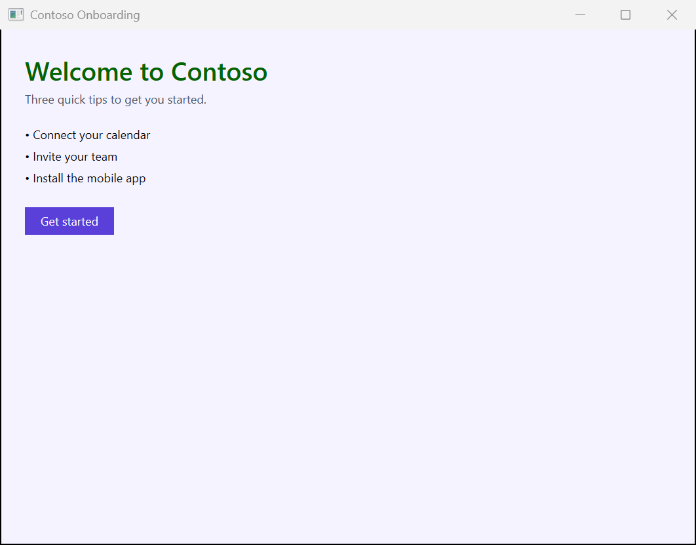

# Session transcript

Source: `Q:\source\XamlAgentDemos-notes\test-runs\HotReloadDoctor\run1\events.jsonl`

## Tool usage

- get_file: 7
- xaml_get_hot_reload_log: 2
- xaml_capture_image: 2
- xaml_explain_property_value: 2
- task_complete: 2
- skill: 1
- xaml_list_apps: 1
- xaml_get_hot_reload_status: 1
- xaml_get_visual_tree: 1
- powershell: 1
- xaml_get_resource_dictionaries: 1
- xaml_apply_hot_reload: 1
- xaml_find_resource: 1
- xaml_find_elements: 1
- glob: 1

Failed tool calls: 0, images: 1


_Model: gpt-6.1-sol_


## User (15:15:29)

XAML Hot Reload is broken in my running app. I made three edits (title color, tip template, page background in Skin.xaml) and none of them show up. Figure out what's going on.


**Tool call (15:15:31):** `skill`
```json
{
 "skill": "xaml-diagnostics"
}
```

<details><summary>Result `skill` success=true</summary>

```
Skill "xaml-diagnostics" loaded successfully. Follow the instructions in the skill context.
```
</details>


_Skill invoked: xaml-diagnostics_


**Assistant (15:15:34):**

I’ll check Hot Reload’s status, then trace each edit to what the running app actually uses.


**Tool call (15:15:34):** `xaml_list_apps`
```json
{
 "progressMessage": "Identify the running app and diagnostics connection"
}
```

<details><summary>Result `xaml_list_apps` success=true</summary>

```
{"isDebugging":true,"debuggerState":"running","diagnosticsActive":true,"apps":[{"app":"a1","name":"HotReloadDoctor.exe [57056]","processId":57056,"platform":"WPF (.NET)","isRemote":false,"isDesignTimeOrNoDebug":false,"sourceInfoAvailable":true,"hotReloadSupported":true,"hotReloadEnabled":true,"supportsPropertyExplorer":true,"supportsInAppToolbar":true,"windowCount":1}]}
```
</details>


**Tool call (15:15:39):** `xaml_get_hot_reload_status`
```json
{
 "progressMessage": "Check Hot Reload options and current errors"
}
```


**Tool call (15:15:39):** `xaml_get_hot_reload_log`
```json
{
 "progressMessage": "Read recent Hot Reload failures",
 "errorsOnly": true
}
```


**Tool call (15:15:39):** `get_file`
```json
{
 "filename": "Q:\\source\\XamlAgentDemos\\src\\HotReloadDoctor\\Skins\\Skin.xaml",
 "startLine": 1,
 "endLine": 40
}
```


**Tool call (15:15:39):** `xaml_get_visual_tree`
```json
{
 "progressMessage": "Locate title, tips, and page elements",
 "app": "a1",
 "depth": 4
}
```


**Tool call (15:15:39):** `powershell`
```json
{
 "command": "git --no-pager status --short; git --no-pager diff -- src/HotReloadDoctor",
 "description": "Inspect current HotReloadDoctor edits"
}
```

<details><summary>Result `xaml_get_hot_reload_status` success=true</summary>

```
{"options":{"hotReloadEnabled":true,"hotReloadOnSave":false,"wpfEnabled":true,"uwpEnabled":true,"winUIEnabled":true,"mauiEnabled":true,"justMyXaml":true,"previewSelectedElement":false,"inAppToolbar":true,"inAppSelection":false,"layoutAdorners":false,"trackFocusedElement":false,"bindingFailuresVisible":true,"compatibilityMode":false},"dotNetHotReloadEnabled":true,"isProcessingChanges":false,"apps":[{"app":"a1","platform":"WPF (.NET)","hotReloadSupported":true,"hotReloadEnabled":true,"sourceInfoAvailable":true}],"errors":[]}
```
</details>

<details><summary>Result `xaml_get_visual_tree` success=true</summary>

```
{"app":"a1","platform":"WPF (.NET)","sourceInfoAvailable":true,"nodeCount":20,"truncated":false,"depthLimitedNodes":1,"hint":"1 node(s) have children beyond the requested depth (childCount > 0, no children listed). Raise depth or pass rootElementId to expand them.","nodes":[{"id":"a1:10","type":"HotReloadDoctor.MainWindow","source":{"file":"Q:\\source\\XamlAgentDemos\\src\\HotReloadDoctor\\MainWindow.xaml","line":3,"column":9},"childCount":1,"children":[{"id":"a1:11","type":"System.Windows.Controls.Border","childCount":1,"children":[{"id":"a1:12","type":"System.Windows.Documents.AdornerDecorator","childCount":2,"children":[{"id":"a1:13","type":"System.Windows.Controls.ContentPresenter","childCount":1,"children":[{"id":"a1:15","type":"System.Windows.Controls.StackPanel","source":{"file":"Q:\\source\\XamlAgentDemos\\src\\HotReloadDoctor\\MainWindow.xaml","line":33,"column":6},"childCount":4,"children":[{"id":"a1:16","type":"System.Windows.Controls.TextBlock","name":"WelcomeTitle","source":{"file":"Q:\\source\\XamlAgentDemos\\src\\HotReloadDoctor\\MainWindow.xaml","line":34,"column":10},"childCount":0},{"id":"a1:17","type":"System.Windows.Controls.TextBlock","source":{"file":"Q:\\source\\XamlAgentDemos\\src\\HotReloadDoctor\\MainWindow.xaml","line":39,"column":10},"childCount":0},{"id":"a1:18","type":"System.Windows.Controls.ItemsControl","name":"TipsList","source":{"file":"Q:\\source\\XamlAgentDemos\\src\\HotReloadDoctor\\MainWindow.xaml","line":43,"column":10},"childCount":1,"children":[{"id":"a1:20","type":"System.Windows.Controls.Border","childCount":1,"children":[{"id":"a1:22","type":"System.Windows.Controls.ItemsPresenter","childCount":1,"children":[{"id":"a1:24","type":"System.Windows.Controls.StackPanel","childCount":3,"children":[{"id":"a1:26","type":"System.Windows.Controls.ContentPresenter","childCount":1,"children":[{"id":"a1:29","type":"System.Windows.Controls.TextBlock","source":{"file":"Q:\\source\\XamlAgentDemos\\src\\HotReloadDoctor\\MainWindow.xaml","line":26,"column":14},"childCount":0}]},{"id":"a1:27","type":"System.Windows.Controls.ContentPresenter","childCount":1,"children":[{"id":"a1:30","type":"System.Windows.Controls.TextBlock","source":{"file":"Q:\\source\\XamlAgentDemos\\src\\HotReloadDoctor\\MainWindow.xaml","line":26,"column":14},"childCount":0}]},{"id":"a1:28","type":"System.Windows.Controls.ContentPresenter","childCount":1,"children":[{"id":"a1:31","type":"System.Windows.Controls.TextBlock","source":{"file":"Q:\\source\\XamlAgen
... [truncated 487 chars]
```
</details>

<details><summary>Result `xaml_get_hot_reload_log` success=true</summary>

```
{"total":0,"entries":[],"dotNetHotReloadPane":["10:14:04.42 [XAML] Connected to HotReloadDoctor.exe [49120] for WpfCore diagnostics. Incremental Hot Reload is enabled.","10:14:38.80 🔥 1> [HotReloadDoctor] ❌ Exited with error code -1","10:14:39.13 [XAML] HotReloadDoctor.exe [49120] WpfCore diagnostics stopped.","10:14:44.57 [XAML] Connected to HotReloadDoctor.exe [57056] for WpfCore diagnostics. Incremental Hot Reload is enabled."],"hint":"No XAML Hot Reload messages were logged in this VS session yet."}
```
</details>

<details><summary>Result `get_file` success=true</summary>

```
```xaml src\HotReloadDoctor\Skins\Skin.xaml (Lines 1-12 of 12 total. Call tools for more if needed.)
<ResourceDictionary xmlns="http://schemas.microsoft.com/winfx/2006/xaml/presentation"
                    xmlns:x="http://schemas.microsoft.com/winfx/2006/xaml">
    <SolidColorBrush x:Key="PageBackground" Color="#FFF7ED" />
    <SolidColorBrush x:Key="CardBackground" Color="White" />

    <Style x:Key="PrimaryButtonStyle" TargetType="Button">
        <Setter Property="Background" Value="#5B3FD9" />
        <Setter Property="Foreground" Value="White" />
        <Setter Property="Padding" Value="16,6" />
        <Setter Property="BorderThickness" Value="0" />
    </Style>
</ResourceDictionary>

```


```
</details>

<details><summary>Result `powershell` success=true</summary>

```
M src/HotReloadDoctor/MainWindow.xaml
 M src/HotReloadDoctor/Skins/Skin.xaml
diff --git a/src/HotReloadDoctor/MainWindow.xaml b/src/HotReloadDoctor/MainWindow.xaml
index 8f6f98a..8c7d8cf 100644
--- a/src/HotReloadDoctor/MainWindow.xaml
+++ b/src/HotReloadDoctor/MainWindow.xaml
@@ -13,7 +13,7 @@
                     Background="{DynamicResource CardBackground}"
                     CornerRadius="6">
                 <StackPanel>
-                    <TextBlock FontWeight="SemiBold" Text="{Binding Title}" />
+                    <TextBlock FontWeight="Bold" Text="{Binding Title}" />
                     <TextBlock Margin="0,4,0,0"
                                Foreground="#4B5563"
                                Text="{Binding Body}"
@@ -34,7 +34,7 @@
         <TextBlock x:Name="WelcomeTitle"
                    FontSize="26"
                    FontWeight="SemiBold"
-                   Foreground="#1F2937"
+                   Foreground="DarkGreen"
                    Text="Welcome to Contoso" />
         <TextBlock Margin="0,4,0,20"
                    Foreground="#4B5563"
diff --git a/src/HotReloadDoctor/Skins/Skin.xaml b/src/HotReloadDoctor/Skins/Skin.xaml
index 8d33670..4cd8266 100644
--- a/src/HotReloadDoctor/Skins/Skin.xaml
+++ b/src/HotReloadDoctor/Skins/Skin.xaml
@@ -1,6 +1,6 @@
 <ResourceDictionary xmlns="http://schemas.microsoft.com/winfx/2006/xaml/presentation"
                     xmlns:x="http://schemas.microsoft.com/winfx/2006/xaml">
-    <SolidColorBrush x:Key="PageBackground" Color="#F5F3FF" />
+    <SolidColorBrush x:Key="PageBackground" Color="#FFF7ED" />
     <SolidColorBrush x:Key="CardBackground" Color="White" />
 
     <Style x:Key="PrimaryButtonStyle" TargetType="Button">
<shellId: 0 completed with exit code 0>
```
</details>


**Tool call (15:15:43):** `get_file`
```json
{
 "filename": "Q:\\source\\XamlAgentDemos\\src\\HotReloadDoctor\\MainWindow.xaml",
 "startLine": 1,
 "endLine": 100
}
```


**Tool call (15:15:43):** `get_file`
```json
{
 "filename": "Q:\\source\\XamlAgentDemos\\src\\HotReloadDoctor\\MainWindow.xaml.cs",
 "startLine": 1,
 "endLine": 200
}
```


**Tool call (15:15:43):** `xaml_capture_image`
```json
{
 "progressMessage": "Capture the app before applying saved edits",
 "app": "a1"
}
```


**Tool call (15:15:43):** `xaml_explain_property_value`
```json
{
 "progressMessage": "Check current title foreground",
 "elementId": "a1:16",
 "propertyName": "Foreground"
}
```


**Tool call (15:15:43):** `xaml_get_resource_dictionaries`
```json
{
 "progressMessage": "Inspect loaded skin dictionaries",
 "app": "a1"
}
```

<details><summary>Result `get_file` success=true</summary>

```
```xaml src\HotReloadDoctor\MainWindow.xaml (Lines 1-53 of 53 total. Call tools for more if needed.)
<Window x:Class="HotReloadDoctor.MainWindow"
        xmlns="http://schemas.microsoft.com/winfx/2006/xaml/presentation"
        xmlns:x="http://schemas.microsoft.com/winfx/2006/xaml"
        Title="Contoso Onboarding"
        Width="720"
        Height="560"
        Background="{DynamicResource PageBackground}"
        Loaded="OnLoaded">
    <Window.Resources>
        <DataTemplate x:Key="TipTemplate">
            <Border Margin="0,0,0,8"
                    Padding="12"
                    Background="{DynamicResource CardBackground}"
                    CornerRadius="6">
                <StackPanel>
                    <TextBlock FontWeight="Bold" Text="{Binding Title}" />
                    <TextBlock Margin="0,4,0,0"
                               Foreground="#4B5563"
                               Text="{Binding Body}"
                               TextWrapping="Wrap" />
                </StackPanel>
            </Border>
        </DataTemplate>

        <DataTemplate x:Key="CompactTipTemplate">
            <TextBlock Margin="0,0,0,6">
                <Run Text="&#x2022;" />
                <Run Text="{Binding Title, Mode=OneWay}" />
            </TextBlock>
        </DataTemplate>
    </Window.Resources>

    <StackPanel Margin="24">
        <TextBlock x:Name="WelcomeTitle"
                   FontSize="26"
                   FontWeight="SemiBold"
                   Foreground="DarkGreen"
                   Text="Welcome to Contoso" />
        <TextBlock Margin="0,4,0,20"
                   Foreground="#4B5563"
                   Text="Three quick tips to get you started." />

        <ItemsControl x:Name="TipsList"
                      ItemTemplate="{StaticResource TipTemplate}"
                      ItemsSource="{Binding Tips}" />

        <Button x:Name="GetStartedButton"
                Margin="0,16,0,0"
                HorizontalAlignment="Left"
                Content="Get started"
                Style="{DynamicResource PrimaryButtonStyle}" />
    </StackPanel>
</Window>

```


```
</details>

<details><summary>Result `get_file` success=true</summary>

```
```csharp src\HotReloadDoctor\MainWindow.xaml.cs (Lines 1-36 of 36 total. Call tools for more if needed.)
using System.Windows;
using System.Windows.Media;

namespace HotReloadDoctor;

public sealed record Tip(string Title, string Body);

public partial class MainWindow : Window
{
    // Persisted user preference ("Compact tips" in the old settings page).
    private static readonly bool UseCompactTips = true;

    public MainWindow()
    {
        this.InitializeComponent();
        this.DataContext = new
        {
            Tips = new[]
            {
                new Tip("Connect your calendar", "We'll suggest focus time and meeting-free blocks."),
                new Tip("Invite your team", "Shared projects show up for everyone you invite."),
                new Tip("Install the mobile app", "Get notified when a review is waiting for you."),
            },
        };
    }

    private void OnLoaded(object sender, RoutedEventArgs e)
    {
        // Apply the user's accent preference and compact layout.
        this.WelcomeTitle.Foreground = new SolidColorBrush(Color.FromRgb(0x5B, 0x3F, 0xD9));
        if (UseCompactTips)
        {
            this.TipsList.ItemTemplate = (DataTemplate)this.FindResource("CompactTipTemplate");
        }
    }
}

```


```
</details>




<details><summary>Result `xaml_capture_image` success=true</summary>

```
Screenshot of window 0x1F90FB4 "Contoso Onboarding" of app a1 (1062x831).
```
</details>

<details><summary>Result `xaml_explain_property_value` success=true</summary>

```
{"id":"a1:16","type":"System.Windows.Controls.TextBlock","property":"Foreground","propertyType":"System.Windows.Media.Brush","effectiveValue":"#FF006400","effectiveSource":"Local","chain":[{"kind":"Local","description":"Local value set on the element (XAML attribute, binding or code). Wins over styles, templates and inheritance.","value":"#FF006400","valueType":"System.Windows.Media.SolidColorBrush","effective":true,"sourceLocation":{"file":"Q:\\source\\XamlAgentDemos\\src\\HotReloadDoctor\\MainWindow.xaml","line":34,"column":10}},{"kind":"Default","description":"The property's default value; nothing sets it.","value":"#FF000000","valueType":"System.Windows.Media.SolidColorBrush","effective":false}],"notes":["To let a style or template value apply, remove the local value (the attribute, binding or code assignment). To change it, edit that local value."]}
```
</details>

<details><summary>Result `xaml_get_resource_dictionaries` success=true</summary>

```
{"app":"a1","scope":"application","note":"Only application-level resources are shown. Window, page and element resources (for example Window.Resources) are searched only when you pass an elementId; pass one from the window you're interested in to include its ancestors' resources.","scopes":[{"scope":"Application","ownerType":"HotReloadDoctor.App","dictionary":{"path":"Application","type":"System.Windows.ResourceDictionary","keyCount":0,"mergedDictionaries":[{"path":"Application/Merged[0]","type":"System.Windows.ResourceDictionary","keyCount":3,"location":{"file":"pack://application:,,,/HotReloadDoctor;component/","line":1,"column":2}}]}}]}
```
</details>


**Tool call (15:15:47):** `xaml_apply_hot_reload`
```json
{
 "progressMessage": "Apply the saved edits and inspect results"
}
```


**Tool call (15:15:47):** `get_file`
```json
{
 "filename": "Q:\\source\\XamlAgentDemos\\src\\HotReloadDoctor\\App.xaml.cs",
 "startLine": 1,
 "endLine": 200
}
```


**Tool call (15:15:47):** `get_file`
```json
{
 "filename": "Q:\\source\\XamlAgentDemos\\src\\HotReloadDoctor\\App.xaml",
 "startLine": 1,
 "endLine": 100
}
```


**Tool call (15:15:47):** `xaml_explain_property_value`
```json
{
 "progressMessage": "Identify the actual tip template in use",
 "elementId": "a1:18",
 "propertyName": "ItemTemplate"
}
```


**Tool call (15:15:47):** `xaml_find_resource`
```json
{
 "progressMessage": "Resolve the running page background brush",
 "key": "PageBackground",
 "elementId": "a1:10"
}
```

<details><summary>Result `xaml_explain_property_value` success=true</summary>

```
{"id":"a1:18","type":"System.Windows.Controls.ItemsControl","property":"ItemTemplate","propertyType":"System.Windows.DataTemplate","effectiveSource":"Local","chain":[{"kind":"Local","description":"Local value set on the element (XAML attribute, binding or code). Wins over styles, templates and inheritance.","valueType":"System.Windows.DataTemplate","effective":true,"sourceLocation":{"file":"Q:\\source\\XamlAgentDemos\\src\\HotReloadDoctor\\MainWindow.xaml","line":43,"column":10},"valueLocation":{"file":"Q:\\source\\XamlAgentDemos\\src\\HotReloadDoctor\\MainWindow.xaml","line":25,"column":10}},{"kind":"Default","description":"The property's default value; nothing sets it.","effective":false}],"notes":["To let a style or template value apply, remove the local value (the attribute, binding or code assignment). To change it, edit that local value."]}
```
</details>

<details><summary>Result `get_file` success=true</summary>

```
```xaml src\HotReloadDoctor\App.xaml (Lines 1-4 of 4 total. Call tools for more if needed.)
<Application x:Class="HotReloadDoctor.App"
             xmlns="http://schemas.microsoft.com/winfx/2006/xaml/presentation"
             xmlns:x="http://schemas.microsoft.com/winfx/2006/xaml"
             StartupUri="MainWindow.xaml" />

```


```
</details>

<details><summary>Result `get_file` success=true</summary>

```
```csharp src\HotReloadDoctor\App.xaml.cs (Lines 1-22 of 22 total. Call tools for more if needed.)
using System.IO;
using System.Windows;
using System.Windows.Markup;

namespace HotReloadDoctor;

public partial class App : Application
{
    protected override void OnStartup(StartupEventArgs e)
    {
        this.LoadSkin();
        base.OnStartup(e);
        DemoHost.Initialize(this, e.Args);
    }

    private void LoadSkin()
    {
        string path = Path.Combine(AppContext.BaseDirectory, "Skins", "Skin.xaml");
        using FileStream stream = File.OpenRead(path);
        this.Resources.MergedDictionaries.Add((ResourceDictionary)XamlReader.Load(stream));
    }
}

```


```
</details>

<details><summary>Result `xaml_find_resource` success=true</summary>

```
{"app":"a1","scope":"a1:10","key":"PageBackground","found":true,"definitions":[{"effective":true,"key":"PageBackground","scope":"Application","ownerType":"HotReloadDoctor.App","dictionaryPath":"Application/Merged[0]","valueType":"System.Windows.Media.SolidColorBrush","value":"SolidColorBrush #FFF5F3FF","location":{"file":"pack://application:,,,/HotReloadDoctor;component/","line":3,"column":6}}],"hint":"Edit the definition at 'location' (or in 'dictionarySource') to change this resource."}
```
</details>

<details><summary>Result `xaml_apply_hot_reload` success=true</summary>

```
{"applied":true,"errors":[],"log":[],"hint":"Call xaml_capture_image to verify the change visually. Views that aren't loaded (other tabs, closed dialogs) are updated when they're next shown. Source line numbers reported for existing elements can still point to the pre-edit lines until the element is recreated, so find elements by x:Name or type rather than by an old line number. Structural edits (wrapping or replacing a parent, changing a root's content) recreate elements, which resets their runtime state such as selection, checked state, typed text and scroll position, and invalidates their IDs. Re-establish the state you were testing before capturing again."}
```
</details>


**Tool call (15:15:52):** `xaml_capture_image`
```json
{
 "progressMessage": "Verify the result after applying Hot Reload",
 "app": "a1"
}
```


**Tool call (15:15:52):** `get_file`
```json
{
 "filename": "Q:\\source\\XamlAgentDemos\\src\\HotReloadDoctor\\HotReloadDoctor.csproj",
 "startLine": 1,
 "endLine": 120
}
```


**Tool call (15:15:52):** `xaml_find_elements`
```json
{
 "progressMessage": "Refresh live title and tips identifiers",
 "app": "a1",
 "type": "TextBlock"
}
```


**Tool call (15:15:52):** `xaml_get_hot_reload_log`
```json
{
 "progressMessage": "Check application results after explicit reload",
 "maxEntries": 30
}
```


**Tool call (15:15:52):** `glob`
```json
{
 "pattern": "**/*DemoHost*",
 "paths": "Q:\\source\\XamlAgentDemos\\src"
}
```

<details><summary>Result `xaml_find_elements` success=true</summary>

```
{"count":6,"truncated":false,"results":[{"id":"a1:16","type":"System.Windows.Controls.TextBlock","name":"WelcomeTitle","source":{"file":"Q:\\source\\XamlAgentDemos\\src\\HotReloadDoctor\\MainWindow.xaml","line":34,"column":10},"path":"MainWindow/Border/AdornerDecorator/ContentPresenter/StackPanel/TextBlock"},{"id":"a1:17","type":"System.Windows.Controls.TextBlock","source":{"file":"Q:\\source\\XamlAgentDemos\\src\\HotReloadDoctor\\MainWindow.xaml","line":39,"column":10},"path":"MainWindow/Border/AdornerDecorator/ContentPresenter/StackPanel/TextBlock"},{"id":"a1:29","type":"System.Windows.Controls.TextBlock","source":{"file":"Q:\\source\\XamlAgentDemos\\src\\HotReloadDoctor\\MainWindow.xaml","line":26,"column":14},"path":"MainWindow/Border/AdornerDecorator/ContentPresenter/StackPanel/ItemsControl/Border/ItemsPresenter/StackPanel/ContentPresenter/TextBlock"},{"id":"a1:30","type":"System.Windows.Controls.TextBlock","source":{"file":"Q:\\source\\XamlAgentDemos\\src\\HotReloadDoctor\\MainWindow.xaml","line":26,"column":14},"path":"MainWindow/Border/AdornerDecorator/ContentPresenter/StackPanel/ItemsControl/Border/ItemsPresenter/StackPanel/ContentPresenter/TextBlock"},{"id":"a1:31","type":"System.Windows.Controls.TextBlock","source":{"file":"Q:\\source\\XamlAgentDemos\\src\\HotReloadDoctor\\MainWindow.xaml","line":26,"column":14},"path":"MainWindow/Border/AdornerDecorator/ContentPresenter/StackPanel/ItemsControl/Border/ItemsPresenter/StackPanel/ContentPresenter/TextBlock"},{"id":"a1:25","type":"System.Windows.Controls.TextBlock","path":"MainWindow/Border/AdornerDecorator/ContentPresenter/StackPanel/Button/Border/ContentPresenter/TextBlock"}]}
```
</details>

<details><summary>Result `xaml_get_hot_reload_log` success=true</summary>

```
{"total":3,"entries":[{"time":"10:14:04.429","level":"Info","project":"XAML","message":"Connected to HotReloadDoctor.exe [49120] for WpfCore diagnostics. Incremental Hot Reload is enabled."},{"time":"10:14:39.138","level":"Info","project":"XAML","message":"HotReloadDoctor.exe [49120] WpfCore diagnostics stopped."},{"time":"10:14:44.570","level":"Info","project":"XAML","message":"Connected to HotReloadDoctor.exe [57056] for WpfCore diagnostics. Incremental Hot Reload is enabled."}],"dotNetHotReloadPane":["10:14:04.42 [XAML] Connected to HotReloadDoctor.exe [49120] for WpfCore diagnostics. Incremental Hot Reload is enabled.","10:14:38.80 🔥 1> [HotReloadDoctor] ❌ Exited with error code -1","10:14:39.13 [XAML] HotReloadDoctor.exe [49120] WpfCore diagnostics stopped.","10:14:44.57 [XAML] Connected to HotReloadDoctor.exe [57056] for WpfCore diagnostics. Incremental Hot Reload is enabled."]}
```
</details>

<details><summary>Result `xaml_capture_image` success=true</summary>

```
Screenshot of window 0x1F90FB4 "Contoso Onboarding" of app a1 (1062x831).
```
</details>

<details><summary>Result `get_file` success=true</summary>

```
``` src\HotReloadDoctor\HotReloadDoctor.csproj (Lines 1-10 of 10 total. Call tools for more if needed.)
<Project Sdk="Microsoft.NET.Sdk">
  <PropertyGroup>
    <RootNamespace>HotReloadDoctor</RootNamespace>
  </PropertyGroup>
  <ItemGroup>
    <!-- The skin is loaded at runtime so customers can swap it without a rebuild. -->
    <Page Remove="Skins\Skin.xaml" />
    <Content Include="Skins\Skin.xaml" CopyToOutputDirectory="PreserveNewest" />
  </ItemGroup>
</Project>

```


```
</details>

<details><summary>Result `glob` success=true</summary>

```
Q:\source\XamlAgentDemos\src\Shared\DemoHost.cs
```
</details>


**Tool call (15:15:56):** `get_file`
```json
{
 "filename": "Q:\\source\\XamlAgentDemos\\src\\Shared\\DemoHost.cs",
 "startLine": 1,
 "endLine": 200
}
```

<details><summary>Result `get_file` success=true</summary>

```
```csharp src\Shared\DemoHost.cs (Lines 1-96 of 96 total. Call tools for more if needed.)
using System.Diagnostics;
using System.IO;
using System.Windows;
using System.Windows.Media;
using System.Windows.Media.Imaging;
using System.Windows.Threading;

namespace XamlAgentDemos;

/// <summary>
/// Optional command-line switches used to validate the demos without Visual Studio.
/// They aren't needed for the demos themselves.
///   --trace-bindings &lt;file&gt;   append WPF binding errors to a text file
///   --snapshot &lt;file.png&gt;     render the main window to a PNG once it's settled, then exit
///   --width / --height &lt;n&gt;    resize the main window after it loads
/// </summary>
public static class DemoHost
{
    public static void Initialize(Application app, string[] args)
    {
        if (GetArg(args, "--trace-bindings") is string tracePath)
        {
            var listener = new TextWriterTraceListener(tracePath);
            PresentationTraceSources.Refresh();
            PresentationTraceSources.DataBindingSource.Listeners.Add(listener);
            PresentationTraceSources.DataBindingSource.Switch.Level = SourceLevels.Warning;
            Trace.AutoFlush = true;
            app.Exit += (_, _) => listener.Flush();
        }

        string? width = GetArg(args, "--width");
        string? height = GetArg(args, "--height");
        if (width != null || height != null)
        {
            app.Dispatcher.BeginInvoke(DispatcherPriority.Loaded, () =>
            {
                if (app.MainWindow is Window window)
                {
                    window.SizeToContent = SizeToContent.Manual;
                    if (width != null)
                    {
                        window.Width = double.Parse(width);
                    }

                    if (height != null)
                    {
                        window.Height = double.Parse(height);
                    }
                }
            });
        }

        if (GetArg(args, "--snapshot") is string snapshotPath)
        {
            var timer = new DispatcherTimer { Interval = TimeSpan.FromSeconds(2) };
            timer.Tick += (_, _) =>
            {
                timer.Stop();
                if (app.MainWindow?.Content is FrameworkElement content)
                {
                    SaveSnapshot(content, app.MainWindow.Background, snapshotPath);
                }

                app.Shutdown();
... [truncated 1379 chars]
```
</details>


**Tool call (15:16:04):** `task_complete`
```json
{
 "summary": "Hot Reload is connected and reports no errors. The three edits have different explanations:\n\n- **Title:** it is already dark green—I verified the live value and screenshot. However, [the Loaded handler](vscopilot://file?path=Q%3A%5Csource%5CXamlAgentDemos%5Csrc%5CHotReloadDoctor%5CMainWindow.xaml.cs&line=27) overwrites it with purple when the window loads again.\n- **Tips:** that same handler selects `CompactTipTemplate`. You edited `TipTemplate`, which isn’t displayed. Edit the compact template or change the preference controlling its selection.\n- **Background:** [the project](vscopilot://file?path=Q%3A%5Csource%5CXamlAgentDemos%5Csrc%5CHotReloadDoctor%5CHotReloadDoctor.csproj&line=5) copies Skin.xaml as loose content; [startup code](vscopilot://file?path=Q%3A%5Csource%5CXamlAgentDemos%5Csrc%5CHotReloadDoctor%5CApp.xaml.cs&line=16) reads it once from the output directory. The running brush remains `#F5F3FF`, not your `#FFF7ED`. There’s no skin-reload path; rebuild and restart to load the updated copy.\n\n**Hot Reload on Save is also disabled.** I explicitly applied pending changes successfully, but that cannot switch the active template or reload this manually loaded dictionary. No source files were changed."
}
```

<details><summary>Result `task_complete` success=true</summary>

```
Hot Reload is connected and reports no errors. The three edits have different explanations:

- **Title:** it is already dark green—I verified the live value and screenshot. However, [the Loaded handler](vscopilot://file?path=Q%3A%5Csource%5CXamlAgentDemos%5Csrc%5CHotReloadDoctor%5CMainWindow.xaml.cs&line=27) overwrites it with purple when the window loads again.
- **Tips:** that same handler selects `CompactTipTemplate`. You edited `TipTemplate`, which isn’t displayed. Edit the compact template or change the preference controlling its selection.
- **Background:** [the project](vscopilot://file?path=Q%3A%5Csource%5CXamlAgentDemos%5Csrc%5CHotReloadDoctor%5CHotReloadDoctor.csproj&line=5) copies Skin.xaml as loose content; [startup code](vscopilot://file?path=Q%3A%5Csource%5CXamlAgentDemos%5Csrc%5CHotReloadDoctor%5CApp.xaml.cs&line=16) reads it once from the output directory. The running brush remains `#F5F3FF`, not your `#FFF7ED`. There’s no skin-reload path; rebuild and restart to load the updated copy.

**Hot Reload on Save is also disabled.** I explicitly applied pending changes successfully, but that cannot switch the active template or reload this manually loaded dictionary. No source files were changed.
```
</details>


**Task complete (15:16:04):** Hot Reload is connected and reports no errors. The three edits have different explanations:

- **Title:** it is already dark green—I verified the live value and screenshot. However, [the Loaded handler](vscopilot://file?path=Q%3A%5Csource%5CXamlAgentDemos%5Csrc%5CHotReloadDoctor%5CMainWindow.xaml.cs&line=27) overwrites it with purple when the window loads again.
- **Tips:** that same handler selects `CompactTipTemplate`. You edited `TipTemplate`, which isn’t displayed. Edit the compact template or change the preference controlling its selection.
- **Background:** [the project](vscopilot://file?path=Q%3A%5Csource%5CXamlAgentDemos%5Csrc%5CHotReloadDoctor%5CHotReloadDoctor.csproj&line=5) copies Skin.xaml as loose content; [startup code](vscopilot://file?path=Q%3A%5Csource%5CXamlAgentDemos%5Csrc%5CHotReloadDoctor%5CApp.xaml.cs&line=16) reads it once from the output directory. The running brush remains `#F5F3FF`, not your `#FFF7ED`. There’s no skin-reload path; rebuild and restart to load the updated copy.

**Hot Reload on Save is also disabled.** I explicitly applied pending changes successfully, but that cannot switch the active template or reload this manually loaded dictionary. No source files were changed.


## User (15:16:20)

Thanks. Now some quick feedback for the tooling team. Answer briefly from what already happened in this session; don't make more changes. (1) Which xaml_* tools or skill guidance helped most? (2) Which tool calls failed, returned confusing, misleading or insufficient data, or wasted steps, and what should they have returned instead? (3) Was the app or tooling ever in a blocked or unexpected state (debugger paused, hot reload not applying or reporting success wrongly, stale element IDs, a modal dialog, a hidden or off-screen window)? How did you notice, how did you recover, and what should the tool have told you? (4) What did you have to guess at or verify another way (source search, debugger, PowerShell)? (5) Which fixes did you verify live in the running app, and which only in source, and why? (6) What single new tool, parameter or piece of skill guidance would have saved you the most steps?


**Tool call (15:16:31):** `task_complete`
```json
{
 "summary": "1. **Most helpful:** `xaml_get_hot_reload_status` exposed save-triggered reload being disabled; `xaml_explain_property_value` located the active compact template; `xaml_find_resource` proved the background brush was stale. The skill’s runtime-loaded-dictionary guidance was particularly useful.\n\n2. **Weak/confusing results:** No calls failed. `xaml_apply_hot_reload` returned `applied:true` with no changes listed—ambiguous between actual updates and nothing pending. It should report changed files, updated instances, and skipped/untracked dictionaries. Property provenance grouped XAML and code together as “Local,” requiring source inspection. The second screenshot returned only a tiny image, making visual comparison unhelpful.\n\n3. **Unexpected state:** No pause, modal, stale IDs, or hidden window. The title was already green before explicit apply; its history remained unexplained. Apply reported success while the background stayed old. I diagnosed this through resource values and source—not by recovering/restarting the app.\n\n4. **Other verification:** Git diff identified your exact edits. Source revealed the startup overrides, compact preference, loose-content project configuration, and one-time skin loading. No debugger was used.\n\n5. **Verification scope:** No fixes were made. Live checks verified the green title, active compact template, and old background brush. Rebuild/restart and preference changes were recommendations only, not tested fixes.\n\n6. **
... [truncated 198 chars]
```

<details><summary>Result `task_complete` success=true</summary>

```
1. **Most helpful:** `xaml_get_hot_reload_status` exposed save-triggered reload being disabled; `xaml_explain_property_value` located the active compact template; `xaml_find_resource` proved the background brush was stale. The skill’s runtime-loaded-dictionary guidance was particularly useful.

2. **Weak/confusing results:** No calls failed. `xaml_apply_hot_reload` returned `applied:true` with no changes listed—ambiguous between actual updates and nothing pending. It should report changed files, updated instances, and skipped/untracked dictionaries. Property provenance grouped XAML and code together as “Local,” requiring source inspection. The second screenshot returned only a tiny image, making visual comparison unhelpful.

3. **Unexpected state:** No pause, modal, stale IDs, or hidden window. The title was already green before explicit apply; its history remained unexplained. Apply reported success while the background stayed old. I diagnosed this through resource values and source—not by recovering/restarting the app.

4. **Other verification:** Git diff identified your exact edits. Source revealed the startup overrides, compact preference, loose-content project configuration, and one-time skin loading. No debugger was used.

5. **Verification scope:** No fixes were made. Live checks verified the green title, active compact template, and old background brush. Rebuild/restart and preference changes were recommendations only, not tested fixes.

6. **Best improvement:** An apply-result breakdown showing **file → updated live instances / unused resource / untracked runtime dictionary / nothing pending** would have saved the most investigation.
```
</details>


**Task complete (15:16:31):** 1. **Most helpful:** `xaml_get_hot_reload_status` exposed save-triggered reload being disabled; `xaml_explain_property_value` located the active compact template; `xaml_find_resource` proved the background brush was stale. The skill’s runtime-loaded-dictionary guidance was particularly useful.

2. **Weak/confusing results:** No calls failed. `xaml_apply_hot_reload` returned `applied:true` with no changes listed—ambiguous between actual updates and nothing pending. It should report changed files, updated instances, and skipped/untracked dictionaries. Property provenance grouped XAML and code together as “Local,” requiring source inspection. The second screenshot returned only a tiny image, making visual comparison unhelpful.

3. **Unexpected state:** No pause, modal, stale IDs, or hidden window. The title was already green before explicit apply; its history remained unexplained. Apply reported success while the background stayed old. I diagnosed this through resource values and source—not by recovering/restarting the app.

4. **Other verification:** Git diff identified your exact edits. Source revealed the startup overrides, compact preference, loose-content project configuration, and one-time skin loading. No debugger was used.

5. **Verification scope:** No fixes were made. Live checks verified the green title, active compact template, and old background brush. Rebuild/restart and preference changes were recommendations only, not tested fixes.

6. **Best improvement:** An apply-result breakdown showing **file → updated live instances / unused resource / untracked runtime dictionary / nothing pending** would have saved the most investigation.
