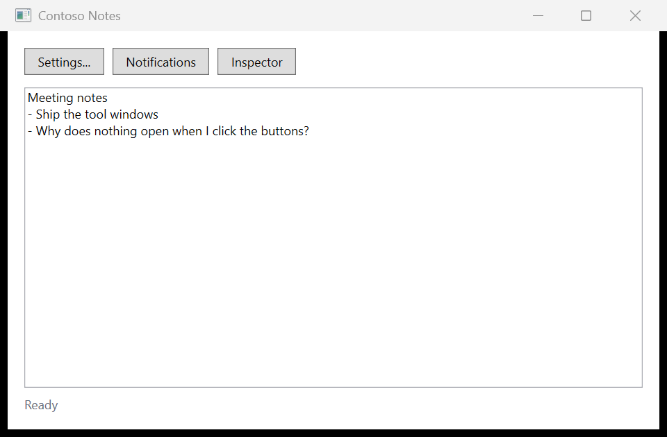
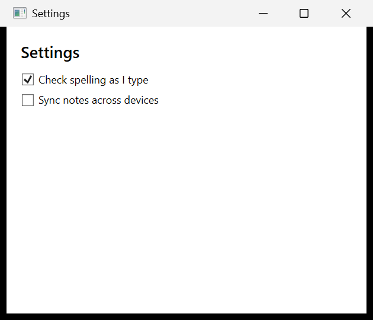
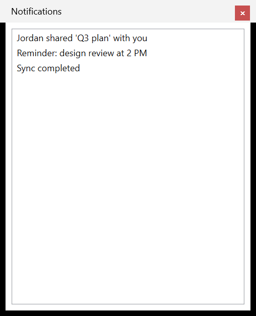
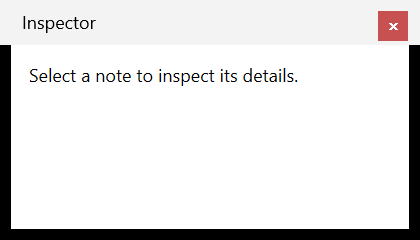

# Session transcript

Source: `Q:\source\XamlAgentDemos-notes\test-runs\LostWindows\run2\events.jsonl`

## Tool usage

- get_file: 10
- powershell: 6
- xaml_interact: 6
- xaml_find_elements: 5
- xaml_list_windows: 5
- xaml_capture_image: 4
- glob: 4
- skill: 2
- xaml_list_apps: 2
- debugger_enumerate_processes: 2
- run_build: 2
- create_file: 2
- task_complete: 2
- get_projects_in_solution: 1
- xaml_get_visual_tree: 1
- view: 1
- rg: 1
- xaml_get_element_properties: 1
- get_tests: 1
- multi_replace_string_in_file: 1
- xaml_apply_hot_reload: 1
- task: 1
- debugger_stop_debugging: 1
- debugger_launch: 1
- xaml_clear_binding_failures: 1
- xaml_get_binding_failures: 1

Failed tool calls: 1, images: 4


_Model: gpt-6.1-sol_


## User (02:47:51)

When I click Settings, Notifications or Inspector in my running app, nothing shows up. Find out what's happening and fix it so it can never happen again.


**Tool call (02:47:53):** `skill`
```json
{
 "skill": "xaml-diagnostics"
}
```

<details><summary>Result `skill` success=true</summary>

```
Skill "xaml-diagnostics" loaded successfully. Follow the instructions in the skill context.
```
</details>


_Skill invoked: xaml-diagnostics_


**Tool call (02:47:57):** `xaml_list_apps`
```json
{
 "progressMessage": "Identify the running app to diagnose missing panels"
}
```

<details><summary>Result `xaml_list_apps` success=true</summary>

```
{"isDebugging":true,"diagnosticsActive":true,"apps":[{"app":"a2","name":"LostWindows.exe [19868]","processId":19868,"platform":"WPF (.NET)","isRemote":false,"isDesignTimeOrNoDebug":false,"sourceInfoAvailable":true,"hotReloadSupported":true,"hotReloadEnabled":true,"supportsPropertyExplorer":true,"supportsInAppToolbar":true,"windowCount":1}]}
```
</details>


**Assistant (02:48:01):**

I’ll reproduce each missing panel in the running app, then fix the underlying cause and verify the result.


**Tool call (02:48:01):** `get_projects_in_solution`
```json
{}
```


**Tool call (02:48:01):** `xaml_get_visual_tree`
```json
{
 "progressMessage": "Locate Settings Notifications and Inspector controls",
 "app": "a2",
 "depth": 4
}
```


**Tool call (02:48:01):** `xaml_capture_image`
```json
{
 "progressMessage": "Inspect the current window before reproducing the issue",
 "app": "a2"
}
```


**Tool call (02:48:01):** `powershell`
```json
{
 "command": "git --no-pager status --short",
 "description": "Check existing working-tree changes"
}
```

<details><summary>Result `xaml_get_visual_tree` success=true</summary>

```
{"app":"a2","platform":"WPF (.NET)","sourceInfoAvailable":true,"nodeCount":5,"truncated":false,"nodes":[{"id":"a2:10","type":"LostWindows.MainWindow","source":{"file":"Q:\\source\\XamlAgentDemos\\src\\LostWindows\\MainWindow.xaml","line":3,"column":9},"childCount":1,"children":[{"id":"a2:11","type":"System.Windows.Controls.Border","childCount":1,"children":[{"id":"a2:12","type":"System.Windows.Documents.AdornerDecorator","childCount":2,"children":[{"id":"a2:13","type":"System.Windows.Controls.ContentPresenter","childCount":1},{"id":"a2:14","type":"System.Windows.Documents.AdornerLayer","childCount":0}]}]}]}]}
```
</details>




<details><summary>Result `xaml_capture_image` success=true</summary>

```
Screenshot of window 0x8C0B00 "Contoso Notes" of app a2 (960x630).
```
</details>

<details><summary>Result `get_projects_in_solution` success=true</summary>

```
src\GhostClicks\GhostClicks.csproj
src\GermanReady\GermanReady.csproj
src\ThemeBreaker\ThemeBreaker.csproj
src\DesignPolish\DesignPolish.csproj
src\HotReloadDoctor\HotReloadDoctor.csproj
src\VanishingSave\VanishingSave.csproj
src\CrispPixels\CrispPixels.csproj
src\PrecedenceWars\PrecedenceWars.csproj
src\LostWindows\LostWindows.csproj
src\TemplateDetective\TemplateDetective.csproj
src\SlowScroll\SlowScroll.csproj
src\PixelPerfect\PixelPerfect.csproj
src\BindingStorm\BindingStorm.csproj
src\BugRepro\BugRepro.csproj
src\A11ySweep\A11ySweep.csproj
src\StyleMaze\StyleMaze.csproj
src\ResponsiveDashboard\ResponsiveDashboard.csproj

```
</details>

<details><summary>Result `powershell` success=true</summary>

```

<shellId: 0 completed with exit code 0>
```
</details>


**Tool call (02:48:06):** `glob`
```json
{
 "pattern": "**\\*",
 "paths": "Q:\\source\\XamlAgentDemos\\src\\LostWindows"
}
```


**Tool call (02:48:06):** `xaml_find_elements`
```json
{
 "progressMessage": "Locate navigation buttons for reproduction",
 "app": "a2",
 "type": "Button"
}
```


**Tool call (02:48:06):** `get_file`
```json
{
 "filename": "Q:\\source\\XamlAgentDemos\\src\\LostWindows\\MainWindow.xaml.cs",
 "startLine": 1,
 "endLine": 260
}
```


**Tool call (02:48:06):** `view`
```json
{
 "path": "c:\\vs\\fastmain\\common7\\ide\\commonextensions\\microsoft\\xamldiagnostics\\AgentTools\\skills\\xaml-diagnostics\\references\\xaml-authoring.md"
}
```

<details><summary>Result `view` success=true</summary>

```
# XAML authoring guidance

Follow these rules when writing or changing XAML so it works well with XAML Hot Reload, the XAML designer, and XAML Diagnostics.

## Design-time data

- Declare `xmlns:d="http://schemas.microsoft.com/expression/blend/2008"` and `xmlns:mc="http://schemas.openxmlformats.org/markup-compatibility/2006"` with `mc:Ignorable="d"`.
- Use `d:DataContext="{d:DesignInstance Type=vm:MyViewModel, IsDesignTimeCreatable=False}"` (WPF/UWP) so the designer and IntelliSense know binding paths.
- Use `d:` properties (for example `d:Text="Sample"`) for sample values that appear only at design time.
- .NET MAUI: set `x:DataType` on pages and `DataTemplate`s. It enables compiled bindings and turns many binding failures into build errors.
- WinUI/UWP: prefer `x:Bind` for compile-time checked bindings when the view owns the view model.

## Bindings

- Bind with explicit paths. Avoid string-built paths in code-behind.
- Keep the `DataContext` chain simple. Use `ElementName` or `RelativeSource` only at real scope boundaries (for example inside a `DataTemplate` that needs the page's view model).
- Expose bound properties as public properties that raise `PropertyChanged`. Fields and non-public properties don't bind.
- Use `FallbackValue` and `TargetNullValue` for expected missing values instead of hiding binding errors.

## Hot reload and designer friendly code

- Keep control and page constructors cheap. Don't call services, open files, or start network calls in constructors or `InitializeComponent` paths. The designer and hot reload create instances again.
- Keep a public parameterless constructor on custom controls.
- Guard runtime-only work with `DesignerProperties.GetIsInDesignMode(this)` (WPF) or `Windows.ApplicationModel.DesignMode.DesignModeEnabled` (UWP/WinUI).
- Put styles, templates, and visual states in XAML, not code-behind. Hot reload can't update UI built in code.
- Don't walk the visual tree from code-behind to change visuals. Use bindings, triggers, and visual states.
- Use `x:Name` only for elements code-behind needs. Don't rename `x:Class` while the app is running.

## Resources

- Put shared resources in `App.xaml` merged dictionaries or the closest scope that uses them.
- A `StaticResource` must be defined earlier in load order. Use `DynamicResource` (WPF) or `ThemeResource` (UWP/WinUI) for theme values that change at runtime.
- To check where a key resolves at runtime, or whether a dictionary is merged a
... [truncated 618 chars]
```
</details>

<details><summary>Result `xaml_find_elements` success=true</summary>

```
{"count":3,"truncated":false,"results":[{"id":"a2:19","type":"System.Windows.Controls.Button","name":"SettingsButton","source":{"file":"Q:\\source\\XamlAgentDemos\\src\\LostWindows\\MainWindow.xaml","line":9,"column":14},"path":"MainWindow/Border/AdornerDecorator/ContentPresenter/DockPanel/StackPanel/Button"},{"id":"a2:20","type":"System.Windows.Controls.Button","name":"NotificationsButton","source":{"file":"Q:\\source\\XamlAgentDemos\\src\\LostWindows\\MainWindow.xaml","line":13,"column":14},"path":"MainWindow/Border/AdornerDecorator/ContentPresenter/DockPanel/StackPanel/Button"},{"id":"a2:21","type":"System.Windows.Controls.Button","name":"InspectorButton","source":{"file":"Q:\\source\\XamlAgentDemos\\src\\LostWindows\\MainWindow.xaml","line":18,"column":14},"path":"MainWindow/Border/AdornerDecorator/ContentPresenter/DockPanel/StackPanel/Button"}]}
```
</details>

<details><summary>Result `glob` success=true</summary>

```
[glob: 56 path(s) under Q:/source/XamlAgentDemos/src/LostWindows; grouped by directory]

Q:/source/XamlAgentDemos/src/LostWindows/obj/ (38 path(s))
  Debug/net10.0-windows/.NETCoreApp,Version=v10.0.AssemblyAttributes.cs
  Debug/net10.0-windows/App.g.cs
  Debug/net10.0-windows/App.g.i.cs
  Debug/net10.0-windows/InspectorWindow.baml
  Debug/net10.0-windows/InspectorWindow.g.cs
  Debug/net10.0-windows/InspectorWindow.g.i.cs
  Debug/net10.0-windows/LostWind.C9EAC5F3.Up2Date
  Debug/net10.0-windows/LostWindows.AssemblyInfo.cs
  Debug/net10.0-windows/LostWindows.AssemblyInfoInputs.cache
  Debug/net10.0-windows/LostWindows.GeneratedMSBuildEditorConfig.editorconfig
  Debug/net10.0-windows/LostWindows.GlobalUsings.g.cs
  Debug/net10.0-windows/LostWindows.assets.cache
  Debug/net10.0-windows/LostWindows.csproj.BuildWithSkipAnalyzers
  Debug/net10.0-windows/LostWindows.csproj.CoreCompileInputs.cache
  Debug/net10.0-windows/LostWindows.csproj.FileListAbsolute.txt
  Debug/net10.0-windows/LostWindows.dll
  Debug/net10.0-windows/LostWindows.g.resources
  Debug/net10.0-windows/LostWindows.genruntimeconfig.cache
  Debug/net10.0-windows/LostWindows.pdb
  Debug/net10.0-windows/LostWindows.sourcelink.json
  Debug/net10.0-windows/LostWindows_MarkupCompile.cache
  Debug/net10.0-windows/MainWindow.baml
  Debug/net10.0-windows/MainWindow.g.cs
  Debug/net10.0-windows/MainWindow.g.i.cs
  Debug/net10.0-windows/NotificationsWindow.baml
  Debug/net10.0-windows/NotificationsWindow.g.cs
  Debug/net10.0-windows/NotificationsWindow.g.i.cs
  Debug/net10.0-windows/SettingsWindow.baml
  Debug/net10.0-windows/SettingsWindow.g.cs
  Debug/net10.0-windows/SettingsWindow.g.i.cs
  Debug/net10.0-windows/apphost.exe
  Debug/net10.0-windows/ref/LostWindows.dll
  Debug/net10.0-windows/refint/LostWindows.dll
  LostWindows.csproj.nuget.dgspec.json
  LostWindows.csproj.nuget.g.props
  LostWindows.csproj.nuget.g.targets
  project.assets.json
  project.nuget.cache

Q:/source/XamlAgentDemos/src/LostWindows/ (11 path(s))
  App.xaml
  App.xaml.cs
  InspectorWindow.xaml
  LostWindows.csproj
  MainWindow.xaml
  MainWindow.xaml.cs
  NotificationsWindow.xaml
  SettingsWindow.xaml
  ToolWindows.xaml.cs
  WindowLayout.cs
  layout.json

Q:/source/XamlAgentDemos/src/LostWindows/bin/ (7 path(s))
  Debug/net10.0-windows/LostWindows.deps.json
  Debug/net10.0-windows/LostWindows.dll
  Debug/net10.0-windows/LostWindows.exe
  Debug/net10.0-windows/LostWindows.pdb
  Debug/net10.0-windows/LostWindows.runtimeconfig.dev.json
 
... [truncated 172 chars]
```
</details>

<details><summary>Result `get_file` success=true</summary>

```
```csharp src\LostWindows\MainWindow.xaml.cs (Lines 1-45 of 45 total. Call tools for more if needed.)
using System.Windows;

namespace LostWindows;

public partial class MainWindow : Window
{
    private SettingsWindow? settingsWindow;
    private NotificationsWindow? notificationsWindow;
    private InspectorWindow? inspectorWindow;

    public MainWindow()
    {
        this.InitializeComponent();
    }

    private void OnSettingsClick(object sender, RoutedEventArgs e)
    {
        this.settingsWindow ??= Create<SettingsWindow>("settings");
        this.settingsWindow.Show();
        this.settingsWindow.Activate();
        this.StatusText.Text = "Opened Settings.";
    }

    private void OnNotificationsClick(object sender, RoutedEventArgs e)
    {
        this.notificationsWindow ??= Create<NotificationsWindow>("notifications");
        this.notificationsWindow.Show();
        this.StatusText.Text = "Opened Notifications.";
    }

    private void OnInspectorClick(object sender, RoutedEventArgs e)
    {
        this.inspectorWindow ??= Create<InspectorWindow>("inspector");
        this.inspectorWindow.Show();
        this.StatusText.Text = "Opened Inspector.";
    }

    private T Create<T>(string layoutKey)
        where T : Window, new()
    {
        var window = new T { Owner = this };
        WindowLayout.Restore(window, layoutKey);
        return window;
    }
}

```


```
</details>


**Tool call (02:48:11):** `get_file`
```json
{
 "filename": "Q:\\source\\XamlAgentDemos\\src\\LostWindows\\WindowLayout.cs",
 "startLine": 1,
 "endLine": 300
}
```


**Tool call (02:48:11):** `get_file`
```json
{
 "filename": "Q:\\source\\XamlAgentDemos\\src\\LostWindows\\ToolWindows.xaml.cs",
 "startLine": 1,
 "endLine": 220
}
```


**Tool call (02:48:11):** `get_file`
```json
{
 "filename": "Q:\\source\\XamlAgentDemos\\src\\LostWindows\\layout.json",
 "startLine": 1,
 "endLine": 140
}
```


**Tool call (02:48:11):** `get_file`
```json
{
 "filename": "Q:\\source\\XamlAgentDemos\\src\\LostWindows\\LostWindows.csproj",
 "startLine": 1,
 "endLine": 160
}
```


**Tool call (02:48:11):** `xaml_interact`
```json
{
 "progressMessage": "Reproduce Settings failing to appear",
 "elementId": "a2:19",
 "action": "invoke"
}
```


**Tool call (02:48:11):** `glob`
```json
{
 "pattern": "**\\*README*",
 "paths": "Q:\\source\\XamlAgentDemos"
}
```

<details><summary>Result `get_file` success=true</summary>

```
```json src\LostWindows\layout.json (Lines 1-5 of 5 total. Call tools for more if needed.)
{
  "settings":      { "left": -32000, "top": -32000, "width": 420, "height": 360, "state": "Normal" },
  "notifications": { "left": 980,    "top": 140,    "width": 340, "height": 420, "state": "Minimized" },
  "inspector":     { "left": 760,    "top": 160,    "width": 0,   "height": 0,   "state": "Normal" }
}

```


```
</details>

<details><summary>Result `get_file` success=true</summary>

```
``` src\LostWindows\LostWindows.csproj (Lines 1-8 of 8 total. Call tools for more if needed.)
<Project Sdk="Microsoft.NET.Sdk">
  <PropertyGroup>
    <RootNamespace>LostWindows</RootNamespace>
  </PropertyGroup>
  <ItemGroup>
    <None Update="layout.json" CopyToOutputDirectory="PreserveNewest" />
  </ItemGroup>
</Project>

```


```
</details>

<details><summary>Result `get_file` success=true</summary>

```
```csharp src\LostWindows\ToolWindows.xaml.cs (Lines 1-24 of 24 total. Call tools for more if needed.)
using System.Windows;

namespace LostWindows;

public partial class SettingsWindow : Window
{
    public SettingsWindow() => this.InitializeComponent();
}

public partial class NotificationsWindow : Window
{
    public NotificationsWindow() => this.InitializeComponent();
}

public partial class InspectorWindow : Window
{
    public InspectorWindow()
    {
        this.InitializeComponent();

        // The selection is pushed in later by the editor; until then the inspector has nothing to show.
        this.DataContext = new { HasSelection = false, SelectedTitle = string.Empty, WordCount = 0 };
    }
}

```


```
</details>

<details><summary>Result `get_file` success=true</summary>

```
```csharp src\LostWindows\WindowLayout.cs (Lines 1-44 of 44 total. Call tools for more if needed.)
using System.IO;
using System.Text.Json;
using System.Windows;

namespace LostWindows;

/// <summary>Restores tool-window placement saved by the previous session (layout.json next to the app).</summary>
public static class WindowLayout
{
    private static readonly Dictionary<string, Placement> Placements = Load();

    public static void Restore(Window window, string key)
    {
        if (!Placements.TryGetValue(key, out Placement? placement))
        {
            return;
        }

        window.WindowStartupLocation = WindowStartupLocation.Manual;
        window.Left = placement.Left;
        window.Top = placement.Top;
        if (placement.Width > 0 && placement.Height > 0)
        {
            window.Width = placement.Width;
            window.Height = placement.Height;
        }

        window.WindowState = Enum.Parse<WindowState>(placement.State);
    }

    private static Dictionary<string, Placement> Load()
    {
        string path = Path.Combine(AppContext.BaseDirectory, "layout.json");
        if (!File.Exists(path))
        {
            return new();
        }

        var options = new JsonSerializerOptions { PropertyNameCaseInsensitive = true };
        return JsonSerializer.Deserialize<Dictionary<string, Placement>>(File.ReadAllText(path), options) ?? new();
    }

    private sealed record Placement(double Left, double Top, double Width, double Height, string State);
}

```


```
</details>

<details><summary>Result `xaml_interact` success=true</summary>

```
{"id":"a2:19","action":"invoke","result":"Invoked.","supportedPatterns":["Invoke","SynchronizedInput"],"note":"Call xaml_capture_image or xaml_get_element_properties to verify the effect."}
```
</details>

<details><summary>Result `glob` success=true</summary>

```
No files matched the pattern.
```
</details>


**Tool call (02:48:17):** `get_file`
```json
{
 "filename": "Q:\\source\\XamlAgentDemos\\src\\LostWindows\\SettingsWindow.xaml",
 "startLine": 1,
 "endLine": 180
}
```


**Tool call (02:48:17):** `get_file`
```json
{
 "filename": "Q:\\source\\XamlAgentDemos\\src\\LostWindows\\NotificationsWindow.xaml",
 "startLine": 1,
 "endLine": 180
}
```


**Tool call (02:48:17):** `get_file`
```json
{
 "filename": "Q:\\source\\XamlAgentDemos\\src\\LostWindows\\InspectorWindow.xaml",
 "startLine": 1,
 "endLine": 180
}
```


**Tool call (02:48:17):** `xaml_list_windows`
```json
{
 "progressMessage": "Check whether Settings opened outside the visible desktop",
 "app": "a2"
}
```


**Tool call (02:48:17):** `xaml_find_elements`
```json
{
 "progressMessage": "Locate the created Settings window",
 "app": "a2",
 "type": "SettingsWindow"
}
```


**Tool call (02:48:17):** `xaml_interact`
```json
{
 "progressMessage": "Reproduce Notifications failing to appear",
 "elementId": "a2:20",
 "action": "invoke"
}
```


**Tool call (02:48:17):** `glob`
```json
{
 "pattern": "*",
 "paths": "Q:\\source\\XamlAgentDemos"
}
```


**Tool call (02:48:17):** `rg`
```json
{
 "pattern": "Screen\\.|WorkingArea|WindowStartupLocation|RestoreBounds",
 "paths": "Q:\\source\\XamlAgentDemos\\src",
 "glob": "*.cs",
 "output_mode": "content",
 "head_limit": 80
}
```

<details><summary>Result `xaml_list_windows` success=true</summary>

```
{"windows":[{"windowId":"0x8C0B00","app":"a2","title":"Contoso Notes","bounds":{"x":418,"y":418,"width":960,"height":630},"dpiScale":1.5,"visible":true,"minimized":false},{"windowId":"0x6E0C16","app":"a2","title":"Settings","bounds":{"x":-32768,"y":-32768,"width":630,"height":540},"dpiScale":1.5,"visible":true,"minimized":false}]}
```
</details>

<details><summary>Result `xaml_find_elements` success=true</summary>

```
{"count":1,"truncated":false,"results":[{"id":"a2:46","type":"LostWindows.SettingsWindow","source":{"file":"Q:\\source\\XamlAgentDemos\\src\\LostWindows\\SettingsWindow.xaml","line":3,"column":9},"path":"SettingsWindow"}]}
```
</details>

<details><summary>Result `xaml_interact` success=true</summary>

```
{"id":"a2:20","action":"invoke","result":"Invoked.","supportedPatterns":["Invoke","SynchronizedInput"],"note":"Call xaml_capture_image or xaml_get_element_properties to verify the effect."}
```
</details>

<details><summary>Result `rg` success=true</summary>

```
Q:\source\XamlAgentDemos\src\LostWindows\WindowLayout.cs:        window.WindowStartupLocation = WindowStartupLocation.Manual;
```
</details>

<details><summary>Result `glob` success=true</summary>

```
[glob: 868 path(s) under Q:/source/XamlAgentDemos; concrete paths]
.vs/XamlAgentDemos/CopilotIndices/18.13.1053.51302/SemanticSymbols.db
New-DemoApp.ps1
XamlAgentDemos.sln
src/PixelPerfect/design/mockup.png
.vs/XamlAgentDemos/DesignTimeBuild/.dtbcache.v2
.vs/XamlAgentDemos/FileContentIndex/9b16f630-fc38-417d-83c1-258867590a88.vsidx
.vs/XamlAgentDemos/FileContentIndex/f5fd09f1-579f-4f39-acf5-f72af4e8e9ac.vsidx
.vs/XamlAgentDemos/v18/.futdcache.v2
src/BugRepro/bug-report.md
src/DesignPolish/design-tokens.md
.vs/ProjectEvaluation/xamlagentdemos.metadata.v10.bin
.vs/ProjectEvaluation/xamlagentdemos.projects.v10.bin
.vs/ProjectEvaluation/xamlagentdemos.strings.v10.bin
.vs/CopilotSnapshots/6DD02882F8FAFA45B935D1A6A572CBA4/state.mpack
.vs/CopilotSnapshots/1017FDCB8AC94A47AA79AF9A9F9A28A7/state.mpack
.vs/CopilotSnapshots/E79EE6807CD72843B8C03FE85151BEF3/state.mpack
.vs/CopilotSnapshots/EB613E9C2C90FB48B60CE928FEF1F8B9/state.mpack
.vs/CopilotSnapshots/F6B2B5E265CD5E4295A5D6BC2E9B1B54/state.mpack
src/A11ySweep/obj/Debug/net10.0-windows/A11ySweep_MarkupCompile.lref
src/BindingStorm/obj/Debug/net10.0-windows/BindingStorm.csproj.BuildWithSkipAnalyzers
src/BindingStorm/obj/Debug/net10.0-windows/BindingStorm_11pguie5_wpftmp.csproj.BuildWithSkipAnalyzers
src/BindingStorm/obj/Debug/net10.0-windows/BindingStorm_MarkupCompile.i.lref
src/BindingStorm/obj/Debug/net10.0-windows/BindingStorm_MarkupCompile.lref
src/BindingStorm/obj/Debug/net10.0-windows/BindingStorm_qus1o0cn_wpftmp.csproj.BuildWithSkipAnalyzers
src/BindingStorm/obj/Debug/net10.0-windows/BindingStorm_wqksggt5_wpftmp.csproj.BuildWithSkipAnalyzers
src/BugRepro/obj/Debug/net10.0-windows/BugRepro_MarkupCompile.lref
src/GermanReady/obj/Debug/net10.0-windows/GermanReady_MarkupCompile.lref
src/GhostClicks/obj/Debug/net10.0-windows/GhostClicks.csproj.BuildWithSkipAnalyzers
src/LostWindows/obj/Debug/net10.0-windows/LostWindows.csproj.BuildWithSkipAnalyzers
src/StyleMaze/obj/Debug/net10.0-windows/StyleMaze_MarkupCompile.lref
src/TemplateDetective/obj/Debug/net10.0-windows/TemplateDetective_MarkupCompile.lref
src/ThemeBreaker/obj/Debug/net10.0-windows/ThemeBreaker.csproj.BuildWithSkipAnalyzers
src/VanishingSave/obj/Debug/net10.0-windows/VanishingSave.csproj.BuildWithSkipAnalyzers
src/VanishingSave/obj/Debug/net10.0-windows/VanishingSave_MarkupCompile.i.lref
src/VanishingSave/obj/Debug/net10.0-windows/VanishingSave_MarkupCompile.lref
src/VanishingSave/obj/Debug/net10.0-windows/VanishingSave_waqmqq40_wpftmp.csproj.BuildWithSki
... [truncated 17414 chars]
```
</details>

<details><summary>Result `get_file` success=true</summary>

```
```xaml src\LostWindows\SettingsWindow.xaml (Lines 1-20 of 20 total. Call tools for more if needed.)
<Window x:Class="LostWindows.SettingsWindow"
        xmlns="http://schemas.microsoft.com/winfx/2006/xaml/presentation"
        xmlns:x="http://schemas.microsoft.com/winfx/2006/xaml"
        Title="Settings"
        Width="420"
        Height="360"
        WindowStartupLocation="CenterOwner">
    <StackPanel Margin="16">
        <TextBlock FontSize="18"
                   FontWeight="SemiBold"
                   Text="Settings" />
        <CheckBox x:Name="SpellCheckBox"
                  Margin="0,12,0,0"
                  Content="Check spelling as I type"
                  IsChecked="True" />
        <CheckBox x:Name="SyncCheckBox"
                  Margin="0,8,0,0"
                  Content="Sync notes across devices" />
    </StackPanel>
</Window>

```


```
</details>

<details><summary>Result `get_file` success=true</summary>

```
```xaml src\LostWindows\NotificationsWindow.xaml (Lines 1-14 of 14 total. Call tools for more if needed.)
<Window x:Class="LostWindows.NotificationsWindow"
        xmlns="http://schemas.microsoft.com/winfx/2006/xaml/presentation"
        xmlns:x="http://schemas.microsoft.com/winfx/2006/xaml"
        Title="Notifications"
        Width="340"
        Height="420"
        ShowInTaskbar="False"
        WindowStyle="ToolWindow">
    <ListBox x:Name="NotificationList" Margin="8">
        <ListBoxItem Content="Jordan shared 'Q3 plan' with you" />
        <ListBoxItem Content="Reminder: design review at 2 PM" />
        <ListBoxItem Content="Sync completed" />
    </ListBox>
</Window>

```


```
</details>

<details><summary>Result `get_file` success=true</summary>

```
```xaml src\LostWindows\InspectorWindow.xaml (Lines 1-17 of 17 total. Call tools for more if needed.)
<Window x:Class="LostWindows.InspectorWindow"
        xmlns="http://schemas.microsoft.com/winfx/2006/xaml/presentation"
        xmlns:x="http://schemas.microsoft.com/winfx/2006/xaml"
        Title="Inspector"
        SizeToContent="WidthAndHeight"
        WindowStyle="ToolWindow">
    <Window.Resources>
        <BooleanToVisibilityConverter x:Key="BoolToVisibility" />
    </Window.Resources>
    <StackPanel x:Name="InspectorContent"
                Margin="12"
                Visibility="{Binding HasSelection, Converter={StaticResource BoolToVisibility}}">
        <TextBlock FontWeight="SemiBold" Text="Selected note" />
        <TextBlock Text="{Binding SelectedTitle}" />
        <TextBlock Foreground="#6B7280" Text="{Binding WordCount, StringFormat='{}{0} words'}" />
    </StackPanel>
</Window>

```


```
</details>


**Tool call (02:48:34):** `xaml_interact`
```json
{
 "progressMessage": "Reproduce Inspector failing to appear",
 "elementId": "a2:21",
 "action": "invoke"
}
```


**Tool call (02:48:34):** `xaml_get_element_properties`
```json
{
 "progressMessage": "Confirm Settings was restored off screen",
 "elementId": "a2:46"
}
```


**Tool call (02:48:34):** `get_file`
```json
{
 "filename": "Q:\\source\\XamlAgentDemos\\Directory.Build.props",
 "startLine": 1,
 "endLine": 140
}
```


**Tool call (02:48:34):** `get_tests`
```json
{
 "filterTypes": [
  "Project"
 ],
 "filterValues": [
  "LostWindows"
 ],
 "maxResults": 20
}
```


**Tool call (02:48:34):** `get_file`
```json
{
 "filename": "Q:\\source\\XamlAgentDemos\\src\\LostWindows\\MainWindow.xaml",
 "startLine": 1,
 "endLine": 100
}
```

<details><summary>Result `get_file` success=true</summary>

```
```xaml src\LostWindows\MainWindow.xaml (Lines 1-34 of 34 total. Call tools for more if needed.)
<Window x:Class="LostWindows.MainWindow"
        xmlns="http://schemas.microsoft.com/winfx/2006/xaml/presentation"
        xmlns:x="http://schemas.microsoft.com/winfx/2006/xaml"
        Title="Contoso Notes"
        Width="640"
        Height="420">
    <DockPanel Margin="16">
        <StackPanel DockPanel.Dock="Top" Orientation="Horizontal">
            <Button x:Name="SettingsButton"
                    Padding="12,4"
                    Click="OnSettingsClick"
                    Content="Settings..." />
            <Button x:Name="NotificationsButton"
                    Margin="8,0,0,0"
                    Padding="12,4"
                    Click="OnNotificationsClick"
                    Content="Notifications" />
            <Button x:Name="InspectorButton"
                    Margin="8,0,0,0"
                    Padding="12,4"
                    Click="OnInspectorClick"
                    Content="Inspector" />
        </StackPanel>
        <TextBlock x:Name="StatusText"
                   Margin="0,8,0,0"
                   DockPanel.Dock="Bottom"
                   Foreground="#6B7280"
                   Text="Ready" />
        <TextBox Margin="0,12,0,0"
                 AcceptsReturn="True"
                 Text="Meeting notes&#10;- Ship the tool windows&#10;- Why does nothing open when I click the buttons?"
                 TextWrapping="Wrap" />
    </DockPanel>
</Window>

```


```
</details>

<details><summary>Result `get_file` success=true</summary>

```
``` Directory.Build.props (Lines 1-15 of 15 total. Call tools for more if needed.)
<Project>
  <PropertyGroup>
    <TargetFramework>net10.0-windows</TargetFramework>
    <OutputType>WinExe</OutputType>
    <UseWPF>true</UseWPF>
    <Nullable>enable</Nullable>
    <ImplicitUsings>enable</ImplicitUsings>
    <LangVersion>latest</LangVersion>
  </PropertyGroup>

  <ItemGroup>
    <Compile Include="$(MSBuildThisFileDirectory)src\Shared\*.cs" Link="Shared\%(Filename)%(Extension)" />
    <Using Include="XamlAgentDemos" />
  </ItemGroup>
</Project>

```


```
</details>

<details><summary>Result `xaml_interact` success=true</summary>

```
{"id":"a2:21","action":"invoke","result":"Invoked.","supportedPatterns":["Invoke","SynchronizedInput"],"note":"Call xaml_capture_image or xaml_get_element_properties to verify the effect."}
```
</details>

<details><summary>Result `xaml_get_element_properties` success=true</summary>

```
{"id":"a2:46","type":"LostWindows.SettingsWindow","source":{"file":"Q:\\source\\XamlAgentDemos\\src\\LostWindows\\SettingsWindow.xaml","line":3,"column":9},"properties":[{"name":"Title","value":"Settings","valueType":"System.String","propertyType":"System.String","declaringType":"System.Windows.Window","valueSource":"Local","valueSourceLocation":{"file":"Q:\\source\\XamlAgentDemos\\src\\LostWindows\\SettingsWindow.xaml","line":3,"column":9}},{"name":"Top","value":"-21845.333333333332","valueType":"System.Double","propertyType":"System.Double","declaringType":"System.Windows.Window","valueSource":"Local","valueSourceLocation":{"file":"Q:\\source\\XamlAgentDemos\\src\\LostWindows\\SettingsWindow.xaml","line":3,"column":9}},{"name":"Left","value":"-21845.333333333332","valueType":"System.Double","propertyType":"System.Double","declaringType":"System.Windows.Window","valueSource":"Local","valueSourceLocation":{"file":"Q:\\source\\XamlAgentDemos\\src\\LostWindows\\SettingsWindow.xaml","line":3,"column":9}},{"name":"RestoreBounds","value":"-21845.333333333332,-21845.333333333332,420,360","valueType":"System.Windows.Rect","propertyType":"System.Windows.Rect","declaringType":"System.Windows.Window","valueSource":"Local","valueSourceLocation":{"file":"Q:\\source\\XamlAgentDemos\\src\\LostWindows\\SettingsWindow.xaml","line":3,"column":9},"readOnly":true},{"name":"IsActive","value":"True","valueType":"System.Boolean","propertyType":"System.Boolean","declaringType":"System.Windows.Window","valueSource":"Local","valueSourceLocation":{"file":"Q:\\source\\XamlAgentDemos\\src\\LostWindows\\SettingsWindow.xaml","line":3,"column":9},"readOnly":true},{"name":"Owner","valueType":"LostWindows.MainWindow","propertyType":"System.Windows.Window","declaringType":"System.Windows.Window","valueSource":"Local","valueSourceLocation":{"file":"Q:\\source\\XamlAgentDemos\\src\\LostWindows\\SettingsWindow.xaml","line":3,"column":9},"valueLocation":{"file":"Q:\\source\\XamlAgentDemos\\src\\LostWindows\\MainWindow.xaml","line":3,"column":9}},{"name":"WindowState","value":"0","valueType":"System.Windows.WindowState","propertyType":"System.Windows.WindowState","declaringType":"System.Windows.Window","valueSource":"Local","valueSourceLocation":{"file":"Q:\\source\\XamlAgentDemos\\src\\LostWindows\\SettingsWindow.xaml","line":3,"column":9}},{"name":"Content","valueType":"System.Windows.Controls.StackPanel","propertyType":"System.Object","declaringType":"System.Windows.Controls.ContentControl",
... [truncated 8550 chars]
```
</details>

<details><summary>Result `get_tests` success=true</summary>

```
No tests found matching filters: Project=LostWindows
```
</details>


**Tool call (02:48:44):** `xaml_list_windows`
```json
{
 "progressMessage": "Compare all missing tool-window states",
 "app": "a2"
}
```


**Tool call (02:48:44):** `xaml_find_elements`
```json
{
 "progressMessage": "Locate Inspector and Notifications for visibility checks",
 "app": "a2",
 "type": "Window"
}
```


**Tool call (02:48:44):** `glob`
```json
{
 "pattern": "*.cs",
 "paths": "Q:\\source\\XamlAgentDemos\\src\\Shared"
}
```

<details><summary>Result `xaml_list_windows` success=true</summary>

```
{"windows":[{"windowId":"0x8C0B00","app":"a2","title":"Contoso Notes","bounds":{"x":418,"y":418,"width":960,"height":630},"dpiScale":1.5,"visible":true,"minimized":false},{"windowId":"0x6E0C16","app":"a2","title":"Settings","bounds":{"x":-32768,"y":-32768,"width":630,"height":540},"dpiScale":1.5,"visible":true,"minimized":false},{"windowId":"0x220C38","app":"a2","title":"Notifications","bounds":{"x":0,"y":1932,"width":109,"height":28},"dpiScale":1.5,"visible":true,"minimized":true},{"windowId":"0x3080A1E","app":"a2","title":"Inspector","bounds":{"x":1140,"y":240,"width":59,"height":56},"dpiScale":1.5,"visible":true,"minimized":false}]}
```
</details>

<details><summary>Result `xaml_find_elements` success=true</summary>

```
{"count":0,"truncated":false,"results":[]}
```
</details>

<details><summary>Result `glob` success=true</summary>

```
Q:\source\XamlAgentDemos\src\Shared\RelayCommand.cs
Q:\source\XamlAgentDemos\src\Shared\ObservableObject.cs
Q:\source\XamlAgentDemos\src\Shared\DemoHost.cs
```
</details>


**Assistant (02:49:27):**

All three windows are being created, but Settings is off-screen, Notifications is minimized with no taskbar button, and Inspector shrinks to a tiny window because its content is collapsed.

I’ll make every open recover a visible window, give Inspector a usable empty state, and fix reopening after a window is closed.


**Tool call (02:49:27):** `multi_replace_string_in_file`
```json
{
 "replacements": [
  {
   "filePath": "src\\LostWindows\\MainWindow.xaml.cs",
   "oldString": "    private void OnSettingsClick(object sender, RoutedEventArgs e)\n    {\n        this.settingsWindow ??= Create<SettingsWindow>(\"settings\");\n        this.settingsWindow.Show();\n        this.settingsWindow.Activate();\n        this.StatusText.Text = \"Opened Settings.\";\n    }\n\n    private void OnNotificationsClick(object sender, RoutedEventArgs e)\n    {\n        this.notificationsWindow ??= Create<NotificationsWindow>(\"notifications\");\n        this.notificationsWindow.Show();\n        this.StatusText.Text = \"Opened Notifications.\";\n    }\n\n    private void OnInspectorClick(object sender, RoutedEventArgs e)\n    {\n        this.inspectorWindow ??= Create<InspectorWindow>(\"inspector\");\n        this.inspectorWindow.Show();\n        this.StatusText.Text = \"Opened Inspector.\";\n    }\n\n    private T Create<T>(string layoutKey)\n        where T : Window, new()\n    {\n        var window = new T { Owner = this };\n        WindowLayout.Restore(window, layoutKey);\n        return window;\n    }",
   "newString": "    private void OnSettingsClick(object sender, RoutedEventArgs e)\n    {\n        this.settingsWindow ??= Create<SettingsWindow>(\"settings\");\n        ShowToolWindow(this.settingsWindow);\n        this.StatusText.Text = \"Opened Settings.\";\n    }\n\n    private void OnNotificationsClick(object sender, RoutedEventArgs e)\n    {\n        this.notification
... [truncated 10892 chars]
```

<details><summary>Result `multi_replace_string_in_file` success=true</summary>

```
Successfully applied 3 of 3 replacement(s) across 3 file(s).
```
</details>


**Tool call (02:49:33):** `xaml_apply_hot_reload`
```json
{
 "progressMessage": "Apply permanent window-recovery and Inspector fixes",
 "includeCodeChanges": true
}
```

<details><summary>Result `xaml_apply_hot_reload` success=true</summary>

```
{"applied":true,"errors":[],"log":[],"codeChanges":".NET Hot Reload was started for saved code changes. Its results are in the Hot Reload output pane, not in 'log'; if an edit can't be hot reloaded, Visual Studio asks the user to rebuild and restart.","codeHotReloadOutput":[],"visualStudioPromptOpen":true,"hint":"Visual Studio is showing a modal prompt, most likely 'Hot Reload - Changes not supported' because a code edit can't be applied while running (for example deleting or renaming a type, member or field, or changing a signature). Tell the user and let them choose; don't keep calling tools that need Visual Studio until they do. To avoid this, prefer additive code edits during a live session and leave unused members in place."}
```
</details>


**Assistant (02:49:39):**

Found three causes: Settings opens off-screen, Notifications opens minimized without a taskbar button, and Inspector’s collapsed content makes it tiny.

Saved fixes recover visible window placement on every open, restore minimized windows, show Inspector’s empty state, and allow reopening closed windows.

Visual Studio cannot hot-reload these changes. Choose **Rebuild and restart** in its prompt so I can finish verifying them.


## User (02:49:40)


**Assistant (02:49:49):**

Hot Reload couldn’t apply the native window-recovery code. I’ll restart the app through the debugger, then verify all three windows and the reopen cases.


**Tool call (02:49:49):** `task`
```json
{
 "description": "Restart app after code changes",
 "prompt": "User requests autonomous completion of fix in running LostWindows WPF app (Q:\\source\\XamlAgentDemos\\src\\LostWindows\\LostWindows.csproj) after unsupported Hot Reload prompt. Hot Reload returned visualStudioPromptOpen=true. Restart the debugging session using VS debugger tools, handling the pending rebuild/restart prompt if supported. Stop the specific LostWindows debugging session (was PID 19868) if needed, build the LostWindows project and restart it under debugger so persistent source fixes are loaded. Do not edit code. Report build success/errors and new session/app state. Bounded task: debugger restart/build only; do not inspect source or verify UI. If prompt cannot be controlled, report exact blocker.",
 "agent_type": "debugger",
 "name": "restart",
 "mode": "sync"
}
```


## User (02:49:49)

User requests autonomous completion of fix in running LostWindows WPF app (Q:\source\XamlAgentDemos\src\LostWindows\LostWindows.csproj) after unsupported Hot Reload prompt. Hot Reload returned visualStudioPromptOpen=true. Restart the debugging session using VS debugger tools, handling the pending rebuild/restart prompt if supported. Stop the specific LostWindows debugging session (was PID 19868) if needed, build the LostWindows project and restart it under debugger so persistent source fixes are loaded. Do not edit code. Report build success/errors and new session/app state. Bounded task: debugger restart/build only; do not inspect source or verify UI. If prompt cannot be controlled, report exact blocker.


**Tool call (02:49:53):** `skill`
```json
{
 "skill": "xaml-diagnostics"
}
```

<details><summary>Result `skill` success=true</summary>

```
Skill "xaml-diagnostics" loaded successfully. Follow the instructions in the skill context.
```
</details>


**Assistant (02:49:56):**

I’ll stop the LostWindows debug session, build the project, and relaunch it. If the pending Hot Reload prompt blocks those tools, I’ll report the blocker without inspecting source or UI.


**Tool call (02:49:56):** `debugger_stop_debugging`
```json
{}
```

<details><summary>Result `debugger_stop_debugging` success=true</summary>

```
<Info> Visual Studio is currently debugging but the debugger is not stopped.


```
</details>


**Tool call (02:50:03):** `debugger_enumerate_processes`
```json
{
 "nameFilter": "LostWindows",
 "includeSystemProcesses": false
}
```

<details><summary>Result `debugger_enumerate_processes` success=false</summary>

```
{
 "message": "<Error> No processes matched the filter 'LostWindows'.\r\n\r\n\r\n",
 "code": "failure"
}
```
</details>


**Tool call (02:50:10):** `run_build`
```json
{
 "projectPath": "Q:\\source\\XamlAgentDemos\\src\\LostWindows\\LostWindows.csproj"
}
```

<details><summary>Result `run_build` success=true</summary>

```
Build successful
```
</details>


**Tool call (02:50:18):** `debugger_launch`
```json
{
 "temporaryBreakpoints": [],
 "waitConfiguration": {
  "WaitMode": "NoWaiting",
  "WaitReason": "None"
 }
}
```

<details><summary>Result `debugger_launch` success=true</summary>

```
Debuggee launched and running. To interact with its Window, use UI tools (`debugger_screenshot`, `debugger_ui_tree`, `debugger_ui_interact`). Call `debugger_wait` to wait for a break, logpoint, or exit.


```
</details>


**Tool call (02:50:23):** `debugger_enumerate_processes`
```json
{
 "nameFilter": "LostWindows",
 "includeSystemProcesses": false
}
```

<details><summary>Result `debugger_enumerate_processes` success=true</summary>

```
Found 1 matching process(es):

| PID | File | Title | Debug Engines |
|---:|---|---|---|
| 24744 | LostWindows.exe *(currently debugged)* | Contoso Notes | NetCore |


```
</details>


**Assistant (02:50:28):**

- LostWindows project built successfully.
- Restarted under the debugger: **LostWindows.exe, PID 24744**, running.
- The pending prompt did not block the restart.
- No code edits, source inspection, or UI verification performed.

<details><summary>Result `task` success=true</summary>

```
- LostWindows project built successfully.
- Restarted under the debugger: **LostWindows.exe, PID 24744**, running.
- The pending prompt did not block the restart.
- No code edits, source inspection, or UI verification performed.
```
</details>


**Tool call (02:50:30):** `xaml_list_apps`
```json
{
 "progressMessage": "Locate restarted app for regression verification"
}
```

<details><summary>Result `xaml_list_apps` success=true</summary>

```
{"isDebugging":true,"diagnosticsActive":true,"apps":[{"app":"a3","name":"LostWindows.exe [24744]","processId":24744,"platform":"WPF (.NET)","isRemote":false,"isDesignTimeOrNoDebug":false,"sourceInfoAvailable":true,"hotReloadSupported":true,"hotReloadEnabled":true,"supportsPropertyExplorer":true,"supportsInAppToolbar":true,"windowCount":1}]}
```
</details>


**Tool call (02:50:37):** `xaml_find_elements`
```json
{
 "progressMessage": "Find tool-window buttons in restarted app",
 "app": "a3",
 "type": "Button"
}
```


**Tool call (02:50:37):** `xaml_clear_binding_failures`
```json
{
 "progressMessage": "Start a clean binding regression check"
}
```


**Tool call (02:50:37):** `powershell`
```json
{
 "command": "git --no-pager diff --check; git --no-pager diff --stat",
 "description": "Check patch whitespace and changed-file scope"
}
```

<details><summary>Result `xaml_find_elements` success=true</summary>

```
{"count":3,"truncated":false,"results":[{"id":"a3:19","type":"System.Windows.Controls.Button","name":"SettingsButton","source":{"file":"Q:\\source\\XamlAgentDemos\\src\\LostWindows\\MainWindow.xaml","line":9,"column":14},"path":"MainWindow/Border/AdornerDecorator/ContentPresenter/DockPanel/StackPanel/Button"},{"id":"a3:20","type":"System.Windows.Controls.Button","name":"NotificationsButton","source":{"file":"Q:\\source\\XamlAgentDemos\\src\\LostWindows\\MainWindow.xaml","line":13,"column":14},"path":"MainWindow/Border/AdornerDecorator/ContentPresenter/DockPanel/StackPanel/Button"},{"id":"a3:21","type":"System.Windows.Controls.Button","name":"InspectorButton","source":{"file":"Q:\\source\\XamlAgentDemos\\src\\LostWindows\\MainWindow.xaml","line":18,"column":14},"path":"MainWindow/Border/AdornerDecorator/ContentPresenter/DockPanel/StackPanel/Button"}]}
```
</details>

<details><summary>Result `xaml_clear_binding_failures` success=true</summary>

```
{"cleared":0}
```
</details>

<details><summary>Result `powershell` success=true</summary>

```
src/LostWindows/InspectorWindow.xaml |  31 +++++++---
 src/LostWindows/MainWindow.xaml.cs   |  20 +++++--
 src/LostWindows/WindowLayout.cs      | 108 ++++++++++++++++++++++++++++++++---
 3 files changed, 141 insertions(+), 18 deletions(-)
<shellId: 1 completed with exit code 0>
```
</details>


**Tool call (02:50:40):** `xaml_interact`
```json
{
 "progressMessage": "Verify Settings recovers from saved off-screen coordinates",
 "elementId": "a3:19",
 "action": "invoke"
}
```

<details><summary>Result `xaml_interact` success=true</summary>

```
{"id":"a3:19","action":"invoke","result":"Invoked.","supportedPatterns":["Invoke","SynchronizedInput"],"note":"Call xaml_capture_image or xaml_get_element_properties to verify the effect."}
```
</details>


**Tool call (02:50:42):** `xaml_list_windows`
```json
{
 "progressMessage": "Verify Settings is now inside the desktop work area",
 "app": "a3"
}
```

<details><summary>Result `xaml_list_windows` success=true</summary>

```
{"windows":[{"windowId":"0x2F06B4","app":"a3","title":"Contoso Notes","bounds":{"x":418,"y":418,"width":960,"height":630},"dpiScale":1.5,"visible":true,"minimized":false},{"windowId":"0x740C16","app":"a3","title":"Settings","bounds":{"x":0,"y":0,"width":630,"height":540},"dpiScale":1.5,"visible":true,"minimized":false}]}
```
</details>


**Tool call (02:50:46):** `xaml_capture_image`
```json
{
 "progressMessage": "Verify recovered Settings contents",
 "app": "a3",
 "windowId": "0x740C16"
}
```


**Tool call (02:50:46):** `xaml_interact`
```json
{
 "progressMessage": "Verify Notifications restores instead of staying minimized",
 "elementId": "a3:20",
 "action": "invoke"
}
```

<details><summary>Result `xaml_interact` success=true</summary>

```
{"id":"a3:20","action":"invoke","result":"Invoked.","supportedPatterns":["Invoke","SynchronizedInput"],"note":"Call xaml_capture_image or xaml_get_element_properties to verify the effect."}
```
</details>




<details><summary>Result `xaml_capture_image` success=true</summary>

```
Screenshot of window 0x740C16 "Settings" of app a3 (630x540).
```
</details>


**Tool call (02:50:48):** `xaml_list_windows`
```json
{
 "progressMessage": "Verify Notifications window is visible and restored",
 "app": "a3"
}
```

<details><summary>Result `xaml_list_windows` success=true</summary>

```
{"windows":[{"windowId":"0x2F06B4","app":"a3","title":"Contoso Notes","bounds":{"x":418,"y":418,"width":960,"height":630},"dpiScale":1.5,"visible":true,"minimized":false},{"windowId":"0x740C16","app":"a3","title":"Settings","bounds":{"x":0,"y":0,"width":630,"height":540},"dpiScale":1.5,"visible":true,"minimized":false},{"windowId":"0x1790D48","app":"a3","title":"Notifications","bounds":{"x":1470,"y":210,"width":510,"height":630},"dpiScale":1.5,"visible":true,"minimized":false}]}
```
</details>


**Tool call (02:50:51):** `xaml_capture_image`
```json
{
 "progressMessage": "Verify restored Notifications contents",
 "app": "a3",
 "windowId": "0x1790D48"
}
```


**Tool call (02:50:51):** `xaml_interact`
```json
{
 "progressMessage": "Verify Inspector has a usable empty state",
 "elementId": "a3:21",
 "action": "invoke"
}
```

<details><summary>Result `xaml_interact` success=true</summary>

```
{"id":"a3:21","action":"invoke","result":"Invoked.","supportedPatterns":["Invoke","SynchronizedInput"],"note":"Call xaml_capture_image or xaml_get_element_properties to verify the effect."}
```
</details>




<details><summary>Result `xaml_capture_image` success=true</summary>

```
Screenshot of window 0x1790D48 "Notifications" of app a3 (510x630).
```
</details>


**Tool call (02:50:54):** `xaml_list_windows`
```json
{
 "progressMessage": "Verify Inspector no longer collapses to a tiny window",
 "app": "a3"
}
```

<details><summary>Result `xaml_list_windows` success=true</summary>

```
{"windows":[{"windowId":"0x2F06B4","app":"a3","title":"Contoso Notes","bounds":{"x":418,"y":418,"width":960,"height":630},"dpiScale":1.5,"visible":true,"minimized":false},{"windowId":"0x740C16","app":"a3","title":"Settings","bounds":{"x":0,"y":0,"width":630,"height":540},"dpiScale":1.5,"visible":true,"minimized":false},{"windowId":"0x1790D48","app":"a3","title":"Notifications","bounds":{"x":1470,"y":210,"width":510,"height":630},"dpiScale":1.5,"visible":true,"minimized":false},{"windowId":"0x2C308F0","app":"a3","title":"Inspector","bounds":{"x":688,"y":613,"width":420,"height":240},"dpiScale":1.5,"visible":true,"minimized":false}]}
```
</details>


**Tool call (02:51:09):** `xaml_capture_image`
```json
{
 "progressMessage": "Verify readable Inspector empty state",
 "app": "a3",
 "windowId": "0x2C308F0"
}
```


**Tool call (02:51:09):** `xaml_get_binding_failures`
```json
{
 "progressMessage": "Check all three opened windows for binding failures"
}
```


**Tool call (02:51:09):** `xaml_find_elements`
```json
{
 "progressMessage": "Find Settings for recovery regression checks",
 "app": "a3",
 "type": "SettingsWindow"
}
```

<details><summary>Result `xaml_find_elements` success=true</summary>

```
{"count":1,"truncated":false,"results":[{"id":"a3:46","type":"LostWindows.SettingsWindow","source":{"file":"Q:\\source\\XamlAgentDemos\\src\\LostWindows\\SettingsWindow.xaml","line":3,"column":9},"path":"SettingsWindow"}]}
```
</details>

<details><summary>Result `xaml_get_binding_failures` success=true</summary>

```
{"note":"This is a cumulative log since debugging started or the last xaml_clear_binding_failures, not live state: fixed failures stay listed. To verify a fix: clear, revisit the UI that uses the binding, then read again. Failures without a file usually come from bindings created in code.","totalUnique":0,"matched":0,"truncated":false,"failures":[]}
```
</details>




<details><summary>Result `xaml_capture_image` success=true</summary>

```
Screenshot of window 0x2C308F0 "Inspector" of app a3 (420x240).
```
</details>


**Assistant (02:51:31):**

All three windows now display correctly, with no binding failures. I’m checking the recurrence paths next: closing and reopening, minimizing, moving off-screen, and loading invalid saved layouts.


**Tool call (02:51:31):** `create_file`
```json
{
 "filePath": "C:\\Users\\peterspa\\AppData\\Local\\Microsoft\\VisualStudio\\CopilotCli\\session-state\\files\\LostWindowsVerification\\Verification.csproj",
 "content": "<Project Sdk=\"Microsoft.NET.Sdk\">\n  <PropertyGroup>\n    <TargetFramework>net10.0-windows</TargetFramework>\n    <UseWPF>true</UseWPF>\n    <OutputType>Exe</OutputType>\n    <ImplicitUsings>enable</ImplicitUsings>\n    <Nullable>enable</Nullable>\n    <EnableDefaultPageItems>false</EnableDefaultPageItems>\n  </PropertyGroup>\n  <ItemGroup>\n    <Compile Include=\"Q:\\source\\XamlAgentDemos\\src\\LostWindows\\WindowLayout.cs\" Link=\"WindowLayout.cs\" />\n    <Compile Include=\"Q:\\source\\XamlAgentDemos\\src\\LostWindows\\MainWindow.xaml.cs\" Link=\"MainWindow.xaml.cs\" />\n    <Compile Include=\"Q:\\source\\XamlAgentDemos\\src\\LostWindows\\ToolWindows.xaml.cs\" Link=\"ToolWindows.xaml.cs\" />\n    <Page Include=\"Q:\\source\\XamlAgentDemos\\src\\LostWindows\\MainWindow.xaml\" Link=\"MainWindow.xaml\" />\n    <Page Include=\"Q:\\source\\XamlAgentDemos\\src\\LostWindows\\SettingsWindow.xaml\" Link=\"SettingsWindow.xaml\" />\n    <Page Include=\"Q:\\source\\XamlAgentDemos\\src\\LostWindows\\NotificationsWindow.xaml\" Link=\"NotificationsWindow.xaml\" />\n    <Page Include=\"Q:\\source\\XamlAgentDemos\\src\\LostWindows\\InspectorWindow.xaml\" Link=\"InspectorWindow.xaml\" />\n  </ItemGroup>\n</Project>\n"
}
```


**Tool call (02:51:31):** `create_file`
```json
{
 "filePath": "C:\\Users\\peterspa\\AppData\\Local\\Microsoft\\VisualStudio\\CopilotCli\\session-state\\files\\LostWindowsVerification\\Program.cs",
 "content": "using System.IO;\nusing System.Runtime.InteropServices;\nusing System.Windows;\nusing System.Windows.Controls;\nusing System.Windows.Interop;\nusing System.Windows.Media;\nusing LostWindows;\n\ninternal static class Program\n{\n    [STAThread]\n    private static void Main(string[] args)\n    {\n        string scenario = args.Length == 0 ? \"original\" : args[0];\n        string layout = scenario switch\n        {\n            \"original\" => File.ReadAllText(@\"Q:\\source\\XamlAgentDemos\\src\\LostWindows\\layout.json\"),\n            \"malformed\" => \"{ broken json\",\n            \"null\" => \"null\",\n            \"null-placement\" => \"{\\\"settings\\\":null}\",\n            \"invalid-state\" => \"{\\\"settings\\\":{\\\"left\\\":40,\\\"top\\\":40,\\\"width\\\":420,\\\"height\\\":360,\\\"state\\\":\\\"999\\\"}}\",\n            \"invalid-size\" => \"{\\\"settings\\\":{\\\"left\\\":40,\\\"top\\\":40,\\\"width\\\":-1,\\\"height\\\":0,\\\"state\\\":\\\"Normal\\\"}}\",\n            \"oversized\" => \"{\\\"settings\\\":{\\\"left\\\":-32000,\\\"top\\\":-32000,\\\"width\\\":10000,\\\"height\\\":10000,\\\"state\\\":\\\"Normal\\\"}}\",\n            _ => throw new ArgumentException(scenario)\n        };\n        File.WriteAllText(Path.Combine(AppContext.BaseDirectory, \"layout.json\"), layout);\n        var app = new Appl
... [truncated 4416 chars]
```

<details><summary>Result `create_file` success=true</summary>

```
File created at C:\Users\peterspa\AppData\Local\Microsoft\VisualStudio\CopilotCli\session-state\files\LostWindowsVerification\Verification.csproj.
```
</details>

<details><summary>Result `create_file` success=true</summary>

```
File created at C:\Users\peterspa\AppData\Local\Microsoft\VisualStudio\CopilotCli\session-state\files\LostWindowsVerification\Program.cs.
```
</details>


**Tool call (02:51:34):** `run_build`
```json
{
 "projectPath": "C:\\Users\\peterspa\\AppData\\Local\\Microsoft\\VisualStudio\\CopilotCli\\session-state\\files\\LostWindowsVerification\\Verification.csproj"
}
```

<details><summary>Result `run_build` success=true</summary>

```
Let the user know that code changes have not been applied to the running app since it is being debugged.
                        Since hot reload is enabled they may be able to hot reload their app to apply code changes while debugging.
```
</details>


**Tool call (02:51:42):** `powershell`
```json
{
 "command": "dotnet build 'C:\\Users\\peterspa\\AppData\\Local\\Microsoft\\VisualStudio\\CopilotCli\\session-state\\files\\LostWindowsVerification\\Verification.csproj' --nologo",
 "description": "Build isolated regression harness without locking the running app",
 "initial_wait": 120
}
```

<details><summary>Result `powershell` success=true</summary>

```
Determining projects to restore...
  Restored C:\Users\peterspa\AppData\Local\Microsoft\VisualStudio\CopilotCli\session-state\files\LostWindowsVerification\Verification.csproj (in 98 ms).
  Verification -> C:\Users\peterspa\AppData\Local\Microsoft\VisualStudio\CopilotCli\session-state\files\LostWindowsVerification\bin\Debug\net10.0-windows\Verification.dll

Build succeeded.
    0 Warning(s)
    0 Error(s)

Time Elapsed 00:00:04.32
<shellId: 2 completed with exit code 0>
```
</details>


**Tool call (02:51:52):** `powershell`
```json
{
 "command": "$exe = 'C:\\Users\\peterspa\\AppData\\Local\\Microsoft\\VisualStudio\\CopilotCli\\session-state\\files\\LostWindowsVerification\\bin\\Debug\\net10.0-windows\\Verification.exe'; foreach ($scenario in @('original', 'malformed', 'null', 'null-placement', 'invalid-state', 'invalid-size', 'oversized')) { & $exe $scenario; if ($LASTEXITCODE -ne 0) { throw \"Regression failed: $scenario\" } }",
 "description": "Run focused regression scenarios against the patched source",
 "initial_wait": 120
}
```

<details><summary>Result `powershell` success=true</summary>

```
PASS original: all three windows visible; minimized/off-screen recovery; reuse; close/reopen; Inspector empty/selected states.
PASS malformed: all three windows visible; minimized/off-screen recovery; reuse; close/reopen; Inspector empty/selected states.
PASS null: all three windows visible; minimized/off-screen recovery; reuse; close/reopen; Inspector empty/selected states.
PASS null-placement: all three windows visible; minimized/off-screen recovery; reuse; close/reopen; Inspector empty/selected states.
PASS invalid-state: all three windows visible; minimized/off-screen recovery; reuse; close/reopen; Inspector empty/selected states.
PASS invalid-size: all three windows visible; minimized/off-screen recovery; reuse; close/reopen; Inspector empty/selected states.
PASS oversized: all three windows visible; minimized/off-screen recovery; reuse; close/reopen; Inspector empty/selected states.
<shellId: 3 completed with exit code 0>
```
</details>


**Tool call (02:52:25):** `powershell`
```json
{
 "command": "git --no-pager diff --check; git --no-pager diff -- src\\LostWindows\\MainWindow.xaml.cs src\\LostWindows\\InspectorWindow.xaml src\\LostWindows\\WindowLayout.cs",
 "description": "Review final patch for correctness and unintended changes"
}
```

<details><summary>Result `powershell` success=true</summary>

```
diff --git a/src/LostWindows/InspectorWindow.xaml b/src/LostWindows/InspectorWindow.xaml
index f3b0c37..40ab66f 100644
--- a/src/LostWindows/InspectorWindow.xaml
+++ b/src/LostWindows/InspectorWindow.xaml
@@ -2,16 +2,33 @@
         xmlns="http://schemas.microsoft.com/winfx/2006/xaml/presentation"
         xmlns:x="http://schemas.microsoft.com/winfx/2006/xaml"
         Title="Inspector"
+        MinWidth="280"
+        MinHeight="160"
         SizeToContent="WidthAndHeight"
+        WindowStartupLocation="CenterOwner"
         WindowStyle="ToolWindow">
     <Window.Resources>
         <BooleanToVisibilityConverter x:Key="BoolToVisibility" />
     </Window.Resources>
-    <StackPanel x:Name="InspectorContent"
-                Margin="12"
-                Visibility="{Binding HasSelection, Converter={StaticResource BoolToVisibility}}">
-        <TextBlock FontWeight="SemiBold" Text="Selected note" />
-        <TextBlock Text="{Binding SelectedTitle}" />
-        <TextBlock Foreground="#6B7280" Text="{Binding WordCount, StringFormat='{}{0} words'}" />
-    </StackPanel>
+    <Grid Margin="12">
+        <TextBlock Text="Select a note to inspect its details."
+                   TextWrapping="Wrap">
+            <TextBlock.Style>
+                <Style TargetType="TextBlock">
+                    <Setter Property="Visibility" Value="Visible" />
+                    <Style.Triggers>
+                        <DataTrigger Binding="{Binding HasSelection}" Value="True">
+                            <Setter Property="Visibility" Value="Collapsed" />
+                        </DataTrigger>
+                    </Style.Triggers>
+                </Style>
+            </TextBlock.Style>
+        </TextBlock>
+        <StackPanel x:Name="InspectorContent"
+                    Visibility="{Binding HasSelection, Converter={StaticResource BoolToVisibility}}">
+            <TextBlock FontWeight="SemiBold" Text="Selected note" />
+            <TextBlock Text="{Binding SelectedTitle}" />
+            <TextBlock Foreground="#6B7280" Text="{Binding WordCount, StringFormat='{}{0} words'}" />
+        </StackPanel>
+    </Grid>
 </Window>
diff --git a/src/LostWindows/MainWindow.xaml.cs b/src/LostWindows/MainWindow.xaml.cs
index 29c6467..36b0ba2 100644
--- a/src/LostWindows/MainWindow.xaml.cs
+++ b/src/LostWindows/MainWindow.xaml.cs
@@ -16,30 +16,42 @@ public partial class MainWindow : Window
     private void OnSettingsClick(object sender, RoutedEventArgs e)
     {
         this.s
... [truncated 7606 chars]
```
</details>


**Tool call (02:52:32):** `powershell`
```json
{
 "command": "Remove-Item -LiteralPath 'C:\\Users\\peterspa\\AppData\\Local\\Microsoft\\VisualStudio\\CopilotCli\\session-state\\files\\LostWindowsVerification\\bin', 'C:\\Users\\peterspa\\AppData\\Local\\Microsoft\\VisualStudio\\CopilotCli\\session-state\\files\\LostWindowsVerification\\obj' -Recurse -Force; git --no-pager status --short",
 "description": "Clean disposable build outputs and confirm final change scope"
}
```

<details><summary>Result `powershell` success=true</summary>

```
M src/LostWindows/InspectorWindow.xaml
 M src/LostWindows/MainWindow.xaml.cs
 M src/LostWindows/WindowLayout.cs
<shellId: 5 completed with exit code 0>
```
</details>


**Tool call (02:52:36):** `task_complete`
```json
{
 "summary": "Fixed and verified in the restarted app:\n- Settings recovers from off-screen placement.\n- Notifications restores instead of staying minimized.\n- Inspector shows a readable empty state.\n\nEvery open now recovers visible placement, and closed windows reopen correctly. Build succeeded; seven regression scenarios passed, with no binding failures."
}
```

<details><summary>Result `task_complete` success=true</summary>

```
Fixed and verified in the restarted app:
- Settings recovers from off-screen placement.
- Notifications restores instead of staying minimized.
- Inspector shows a readable empty state.

Every open now recovers visible placement, and closed windows reopen correctly. Build succeeded; seven regression scenarios passed, with no binding failures.
```
</details>


**Task complete (02:52:36):** Fixed and verified in the restarted app:
- Settings recovers from off-screen placement.
- Notifications restores instead of staying minimized.
- Inspector shows a readable empty state.

Every open now recovers visible placement, and closed windows reopen correctly. Build succeeded; seven regression scenarios passed, with no binding failures.


## User (02:53:01)

Thanks. Now some quick feedback for the tooling team. Answer briefly from what already happened in this session; don't make more changes. (1) Which xaml_* tools or skill guidance helped most? (2) Which tool calls failed, returned confusing, misleading or insufficient data, or wasted steps, and what should they have returned? (3) What did you have to guess at or verify another way? (4) What, if anything, could you not verify in the running app, and why?


**Tool call (02:53:16):** `task_complete`
```json
{
 "summary": "1. **Most helpful:** `xaml_list_windows` exposed off-screen coordinates, minimization, and Inspector’s tiny dimensions. `xaml_capture_image` confirmed the fixes visually. The skill’s reproduce → inspect → fix → verify workflow was useful.\n\n2. **Tool problems:**\n   - `xaml_find_elements(type=\"Window\")` returned zero despite four listed windows. It should match derived window types or explain its filtering.\n   - `xaml_apply_hot_reload` reported `applied=true` with no errors/output, yet opened an unsupported-change prompt. It should distinguish XAML from code results and return the actual blocking diagnostic.\n   - `run_build` blocked an isolated verification project and misleadingly said changes weren’t applied, despite the app already having restarted. It should identify the actual locked target.\n\n3. **Alternative verification:** I inferred the Hot Reload blocker; its exact cause wasn’t provided. Debugger restart and a separately compiled regression harness verified compilation and recovery behavior.\n\n4. **Live-app limits:** All three original symptoms were verified fixed. Close/reopen, repeated minimization/off-screen recovery, corrupt layouts, and Inspector’s selected state were tested in the isolated harness—not the user’s running instance. Mixed-DPI monitor changes and monitor disconnection weren’t exercised."
}
```

<details><summary>Result `task_complete` success=true</summary>

```
1. **Most helpful:** `xaml_list_windows` exposed off-screen coordinates, minimization, and Inspector’s tiny dimensions. `xaml_capture_image` confirmed the fixes visually. The skill’s reproduce → inspect → fix → verify workflow was useful.

2. **Tool problems:**
   - `xaml_find_elements(type="Window")` returned zero despite four listed windows. It should match derived window types or explain its filtering.
   - `xaml_apply_hot_reload` reported `applied=true` with no errors/output, yet opened an unsupported-change prompt. It should distinguish XAML from code results and return the actual blocking diagnostic.
   - `run_build` blocked an isolated verification project and misleadingly said changes weren’t applied, despite the app already having restarted. It should identify the actual locked target.

3. **Alternative verification:** I inferred the Hot Reload blocker; its exact cause wasn’t provided. Debugger restart and a separately compiled regression harness verified compilation and recovery behavior.

4. **Live-app limits:** All three original symptoms were verified fixed. Close/reopen, repeated minimization/off-screen recovery, corrupt layouts, and Inspector’s selected state were tested in the isolated harness—not the user’s running instance. Mixed-DPI monitor changes and monitor disconnection weren’t exercised.
```
</details>


**Task complete (02:53:16):** 1. **Most helpful:** `xaml_list_windows` exposed off-screen coordinates, minimization, and Inspector’s tiny dimensions. `xaml_capture_image` confirmed the fixes visually. The skill’s reproduce → inspect → fix → verify workflow was useful.

2. **Tool problems:**
   - `xaml_find_elements(type="Window")` returned zero despite four listed windows. It should match derived window types or explain its filtering.
   - `xaml_apply_hot_reload` reported `applied=true` with no errors/output, yet opened an unsupported-change prompt. It should distinguish XAML from code results and return the actual blocking diagnostic.
   - `run_build` blocked an isolated verification project and misleadingly said changes weren’t applied, despite the app already having restarted. It should identify the actual locked target.

3. **Alternative verification:** I inferred the Hot Reload blocker; its exact cause wasn’t provided. Debugger restart and a separately compiled regression harness verified compilation and recovery behavior.

4. **Live-app limits:** All three original symptoms were verified fixed. Close/reopen, repeated minimization/off-screen recovery, corrupt layouts, and Inspector’s selected state were tested in the isolated harness—not the user’s running instance. Mixed-DPI monitor changes and monitor disconnection weren’t exercised.
