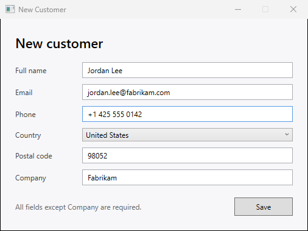

# Session transcript

Source: `Q:\source\XamlAgentDemos-notes\test-runs\NewCustomer\run1\events.jsonl`

## Tool usage

- get_file: 6
- glob: 4
- xaml_get_element_properties: 3
- xaml_interact: 3
- powershell: 2
- xaml_hit_test: 2
- task_complete: 2
- skill: 1
- xaml_get_status: 1
- xaml_find_elements: 1
- xaml_get_binding_failures: 1
- get_projects_in_solution: 1
- rg: 1
- replace_string_in_file: 1
- xaml_apply_hot_reload: 1
- xaml_capture_image: 1

Failed tool calls: 0, images: 1


_Model: gpt-6.1-sol_


## User (22:08:25)

In my running NewCustomer app I filled in the new customer form and everything looks valid, but Save stays disabled. Find out why and fix it so what I entered can be saved.


**Tool call (22:08:27):** `skill`
```json
{
 "skill": "xaml-diagnostics"
}
```

<details><summary>Result `skill` success=true</summary>

```
Skill "xaml-diagnostics" loaded successfully. Follow the instructions in the skill context.
```
</details>


_Skill invoked: xaml-diagnostics_


**Assistant (22:08:30):**

I’ll inspect the live form and Save command, then fix the cause without losing your entries.


**Tool call (22:08:30):** `xaml_get_status`
```json
{
 "progressMessage": "Inspect running NewCustomer app and debugging state"
}
```

<details><summary>Result `xaml_get_status` success=true</summary>

```
{"isDebugging":true,"debuggerState":"running","diagnosticsActive":true,"apps":[{"app":"a1","name":"NewCustomer.exe [62960]","processId":62960,"platform":"WPF (.NET)","isRemote":false,"isDesignTimeOrNoDebug":false,"sourceInfoAvailable":true,"hotReloadSupported":true,"hotReloadEnabled":true,"supportsPropertyExplorer":true,"supportsInAppToolbar":true,"supportsHitTest":true,"windows":[{"windowId":"0x500994","title":"New Customer","bounds":{"x":130,"y":130,"width":520,"height":386},"dpiScale":1.0,"visible":true,"minimized":false}]}],"issues":[],"issuesSummary":"No problems detected.","hotReload":{"options":{"hotReloadEnabled":true,"hotReloadOnSave":false,"applyMode":"asYouType: XAML edits apply as you type, without saving (default)","wpfEnabled":true,"uwpEnabled":true,"winUIEnabled":true,"mauiEnabled":true,"justMyXaml":true,"previewSelectedElement":false,"inAppToolbar":true,"inAppSelection":false,"layoutAdorners":false,"trackFocusedElement":false,"bindingFailuresVisible":true,"compatibilityMode":false},"dotNetHotReloadEnabled":true,"isProcessingChanges":false,"errors":[]},"windowsNote":"Window bounds are physical pixels including the frame; Window.Width/Height are DIPs including the frame (= bounds.width / dpiScale), so say which unit you tested. Minimized windows report x/y = -32000 and can't be captured."}
```
</details>


**Tool call (22:08:34):** `xaml_find_elements`
```json
{
 "progressMessage": "Find form inputs and Save button",
 "app": "a1",
 "type": "*Button|TextBox|ComboBox|CheckBox"
}
```


**Tool call (22:08:34):** `xaml_get_binding_failures`
```json
{
 "progressMessage": "Check form binding failures"
}
```


**Tool call (22:08:34):** `powershell`
```json
{
 "command": "git --no-pager status --short",
 "description": "Check working tree before changing source"
}
```

<details><summary>Result `xaml_find_elements` success=true</summary>

```
{"defaultSourceFile":"Q:\\source\\XamlAgentDemos\\src\\NewCustomer\\MainWindow.xaml","count":8,"totalMatches":8,"truncated":false,"results":[{"id":"a1:20","type":"TextBox","name":"FullNameBox","source":{"line":32,"column":8},"path":"MainWindow/Border/AdornerDecorator/ContentPresenter/StackPanel/Grid/TextBox"},{"id":"a1:22","type":"TextBox","name":"EmailBox","source":{"line":34,"column":8},"path":"MainWindow/Border/AdornerDecorator/ContentPresenter/StackPanel/Grid/TextBox"},{"id":"a1:24","type":"TextBox","name":"PhoneBox","source":{"line":36,"column":8},"path":"MainWindow/Border/AdornerDecorator/ContentPresenter/StackPanel/Grid/TextBox"},{"id":"a1:26","type":"ComboBox","name":"CountryBox","source":{"line":38,"column":8},"path":"MainWindow/Border/AdornerDecorator/ContentPresenter/StackPanel/Grid/ComboBox"},{"id":"a1:44","type":"ToggleButton","name":"toggleButton","path":"MainWindow/Border/AdornerDecorator/ContentPresenter/StackPanel/Grid/ComboBox/Grid/ToggleButton"},{"id":"a1:28","type":"TextBox","name":"PostalCodeBox","source":{"line":40,"column":8},"path":"MainWindow/Border/AdornerDecorator/ContentPresenter/StackPanel/Grid/TextBox"},{"id":"a1:30","type":"TextBox","name":"CompanyBox","source":{"line":42,"column":8},"path":"MainWindow/Border/AdornerDecorator/ContentPresenter/StackPanel/Grid/TextBox"},{"id":"a1:31","type":"Button","name":"SaveButton","source":{"line":45,"column":8},"path":"MainWindow/Border/AdornerDecorator/ContentPresenter/StackPanel/DockPanel/Button"}]}
```
</details>

<details><summary>Result `xaml_get_binding_failures` success=true</summary>

```
{"note":"Cumulative log, not live state: fixed failures stay listed. To verify a fix: clear, revisit the UI that uses the binding, then read again.","totalUnique":0,"matched":0,"truncated":false,"failures":[]}
```
</details>

<details><summary>Result `powershell` success=true</summary>

```

<shellId: 0 completed with exit code 0>
```
</details>


**Tool call (22:08:39):** `get_file`
```json
{
 "filename": "Q:\\source\\XamlAgentDemos\\src\\NewCustomer\\MainWindow.xaml",
 "startLine": 1,
 "endLine": 180
}
```


**Tool call (22:08:39):** `xaml_get_element_properties`
```json
{
 "progressMessage": "Read actual input and validation state",
 "elementIds": [
  "#FullNameBox",
  "#EmailBox",
  "#PhoneBox",
  "#CountryBox",
  "#PostalCodeBox",
  "#CompanyBox"
 ],
 "nameFilter": "Text|SelectedItem|Validation.HasError",
 "includeAll": true
}
```


**Tool call (22:08:39):** `xaml_hit_test`
```json
{
 "progressMessage": "Identify what disables Save",
 "elementIds": [
  "#SaveButton"
 ]
}
```


**Tool call (22:08:39):** `glob`
```json
{
 "pattern": "src\\NewCustomer\\**\\*.cs"
}
```

<details><summary>Result `xaml_hit_test` success=true</summary>

```
{"defaultSourceFile":"Q:\\source\\XamlAgentDemos\\src\\NewCustomer\\MainWindow.xaml","id":"#SaveButton","summary":"A click at its center does NOT reach 'SaveButton' because it's disabled (IsEnabled=False): input skips disabled elements and lands on DockPanel behind or around it. That element isn't necessarily covering it; fix the IsEnabled cause (see blockers, or a command's CanExecute) rather than the layout. Button 'SaveButton' has IsEnabled=False (IsEnabledCore: command CanExecute is false or the control disabled itself).","elementReceivesInput":false,"inputTarget":{"id":"a1:18","type":"DockPanel","source":{"line":44,"column":6}},"stack":[{"id":"a1:56","type":"TextBlock","templatedParent":{"id":"a1:31","type":"Button","name":"SaveButton","source":{"line":45,"column":8}}},{"id":"a1:39","type":"Border","name":"border","templatedParent":{"id":"a1:31","type":"Button","name":"SaveButton","source":{"line":45,"column":8}}},{"id":"a1:11","type":"Border","templatedParent":{"id":"a1:10","type":"NewCustomer.MainWindow","source":{"line":4,"column":9}}}],"isVisible":true,"isHitTestVisible":true,"isEnabled":false,"effectiveOpacity":1.0,"blockers":[{"id":"a1:31","type":"Button","name":"SaveButton","source":{"line":45,"column":8},"property":"IsEnabled","value":"False (IsEnabledCore: command CanExecute is false or the control disabled itself)"}],"visibleFraction":1.0,"point":{"window":{"x":432.0,"y":308.0},"screen":{"x":570.0,"y":469.0}},"note":"inputTarget = what a click or tap at the point reaches; stack = hit-testable elements there, topmost first (no id = template part, see templatedParent). blockers = the element and ancestors whose own values hide it or block input. visibleFraction includes ancestor and window clipping."}
```
</details>

<details><summary>Result `glob` success=true</summary>

```
.\src\NewCustomer\MainWindow.xaml.cs
.\src\NewCustomer\CustomerFormViewModel.cs
.\src\NewCustomer\App.xaml.cs
```
</details>

<details><summary>Result `xaml_get_element_properties` success=true</summary>

```
{"defaultSourceFile":"Q:\\source\\XamlAgentDemos\\src\\NewCustomer\\MainWindow.xaml","count":6,"failed":0,"results":[{"id":"#FullNameBox","type":"TextBox","name":"FullNameBox","source":{"line":32,"column":8},"properties":[{"name":"Text","evaluatedValue":"Jordan Lee (System.String)","valueType":"System.Windows.Data.BindingExpression","propertyType":"System.String","valueSource":"Local","isBinding":true}],"hiddenDefaultOrOverridden":1,"hint":"includeAll=true lists the omitted values; xaml_explain_property_value gives one property's precedence chain."},{"id":"#EmailBox","type":"TextBox","name":"EmailBox","source":{"line":34,"column":8},"properties":[{"name":"Text","evaluatedValue":"jordan.lee@fabrikam.com (System.String)","valueType":"System.Windows.Data.BindingExpression","propertyType":"System.String","valueSource":"Local","isBinding":true}],"hiddenDefaultOrOverridden":1,"hint":"includeAll=true lists the omitted values; xaml_explain_property_value gives one property's precedence chain."},{"id":"#PhoneBox","type":"TextBox","name":"PhoneBox","source":{"line":36,"column":8},"properties":[{"name":"Text","evaluatedValue":"+1\u00A0425\u00A0555\u00A00142 (System.String)","valueType":"System.Windows.Data.BindingExpression","propertyType":"System.String","valueSource":"Local","isBinding":true}],"hiddenDefaultOrOverridden":1,"hint":"includeAll=true lists the omitted values; xaml_explain_property_value gives one property's precedence chain."},{"id":"#CountryBox","type":"ComboBox","name":"CountryBox","source":{"line":38,"column":8},"properties":[{"name":"Text","value":"United States","valueType":"System.String","valueSource":"Coercion"},{"name":"SelectedItem","evaluatedValue":"United States (System.String)","valueType":"System.Windows.Data.BindingExpression","propertyType":"System.Object","valueSource":"Local","isBinding":true}],"hiddenDefaultOrOverridden":3,"hint":"includeAll=true lists the omitted values; xaml_explain_property_value gives one property's precedence chain."},{"id":"#PostalCodeBox","type":"TextBox","name":"PostalCodeBox","source":{"line":40,"column":8},"properties":[{"name":"Text","evaluatedValue":"98052 (System.String)","valueType":"System.Windows.Data.BindingExpression","propertyType":"System.String","valueSource":"Local","isBinding":true}],"hiddenDefaultOrOverridden":1,"hint":"includeAll=true lists the omitted values; xaml_explain_property_value gives one property's precedence chain."},{"id":"#CompanyBox","type":"TextBox","name":"CompanyBox","source"
... [truncated 371 chars]
```
</details>

<details><summary>Result `get_file` success=true</summary>

```
```xaml src\NewCustomer\MainWindow.xaml (Lines 1-49 of 49 total. Call tools for more if needed.)
<Window x:Class="NewCustomer.MainWindow"
        xmlns="http://schemas.microsoft.com/winfx/2006/xaml/presentation"
        xmlns:x="http://schemas.microsoft.com/winfx/2006/xaml"
        xmlns:local="clr-namespace:NewCustomer"
        Title="New Customer" Width="520" SizeToContent="Height" ResizeMode="CanMinimize"
        Background="#FFF7F7FA">
  <Window.DataContext>
    <local:CustomerFormViewModel />
  </Window.DataContext>
  <Window.Resources>
    <Style TargetType="TextBlock" x:Key="Label">
      <Setter Property="Margin" Value="0,10,12,0" />
      <Setter Property="VerticalAlignment" Value="Center" />
      <Setter Property="Foreground" Value="#FF444444" />
    </Style>
    <Style TargetType="TextBox">
      <Setter Property="Margin" Value="0,10,0,0" />
      <Setter Property="Padding" Value="6,4" />
    </Style>
  </Window.Resources>
  <StackPanel Margin="24">
    <TextBlock Text="New customer" FontSize="22" FontWeight="SemiBold" Margin="0,0,0,8" />
    <Grid>
      <Grid.ColumnDefinitions>
        <ColumnDefinition Width="110" />
        <ColumnDefinition Width="*" />
      </Grid.ColumnDefinitions>
      <Grid.RowDefinitions>
        <RowDefinition /><RowDefinition /><RowDefinition /><RowDefinition /><RowDefinition /><RowDefinition />
      </Grid.RowDefinitions>
      <TextBlock Style="{StaticResource Label}" Text="Full name" />
      <TextBox x:Name="FullNameBox" Grid.Column="1" Text="{Binding FullName, UpdateSourceTrigger=PropertyChanged}" />
      <TextBlock Style="{StaticResource Label}" Grid.Row="1" Text="Email" />
      <TextBox x:Name="EmailBox" Grid.Row="1" Grid.Column="1" Text="{Binding Email, UpdateSourceTrigger=PropertyChanged}" />
      <TextBlock Style="{StaticResource Label}" Grid.Row="2" Text="Phone" />
      <TextBox x:Name="PhoneBox" Grid.Row="2" Grid.Column="1" Text="{Binding Phone, UpdateSourceTrigger=PropertyChanged}" />
      <TextBlock Style="{StaticResource Label}" Grid.Row="3" Text="Country" />
      <ComboBox x:Name="CountryBox" Grid.Row="3" Grid.Column="1" Margin="0,10,0,0" ItemsSource="{Binding Countries}" SelectedItem="{Binding Country}" />
      <TextBlock Style="{StaticResource Label}" Grid.Row="4" Text="Postal code" />
      <TextBox x:Name="PostalCodeBox" Grid.Row="4" Grid.Column="1" Text="{Binding PostalCode, UpdateSourceTrigger=PropertyChanged}" />
      <TextBlock Style="{Stati
... [truncated 513 chars]
```
</details>


**Tool call (22:08:43):** `get_file`
```json
{
 "filename": "Q:\\source\\XamlAgentDemos\\src\\NewCustomer\\CustomerFormViewModel.cs",
 "startLine": 1,
 "endLine": 300,
 "includeLineNumbers": true
}
```


**Tool call (22:08:43):** `xaml_get_element_properties`
```json
{
 "progressMessage": "Read Save validation inputs from view model",
 "elementIds": [
  "#SaveButton"
 ],
 "nameFilter": "IsEnabled|DataContext.FullName|Email|Phone|Country|PostalCode|Company|Status",
 "includeAll": true
}
```


**Tool call (22:08:43):** `glob`
```json
{
 "pattern": "**\\*NewCustomer*"
}
```


**Tool call (22:08:43):** `get_projects_in_solution`
```json
{}
```

<details><summary>Result `get_file` success=true</summary>

```
```csharp src\NewCustomer\CustomerFormViewModel.cs (Lines 1-70 of 70 total. Call tools for more if needed.)
1: using System.Text.RegularExpressions;
2: using System.Windows.Input;
3: 
4: namespace NewCustomer;
5: 
6: public sealed partial class CustomerFormViewModel : ObservableObject
7: {
8:     private string fullName = string.Empty;
9:     private string email = string.Empty;
10:     private string phone = string.Empty;
11:     private string country = "United States";
12:     private string postalCode = string.Empty;
13:     private string company = string.Empty;
14:     private string status = "All fields except Company are required.";
15: 
16:     public CustomerFormViewModel()
17:     {
18:         this.SaveCommand = new RelayCommand(this.Save, () => this.IsValid);
19:     }
20: 
21:     public IReadOnlyList<string> Countries { get; } = ["United States", "Canada", "United Kingdom"];
22: 
23:     public string FullName { get => this.fullName; set => this.SetProperty(ref this.fullName, value); }
24: 
25:     public string Email { get => this.email; set => this.SetProperty(ref this.email, value); }
26: 
27:     public string Phone { get => this.phone; set => this.SetProperty(ref this.phone, value); }
28: 
29:     public string Country { get => this.country; set => this.SetProperty(ref this.country, value); }
30: 
31:     public string PostalCode { get => this.postalCode; set => this.SetProperty(ref this.postalCode, value); }
32: 
33:     public string Company { get => this.company; set => this.SetProperty(ref this.company, value); }
34: 
35:     public string Status { get => this.status; private set => this.SetProperty(ref this.status, value); }
36: 
37:     public ICommand SaveCommand { get; }
38: 
39:     public bool IsValid =>
40:         this.FullName.Trim().Contains(' ')
41:         && EmailRegex().IsMatch(this.Email)
42:         && PhoneRegex().IsMatch(this.Phone)
43:         && this.IsPostalCodeValid()
44:         && this.Company.Length <= 60;
45: 
46:     private bool IsPostalCodeValid() => this.Country switch
47:     {
48:         "United States" => UsZipRegex().IsMatch(this.PostalCode),
49:         "Canada" => CanadaPostalRegex().IsMatch(this.PostalCode),
50:         "United Kingdom" => UkPostcodeRegex().IsMatch(this.PostalCode),
51:         _ => false,
52:     };
53: 
54:     private void Save() => this.Status = $"Saved {this.FullName.Trim()} ✓";
55: 
56:     [GeneratedRegex(@"^[^@\s]+@
... [truncated 579 chars]
```
</details>

<details><summary>Result `glob` success=true</summary>

```
.\src\NewCustomer\NewCustomer.csproj
```
</details>

<details><summary>Result `get_projects_in_solution` success=true</summary>

```
src\GhostClicks\GhostClicks.csproj
src\NewCustomer\NewCustomer.csproj
src\DeadFollow\DeadFollow.csproj
src\GermanReady\GermanReady.csproj
src\ThemeBreaker\ThemeBreaker.csproj
src\DesignPolish\DesignPolish.csproj
src\HotReloadDoctor\HotReloadDoctor.csproj
src\Timesheet\Timesheet.csproj
src\VanishingSave\VanishingSave.csproj
src\TeamStrip\TeamStrip.csproj
src\CrispPixels\CrispPixels.csproj
src\PrecedenceWars\PrecedenceWars.csproj
src\LostWindows\LostWindows.csproj
src\TemplateDetective\TemplateDetective.csproj
src\KitToolbar\KitToolbar.csproj
src\SlowScroll\SlowScroll.csproj
src\PixelPerfect\PixelPerfect.csproj
src\BindingStorm\BindingStorm.csproj
src\BugRepro\BugRepro.csproj
src\A11ySweep\A11ySweep.csproj
src\StyleMaze\StyleMaze.csproj
src\ResponsiveDashboard\ResponsiveDashboard.csproj

```
</details>

<details><summary>Result `xaml_get_element_properties` success=true</summary>

```
{"id":"#SaveButton","type":"Button","name":"SaveButton","source":{"file":"Q:\\source\\XamlAgentDemos\\src\\NewCustomer\\MainWindow.xaml","line":45,"column":8},"properties":[{"name":"IsEnabled","value":"False","valueType":"System.Boolean","valueSource":"Coercion"}],"hiddenDefaultOrOverridden":1,"hint":"includeAll=true lists the omitted values; xaml_explain_property_value gives one property's precedence chain.","items":[{"path":"DataContext","type":"NewCustomer.CustomerFormViewModel","properties":[{"name":"FullName","value":"Jordan Lee","valueSource":"Local"},{"name":"Email","value":"jordan.lee@fabrikam.com","valueSource":"Local"},{"name":"Phone","value":"+1\u00A0425\u00A0555\u00A00142","valueSource":"Local"},{"name":"Country","value":"United States","valueSource":"Local"},{"name":"PostalCode","value":"98052","valueSource":"Local"},{"name":"Company","value":"Fabrikam","valueSource":"Local"},{"name":"Status","value":"All fields except Company are required.","valueSource":"Local","readOnly":true}]}],"note":"Set an item property with xaml_set_element_property using its path (setters=['ColumnDefinitions[2].Width=Auto']) and edit the XAML to keep it. Without nameFilter only set values and Actual* sizes are listed."}
```
</details>


**Tool call (22:08:49):** `get_file`
```json
{
 "filename": "Q:\\source\\XamlAgentDemos\\src\\NewCustomer\\NewCustomer.csproj",
 "startLine": 1,
 "endLine": 120
}
```


**Tool call (22:08:49):** `rg`
```json
{
 "pattern": "class ObservableObject|class RelayCommand|Normalize|00A0",
 "glob": "*.cs",
 "output_mode": "content",
 "head_limit": 65
}
```


**Tool call (22:08:49):** `glob`
```json
{
 "pattern": "**\\*Tests*"
}
```


**Tool call (22:08:49):** `glob`
```json
{
 "pattern": "**\\*README*"
}
```

<details><summary>Result `glob` success=true</summary>

```
No files matched the pattern.
```
</details>

<details><summary>Result `get_file` success=true</summary>

```
``` src\NewCustomer\NewCustomer.csproj (Lines 1-5 of 5 total. Call tools for more if needed.)
<Project Sdk="Microsoft.NET.Sdk">
  <PropertyGroup>
    <RootNamespace>NewCustomer</RootNamespace>
  </PropertyGroup>
</Project>

```


```
</details>

<details><summary>Result `glob` success=true</summary>

```
No files matched the pattern.
```
</details>

<details><summary>Result `rg` success=true</summary>

```
.\src\Shared\RelayCommand.cs:public sealed class RelayCommand(Action execute, Func<bool>? canExecute = null) : ICommand
.\src\Shared\ObservableObject.cs:public abstract class ObservableObject : INotifyPropertyChanged
```
</details>


**Assistant (22:08:57):**

The phone number contains non-breaking spaces from pasted text. They look normal, but validation rejects them. I’ll accept those separators while preserving your entry and the existing validation rules.


**Tool call (22:08:57):** `get_file`
```json
{
 "filename": "Q:\\source\\XamlAgentDemos\\src\\Shared\\ObservableObject.cs",
 "startLine": 1,
 "endLine": 150
}
```


**Tool call (22:08:57):** `get_file`
```json
{
 "filename": "Q:\\source\\XamlAgentDemos\\src\\Shared\\RelayCommand.cs",
 "startLine": 1,
 "endLine": 150
}
```


**Tool call (22:08:57):** `get_file`
```json
{
 "filename": "Q:\\source\\XamlAgentDemos\\Directory.Build.props",
 "startLine": 1,
 "endLine": 180
}
```

<details><summary>Result `get_file` success=true</summary>

```
```csharp src\Shared\RelayCommand.cs (Lines 1-16 of 16 total. Call tools for more if needed.)
using System.Windows.Input;

namespace XamlAgentDemos;

public sealed class RelayCommand(Action execute, Func<bool>? canExecute = null) : ICommand
{
    public event EventHandler? CanExecuteChanged
    {
        add => CommandManager.RequerySuggested += value;
        remove => CommandManager.RequerySuggested -= value;
    }

    public bool CanExecute(object? parameter) => canExecute?.Invoke() ?? true;

    public void Execute(object? parameter) => execute();
}

```


```
</details>

<details><summary>Result `get_file` success=true</summary>

```
```csharp src\Shared\ObservableObject.cs (Lines 1-24 of 24 total. Call tools for more if needed.)
using System.ComponentModel;
using System.Runtime.CompilerServices;

namespace XamlAgentDemos;

public abstract class ObservableObject : INotifyPropertyChanged
{
    public event PropertyChangedEventHandler? PropertyChanged;

    protected bool SetProperty<T>(ref T field, T value, [CallerMemberName] string? propertyName = null)
    {
        if (EqualityComparer<T>.Default.Equals(field, value))
        {
            return false;
        }

        field = value;
        this.OnPropertyChanged(propertyName);
        return true;
    }

    protected void OnPropertyChanged([CallerMemberName] string? propertyName = null)
        => this.PropertyChanged?.Invoke(this, new PropertyChangedEventArgs(propertyName));
}

```


```
</details>

<details><summary>Result `get_file` success=true</summary>

```
``` Directory.Build.props (Lines 1-15 of 15 total. Call tools for more if needed.)
<Project>
  <PropertyGroup>
    <TargetFramework>net10.0-windows</TargetFramework>
    <OutputType>WinExe</OutputType>
    <UseWPF>true</UseWPF>
    <Nullable>enable</Nullable>
    <ImplicitUsings>enable</ImplicitUsings>
    <LangVersion>latest</LangVersion>
  </PropertyGroup>

  <ItemGroup>
    <Compile Include="$(MSBuildThisFileDirectory)src\Shared\*.cs" Link="Shared\%(Filename)%(Extension)" />
    <Using Include="XamlAgentDemos" />
  </ItemGroup>
</Project>

```


```
</details>


**Tool call (22:09:00):** `replace_string_in_file`
```json
{
 "filePath": "src\\NewCustomer\\CustomerFormViewModel.cs",
 "oldString": "    public bool IsValid =>\n        this.FullName.Trim().Contains(' ')\n        && EmailRegex().IsMatch(this.Email)\n        && PhoneRegex().IsMatch(this.Phone)\n        && this.IsPostalCodeValid()\n        && this.Company.Length <= 60;\n\n    private bool IsPostalCodeValid() => this.Country switch",
 "newString": "    public bool IsValid =>\n        this.FullName.Trim().Contains(' ')\n        && EmailRegex().IsMatch(this.Email)\n        && PhoneRegex().IsMatch(this.Phone.Replace('\\u00A0', ' '))\n        && this.IsPostalCodeValid()\n        && this.Company.Length <= 60;\n\n    private bool IsPostalCodeValid() => this.Country switch"
}
```

<details><summary>Result `replace_string_in_file` success=true</summary>

```
Successfully replaced text in src\NewCustomer\CustomerFormViewModel.cs
```
</details>


**Tool call (22:09:03):** `xaml_apply_hot_reload`
```json
{
 "progressMessage": "Apply phone validation fix without losing form entries",
 "includeCodeChanges": true
}
```

<details><summary>Result `xaml_apply_hot_reload` success=true</summary>

```
{"summary":"XAML: Applied with no new errors. .NET code: applied (see 'codeHotReloadOutput'). New code runs the next time each method is called; code that already ran (constructors, startup, Loaded handlers, a failed operation that left a flag set) isn't re-run, so the state it produced stays until you trigger that code again, reopen the view, or restart the app.","applied":true,"xamlApplied":true,"status":"applied","errors":[],"log":[],"codeChanges":".NET Hot Reload was started for saved code changes. Its results are in the Hot Reload output pane, not in 'log'; if an edit can't be hot reloaded, Visual Studio asks the user to rebuild and restart.","codeStatus":"applied","codeHotReloadOutput":["17:09:05.36  Code changes were successfully applied."],"hint":"Verify with xaml_capture_image. Structural edits recreate elements: new IDs and reset state (selection, text, scroll), so re-find by x:Name and restore the state you were testing. Unchanged elements may keep pre-edit line numbers."}
```
</details>


**Tool call (22:09:11):** `xaml_interact`
```json
{
 "progressMessage": "Re-evaluate Save with existing customer input",
 "elementId": "#PhoneBox",
 "action": "focus",
 "checkProperties": "IsEnabled|DataContext.IsValid|Phone",
 "checkElementIds": [
  "#SaveButton"
 ]
}
```

<details><summary>Result `xaml_interact` success=true</summary>

```
{"id":"#PhoneBox","action":"focus","result":"Focused.","supportedPatterns":["Value","Scroll","Text","SynchronizedInput"],"checks":[{"id":"#SaveButton","changed":true,"before":[{"name":"IsEnabled","value":"False","valueSource":"Coercion"}],"after":[]}],"note":"Automation bypasses mouse hit testing; xaml_hit_test shows whether a real click reaches the element."}
```
</details>


**Tool call (22:09:15):** `xaml_get_element_properties`
```json
{
 "progressMessage": "Verify original phone now passes validation",
 "elementIds": [
  "#SaveButton"
 ],
 "nameFilter": "IsEnabled|DataContext.IsValid|Phone|Status",
 "includeAll": true
}
```


**Tool call (22:09:15):** `xaml_capture_image`
```json
{
 "progressMessage": "Verify form entries preserved and Save enabled",
 "app": "a1"
}
```


**Tool call (22:09:15):** `powershell`
```json
{
 "command": "git --no-pager diff --check; git --no-pager diff -- src\\NewCustomer\\CustomerFormViewModel.cs",
 "description": "Verify the focused validation change and whitespace"
}
```

<details><summary>Result `xaml_get_element_properties` success=true</summary>

```
{"id":"#SaveButton","type":"Button","name":"SaveButton","source":{"file":"Q:\\source\\XamlAgentDemos\\src\\NewCustomer\\MainWindow.xaml","line":45,"column":8},"properties":[],"defaultValues":{"IsEnabled":"True"},"hint":"No property name matches any of: IsEnabled (exact name when one exists, otherwise a case-insensitive substring; separate alternatives with '|' or ','). Check the spelling, or omit nameFilter to list the properties that are set.","items":[{"path":"DataContext","type":"NewCustomer.CustomerFormViewModel","properties":[{"name":"Phone","value":"+1\u00A0425\u00A0555\u00A00142","valueSource":"Local"},{"name":"Status","value":"All fields except Company are required.","valueSource":"Local","readOnly":true},{"name":"IsValid","value":"True","valueSource":"Local","readOnly":true}]}],"note":"Set an item property with xaml_set_element_property using its path (setters=['ColumnDefinitions[2].Width=Auto']) and edit the XAML to keep it. Without nameFilter only set values and Actual* sizes are listed."}
```
</details>




<details><summary>Result `xaml_capture_image` success=true</summary>

```
Screenshot of window 0x500994 "New Customer" of app a1 (506x379 image of the window's client area, so it's slightly smaller than the frame bounds from xaml_get_status).
```
</details>

<details><summary>Result `powershell` success=true</summary>

```
diff --git a/src/NewCustomer/CustomerFormViewModel.cs b/src/NewCustomer/CustomerFormViewModel.cs
index c10b732..d666683 100644
--- a/src/NewCustomer/CustomerFormViewModel.cs
+++ b/src/NewCustomer/CustomerFormViewModel.cs
@@ -39,7 +39,7 @@ public sealed partial class CustomerFormViewModel : ObservableObject
     public bool IsValid =>
         this.FullName.Trim().Contains(' ')
         && EmailRegex().IsMatch(this.Email)
-        && PhoneRegex().IsMatch(this.Phone)
+        && PhoneRegex().IsMatch(this.Phone.Replace('\u00A0', ' '))
         && this.IsPostalCodeValid()
         && this.Company.Length <= 60;
<shellId: 1 completed with exit code 0>
```
</details>


**Tool call (22:09:20):** `xaml_interact`
```json
{
 "progressMessage": "Ensure invalid phone characters still block Save",
 "elementId": "#PhoneBox",
 "action": "setValue",
 "value": "+1 425 555 0142x",
 "checkProperties": "DataContext.IsValid",
 "checkElementIds": [
  "#SaveButton"
 ]
}
```

<details><summary>Result `xaml_interact` success=true</summary>

```
{"id":"#PhoneBox","action":"setValue","result":"Value is now '+1\u00A0425\u00A0555\u00A00142x'.","supportedPatterns":["Value","Scroll","Text","SynchronizedInput"],"checks":[{"id":"#SaveButton","changed":true,"before":[{"path":"DataContext","type":"NewCustomer.CustomerFormViewModel","properties":[{"name":"IsValid","value":"True","valueSource":"Local","readOnly":true}]}],"after":[{"path":"DataContext","type":"NewCustomer.CustomerFormViewModel","properties":[{"name":"IsValid","value":"False","valueSource":"Default","readOnly":true}]}]}],"note":"Automation bypasses mouse hit testing; xaml_hit_test shows whether a real click reaches the element."}
```
</details>


**Tool call (22:09:23):** `xaml_interact`
```json
{
 "progressMessage": "Restore original phone and confirm validation succeeds",
 "elementId": "#PhoneBox",
 "action": "setValue",
 "value": "+1 425 555 0142",
 "checkProperties": "DataContext.IsValid|Phone",
 "checkElementIds": [
  "#SaveButton"
 ]
}
```

<details><summary>Result `xaml_interact` success=true</summary>

```
{"id":"#PhoneBox","action":"setValue","result":"Value is now '+1\u00A0425\u00A0555\u00A00142'.","supportedPatterns":["Value","Scroll","Text","SynchronizedInput"],"checks":[{"id":"#SaveButton","changed":true,"before":[{"path":"DataContext","type":"NewCustomer.CustomerFormViewModel","properties":[{"name":"Phone","value":"+1\u00A0425\u00A0555\u00A00142x","valueSource":"Local"},{"name":"IsValid","value":"False","valueSource":"Default","readOnly":true}]}],"after":[{"path":"DataContext","type":"NewCustomer.CustomerFormViewModel","properties":[{"name":"Phone","value":"+1\u00A0425\u00A0555\u00A00142","valueSource":"Local"},{"name":"IsValid","value":"True","valueSource":"Local","readOnly":true}]}]}],"note":"Automation bypasses mouse hit testing; xaml_hit_test shows whether a real click reaches the element."}
```
</details>


**Tool call (22:09:27):** `xaml_hit_test`
```json
{
 "progressMessage": "Confirm Save is enabled and reachable by mouse",
 "elementIds": [
  "#SaveButton"
 ]
}
```

<details><summary>Result `xaml_hit_test` success=true</summary>

```
{"defaultSourceFile":"Q:\\source\\XamlAgentDemos\\src\\NewCustomer\\MainWindow.xaml","id":"#SaveButton","summary":"A click at its center reaches 'SaveButton' (input lands on TextBlock (in the template of Button 'SaveButton')).","elementReceivesInput":true,"inputTarget":{"id":"a1:56","type":"TextBlock","templatedParent":{"id":"a1:31","type":"Button","name":"SaveButton","source":{"line":45,"column":8}}},"stack":[{"id":"a1:56","type":"TextBlock","templatedParent":{"id":"a1:31","type":"Button","name":"SaveButton","source":{"line":45,"column":8}}},{"id":"a1:39","type":"Border","name":"border","templatedParent":{"id":"a1:31","type":"Button","name":"SaveButton","source":{"line":45,"column":8}}},{"id":"a1:11","type":"Border","templatedParent":{"id":"a1:10","type":"NewCustomer.MainWindow","source":{"line":4,"column":9}}}],"isVisible":true,"isHitTestVisible":true,"isEnabled":true,"effectiveOpacity":1.0,"visibleFraction":1.0,"point":{"window":{"x":432.0,"y":308.0},"screen":{"x":570.0,"y":469.0}},"note":"inputTarget = what a click or tap at the point reaches; stack = hit-testable elements there, topmost first (no id = template part, see templatedParent). blockers = the element and ancestors whose own values hide it or block input. visibleFraction includes ancestor and window clipping."}
```
</details>


**Tool call (22:09:31):** `task_complete`
```json
{
 "summary": "Your phone number contained non-breaking spaces that validation rejected. Fixed validation to accept those spaces without changing your entry.\n\nApplied the fix live: Save is now enabled and clickable. Verified invalid phone characters still fail validation. Your entries are preserved and ready to save."
}
```

<details><summary>Result `task_complete` success=true</summary>

```
Your phone number contained non-breaking spaces that validation rejected. Fixed validation to accept those spaces without changing your entry.

Applied the fix live: Save is now enabled and clickable. Verified invalid phone characters still fail validation. Your entries are preserved and ready to save.
```
</details>


**Task complete (22:09:31):** Your phone number contained non-breaking spaces that validation rejected. Fixed validation to accept those spaces without changing your entry.

Applied the fix live: Save is now enabled and clickable. Verified invalid phone characters still fail validation. Your entries are preserved and ready to save.


## User (22:09:53)

Thanks. Now some quick feedback for the tooling team. Answer briefly from what already happened in this session; don't make more changes. (1) Which xaml_* tools or skill guidance helped most? (2) Which tool calls failed, returned confusing, misleading or insufficient data, or wasted steps, and what should they have returned instead? (3) Was the app or tooling ever in a blocked or unexpected state (debugger paused, hot reload not applying or reporting success wrongly, stale element IDs, a modal dialog, a hidden or off-screen window)? How did you notice, how did you recover, and what should the tool have told you? (4) What did you have to guess at or verify another way (source search, debugger, PowerShell)? (5) Which fixes did you verify live in the running app, and which only in source, and why? (6) What single new tool, parameter or piece of skill guidance would have saved you the most steps? (7) Re-read my original request: did you meet every explicit requirement in it? If you skipped, merged or changed any of them, say which and why.


**Tool call (22:10:02):** `task_complete`
```json
{
 "summary": "1. **Most helpful:** Live property reads exposed `\\u00A0` in the phone number; `xaml_hit_test` identified command-based disabling. Skill guidance on escaped characters and code Hot Reload was directly useful.\n2. **Confusing results:** Property reads omitted `IsEnabled=True` from the main list despite `includeAll=true`, showing it under defaults with a misleading “no property name matches” hint. Focus verification returned an empty “after” list. Both should report explicit effective values. No calls failed.\n3. **Blocked states:** None observed. Debugger stayed running, Hot Reload applied successfully, and IDs remained valid. There were no modal or window-position issues.\n4. **Other verification:** Source inspection identified the rejecting regex and command requery behavior. PowerShell checked the working tree and final diff. No debugger evaluation was needed.\n5. **Verified live:** The original unchanged phone passed after Hot Reload; adding a letter failed; restoring the original passed again. Save became enabled and mouse-reachable. I did not click Save, so actual Save execution was not verified. The permanent source edit was checked in the diff.\n6. **Best improvement:** Consistently return requested effective properties—including defaults—in property reads and interaction checks.\n7. **Original request:** Yes: diagnosed why Save stayed disabled, fixed the source, and enabled Save for your preserved entries. Actual saving was left to you; no explicit req
... [truncated 24 chars]
```

<details><summary>Result `task_complete` success=true</summary>

```
1. **Most helpful:** Live property reads exposed `\u00A0` in the phone number; `xaml_hit_test` identified command-based disabling. Skill guidance on escaped characters and code Hot Reload was directly useful.
2. **Confusing results:** Property reads omitted `IsEnabled=True` from the main list despite `includeAll=true`, showing it under defaults with a misleading “no property name matches” hint. Focus verification returned an empty “after” list. Both should report explicit effective values. No calls failed.
3. **Blocked states:** None observed. Debugger stayed running, Hot Reload applied successfully, and IDs remained valid. There were no modal or window-position issues.
4. **Other verification:** Source inspection identified the rejecting regex and command requery behavior. PowerShell checked the working tree and final diff. No debugger evaluation was needed.
5. **Verified live:** The original unchanged phone passed after Hot Reload; adding a letter failed; restoring the original passed again. Save became enabled and mouse-reachable. I did not click Save, so actual Save execution was not verified. The permanent source edit was checked in the diff.
6. **Best improvement:** Consistently return requested effective properties—including defaults—in property reads and interaction checks.
7. **Original request:** Yes: diagnosed why Save stayed disabled, fixed the source, and enabled Save for your preserved entries. Actual saving was left to you; no explicit requirement was skipped.
```
</details>


**Task complete (22:10:02):** 1. **Most helpful:** Live property reads exposed `\u00A0` in the phone number; `xaml_hit_test` identified command-based disabling. Skill guidance on escaped characters and code Hot Reload was directly useful.
2. **Confusing results:** Property reads omitted `IsEnabled=True` from the main list despite `includeAll=true`, showing it under defaults with a misleading “no property name matches” hint. Focus verification returned an empty “after” list. Both should report explicit effective values. No calls failed.
3. **Blocked states:** None observed. Debugger stayed running, Hot Reload applied successfully, and IDs remained valid. There were no modal or window-position issues.
4. **Other verification:** Source inspection identified the rejecting regex and command requery behavior. PowerShell checked the working tree and final diff. No debugger evaluation was needed.
5. **Verified live:** The original unchanged phone passed after Hot Reload; adding a letter failed; restoring the original passed again. Save became enabled and mouse-reachable. I did not click Save, so actual Save execution was not verified. The permanent source edit was checked in the diff.
6. **Best improvement:** Consistently return requested effective properties—including defaults—in property reads and interaction checks.
7. **Original request:** Yes: diagnosed why Save stayed disabled, fixed the source, and enabled Save for your preserved entries. Actual saving was left to you; no explicit requirement was skipped.
