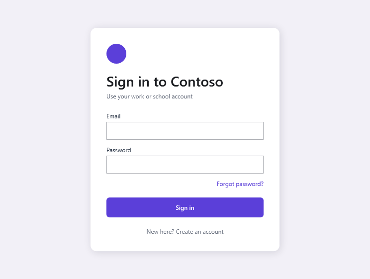
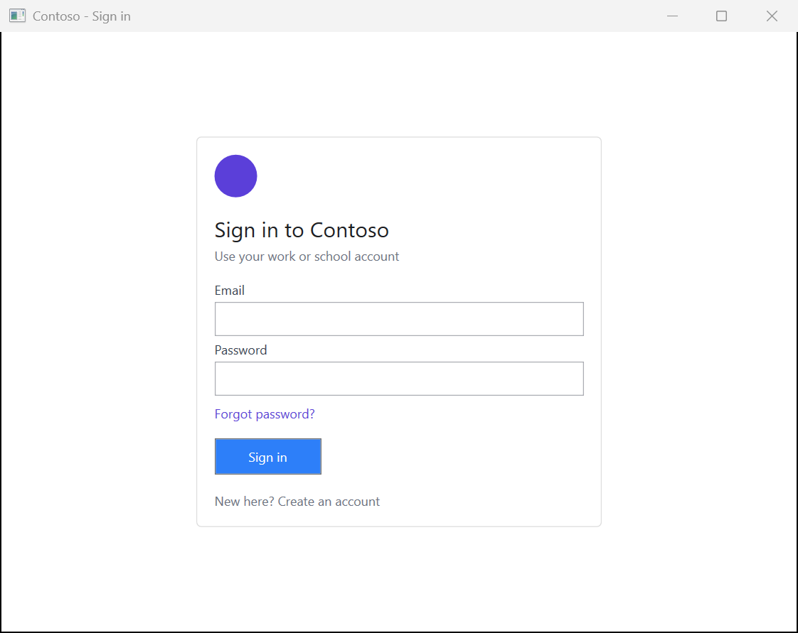
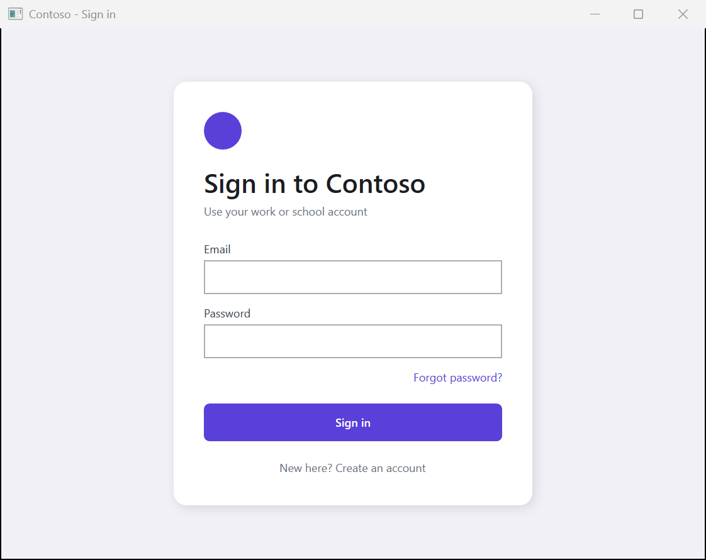

# Session transcript

Source: `Q:\source\XamlAgentDemos-notes\test-runs\PixelPerfect\run1\events.jsonl`

## Tool usage

- view: 4
- powershell: 3
- xaml_capture_image: 3
- get_file: 3
- xaml_find_elements: 2
- xaml_get_element_bounds: 2
- task_complete: 2
- skill: 1
- xaml_list_apps: 1
- get_projects_in_solution: 1
- xaml_get_visual_tree: 1
- xaml_list_windows: 1
- xaml_get_element_properties: 1
- replace_string_in_file: 1
- xaml_apply_hot_reload: 1
- xaml_get_binding_failures: 1
- xaml_get_hot_reload_status: 1

Failed tool calls: 0, images: 3


_Model: gpt-6.1-sol_


## User (17:20:25)

Here's the designer's mockup: src\PixelPerfect\design\mockup.png. Make my running sign-in page match it as closely as possible, and show me before/after screenshots.


**Tool call (17:20:27):** `skill`
```json
{
 "skill": "xaml-diagnostics"
}
```

<details><summary>Result `skill` success=true</summary>

```
Skill "xaml-diagnostics" loaded successfully. Follow the instructions in the skill context.
```
</details>


_Skill invoked: xaml-diagnostics_


**Assistant (17:20:30):**

I’ll capture the current page, compare it with the mockup, then update the XAML and verify it live.


**Tool call (17:20:30):** `xaml_list_apps`
```json
{
 "progressMessage": "Find running sign-in app"
}
```


**Tool call (17:20:30):** `view`
```json
{
 "path": "Q:\\source\\XamlAgentDemos\\src\\PixelPerfect\\design\\mockup.png"
}
```


**Tool call (17:20:30):** `get_projects_in_solution`
```json
{}
```


**Tool call (17:20:30):** `powershell`
```json
{
 "command": "git --no-pager status --short",
 "description": "Check existing workspace changes"
}
```


**Tool call (17:20:30):** `view`
```json
{
 "path": "c:\\vs\\fastmain\\common7\\ide\\commonextensions\\microsoft\\xamldiagnostics\\AgentTools\\skills\\xaml-diagnostics\\references\\xaml-authoring.md"
}
```

<details><summary>Result `xaml_list_apps` success=true</summary>

```
{"isDebugging":true,"debuggerState":"running","diagnosticsActive":true,"apps":[{"app":"a2","name":"PixelPerfect.exe [13904]","processId":13904,"platform":"WPF (.NET)","isRemote":false,"isDesignTimeOrNoDebug":false,"sourceInfoAvailable":true,"hotReloadSupported":true,"hotReloadEnabled":true,"supportsPropertyExplorer":true,"supportsInAppToolbar":true,"windowCount":1}]}
```
</details>




<details><summary>Result `view` success=true</summary>

```
Viewed image file successfully.
```
</details>

<details><summary>Result `get_projects_in_solution` success=true</summary>

```
src\GhostClicks\GhostClicks.csproj
src\GermanReady\GermanReady.csproj
src\ThemeBreaker\ThemeBreaker.csproj
src\DesignPolish\DesignPolish.csproj
src\HotReloadDoctor\HotReloadDoctor.csproj
src\VanishingSave\VanishingSave.csproj
src\CrispPixels\CrispPixels.csproj
src\PrecedenceWars\PrecedenceWars.csproj
src\LostWindows\LostWindows.csproj
src\TemplateDetective\TemplateDetective.csproj
src\SlowScroll\SlowScroll.csproj
src\PixelPerfect\PixelPerfect.csproj
src\BindingStorm\BindingStorm.csproj
src\BugRepro\BugRepro.csproj
src\A11ySweep\A11ySweep.csproj
src\StyleMaze\StyleMaze.csproj
src\ResponsiveDashboard\ResponsiveDashboard.csproj

```
</details>

<details><summary>Result `view` success=true</summary>

```
# XAML authoring guidance

Follow these rules when writing or changing XAML so it works well with XAML Hot Reload, the XAML designer, and XAML Diagnostics.

## Design-time data

- Declare `xmlns:d="http://schemas.microsoft.com/expression/blend/2008"` and `xmlns:mc="http://schemas.openxmlformats.org/markup-compatibility/2006"` with `mc:Ignorable="d"`.
- Use `d:DataContext="{d:DesignInstance Type=vm:MyViewModel, IsDesignTimeCreatable=False}"` (WPF/UWP) so the designer and IntelliSense know binding paths.
- Use `d:` properties (for example `d:Text="Sample"`) for sample values that appear only at design time.
- .NET MAUI: set `x:DataType` on pages and `DataTemplate`s. It enables compiled bindings and turns many binding failures into build errors.
- WinUI/UWP: prefer `x:Bind` for compile-time checked bindings when the view owns the view model.

## Bindings

- Bind with explicit paths. Avoid string-built paths in code-behind.
- Keep the `DataContext` chain simple. Use `ElementName` or `RelativeSource` only at real scope boundaries (for example inside a `DataTemplate` that needs the page's view model).
- Expose bound properties as public properties that raise `PropertyChanged`. Fields and non-public properties don't bind.
- Use `FallbackValue` and `TargetNullValue` for expected missing values instead of hiding binding errors.

## Hot reload and designer friendly code

- Keep control and page constructors cheap. Don't call services, open files, or start network calls in constructors or `InitializeComponent` paths. The designer and hot reload create instances again.
- Keep a public parameterless constructor on custom controls.
- Guard runtime-only work with `DesignerProperties.GetIsInDesignMode(this)` (WPF) or `Windows.ApplicationModel.DesignMode.DesignModeEnabled` (UWP/WinUI).
- Put styles, templates, and visual states in XAML, not code-behind. Hot reload can't update UI built in code.
- Don't walk the visual tree from code-behind to change visuals. Use bindings, triggers, and visual states.
- Use `x:Name` only for elements code-behind needs. Don't rename `x:Class` while the app is running.

## Resources

- Put shared resources in `App.xaml` merged dictionaries or the closest scope that uses them.
- A `StaticResource` must be defined earlier in load order. Use `DynamicResource` (WPF) or `ThemeResource` (UWP/WinUI) for theme values that change at runtime.
- To check where a key resolves at runtime, or whether a dictionary is merged a
... [truncated 618 chars]
```
</details>

<details><summary>Result `powershell` success=true</summary>

```

<shellId: 2 completed with exit code 0>
```
</details>


**Tool call (17:20:34):** `xaml_capture_image`
```json
{
 "progressMessage": "Capture before screenshot",
 "app": "a2"
}
```


**Tool call (17:20:34):** `xaml_get_visual_tree`
```json
{
 "progressMessage": "Inspect sign-in layout",
 "app": "a2",
 "depth": 4
}
```


**Tool call (17:20:34):** `view`
```json
{
 "path": "Q:\\source\\XamlAgentDemos\\src\\PixelPerfect"
}
```


**Tool call (17:20:34):** `xaml_list_windows`
```json
{
 "progressMessage": "Measure current window",
 "app": "a2"
}
```

<details><summary>Result `view` success=true</summary>

```
App.xaml
App.xaml.cs
MainWindow.xaml
MainWindow.xaml.cs
PixelPerfect.csproj
bin
design
obj
```
</details>

<details><summary>Result `xaml_get_visual_tree` success=true</summary>

```
{"app":"a2","platform":"WPF (.NET)","sourceInfoAvailable":true,"nodeCount":8,"truncated":false,"depthLimitedNodes":1,"hint":"1 node(s) have children beyond the requested depth (childCount > 0, no children listed). Raise depth or pass rootElementId to expand them.","nodes":[{"id":"a2:10","type":"PixelPerfect.MainWindow","source":{"file":"Q:\\source\\XamlAgentDemos\\src\\PixelPerfect\\MainWindow.xaml","line":3,"column":9},"childCount":1,"children":[{"id":"a2:11","type":"System.Windows.Controls.Border","childCount":1,"children":[{"id":"a2:12","type":"System.Windows.Documents.AdornerDecorator","childCount":2,"children":[{"id":"a2:13","type":"System.Windows.Controls.ContentPresenter","childCount":1,"children":[{"id":"a2:15","type":"System.Windows.Controls.Grid","source":{"file":"Q:\\source\\XamlAgentDemos\\src\\PixelPerfect\\MainWindow.xaml","line":8,"column":6},"childCount":1,"children":[{"id":"a2:16","type":"System.Windows.Controls.Border","name":"SignInCard","source":{"file":"Q:\\source\\XamlAgentDemos\\src\\PixelPerfect\\MainWindow.xaml","line":9,"column":10},"childCount":1,"children":[{"id":"a2:17","type":"System.Windows.Controls.StackPanel","source":{"file":"Q:\\source\\XamlAgentDemos\\src\\PixelPerfect\\MainWindow.xaml","line":18,"column":14},"childCount":10}]}]}]},{"id":"a2:14","type":"System.Windows.Documents.AdornerLayer","childCount":0}]}]}]}]}
```
</details>

<details><summary>Result `xaml_list_windows` success=true</summary>

```
{"windows":[{"windowId":"0x166065E","app":"a2","title":"Contoso - Sign in","bounds":{"x":342,"y":342,"width":1140,"height":900},"dpiScale":1.5,"visible":true,"minimized":false}],"note":"bounds are physical screen pixels and include the window frame. A WPF/WinUI Window's Width and Height are device-independent units (DIPs) that also include the frame, so Width = bounds.width / dpiScale. A user's \"800 px wide\" is ambiguous: say which unit you tested. A minimized window reports x/y = -32000 and can't be captured."}
```
</details>




<details><summary>Result `xaml_capture_image` success=true</summary>

```
Screenshot of window 0x166065E "Contoso - Sign in" of app a2 (1122x891 image of the window's client area, so it's slightly smaller than the frame bounds from xaml_list_windows).
```
</details>


**Tool call (17:20:37):** `get_file`
```json
{
 "filename": "Q:\\source\\XamlAgentDemos\\src\\PixelPerfect\\MainWindow.xaml",
 "startLine": 1,
 "endLine": 260
}
```


**Tool call (17:20:37):** `get_file`
```json
{
 "filename": "Q:\\source\\XamlAgentDemos\\src\\PixelPerfect\\MainWindow.xaml.cs",
 "startLine": 1,
 "endLine": 180
}
```


**Tool call (17:20:37):** `get_file`
```json
{
 "filename": "Q:\\source\\XamlAgentDemos\\src\\PixelPerfect\\App.xaml",
 "startLine": 1,
 "endLine": 150
}
```


**Tool call (17:20:37):** `view`
```json
{
 "path": "Q:\\source\\XamlAgentDemos\\src\\PixelPerfect\\design"
}
```

<details><summary>Result `view` success=true</summary>

```
mockup.png
```
</details>

<details><summary>Result `get_file` success=true</summary>

```
```xaml src\PixelPerfect\MainWindow.xaml (Lines 1-72 of 72 total. Call tools for more if needed.)
<Window x:Class="PixelPerfect.MainWindow"
        xmlns="http://schemas.microsoft.com/winfx/2006/xaml/presentation"
        xmlns:x="http://schemas.microsoft.com/winfx/2006/xaml"
        Title="Contoso - Sign in"
        Width="760"
        Height="600"
        Background="White">
    <Grid>
        <Border x:Name="SignInCard"
                Width="380"
                Padding="16"
                HorizontalAlignment="Center"
                VerticalAlignment="Center"
                Background="White"
                BorderBrush="#DDDDDD"
                BorderThickness="1"
                CornerRadius="4">
            <StackPanel>
                <Ellipse x:Name="Logo"
                         Width="40"
                         Height="40"
                         Margin="0,0,0,16"
                         HorizontalAlignment="Left"
                         Fill="#5B3FD9" />
                <TextBlock x:Name="TitleText"
                           FontSize="20"
                           Foreground="#1B1D21"
                           Text="Sign in to Contoso" />
                <TextBlock x:Name="Subtitle"
                           Margin="0,4,0,16"
                           Foreground="#6B7280"
                           Text="Use your work or school account" />

                <TextBlock Foreground="#374151" Text="Email" />
                <TextBox x:Name="EmailBox"
                         Height="32"
                         Margin="0,4,0,4"
                         Padding="6,0"
                         VerticalContentAlignment="Center"
                         AutomationProperties.Name="Email" />

                <TextBlock Foreground="#374151" Text="Password" />
                <PasswordBox x:Name="PasswordBox"
                             Height="32"
                             Margin="0,4,0,4"
                             Padding="6,0"
                             VerticalContentAlignment="Center"
                             AutomationProperties.Name="Password" />

                <TextBlock x:Name="ForgotPassword"
                           Margin="0,4,0,16"
                           HorizontalAlignment="Left"
                           Foreground="#5B3FD9"
                           Text="Forgot password?" />

                <Button x:Name="SignInButton"
                        Widt
... [truncated 577 chars]
```
</details>

<details><summary>Result `get_file` success=true</summary>

```
```csharp src\PixelPerfect\MainWindow.xaml.cs (Lines 1-11 of 11 total. Call tools for more if needed.)
using System.Windows;

namespace PixelPerfect;

public partial class MainWindow : Window
{
    public MainWindow()
    {
        this.InitializeComponent();
    }
}

```


```
</details>

<details><summary>Result `get_file` success=true</summary>

```
```xaml src\PixelPerfect\App.xaml (Lines 1-3 of 3 total. Call tools for more if needed.)
<Application x:Class="PixelPerfect.App"
             xmlns="http://schemas.microsoft.com/winfx/2006/xaml/presentation"
             xmlns:x="http://schemas.microsoft.com/winfx/2006/xaml" />

```


```
</details>


**Assistant (17:20:57):**

The mockup uses a lavender background, softer card corners and shadow, larger heading, and a full-width purple button. I’ll match those proportions and spacing while keeping the window size unchanged.


**Tool call (17:20:57):** `powershell`
```json
{
 "command": "Add-Type -AssemblyName System.Drawing; $image = [System.Drawing.Bitmap]::FromFile('Q:\\source\\XamlAgentDemos\\src\\PixelPerfect\\design\\mockup.png'); foreach ($point in @(@(0,0),@(100,280),@(372,70),@(234,108),@(372,417),@(214,250))) { $color = $image.GetPixel($point[0],$point[1]); '{0},{1}: #{2:X2}{3:X2}{4:X2}' -f $point[0],$point[1],$color.R,$color.G,$color.B }; $image.Dispose()",
 "description": "Sample mockup background, accent, and border colors"
}
```


**Tool call (17:20:57):** `xaml_get_element_properties`
```json
{
 "progressMessage": "Check current typography defaults",
 "elementId": "a2:10",
 "nameFilter": "Font",
 "includeAll": true
}
```

<details><summary>Result `xaml_get_element_properties` success=true</summary>

```
{"id":"a2:10","type":"PixelPerfect.MainWindow","source":{"file":"Q:\\source\\XamlAgentDemos\\src\\PixelPerfect\\MainWindow.xaml","line":3,"column":9},"properties":[{"name":"FontFamily","value":"Segoe UI","valueType":"System.Windows.Media.FontFamily","propertyType":"System.Windows.Media.FontFamily","declaringType":"System.Windows.Controls.Control","valueSource":"Default"},{"name":"FontSize","value":"12","valueType":"System.Double","propertyType":"System.Double","declaringType":"System.Windows.Controls.Control","valueSource":"Default"},{"name":"FontStretch","value":"Normal","valueType":"System.Windows.FontStretch","propertyType":"System.Windows.FontStretch","declaringType":"System.Windows.Controls.Control","valueSource":"Default"},{"name":"FontStyle","value":"Normal","valueType":"System.Windows.FontStyle","propertyType":"System.Windows.FontStyle","declaringType":"System.Windows.Controls.Control","valueSource":"Default"},{"name":"FontWeight","value":"Normal","valueType":"System.Windows.FontWeight","propertyType":"System.Windows.FontWeight","declaringType":"System.Windows.Controls.Control","valueSource":"Default"}]}
```
</details>

<details><summary>Result `powershell` success=true</summary>

```
0,0: #F2F0F7
100,280: #F2F0F7
372,70: #FFFFFF
234,108: #5B3FD9
372,417: #E7E3F9
214,250: #ABADB3
<shellId: 3 completed with exit code 0>
```
</details>


**Tool call (17:21:13):** `replace_string_in_file`
```json
{
 "filePath": "src\\PixelPerfect\\MainWindow.xaml",
 "oldString": "<Window x:Class=\"PixelPerfect.MainWindow\"\n        xmlns=\"http://schemas.microsoft.com/winfx/2006/xaml/presentation\"\n        xmlns:x=\"http://schemas.microsoft.com/winfx/2006/xaml\"\n        Title=\"Contoso - Sign in\"\n        Width=\"760\"\n        Height=\"600\"\n        Background=\"White\">\n    <Grid>\n        <Border x:Name=\"SignInCard\"\n                Width=\"380\"\n                Padding=\"16\"\n                HorizontalAlignment=\"Center\"\n                VerticalAlignment=\"Center\"\n                Background=\"White\"\n                BorderBrush=\"#DDDDDD\"\n                BorderThickness=\"1\"\n                CornerRadius=\"4\">\n            <StackPanel>\n                <Ellipse x:Name=\"Logo\"\n                         Width=\"40\"\n                         Height=\"40\"\n                         Margin=\"0,0,0,16\"\n                         HorizontalAlignment=\"Left\"\n                         Fill=\"#5B3FD9\" />\n                <TextBlock x:Name=\"TitleText\"\n                           FontSize=\"20\"\n                           Foreground=\"#1B1D21\"\n                           Text=\"Sign in to Contoso\" />\n                <TextBlock x:Name=\"Subtitle\"\n                           Margin=\"0,4,0,16\"\n                           Foreground=\"#6B7280\"\n                           Text=\"Use your work or school account\" />\n\n                <TextBlock Foreground=\"#374151\
... [truncated 7042 chars]
```

<details><summary>Result `replace_string_in_file` success=true</summary>

```
Successfully replaced text in src\PixelPerfect\MainWindow.xaml
```
</details>


**Tool call (17:21:16):** `xaml_apply_hot_reload`
```json
{
 "progressMessage": "Apply mockup styling to running sign-in page"
}
```

<details><summary>Result `xaml_apply_hot_reload` success=true</summary>

```
{"applied":true,"status":"applied","errors":[],"log":[],"noNewActivity":true,"note":"Nothing new was logged by this apply. Usually the edits were already applied when they were made (XAML Hot Reload applies edits as they happen when it's enabled), or nothing was pending. It doesn't prove the app shows them: XAML that the app loads itself (XamlReader, files copied to the output folder, dictionaries swapped in code) is never hot reloaded, and code that sets the same property or picks another template/resource at runtime overrides the edit. Check the live value with xaml_explain_property_value or xaml_find_resource.","hint":"Call xaml_capture_image to verify the change visually. Views that aren't loaded (other tabs, closed dialogs) are updated when they're next shown. Source line numbers reported for existing elements can still point to the pre-edit lines until the element is recreated, so find elements by x:Name or type rather than by an old line number. Structural edits (wrapping or replacing a parent, changing a root's content) recreate elements, which resets their runtime state such as selection, checked state, typed text and scroll position, and invalidates their IDs. Re-establish the state you were testing before capturing again."}
```
</details>


**Tool call (17:21:19):** `xaml_capture_image`
```json
{
 "progressMessage": "Compare updated page with mockup",
 "app": "a2"
}
```


**Tool call (17:21:19):** `xaml_find_elements`
```json
{
 "progressMessage": "Measure updated sign-in card",
 "app": "a2",
 "name": "SignInCard"
}
```


**Tool call (17:21:19):** `xaml_get_binding_failures`
```json
{
 "progressMessage": "Check updated page for binding errors"
}
```


**Tool call (17:21:19):** `powershell`
```json
{
 "command": "git --no-pager diff --check; git --no-pager diff --stat",
 "description": "Verify patch whitespace and scope"
}
```

<details><summary>Result `xaml_get_binding_failures` success=true</summary>

```
{"note":"This is a cumulative log since debugging started or the last xaml_clear_binding_failures, not live state: fixed failures stay listed. To verify a fix: clear, revisit the UI that uses the binding, then read again. Failures without a file usually come from bindings created in code.","totalUnique":0,"matched":0,"truncated":false,"failures":[]}
```
</details>

<details><summary>Result `xaml_find_elements` success=true</summary>

```
{"count":1,"totalMatches":1,"truncated":false,"results":[{"id":"a2:73","type":"System.Windows.Controls.Border","name":"SignInCard","path":"MainWindow/Border/AdornerDecorator/ContentPresenter/Grid/Grid/Border"}]}
```
</details>




<details><summary>Result `xaml_capture_image` success=true</summary>

```
Screenshot of window 0x166065E "Contoso - Sign in" of app a2 (1122x891 image of the window's client area, so it's slightly smaller than the frame bounds from xaml_list_windows).
```
</details>

<details><summary>Result `powershell` success=true</summary>

```
src/PixelPerfect/MainWindow.xaml | 146 ++++++++++++++++++++++++---------------
 1 file changed, 89 insertions(+), 57 deletions(-)
<shellId: 4 completed with exit code 0>
```
</details>


**Tool call (17:21:30):** `xaml_get_element_bounds`
```json
{
 "progressMessage": "Verify card matches mockup dimensions",
 "elementIds": [
  "a2:73"
 ]
}
```


**Tool call (17:21:30):** `xaml_get_hot_reload_status`
```json
{
 "progressMessage": "Confirm XAML changes applied without errors"
}
```


**Tool call (17:21:30):** `xaml_find_elements`
```json
{
 "progressMessage": "Verify button geometry against mockup",
 "app": "a2",
 "name": "SignInButton"
}
```

<details><summary>Result `xaml_get_hot_reload_status` success=true</summary>

```
{"options":{"hotReloadEnabled":true,"hotReloadOnSave":false,"applyMode":"asYouType: XAML edits apply as you type, without saving (default)","wpfEnabled":true,"uwpEnabled":true,"winUIEnabled":true,"mauiEnabled":true,"justMyXaml":true,"previewSelectedElement":false,"inAppToolbar":true,"inAppSelection":false,"layoutAdorners":false,"trackFocusedElement":false,"bindingFailuresVisible":true,"compatibilityMode":false},"dotNetHotReloadEnabled":true,"isProcessingChanges":false,"apps":[{"app":"a2","platform":"WPF (.NET)","hotReloadSupported":true,"hotReloadEnabled":true,"sourceInfoAvailable":true}],"errors":[]}
```
</details>

<details><summary>Result `xaml_find_elements` success=true</summary>

```
{"count":1,"totalMatches":1,"truncated":false,"results":[{"id":"a2:83","type":"System.Windows.Controls.Button","name":"SignInButton","path":"MainWindow/Border/AdornerDecorator/ContentPresenter/Grid/Grid/Border/StackPanel/Button"}]}
```
</details>

<details><summary>Result `xaml_get_element_bounds` success=true</summary>

```
{"note":"'screen' is in physical screen pixels. 'window' is in device-independent units relative to the element's root window (multiply by dpiScale for pixels). Fractional screen pixel values (for example x=18.75) mean edges fall between device pixels, so thin lines and text render blurry unless layout rounding snaps them. isVisible only reflects Visibility/opacity; insideWindowFraction < 1 (clippedByWindow) means part of the element is outside the window's client area, so the user can't see that part. Ancestor clipping (ScrollViewer, Grid cell, ClipToBounds) isn't included; compare with the parent's bounds or call xaml_capture_image.","bounds":[{"id":"a2:73","isVisible":true,"insideWindowFraction":1.0,"windowHandle":"0x166065E","dpiScale":1.5,"screen":{"x":627.0,"y":472.0,"width":570.0,"height":674.0},"window":{"x":182.67,"y":56.67,"width":380.0,"height":449.33}}]}
```
</details>


**Assistant (17:21:36):**

The updated card measures 380 × 449 DIPs, matching the mockup closely. Hot Reload reports no errors, and there are no binding failures. Here’s the final “after” screenshot; the original “before” is above.


**Tool call (17:21:36):** `xaml_capture_image`
```json
{
 "progressMessage": "After: sign-in page matched to mockup",
 "app": "a2"
}
```


**Tool call (17:21:36):** `xaml_get_element_bounds`
```json
{
 "progressMessage": "Confirm full-width button dimensions",
 "elementIds": [
  "a2:83"
 ]
}
```

<details><summary>Result `xaml_get_element_bounds` success=true</summary>

```
{"note":"'screen' is in physical screen pixels. 'window' is in device-independent units relative to the element's root window (multiply by dpiScale for pixels). Fractional screen pixel values (for example x=18.75) mean edges fall between device pixels, so thin lines and text render blurry unless layout rounding snaps them. isVisible only reflects Visibility/opacity; insideWindowFraction < 1 (clippedByWindow) means part of the element is outside the window's client area, so the user can't see that part. Ancestor clipping (ScrollViewer, Grid cell, ClipToBounds) isn't included; compare with the parent's bounds or call xaml_capture_image.","bounds":[{"id":"a2:83","isVisible":true,"insideWindowFraction":1.0,"windowHandle":"0x166065E","dpiScale":1.5,"screen":{"x":675.0,"y":984.0,"width":474.0,"height":60.0},"window":{"x":214.67,"y":398.0,"width":316.0,"height":40.0}}]}
```
</details>

<details><summary>Result `xaml_capture_image` success=true</summary>

```
Screenshot of window 0x166065E "Contoso - Sign in" of app a2 (1122x891 image of the window's client area, so it's slightly smaller than the frame bounds from xaml_list_windows). Note: this image is pixel-identical to the previous capture of this window, so nothing visible changed since then (the chat may show it as a reference to the earlier image).
```
</details>


**Tool call (17:21:39):** `task_complete`
```json
{
 "summary": "Updated [MainWindow.xaml](vscopilot://file?path=Q%3A%5Csource%5CXamlAgentDemos%5Csrc%5CPixelPerfect%5CMainWindow.xaml) to closely match the mockup: background, shadow, corners, typography, spacing, and purple button.\n\nBefore/after screenshots shown above. Verified live through Hot Reload with no XAML or binding errors."
}
```

<details><summary>Result `task_complete` success=true</summary>

```
Updated [MainWindow.xaml](vscopilot://file?path=Q%3A%5Csource%5CXamlAgentDemos%5Csrc%5CPixelPerfect%5CMainWindow.xaml) to closely match the mockup: background, shadow, corners, typography, spacing, and purple button.

Before/after screenshots shown above. Verified live through Hot Reload with no XAML or binding errors.
```
</details>


**Task complete (17:21:39):** Updated [MainWindow.xaml](vscopilot://file?path=Q%3A%5Csource%5CXamlAgentDemos%5Csrc%5CPixelPerfect%5CMainWindow.xaml) to closely match the mockup: background, shadow, corners, typography, spacing, and purple button.

Before/after screenshots shown above. Verified live through Hot Reload with no XAML or binding errors.


## User (17:23:56)

Thanks. Now some quick feedback for the tooling team. Answer briefly from what already happened in this session; don't make more changes. (1) Which xaml_* tools or skill guidance helped most? (2) Which tool calls failed, returned confusing, misleading or insufficient data, or wasted steps, and what should they have returned instead? (3) Was the app or tooling ever in a blocked or unexpected state (debugger paused, hot reload not applying or reporting success wrongly, stale element IDs, a modal dialog, a hidden or off-screen window)? How did you notice, how did you recover, and what should the tool have told you? (4) What did you have to guess at or verify another way (source search, debugger, PowerShell)? (5) Which fixes did you verify live in the running app, and which only in source, and why? (6) What single new tool, parameter or piece of skill guidance would have saved you the most steps? (7) Re-read my original request: did you meet every explicit requirement in it? If you skipped, merged or changed any of them, say which and why.


**Tool call (17:24:05):** `task_complete`
```json
{
 "summary": "1. **Most helpful:** `xaml_capture_image` for visual comparison; `xaml_get_element_bounds` for confirming card/button dimensions; `xaml_list_apps` and the visual tree for locating the running page. Skill guidance to edit source, Hot Reload, then capture—and avoid rebuilding while debugging—was useful.\n2. **Tool friction:** No calls failed. `xaml_apply_hot_reload` reported `applied:true` alongside `noNewActivity:true`, which was ambiguous; it should distinguish “already auto-applied” from “new changes applied,” ideally with file/revision confirmation. The final duplicate capture rendered only a tiny reference image; it should offer a full-image output for before/after presentation. That repeated capture added little.\n3. **Blocked/unexpected states:** None observed. The debugger stayed running, the window was visible, and screenshots confirmed Hot Reload worked. Structural edits recreated elements; I re-queried IDs as instructed, so no stale-ID failure occurred.\n4. **Other verification:** I read the XAML/code-behind, inferred spacing and typography from the mockup, and used PowerShell to sample exact image colors. Git checks verified patch scope and whitespace. No debugger investigation was needed.\n5. **Live versus source:** All visual changes were verified in the running app. Card dimensions were approximately 380 × 449 DIPs; the button was 316 × 40. Binding and Hot Reload checks were clean. Source persistence was checked through Git; I did not rebuild/resta
... [truncated 549 chars]
```

<details><summary>Result `task_complete` success=true</summary>

```
1. **Most helpful:** `xaml_capture_image` for visual comparison; `xaml_get_element_bounds` for confirming card/button dimensions; `xaml_list_apps` and the visual tree for locating the running page. Skill guidance to edit source, Hot Reload, then capture—and avoid rebuilding while debugging—was useful.
2. **Tool friction:** No calls failed. `xaml_apply_hot_reload` reported `applied:true` alongside `noNewActivity:true`, which was ambiguous; it should distinguish “already auto-applied” from “new changes applied,” ideally with file/revision confirmation. The final duplicate capture rendered only a tiny reference image; it should offer a full-image output for before/after presentation. That repeated capture added little.
3. **Blocked/unexpected states:** None observed. The debugger stayed running, the window was visible, and screenshots confirmed Hot Reload worked. Structural edits recreated elements; I re-queried IDs as instructed, so no stale-ID failure occurred.
4. **Other verification:** I read the XAML/code-behind, inferred spacing and typography from the mockup, and used PowerShell to sample exact image colors. Git checks verified patch scope and whitespace. No debugger investigation was needed.
5. **Live versus source:** All visual changes were verified in the running app. Card dimensions were approximately 380 × 449 DIPs; the button was 316 × 40. Binding and Hot Reload checks were clean. Source persistence was checked through Git; I did not rebuild/restart or test hover, pressed, disabled, or keyboard-focus states.
6. **Best addition:** A mockup-comparison tool accepting an image path and live window, with DPI-normalized overlay/diff plus saved, labeled before/after screenshots.
7. **Original requirements:** Yes: persistent styling changes closely matched the mockup, and both before/after captures were shown. Caveats: comparison was visual plus geometry/color checks—not a quantified pixel diff—and screenshots were inline rather than saved artifacts, which you hadn’t explicitly requested.
```
</details>


**Task complete (17:24:05):** 1. **Most helpful:** `xaml_capture_image` for visual comparison; `xaml_get_element_bounds` for confirming card/button dimensions; `xaml_list_apps` and the visual tree for locating the running page. Skill guidance to edit source, Hot Reload, then capture—and avoid rebuilding while debugging—was useful.
2. **Tool friction:** No calls failed. `xaml_apply_hot_reload` reported `applied:true` alongside `noNewActivity:true`, which was ambiguous; it should distinguish “already auto-applied” from “new changes applied,” ideally with file/revision confirmation. The final duplicate capture rendered only a tiny reference image; it should offer a full-image output for before/after presentation. That repeated capture added little.
3. **Blocked/unexpected states:** None observed. The debugger stayed running, the window was visible, and screenshots confirmed Hot Reload worked. Structural edits recreated elements; I re-queried IDs as instructed, so no stale-ID failure occurred.
4. **Other verification:** I read the XAML/code-behind, inferred spacing and typography from the mockup, and used PowerShell to sample exact image colors. Git checks verified patch scope and whitespace. No debugger investigation was needed.
5. **Live versus source:** All visual changes were verified in the running app. Card dimensions were approximately 380 × 449 DIPs; the button was 316 × 40. Binding and Hot Reload checks were clean. Source persistence was checked through Git; I did not rebuild/restart or test hover, pressed, disabled, or keyboard-focus states.
6. **Best addition:** A mockup-comparison tool accepting an image path and live window, with DPI-normalized overlay/diff plus saved, labeled before/after screenshots.
7. **Original requirements:** Yes: persistent styling changes closely matched the mockup, and both before/after captures were shown. Caveats: comparison was visual plus geometry/color checks—not a quantified pixel diff—and screenshots were inline rather than saved artifacts, which you hadn’t explicitly requested.
