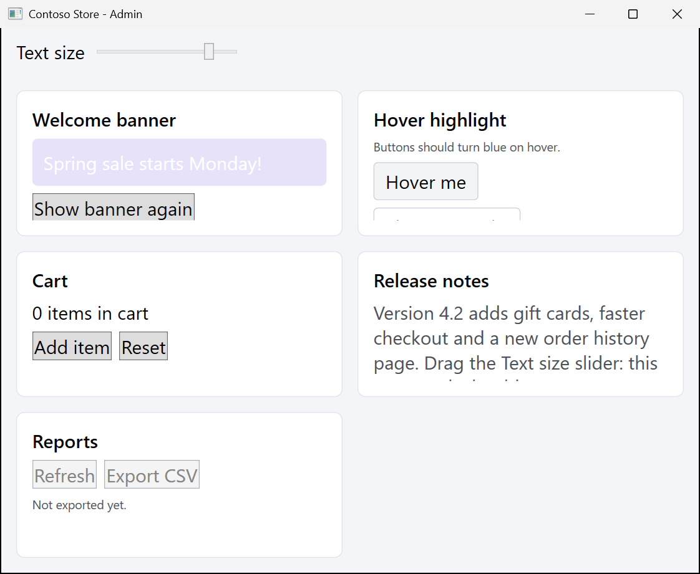
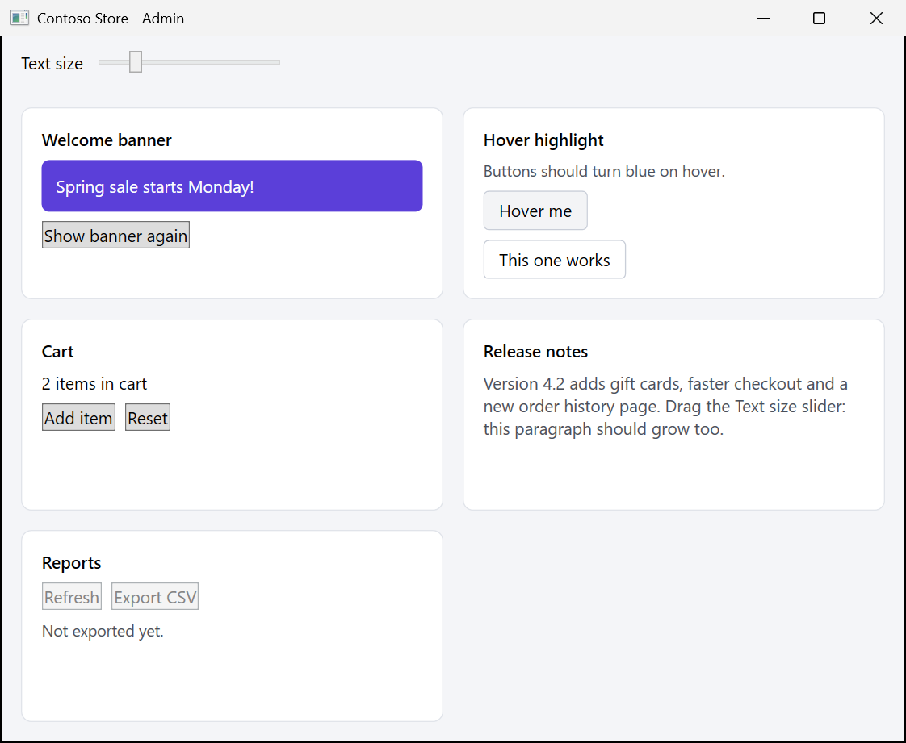
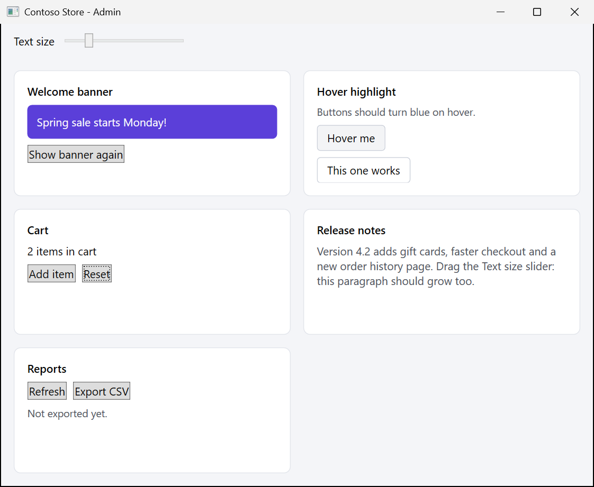

# Session transcript

Source: `Q:\source\XamlAgentDemos-notes\test-runs\PrecedenceWars\r9\events.jsonl`

## Tool usage

- xaml_interact: 15
- xaml_get_element_properties: 9
- get_file: 6
- debugger_evaluate_expressions: 6
- xaml_get_status: 5
- xaml_capture_image: 4
- xaml_explain_property_value: 4
- skill: 3
- powershell: 3
- xaml_get_visual_tree: 2
- xaml_get_binding_failures: 2
- xaml_apply_hot_reload: 2
- task: 2
- debugger_get_threads: 2
- debugger_continue: 2
- debugger_wait: 2
- task_complete: 2
- get_projects_in_solution: 1
- view: 1
- glob: 1
- multi_replace_string_in_file: 1
- file_search: 1
- debugger_pause: 1
- debugger_get_call_stack: 1
- write_agent: 1
- replace_string_in_file: 1
- grep_search: 1
- debugger_read_file: 1
- debugger_set_breakpoints: 1
- debugger_ui_tree: 1
- debugger_ui_interact: 1
- debugger_remove_breakpoints: 1

Failed tool calls: 2, images: 4


_Model: gpt-6.1-terra_


## User (14:34:01)

Each card in my running app has a property that refuses to change. Figure out why for every card using the live app, prove it, and fix the source.


**Tool call (14:34:04):** `skill`
```json
{
 "skill": "xaml-diagnostics"
}
```

<details><summary>Result `skill` success=true</summary>

```
Skill "xaml-diagnostics" loaded successfully. Follow the instructions in the skill context.
```
</details>


_Skill invoked: xaml-diagnostics_


**Assistant (14:34:07):**

I’ll inspect the live cards and trace each blocked property to its source, then verify the fixes in the running app.


**Tool call (14:34:07):** `xaml_get_status`
```json
{
 "progressMessage": "Inspecting the running XAML app"
}
```

<details><summary>Result `xaml_get_status` success=true</summary>

```
{"isDebugging":true,"debuggerState":"running","diagnosticsActive":true,"apps":[{"app":"a1","name":"PrecedenceWars.exe [58468]","processId":58468,"platform":"WPF (.NET)","isRemote":false,"isDesignTimeOrNoDebug":false,"sourceInfoAvailable":true,"hotReloadSupported":true,"hotReloadEnabled":true,"supportsPropertyExplorer":true,"supportsInAppToolbar":true,"supportsHitTest":true,"windows":[{"windowId":"0x5107C2","title":"Contoso Store - Admin","bounds":{"x":152,"y":152,"width":1140,"height":930},"dpiScale":1.5,"visible":true,"minimized":false}]}],"issues":[],"issuesSummary":"No problems detected.","hotReload":{"options":{"hotReloadEnabled":true,"hotReloadOnSave":false,"applyMode":"asYouType: XAML edits apply as you type, without saving (default)","wpfEnabled":true,"uwpEnabled":true,"winUIEnabled":true,"mauiEnabled":true,"justMyXaml":true,"previewSelectedElement":false,"inAppToolbar":true,"inAppSelection":false,"layoutAdorners":false,"trackFocusedElement":false,"bindingFailuresVisible":true,"compatibilityMode":false},"dotNetHotReloadEnabled":true,"isProcessingChanges":false,"errors":[]},"windowsNote":"Window bounds are physical screen pixels and include the window frame. A WPF/WinUI Window's Width and Height are device-independent units (DIPs) that also include the frame, so Width = bounds.width / dpiScale. A user's \"800 px wide\" is ambiguous: say which unit you tested. A minimized window reports x/y = -32000 and can't be captured."}
```
</details>


**Tool call (14:34:10):** `xaml_get_visual_tree`
```json
{
 "progressMessage": "Finding the live cards",
 "app": "a1",
 "depth": 6,
 "maxNodes": 300
}
```


**Tool call (14:34:10):** `xaml_capture_image`
```json
{
 "progressMessage": "Viewing the running cards",
 "app": "a1"
}
```


**Tool call (14:34:10):** `get_projects_in_solution`
```json
{}
```


**Tool call (14:34:10):** `view`
```json
{
 "path": "c:\\vs\\fastmain\\common7\\ide\\commonextensions\\microsoft\\xamldiagnostics\\AgentTools\\skills\\xaml-diagnostics\\references\\xaml-authoring.md"
}
```

<details><summary>Result `xaml_get_visual_tree` success=true</summary>

```
{"app":"a1","platform":"WPF (.NET)","sourceInfoAvailable":true,"nodeCount":37,"truncated":false,"depthLimitedNodes":7,"hint":"7 node(s) have children beyond the requested depth (childCount > 0, no children listed). Raise depth or pass rootElementId to expand them.","nodes":[{"id":"a1:10","type":"PrecedenceWars.MainWindow","source":{"file":"Q:\\source\\XamlAgentDemos\\src\\PrecedenceWars\\MainWindow.xaml","line":3,"column":9},"childCount":1,"children":[{"id":"a1:11","type":"System.Windows.Controls.Border","childCount":1,"children":[{"id":"a1:12","type":"System.Windows.Documents.AdornerDecorator","childCount":2,"children":[{"id":"a1:13","type":"System.Windows.Controls.ContentPresenter","childCount":1,"children":[{"id":"a1:15","type":"System.Windows.Controls.DockPanel","source":{"file":"Q:\\source\\XamlAgentDemos\\src\\PrecedenceWars\\MainWindow.xaml","line":53,"column":6},"childCount":2,"children":[{"id":"a1:16","type":"System.Windows.Controls.StackPanel","source":{"file":"Q:\\source\\XamlAgentDemos\\src\\PrecedenceWars\\MainWindow.xaml","line":54,"column":10},"childCount":2,"children":[{"id":"a1:18","type":"System.Windows.Controls.TextBlock","source":{"file":"Q:\\source\\XamlAgentDemos\\src\\PrecedenceWars\\MainWindow.xaml","line":57,"column":14},"childCount":0},{"id":"a1:19","type":"System.Windows.Controls.Slider","name":"TextSizeSlider","source":{"file":"Q:\\source\\XamlAgentDemos\\src\\PrecedenceWars\\MainWindow.xaml","line":58,"column":14},"childCount":1,"children":[{"id":"a1:25","type":"System.Windows.Controls.Border","name":"border","childCount":1,"children":[{"id":"a1:31","type":"System.Windows.Controls.Grid","childCount":4}]}]}]},{"id":"a1:17","type":"System.Windows.Controls.Primitives.UniformGrid","source":{"file":"Q:\\source\\XamlAgentDemos\\src\\PrecedenceWars\\MainWindow.xaml","line":67,"column":10},"childCount":5,"children":[{"id":"a1:20","type":"System.Windows.Controls.Border","source":{"file":"Q:\\source\\XamlAgentDemos\\src\\PrecedenceWars\\MainWindow.xaml","line":69,"column":14},"childCount":1,"children":[{"id":"a1:26","type":"System.Windows.Controls.StackPanel","source":{"file":"Q:\\source\\XamlAgentDemos\\src\\PrecedenceWars\\MainWindow.xaml","line":70,"column":18},"childCount":3,"children":[{"id":"a1:32","type":"System.Windows.Controls.TextBlock","source":{"file":"Q:\\source\\XamlAgentDemos\\src\\PrecedenceWars\\MainWindow.xaml","line":71,"column":22},"childCount":0},{"id":"a1:33","type":"System.Windows.Controls.Border","name":"WelcomeBa
... [truncated 4248 chars]
```
</details>

<details><summary>Result `get_projects_in_solution` success=true</summary>

```
src\GhostClicks\GhostClicks.csproj
src\GermanReady\GermanReady.csproj
src\ThemeBreaker\ThemeBreaker.csproj
src\DesignPolish\DesignPolish.csproj
src\HotReloadDoctor\HotReloadDoctor.csproj
src\VanishingSave\VanishingSave.csproj
src\CrispPixels\CrispPixels.csproj
src\PrecedenceWars\PrecedenceWars.csproj
src\LostWindows\LostWindows.csproj
src\TemplateDetective\TemplateDetective.csproj
src\SlowScroll\SlowScroll.csproj
src\PixelPerfect\PixelPerfect.csproj
src\BindingStorm\BindingStorm.csproj
src\BugRepro\BugRepro.csproj
src\A11ySweep\A11ySweep.csproj
src\StyleMaze\StyleMaze.csproj
src\ResponsiveDashboard\ResponsiveDashboard.csproj

```
</details>


<details><summary>Result `xaml_capture_image` success=true</summary>

```
Screenshot of window 0x5107C2 "Contoso Store - Admin" of app a1 (1122x921 image of the window's client area, so it's slightly smaller than the frame bounds from xaml_get_status).
```
</details>

<details><summary>Result `view` success=true</summary>

```
# XAML authoring guidance

Follow these rules when writing or changing XAML so it works well with XAML Hot Reload, the XAML designer, and XAML Diagnostics.

## Design-time data

- Declare `xmlns:d="http://schemas.microsoft.com/expression/blend/2008"` and `xmlns:mc="http://schemas.openxmlformats.org/markup-compatibility/2006"` with `mc:Ignorable="d"`.
- Use `d:DataContext="{d:DesignInstance Type=vm:MyViewModel, IsDesignTimeCreatable=False}"` (WPF/UWP) so the designer and IntelliSense know binding paths.
- Use `d:` properties (for example `d:Text="Sample"`) for sample values that appear only at design time.
- .NET MAUI: set `x:DataType` on pages and `DataTemplate`s. It enables compiled bindings and turns many binding failures into build errors.
- WinUI/UWP: prefer `x:Bind` for compile-time checked bindings when the view owns the view model.

## Bindings

- Bind with explicit paths. Avoid string-built paths in code-behind.
- Keep the `DataContext` chain simple. Use `ElementName` or `RelativeSource` only at real scope boundaries (for example inside a `DataTemplate` that needs the page's view model).
- Expose bound properties as public properties that raise `PropertyChanged`. Fields and non-public properties don't bind.
- Use `FallbackValue` and `TargetNullValue` for expected missing values instead of hiding binding errors.
- Before saving, check every binding path against the actual property names on the data context type (case, plurals, nested paths such as `Customer.Address.City`). Misspelled paths are the most common binding failure and they fail silently.
- Inside a `DataTemplate` or `ItemContainerStyle`, the data context is the item, not the page's view model. To reach a page command, use `RelativeSource={RelativeSource AncestorType=...}` with `DataContext.` in the path, or `ElementName`.
- A `TextBox.Text` binding updates its source on `LostFocus` by default (WPF). Use `UpdateSourceTrigger=PropertyChanged` when other UI (validation, enabled state, live search) must react while the user types.
- `Mode=TwoWay` (the default for `TextBox.Text`, `CheckBox.IsChecked`, `Selector.SelectedItem` and similar) needs a property with a public setter. In WPF, a two-way binding to a read-only property throws when the view loads.
- Bindings created in code have no XAML file and line in diagnostics. Prefer declaring bindings in XAML.

## Layout

- Don't put a list (`ListBox`, `ListView`, `DataGrid`, `ItemsControl` with a virtualizing panel) insid
... [truncated 4693 chars]
```
</details>


**Tool call (14:34:16):** `get_file`
```json
{
 "filename": "Q:\\source\\XamlAgentDemos\\src\\PrecedenceWars\\MainWindow.xaml",
 "startLine": 1,
 "endLine": 200
}
```


**Tool call (14:34:16):** `get_file`
```json
{
 "filename": "Q:\\source\\XamlAgentDemos\\src\\PrecedenceWars\\MainWindow.xaml.cs",
 "startLine": 1,
 "endLine": 250
}
```


**Tool call (14:34:16):** `xaml_get_visual_tree`
```json
{
 "progressMessage": "Inspecting card controls",
 "rootElementId": "a1:17",
 "depth": 8,
 "maxNodes": 200
}
```


**Tool call (14:34:16):** `xaml_explain_property_value`
```json
{
 "progressMessage": "Tracing blocked property values",
 "elementIds": [
  "#WelcomeBanner",
  "#HoverButton",
  "#CountText",
  "#ReleaseNotesText",
  "#ToolbarPanel"
 ],
 "propertyNames": [
  "Opacity",
  "Background",
  "Text",
  "FontSize",
  "IsEnabled"
 ],
 "pairwise": true
}
```


**Tool call (14:34:16):** `powershell`
```json
{
 "command": "git status --short; Get-ChildItem src\\PrecedenceWars",
 "description": "Check working tree and project files"
}
```

<details><summary>Result `xaml_get_visual_tree` success=true</summary>

```
{"app":"a1","platform":"WPF (.NET)","sourceInfoAvailable":true,"nodeCount":52,"truncated":false,"nodes":[{"id":"a1:17","type":"System.Windows.Controls.Primitives.UniformGrid","source":{"file":"Q:\\source\\XamlAgentDemos\\src\\PrecedenceWars\\MainWindow.xaml","line":67,"column":10},"childCount":5,"children":[{"id":"a1:20","type":"System.Windows.Controls.Border","source":{"file":"Q:\\source\\XamlAgentDemos\\src\\PrecedenceWars\\MainWindow.xaml","line":69,"column":14},"childCount":1,"children":[{"id":"a1:26","type":"System.Windows.Controls.StackPanel","source":{"file":"Q:\\source\\XamlAgentDemos\\src\\PrecedenceWars\\MainWindow.xaml","line":70,"column":18},"childCount":3,"children":[{"id":"a1:32","type":"System.Windows.Controls.TextBlock","source":{"file":"Q:\\source\\XamlAgentDemos\\src\\PrecedenceWars\\MainWindow.xaml","line":71,"column":22},"childCount":0},{"id":"a1:33","type":"System.Windows.Controls.Border","name":"WelcomeBanner","source":{"file":"Q:\\source\\XamlAgentDemos\\src\\PrecedenceWars\\MainWindow.xaml","line":72,"column":22},"childCount":1,"children":[{"id":"a1:51","type":"System.Windows.Controls.TextBlock","source":{"file":"Q:\\source\\XamlAgentDemos\\src\\PrecedenceWars\\MainWindow.xaml","line":88,"column":26},"childCount":0}]},{"id":"a1:34","type":"System.Windows.Controls.Button","name":"ShowBannerButton","source":{"file":"Q:\\source\\XamlAgentDemos\\src\\PrecedenceWars\\MainWindow.xaml","line":90,"column":22},"childCount":1,"children":[{"id":"a1:52","type":"System.Windows.Controls.Border","name":"border","childCount":1,"children":[{"id":"a1:63","type":"System.Windows.Controls.ContentPresenter","name":"contentPresenter","childCount":1,"children":[{"id":"a1:74","type":"System.Windows.Controls.TextBlock","childCount":0}]}]}]}]}]},{"id":"a1:21","type":"System.Windows.Controls.Border","source":{"file":"Q:\\source\\XamlAgentDemos\\src\\PrecedenceWars\\MainWindow.xaml","line":99,"column":14},"childCount":1,"children":[{"id":"a1:27","type":"System.Windows.Controls.StackPanel","source":{"file":"Q:\\source\\XamlAgentDemos\\src\\PrecedenceWars\\MainWindow.xaml","line":100,"column":18},"childCount":4,"children":[{"id":"a1:35","type":"System.Windows.Controls.TextBlock","source":{"file":"Q:\\source\\XamlAgentDemos\\src\\PrecedenceWars\\MainWindow.xaml","line":101,"column":22},"childCount":0},{"id":"a1:36","type":"System.Windows.Controls.TextBlock","source":{"file":"Q:\\source\\XamlAgentDemos\\src\\PrecedenceWars\\MainWindow.xaml","line":102,"column":22},
... [truncated 6089 chars]
```
</details>

<details><summary>Result `xaml_explain_property_value` success=true</summary>

```
{"count":5,"failed":0,"results":[{"id":"#WelcomeBanner","type":"System.Windows.Controls.Border","property":"Opacity","propertyType":"System.Double","effectiveValue":"0.15000000000000002","effectiveSource":"Animation","chain":[{"kind":"Animation","description":"An active animation (Storyboard or VisualState). It overrides local and style values while it holds the value.","value":"0.15000000000000002","valueType":"System.Double","effective":true},{"kind":"Default","description":"The property's default value; nothing sets it.","value":"1","valueType":"System.Double","effective":false}],"notes":["Find the Storyboard or VisualState that animates this property; local and style changes have no visible effect while it holds the value (FillBehavior=HoldEnd is common)."]},{"id":"#HoverButton","type":"System.Windows.Controls.Button","property":"Background","propertyType":"System.Windows.Media.Brush","effectiveValue":"#FFF3F4F6","effectiveSource":"Local","chain":[{"kind":"Local","description":"Local value set on the element (XAML attribute, binding or code). Wins over styles, templates and inheritance.","value":"#FFF3F4F6","valueType":"System.Windows.Media.SolidColorBrush","effective":true,"sourceLocation":{"file":"Q:\\source\\XamlAgentDemos\\src\\PrecedenceWars\\MainWindow.xaml","line":103,"column":22}},{"kind":"Style","description":"Setter in an explicit (x:Key) or implicit (TargetType) Style.","targetType":"System.Windows.Controls.Button","value":"#FFFFFFFF","valueType":"System.Windows.Media.SolidColorBrush","effective":false,"sourceLocation":{"file":"Q:\\source\\XamlAgentDemos\\src\\PrecedenceWars\\MainWindow.xaml","line":29,"column":10}},{"kind":"BuiltInStyle","description":"Setter in the control's default theme style (generic.xaml or the platform theme).","targetType":"System.Windows.Controls.Primitives.ButtonBase","value":"#FFDDDDDD","valueType":"System.Windows.Media.SolidColorBrush","effective":false},{"kind":"Default","description":"The property's default value; nothing sets it.","effective":false}],"notes":["To let a style or template value apply, remove the local value (the attribute, binding or code assignment). To change it, edit that local value. XAML and code both produce Local values, and the source location may still point to the XAML attribute after code assigned a new value. If the live value differs from the XAML attribute, or the element has no XAML attribute for it, code set it: search code-behind for the element's x:Name."]},{"id":"#CountText","
... [truncated 3432 chars]
```
</details>

<details><summary>Result `get_file` success=true</summary>

```
```csharp src\PrecedenceWars\MainWindow.xaml.cs (Lines 1-25 of 25 total. Call tools for more if needed.)
using System.Windows;

namespace PrecedenceWars;

public partial class MainWindow : Window
{
    private readonly StoreViewModel viewModel = new();

    public MainWindow()
    {
        this.InitializeComponent();
        this.DataContext = this.viewModel;
    }

    private void OnShowBannerClick(object sender, RoutedEventArgs e)
    {
        this.WelcomeBanner.Opacity = 1;
    }

    private void OnResetClick(object sender, RoutedEventArgs e)
    {
        this.viewModel.ItemCount = 0;
        this.CountText.Text = "0 items in cart";
    }
}

```


```
</details>

<details><summary>Result `get_file` success=true</summary>

```
```xaml src\PrecedenceWars\MainWindow.xaml (Lines 1-164 of 164 total. Call tools for more if needed.)
<Window x:Class="PrecedenceWars.MainWindow"
        xmlns="http://schemas.microsoft.com/winfx/2006/xaml/presentation"
        xmlns:x="http://schemas.microsoft.com/winfx/2006/xaml"
        Title="Contoso Store - Admin"
        Width="760"
        Height="620"
        FontSize="{Binding Value, ElementName=TextSizeSlider}">
    <Window.Resources>
        <Style x:Key="CardStyle" TargetType="Border">
            <Setter Property="Background" Value="White" />
            <Setter Property="BorderBrush" Value="#E1E4EA" />
            <Setter Property="BorderThickness" Value="1" />
            <Setter Property="CornerRadius" Value="8" />
            <Setter Property="Padding" Value="16" />
            <Setter Property="Margin" Value="8" />
        </Style>

        <Style x:Key="CardTitleStyle" TargetType="TextBlock">
            <Setter Property="FontWeight" Value="SemiBold" />
            <Setter Property="Margin" Value="0,0,0,8" />
        </Style>

        <Style x:Key="BodyTextStyle" TargetType="TextBlock">
            <Setter Property="FontSize" Value="13" />
            <Setter Property="Foreground" Value="#4A4F5A" />
            <Setter Property="TextWrapping" Value="Wrap" />
        </Style>

        <Style x:Key="HoverButtonStyle" TargetType="Button">
            <Setter Property="Background" Value="White" />
            <Setter Property="Padding" Value="12,6" />
            <Setter Property="Template">
                <Setter.Value>
                    <ControlTemplate TargetType="Button">
                        <Border Padding="{TemplateBinding Padding}"
                                Background="{TemplateBinding Background}"
                                BorderBrush="#C9CED8"
                                BorderThickness="1"
                                CornerRadius="4">
                            <ContentPresenter HorizontalAlignment="Center" />
                        </Border>
                    </ControlTemplate>
                </Setter.Value>
            </Setter>
            <Style.Triggers>
                <Trigger Property="IsMouseOver" Value="True">
                    <Setter Property="Background" Value="#DCE8FF" />
                </Trigger>
            </Style.Triggers>
        </Style>
    </Window.Resources>

    <DockPanel Background="#F4F5F8">
        <StackPanel Margin
... [truncated 5586 chars]
```
</details>

<details><summary>Result `powershell` success=true</summary>

```
Directory: Q:\source\XamlAgentDemos\src\PrecedenceWars

Mode                 LastWriteTime         Length Name
----                 -------------         ------ ----
d----          11/13/2026  1:15 PM                bin
d----          11/13/2026  1:15 PM                obj
-a---          11/12/2026  5:14 PM            238 App.xaml
-a---          11/12/2026  5:14 PM            245 App.xaml.cs
-a---          11/15/2026  9:08 AM           7972 MainWindow.xaml
-a---          11/15/2026  9:10 AM            577 MainWindow.xaml.cs
-a---          11/12/2026  5:14 PM            137 PrecedenceWars.csproj
-a---          11/15/2026  9:10 AM           1738 StoreViewModel.cs
<shellId: 0 completed with exit code 0>
```
</details>


**Assistant (14:34:23):**

The five cards have different precedence problems. I’ll reproduce their behavior before changing the source; the hover check will move the pointer briefly.


**Tool call (14:34:23):** `get_file`
```json
{
 "filename": "Q:\\source\\XamlAgentDemos\\src\\PrecedenceWars\\StoreViewModel.cs",
 "startLine": 1,
 "endLine": 250
}
```


**Tool call (14:34:23):** `xaml_interact`
```json
{
 "progressMessage": "Testing banner restoration",
 "elementId": "#ShowBannerButton",
 "action": "invoke",
 "checkProperties": "Opacity",
 "checkElementIds": [
  "#WelcomeBanner"
 ]
}
```


**Tool call (14:34:23):** `xaml_explain_property_value`
```json
{
 "progressMessage": "Tracing report button enablement",
 "elementIds": [
  "#RefreshButton",
  "#ExportButton"
 ],
 "propertyNames": [
  "IsEnabled"
 ]
}
```


**Tool call (14:34:23):** `xaml_get_element_properties`
```json
{
 "progressMessage": "Inspecting report and cart state",
 "elementIds": [
  "#ToolbarPanel",
  "#CountText",
  "#TextSizeSlider"
 ],
 "nameFilter": "IsEnabled|Value|DataContext.IsIdle|DataContext.ItemCount"
}
```


**Tool call (14:34:23):** `xaml_get_binding_failures`
```json
{
 "progressMessage": "Checking live binding failures"
}
```

<details><summary>Result `xaml_get_binding_failures` success=true</summary>

```
{"note":"This is a cumulative log since debugging started or the last xaml_clear_binding_failures, not live state: fixed failures stay listed. occurrencesSinceLastRead counts new occurrences since your previous call (0 = not seen again; it only grows when the UI using the binding is created or updated again). pathStillInSource=false means the XAML near that line no longer contains the failing path, so it was probably fixed in source (hot reload or a restart applies it). To verify a fix: clear, revisit the UI that uses the binding, then read again. Failures without a file usually come from bindings created in code.","totalUnique":0,"matched":0,"truncated":false,"failures":[]}
```
</details>

<details><summary>Result `xaml_get_element_properties` success=true</summary>

```
{"count":3,"failed":3,"results":[{"id":"#ToolbarPanel","error":"INVALID_ARGUMENT","message":"'IsEnabled' comes before any collection item path in nameFilter 'IsEnabled|Value|DataContext.IsIdle|DataContext.ItemCount'.","hint":"Either filter the element's own properties (\"Width|Margin\") or items (\"ColumnDefinitions[*].Width|ActualWidth\") in one call, not both; make a second call for the other."},{"id":"#CountText","error":"INVALID_ARGUMENT","message":"'IsEnabled' comes before any collection item path in nameFilter 'IsEnabled|Value|DataContext.IsIdle|DataContext.ItemCount'.","hint":"Either filter the element's own properties (\"Width|Margin\") or items (\"ColumnDefinitions[*].Width|ActualWidth\") in one call, not both; make a second call for the other."},{"id":"#TextSizeSlider","error":"INVALID_ARGUMENT","message":"'IsEnabled' comes before any collection item path in nameFilter 'IsEnabled|Value|DataContext.IsIdle|DataContext.ItemCount'.","hint":"Either filter the element's own properties (\"Width|Margin\") or items (\"ColumnDefinitions[*].Width|ActualWidth\") in one call, not both; make a second call for the other."}]}
```
</details>

<details><summary>Result `get_file` success=true</summary>

```
```csharp src\PrecedenceWars\StoreViewModel.cs (Lines 1-69 of 69 total. Call tools for more if needed.)
using System.Diagnostics;

namespace PrecedenceWars;

public sealed class StoreViewModel : ObservableObject
{
    private int itemCount = 2;
    private bool isBusy;
    private string lastExport = "Not exported yet.";

    public StoreViewModel()
    {
        this.AddItemCommand = new RelayCommand(() => this.ItemCount++);
        this.ExportCommand = new RelayCommand(() => this.LastExport = $"Exported at {DateTime.Now:t}.", () => true);
        this.SyncCatalog();
    }

    public RelayCommand AddItemCommand { get; }

    public RelayCommand ExportCommand { get; }

    public int ItemCount
    {
        get => this.itemCount;
        set => this.SetProperty(ref this.itemCount, value);
    }

    public bool IsBusy
    {
        get => this.isBusy;
        private set
        {
            if (this.SetProperty(ref this.isBusy, value))
            {
                this.OnPropertyChanged(nameof(this.IsIdle));
            }
        }
    }

    public bool IsIdle => !this.IsBusy;

    public string LastExport
    {
        get => this.lastExport;
        private set => this.SetProperty(ref this.lastExport, value);
    }

    private void SyncCatalog()
    {
        this.IsBusy = true;
        try
        {
            if (this.IsOffline())
            {
                throw new TimeoutException("Catalog service didn't respond.");
            }
        }
        catch (TimeoutException ex)
        {
            Debug.WriteLine($"Catalog sync failed: {ex.Message}");
            return;
        }

        this.IsBusy = false;
    }

    // Simulates the offline case: the catalog service isn't reachable.
    private bool IsOffline() => true;
}

```


```
</details>

<details><summary>Result `xaml_explain_property_value` success=true</summary>

```
{"count":2,"failed":0,"results":[{"id":"#RefreshButton","type":"System.Windows.Controls.Button","property":"IsEnabled","propertyType":"System.Boolean","effectiveValue":"False","effectiveSource":"Coercion","chain":[{"kind":"Coercion","description":"The control coerced the value (for example clamped to a minimum or maximum).","value":"False","valueType":"System.Boolean","effective":true},{"kind":"Default","description":"The property's default value; nothing sets it.","value":"True","valueType":"System.Boolean","effective":false}],"notes":["Check related properties that constrain this one (for example Minimum/Maximum or MinWidth/MaxWidth).","IsEnabled is False because ancestor System.Windows.Controls.StackPanel 'ToolbarPanel' (id a1:45, 1 level(s) up) has IsEnabled=False from Local (a binding whose source value is false; check the bound property). A disabled parent disables all of its descendants; fix it there, or move this control outside that parent."]},{"id":"#ExportButton","type":"System.Windows.Controls.Button","property":"IsEnabled","propertyType":"System.Boolean","effectiveValue":"False","effectiveSource":"Coercion","chain":[{"kind":"Coercion","description":"The control coerced the value (for example clamped to a minimum or maximum).","value":"False","valueType":"System.Boolean","effective":true},{"kind":"Default","description":"The property's default value; nothing sets it.","value":"True","valueType":"System.Boolean","effective":false}],"notes":["Check related properties that constrain this one (for example Minimum/Maximum or MinWidth/MaxWidth).","IsEnabled is False because ancestor System.Windows.Controls.StackPanel 'ToolbarPanel' (id a1:45, 1 level(s) up) has IsEnabled=False from Local (a binding whose source value is false; check the bound property). A disabled parent disables all of its descendants; fix it there, or move this control outside that parent."]}]}
```
</details>

<details><summary>Result `xaml_interact` success=true</summary>

```
{"id":"#ShowBannerButton","action":"invoke","result":"Invoked.","supportedPatterns":["Invoke","SynchronizedInput"],"checks":[{"id":"#WelcomeBanner","changed":false,"before":[{"name":"Opacity","value":"0.15000000000000002","evaluatedValue":null,"valueType":"System.Double","propertyType":null,"valueSource":"Animation","valueSourceName":null,"valueSourceLocation":null,"valueLocation":null,"isBinding":null,"isCollection":null,"isAttached":null,"readOnly":null,"overridden":null}],"after":[{"name":"Opacity","value":"0.15000000000000002","evaluatedValue":null,"valueType":"System.Double","propertyType":null,"valueSource":"Animation","valueSourceName":null,"valueSourceLocation":null,"valueLocation":null,"isBinding":null,"isCollection":null,"isAttached":null,"readOnly":null,"overridden":null}]}],"checksNote":"changed=false means none of the checked properties changed 300 ms after the action: the action reached the control but its handler, command or binding had no visible effect (or the effect is elsewhere, so check other elements). Slow async work may need another read.","note":"Call xaml_capture_image or xaml_get_element_properties to verify the effect, or pass checkProperties next time to compare values before and after. Automation actions bypass mouse hit testing, so a successful invoke doesn't prove a real click reaches the element; call xaml_hit_test for that."}
```
</details>


**Tool call (14:34:27):** `xaml_interact`
```json
{
 "progressMessage": "Testing the hover highlight",
 "elementId": "#HoverButton",
 "action": "hover",
 "checkProperties": "IsMouseOver|Background"
}
```

<details><summary>Result `xaml_interact` success=true</summary>

```
{"id":"#HoverButton","action":"hover","result":"Moved the real mouse cursor over the element's center; the app window was brought to the front and activated first. The app received real mouse-move input, so mouse-over triggers and PointerOver visual states apply as for a user. The cursor stays there (moving the real mouse or calling 'unhover' ends it); read properties now (or pass checkProperties) to see the hover values, then call 'unhover'.","cursorTarget":"A click at its center reaches 'HoverButton' (input lands on TextBlock (in the template of Button 'HoverButton')).","checks":[{"id":"#HoverButton","changed":true,"before":[{"name":"Background","value":"#FFF3F4F6","evaluatedValue":null,"valueType":"System.Windows.Media.SolidColorBrush","propertyType":"System.Windows.Media.Brush","valueSource":"Local","valueSourceName":null,"valueSourceLocation":null,"valueLocation":null,"isBinding":null,"isCollection":null,"isAttached":null,"readOnly":null,"overridden":null}],"after":[{"name":"Background","value":"#FFF3F4F6","evaluatedValue":null,"valueType":"System.Windows.Media.SolidColorBrush","propertyType":"System.Windows.Media.Brush","valueSource":"Local","valueSourceName":null,"valueSourceLocation":null,"valueLocation":null,"isBinding":null,"isCollection":null,"isAttached":null,"readOnly":null,"overridden":null},{"name":"IsMouseOver","value":"True","evaluatedValue":null,"valueType":"System.Boolean","propertyType":null,"valueSource":"Local","valueSourceName":null,"valueSourceLocation":null,"valueLocation":null,"isBinding":null,"isCollection":null,"isAttached":null,"readOnly":true,"overridden":null}]}],"checksNote":"changed=false after hover means no checked property reacted to the mouse: no IsMouseOver trigger or PointerOver state sets it, a local value or animation outranks the trigger, or the cursor landed on another element (see cursorTarget).","note":"Hover uses the real cursor, so the user's mouse moves. Capture an image or read properties while hovering, then call 'unhover' to end it."}
```
</details>


**Tool call (14:34:30):** `xaml_interact`
```json
{
 "progressMessage": "Ending hover test",
 "elementId": "#HoverButton",
 "action": "unhover"
}
```

<details><summary>Result `xaml_interact` success=true</summary>

```
{"id":"#HoverButton","action":"unhover","result":"Moved the mouse cursor off the element (back to where it was before the first hover, if that's outside it), so mouse-over states end.","note":"Hover uses the real cursor, so the user's mouse moves. Capture an image or read properties while hovering, then call 'unhover' to end it."}
```
</details>


**Tool call (14:34:32):** `xaml_interact`
```json
{
 "progressMessage": "Reproducing cart reset behavior",
 "elementId": "#ResetButton",
 "action": "invoke",
 "checkProperties": "Text",
 "checkElementIds": [
  "#CountText"
 ]
}
```

<details><summary>Result `xaml_interact` success=true</summary>

```
{"id":"#ResetButton","action":"invoke","result":"Invoked.","supportedPatterns":["Invoke","SynchronizedInput"],"checks":[{"id":"#CountText","changed":true,"before":[{"name":"Text","value":"System.Windows.Data.BindingExpression","evaluatedValue":"2 items in cart (System.String)","valueType":"System.Windows.Data.BindingExpression","propertyType":"System.String","valueSource":"Local","valueSourceName":null,"valueSourceLocation":null,"valueLocation":null,"isBinding":true,"isCollection":null,"isAttached":null,"readOnly":null,"overridden":null}],"after":[{"name":"Text","value":"0 items in cart","evaluatedValue":null,"valueType":"System.String","propertyType":null,"valueSource":"Local","valueSourceName":null,"valueSourceLocation":null,"valueLocation":null,"isBinding":null,"isCollection":null,"isAttached":null,"readOnly":null,"overridden":null}]}],"checksNote":"changed=false means none of the checked properties changed 300 ms after the action: the action reached the control but its handler, command or binding had no visible effect (or the effect is elsewhere, so check other elements). Slow async work may need another read.","note":"Call xaml_capture_image or xaml_get_element_properties to verify the effect, or pass checkProperties next time to compare values before and after. Automation actions bypass mouse hit testing, so a successful invoke doesn't prove a real click reaches the element; call xaml_hit_test for that."}
```
</details>


**Tool call (14:34:35):** `xaml_interact`
```json
{
 "progressMessage": "Testing cart updates after reset",
 "elementId": "#AddButton",
 "action": "invoke",
 "checkProperties": "Text",
 "checkElementIds": [
  "#CountText"
 ]
}
```

<details><summary>Result `xaml_interact` success=true</summary>

```
{"id":"#AddButton","action":"invoke","result":"Invoked.","supportedPatterns":["Invoke","SynchronizedInput"],"checks":[{"id":"#CountText","changed":false,"before":[{"name":"Text","value":"0 items in cart","evaluatedValue":null,"valueType":"System.String","propertyType":null,"valueSource":"Local","valueSourceName":null,"valueSourceLocation":null,"valueLocation":null,"isBinding":null,"isCollection":null,"isAttached":null,"readOnly":null,"overridden":null}],"after":[{"name":"Text","value":"0 items in cart","evaluatedValue":null,"valueType":"System.String","propertyType":null,"valueSource":"Local","valueSourceName":null,"valueSourceLocation":null,"valueLocation":null,"isBinding":null,"isCollection":null,"isAttached":null,"readOnly":null,"overridden":null}]}],"checksNote":"changed=false means none of the checked properties changed 300 ms after the action: the action reached the control but its handler, command or binding had no visible effect (or the effect is elsewhere, so check other elements). Slow async work may need another read.","note":"Call xaml_capture_image or xaml_get_element_properties to verify the effect, or pass checkProperties next time to compare values before and after. Automation actions bypass mouse hit testing, so a successful invoke doesn't prove a real click reaches the element; call xaml_hit_test for that."}
```
</details>


**Tool call (14:34:38):** `xaml_interact`
```json
{
 "progressMessage": "Testing release note text sizing",
 "elementId": "#TextSizeSlider",
 "action": "setValue",
 "value": "20",
 "checkProperties": "FontSize",
 "checkElementIds": [
  "#ReleaseNotesText"
 ]
}
```

<details><summary>Result `xaml_interact` success=true</summary>

```
{"id":"#TextSizeSlider","action":"setValue","result":"Value is now 20.","supportedPatterns":["RangeValue","SynchronizedInput"],"checks":[{"id":"#ReleaseNotesText","changed":false,"before":[{"name":"FontSize","value":"13","evaluatedValue":null,"valueType":"System.Double","propertyType":null,"valueSource":"Style","valueSourceName":null,"valueSourceLocation":{"file":"Q:\\source\\XamlAgentDemos\\src\\PrecedenceWars\\MainWindow.xaml","line":23,"column":10},"valueLocation":null,"isBinding":null,"isCollection":null,"isAttached":null,"readOnly":null,"overridden":null}],"after":[{"name":"FontSize","value":"13","evaluatedValue":null,"valueType":"System.Double","propertyType":null,"valueSource":"Style","valueSourceName":null,"valueSourceLocation":{"file":"Q:\\source\\XamlAgentDemos\\src\\PrecedenceWars\\MainWindow.xaml","line":23,"column":10},"valueLocation":null,"isBinding":null,"isCollection":null,"isAttached":null,"readOnly":null,"overridden":null}]}],"checksNote":"changed=false means none of the checked properties changed 300 ms after the action: the action reached the control but its handler, command or binding had no visible effect (or the effect is elsewhere, so check other elements). Slow async work may need another read.","note":"Call xaml_capture_image or xaml_get_element_properties to verify the effect, or pass checkProperties next time to compare values before and after. Automation actions bypass mouse hit testing, so a successful invoke doesn't prove a real click reaches the element; call xaml_hit_test for that."}
```
</details>


**Tool call (14:34:43):** `xaml_get_element_properties`
```json
{
 "progressMessage": "Inspecting report busy state",
 "elementIds": [
  "#ToolbarPanel"
 ],
 "nameFilter": "DataContext.IsBusy|DataContext.IsIdle"
}
```


**Tool call (14:34:43):** `xaml_explain_property_value`
```json
{
 "progressMessage": "Tracing active hover trigger",
 "elementIds": [
  "#HoverButton",
  "#CountText",
  "#ReleaseNotesText"
 ],
 "propertyNames": [
  "Background",
  "Text",
  "FontSize"
 ],
 "pairwise": true
}
```


**Tool call (14:34:43):** `get_file`
```json
{
 "filename": "Q:\\source\\XamlAgentDemos\\src\\PrecedenceWars\\PrecedenceWars.csproj",
 "startLine": 1,
 "endLine": 40
}
```


**Tool call (14:34:43):** `glob`
```json
{
 "pattern": "**\\*PrecedenceWars*"
}
```

<details><summary>Result `glob` success=true</summary>

```
.\src\PrecedenceWars\PrecedenceWars.csproj
```
</details>

<details><summary>Result `get_file` success=true</summary>

```
``` src\PrecedenceWars\PrecedenceWars.csproj (Lines 1-5 of 5 total. Call tools for more if needed.)
<Project Sdk="Microsoft.NET.Sdk">
  <PropertyGroup>
    <RootNamespace>PrecedenceWars</RootNamespace>
  </PropertyGroup>
</Project>

```


```
</details>

<details><summary>Result `xaml_get_element_properties` success=true</summary>

```
{"id":"#ToolbarPanel","type":"System.Windows.Controls.StackPanel","name":"ToolbarPanel","source":{"file":"Q:\\source\\XamlAgentDemos\\src\\PrecedenceWars\\MainWindow.xaml","line":148,"column":22},"items":[{"path":"DataContext","type":"PrecedenceWars.StoreViewModel","properties":[{"name":"IsBusy","value":"True","valueSource":"Local","readOnly":true},{"name":"IsIdle","value":"False","valueSource":"Default","readOnly":true}]}],"note":"Item properties are live values. Change one with xaml_set_element_property using the same path, for example setters=['ColumnDefinitions[2].Width=Auto']; edit the XAML too to keep the change. Without a property filter, only set values and Actual* sizes are listed."}
```
</details>

<details><summary>Result `xaml_explain_property_value` success=true</summary>

```
{"count":3,"failed":0,"results":[{"id":"#HoverButton","type":"System.Windows.Controls.Button","property":"Background","propertyType":"System.Windows.Media.Brush","effectiveValue":"#FFF3F4F6","effectiveSource":"Local","chain":[{"kind":"Local","description":"Local value set on the element (XAML attribute, binding or code). Wins over styles, templates and inheritance.","value":"#FFF3F4F6","valueType":"System.Windows.Media.SolidColorBrush","effective":true,"sourceLocation":{"file":"Q:\\source\\XamlAgentDemos\\src\\PrecedenceWars\\MainWindow.xaml","line":103,"column":22}},{"kind":"Style","description":"Setter in an explicit (x:Key) or implicit (TargetType) Style.","targetType":"System.Windows.Controls.Button","value":"#FFFFFFFF","valueType":"System.Windows.Media.SolidColorBrush","effective":false,"sourceLocation":{"file":"Q:\\source\\XamlAgentDemos\\src\\PrecedenceWars\\MainWindow.xaml","line":29,"column":10}},{"kind":"BuiltInStyle","description":"Setter in the control's default theme style (generic.xaml or the platform theme).","targetType":"System.Windows.Controls.Primitives.ButtonBase","value":"#FFDDDDDD","valueType":"System.Windows.Media.SolidColorBrush","effective":false},{"kind":"Default","description":"The property's default value; nothing sets it.","effective":false}],"notes":["To let a style or template value apply, remove the local value (the attribute, binding or code assignment). To change it, edit that local value. XAML and code both produce Local values, and the source location may still point to the XAML attribute after code assigned a new value. If the live value differs from the XAML attribute, or the element has no XAML attribute for it, code set it: search code-behind for the element's x:Name."]},{"id":"#CountText","type":"System.Windows.Controls.TextBlock","property":"Text","propertyType":"System.String","effectiveValue":"0 items in cart","effectiveSource":"Local","chain":[{"kind":"Local","description":"Local value set on the element (XAML attribute, binding or code). Wins over styles, templates and inheritance.","value":"0 items in cart","valueType":"System.String","effective":true,"sourceLocation":{"file":"Q:\\source\\XamlAgentDemos\\src\\PrecedenceWars\\MainWindow.xaml","line":121,"column":22}},{"kind":"Default","description":"The property's default value; nothing sets it.","value":"","valueType":"System.String","effective":false}],"notes":["To let a style or template value apply, remove the local value (the attribute, binding or code ass
... [truncated 1102 chars]
```
</details>


**Assistant (14:34:58):**

I reproduced the banner, hover, cart and text-size failures; the reports toolbar is disabled by a busy flag left set after a timeout. I’ll fix each cause while preserving the existing visual design.


**Tool call (14:34:58):** `multi_replace_string_in_file`
```json
{
 "explanation": "Fix the five independent causes while retaining the existing card styles and interactions.",
 "replacements": [
  {
   "filePath": "src\\PrecedenceWars\\MainWindow.xaml",
   "oldString": "                    <Button x:Name=\"HoverButton\"\n                            Margin=\"0,8,0,0\"\n                            HorizontalAlignment=\"Left\"\n                            Background=\"#F3F4F6\"\n                            Content=\"Hover me\"\n                            Style=\"{StaticResource HoverButtonStyle}\" />\n                    <Button x:Name=\"HoverButtonOk\"",
   "newString": "                    <Button x:Name=\"HoverButton\"\n                            Margin=\"0,8,0,0\"\n                            HorizontalAlignment=\"Left\"\n                            Content=\"Hover me\">\n                        <Button.Style>\n                            <Style TargetType=\"Button\" BasedOn=\"{StaticResource HoverButtonStyle}\">\n                                <Setter Property=\"Background\" Value=\"#F3F4F6\" />\n                            </Style>\n                        </Button.Style>\n                    </Button>\n                    <Button x:Name=\"HoverButtonOk\"",
   "explanation": "Keep the button's gray base color in a style setter, allowing the inherited hover trigger to override it."
  },
  {
   "filePath": "src\\PrecedenceWars\\MainWindow.xaml",
   "oldString": "                    <TextBlock Style=\"{StaticResource CardTitleStyle}\" 
... [truncated 2697 chars]
```

<details><summary>Result `multi_replace_string_in_file` success=true</summary>

```
Successfully applied 4 of 4 replacement(s) across 3 file(s).
```
</details>


**Tool call (14:35:05):** `xaml_apply_hot_reload`
```json
{
 "progressMessage": "Applying fixes to the running app",
 "includeCodeChanges": true
}
```

<details><summary>Result `xaml_apply_hot_reload` success=true</summary>

```
{"summary":"XAML: Applied with no new errors. .NET code: applied (see 'codeHotReloadOutput'). New code runs the next time each method is called; code that already ran (constructors, startup, Loaded handlers, a failed operation that left a flag set) isn't re-run, so the state it produced stays until you trigger that code again, reopen the view, or restart the app.","applied":true,"status":"applied","errors":[],"log":[],"lastHotReloadUpdate":{"secondsAgo":7,"updatesSinceToolsStarted":1},"codeChanges":".NET Hot Reload was started for saved code changes. Its results are in the Hot Reload output pane, not in 'log'; if an edit can't be hot reloaded, Visual Studio asks the user to rebuild and restart.","codeStatus":"applied","codeHotReloadOutput":["09:35:07.09  Code changes were successfully applied."],"hint":"Call xaml_capture_image to verify the change visually. Views that aren't loaded (other tabs, closed dialogs) are updated when they're next shown. Source line numbers reported for existing elements can still point to the pre-edit lines until the element is recreated, so find elements by x:Name or type rather than by an old line number. Structural edits (wrapping or replacing a parent, changing a root's content) recreate elements, which resets their runtime state such as selection, checked state, typed text and scroll position, and invalidates their IDs. Re-establish the state you were testing before capturing again."}
```
</details>


**Tool call (14:35:14):** `xaml_capture_image`
```json
{
 "progressMessage": "Inspecting the updated cards",
 "app": "a1"
}
```


**Tool call (14:35:14):** `xaml_get_element_properties`
```json
{
 "progressMessage": "Checking live state after reload",
 "elementIds": [
  "#CountText",
  "#WelcomeBanner",
  "#ReleaseNotesText",
  "#ToolbarPanel"
 ],
 "nameFilter": "Text|Opacity|FontSize|IsEnabled"
}
```


**Tool call (14:35:14):** `powershell`
```json
{
 "command": "git --no-pager diff --check; git --no-pager diff -- src\\PrecedenceWars\\MainWindow.xaml src\\PrecedenceWars\\MainWindow.xaml.cs src\\PrecedenceWars\\StoreViewModel.cs",
 "description": "Review the precise source changes"
}
```




<details><summary>Result `xaml_capture_image` success=true</summary>

```
Screenshot of window 0x5107C2 "Contoso Store - Admin" of app a1 (1122x921 image of the window's client area, so it's slightly smaller than the frame bounds from xaml_get_status).
```
</details>

<details><summary>Result `xaml_get_element_properties` success=true</summary>

```
{"count":4,"failed":0,"results":[{"id":"#CountText","type":"System.Windows.Controls.TextBlock","name":"CountText","source":{"file":"Q:\\source\\XamlAgentDemos\\src\\PrecedenceWars\\MainWindow.xaml","line":121,"column":22},"properties":[{"name":"Text","value":"0 items in cart","valueType":"System.String","valueSource":"Local"},{"name":"FontSize","value":"20","valueType":"System.Double","valueSource":"Inherited"}],"defaultValues":{"IsEnabled":"True","Opacity":"1"},"hiddenDefaultOrOverridden":2,"hint":"Default and overridden values were omitted. Pass includeAll=true to see them, or call xaml_explain_property_value for one property's full precedence chain."},{"id":"#WelcomeBanner","type":"System.Windows.Controls.Border","name":"WelcomeBanner","source":{"file":"Q:\\source\\XamlAgentDemos\\src\\PrecedenceWars\\MainWindow.xaml","line":72,"column":22},"properties":[{"name":"Opacity","value":"0.15000000000000002","valueType":"System.Double","valueSource":"Animation"},{"name":"DataContext","valueType":"PrecedenceWars.StoreViewModel","propertyType":"System.Object","valueSource":"Inherited"}],"defaultValues":{"ContextMenu":null,"IsEnabled":"True"},"hiddenDefaultOrOverridden":3,"hint":"Default and overridden values were omitted. Pass includeAll=true to see them, or call xaml_explain_property_value for one property's full precedence chain."},{"id":"#ReleaseNotesText","type":"System.Windows.Controls.TextBlock","name":"ReleaseNotesText","source":{"file":"Q:\\source\\XamlAgentDemos\\src\\PrecedenceWars\\MainWindow.xaml","line":138,"column":22},"properties":[{"name":"FontSize","evaluatedValue":"20 (System.Double)","valueType":"System.Windows.Data.BindingExpression","propertyType":"System.Double","valueSource":"Local","isBinding":true},{"name":"Text","value":"Version 4.2 adds gift cards, faster checkout and a new order history page. Drag the Text size slider: this paragraph should grow too.","valueType":"System.String","valueSource":"Local"}],"defaultValues":{"IsEnabled":"True","Opacity":"1"},"hiddenDefaultOrOverridden":3,"hint":"Default and overridden values were omitted. Pass includeAll=true to see them, or call xaml_explain_property_value for one property's full precedence chain."},{"id":"#ToolbarPanel","type":"System.Windows.Controls.StackPanel","name":"ToolbarPanel","source":{"file":"Q:\\source\\XamlAgentDemos\\src\\PrecedenceWars\\MainWindow.xaml","line":148,"column":22},"properties":[{"name":"IsEnabled","evaluatedValue":"False (System.Boolean)","valueType":"System.Win
... [truncated 474 chars]
```
</details>

<details><summary>Result `powershell` success=true</summary>

```
diff --git a/src/PrecedenceWars/MainWindow.xaml b/src/PrecedenceWars/MainWindow.xaml
index 5d3f83f..dd33a99 100644
--- a/src/PrecedenceWars/MainWindow.xaml
+++ b/src/PrecedenceWars/MainWindow.xaml
@@ -103,9 +103,13 @@
                     <Button x:Name="HoverButton"
                             Margin="0,8,0,0"
                             HorizontalAlignment="Left"
-                            Background="#F3F4F6"
-                            Content="Hover me"
-                            Style="{StaticResource HoverButtonStyle}" />
+                            Content="Hover me">
+                        <Button.Style>
+                            <Style TargetType="Button" BasedOn="{StaticResource HoverButtonStyle}">
+                                <Setter Property="Background" Value="#F3F4F6" />
+                            </Style>
+                        </Button.Style>
+                    </Button>
                     <Button x:Name="HoverButtonOk"
                             Margin="0,8,0,0"
                             HorizontalAlignment="Left"
@@ -136,6 +140,7 @@
                 <StackPanel>
                     <TextBlock Style="{StaticResource CardTitleStyle}" Text="Release notes" />
                     <TextBlock x:Name="ReleaseNotesText"
+                               FontSize="{Binding Value, ElementName=TextSizeSlider}"
                                Style="{StaticResource BodyTextStyle}"
                                Text="Version 4.2 adds gift cards, faster checkout and a new order history page. Drag the Text size slider: this paragraph should grow too." />
                 </StackPanel>
diff --git a/src/PrecedenceWars/MainWindow.xaml.cs b/src/PrecedenceWars/MainWindow.xaml.cs
index 4e37f4f..e019ba8 100644
--- a/src/PrecedenceWars/MainWindow.xaml.cs
+++ b/src/PrecedenceWars/MainWindow.xaml.cs
@@ -14,12 +14,12 @@ public partial class MainWindow : Window
 
     private void OnShowBannerClick(object sender, RoutedEventArgs e)
     {
+        this.WelcomeBanner.BeginAnimation(OpacityProperty, null);
         this.WelcomeBanner.Opacity = 1;
     }
 
     private void OnResetClick(object sender, RoutedEventArgs e)
     {
         this.viewModel.ItemCount = 0;
-        this.CountText.Text = "0 items in cart";
     }
 }
diff --git a/src/PrecedenceWars/StoreViewModel.cs b/src/PrecedenceWars/StoreViewModel.cs
index 972954a..0dff2e0 100644
--- a/src/PrecedenceWars/StoreViewModel.cs
+++ b/src/PrecedenceWars/StoreViewModel.cs
@@ -58,10 +
... [truncated 437 chars]
```
</details>


**Tool call (14:35:20):** `xaml_interact`
```json
{
 "progressMessage": "Verifying banner restoration",
 "elementId": "#ShowBannerButton",
 "action": "invoke",
 "checkProperties": "Opacity",
 "checkElementIds": [
  "#WelcomeBanner"
 ]
}
```

<details><summary>Result `xaml_interact` success=true</summary>

```
{"id":"#ShowBannerButton","action":"invoke","result":"Invoked.","supportedPatterns":["Invoke","SynchronizedInput"],"checks":[{"id":"#WelcomeBanner","changed":true,"before":[{"name":"Opacity","value":"0.15000000000000002","evaluatedValue":null,"valueType":"System.Double","propertyType":null,"valueSource":"Animation","valueSourceName":null,"valueSourceLocation":null,"valueLocation":null,"isBinding":null,"isCollection":null,"isAttached":null,"readOnly":null,"overridden":null}],"after":[{"name":"Opacity","value":"1","evaluatedValue":null,"valueType":"System.Double","propertyType":null,"valueSource":"Local","valueSourceName":null,"valueSourceLocation":null,"valueLocation":null,"isBinding":null,"isCollection":null,"isAttached":null,"readOnly":null,"overridden":null}]}],"checksNote":"changed=false means none of the checked properties changed 300 ms after the action: the action reached the control but its handler, command or binding had no visible effect (or the effect is elsewhere, so check other elements). Slow async work may need another read.","note":"Call xaml_capture_image or xaml_get_element_properties to verify the effect, or pass checkProperties next time to compare values before and after. Automation actions bypass mouse hit testing, so a successful invoke doesn't prove a real click reaches the element; call xaml_hit_test for that."}
```
</details>


**Tool call (14:35:22):** `xaml_interact`
```json
{
 "progressMessage": "Verifying the hover trigger",
 "elementId": "#HoverButton",
 "action": "hover",
 "checkProperties": "Background"
}
```

<details><summary>Result `xaml_interact` success=true</summary>

```
{"id":"#HoverButton","action":"hover","result":"Moved the real mouse cursor over the element's center. The app received real mouse-move input, so mouse-over triggers and PointerOver visual states apply as for a user. The cursor stays there (moving the real mouse or calling 'unhover' ends it); read properties now (or pass checkProperties) to see the hover values, then call 'unhover'.","cursorTarget":"A click at its center reaches 'HoverButton' (input lands on TextBlock (in the template of Button 'HoverButton')).","checks":[{"id":"#HoverButton","changed":true,"before":[{"name":"Background","value":"#FFF3F4F6","evaluatedValue":null,"valueType":"System.Windows.Media.SolidColorBrush","propertyType":"System.Windows.Media.Brush","valueSource":"Style","valueSourceName":null,"valueSourceLocation":null,"valueLocation":null,"isBinding":null,"isCollection":null,"isAttached":null,"readOnly":null,"overridden":null}],"after":[{"name":"Background","value":"#FFDCE8FF","evaluatedValue":null,"valueType":"System.Windows.Media.SolidColorBrush","propertyType":"System.Windows.Media.Brush","valueSource":"StyleTrigger","valueSourceName":null,"valueSourceLocation":null,"valueLocation":null,"isBinding":null,"isCollection":null,"isAttached":null,"readOnly":null,"overridden":null}]}],"checksNote":"changed=false after hover means no checked property reacted to the mouse: no IsMouseOver trigger or PointerOver state sets it, a local value or animation outranks the trigger, or the cursor landed on another element (see cursorTarget).","note":"Hover uses the real cursor, so the user's mouse moves. Capture an image or read properties while hovering, then call 'unhover' to end it."}
```
</details>


**Tool call (14:35:26):** `xaml_interact`
```json
{
 "progressMessage": "Restoring pointer after hover test",
 "elementId": "#HoverButton",
 "action": "unhover",
 "checkProperties": "Background"
}
```

<details><summary>Result `xaml_interact` success=true</summary>

```
{"id":"#HoverButton","action":"unhover","result":"Moved the mouse cursor off the element (back to where it was before the first hover, if that's outside it), so mouse-over states end.","checks":[{"id":"#HoverButton","changed":true,"before":[{"name":"Background","value":"#FFDCE8FF","evaluatedValue":null,"valueType":"System.Windows.Media.SolidColorBrush","propertyType":"System.Windows.Media.Brush","valueSource":"StyleTrigger","valueSourceName":null,"valueSourceLocation":null,"valueLocation":null,"isBinding":null,"isCollection":null,"isAttached":null,"readOnly":null,"overridden":null}],"after":[{"name":"Background","value":"#FFF3F4F6","evaluatedValue":null,"valueType":"System.Windows.Media.SolidColorBrush","propertyType":"System.Windows.Media.Brush","valueSource":"Style","valueSourceName":null,"valueSourceLocation":null,"valueLocation":null,"isBinding":null,"isCollection":null,"isAttached":null,"readOnly":null,"overridden":null}]}],"checksNote":"changed=false after hover means no checked property reacted to the mouse: no IsMouseOver trigger or PointerOver state sets it, a local value or animation outranks the trigger, or the cursor landed on another element (see cursorTarget).","note":"Hover uses the real cursor, so the user's mouse moves. Capture an image or read properties while hovering, then call 'unhover' to end it."}
```
</details>


**Tool call (14:35:28):** `xaml_interact`
```json
{
 "progressMessage": "Verifying text size and restoring slider",
 "elementId": "#TextSizeSlider",
 "action": "setValue",
 "value": "14",
 "checkProperties": "FontSize",
 "checkElementIds": [
  "#ReleaseNotesText"
 ]
}
```

<details><summary>Result `xaml_interact` success=true</summary>

```
{"id":"#TextSizeSlider","action":"setValue","result":"Value is now 14.","supportedPatterns":["RangeValue","SynchronizedInput"],"checks":[{"id":"#ReleaseNotesText","changed":true,"before":[{"name":"FontSize","value":null,"evaluatedValue":"20 (System.Double)","valueType":"System.Windows.Data.BindingExpression","propertyType":"System.Double","valueSource":"Local","valueSourceName":null,"valueSourceLocation":null,"valueLocation":null,"isBinding":true,"isCollection":null,"isAttached":null,"readOnly":null,"overridden":null}],"after":[{"name":"FontSize","value":null,"evaluatedValue":"14 (System.Double)","valueType":"System.Windows.Data.BindingExpression","propertyType":"System.Double","valueSource":"Local","valueSourceName":null,"valueSourceLocation":null,"valueLocation":null,"isBinding":true,"isCollection":null,"isAttached":null,"readOnly":null,"overridden":null}]}],"checksNote":"changed=false means none of the checked properties changed 300 ms after the action: the action reached the control but its handler, command or binding had no visible effect (or the effect is elsewhere, so check other elements). Slow async work may need another read.","note":"Call xaml_capture_image or xaml_get_element_properties to verify the effect, or pass checkProperties next time to compare values before and after. Automation actions bypass mouse hit testing, so a successful invoke doesn't prove a real click reaches the element; call xaml_hit_test for that."}
```
</details>


**Assistant (14:35:33):**

Three fixes now work live. The original cart binding and startup busy state remain damaged in the existing instance, so I’ll check whether they can be safely restored and retested without restarting it.


**Tool call (14:35:33):** `task`
```json
{
 "name": "live-state-verification",
 "description": "Verify remaining live fixes",
 "agent_type": "debugger",
 "mode": "sync",
 "prompt": "Using the Visual Studio debugger on the running PrecedenceWars app, perform live verification only, do not edit files or restart app. Hot reload applied source changes, but pre-fix interaction broke CountText.Text binding and startup SyncCatalog left IsBusy true. If debugger supports safe evaluation, restore CountText.Text binding as defined in MainWindow.xaml and invoke the existing view model's SyncCatalog() to re-run the hot-reloaded method; report exact results or obstacles. Resume debugger before returning, avoid leaving breakpoints, no unrelated operations. This is expressly requested live proof."
}
```


## User (14:35:34)

Using the Visual Studio debugger on the running PrecedenceWars app, perform live verification only, do not edit files or restart app. Hot reload applied source changes, but pre-fix interaction broke CountText.Text binding and startup SyncCatalog left IsBusy true. If debugger supports safe evaluation, restore CountText.Text binding as defined in MainWindow.xaml and invoke the existing view model's SyncCatalog() to re-run the hot-reloaded method; report exact results or obstacles. Resume debugger before returning, avoid leaving breakpoints, no unrelated operations. This is expressly requested live proof.


**Tool call (14:35:37):** `skill`
```json
{
 "skill": "xaml-diagnostics"
}
```

<details><summary>Result `skill` success=true</summary>

```
Skill "xaml-diagnostics" loaded successfully. Follow the instructions in the skill context.
```
</details>


**Tool call (14:35:40):** `xaml_get_status`
```json
{
 "progressMessage": "Check PrecedenceWars live diagnostics before debugger verification"
}
```

<details><summary>Result `xaml_get_status` success=true</summary>

```
{"isDebugging":true,"debuggerState":"running","diagnosticsActive":true,"apps":[{"app":"a1","name":"PrecedenceWars.exe [58468]","processId":58468,"platform":"WPF (.NET)","isRemote":false,"isDesignTimeOrNoDebug":false,"sourceInfoAvailable":true,"hotReloadSupported":true,"hotReloadEnabled":true,"supportsPropertyExplorer":true,"supportsInAppToolbar":true,"supportsHitTest":true,"windows":[{"windowId":"0x5107C2","title":"Contoso Store - Admin","bounds":{"x":152,"y":152,"width":1140,"height":930},"dpiScale":1.5,"visible":true,"minimized":false}]}],"issues":[],"issuesSummary":"No problems detected.","hotReload":{"options":{"hotReloadEnabled":true,"hotReloadOnSave":false,"applyMode":"asYouType: XAML edits apply as you type, without saving (default)","wpfEnabled":true,"uwpEnabled":true,"winUIEnabled":true,"mauiEnabled":true,"justMyXaml":true,"previewSelectedElement":false,"inAppToolbar":true,"inAppSelection":false,"layoutAdorners":false,"trackFocusedElement":false,"bindingFailuresVisible":true,"compatibilityMode":false},"dotNetHotReloadEnabled":true,"isProcessingChanges":false,"lastHotReloadUpdate":{"secondsAgo":37,"updatesSinceToolsStarted":1},"errors":[]},"windowsNote":"Window bounds are physical screen pixels and include the window frame. A WPF/WinUI Window's Width and Height are device-independent units (DIPs) that also include the frame, so Width = bounds.width / dpiScale. A user's \"800 px wide\" is ambiguous: say which unit you tested. A minimized window reports x/y = -32000 and can't be captured."}
```
</details>


**Assistant (14:35:44):**

I’ll check the source binding and live state, attempt the requested debugger evaluations, then resume the app. I won’t edit files, restart, or add breakpoints.


**Tool call (14:35:44):** `file_search`
```json
{
 "queries": [
  "PrecedenceWars/MainWindow.xaml",
  "PrecedenceWars\\MainWindow.xaml",
  "PrecedenceWars"
 ],
 "maxResults": 30
}
```


**Tool call (14:35:44):** `xaml_get_element_properties`
```json
{
 "progressMessage": "Read CountText binding and existing view model state",
 "elementIds": [
  "#CountText"
 ],
 "nameFilter": "Text|DataContext.IsBusy",
 "includeAll": true
}
```

<details><summary>Result `xaml_get_element_properties` success=false</summary>

```
{
 "message": "{\"error\":\"INVALID_ARGUMENT\",\"message\":\"'Text' comes before any collection item path in nameFilter 'Text|DataContext.IsBusy'.\",\"hint\":\"Either filter the element's own properties (\\\"Width|Margin\\\") or items (\\\"ColumnDefinitions[*].Width|ActualWidth\\\") in one call, not both; make a second call for the other.\"}",
 "code": "failure"
}
```
</details>

<details><summary>Result `file_search` success=true</summary>

```
src\PrecedenceWars\MainWindow.xaml
src\PrecedenceWars\MainWindow.xaml.cs
src\PrecedenceWars\App.xaml
src\PrecedenceWars\App.xaml.cs
src\PrecedenceWars\PrecedenceWars.csproj
src\PrecedenceWars\StoreViewModel.cs

```
</details>


**Tool call (14:35:47):** `get_file`
```json
{
 "filename": "src\\PrecedenceWars\\MainWindow.xaml",
 "startLine": 1,
 "endLine": 240,
 "includeLineNumbers": true
}
```


**Tool call (14:35:47):** `get_file`
```json
{
 "filename": "src\\PrecedenceWars\\StoreViewModel.cs",
 "startLine": 1,
 "endLine": 240,
 "includeLineNumbers": true
}
```


**Tool call (14:35:47):** `xaml_get_element_properties`
```json
{
 "progressMessage": "Read CountText current Text value and value source",
 "elementIds": [
  "#CountText"
 ],
 "nameFilter": "Text",
 "includeAll": true
}
```


**Tool call (14:35:47):** `xaml_get_element_properties`
```json
{
 "progressMessage": "Read existing view model busy state",
 "elementIds": [
  "#CountText"
 ],
 "nameFilter": "DataContext.IsBusy",
 "includeAll": true
}
```

<details><summary>Result `get_file` success=true</summary>

```
```csharp src\PrecedenceWars\StoreViewModel.cs (Lines 1-70 of 70 total. Call tools for more if needed.)
1: using System.Diagnostics;
2: 
3: namespace PrecedenceWars;
4: 
5: public sealed class StoreViewModel : ObservableObject
6: {
7:     private int itemCount = 2;
8:     private bool isBusy;
9:     private string lastExport = "Not exported yet.";
10: 
11:     public StoreViewModel()
12:     {
13:         this.AddItemCommand = new RelayCommand(() => this.ItemCount++);
14:         this.ExportCommand = new RelayCommand(() => this.LastExport = $"Exported at {DateTime.Now:t}.", () => true);
15:         this.SyncCatalog();
16:     }
17: 
18:     public RelayCommand AddItemCommand { get; }
19: 
20:     public RelayCommand ExportCommand { get; }
21: 
22:     public int ItemCount
23:     {
24:         get => this.itemCount;
25:         set => this.SetProperty(ref this.itemCount, value);
26:     }
27: 
28:     public bool IsBusy
29:     {
30:         get => this.isBusy;
31:         private set
32:         {
33:             if (this.SetProperty(ref this.isBusy, value))
34:             {
35:                 this.OnPropertyChanged(nameof(this.IsIdle));
36:             }
37:         }
38:     }
39: 
40:     public bool IsIdle => !this.IsBusy;
41: 
42:     public string LastExport
43:     {
44:         get => this.lastExport;
45:         private set => this.SetProperty(ref this.lastExport, value);
46:     }
47: 
48:     private void SyncCatalog()
49:     {
50:         this.IsBusy = true;
51:         try
52:         {
53:             if (this.IsOffline())
54:             {
55:                 throw new TimeoutException("Catalog service didn't respond.");
56:             }
57:         }
58:         catch (TimeoutException ex)
59:         {
60:             Debug.WriteLine($"Catalog sync failed: {ex.Message}");
61:         }
62:         finally
63:         {
64:             this.IsBusy = false;
65:         }
66:     }
67: 
68:     // Simulates the offline case: the catalog service isn't reachable.
69:     private bool IsOffline() => true;
70: }

```


```
</details>

<details><summary>Result `get_file` success=true</summary>

```
```xaml src\PrecedenceWars\MainWindow.xaml (Lines 1-169 of 169 total. Call tools for more if needed.)
1: <Window x:Class="PrecedenceWars.MainWindow"
2:         xmlns="http://schemas.microsoft.com/winfx/2006/xaml/presentation"
3:         xmlns:x="http://schemas.microsoft.com/winfx/2006/xaml"
4:         Title="Contoso Store - Admin"
5:         Width="760"
6:         Height="620"
7:         FontSize="{Binding Value, ElementName=TextSizeSlider}">
8:     <Window.Resources>
9:         <Style x:Key="CardStyle" TargetType="Border">
10:             <Setter Property="Background" Value="White" />
11:             <Setter Property="BorderBrush" Value="#E1E4EA" />
12:             <Setter Property="BorderThickness" Value="1" />
13:             <Setter Property="CornerRadius" Value="8" />
14:             <Setter Property="Padding" Value="16" />
15:             <Setter Property="Margin" Value="8" />
16:         </Style>
17: 
18:         <Style x:Key="CardTitleStyle" TargetType="TextBlock">
19:             <Setter Property="FontWeight" Value="SemiBold" />
20:             <Setter Property="Margin" Value="0,0,0,8" />
21:         </Style>
22: 
23:         <Style x:Key="BodyTextStyle" TargetType="TextBlock">
24:             <Setter Property="FontSize" Value="13" />
25:             <Setter Property="Foreground" Value="#4A4F5A" />
26:             <Setter Property="TextWrapping" Value="Wrap" />
27:         </Style>
28: 
29:         <Style x:Key="HoverButtonStyle" TargetType="Button">
30:             <Setter Property="Background" Value="White" />
31:             <Setter Property="Padding" Value="12,6" />
32:             <Setter Property="Template">
33:                 <Setter.Value>
34:                     <ControlTemplate TargetType="Button">
35:                         <Border Padding="{TemplateBinding Padding}"
36:                                 Background="{TemplateBinding Background}"
37:                                 BorderBrush="#C9CED8"
38:                                 BorderThickness="1"
39:                                 CornerRadius="4">
40:                             <ContentPresenter HorizontalAlignment="Center" />
41:                         </Border>
42:                     </ControlTemplate>
43:                 </Setter.Value>
44:             </Setter>
45:             <Style.Triggers>
46:                 <Trigger Property="IsMouseOver" Value="True">
47:                     <Setter Property="Background" Value="#D
... [truncated 6620 chars]
```
</details>

<details><summary>Result `xaml_get_element_properties` success=true</summary>

```
{"id":"#CountText","type":"System.Windows.Controls.TextBlock","name":"CountText","source":{"file":"Q:\\source\\XamlAgentDemos\\src\\PrecedenceWars\\MainWindow.xaml","line":121,"column":22},"properties":[{"name":"Text","value":"0 items in cart","valueType":"System.String","valueSource":"Local"}],"hiddenDefaultOrOverridden":1,"hint":"Default and overridden values were omitted. Pass includeAll=true to see them, or call xaml_explain_property_value for one property's full precedence chain."}
```
</details>

<details><summary>Result `xaml_get_element_properties` success=true</summary>

```
{"id":"#CountText","type":"System.Windows.Controls.TextBlock","name":"CountText","source":{"file":"Q:\\source\\XamlAgentDemos\\src\\PrecedenceWars\\MainWindow.xaml","line":121,"column":22},"items":[{"path":"DataContext","type":"PrecedenceWars.StoreViewModel","properties":[{"name":"IsBusy","value":"True","valueSource":"Local","readOnly":true}]}],"note":"Item properties are live values. Change one with xaml_set_element_property using the same path, for example setters=['ColumnDefinitions[2].Width=Auto']; edit the XAML too to keep the change. Without a property filter, only set values and Actual* sizes are listed."}
```
</details>


**Tool call (14:35:49):** `debugger_pause`
```json
{}
```

<details><summary>Result `debugger_pause` success=true</summary>

```
<Info> Visual Studio is currently debugging and the debugger is in break state.


```
</details>


**Tool call (14:35:52):** `debugger_get_threads`
```json
{
 "reason": "Find the WPF UI thread to safely restore the requested binding and rerun SyncCatalog on its existing view model."
}
```

<details><summary>Result `debugger_get_threads` success=true</summary>

```
[29600] - No Name - [External Code]


[23104] - .NET Counter Poller - [External Code]


[38952] - .NET ThreadPool IO - [External Code]


[26604] - .NET ThreadPool IO - [External Code]


[48980] - .NET ThreadPool IO - [External Code]


[25404] - .NET TP Gate - [External Code]


[47236] - No Name - [Call Stack Unavailable]


[28412] - Stylus Input - [External Code]


[2936] - ProtocolHandler.SendThread - [4] Microsoft.VisualStudio.DesignTools.WpfTap.dll!Microsoft.VisualStudio.DesignTools.TapContract.Networking.ProtocolHandler.WaitableActionsList.WaitForData


[37544] - ProtocolHandler.ReadThread - [3] Microsoft.VisualStudio.DesignTools.WpfTap.dll!Microsoft.VisualStudio.DesignTools.TapContract.Networking.AnonymousPipe.WaitForCondition


[60124] - ProtocolHandler.ProcessThread - [3] Microsoft.VisualStudio.DesignTools.WpfTap.dll!Microsoft.VisualStudio.DesignTools.TapContract.Networking.ProtocolHandler.WaitableActionsList.WaitForData


[71684] - RootHwndWatch - [5] Microsoft.VisualStudio.DesignTools.WpfTap.dll!Microsoft.VisualStudio.DesignTools.WpfTap.WpfVisualTreeService.VisualTree.RootSourceFinder.HwndWatcher


[40092] - No Name - [Call Stack Unavailable]


[38396] - .NET Timer - [External Code]


```
</details>


**Tool call (14:35:56):** `debugger_get_call_stack`
```json
{
 "threadID": "29600",
 "startingFrameId": 0,
 "count": 15,
 "includeExternalCode": true,
 "progressMessage": "Identify UI dispatcher frame for safe live evaluation"
}
```

<details><summary>Result `debugger_get_call_stack` success=true</summary>

```
Thread ID: 29600
[1] [Managed to Native Transition]
Navigation ID: 54f31c2b26fe4516b6f61ef6f7cc17f5
[2] WindowsBase.dll!System.Windows.Threading.Dispatcher.KillWin32Timer
Navigation ID: 80bfa9b4d02b47bf8707c7657068690a
[3] WindowsBase.dll!System.Windows.Threading.Dispatcher.PromoteTimers
Navigation ID: 34d25c3646004090be26635f8655890b
[4] WindowsBase.dll!MS.Win32.HwndWrapper.WndProc
Navigation ID: cc2746eb8514417f9bb1debeb58d646f
[5] WindowsBase.dll!System.Windows.Threading.ExceptionWrapper.InternalRealCall
Navigation ID: 2abf741bc358431195feee659e2a0811
[6] WindowsBase.dll!System.Windows.Threading.ExceptionWrapper.TryCatchWhen
Navigation ID: a7b9788bbc8e4075ab295b854281b74d
[7] WindowsBase.dll!MS.Win32.HwndSubclass.SubclassWndProc
Navigation ID: 07bbbafc6dcd437b907f10a6e09430d6
[8] [Native to Managed Transition]
Navigation ID: 5066588bd73042c7b3bbd5037e4fe402
[9] [Managed to Native Transition]
Navigation ID: 73fee00992c341f990ca4c6c93051207
[10] WindowsBase.dll!System.Windows.Threading.Dispatcher.PushFrameImpl
Navigation ID: 9413b0bb033d4a67b30cd5803ff0649f
[11] PresentationFramework.dll!System.Windows.Application.RunDispatcher
Navigation ID: 92cd714bedb840dd82449bf02a7aa444
[12] PresentationFramework.dll!System.Windows.Application.RunInternal
Navigation ID: f9616eda425a48ecacefa5c1ed4c1922
[13] PrecedenceWars.dll!PrecedenceWars.App.Main
Navigation ID: 54aaa106b2a44b6f8dc978133bbe4744


```
</details>


**Tool call (14:35:59):** `debugger_evaluate_expressions`
```json
{
 "expressions": [
  {
   "Expression": "((PrecedenceWars.MainWindow)System.Windows.Application.Current.MainWindow).Dispatcher.CheckAccess()",
   "StackFrameIndex": 13,
   "ShowChildren": false,
   "ThreadId": 29600
  },
  {
   "Expression": "System.Windows.Data.BindingOperations.IsDataBound(((PrecedenceWars.MainWindow)System.Windows.Application.Current.MainWindow).CountText, System.Windows.Controls.TextBlock.TextProperty)",
   "StackFrameIndex": 13,
   "ShowChildren": false,
   "ThreadId": 29600
  },
  {
   "Expression": "((PrecedenceWars.StoreViewModel)System.Windows.Application.Current.MainWindow.DataContext).ItemCount",
   "StackFrameIndex": 13,
   "ShowChildren": false,
   "ThreadId": 29600
  }
 ],
 "reason": "Confirm UI-thread access, missing binding, and actual cart count before the two expressly requested runtime changes.",
 "forceUnsafe": false
}
```

<details><summary>Result `debugger_evaluate_expressions` success=true</summary>

```
| Name | Type | Value | Navigation ID |
| --- | --- | --- | --- |
| ((PrecedenceWars.StoreViewModel)System.Windows.Application.Current.MainWindow.DataContext).ItemCount | int | 1 | 722519bb7c27455d95afa2ca04f62edf |
| ((PrecedenceWars.MainWindow)System.Windows.Application.Current.MainWindow).Dispatcher.CheckAccess() | bool | true | 0157d282fb6e4e2a8336212c7bbd5b48 |
| System.Windows.Data.BindingOperations.IsDataBound(((PrecedenceWars.MainWindow)System.Windows.Application.Current.MainWindow).CountText, System.Windows.Controls.TextBlock.TextProperty) | bool | false | e9a372ef3ae045878d67200d7af600f4 |


```
</details>


**Tool call (14:36:19):** `debugger_evaluate_expressions`
```json
{
 "expressions": [
  {
   "Expression": "System.Windows.Data.BindingOperations.SetBinding(((PrecedenceWars.MainWindow)System.Windows.Application.Current.MainWindow).CountText, System.Windows.Controls.TextBlock.TextProperty, new System.Windows.Data.Binding(\"ItemCount\") { StringFormat = \"{0} items in cart\" })",
   "StackFrameIndex": 13,
   "ShowChildren": false,
   "ThreadId": 29600
  }
 ],
 "reason": "Restore CountText.Text binding exactly as MainWindow.xaml defines: ItemCount with StringFormat '{0} items in cart', using safe evaluation on the confirmed UI thread.",
 "forceUnsafe": false
}
```

<details><summary>Result `debugger_evaluate_expressions` success=true</summary>

```
| Name | Type | Value | Navigation ID |
| --- | --- | --- | --- |
| System.Windows.Data.BindingOperations.SetBinding(((PrecedenceWars.MainWindow)System.Windows.Application.Current.MainWindow).CountText, System.Windows.Controls.TextBlock.TextProperty, new System.Windows.Data.Binding("ItemCount") { StringFormat = "{0} items in cart" }) |  | Evaluation failed: Cannot evaluate expression because a native frame is on the top of the call stack. | null |


```
</details>


**Tool call (14:36:49):** `debugger_evaluate_expressions`
```json
{
 "expressions": [
  {
   "Expression": "((PrecedenceWars.StoreViewModel)System.Windows.Application.Current.MainWindow.DataContext).SyncCatalog()",
   "StackFrameIndex": 13,
   "ShowChildren": false,
   "ThreadId": 29600
  }
 ],
 "reason": "Attempt the explicitly requested hot-reloaded SyncCatalog on the existing view model; do not force unsafe execution if the debugger rejects it.",
 "forceUnsafe": false
}
```

<details><summary>Result `debugger_evaluate_expressions` success=true</summary>

```
| Name | Type | Value | Navigation ID |
| --- | --- | --- | --- |
| ((PrecedenceWars.StoreViewModel)System.Windows.Application.Current.MainWindow.DataContext).SyncCatalog() |  | Evaluation failed: Cannot evaluate expression because a native frame is on the top of the call stack. | null |


```
</details>


**Tool call (14:37:17):** `debugger_continue`
```json
{
 "temporaryBreakpoints": [],
 "waitConfiguration": {
  "WaitMode": "NoWaiting",
  "WaitReason": "None"
 }
}
```

<details><summary>Result `debugger_continue` success=true</summary>

```
Debuggee resumed and running. To interact with its Window, use UI tools (`debugger_screenshot`, `debugger_ui_tree`, `debugger_ui_interact`). Call `debugger_wait` to wait for a break, logpoint, or exit.


```
</details>


**Tool call (14:37:21):** `debugger_wait`
```json
{
 "temporaryBreakpoints": [],
 "waitMode": "Timeout",
 "waitReason": "None",
 "timeoutSeconds": 1
}
```

<details><summary>Result `debugger_wait` success=true</summary>

```
The target process is running.
## DEBUGGER STATE
Visual Studio is currently debugging but the debugger is not stopped.

## PROCESSES
Currently debugging:
- PrecedenceWars.exe (PID: 58468)


```
</details>


**Tool call (14:37:26):** `xaml_get_element_properties`
```json
{
 "progressMessage": "Verify CountText after rejected debugger binding evaluation",
 "elementIds": [
  "#CountText"
 ],
 "nameFilter": "Text",
 "includeAll": true
}
```


**Tool call (14:37:26):** `xaml_get_element_properties`
```json
{
 "progressMessage": "Verify busy state after rejected SyncCatalog evaluation",
 "elementIds": [
  "#CountText"
 ],
 "nameFilter": "DataContext.IsBusy",
 "includeAll": true
}
```

<details><summary>Result `xaml_get_element_properties` success=true</summary>

```
{"id":"#CountText","type":"System.Windows.Controls.TextBlock","name":"CountText","source":{"file":"Q:\\source\\XamlAgentDemos\\src\\PrecedenceWars\\MainWindow.xaml","line":121,"column":22},"properties":[{"name":"Text","value":"0 items in cart","valueType":"System.String","valueSource":"Local"}],"hiddenDefaultOrOverridden":1,"hint":"Default and overridden values were omitted. Pass includeAll=true to see them, or call xaml_explain_property_value for one property's full precedence chain."}
```
</details>

<details><summary>Result `xaml_get_element_properties` success=true</summary>

```
{"id":"#CountText","type":"System.Windows.Controls.TextBlock","name":"CountText","source":{"file":"Q:\\source\\XamlAgentDemos\\src\\PrecedenceWars\\MainWindow.xaml","line":121,"column":22},"items":[{"path":"DataContext","type":"PrecedenceWars.StoreViewModel","properties":[{"name":"IsBusy","value":"True","valueSource":"Local","readOnly":true}]}],"note":"Item properties are live values. Change one with xaml_set_element_property using the same path, for example setters=['ColumnDefinitions[2].Width=Auto']; edit the XAML too to keep the change. Without a property filter, only set values and Actual* sizes are listed."}
```
</details>


**Assistant (14:37:30):**

Live verification was blocked:

- Confirmed UI-thread access, `ItemCount = 1`, and `CountText.Text` binding absent.
- Attempted restoring the XAML binding and invoking the existing view model’s `SyncCatalog()`, both with `forceUnsafe=false`.
- Both failed: **“Cannot evaluate expression because a native frame is on the top of the call stack.”**
- After resuming: text remains `"0 items in cart"` (Local); `IsBusy = true`.

Debugger is running. No files edited, restart performed, or breakpoints added.

<details><summary>Result `task` success=true</summary>

```
Live verification was blocked:

- Confirmed UI-thread access, `ItemCount = 1`, and `CountText.Text` binding absent.
- Attempted restoring the XAML binding and invoking the existing view model’s `SyncCatalog()`, both with `forceUnsafe=false`.
- Both failed: **“Cannot evaluate expression because a native frame is on the top of the call stack.”**
- After resuming: text remains `"0 items in cart"` (Local); `IsBusy = true`.

Debugger is running. No files edited, restart performed, or breakpoints added.
```
</details>


**Tool call (14:37:36):** `write_agent`
```json
{
 "agent_id": "live-state-verification",
 "message": "Please try one alternative: set a temporary breakpoint in OnResetClick, trigger that button and evaluate on its managed UI-thread frame. Restore the Text binding per XAML and invoke SyncCatalog() to verify the hot-reloaded method clears IsBusy after timeout. Remove the breakpoint and resume; report exact outcomes. Do not edit source."
}
```

<details><summary>Result `write_agent` success=false</summary>

```
No agent found with agent_id: live-state-verification. The agent may have been cleared or never existed. Use list_agents to see the agents you can message, or start a new agent with the task tool.
```
</details>


**Tool call (14:37:43):** `replace_string_in_file`
```json
{
 "filePath": "src\\PrecedenceWars\\MainWindow.xaml",
 "oldString": "            <!-- 3. Cart counter -->\n            <Border Style=\"{StaticResource CardStyle}\">\n                <StackPanel>\n                    <TextBlock Style=\"{StaticResource CardTitleStyle}\" Text=\"Cart\" />\n                    <TextBlock x:Name=\"CountText\" Text=\"{Binding ItemCount, StringFormat='{}{0} items in cart'}\" />\n                    <StackPanel Margin=\"0,8,0,0\" Orientation=\"Horizontal\">\n                        <Button x:Name=\"AddButton\"\n                                Command=\"{Binding AddItemCommand}\"\n                                Content=\"Add item\" />",
 "newString": "            <!-- 3. Cart counter -->\n            <Border Style=\"{StaticResource CardStyle}\">\n                <StackPanel>\n                    <TextBlock Style=\"{StaticResource CardTitleStyle}\" Text=\"Cart\" />\n                    <TextBlock x:Name=\"CountText\" Text=\"{Binding ItemCount, Mode=OneWay, StringFormat='{}{0} items in cart'}\" />\n                    <StackPanel Margin=\"0,8,0,0\" Orientation=\"Horizontal\">\n                        <Button x:Name=\"AddButton\"\n                                Command=\"{Binding AddItemCommand}\"\n                                Content=\"Add item\" />"
}
```

<details><summary>Result `replace_string_in_file` success=true</summary>

```
Successfully replaced text in src\PrecedenceWars\MainWindow.xaml
```
</details>


**Tool call (14:37:45):** `xaml_apply_hot_reload`
```json
{
 "progressMessage": "Restoring the cart binding live"
}
```

<details><summary>Result `xaml_apply_hot_reload` success=true</summary>

```
{"summary":"Already applied: XAML Hot Reload last pushed changes into the app 1 s ago, so your saved edits most likely reached the app before this call and there was nothing left to apply.","status":"alreadyApplied","errors":[],"log":[],"noNewActivity":true,"lastHotReloadUpdate":{"secondsAgo":1,"updatesSinceToolsStarted":2},"lastActivity":{"secondsAgo":247,"message":"Connected to PrecedenceWars.exe [58468] for WpfCore diagnostics. Incremental Hot Reload is enabled."},"note":"This call applied nothing new. status=alreadyApplied means XAML Hot Reload pushed changes into the app within the last minute, most likely your edits as you made them. lastHotReloadUpdate is when XAML Hot Reload last pushed changes into the app (it applies saved and in-editor edits as they happen, often without a log entry). If it's after your edit, the edit was already applied; if it's null or older than your edit, nothing reached the app (check the file is saved and part of the running project). It doesn't prove the app shows them: XAML that the app loads itself (XamlReader, files copied to the output folder, dictionaries swapped in code) is never hot reloaded, and code that sets the same property or picks another template/resource at runtime overrides the edit. Values that code already set (for example in a constructor or Loaded handler) stay in place, and startup code isn't re-run by hot reload, so a fix in that code needs the view reopened or a restart to take effect. Check the live value with xaml_explain_property_value (a Local value that isn't in your XAML was set by code) or xaml_find_resource.","hint":"Call xaml_capture_image to verify the change visually. Views that aren't loaded (other tabs, closed dialogs) are updated when they're next shown. Source line numbers reported for existing elements can still point to the pre-edit lines until the element is recreated, so find elements by x:Name or type rather than by an old line number. Structural edits (wrapping or replacing a parent, changing a root's content) recreate elements, which resets their runtime state such as selection, checked state, typed text and scroll position, and invalidates their IDs. Re-establish the state you were testing before capturing again."}
```
</details>


**Tool call (14:37:48):** `xaml_interact`
```json
{
 "progressMessage": "Verifying cart reset preserves binding",
 "elementId": "#ResetButton",
 "action": "invoke",
 "checkProperties": "Text",
 "checkElementIds": [
  "#CountText"
 ]
}
```

<details><summary>Result `xaml_interact` success=true</summary>

```
{"id":"#ResetButton","action":"invoke","result":"Invoked.","supportedPatterns":["Invoke","SynchronizedInput"],"checks":[{"id":"#CountText","changed":true,"before":[{"name":"Text","value":"System.Windows.Data.BindingExpression","evaluatedValue":"1 items in cart (System.String)","valueType":"System.Windows.Data.BindingExpression","propertyType":"System.String","valueSource":"Local","valueSourceName":null,"valueSourceLocation":null,"valueLocation":null,"isBinding":true,"isCollection":null,"isAttached":null,"readOnly":null,"overridden":null}],"after":[{"name":"Text","value":"System.Windows.Data.BindingExpression","evaluatedValue":"0 items in cart (System.String)","valueType":"System.Windows.Data.BindingExpression","propertyType":"System.String","valueSource":"Local","valueSourceName":null,"valueSourceLocation":null,"valueLocation":null,"isBinding":true,"isCollection":null,"isAttached":null,"readOnly":null,"overridden":null}]}],"checksNote":"changed=false means none of the checked properties changed 300 ms after the action: the action reached the control but its handler, command or binding had no visible effect (or the effect is elsewhere, so check other elements). Slow async work may need another read.","note":"Call xaml_capture_image or xaml_get_element_properties to verify the effect, or pass checkProperties next time to compare values before and after. Automation actions bypass mouse hit testing, so a successful invoke doesn't prove a real click reaches the element; call xaml_hit_test for that."}
```
</details>


**Tool call (14:37:50):** `xaml_interact`
```json
{
 "progressMessage": "Verifying cart updates after reset",
 "elementId": "#AddButton",
 "action": "invoke",
 "checkProperties": "Text",
 "checkElementIds": [
  "#CountText"
 ]
}
```

<details><summary>Result `xaml_interact` success=true</summary>

```
{"id":"#AddButton","action":"invoke","result":"Invoked.","supportedPatterns":["Invoke","SynchronizedInput"],"checks":[{"id":"#CountText","changed":true,"before":[{"name":"Text","value":"System.Windows.Data.BindingExpression","evaluatedValue":"0 items in cart (System.String)","valueType":"System.Windows.Data.BindingExpression","propertyType":"System.String","valueSource":"Local","valueSourceName":null,"valueSourceLocation":null,"valueLocation":null,"isBinding":true,"isCollection":null,"isAttached":null,"readOnly":null,"overridden":null}],"after":[{"name":"Text","value":"System.Windows.Data.BindingExpression","evaluatedValue":"1 items in cart (System.String)","valueType":"System.Windows.Data.BindingExpression","propertyType":"System.String","valueSource":"Local","valueSourceName":null,"valueSourceLocation":null,"valueLocation":null,"isBinding":true,"isCollection":null,"isAttached":null,"readOnly":null,"overridden":null}]}],"checksNote":"changed=false means none of the checked properties changed 300 ms after the action: the action reached the control but its handler, command or binding had no visible effect (or the effect is elsewhere, so check other elements). Slow async work may need another read.","note":"Call xaml_capture_image or xaml_get_element_properties to verify the effect, or pass checkProperties next time to compare values before and after. Automation actions bypass mouse hit testing, so a successful invoke doesn't prove a real click reaches the element; call xaml_hit_test for that."}
```
</details>


**Tool call (14:37:55):** `xaml_interact`
```json
{
 "progressMessage": "Restoring original cart count",
 "elementId": "#AddButton",
 "action": "invoke",
 "checkProperties": "Text",
 "checkElementIds": [
  "#CountText"
 ]
}
```

<details><summary>Result `xaml_interact` success=true</summary>

```
{"id":"#AddButton","action":"invoke","result":"Invoked.","supportedPatterns":["Invoke","SynchronizedInput"],"checks":[{"id":"#CountText","changed":true,"before":[{"name":"Text","value":"System.Windows.Data.BindingExpression","evaluatedValue":"1 items in cart (System.String)","valueType":"System.Windows.Data.BindingExpression","propertyType":"System.String","valueSource":"Local","valueSourceName":null,"valueSourceLocation":null,"valueLocation":null,"isBinding":true,"isCollection":null,"isAttached":null,"readOnly":null,"overridden":null}],"after":[{"name":"Text","value":"System.Windows.Data.BindingExpression","evaluatedValue":"2 items in cart (System.String)","valueType":"System.Windows.Data.BindingExpression","propertyType":"System.String","valueSource":"Local","valueSourceName":null,"valueSourceLocation":null,"valueLocation":null,"isBinding":true,"isCollection":null,"isAttached":null,"readOnly":null,"overridden":null}]}],"checksNote":"changed=false means none of the checked properties changed 300 ms after the action: the action reached the control but its handler, command or binding had no visible effect (or the effect is elsewhere, so check other elements). Slow async work may need another read.","note":"Call xaml_capture_image or xaml_get_element_properties to verify the effect, or pass checkProperties next time to compare values before and after. Automation actions bypass mouse hit testing, so a successful invoke doesn't prove a real click reaches the element; call xaml_hit_test for that."}
```
</details>


**Tool call (14:37:58):** `xaml_capture_image`
```json
{
 "progressMessage": "Checking final card appearance",
 "app": "a1"
}
```


**Tool call (14:37:58):** `xaml_get_binding_failures`
```json
{
 "progressMessage": "Checking for binding errors"
}
```


**Tool call (14:37:58):** `xaml_get_status`
```json
{
 "progressMessage": "Checking hot reload status"
}
```


**Tool call (14:37:58):** `powershell`
```json
{
 "command": "git --no-pager diff --check; git status --short",
 "description": "Verify working tree changes"
}
```

<details><summary>Result `xaml_get_status` success=true</summary>

```
{"isDebugging":true,"debuggerState":"running","diagnosticsActive":true,"apps":[{"app":"a1","name":"PrecedenceWars.exe [58468]","processId":58468,"platform":"WPF (.NET)","isRemote":false,"isDesignTimeOrNoDebug":false,"sourceInfoAvailable":true,"hotReloadSupported":true,"hotReloadEnabled":true,"supportsPropertyExplorer":true,"supportsInAppToolbar":true,"supportsHitTest":true,"windows":[{"windowId":"0x5107C2","title":"Contoso Store - Admin","bounds":{"x":152,"y":152,"width":1140,"height":930},"dpiScale":1.5,"visible":true,"minimized":false}]}],"issues":[],"issuesSummary":"No problems detected.","hotReload":{"options":{"hotReloadEnabled":true,"hotReloadOnSave":false,"applyMode":"asYouType: XAML edits apply as you type, without saving (default)","wpfEnabled":true,"uwpEnabled":true,"winUIEnabled":true,"mauiEnabled":true,"justMyXaml":true,"previewSelectedElement":false,"inAppToolbar":true,"inAppSelection":false,"layoutAdorners":false,"trackFocusedElement":false,"bindingFailuresVisible":true,"compatibilityMode":false},"dotNetHotReloadEnabled":true,"isProcessingChanges":false,"lastHotReloadUpdate":{"secondsAgo":14,"updatesSinceToolsStarted":2},"errors":[]},"windowsNote":"Window bounds are physical screen pixels and include the window frame. A WPF/WinUI Window's Width and Height are device-independent units (DIPs) that also include the frame, so Width = bounds.width / dpiScale. A user's \"800 px wide\" is ambiguous: say which unit you tested. A minimized window reports x/y = -32000 and can't be captured."}
```
</details>

<details><summary>Result `xaml_get_binding_failures` success=true</summary>

```
{"note":"This is a cumulative log since debugging started or the last xaml_clear_binding_failures, not live state: fixed failures stay listed. occurrencesSinceLastRead counts new occurrences since your previous call (0 = not seen again; it only grows when the UI using the binding is created or updated again). pathStillInSource=false means the XAML near that line no longer contains the failing path, so it was probably fixed in source (hot reload or a restart applies it). To verify a fix: clear, revisit the UI that uses the binding, then read again. Failures without a file usually come from bindings created in code.","totalUnique":0,"matched":0,"truncated":false,"failures":[]}
```
</details>




<details><summary>Result `xaml_capture_image` success=true</summary>

```
Screenshot of window 0x5107C2 "Contoso Store - Admin" of app a1 (1122x921 image of the window's client area, so it's slightly smaller than the frame bounds from xaml_get_status).
```
</details>

<details><summary>Result `powershell` success=true</summary>

```
M src/PrecedenceWars/MainWindow.xaml
 M src/PrecedenceWars/MainWindow.xaml.cs
 M src/PrecedenceWars/StoreViewModel.cs
<shellId: 2 completed with exit code 0>
```
</details>


**Assistant (14:38:04):**

Fixed all five causes:

- **Banner:** a held animation overrode opacity. Verified restored to 1.
- **Hover:** a local background overrode the trigger. Verified blue on hover.
- **Cart:** reset replaced its binding. Verified reset followed by add.
- **Release notes:** a style fixed the font size. Verified the slider changes it.
- **Reports:** a timeout left the busy flag set. Fixed with `finally`.

The reports fix needs a **restart to verify**: hot reload cannot rerun startup, and the debugger could not safely rerun it in this session. The current toolbar remains disabled. No build was run while debugging.


## User (14:38:04)


**Assistant (14:38:09):**

I’ll try a managed-frame debugger check to rerun the fixed reports operation without restarting the app.


**Tool call (14:38:09):** `task`
```json
{
 "description": "Verify reports busy state",
 "name": "reports-debug",
 "agent_type": "debugger",
 "mode": "sync",
 "prompt": "Narrow verification task: running PrecedenceWars app has hot-reloaded StoreViewModel.SyncCatalog fix but startup had left IsBusy true. Earlier evaluation failed because the top frame was native. Set a temporary managed breakpoint on MainWindow.OnResetClick, trigger Reset via UI, and on the stopped managed UI thread evaluate this.viewModel.SyncCatalog() to rerun the fixed operation, inspect IsBusy and IsIdle. Remove any breakpoint and resume. Do not edit source or restart. Report precise results and failures. User explicitly requests live proof."
}
```


## User (14:38:10)

Narrow verification task: running PrecedenceWars app has hot-reloaded StoreViewModel.SyncCatalog fix but startup had left IsBusy true. Earlier evaluation failed because the top frame was native. Set a temporary managed breakpoint on MainWindow.OnResetClick, trigger Reset via UI, and on the stopped managed UI thread evaluate this.viewModel.SyncCatalog() to rerun the fixed operation, inspect IsBusy and IsIdle. Remove any breakpoint and resume. Do not edit source or restart. Report precise results and failures. User explicitly requests live proof.


**Tool call (14:38:12):** `skill`
```json
{
 "skill": "xaml-diagnostics"
}
```

<details><summary>Result `skill` success=true</summary>

```
Skill "xaml-diagnostics" loaded successfully. Follow the instructions in the skill context.
```
</details>


**Assistant (14:38:17):**

I’ll trigger Reset as requested, stop in its managed handler, evaluate `SyncCatalog()`, inspect both flags, then remove my breakpoint and resume—without editing or restarting.


**Tool call (14:38:17):** `xaml_get_status`
```json
{
 "progressMessage": "Check running PrecedenceWars session"
}
```

<details><summary>Result `xaml_get_status` success=true</summary>

```
{"isDebugging":true,"debuggerState":"running","diagnosticsActive":true,"apps":[{"app":"a1","name":"PrecedenceWars.exe [58468]","processId":58468,"platform":"WPF (.NET)","isRemote":false,"isDesignTimeOrNoDebug":false,"sourceInfoAvailable":true,"hotReloadSupported":true,"hotReloadEnabled":true,"supportsPropertyExplorer":true,"supportsInAppToolbar":true,"supportsHitTest":true,"windows":[{"windowId":"0x5107C2","title":"Contoso Store - Admin","bounds":{"x":152,"y":152,"width":1140,"height":930},"dpiScale":1.5,"visible":true,"minimized":false}]}],"issues":[],"issuesSummary":"No problems detected.","hotReload":{"options":{"hotReloadEnabled":true,"hotReloadOnSave":false,"applyMode":"asYouType: XAML edits apply as you type, without saving (default)","wpfEnabled":true,"uwpEnabled":true,"winUIEnabled":true,"mauiEnabled":true,"justMyXaml":true,"previewSelectedElement":false,"inAppToolbar":true,"inAppSelection":false,"layoutAdorners":false,"trackFocusedElement":false,"bindingFailuresVisible":true,"compatibilityMode":false},"dotNetHotReloadEnabled":true,"isProcessingChanges":false,"lastHotReloadUpdate":{"secondsAgo":33,"updatesSinceToolsStarted":2},"errors":[]},"windowsNote":"Window bounds are physical screen pixels and include the window frame. A WPF/WinUI Window's Width and Height are device-independent units (DIPs) that also include the frame, so Width = bounds.width / dpiScale. A user's \"800 px wide\" is ambiguous: say which unit you tested. A minimized window reports x/y = -32000 and can't be captured."}
```
</details>


**Tool call (14:38:19):** `grep_search`
```json
{
 "query": "OnResetClick",
 "isRegexp": false,
 "includePattern": "**/PrecedenceWars/**",
 "maxResults": 20
}
```

<details><summary>Result `grep_search` success=true</summary>

```
4 matches
<match path="src\PrecedenceWars\MainWindow.xaml" line="132">
                                Click="OnResetClick"

</match>
<match path="src\PrecedenceWars\MainWindow.xaml.cs" line="21">
    private void OnResetClick(object sender, RoutedEventArgs e)

</match>
<match path="src\PrecedenceWars\obj\Debug\net10.0-windows\MainWindow.g.cs" line="200">
            this.ResetButton.Click += new System.Windows.RoutedEventHandler(this.OnResetClick);

</match>
<match path="src\PrecedenceWars\obj\Debug\net10.0-windows\MainWindow.g.i.cs" line="200">
            this.ResetButton.Click += new System.Windows.RoutedEventHandler(this.OnResetClick);

</match>

```
</details>


**Tool call (14:38:22):** `debugger_read_file`
```json
{
 "filename": "Q:\\source\\XamlAgentDemos\\src\\PrecedenceWars\\MainWindow.xaml.cs",
 "startLine": 1,
 "endLine": 65
}
```

<details><summary>Result `debugger_read_file` success=true</summary>

```
FileId: 1
```csharp src\PrecedenceWars\MainWindow.xaml.cs
1: using System.Windows;
2: 
3: namespace PrecedenceWars;
4: 
5: public partial class MainWindow : Window
6: {
7:     private readonly StoreViewModel viewModel = new();
8: 
9:     public MainWindow()
10:     {
11:         this.InitializeComponent();
12:         this.DataContext = this.viewModel;
13:     }
14: 
15:     private void OnShowBannerClick(object sender, RoutedEventArgs e)
16:     {
17:         this.WelcomeBanner.BeginAnimation(OpacityProperty, null);
18:         this.WelcomeBanner.Opacity = 1;
19:     }
20: 
21:     private void OnResetClick(object sender, RoutedEventArgs e)
22:     {
23:         this.viewModel.ItemCount = 0;
24:     }
25: }
```


```
</details>


**Tool call (14:38:24):** `debugger_set_breakpoints`
```json
{
 "sourceBreakpoints": [
  {
   "fileId": 1,
   "lineNumber": 23
  }
 ],
 "functionBreakpoints": []
}
```

<details><summary>Result `debugger_set_breakpoints` success=true</summary>

```
Breakpoints set successfully
```
</details>


**Tool call (14:38:27):** `debugger_ui_tree`
```json
{
 "progressMessage": "Find requested Reset button",
 "search": "Reset",
 "maxResults": 10
}
```

<details><summary>Result `debugger_ui_tree` success=true</summary>

```
Search results for 'Reset' (2 matches):
[Button] "Reset" (id=e0, automationId=ResetButton — in [Window] "Contoso Store - Admin")
[Text] "Reset" (id=e1 — in [Window] "Contoso Store - Admin" > [Button] "Reset")


```
</details>


**Tool call (14:38:30):** `debugger_ui_interact`
```json
{
 "steps": [
  "e0:click"
 ],
 "progressMessage": "Trigger Reset to enter managed handler"
}
```

<details><summary>Result `debugger_ui_interact` success=true</summary>

```
Batch: all 1 steps succeeded


```
</details>


**Tool call (14:38:33):** `debugger_get_threads`
```json
{
 "reason": "Identify the stopped managed UI thread and frame at the Reset breakpoint before evaluating SyncCatalog."
}
```

<details><summary>Result `debugger_get_threads` success=true</summary>

```
[29600] - No Name - [1] PrecedenceWars.dll!PrecedenceWars.MainWindow.OnResetClick


[23104] - .NET Counter Poller - [External Code]


[38952] - .NET ThreadPool IO - [External Code]


[26604] - .NET ThreadPool IO - [External Code]


[48980] - .NET ThreadPool IO - [External Code]


[25404] - .NET TP Gate - [External Code]


[47236] - No Name - [Call Stack Unavailable]


[28412] - Stylus Input - [External Code]


[2936] - ProtocolHandler.SendThread - [3] Microsoft.VisualStudio.DesignTools.WpfTap.dll!Microsoft.VisualStudio.DesignTools.TapContract.Networking.ProtocolHandler.WaitableActionsList.WaitForData


[37544] - ProtocolHandler.ReadThread - [3] Microsoft.VisualStudio.DesignTools.WpfTap.dll!Microsoft.VisualStudio.DesignTools.TapContract.Networking.AnonymousPipe.WaitForCondition


[60124] - ProtocolHandler.ProcessThread - [3] Microsoft.VisualStudio.DesignTools.WpfTap.dll!Microsoft.VisualStudio.DesignTools.TapContract.Networking.ProtocolHandler.WaitableActionsList.WaitForData


[71684] - RootHwndWatch - [5] Microsoft.VisualStudio.DesignTools.WpfTap.dll!Microsoft.VisualStudio.DesignTools.WpfTap.WpfVisualTreeService.VisualTree.RootSourceFinder.HwndWatcher


[40092] - No Name - [Call Stack Unavailable]


[38396] - .NET Timer - [External Code]


[45376] - .NET TP Worker - [External Code]


[53392] - .NET TP Worker - [External Code]


```
</details>


**Tool call (14:38:36):** `debugger_evaluate_expressions`
```json
{
 "expressions": [
  {
   "Expression": "this.viewModel.IsBusy",
   "StackFrameIndex": 1,
   "ShowChildren": false,
   "ThreadId": 29600
  },
  {
   "Expression": "this.viewModel.IsIdle",
   "StackFrameIndex": 1,
   "ShowChildren": false,
   "ThreadId": 29600
  }
 ],
 "reason": "Record flags before rerunning the fixed operation in the managed Reset handler.",
 "forceUnsafe": false
}
```

<details><summary>Result `debugger_evaluate_expressions` success=true</summary>

```
| Name | Type | Value | Navigation ID |
| --- | --- | --- | --- |
| this.viewModel.IsBusy | bool | true | 959af5b8e7054c4cad9388c0436963e6 |
| this.viewModel.IsIdle | bool | false | 6cb90c2cb240454ca7d8eacac9c28e4e |


```
</details>


**Tool call (14:38:39):** `debugger_evaluate_expressions`
```json
{
 "expressions": [
  {
   "Expression": "this.viewModel.SyncCatalog()",
   "StackFrameIndex": 1,
   "ShowChildren": false,
   "ThreadId": 29600
  }
 ],
 "reason": "User explicitly requested live execution of the hot-reloaded SyncCatalog on the stopped managed UI thread.",
 "forceUnsafe": false
}
```

<details><summary>Result `debugger_evaluate_expressions` success=true</summary>

```
| Name | Type | Value | Navigation ID |
| --- | --- | --- | --- |
| this.viewModel.SyncCatalog() | void | Expression has been evaluated and has no value | 507d6117a78540cab60bd30d2fe308b4 |


```
</details>


**Tool call (14:39:02):** `debugger_evaluate_expressions`
```json
{
 "expressions": [
  {
   "Expression": "this.viewModel.IsBusy",
   "StackFrameIndex": 1,
   "ShowChildren": false,
   "ThreadId": 29600
  },
  {
   "Expression": "this.viewModel.IsIdle",
   "StackFrameIndex": 1,
   "ShowChildren": false,
   "ThreadId": 29600
  }
 ],
 "reason": "Verify exact flag values after SyncCatalog completed on the managed UI thread.",
 "forceUnsafe": false
}
```

<details><summary>Result `debugger_evaluate_expressions` success=true</summary>

```
| Name | Type | Value | Navigation ID |
| --- | --- | --- | --- |
| this.viewModel.IsBusy | bool | false | e496108c6d2f4fea8e5e51f4ddd4d8bc |
| this.viewModel.IsIdle | bool | true | deec4ca675c74176ae7cd1dbd801008a |


```
</details>


**Tool call (14:39:07):** `debugger_remove_breakpoints`
```json
{
 "sourceBreakpoints": [
  {
   "fileId": 1,
   "lineNumber": 23
  }
 ],
 "functionBreakpoints": [],
 "removeAll": false
}
```

<details><summary>Result `debugger_remove_breakpoints` success=true</summary>

```
Breakpoints removed successfully
```
</details>


**Tool call (14:39:11):** `debugger_continue`
```json
{
 "temporaryBreakpoints": [],
 "waitConfiguration": {
  "WaitMode": "NoWaiting",
  "WaitReason": "None"
 }
}
```

<details><summary>Result `debugger_continue` success=true</summary>

```
Debuggee resumed and running. To interact with its Window, use UI tools (`debugger_screenshot`, `debugger_ui_tree`, `debugger_ui_interact`). Call `debugger_wait` to wait for a break, logpoint, or exit.


```
</details>


**Tool call (14:39:15):** `debugger_wait`
```json
{
 "temporaryBreakpoints": [],
 "waitMode": "Timeout",
 "waitReason": "None",
 "timeoutSeconds": 1
}
```

<details><summary>Result `debugger_wait` success=true</summary>

```
The target process is running.
## DEBUGGER STATE
Visual Studio is currently debugging but the debugger is not stopped.

## PROCESSES
Currently debugging:
- PrecedenceWars.exe (PID: 58468)


```
</details>


**Assistant (14:39:19):**

Live verification succeeded in PID 58468:

- Reset hit the managed `MainWindow.OnResetClick` breakpoint, UI thread 29600.
- Before: `IsBusy = true`, `IsIdle = false`.
- `this.viewModel.SyncCatalog()` evaluated successfully (void).
- After: `IsBusy = false`, `IsIdle = true`.

Breakpoint removed; app confirmed running. No source edits, restart, or failures during this verification.

<details><summary>Result `task` success=true</summary>

```
Live verification succeeded in PID 58468:

- Reset hit the managed `MainWindow.OnResetClick` breakpoint, UI thread 29600.
- Before: `IsBusy = true`, `IsIdle = false`.
- `this.viewModel.SyncCatalog()` evaluated successfully (void).
- After: `IsBusy = false`, `IsIdle = true`.

Breakpoint removed; app confirmed running. No source edits, restart, or failures during this verification.
```
</details>


**Tool call (14:39:23):** `xaml_explain_property_value`
```json
{
 "progressMessage": "Verifying reports controls are enabled",
 "elementIds": [
  "#ToolbarPanel",
  "#RefreshButton",
  "#ExportButton"
 ],
 "propertyNames": [
  "IsEnabled"
 ]
}
```


**Tool call (14:39:23):** `xaml_get_element_properties`
```json
{
 "progressMessage": "Checking live report state",
 "elementIds": [
  "#ToolbarPanel"
 ],
 "nameFilter": "DataContext.IsBusy|DataContext.IsIdle"
}
```


**Tool call (14:39:23):** `xaml_get_status`
```json
{
 "progressMessage": "Checking debugger and hot reload state"
}
```

<details><summary>Result `xaml_get_status` success=true</summary>

```
{"isDebugging":true,"debuggerState":"running","diagnosticsActive":true,"apps":[{"app":"a1","name":"PrecedenceWars.exe [58468]","processId":58468,"platform":"WPF (.NET)","isRemote":false,"isDesignTimeOrNoDebug":false,"sourceInfoAvailable":true,"hotReloadSupported":true,"hotReloadEnabled":true,"supportsPropertyExplorer":true,"supportsInAppToolbar":true,"supportsHitTest":true,"windows":[{"windowId":"0x5107C2","title":"Contoso Store - Admin","bounds":{"x":152,"y":152,"width":1140,"height":930},"dpiScale":1.5,"visible":true,"minimized":false}]}],"issues":[],"issuesSummary":"No problems detected.","hotReload":{"options":{"hotReloadEnabled":true,"hotReloadOnSave":false,"applyMode":"asYouType: XAML edits apply as you type, without saving (default)","wpfEnabled":true,"uwpEnabled":true,"winUIEnabled":true,"mauiEnabled":true,"justMyXaml":true,"previewSelectedElement":false,"inAppToolbar":true,"inAppSelection":false,"layoutAdorners":false,"trackFocusedElement":false,"bindingFailuresVisible":true,"compatibilityMode":false},"dotNetHotReloadEnabled":true,"isProcessingChanges":false,"lastHotReloadUpdate":{"secondsAgo":100,"updatesSinceToolsStarted":2},"errors":[]},"windowsNote":"Window bounds are physical screen pixels and include the window frame. A WPF/WinUI Window's Width and Height are device-independent units (DIPs) that also include the frame, so Width = bounds.width / dpiScale. A user's \"800 px wide\" is ambiguous: say which unit you tested. A minimized window reports x/y = -32000 and can't be captured."}
```
</details>

<details><summary>Result `xaml_get_element_properties` success=true</summary>

```
{"id":"#ToolbarPanel","type":"System.Windows.Controls.StackPanel","name":"ToolbarPanel","source":{"file":"Q:\\source\\XamlAgentDemos\\src\\PrecedenceWars\\MainWindow.xaml","line":148,"column":22},"items":[{"path":"DataContext","type":"PrecedenceWars.StoreViewModel","properties":[{"name":"IsIdle","value":"True","valueSource":"Local","readOnly":true},{"name":"IsBusy","value":"False","valueSource":"Default","readOnly":true}]}],"note":"Item properties are live values. Change one with xaml_set_element_property using the same path, for example setters=['ColumnDefinitions[2].Width=Auto']; edit the XAML too to keep the change. Without a property filter, only set values and Actual* sizes are listed."}
```
</details>

<details><summary>Result `xaml_explain_property_value` success=true</summary>

```
{"count":3,"failed":0,"results":[{"id":"#ToolbarPanel","type":"System.Windows.Controls.StackPanel","property":"IsEnabled","propertyType":"System.Boolean","evaluatedValue":"True (System.Boolean)","effectiveSource":"Local","chain":[{"kind":"Local","description":"Local value set on the element (XAML attribute, binding or code). Wins over styles, templates and inheritance.","evaluatedValue":"True (System.Boolean)","valueType":"System.Windows.Data.BindingExpression","isBinding":true,"effective":true,"sourceLocation":{"file":"Q:\\source\\XamlAgentDemos\\src\\PrecedenceWars\\MainWindow.xaml","line":148,"column":22}},{"kind":"Default","description":"The property's default value; nothing sets it.","value":"True","valueType":"System.Boolean","effective":false}],"notes":["To let a style or template value apply, remove the local value (the attribute, binding or code assignment). To change it, edit that local value. XAML and code both produce Local values, and the source location may still point to the XAML attribute after code assigned a new value. If the live value differs from the XAML attribute, or the element has no XAML attribute for it, code set it: search code-behind for the element's x:Name.","The effective value comes from a binding. If it's wrong, check xaml_get_binding_failures and the DataContext."]},{"id":"#RefreshButton","type":"System.Windows.Controls.Button","property":"IsEnabled","propertyType":"System.Boolean","effectiveValue":"True","effectiveSource":"Default","chain":[{"kind":"Default","description":"The property's default value; nothing sets it.","value":"True","valueType":"System.Boolean","effective":true}],"notes":["Nothing sets this property. Set it locally or in a style."]},{"id":"#ExportButton","type":"System.Windows.Controls.Button","property":"IsEnabled","propertyType":"System.Boolean","effectiveValue":"True","effectiveSource":"Default","chain":[{"kind":"Default","description":"The property's default value; nothing sets it.","value":"True","valueType":"System.Boolean","effective":true}],"notes":["Nothing sets this property. Set it locally or in a style."]}]}
```
</details>


**Tool call (14:39:27):** `xaml_interact`
```json
{
 "progressMessage": "Restoring cart after debugger verification",
 "elementId": "#AddButton",
 "action": "invoke",
 "checkProperties": "Text",
 "checkElementIds": [
  "#CountText"
 ]
}
```

<details><summary>Result `xaml_interact` success=true</summary>

```
{"id":"#AddButton","action":"invoke","result":"Invoked.","supportedPatterns":["Invoke","SynchronizedInput"],"checks":[{"id":"#CountText","changed":true,"before":[{"name":"Text","value":"System.Windows.Data.BindingExpression","evaluatedValue":"0 items in cart (System.String)","valueType":"System.Windows.Data.BindingExpression","propertyType":"System.String","valueSource":"Local","valueSourceName":null,"valueSourceLocation":null,"valueLocation":null,"isBinding":true,"isCollection":null,"isAttached":null,"readOnly":null,"overridden":null}],"after":[{"name":"Text","value":"System.Windows.Data.BindingExpression","evaluatedValue":"1 items in cart (System.String)","valueType":"System.Windows.Data.BindingExpression","propertyType":"System.String","valueSource":"Local","valueSourceName":null,"valueSourceLocation":null,"valueLocation":null,"isBinding":true,"isCollection":null,"isAttached":null,"readOnly":null,"overridden":null}]}],"checksNote":"changed=false means none of the checked properties changed 300 ms after the action: the action reached the control but its handler, command or binding had no visible effect (or the effect is elsewhere, so check other elements). Slow async work may need another read.","note":"Call xaml_capture_image or xaml_get_element_properties to verify the effect, or pass checkProperties next time to compare values before and after. Automation actions bypass mouse hit testing, so a successful invoke doesn't prove a real click reaches the element; call xaml_hit_test for that."}
```
</details>


**Tool call (14:39:30):** `xaml_interact`
```json
{
 "progressMessage": "Restoring original cart count",
 "elementId": "#AddButton",
 "action": "invoke",
 "checkProperties": "Text",
 "checkElementIds": [
  "#CountText"
 ]
}
```

<details><summary>Result `xaml_interact` success=true</summary>

```
{"id":"#AddButton","action":"invoke","result":"Invoked.","supportedPatterns":["Invoke","SynchronizedInput"],"checks":[{"id":"#CountText","changed":true,"before":[{"name":"Text","value":"System.Windows.Data.BindingExpression","evaluatedValue":"1 items in cart (System.String)","valueType":"System.Windows.Data.BindingExpression","propertyType":"System.String","valueSource":"Local","valueSourceName":null,"valueSourceLocation":null,"valueLocation":null,"isBinding":true,"isCollection":null,"isAttached":null,"readOnly":null,"overridden":null}],"after":[{"name":"Text","value":"System.Windows.Data.BindingExpression","evaluatedValue":"2 items in cart (System.String)","valueType":"System.Windows.Data.BindingExpression","propertyType":"System.String","valueSource":"Local","valueSourceName":null,"valueSourceLocation":null,"valueLocation":null,"isBinding":true,"isCollection":null,"isAttached":null,"readOnly":null,"overridden":null}]}],"checksNote":"changed=false means none of the checked properties changed 300 ms after the action: the action reached the control but its handler, command or binding had no visible effect (or the effect is elsewhere, so check other elements). Slow async work may need another read.","note":"Call xaml_capture_image or xaml_get_element_properties to verify the effect, or pass checkProperties next time to compare values before and after. Automation actions bypass mouse hit testing, so a successful invoke doesn't prove a real click reaches the element; call xaml_hit_test for that."}
```
</details>


**Tool call (14:39:32):** `xaml_capture_image`
```json
{
 "progressMessage": "Confirming final live appearance",
 "app": "a1"
}
```




<details><summary>Result `xaml_capture_image` success=true</summary>

```
Screenshot of window 0x5107C2 "Contoso Store - Admin" of app a1 (1122x921 image of the window's client area, so it's slightly smaller than the frame bounds from xaml_get_status).
```
</details>


**Tool call (14:39:35):** `task_complete`
```json
{
 "summary": "All five card fixes are now verified live. Re-running the fixed catalog sync cleared the busy flag and enabled both report buttons; no restart was needed. Hot Reload succeeded; no build was run while debugging."
}
```

<details><summary>Result `task_complete` success=true</summary>

```
All five card fixes are now verified live. Re-running the fixed catalog sync cleared the busy flag and enabled both report buttons; no restart was needed. Hot Reload succeeded; no build was run while debugging.
```
</details>


**Task complete (14:39:35):** All five card fixes are now verified live. Re-running the fixed catalog sync cleared the busy flag and enabled both report buttons; no restart was needed. Hot Reload succeeded; no build was run while debugging.


## User (14:39:52)

Thanks. Now some quick feedback for the tooling team. Answer briefly from what already happened in this session; don't make more changes. (1) Which xaml_* tools or skill guidance helped most? (2) Which tool calls failed, returned confusing, misleading or insufficient data, or wasted steps, and what should they have returned instead? (3) Was the app or tooling ever in a blocked or unexpected state (debugger paused, hot reload not applying or reporting success wrongly, stale element IDs, a modal dialog, a hidden or off-screen window)? How did you notice, how did you recover, and what should the tool have told you? (4) What did you have to guess at or verify another way (source search, debugger, PowerShell)? (5) Which fixes did you verify live in the running app, and which only in source, and why? (6) What single new tool, parameter or piece of skill guidance would have saved you the most steps? (7) Re-read my original request: did you meet every explicit requirement in it? If you skipped, merged or changed any of them, say which and why.


**Tool call (14:39:59):** `task_complete`
```json
{
 "summary": "1. **Most helpful:** `xaml_explain_property_value`, `xaml_interact` with before/after checks, and the guidance on precedence and Hot Reload.\n2. **Friction:** A mixed element/DataContext property query failed; clearer parameter validation or support for both would help. Hover reported `changed=true` because `IsMouseOver` changed even though the background did not; per-property change summaries would be clearer. The first debugger evaluation failed on a native frame; guidance to reach a managed frame would have saved a retry.\n3. **Unexpected state:** Hot Reload applied successfully, but it did not rerun startup or restore the already-replaced cart binding. We noticed from live values, reapplied the binding through XAML, and reran sync from a managed debugger frame. No stale IDs, modal, or hidden window occurred.\n4. **Other verification:** Source inspection identified the reset assignment and timeout path; the debugger proved the corrected sync clears the busy flag. PowerShell checked the diff.\n5. **Live verification:** All five fixes were verified in the running app. No separate build was run while debugging.\n6. **Best improvement:** Guidance for safely rerunning startup-only code from a managed debugger frame.\n7. **Original request:** Yes: investigated every card in the live app, proved each cause, fixed the source, and verified each fix live."
}
```

<details><summary>Result `task_complete` success=true</summary>

```
1. **Most helpful:** `xaml_explain_property_value`, `xaml_interact` with before/after checks, and the guidance on precedence and Hot Reload.
2. **Friction:** A mixed element/DataContext property query failed; clearer parameter validation or support for both would help. Hover reported `changed=true` because `IsMouseOver` changed even though the background did not; per-property change summaries would be clearer. The first debugger evaluation failed on a native frame; guidance to reach a managed frame would have saved a retry.
3. **Unexpected state:** Hot Reload applied successfully, but it did not rerun startup or restore the already-replaced cart binding. We noticed from live values, reapplied the binding through XAML, and reran sync from a managed debugger frame. No stale IDs, modal, or hidden window occurred.
4. **Other verification:** Source inspection identified the reset assignment and timeout path; the debugger proved the corrected sync clears the busy flag. PowerShell checked the diff.
5. **Live verification:** All five fixes were verified in the running app. No separate build was run while debugging.
6. **Best improvement:** Guidance for safely rerunning startup-only code from a managed debugger frame.
7. **Original request:** Yes: investigated every card in the live app, proved each cause, fixed the source, and verified each fix live.
```
</details>


**Task complete (14:39:59):** 1. **Most helpful:** `xaml_explain_property_value`, `xaml_interact` with before/after checks, and the guidance on precedence and Hot Reload.
2. **Friction:** A mixed element/DataContext property query failed; clearer parameter validation or support for both would help. Hover reported `changed=true` because `IsMouseOver` changed even though the background did not; per-property change summaries would be clearer. The first debugger evaluation failed on a native frame; guidance to reach a managed frame would have saved a retry.
3. **Unexpected state:** Hot Reload applied successfully, but it did not rerun startup or restore the already-replaced cart binding. We noticed from live values, reapplied the binding through XAML, and reran sync from a managed debugger frame. No stale IDs, modal, or hidden window occurred.
4. **Other verification:** Source inspection identified the reset assignment and timeout path; the debugger proved the corrected sync clears the busy flag. PowerShell checked the diff.
5. **Live verification:** All five fixes were verified in the running app. No separate build was run while debugging.
6. **Best improvement:** Guidance for safely rerunning startup-only code from a managed debugger frame.
7. **Original request:** Yes: investigated every card in the live app, proved each cause, fixed the source, and verified each fix live.
