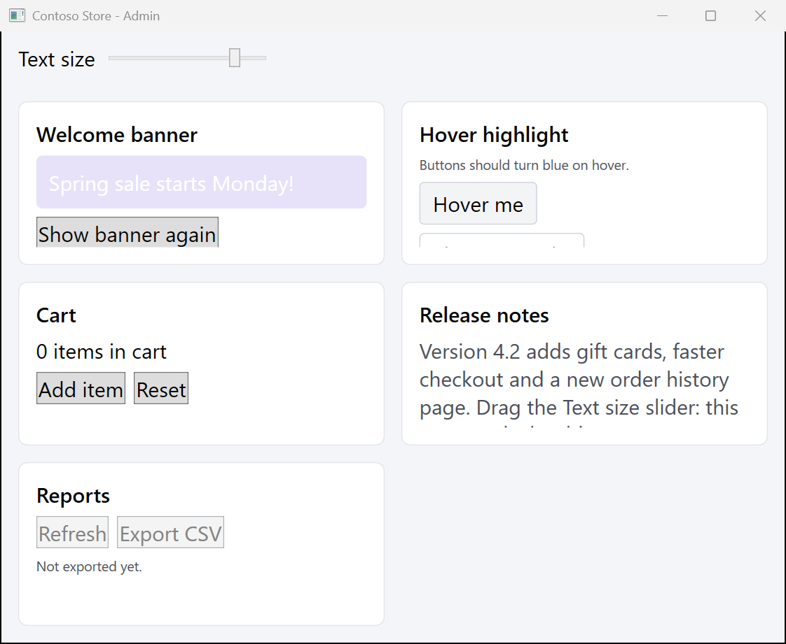
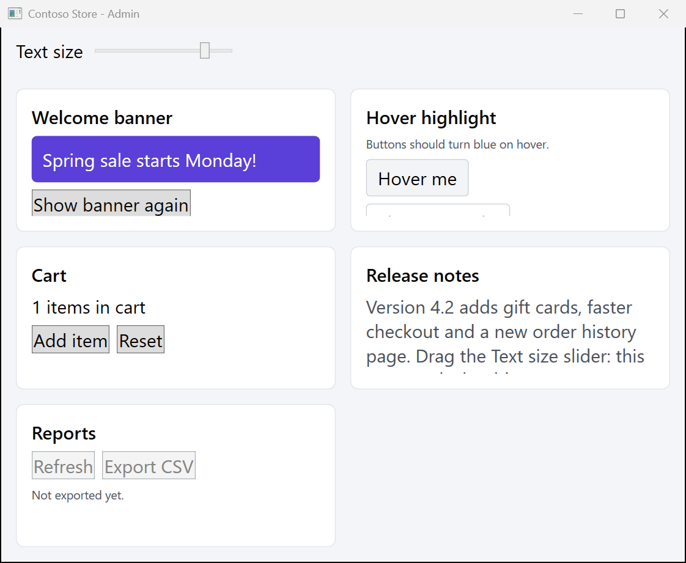
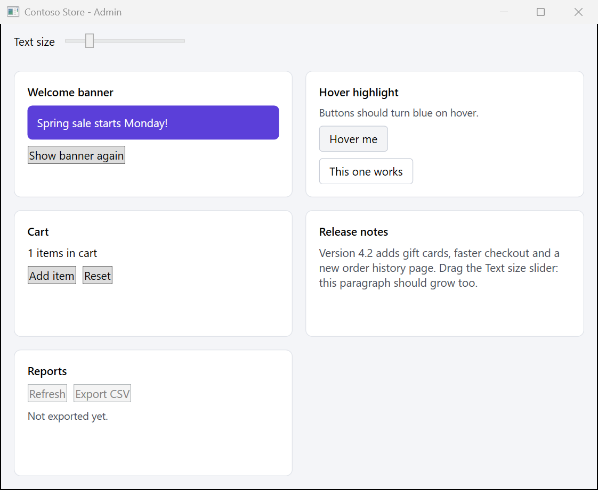

# Session transcript

Source: `Q:\source\XamlAgentDemos-notes\test-runs\PrecedenceWars\run-consolidated\events.jsonl`

## Tool usage

- xaml_explain_property_value: 16
- get_file: 10
- xaml_interact: 9
- xaml_get_status: 5
- xaml_capture_image: 4
- xaml_find_elements: 4
- powershell: 3
- xaml_apply_hot_reload: 3
- update_todo: 3
- skill: 2
- xaml_get_visual_tree: 2
- glob: 2
- xaml_get_element_styles: 2
- xaml_get_hot_reload_log: 2
- xaml_get_element_properties: 2
- debugger_evaluate_expressions: 2
- task_complete: 2
- get_projects_in_solution: 1
- view: 1
- xaml_hit_test: 1
- multi_replace_string_in_file: 1
- task: 1
- read_agent: 1
- file_search: 1
- debugger_pause: 1
- debugger_get_threads: 1
- debugger_get_call_stack: 1
- debugger_continue: 1
- ask_question: 1
- xaml_get_binding_failures: 1
- replace_string_in_file: 1

Failed tool calls: 0, images: 4


_Model: gpt-6.1-terra_


## User (02:46:27)

Each card in my running app has a property that refuses to change. Figure out why for every card using the live app, prove it, and fix the source.


**Tool call (02:46:30):** `skill`
```json
{
 "skill": "xaml-diagnostics"
}
```

<details><summary>Result `skill` success=true</summary>

```
Skill "xaml-diagnostics" loaded successfully. Follow the instructions in the skill context.
```
</details>


_Skill invoked: xaml-diagnostics_


**Assistant (02:46:32):**

I’ll inspect the live cards and trace each property’s winning value before changing the source.


**Tool call (02:46:32):** `xaml_get_status`
```json
{
 "progressMessage": "Inspecting the running XAML app"
}
```

<details><summary>Result `xaml_get_status` success=true</summary>

```
{"isDebugging":true,"debuggerState":"running","diagnosticsActive":true,"apps":[{"app":"a1","name":"PrecedenceWars.exe [5684]","processId":5684,"platform":"WPF (.NET)","isRemote":false,"isDesignTimeOrNoDebug":false,"sourceInfoAvailable":true,"hotReloadSupported":true,"hotReloadEnabled":true,"supportsPropertyExplorer":true,"supportsInAppToolbar":true,"supportsHitTest":true,"windows":[{"windowId":"0x1D20EB0","title":"Contoso Store - Admin","bounds":{"x":266,"y":266,"width":1140,"height":930},"dpiScale":1.5,"visible":true,"minimized":false}]}],"issues":[],"issuesSummary":"No problems detected.","hotReload":{"options":{"hotReloadEnabled":true,"hotReloadOnSave":false,"applyMode":"asYouType: XAML edits apply as you type, without saving (default)","wpfEnabled":true,"uwpEnabled":true,"winUIEnabled":true,"mauiEnabled":true,"justMyXaml":true,"previewSelectedElement":false,"inAppToolbar":true,"inAppSelection":false,"layoutAdorners":false,"trackFocusedElement":false,"bindingFailuresVisible":true,"compatibilityMode":false},"dotNetHotReloadEnabled":true,"isProcessingChanges":false,"errors":[]},"windowsNote":"Window bounds are physical screen pixels and include the window frame. A WPF/WinUI Window's Width and Height are device-independent units (DIPs) that also include the frame, so Width = bounds.width / dpiScale. A user's \"800 px wide\" is ambiguous: say which unit you tested. A minimized window reports x/y = -32000 and can't be captured."}
```
</details>


**Tool call (02:46:35):** `xaml_get_visual_tree`
```json
{
 "progressMessage": "Finding all live cards",
 "depth": 6,
 "maxNodes": 500
}
```


**Tool call (02:46:35):** `xaml_capture_image`
```json
{
 "progressMessage": "Inspecting the current card display"
}
```


**Tool call (02:46:35):** `get_projects_in_solution`
```json
{}
```

<details><summary>Result `xaml_get_visual_tree` success=true</summary>

```
{"app":"a1","platform":"WPF (.NET)","sourceInfoAvailable":true,"nodeCount":37,"truncated":false,"depthLimitedNodes":7,"hint":"7 node(s) have children beyond the requested depth (childCount > 0, no children listed). Raise depth or pass rootElementId to expand them.","nodes":[{"id":"a1:10","type":"PrecedenceWars.MainWindow","source":{"file":"Q:\\source\\XamlAgentDemos\\src\\PrecedenceWars\\MainWindow.xaml","line":3,"column":9},"childCount":1,"children":[{"id":"a1:11","type":"System.Windows.Controls.Border","childCount":1,"children":[{"id":"a1:12","type":"System.Windows.Documents.AdornerDecorator","childCount":2,"children":[{"id":"a1:13","type":"System.Windows.Controls.ContentPresenter","childCount":1,"children":[{"id":"a1:15","type":"System.Windows.Controls.DockPanel","source":{"file":"Q:\\source\\XamlAgentDemos\\src\\PrecedenceWars\\MainWindow.xaml","line":53,"column":6},"childCount":2,"children":[{"id":"a1:16","type":"System.Windows.Controls.StackPanel","source":{"file":"Q:\\source\\XamlAgentDemos\\src\\PrecedenceWars\\MainWindow.xaml","line":54,"column":10},"childCount":2,"children":[{"id":"a1:18","type":"System.Windows.Controls.TextBlock","source":{"file":"Q:\\source\\XamlAgentDemos\\src\\PrecedenceWars\\MainWindow.xaml","line":57,"column":14},"childCount":0},{"id":"a1:19","type":"System.Windows.Controls.Slider","name":"TextSizeSlider","source":{"file":"Q:\\source\\XamlAgentDemos\\src\\PrecedenceWars\\MainWindow.xaml","line":58,"column":14},"childCount":1,"children":[{"id":"a1:25","type":"System.Windows.Controls.Border","name":"border","childCount":1,"children":[{"id":"a1:31","type":"System.Windows.Controls.Grid","childCount":4}]}]}]},{"id":"a1:17","type":"System.Windows.Controls.Primitives.UniformGrid","source":{"file":"Q:\\source\\XamlAgentDemos\\src\\PrecedenceWars\\MainWindow.xaml","line":67,"column":10},"childCount":5,"children":[{"id":"a1:20","type":"System.Windows.Controls.Border","source":{"file":"Q:\\source\\XamlAgentDemos\\src\\PrecedenceWars\\MainWindow.xaml","line":69,"column":14},"childCount":1,"children":[{"id":"a1:26","type":"System.Windows.Controls.StackPanel","source":{"file":"Q:\\source\\XamlAgentDemos\\src\\PrecedenceWars\\MainWindow.xaml","line":70,"column":18},"childCount":3,"children":[{"id":"a1:32","type":"System.Windows.Controls.TextBlock","source":{"file":"Q:\\source\\XamlAgentDemos\\src\\PrecedenceWars\\MainWindow.xaml","line":71,"column":22},"childCount":0},{"id":"a1:33","type":"System.Windows.Controls.Border","name":"WelcomeBa
... [truncated 4248 chars]
```
</details>

<details><summary>Result `get_projects_in_solution` success=true</summary>

```
src\GhostClicks\GhostClicks.csproj
src\GermanReady\GermanReady.csproj
src\ThemeBreaker\ThemeBreaker.csproj
src\DesignPolish\DesignPolish.csproj
src\HotReloadDoctor\HotReloadDoctor.csproj
src\VanishingSave\VanishingSave.csproj
src\CrispPixels\CrispPixels.csproj
src\PrecedenceWars\PrecedenceWars.csproj
src\LostWindows\LostWindows.csproj
src\TemplateDetective\TemplateDetective.csproj
src\SlowScroll\SlowScroll.csproj
src\PixelPerfect\PixelPerfect.csproj
src\BindingStorm\BindingStorm.csproj
src\BugRepro\BugRepro.csproj
src\A11ySweep\A11ySweep.csproj
src\StyleMaze\StyleMaze.csproj
src\ResponsiveDashboard\ResponsiveDashboard.csproj

```
</details>


<details><summary>Result `xaml_capture_image` success=true</summary>

```
Screenshot of window 0x1D20EB0 "Contoso Store - Admin" of app a1 (1122x921 image of the window's client area, so it's slightly smaller than the frame bounds from xaml_get_status).
```
</details>


**Tool call (02:46:39):** `get_file`
```json
{
 "filename": "Q:\\source\\XamlAgentDemos\\src\\PrecedenceWars\\MainWindow.xaml",
 "startLine": 1,
 "endLine": 200
}
```


**Tool call (02:46:39):** `get_file`
```json
{
 "filename": "Q:\\source\\XamlAgentDemos\\src\\PrecedenceWars\\MainWindow.xaml.cs",
 "startLine": 1,
 "endLine": 240
}
```


**Tool call (02:46:39):** `xaml_find_elements`
```json
{
 "progressMessage": "Finding card controls",
 "sourceFile": "MainWindow.xaml",
 "maxResults": 200
}
```


**Tool call (02:46:39):** `view`
```json
{
 "path": "c:\\vs\\fastmain\\common7\\ide\\commonextensions\\microsoft\\xamldiagnostics\\AgentTools\\skills\\xaml-diagnostics\\references\\xaml-authoring.md"
}
```


**Tool call (02:46:39):** `powershell`
```json
{
 "command": "git status --short",
 "description": "Check existing working tree changes"
}
```

<details><summary>Result `xaml_find_elements` success=true</summary>

```
{"count":40,"totalMatches":40,"truncated":false,"results":[{"id":"a1:10","type":"PrecedenceWars.MainWindow","source":{"file":"Q:\\source\\XamlAgentDemos\\src\\PrecedenceWars\\MainWindow.xaml","line":3,"column":9},"path":"MainWindow"},{"id":"a1:15","type":"System.Windows.Controls.DockPanel","source":{"file":"Q:\\source\\XamlAgentDemos\\src\\PrecedenceWars\\MainWindow.xaml","line":53,"column":6},"path":"MainWindow/Border/AdornerDecorator/ContentPresenter/DockPanel"},{"id":"a1:16","type":"System.Windows.Controls.StackPanel","source":{"file":"Q:\\source\\XamlAgentDemos\\src\\PrecedenceWars\\MainWindow.xaml","line":54,"column":10},"path":"MainWindow/Border/AdornerDecorator/ContentPresenter/DockPanel/StackPanel"},{"id":"a1:18","type":"System.Windows.Controls.TextBlock","source":{"file":"Q:\\source\\XamlAgentDemos\\src\\PrecedenceWars\\MainWindow.xaml","line":57,"column":14},"path":"MainWindow/Border/AdornerDecorator/ContentPresenter/DockPanel/StackPanel/TextBlock"},{"id":"a1:19","type":"System.Windows.Controls.Slider","name":"TextSizeSlider","source":{"file":"Q:\\source\\XamlAgentDemos\\src\\PrecedenceWars\\MainWindow.xaml","line":58,"column":14},"path":"MainWindow/Border/AdornerDecorator/ContentPresenter/DockPanel/StackPanel/Slider"},{"id":"a1:17","type":"System.Windows.Controls.Primitives.UniformGrid","source":{"file":"Q:\\source\\XamlAgentDemos\\src\\PrecedenceWars\\MainWindow.xaml","line":67,"column":10},"path":"MainWindow/Border/AdornerDecorator/ContentPresenter/DockPanel/UniformGrid"},{"id":"a1:20","type":"System.Windows.Controls.Border","source":{"file":"Q:\\source\\XamlAgentDemos\\src\\PrecedenceWars\\MainWindow.xaml","line":69,"column":14},"path":"MainWindow/Border/AdornerDecorator/ContentPresenter/DockPanel/UniformGrid/Border"},{"id":"a1:26","type":"System.Windows.Controls.StackPanel","source":{"file":"Q:\\source\\XamlAgentDemos\\src\\PrecedenceWars\\MainWindow.xaml","line":70,"column":18},"path":"MainWindow/Border/AdornerDecorator/ContentPresenter/DockPanel/UniformGrid/Border/StackPanel"},{"id":"a1:32","type":"System.Windows.Controls.TextBlock","source":{"file":"Q:\\source\\XamlAgentDemos\\src\\PrecedenceWars\\MainWindow.xaml","line":71,"column":22},"path":"MainWindow/Border/AdornerDecorator/ContentPresenter/DockPanel/UniformGrid/Border/StackPanel/TextBlock"},{"id":"a1:33","type":"System.Windows.Controls.Border","name":"WelcomeBanner","source":{"file":"Q:\\source\\XamlAgentDemos\\src\\PrecedenceWars\\MainWindow.xaml","line":72,"column":22},"path":"Mai
... [truncated 8784 chars]
```
</details>

<details><summary>Result `view` success=true</summary>

```
# XAML authoring guidance

Follow these rules when writing or changing XAML so it works well with XAML Hot Reload, the XAML designer, and XAML Diagnostics.

## Design-time data

- Declare `xmlns:d="http://schemas.microsoft.com/expression/blend/2008"` and `xmlns:mc="http://schemas.openxmlformats.org/markup-compatibility/2006"` with `mc:Ignorable="d"`.
- Use `d:DataContext="{d:DesignInstance Type=vm:MyViewModel, IsDesignTimeCreatable=False}"` (WPF/UWP) so the designer and IntelliSense know binding paths.
- Use `d:` properties (for example `d:Text="Sample"`) for sample values that appear only at design time.
- .NET MAUI: set `x:DataType` on pages and `DataTemplate`s. It enables compiled bindings and turns many binding failures into build errors.
- WinUI/UWP: prefer `x:Bind` for compile-time checked bindings when the view owns the view model.

## Bindings

- Bind with explicit paths. Avoid string-built paths in code-behind.
- Keep the `DataContext` chain simple. Use `ElementName` or `RelativeSource` only at real scope boundaries (for example inside a `DataTemplate` that needs the page's view model).
- Expose bound properties as public properties that raise `PropertyChanged`. Fields and non-public properties don't bind.
- Use `FallbackValue` and `TargetNullValue` for expected missing values instead of hiding binding errors.
- Before saving, check every binding path against the actual property names on the data context type (case, plurals, nested paths such as `Customer.Address.City`). Misspelled paths are the most common binding failure and they fail silently.
- Inside a `DataTemplate` or `ItemContainerStyle`, the data context is the item, not the page's view model. To reach a page command, use `RelativeSource={RelativeSource AncestorType=...}` with `DataContext.` in the path, or `ElementName`.
- A `TextBox.Text` binding updates its source on `LostFocus` by default (WPF). Use `UpdateSourceTrigger=PropertyChanged` when other UI (validation, enabled state, live search) must react while the user types.
- `Mode=TwoWay` (the default for `TextBox.Text`, `CheckBox.IsChecked`, `Selector.SelectedItem` and similar) needs a property with a public setter. In WPF, a two-way binding to a read-only property throws when the view loads.
- Bindings created in code have no XAML file and line in diagnostics. Prefer declaring bindings in XAML.

## Layout

- Don't put a list (`ListBox`, `ListView`, `DataGrid`, `ItemsControl` with a virtualizing panel) insid
... [truncated 4693 chars]
```
</details>

<details><summary>Result `get_file` success=true</summary>

```
```csharp src\PrecedenceWars\MainWindow.xaml.cs (Lines 1-25 of 25 total. Call tools for more if needed.)
using System.Windows;

namespace PrecedenceWars;

public partial class MainWindow : Window
{
    private readonly StoreViewModel viewModel = new();

    public MainWindow()
    {
        this.InitializeComponent();
        this.DataContext = this.viewModel;
    }

    private void OnShowBannerClick(object sender, RoutedEventArgs e)
    {
        this.WelcomeBanner.Opacity = 1;
    }

    private void OnResetClick(object sender, RoutedEventArgs e)
    {
        this.viewModel.ItemCount = 0;
        this.CountText.Text = "0 items in cart";
    }
}

```


```
</details>

<details><summary>Result `get_file` success=true</summary>

```
```xaml src\PrecedenceWars\MainWindow.xaml (Lines 1-164 of 164 total. Call tools for more if needed.)
<Window x:Class="PrecedenceWars.MainWindow"
        xmlns="http://schemas.microsoft.com/winfx/2006/xaml/presentation"
        xmlns:x="http://schemas.microsoft.com/winfx/2006/xaml"
        Title="Contoso Store - Admin"
        Width="760"
        Height="620"
        FontSize="{Binding Value, ElementName=TextSizeSlider}">
    <Window.Resources>
        <Style x:Key="CardStyle" TargetType="Border">
            <Setter Property="Background" Value="White" />
            <Setter Property="BorderBrush" Value="#E1E4EA" />
            <Setter Property="BorderThickness" Value="1" />
            <Setter Property="CornerRadius" Value="8" />
            <Setter Property="Padding" Value="16" />
            <Setter Property="Margin" Value="8" />
        </Style>

        <Style x:Key="CardTitleStyle" TargetType="TextBlock">
            <Setter Property="FontWeight" Value="SemiBold" />
            <Setter Property="Margin" Value="0,0,0,8" />
        </Style>

        <Style x:Key="BodyTextStyle" TargetType="TextBlock">
            <Setter Property="FontSize" Value="13" />
            <Setter Property="Foreground" Value="#4A4F5A" />
            <Setter Property="TextWrapping" Value="Wrap" />
        </Style>

        <Style x:Key="HoverButtonStyle" TargetType="Button">
            <Setter Property="Background" Value="White" />
            <Setter Property="Padding" Value="12,6" />
            <Setter Property="Template">
                <Setter.Value>
                    <ControlTemplate TargetType="Button">
                        <Border Padding="{TemplateBinding Padding}"
                                Background="{TemplateBinding Background}"
                                BorderBrush="#C9CED8"
                                BorderThickness="1"
                                CornerRadius="4">
                            <ContentPresenter HorizontalAlignment="Center" />
                        </Border>
                    </ControlTemplate>
                </Setter.Value>
            </Setter>
            <Style.Triggers>
                <Trigger Property="IsMouseOver" Value="True">
                    <Setter Property="Background" Value="#DCE8FF" />
                </Trigger>
            </Style.Triggers>
        </Style>
    </Window.Resources>

    <DockPanel Background="#F4F5F8">
        <StackPanel Margin
... [truncated 5586 chars]
```
</details>

<details><summary>Result `powershell` success=true</summary>

```

<shellId: 0 completed with exit code 0>
```
</details>


**Tool call (02:46:45):** `xaml_explain_property_value`
```json
{
 "progressMessage": "Tracing banner animation precedence",
 "elementIds": [
  "a1:33"
 ],
 "propertyNames": [
  "Opacity"
 ]
}
```


**Tool call (02:46:45):** `xaml_explain_property_value`
```json
{
 "progressMessage": "Comparing hover button precedence",
 "elementIds": [
  "a1:37",
  "a1:38"
 ],
 "propertyNames": [
  "Background"
 ]
}
```


**Tool call (02:46:45):** `xaml_explain_property_value`
```json
{
 "progressMessage": "Tracing text sizing precedence",
 "elementIds": [
  "a1:10",
  "a1:43"
 ],
 "propertyNames": [
  "FontSize"
 ]
}
```


**Tool call (02:46:45):** `xaml_explain_property_value`
```json
{
 "progressMessage": "Tracing report button enabled state",
 "elementIds": [
  "a1:45",
  "a1:57",
  "a1:58"
 ],
 "propertyNames": [
  "IsEnabled"
 ]
}
```


**Tool call (02:46:45):** `xaml_explain_property_value`
```json
{
 "progressMessage": "Tracing cart text binding",
 "elementIds": [
  "a1:40"
 ],
 "propertyNames": [
  "Text"
 ]
}
```


**Tool call (02:46:45):** `glob`
```json
{
 "pattern": "src\\PrecedenceWars\\*.cs"
}
```


**Tool call (02:46:45):** `xaml_interact`
```json
{
 "progressMessage": "Testing the banner restore button",
 "elementId": "a1:34",
 "action": "invoke"
}
```

<details><summary>Result `glob` success=true</summary>

```
.\src\PrecedenceWars\StoreViewModel.cs
.\src\PrecedenceWars\MainWindow.xaml.cs
.\src\PrecedenceWars\App.xaml.cs
```
</details>

<details><summary>Result `xaml_explain_property_value` success=true</summary>

```
{"id":"a1:33","type":"System.Windows.Controls.Border","property":"Opacity","propertyType":"System.Double","effectiveValue":"0.15000000000000002","effectiveSource":"Animation","chain":[{"kind":"Animation","description":"An active animation (Storyboard or VisualState). It overrides local and style values while it holds the value.","value":"0.15000000000000002","valueType":"System.Double","effective":true},{"kind":"Default","description":"The property's default value; nothing sets it.","value":"1","valueType":"System.Double","effective":false}],"notes":["Find the Storyboard or VisualState that animates this property; local and style changes have no visible effect while it holds the value (FillBehavior=HoldEnd is common)."]}
```
</details>

<details><summary>Result `xaml_explain_property_value` success=true</summary>

```
{"id":"a1:40","type":"System.Windows.Controls.TextBlock","property":"Text","propertyType":"System.String","effectiveValue":"System.Windows.Data.BindingExpression","evaluatedValue":"2 items in cart (System.String)","effectiveSource":"Local","chain":[{"kind":"Local","description":"Local value set on the element (XAML attribute, binding or code). Wins over styles, templates and inheritance.","value":"System.Windows.Data.BindingExpression","evaluatedValue":"2 items in cart (System.String)","valueType":"System.Windows.Data.BindingExpression","isBinding":true,"effective":true,"sourceLocation":{"file":"Q:\\source\\XamlAgentDemos\\src\\PrecedenceWars\\MainWindow.xaml","line":121,"column":22}},{"kind":"Default","description":"The property's default value; nothing sets it.","value":"","valueType":"System.String","effective":false}],"notes":["To let a style or template value apply, remove the local value (the attribute, binding or code assignment). To change it, edit that local value. XAML and code both produce Local values, and the source location may still point to the XAML attribute after code assigned a new value. If the live value differs from the XAML attribute, or the element has no XAML attribute for it, code set it: search code-behind for the element's x:Name.","The effective value comes from a binding. If it's wrong, check xaml_get_binding_failures and the DataContext."]}
```
</details>

<details><summary>Result `xaml_interact` success=true</summary>

```
{"id":"a1:34","action":"invoke","result":"Invoked.","supportedPatterns":["Invoke","SynchronizedInput"],"note":"Call xaml_capture_image or xaml_get_element_properties to verify the effect. Automation actions bypass mouse hit testing, so a successful invoke doesn't prove a real click reaches the element; call xaml_hit_test for that."}
```
</details>

<details><summary>Result `xaml_explain_property_value` success=true</summary>

```
{"count":2,"failed":0,"results":[{"id":"a1:10","type":"PrecedenceWars.MainWindow","property":"FontSize","propertyType":"System.Double","evaluatedValue":"14 (System.Double)","effectiveSource":"Local","chain":[{"kind":"Local","description":"Local value set on the element (XAML attribute, binding or code). Wins over styles, templates and inheritance.","evaluatedValue":"14 (System.Double)","valueType":"System.Windows.Data.BindingExpression","isBinding":true,"effective":true,"sourceLocation":{"file":"Q:\\source\\XamlAgentDemos\\src\\PrecedenceWars\\MainWindow.xaml","line":3,"column":9}},{"kind":"Default","description":"The property's default value; nothing sets it.","value":"12","valueType":"System.Double","effective":false}],"notes":["To let a style or template value apply, remove the local value (the attribute, binding or code assignment). To change it, edit that local value. XAML and code both produce Local values, and the source location may still point to the XAML attribute after code assigned a new value. If the live value differs from the XAML attribute, or the element has no XAML attribute for it, code set it: search code-behind for the element's x:Name.","The effective value comes from a binding. If it's wrong, check xaml_get_binding_failures and the DataContext."]},{"id":"a1:43","type":"System.Windows.Controls.TextBlock","property":"FontSize","propertyType":"System.Double","effectiveValue":"13","effectiveSource":"Style","chain":[{"kind":"Style","description":"Setter in an explicit (x:Key) or implicit (TargetType) Style.","targetType":"System.Windows.Controls.TextBlock","value":"13","valueType":"System.Double","effective":true,"sourceLocation":{"file":"Q:\\source\\XamlAgentDemos\\src\\PrecedenceWars\\MainWindow.xaml","line":23,"column":10}},{"kind":"Default","description":"The property's default value; nothing sets it.","value":"12","valueType":"System.Double","effective":false}],"notes":["Edit the setter or trigger at the source location, or set a local value to override it for this element only."]}]}
```
</details>

<details><summary>Result `xaml_explain_property_value` success=true</summary>

```
{"count":2,"failed":0,"results":[{"id":"a1:37","type":"System.Windows.Controls.Button","property":"Background","propertyType":"System.Windows.Media.Brush","effectiveValue":"#FFF3F4F6","effectiveSource":"Local","chain":[{"kind":"Local","description":"Local value set on the element (XAML attribute, binding or code). Wins over styles, templates and inheritance.","value":"#FFF3F4F6","valueType":"System.Windows.Media.SolidColorBrush","effective":true,"sourceLocation":{"file":"Q:\\source\\XamlAgentDemos\\src\\PrecedenceWars\\MainWindow.xaml","line":103,"column":22}},{"kind":"Style","description":"Setter in an explicit (x:Key) or implicit (TargetType) Style.","targetType":"System.Windows.Controls.Button","value":"#FFFFFFFF","valueType":"System.Windows.Media.SolidColorBrush","effective":false,"sourceLocation":{"file":"Q:\\source\\XamlAgentDemos\\src\\PrecedenceWars\\MainWindow.xaml","line":29,"column":10}},{"kind":"BuiltInStyle","description":"Setter in the control's default theme style (generic.xaml or the platform theme).","targetType":"System.Windows.Controls.Primitives.ButtonBase","value":"#FFDDDDDD","valueType":"System.Windows.Media.SolidColorBrush","effective":false},{"kind":"Default","description":"The property's default value; nothing sets it.","effective":false}],"notes":["To let a style or template value apply, remove the local value (the attribute, binding or code assignment). To change it, edit that local value. XAML and code both produce Local values, and the source location may still point to the XAML attribute after code assigned a new value. If the live value differs from the XAML attribute, or the element has no XAML attribute for it, code set it: search code-behind for the element's x:Name."]},{"id":"a1:38","type":"System.Windows.Controls.Button","property":"Background","propertyType":"System.Windows.Media.Brush","effectiveValue":"#FFFFFFFF","effectiveSource":"Style","chain":[{"kind":"Style","description":"Setter in an explicit (x:Key) or implicit (TargetType) Style.","targetType":"System.Windows.Controls.Button","value":"#FFFFFFFF","valueType":"System.Windows.Media.SolidColorBrush","effective":true,"sourceLocation":{"file":"Q:\\source\\XamlAgentDemos\\src\\PrecedenceWars\\MainWindow.xaml","line":29,"column":10}},{"kind":"BuiltInStyle","description":"Setter in the control's default theme style (generic.xaml or the platform theme).","targetType":"System.Windows.Controls.Primitives.ButtonBase","value":"#FFDDDDDD","valueType":"System.Windows.Media.S
... [truncated 260 chars]
```
</details>

<details><summary>Result `xaml_explain_property_value` success=true</summary>

```
{"count":3,"failed":0,"results":[{"id":"a1:45","type":"System.Windows.Controls.StackPanel","property":"IsEnabled","propertyType":"System.Boolean","evaluatedValue":"False (System.Boolean)","effectiveSource":"Local","chain":[{"kind":"Local","description":"Local value set on the element (XAML attribute, binding or code). Wins over styles, templates and inheritance.","evaluatedValue":"False (System.Boolean)","valueType":"System.Windows.Data.BindingExpression","isBinding":true,"effective":true,"sourceLocation":{"file":"Q:\\source\\XamlAgentDemos\\src\\PrecedenceWars\\MainWindow.xaml","line":148,"column":22}},{"kind":"Default","description":"The property's default value; nothing sets it.","value":"True","valueType":"System.Boolean","effective":false}],"notes":["To let a style or template value apply, remove the local value (the attribute, binding or code assignment). To change it, edit that local value. XAML and code both produce Local values, and the source location may still point to the XAML attribute after code assigned a new value. If the live value differs from the XAML attribute, or the element has no XAML attribute for it, code set it: search code-behind for the element's x:Name.","The effective value comes from a binding. If it's wrong, check xaml_get_binding_failures and the DataContext."]},{"id":"a1:57","type":"System.Windows.Controls.Button","property":"IsEnabled","propertyType":"System.Boolean","effectiveValue":"False","effectiveSource":"Coercion","chain":[{"kind":"Coercion","description":"The control coerced the value (for example clamped to a minimum or maximum).","value":"False","valueType":"System.Boolean","effective":true},{"kind":"Default","description":"The property's default value; nothing sets it.","value":"True","valueType":"System.Boolean","effective":false}],"notes":["Check related properties that constrain this one (for example Minimum/Maximum or MinWidth/MaxWidth)."]},{"id":"a1:58","type":"System.Windows.Controls.Button","property":"IsEnabled","propertyType":"System.Boolean","effectiveValue":"False","effectiveSource":"Coercion","chain":[{"kind":"Coercion","description":"The control coerced the value (for example clamped to a minimum or maximum).","value":"False","valueType":"System.Boolean","effective":true},{"kind":"Default","description":"The property's default value; nothing sets it.","value":"True","valueType":"System.Boolean","effective":false}],"notes":["Check related properties that constrain this one (for example Minimum/Maximu
... [truncated 29 chars]
```
</details>


**Tool call (02:46:50):** `get_file`
```json
{
 "filename": "Q:\\source\\XamlAgentDemos\\src\\PrecedenceWars\\StoreViewModel.cs",
 "startLine": 1,
 "endLine": 240
}
```


**Tool call (02:46:50):** `xaml_explain_property_value`
```json
{
 "progressMessage": "Checking banner after restore",
 "elementIds": [
  "a1:33"
 ],
 "propertyNames": [
  "Opacity"
 ]
}
```


**Tool call (02:46:50):** `xaml_interact`
```json
{
 "progressMessage": "Reproducing cart reset behavior",
 "elementId": "a1:56",
 "action": "invoke"
}
```


**Tool call (02:46:50):** `xaml_interact`
```json
{
 "progressMessage": "Testing release note text sizing",
 "elementId": "a1:19",
 "action": "setValue",
 "value": "20"
}
```


**Tool call (02:46:50):** `xaml_hit_test`
```json
{
 "progressMessage": "Inspecting disabled report controls",
 "elementIds": [
  "a1:57",
  "a1:58"
 ]
}
```


**Tool call (02:46:50):** `xaml_get_element_styles`
```json
{
 "progressMessage": "Inspecting hover styles",
 "elementIds": [
  "a1:37",
  "a1:38"
 ]
}
```

<details><summary>Result `xaml_explain_property_value` success=true</summary>

```
{"id":"a1:33","type":"System.Windows.Controls.Border","property":"Opacity","propertyType":"System.Double","effectiveValue":"0.15000000000000002","effectiveSource":"Animation","chain":[{"kind":"Animation","description":"An active animation (Storyboard or VisualState). It overrides local and style values while it holds the value.","value":"0.15000000000000002","valueType":"System.Double","effective":true},{"kind":"Local","description":"Local value set on the element (XAML attribute, binding or code). Wins over styles, templates and inheritance.","value":"1","valueType":"System.Double","effective":false,"sourceLocation":{"file":"Q:\\source\\XamlAgentDemos\\src\\PrecedenceWars\\MainWindow.xaml","line":72,"column":22}},{"kind":"Default","description":"The property's default value; nothing sets it.","value":"1","valueType":"System.Double","effective":false}],"notes":["Find the Storyboard or VisualState that animates this property; local and style changes have no visible effect while it holds the value (FillBehavior=HoldEnd is common)."]}
```
</details>

<details><summary>Result `get_file` success=true</summary>

```
```csharp src\PrecedenceWars\StoreViewModel.cs (Lines 1-69 of 69 total. Call tools for more if needed.)
using System.Diagnostics;

namespace PrecedenceWars;

public sealed class StoreViewModel : ObservableObject
{
    private int itemCount = 2;
    private bool isBusy;
    private string lastExport = "Not exported yet.";

    public StoreViewModel()
    {
        this.AddItemCommand = new RelayCommand(() => this.ItemCount++);
        this.ExportCommand = new RelayCommand(() => this.LastExport = $"Exported at {DateTime.Now:t}.", () => true);
        this.SyncCatalog();
    }

    public RelayCommand AddItemCommand { get; }

    public RelayCommand ExportCommand { get; }

    public int ItemCount
    {
        get => this.itemCount;
        set => this.SetProperty(ref this.itemCount, value);
    }

    public bool IsBusy
    {
        get => this.isBusy;
        private set
        {
            if (this.SetProperty(ref this.isBusy, value))
            {
                this.OnPropertyChanged(nameof(this.IsIdle));
            }
        }
    }

    public bool IsIdle => !this.IsBusy;

    public string LastExport
    {
        get => this.lastExport;
        private set => this.SetProperty(ref this.lastExport, value);
    }

    private void SyncCatalog()
    {
        this.IsBusy = true;
        try
        {
            if (this.IsOffline())
            {
                throw new TimeoutException("Catalog service didn't respond.");
            }
        }
        catch (TimeoutException ex)
        {
            Debug.WriteLine($"Catalog sync failed: {ex.Message}");
            return;
        }

        this.IsBusy = false;
    }

    // Simulates the offline case: the catalog service isn't reachable.
    private bool IsOffline() => true;
}

```


```
</details>

<details><summary>Result `xaml_interact` success=true</summary>

```
{"id":"a1:56","action":"invoke","result":"Invoked.","supportedPatterns":["Invoke","SynchronizedInput"],"note":"Call xaml_capture_image or xaml_get_element_properties to verify the effect. Automation actions bypass mouse hit testing, so a successful invoke doesn't prove a real click reaches the element; call xaml_hit_test for that."}
```
</details>

<details><summary>Result `xaml_interact` success=true</summary>

```
{"id":"a1:19","action":"setValue","result":"Value is now 20.","supportedPatterns":["RangeValue","SynchronizedInput"],"note":"Call xaml_capture_image or xaml_get_element_properties to verify the effect. Automation actions bypass mouse hit testing, so a successful invoke doesn't prove a real click reaches the element; call xaml_hit_test for that."}
```
</details>

<details><summary>Result `xaml_get_element_styles` success=true</summary>

```
{"count":2,"failed":0,"results":[{"id":"a1:37","type":"System.Windows.Controls.Button","name":"HoverButton","source":{"file":"Q:\\source\\XamlAgentDemos\\src\\PrecedenceWars\\MainWindow.xaml","line":103,"column":22},"styleProperty":{"value":"System.Windows.Style","valueSource":"Local","location":{"file":"Q:\\source\\XamlAgentDemos\\src\\PrecedenceWars\\MainWindow.xaml","line":103,"column":22}},"templateProperty":{"value":"System.Windows.Controls.ControlTemplate","valueSource":"Style","location":{"file":"Q:\\source\\XamlAgentDemos\\src\\PrecedenceWars\\MainWindow.xaml","line":29,"column":10}},"styles":[{"kind":"Style","description":"Setter in an explicit (x:Key) or implicit (TargetType) Style.","targetType":"System.Windows.Controls.Button","location":{"file":"Q:\\source\\XamlAgentDemos\\src\\PrecedenceWars\\MainWindow.xaml","line":29,"column":10},"setters":[{"property":"Background","value":"#FFFFFFFF","effective":false,"overriddenBy":"Local"},{"property":"Padding","value":"12,6,12,6","effective":true},{"property":"Template","value":"System.Windows.Controls.ControlTemplate","effective":true,"valueLocation":{"file":"Q:\\source\\XamlAgentDemos\\src\\PrecedenceWars\\MainWindow.xaml","line":34,"column":22}}]},{"kind":"BuiltInStyle","description":"Setter in the control's default theme style (generic.xaml or the platform theme).","targetType":"System.Windows.Controls.Primitives.ButtonBase","setters":[{"property":"Background","value":"#FFDDDDDD","effective":false,"overriddenBy":"Local"},{"property":"BorderBrush","value":"#FF707070","effective":true},{"property":"BorderThickness","value":"1,1,1,1","effective":true},{"property":"FocusVisualStyle","value":"System.Windows.Style","effective":true},{"property":"Foreground","effective":true},{"property":"HorizontalContentAlignment","value":"1","effective":true},{"property":"Padding","value":"1,1,1,1","effective":false,"overriddenBy":"Style (System.Windows.Controls.Button)"},{"property":"Template","value":"System.Windows.Controls.ControlTemplate","effective":false,"overriddenBy":"Style (System.Windows.Controls.Button)"},{"property":"VerticalContentAlignment","value":"1","effective":true}]}],"hint":"Styles are listed in precedence order, highest first. 'effective=false' setters lose to 'overriddenBy'. Use xaml_find_resource to see where a style or resource key resolves. Only triggers whose condition is true right now are listed; inactive triggers (IsMouseOver, IsPressed, DataTriggers) aren't. Read the style's source at 'loc
... [truncated 2621 chars]
```
</details>

<details><summary>Result `xaml_hit_test` success=true</summary>

```
{"count":2,"failed":0,"results":[{"id":"a1:57","summary":"A click at its center does NOT reach 'RefreshButton': it lands on StackPanel, which is above it at that point or covers it. StackPanel 'ToolbarPanel' has IsEnabled=False, which applies to 'RefreshButton' too.","elementReceivesInput":false,"inputTarget":{"id":"a1:30","type":"System.Windows.Controls.StackPanel","source":{"file":"Q:\\source\\XamlAgentDemos\\src\\PrecedenceWars\\MainWindow.xaml","line":146,"column":18}},"stack":[{"id":"a1:84","type":"System.Windows.Controls.TextBlock","templatedParent":{"id":"a1:57","type":"System.Windows.Controls.Button","name":"RefreshButton","source":{"file":"Q:\\source\\XamlAgentDemos\\src\\PrecedenceWars\\MainWindow.xaml","line":151,"column":26}}},{"id":"a1:68","type":"System.Windows.Controls.Border","name":"border","templatedParent":{"id":"a1:57","type":"System.Windows.Controls.Button","name":"RefreshButton","source":{"file":"Q:\\source\\XamlAgentDemos\\src\\PrecedenceWars\\MainWindow.xaml","line":151,"column":26}}},{"id":"a1:24","type":"System.Windows.Controls.Border","source":{"file":"Q:\\source\\XamlAgentDemos\\src\\PrecedenceWars\\MainWindow.xaml","line":145,"column":14}},{"id":"a1:15","type":"System.Windows.Controls.DockPanel","source":{"file":"Q:\\source\\XamlAgentDemos\\src\\PrecedenceWars\\MainWindow.xaml","line":53,"column":6}},{"id":"a1:11","type":"System.Windows.Controls.Border","templatedParent":{"id":"a1:10","type":"PrecedenceWars.MainWindow","source":{"file":"Q:\\source\\XamlAgentDemos\\src\\PrecedenceWars\\MainWindow.xaml","line":3,"column":9}}}],"isVisible":true,"isHitTestVisible":true,"isEnabled":false,"effectiveOpacity":1.0,"blockers":[{"id":"a1:45","type":"System.Windows.Controls.StackPanel","name":"ToolbarPanel","source":{"file":"Q:\\source\\XamlAgentDemos\\src\\PrecedenceWars\\MainWindow.xaml","line":148,"column":22},"property":"IsEnabled","value":"False"}],"visibleFraction":1.0,"point":{"window":{"x":57.86,"y":462.91},"screen":{"x":364.0,"y":1005.0}}},{"id":"a1:58","summary":"A click at its center does NOT reach 'ExportButton': it lands on StackPanel, which is above it at that point or covers it. StackPanel 'ToolbarPanel' has IsEnabled=False, which applies to 'ExportButton' too.","elementReceivesInput":false,"inputTarget":{"id":"a1:30","type":"System.Windows.Controls.StackPanel","source":{"file":"Q:\\source\\XamlAgentDemos\\src\\PrecedenceWars\\MainWindow.xaml","line":146,"column":18}},"stack":[{"id":"a1:85","type":"System.Windows.Controls.Te
... [truncated 2179 chars]
```
</details>


**Tool call (02:46:57):** `xaml_interact`
```json
{
 "progressMessage": "Testing cart after reset",
 "elementId": "a1:55",
 "action": "invoke"
}
```


**Tool call (02:46:57):** `xaml_explain_property_value`
```json
{
 "progressMessage": "Comparing changed text sizes",
 "elementIds": [
  "a1:10",
  "a1:43"
 ],
 "propertyNames": [
  "FontSize"
 ]
}
```


**Tool call (02:46:57):** `get_file`
```json
{
 "filename": "Q:\\source\\XamlAgentDemos\\src\\PrecedenceWars\\PrecedenceWars.csproj",
 "startLine": 1,
 "endLine": 120
}
```

<details><summary>Result `get_file` success=true</summary>

```
``` src\PrecedenceWars\PrecedenceWars.csproj (Lines 1-5 of 5 total. Call tools for more if needed.)
<Project Sdk="Microsoft.NET.Sdk">
  <PropertyGroup>
    <RootNamespace>PrecedenceWars</RootNamespace>
  </PropertyGroup>
</Project>

```


```
</details>

<details><summary>Result `xaml_interact` success=true</summary>

```
{"id":"a1:55","action":"invoke","result":"Invoked.","supportedPatterns":["Invoke","SynchronizedInput"],"note":"Call xaml_capture_image or xaml_get_element_properties to verify the effect. Automation actions bypass mouse hit testing, so a successful invoke doesn't prove a real click reaches the element; call xaml_hit_test for that."}
```
</details>

<details><summary>Result `xaml_explain_property_value` success=true</summary>

```
{"count":2,"failed":0,"results":[{"id":"a1:10","type":"PrecedenceWars.MainWindow","property":"FontSize","propertyType":"System.Double","evaluatedValue":"20 (System.Double)","effectiveSource":"Local","chain":[{"kind":"Local","description":"Local value set on the element (XAML attribute, binding or code). Wins over styles, templates and inheritance.","evaluatedValue":"20 (System.Double)","valueType":"System.Windows.Data.BindingExpression","isBinding":true,"effective":true,"sourceLocation":{"file":"Q:\\source\\XamlAgentDemos\\src\\PrecedenceWars\\MainWindow.xaml","line":3,"column":9}},{"kind":"Default","description":"The property's default value; nothing sets it.","value":"12","valueType":"System.Double","effective":false}],"notes":["To let a style or template value apply, remove the local value (the attribute, binding or code assignment). To change it, edit that local value. XAML and code both produce Local values, and the source location may still point to the XAML attribute after code assigned a new value. If the live value differs from the XAML attribute, or the element has no XAML attribute for it, code set it: search code-behind for the element's x:Name.","The effective value comes from a binding. If it's wrong, check xaml_get_binding_failures and the DataContext."]},{"id":"a1:43","type":"System.Windows.Controls.TextBlock","property":"FontSize","propertyType":"System.Double","effectiveValue":"13","effectiveSource":"Style","chain":[{"kind":"Style","description":"Setter in an explicit (x:Key) or implicit (TargetType) Style.","targetType":"System.Windows.Controls.TextBlock","value":"13","valueType":"System.Double","effective":true,"sourceLocation":{"file":"Q:\\source\\XamlAgentDemos\\src\\PrecedenceWars\\MainWindow.xaml","line":23,"column":10}},{"kind":"Default","description":"The property's default value; nothing sets it.","value":"12","valueType":"System.Double","effective":false}],"notes":["Edit the setter or trigger at the source location, or set a local value to override it for this element only."]}]}
```
</details>


**Tool call (02:46:59):** `xaml_explain_property_value`
```json
{
 "progressMessage": "Checking cart text after adding",
 "elementIds": [
  "a1:40"
 ],
 "propertyNames": [
  "Text"
 ]
}
```

<details><summary>Result `xaml_explain_property_value` success=true</summary>

```
{"id":"a1:40","type":"System.Windows.Controls.TextBlock","property":"Text","propertyType":"System.String","effectiveValue":"0 items in cart","effectiveSource":"Local","chain":[{"kind":"Local","description":"Local value set on the element (XAML attribute, binding or code). Wins over styles, templates and inheritance.","value":"0 items in cart","valueType":"System.String","effective":true,"sourceLocation":{"file":"Q:\\source\\XamlAgentDemos\\src\\PrecedenceWars\\MainWindow.xaml","line":121,"column":22}},{"kind":"Default","description":"The property's default value; nothing sets it.","value":"","valueType":"System.String","effective":false}],"notes":["To let a style or template value apply, remove the local value (the attribute, binding or code assignment). To change it, edit that local value. XAML and code both produce Local values, and the source location may still point to the XAML attribute after code assigned a new value. If the live value differs from the XAML attribute, or the element has no XAML attribute for it, code set it: search code-behind for the element's x:Name."]}
```
</details>


**Assistant (02:47:14):**

The five cards have different blockers: an animation, a local brush, a discarded binding, a style setter, and a busy flag left set after failure. I’ll fix each at its source while preserving the existing design.


**Tool call (02:47:14):** `multi_replace_string_in_file`
```json
{
 "explanation": "Fix the five identified property-precedence and state issues while preserving the initial design.",
 "replacements": [
  {
   "filePath": "src\\PrecedenceWars\\MainWindow.xaml",
   "oldString": "            </Style.Triggers>\n        </Style>\n    </Window.Resources>\n\n    <DockPanel Background=\"#F4F5F8\">",
   "newString": "            </Style.Triggers>\n        </Style>\n\n        <Style x:Key=\"GrayHoverButtonStyle\" TargetType=\"Button\" BasedOn=\"{StaticResource HoverButtonStyle}\">\n            <Setter Property=\"Background\" Value=\"#F3F4F6\" />\n        </Style>\n    </Window.Resources>\n\n    <DockPanel Background=\"#F4F5F8\">",
   "explanation": "Keep the first button gray at rest without blocking the inherited hover trigger."
  },
  {
   "filePath": "src\\PrecedenceWars\\MainWindow.xaml",
   "oldString": "                    <Button x:Name=\"HoverButton\"\n                            Margin=\"0,8,0,0\"\n                            HorizontalAlignment=\"Left\"\n                            Background=\"#F3F4F6\"\n                            Content=\"Hover me\"\n                            Style=\"{StaticResource HoverButtonStyle}\" />\n                    <Button x:Name=\"HoverButtonOk\"",
   "newString": "                    <Button x:Name=\"HoverButton\"\n                            Margin=\"0,8,0,0\"\n                            HorizontalAlignment=\"Left\"\n                            Content=\"Hover me\"\n                            Style=\
... [truncated 2983 chars]
```

<details><summary>Result `multi_replace_string_in_file` success=true</summary>

```
Successfully applied 5 of 5 replacement(s) across 3 file(s).
```
</details>


**Tool call (02:47:20):** `xaml_apply_hot_reload`
```json
{
 "progressMessage": "Applying the source fixes to the running app",
 "includeCodeChanges": true
}
```

<details><summary>Result `xaml_apply_hot_reload` success=true</summary>

```
{"status":"alreadyApplied","errors":[],"log":[],"noNewActivity":true,"lastHotReloadUpdate":{"secondsAgo":5,"updatesSinceToolsStarted":1},"lastActivity":{"secondsAgo":80,"message":"Connected to PrecedenceWars.exe [5684] for WpfCore diagnostics. Incremental Hot Reload is enabled."},"note":"This call applied nothing new. status=alreadyApplied means XAML Hot Reload pushed changes into the app within the last minute, most likely your edits as you made them. lastHotReloadUpdate is when XAML Hot Reload last pushed changes into the app (it applies saved and in-editor edits as they happen, often without a log entry). If it's after your edit, the edit was already applied; if it's null or older than your edit, nothing reached the app (check the file is saved and part of the running project). It doesn't prove the app shows them: XAML that the app loads itself (XamlReader, files copied to the output folder, dictionaries swapped in code) is never hot reloaded, and code that sets the same property or picks another template/resource at runtime overrides the edit. Check the live value with xaml_explain_property_value or xaml_find_resource.","codeChanges":".NET Hot Reload was started for saved code changes. Its results are in the Hot Reload output pane, not in 'log'; if an edit can't be hot reloaded, Visual Studio asks the user to rebuild and restart.","codeHotReloadOutput":[],"hint":"Call xaml_capture_image to verify the change visually. Views that aren't loaded (other tabs, closed dialogs) are updated when they're next shown. Source line numbers reported for existing elements can still point to the pre-edit lines until the element is recreated, so find elements by x:Name or type rather than by an old line number. Structural edits (wrapping or replacing a parent, changing a root's content) recreate elements, which resets their runtime state such as selection, checked state, typed text and scroll position, and invalidates their IDs. Re-establish the state you were testing before capturing again."}
```
</details>


**Tool call (02:47:28):** `xaml_get_status`
```json
{
 "progressMessage": "Checking hot reload status"
}
```


**Tool call (02:47:28):** `xaml_capture_image`
```json
{
 "progressMessage": "Inspecting applied changes"
}
```


**Tool call (02:47:28):** `xaml_find_elements`
```json
{
 "progressMessage": "Finding recreated card controls",
 "name": "WelcomeBanner|ShowBannerButton|HoverButton*|CountText|AddButton|ResetButton|ReleaseNotesText|TextSizeSlider|ToolbarPanel|RefreshButton|ExportButton",
 "maxResults": 100
}
```


**Tool call (02:47:28):** `xaml_get_hot_reload_log`
```json
{
 "progressMessage": "Checking hot reload results",
 "maxEntries": 100
}
```

<details><summary>Result `xaml_get_status` success=true</summary>

```
{"isDebugging":true,"debuggerState":"running","diagnosticsActive":true,"apps":[{"app":"a1","name":"PrecedenceWars.exe [5684]","processId":5684,"platform":"WPF (.NET)","isRemote":false,"isDesignTimeOrNoDebug":false,"sourceInfoAvailable":true,"hotReloadSupported":true,"hotReloadEnabled":true,"supportsPropertyExplorer":true,"supportsInAppToolbar":true,"supportsHitTest":true,"windows":[{"windowId":"0x1D20EB0","title":"Contoso Store - Admin","bounds":{"x":266,"y":266,"width":1140,"height":930},"dpiScale":1.5,"visible":true,"minimized":false}]}],"issues":[],"issuesSummary":"No problems detected.","hotReload":{"options":{"hotReloadEnabled":true,"hotReloadOnSave":false,"applyMode":"asYouType: XAML edits apply as you type, without saving (default)","wpfEnabled":true,"uwpEnabled":true,"winUIEnabled":true,"mauiEnabled":true,"justMyXaml":true,"previewSelectedElement":false,"inAppToolbar":true,"inAppSelection":false,"layoutAdorners":false,"trackFocusedElement":false,"bindingFailuresVisible":true,"compatibilityMode":false},"dotNetHotReloadEnabled":true,"isProcessingChanges":false,"lastHotReloadUpdate":{"secondsAgo":8,"updatesSinceToolsStarted":1},"errors":[]},"windowsNote":"Window bounds are physical screen pixels and include the window frame. A WPF/WinUI Window's Width and Height are device-independent units (DIPs) that also include the frame, so Width = bounds.width / dpiScale. A user's \"800 px wide\" is ambiguous: say which unit you tested. A minimized window reports x/y = -32000 and can't be captured."}
```
</details>

<details><summary>Result `xaml_find_elements` success=true</summary>

```
{"count":12,"totalMatches":12,"truncated":false,"results":[{"id":"a1:19","type":"System.Windows.Controls.Slider","name":"TextSizeSlider","source":{"file":"Q:\\source\\XamlAgentDemos\\src\\PrecedenceWars\\MainWindow.xaml","line":58,"column":14},"path":"MainWindow/Border/AdornerDecorator/ContentPresenter/DockPanel/StackPanel/Slider"},{"id":"a1:33","type":"System.Windows.Controls.Border","name":"WelcomeBanner","source":{"file":"Q:\\source\\XamlAgentDemos\\src\\PrecedenceWars\\MainWindow.xaml","line":72,"column":22},"path":"MainWindow/Border/AdornerDecorator/ContentPresenter/DockPanel/UniformGrid/Border/StackPanel/Border"},{"id":"a1:34","type":"System.Windows.Controls.Button","name":"ShowBannerButton","source":{"file":"Q:\\source\\XamlAgentDemos\\src\\PrecedenceWars\\MainWindow.xaml","line":90,"column":22},"path":"MainWindow/Border/AdornerDecorator/ContentPresenter/DockPanel/UniformGrid/Border/StackPanel/Button"},{"id":"a1:37","type":"System.Windows.Controls.Button","name":"HoverButton","source":{"file":"Q:\\source\\XamlAgentDemos\\src\\PrecedenceWars\\MainWindow.xaml","line":103,"column":22},"path":"MainWindow/Border/AdornerDecorator/ContentPresenter/DockPanel/UniformGrid/Border/StackPanel/Button"},{"id":"a1:38","type":"System.Windows.Controls.Button","name":"HoverButtonOk","source":{"file":"Q:\\source\\XamlAgentDemos\\src\\PrecedenceWars\\MainWindow.xaml","line":109,"column":22},"path":"MainWindow/Border/AdornerDecorator/ContentPresenter/DockPanel/UniformGrid/Border/StackPanel/Button"},{"id":"a1:40","type":"System.Windows.Controls.TextBlock","name":"CountText","source":{"file":"Q:\\source\\XamlAgentDemos\\src\\PrecedenceWars\\MainWindow.xaml","line":121,"column":22},"path":"MainWindow/Border/AdornerDecorator/ContentPresenter/DockPanel/UniformGrid/Border/StackPanel/TextBlock"},{"id":"a1:55","type":"System.Windows.Controls.Button","name":"AddButton","source":{"file":"Q:\\source\\XamlAgentDemos\\src\\PrecedenceWars\\MainWindow.xaml","line":123,"column":26},"path":"MainWindow/Border/AdornerDecorator/ContentPresenter/DockPanel/UniformGrid/Border/StackPanel/StackPanel/Button"},{"id":"a1:56","type":"System.Windows.Controls.Button","name":"ResetButton","source":{"file":"Q:\\source\\XamlAgentDemos\\src\\PrecedenceWars\\MainWindow.xaml","line":126,"column":26},"path":"MainWindow/Border/AdornerDecorator/ContentPresenter/DockPanel/UniformGrid/Border/StackPanel/StackPanel/Button"},{"id":"a1:43","type":"System.Windows.Controls.TextBlock","name":"ReleaseNotesText","source"
... [truncated 1123 chars]
```
</details>

<details><summary>Result `xaml_get_hot_reload_log` success=true</summary>

```
{"total":3,"entries":[{"time":"21:45:12.092","level":"Info","project":"XAML","message":"Connected to PrecedenceWars.exe [63152] for WpfCore diagnostics. Incremental Hot Reload is enabled."},{"time":"21:45:59.301","level":"Info","project":"XAML","message":"PrecedenceWars.exe [63152] WpfCore diagnostics stopped."},{"time":"21:46:04.562","level":"Info","project":"XAML","message":"Connected to PrecedenceWars.exe [5684] for WpfCore diagnostics. Incremental Hot Reload is enabled."}],"dotNetHotReloadPane":["21:45:12.09 [XAML] Connected to PrecedenceWars.exe [63152] for WpfCore diagnostics. Incremental Hot Reload is enabled.","21:45:58.94 🔥 1> [PrecedenceWars] ❌ Exited with error code -1","21:45:59.30 [XAML] PrecedenceWars.exe [63152] WpfCore diagnostics stopped.","21:46:04.56 [XAML] Connected to PrecedenceWars.exe [5684] for WpfCore diagnostics. Incremental Hot Reload is enabled.","21:47:22.38  Code changes were successfully applied."]}
```
</details>




<details><summary>Result `xaml_capture_image` success=true</summary>

```
Screenshot of window 0x1D20EB0 "Contoso Store - Admin" of app a1 (1122x921 image of the window's client area, so it's slightly smaller than the frame bounds from xaml_get_status).
```
</details>


**Tool call (02:47:33):** `task`
```json
{
 "description": "Verify live state recovery",
 "name": "live-recovery",
 "agent_type": "debugger",
 "mode": "background",
 "prompt": "Using the Visual Studio debugger, verify the PrecedenceWars live fixes for Reports and Cart, whose old startup state and destroyed binding remain after Hot Reload. User explicitly requested proof using the live app. If available, evaluate on the UI thread after code Hot Reload: re-run the existing viewModel.SyncCatalog() and restore CountText's original XAML binding using an appropriate way, without editing repository files or restarting the app. Or otherwise safely test equivalent behavior. Avoid persistent breakpoints or unrelated state changes, resume the debugger before finishing, and report exact actions, results and any blockers. Do not edit source. Note methods/private access and evaluation may require user approval; do not work around a prompt."
}
```

<details><summary>Result `task` success=true</summary>

```
Agent started in background with agent_id: 00d9da98-3ba2-4631-b8ad-bdbdd4a79fd1. You'll be notified when it completes. Tell the user you're waiting and end your response, or continue unrelated work until notified. The agent supports multi-turn conversations. Use write_agent only for same-task follow-ups where retained context is useful. For unrelated work or the next independent batch item, use a fresh task when available rather than repurposing an existing agent.
```
</details>


## User (02:47:34)

Using the Visual Studio debugger, verify the PrecedenceWars live fixes for Reports and Cart, whose old startup state and destroyed binding remain after Hot Reload. User explicitly requested proof using the live app. If available, evaluate on the UI thread after code Hot Reload: re-run the existing viewModel.SyncCatalog() and restore CountText's original XAML binding using an appropriate way, without editing repository files or restarting the app. Or otherwise safely test equivalent behavior. Avoid persistent breakpoints or unrelated state changes, resume the debugger before finishing, and report exact actions, results and any blockers. Do not edit source. Note methods/private access and evaluation may require user approval; do not work around a prompt.


**Tool call (02:47:37):** `powershell`
```json
{
 "command": "git --no-pager diff --check; git --no-pager diff -- src\\PrecedenceWars\\MainWindow.xaml src\\PrecedenceWars\\MainWindow.xaml.cs src\\PrecedenceWars\\StoreViewModel.cs",
 "description": "Review and validate the source changes"
}
```


**Tool call (02:47:37):** `skill`
```json
{
 "skill": "xaml-diagnostics"
}
```

<details><summary>Result `skill` success=true</summary>

```
Skill "xaml-diagnostics" loaded successfully. Follow the instructions in the skill context.
```
</details>

<details><summary>Result `powershell` success=true</summary>

```
diff --git a/src/PrecedenceWars/MainWindow.xaml b/src/PrecedenceWars/MainWindow.xaml
index 5d3f83f..f2fdc0d 100644
--- a/src/PrecedenceWars/MainWindow.xaml
+++ b/src/PrecedenceWars/MainWindow.xaml
@@ -48,6 +48,10 @@
                 </Trigger>
             </Style.Triggers>
         </Style>
+
+        <Style x:Key="GrayHoverButtonStyle" TargetType="Button" BasedOn="{StaticResource HoverButtonStyle}">
+            <Setter Property="Background" Value="#F3F4F6" />
+        </Style>
     </Window.Resources>
 
     <DockPanel Background="#F4F5F8">
@@ -103,9 +107,8 @@
                     <Button x:Name="HoverButton"
                             Margin="0,8,0,0"
                             HorizontalAlignment="Left"
-                            Background="#F3F4F6"
                             Content="Hover me"
-                            Style="{StaticResource HoverButtonStyle}" />
+                            Style="{StaticResource GrayHoverButtonStyle}" />
                     <Button x:Name="HoverButtonOk"
                             Margin="0,8,0,0"
                             HorizontalAlignment="Left"
@@ -136,6 +139,7 @@
                 <StackPanel>
                     <TextBlock Style="{StaticResource CardTitleStyle}" Text="Release notes" />
                     <TextBlock x:Name="ReleaseNotesText"
+                               FontSize="{Binding FontSize, RelativeSource={RelativeSource AncestorType=Window}}"
                                Style="{StaticResource BodyTextStyle}"
                                Text="Version 4.2 adds gift cards, faster checkout and a new order history page. Drag the Text size slider: this paragraph should grow too." />
                 </StackPanel>
diff --git a/src/PrecedenceWars/MainWindow.xaml.cs b/src/PrecedenceWars/MainWindow.xaml.cs
index 4e37f4f..e019ba8 100644
--- a/src/PrecedenceWars/MainWindow.xaml.cs
+++ b/src/PrecedenceWars/MainWindow.xaml.cs
@@ -14,12 +14,12 @@ public partial class MainWindow : Window
 
     private void OnShowBannerClick(object sender, RoutedEventArgs e)
     {
+        this.WelcomeBanner.BeginAnimation(OpacityProperty, null);
         this.WelcomeBanner.Opacity = 1;
     }
 
     private void OnResetClick(object sender, RoutedEventArgs e)
     {
         this.viewModel.ItemCount = 0;
-        this.CountText.Text = "0 items in cart";
     }
 }
diff --git a/src/PrecedenceWars/StoreViewModel.cs b/src/PrecedenceWars/StoreViewModel.cs
index 972954a..0dff2e0 100644
--- a/src/PrecedenceW
... [truncated 513 chars]
```
</details>


**Tool call (02:47:40):** `glob`
```json
{
 "pattern": "src\\PrecedenceWars\\*"
}
```


**Tool call (02:47:40):** `xaml_get_status`
```json
{
 "progressMessage": "Check PrecedenceWars live diagnostics and Hot Reload state"
}
```

<details><summary>Result `xaml_get_status` success=true</summary>

```
{"isDebugging":true,"debuggerState":"running","diagnosticsActive":true,"apps":[{"app":"a1","name":"PrecedenceWars.exe [5684]","processId":5684,"platform":"WPF (.NET)","isRemote":false,"isDesignTimeOrNoDebug":false,"sourceInfoAvailable":true,"hotReloadSupported":true,"hotReloadEnabled":true,"supportsPropertyExplorer":true,"supportsInAppToolbar":true,"supportsHitTest":true,"windows":[{"windowId":"0x1D20EB0","title":"Contoso Store - Admin","bounds":{"x":266,"y":266,"width":1140,"height":930},"dpiScale":1.5,"visible":true,"minimized":false}]}],"issues":[],"issuesSummary":"No problems detected.","hotReload":{"options":{"hotReloadEnabled":true,"hotReloadOnSave":false,"applyMode":"asYouType: XAML edits apply as you type, without saving (default)","wpfEnabled":true,"uwpEnabled":true,"winUIEnabled":true,"mauiEnabled":true,"justMyXaml":true,"previewSelectedElement":false,"inAppToolbar":true,"inAppSelection":false,"layoutAdorners":false,"trackFocusedElement":false,"bindingFailuresVisible":true,"compatibilityMode":false},"dotNetHotReloadEnabled":true,"isProcessingChanges":false,"lastHotReloadUpdate":{"secondsAgo":21,"updatesSinceToolsStarted":1},"errors":[]},"windowsNote":"Window bounds are physical screen pixels and include the window frame. A WPF/WinUI Window's Width and Height are device-independent units (DIPs) that also include the frame, so Width = bounds.width / dpiScale. A user's \"800 px wide\" is ambiguous: say which unit you tested. A minimized window reports x/y = -32000 and can't be captured."}
```
</details>

<details><summary>Result `glob` success=true</summary>

```
.\src\PrecedenceWars\StoreViewModel.cs
.\src\PrecedenceWars\PrecedenceWars.csproj
.\src\PrecedenceWars\MainWindow.xaml
.\src\PrecedenceWars\App.xaml
.\src\PrecedenceWars\App.xaml.cs
.\src\PrecedenceWars\MainWindow.xaml.cs
```
</details>


**Assistant (02:47:43):**

The source changes are hot-reloaded. I’m checking the remaining startup-only state and the binding that was already removed in the live session.


**Tool call (02:47:43):** `read_agent`
```json
{
 "agent_id": "00d9da98-3ba2-4631-b8ad-bdbdd4a79fd1",
 "wait": true,
 "timeout": 180
}
```


**Assistant (02:47:46):**

I’ll inspect the live state and existing code, apply pending code Hot Reload if needed, then attempt the runtime repairs on the UI thread. I won’t edit files or restart the app, and I’ll respect any evaluation approval prompt.


**Tool call (02:47:46):** `file_search`
```json
{
 "queries": [
  "PrecedenceWars"
 ],
 "maxResults": 50
}
```


**Tool call (02:47:46):** `xaml_find_elements`
```json
{
 "progressMessage": "Find Reports, Cart, and count elements",
 "app": "a1",
 "name": "*Reports*|*Cart*|CountText",
 "maxResults": 50
}
```


**Tool call (02:47:46):** `xaml_get_hot_reload_log`
```json
{
 "progressMessage": "Inspect recent code Hot Reload results",
 "maxEntries": 15
}
```


**Tool call (02:47:46):** `update_todo`
```json
{
 "todos": "- [ ] Inspect existing code and live Reports/Cart state.\n- [ ] Apply pending Hot Reload and perform permitted UI-thread runtime repairs.\n- [ ] Verify live behavior, restore test state, and leave debugger running."
}
```

<details><summary>Result `update_todo` success=true</summary>

```
TODO list updated
```
</details>

<details><summary>Result `xaml_find_elements` success=true</summary>

```
{"count":1,"totalMatches":1,"truncated":false,"results":[{"id":"a1:40","type":"System.Windows.Controls.TextBlock","name":"CountText","source":{"file":"Q:\\source\\XamlAgentDemos\\src\\PrecedenceWars\\MainWindow.xaml","line":121,"column":22},"path":"MainWindow/Border/AdornerDecorator/ContentPresenter/DockPanel/UniformGrid/Border/StackPanel/TextBlock"}]}
```
</details>

<details><summary>Result `xaml_get_hot_reload_log` success=true</summary>

```
{"total":3,"entries":[{"time":"21:45:12.092","level":"Info","project":"XAML","message":"Connected to PrecedenceWars.exe [63152] for WpfCore diagnostics. Incremental Hot Reload is enabled."},{"time":"21:45:59.301","level":"Info","project":"XAML","message":"PrecedenceWars.exe [63152] WpfCore diagnostics stopped."},{"time":"21:46:04.562","level":"Info","project":"XAML","message":"Connected to PrecedenceWars.exe [5684] for WpfCore diagnostics. Incremental Hot Reload is enabled."}],"dotNetHotReloadPane":["21:45:12.09 [XAML] Connected to PrecedenceWars.exe [63152] for WpfCore diagnostics. Incremental Hot Reload is enabled.","21:45:58.94 🔥 1> [PrecedenceWars] ❌ Exited with error code -1","21:45:59.30 [XAML] PrecedenceWars.exe [63152] WpfCore diagnostics stopped.","21:46:04.56 [XAML] Connected to PrecedenceWars.exe [5684] for WpfCore diagnostics. Incremental Hot Reload is enabled.","21:47:22.38  Code changes were successfully applied."]}
```
</details>

<details><summary>Result `file_search` success=true</summary>

```
src\PrecedenceWars\App.xaml
src\PrecedenceWars\App.xaml.cs
src\PrecedenceWars\MainWindow.xaml
src\PrecedenceWars\MainWindow.xaml.cs
src\PrecedenceWars\PrecedenceWars.csproj
src\PrecedenceWars\StoreViewModel.cs

```
</details>


**Tool call (02:47:50):** `get_file`
```json
{
 "filename": "src\\PrecedenceWars\\MainWindow.xaml.cs",
 "startLine": 1,
 "endLine": 260,
 "includeLineNumbers": true
}
```


**Tool call (02:47:50):** `get_file`
```json
{
 "filename": "src\\PrecedenceWars\\StoreViewModel.cs",
 "startLine": 1,
 "endLine": 300,
 "includeLineNumbers": true
}
```


**Tool call (02:47:50):** `get_file`
```json
{
 "filename": "src\\PrecedenceWars\\MainWindow.xaml",
 "startLine": 1,
 "endLine": 260,
 "includeLineNumbers": true
}
```


**Tool call (02:47:50):** `xaml_get_visual_tree`
```json
{
 "progressMessage": "Inspect live Reports and Cart controls",
 "app": "a1",
 "depth": 5,
 "maxNodes": 150
}
```

<details><summary>Result `xaml_get_visual_tree` success=true</summary>

```
{"app":"a1","platform":"WPF (.NET)","sourceInfoAvailable":true,"nodeCount":21,"truncated":false,"depthLimitedNodes":6,"hint":"6 node(s) have children beyond the requested depth (childCount > 0, no children listed). Raise depth or pass rootElementId to expand them.","nodes":[{"id":"a1:10","type":"PrecedenceWars.MainWindow","source":{"file":"Q:\\source\\XamlAgentDemos\\src\\PrecedenceWars\\MainWindow.xaml","line":3,"column":9},"childCount":1,"children":[{"id":"a1:11","type":"System.Windows.Controls.Border","childCount":1,"children":[{"id":"a1:12","type":"System.Windows.Documents.AdornerDecorator","childCount":2,"children":[{"id":"a1:13","type":"System.Windows.Controls.ContentPresenter","childCount":1,"children":[{"id":"a1:15","type":"System.Windows.Controls.DockPanel","source":{"file":"Q:\\source\\XamlAgentDemos\\src\\PrecedenceWars\\MainWindow.xaml","line":53,"column":6},"childCount":2,"children":[{"id":"a1:16","type":"System.Windows.Controls.StackPanel","source":{"file":"Q:\\source\\XamlAgentDemos\\src\\PrecedenceWars\\MainWindow.xaml","line":54,"column":10},"childCount":2,"children":[{"id":"a1:18","type":"System.Windows.Controls.TextBlock","source":{"file":"Q:\\source\\XamlAgentDemos\\src\\PrecedenceWars\\MainWindow.xaml","line":57,"column":14},"childCount":0},{"id":"a1:19","type":"System.Windows.Controls.Slider","name":"TextSizeSlider","source":{"file":"Q:\\source\\XamlAgentDemos\\src\\PrecedenceWars\\MainWindow.xaml","line":58,"column":14},"childCount":1,"children":[{"id":"a1:25","type":"System.Windows.Controls.Border","name":"border","childCount":1}]}]},{"id":"a1:17","type":"System.Windows.Controls.Primitives.UniformGrid","source":{"file":"Q:\\source\\XamlAgentDemos\\src\\PrecedenceWars\\MainWindow.xaml","line":67,"column":10},"childCount":5,"children":[{"id":"a1:20","type":"System.Windows.Controls.Border","source":{"file":"Q:\\source\\XamlAgentDemos\\src\\PrecedenceWars\\MainWindow.xaml","line":69,"column":14},"childCount":1,"children":[{"id":"a1:26","type":"System.Windows.Controls.StackPanel","source":{"file":"Q:\\source\\XamlAgentDemos\\src\\PrecedenceWars\\MainWindow.xaml","line":70,"column":18},"childCount":3}]},{"id":"a1:21","type":"System.Windows.Controls.Border","source":{"file":"Q:\\source\\XamlAgentDemos\\src\\PrecedenceWars\\MainWindow.xaml","line":99,"column":14},"childCount":1,"children":[{"id":"a1:27","type":"System.Windows.Controls.StackPanel","source":{"file":"Q:\\source\\XamlAgentDemos\\src\\PrecedenceWars\\MainWindow.xaml","line":100,
... [truncated 1240 chars]
```
</details>

<details><summary>Result `get_file` success=true</summary>

```
```csharp src\PrecedenceWars\MainWindow.xaml.cs (Lines 1-25 of 25 total. Call tools for more if needed.)
1: using System.Windows;
2: 
3: namespace PrecedenceWars;
4: 
5: public partial class MainWindow : Window
6: {
7:     private readonly StoreViewModel viewModel = new();
8: 
9:     public MainWindow()
10:     {
11:         this.InitializeComponent();
12:         this.DataContext = this.viewModel;
13:     }
14: 
15:     private void OnShowBannerClick(object sender, RoutedEventArgs e)
16:     {
17:         this.WelcomeBanner.BeginAnimation(OpacityProperty, null);
18:         this.WelcomeBanner.Opacity = 1;
19:     }
20: 
21:     private void OnResetClick(object sender, RoutedEventArgs e)
22:     {
23:         this.viewModel.ItemCount = 0;
24:     }
25: }

```


```
</details>

<details><summary>Result `get_file` success=true</summary>

```
```xaml src\PrecedenceWars\MainWindow.xaml (Lines 1-168 of 168 total. Call tools for more if needed.)
1: <Window x:Class="PrecedenceWars.MainWindow"
2:         xmlns="http://schemas.microsoft.com/winfx/2006/xaml/presentation"
3:         xmlns:x="http://schemas.microsoft.com/winfx/2006/xaml"
4:         Title="Contoso Store - Admin"
5:         Width="760"
6:         Height="620"
7:         FontSize="{Binding Value, ElementName=TextSizeSlider}">
8:     <Window.Resources>
9:         <Style x:Key="CardStyle" TargetType="Border">
10:             <Setter Property="Background" Value="White" />
11:             <Setter Property="BorderBrush" Value="#E1E4EA" />
12:             <Setter Property="BorderThickness" Value="1" />
13:             <Setter Property="CornerRadius" Value="8" />
14:             <Setter Property="Padding" Value="16" />
15:             <Setter Property="Margin" Value="8" />
16:         </Style>
17: 
18:         <Style x:Key="CardTitleStyle" TargetType="TextBlock">
19:             <Setter Property="FontWeight" Value="SemiBold" />
20:             <Setter Property="Margin" Value="0,0,0,8" />
21:         </Style>
22: 
23:         <Style x:Key="BodyTextStyle" TargetType="TextBlock">
24:             <Setter Property="FontSize" Value="13" />
25:             <Setter Property="Foreground" Value="#4A4F5A" />
26:             <Setter Property="TextWrapping" Value="Wrap" />
27:         </Style>
28: 
29:         <Style x:Key="HoverButtonStyle" TargetType="Button">
30:             <Setter Property="Background" Value="White" />
31:             <Setter Property="Padding" Value="12,6" />
32:             <Setter Property="Template">
33:                 <Setter.Value>
34:                     <ControlTemplate TargetType="Button">
35:                         <Border Padding="{TemplateBinding Padding}"
36:                                 Background="{TemplateBinding Background}"
37:                                 BorderBrush="#C9CED8"
38:                                 BorderThickness="1"
39:                                 CornerRadius="4">
40:                             <ContentPresenter HorizontalAlignment="Center" />
41:                         </Border>
42:                     </ControlTemplate>
43:                 </Setter.Value>
44:             </Setter>
45:             <Style.Triggers>
46:                 <Trigger Property="IsMouseOver" Value="True">
47:                     <Setter Property="Background" Value="#D
... [truncated 6579 chars]
```
</details>

<details><summary>Result `get_file` success=true</summary>

```
```csharp src\PrecedenceWars\StoreViewModel.cs (Lines 1-70 of 70 total. Call tools for more if needed.)
1: using System.Diagnostics;
2: 
3: namespace PrecedenceWars;
4: 
5: public sealed class StoreViewModel : ObservableObject
6: {
7:     private int itemCount = 2;
8:     private bool isBusy;
9:     private string lastExport = "Not exported yet.";
10: 
11:     public StoreViewModel()
12:     {
13:         this.AddItemCommand = new RelayCommand(() => this.ItemCount++);
14:         this.ExportCommand = new RelayCommand(() => this.LastExport = $"Exported at {DateTime.Now:t}.", () => true);
15:         this.SyncCatalog();
16:     }
17: 
18:     public RelayCommand AddItemCommand { get; }
19: 
20:     public RelayCommand ExportCommand { get; }
21: 
22:     public int ItemCount
23:     {
24:         get => this.itemCount;
25:         set => this.SetProperty(ref this.itemCount, value);
26:     }
27: 
28:     public bool IsBusy
29:     {
30:         get => this.isBusy;
31:         private set
32:         {
33:             if (this.SetProperty(ref this.isBusy, value))
34:             {
35:                 this.OnPropertyChanged(nameof(this.IsIdle));
36:             }
37:         }
38:     }
39: 
40:     public bool IsIdle => !this.IsBusy;
41: 
42:     public string LastExport
43:     {
44:         get => this.lastExport;
45:         private set => this.SetProperty(ref this.lastExport, value);
46:     }
47: 
48:     private void SyncCatalog()
49:     {
50:         this.IsBusy = true;
51:         try
52:         {
53:             if (this.IsOffline())
54:             {
55:                 throw new TimeoutException("Catalog service didn't respond.");
56:             }
57:         }
58:         catch (TimeoutException ex)
59:         {
60:             Debug.WriteLine($"Catalog sync failed: {ex.Message}");
61:         }
62:         finally
63:         {
64:             this.IsBusy = false;
65:         }
66:     }
67: 
68:     // Simulates the offline case: the catalog service isn't reachable.
69:     private bool IsOffline() => true;
70: }

```


```
</details>


**Tool call (02:47:56):** `xaml_find_elements`
```json
{
 "progressMessage": "Find target controls for baseline verification",
 "app": "a1",
 "name": "ToolbarPanel|ExportButton|AddButton|ResetButton|CountText",
 "maxResults": 20
}
```


**Tool call (02:47:56):** `xaml_get_element_properties`
```json
{
 "progressMessage": "Read stale count and binding baseline",
 "elementIds": [
  "a1:40"
 ],
 "nameFilter": "Text|DataContext"
}
```


**Tool call (02:47:56):** `xaml_apply_hot_reload`
```json
{
 "progressMessage": "Ensure pending code changes reach the live app",
 "includeCodeChanges": true
}
```

<details><summary>Result `xaml_find_elements` success=true</summary>

```
{"count":5,"totalMatches":5,"truncated":false,"results":[{"id":"a1:40","type":"System.Windows.Controls.TextBlock","name":"CountText","source":{"file":"Q:\\source\\XamlAgentDemos\\src\\PrecedenceWars\\MainWindow.xaml","line":121,"column":22},"path":"MainWindow/Border/AdornerDecorator/ContentPresenter/DockPanel/UniformGrid/Border/StackPanel/TextBlock"},{"id":"a1:55","type":"System.Windows.Controls.Button","name":"AddButton","source":{"file":"Q:\\source\\XamlAgentDemos\\src\\PrecedenceWars\\MainWindow.xaml","line":123,"column":26},"path":"MainWindow/Border/AdornerDecorator/ContentPresenter/DockPanel/UniformGrid/Border/StackPanel/StackPanel/Button"},{"id":"a1:56","type":"System.Windows.Controls.Button","name":"ResetButton","source":{"file":"Q:\\source\\XamlAgentDemos\\src\\PrecedenceWars\\MainWindow.xaml","line":126,"column":26},"path":"MainWindow/Border/AdornerDecorator/ContentPresenter/DockPanel/UniformGrid/Border/StackPanel/StackPanel/Button"},{"id":"a1:45","type":"System.Windows.Controls.StackPanel","name":"ToolbarPanel","source":{"file":"Q:\\source\\XamlAgentDemos\\src\\PrecedenceWars\\MainWindow.xaml","line":148,"column":22},"path":"MainWindow/Border/AdornerDecorator/ContentPresenter/DockPanel/UniformGrid/Border/StackPanel/StackPanel"},{"id":"a1:58","type":"System.Windows.Controls.Button","name":"ExportButton","source":{"file":"Q:\\source\\XamlAgentDemos\\src\\PrecedenceWars\\MainWindow.xaml","line":152,"column":26},"path":"MainWindow/Border/AdornerDecorator/ContentPresenter/DockPanel/UniformGrid/Border/StackPanel/StackPanel/Button"}]}
```
</details>

<details><summary>Result `xaml_get_element_properties` success=true</summary>

```
{"id":"a1:40","type":"System.Windows.Controls.TextBlock","name":"CountText","source":{"file":"Q:\\source\\XamlAgentDemos\\src\\PrecedenceWars\\MainWindow.xaml","line":121,"column":22},"properties":[{"name":"Text","value":"0 items in cart","valueType":"System.String","propertyType":"System.String","declaringType":"System.Windows.Controls.TextBlock","valueSource":"Local","valueSourceLocation":{"file":"Q:\\source\\XamlAgentDemos\\src\\PrecedenceWars\\MainWindow.xaml","line":121,"column":22}},{"name":"TextTrimming","value":"0","valueType":"System.Windows.TextTrimming","propertyType":"System.Windows.TextTrimming","declaringType":"System.Windows.Controls.TextBlock","valueSource":"BuiltInStyle"},{"name":"TextWrapping","value":"1","valueType":"System.Windows.TextWrapping","propertyType":"System.Windows.TextWrapping","declaringType":"System.Windows.Controls.TextBlock","valueSource":"BuiltInStyle"},{"name":"DataContext","valueType":"PrecedenceWars.StoreViewModel","propertyType":"System.Object","declaringType":"System.Windows.FrameworkElement","valueSource":"Inherited"},{"name":"TextAlignment","value":"0","valueType":"System.Windows.TextAlignment","propertyType":"System.Windows.TextAlignment","declaringType":"System.Windows.Controls.TextBlock","valueSource":"Default"},{"name":"TextDecorations","valueType":"System.Windows.TextDecorationCollection","propertyType":"System.Windows.TextDecorationCollection","declaringType":"System.Windows.Controls.TextBlock","valueSource":"Default","isCollection":true},{"name":"TextEffects","valueType":"System.Windows.Media.TextEffectCollection","propertyType":"System.Windows.Media.TextEffectCollection","declaringType":"System.Windows.Controls.TextBlock","valueSource":"Default","isCollection":true},{"name":"ContextMenu","propertyType":"System.Windows.Controls.ContextMenu","declaringType":"System.Windows.FrameworkElement","valueSource":"Default"}],"hiddenDefaultOrOverridden":4,"hint":"Default and overridden values were omitted. Pass includeAll=true to see them, or call xaml_explain_property_value for one property's full precedence chain."}
```
</details>

<details><summary>Result `xaml_apply_hot_reload` success=true</summary>

```
{"status":"alreadyApplied","errors":[],"log":[],"noNewActivity":true,"lastHotReloadUpdate":{"secondsAgo":40,"updatesSinceToolsStarted":1},"lastActivity":{"secondsAgo":115,"message":"Connected to PrecedenceWars.exe [5684] for WpfCore diagnostics. Incremental Hot Reload is enabled."},"note":"This call applied nothing new. status=alreadyApplied means XAML Hot Reload pushed changes into the app within the last minute, most likely your edits as you made them. lastHotReloadUpdate is when XAML Hot Reload last pushed changes into the app (it applies saved and in-editor edits as they happen, often without a log entry). If it's after your edit, the edit was already applied; if it's null or older than your edit, nothing reached the app (check the file is saved and part of the running project). It doesn't prove the app shows them: XAML that the app loads itself (XamlReader, files copied to the output folder, dictionaries swapped in code) is never hot reloaded, and code that sets the same property or picks another template/resource at runtime overrides the edit. Check the live value with xaml_explain_property_value or xaml_find_resource.","codeChanges":".NET Hot Reload was started for saved code changes. Its results are in the Hot Reload output pane, not in 'log'; if an edit can't be hot reloaded, Visual Studio asks the user to rebuild and restart.","codeHotReloadOutput":[],"hint":"Call xaml_capture_image to verify the change visually. Views that aren't loaded (other tabs, closed dialogs) are updated when they're next shown. Source line numbers reported for existing elements can still point to the pre-edit lines until the element is recreated, so find elements by x:Name or type rather than by an old line number. Structural edits (wrapping or replacing a parent, changing a root's content) recreate elements, which resets their runtime state such as selection, checked state, typed text and scroll position, and invalidates their IDs. Re-establish the state you were testing before capturing again."}
```
</details>


**Tool call (02:48:04):** `xaml_get_element_properties`
```json
{
 "progressMessage": "Read Reports enabled-state baseline",
 "elementIds": [
  "a1:45",
  "a1:58"
 ],
 "nameFilter": "IsEnabled|Command",
 "includeAll": true
}
```


**Tool call (02:48:04):** `xaml_explain_property_value`
```json
{
 "progressMessage": "Confirm Cart binding was replaced by literal text",
 "elementIds": [
  "a1:40"
 ],
 "propertyNames": [
  "Text"
 ]
}
```


**Tool call (02:48:04):** `update_todo`
```json
{
 "todos": "- [x] Inspect existing code and live Reports/Cart state.\n- [ ] Apply pending Hot Reload and perform permitted UI-thread runtime repairs.\n- [ ] Verify live behavior, restore test state, and leave debugger running."
}
```

<details><summary>Result `update_todo` success=true</summary>

```
TODO list updated
```
</details>

<details><summary>Result `xaml_explain_property_value` success=true</summary>

```
{"id":"a1:40","type":"System.Windows.Controls.TextBlock","property":"Text","propertyType":"System.String","effectiveValue":"0 items in cart","effectiveSource":"Local","chain":[{"kind":"Local","description":"Local value set on the element (XAML attribute, binding or code). Wins over styles, templates and inheritance.","value":"0 items in cart","valueType":"System.String","effective":true,"sourceLocation":{"file":"Q:\\source\\XamlAgentDemos\\src\\PrecedenceWars\\MainWindow.xaml","line":121,"column":22}},{"kind":"Default","description":"The property's default value; nothing sets it.","value":"","valueType":"System.String","effective":false}],"notes":["To let a style or template value apply, remove the local value (the attribute, binding or code assignment). To change it, edit that local value. XAML and code both produce Local values, and the source location may still point to the XAML attribute after code assigned a new value. If the live value differs from the XAML attribute, or the element has no XAML attribute for it, code set it: search code-behind for the element's x:Name."]}
```
</details>

<details><summary>Result `xaml_get_element_properties` success=true</summary>

```
{"count":2,"failed":0,"results":[{"id":"a1:45","type":"System.Windows.Controls.StackPanel","name":"ToolbarPanel","source":{"file":"Q:\\source\\XamlAgentDemos\\src\\PrecedenceWars\\MainWindow.xaml","line":148,"column":22},"properties":[{"name":"IsEnabled","evaluatedValue":"False (System.Boolean)","valueType":"System.Windows.Data.BindingExpression","propertyType":"System.Boolean","declaringType":"System.Windows.UIElement","valueSource":"Local","valueSourceLocation":{"file":"Q:\\source\\XamlAgentDemos\\src\\PrecedenceWars\\MainWindow.xaml","line":148,"column":22},"isBinding":true},{"name":"CommandBindings","propertyType":"System.Windows.Input.CommandBindingCollection","declaringType":"System.Windows.UIElement","valueSource":"Default"}],"hiddenDefaultOrOverridden":1,"hint":"Default and overridden values were omitted. Pass includeAll=true to see them, or call xaml_explain_property_value for one property's full precedence chain."},{"id":"a1:58","type":"System.Windows.Controls.Button","name":"ExportButton","source":{"file":"Q:\\source\\XamlAgentDemos\\src\\PrecedenceWars\\MainWindow.xaml","line":152,"column":26},"properties":[{"name":"IsEnabled","value":"False","valueType":"System.Boolean","propertyType":"System.Boolean","declaringType":"System.Windows.UIElement","valueSource":"Coercion"},{"name":"Command","evaluatedValue":"(XamlAgentDemos.RelayCommand)","valueType":"System.Windows.Data.BindingExpression","propertyType":"System.Windows.Input.ICommand","declaringType":"System.Windows.Controls.Primitives.ButtonBase","valueSource":"Local","valueSourceLocation":{"file":"Q:\\source\\XamlAgentDemos\\src\\PrecedenceWars\\MainWindow.xaml","line":152,"column":26},"isBinding":true},{"name":"CommandParameter","propertyType":"System.Object","declaringType":"System.Windows.Controls.Primitives.ButtonBase","valueSource":"Default"},{"name":"CommandTarget","propertyType":"System.Windows.IInputElement","declaringType":"System.Windows.Controls.Primitives.ButtonBase","valueSource":"Default"},{"name":"CommandBindings","propertyType":"System.Windows.Input.CommandBindingCollection","declaringType":"System.Windows.UIElement","valueSource":"Default"}],"hiddenDefaultOrOverridden":2,"hint":"Default and overridden values were omitted. Pass includeAll=true to see them, or call xaml_explain_property_value for one property's full precedence chain."}]}
```
</details>


**Tool call (02:48:06):** `debugger_pause`
```json
{}
```

<details><summary>Result `debugger_pause` success=true</summary>

```
<Info> Visual Studio is currently debugging and the debugger is in break state.


```
</details>


**Tool call (02:48:10):** `debugger_get_threads`
```json
{
 "reason": "Identify the WPF UI thread so the requested live SyncCatalog and binding restoration evaluations run safely on the owning thread."
}
```

<details><summary>Result `debugger_get_threads` success=true</summary>

```
[60012] - No Name - [External Code]


[55048] - .NET Counter Poller - [External Code]


[18592] - .NET ThreadPool IO - [External Code]


[26420] - .NET ThreadPool IO - [External Code]


[48820] - .NET ThreadPool IO - [External Code]


[56408] - .NET TP Gate - [External Code]


[34880] - No Name - [Call Stack Unavailable]


[44860] - Stylus Input - [External Code]


[19656] - ProtocolHandler.SendThread - [4] Microsoft.VisualStudio.DesignTools.WpfTap.dll!Microsoft.VisualStudio.DesignTools.TapContract.Networking.ProtocolHandler.WaitableActionsList.WaitForData


[58596] - ProtocolHandler.ReadThread - [3] Microsoft.VisualStudio.DesignTools.WpfTap.dll!Microsoft.VisualStudio.DesignTools.TapContract.Networking.AnonymousPipe.WaitForCondition


[65208] - ProtocolHandler.ProcessThread - [3] Microsoft.VisualStudio.DesignTools.WpfTap.dll!Microsoft.VisualStudio.DesignTools.TapContract.Networking.ProtocolHandler.WaitableActionsList.WaitForData


[32596] - RootHwndWatch - [5] Microsoft.VisualStudio.DesignTools.WpfTap.dll!Microsoft.VisualStudio.DesignTools.WpfTap.WpfVisualTreeService.VisualTree.RootSourceFinder.HwndWatcher


[7388] - No Name - [Call Stack Unavailable]


[27036] - .NET Timer - [External Code]


```
</details>


**Tool call (02:48:13):** `debugger_get_call_stack`
```json
{
 "threadID": "60012",
 "startingFrameId": 0,
 "count": 20,
 "includeExternalCode": true,
 "progressMessage": "Identify WPF UI dispatcher thread before evaluation"
}
```

<details><summary>Result `debugger_get_call_stack` success=true</summary>

```
Thread ID: 60012
[1] [Managed to Native Transition]
Navigation ID: f005b4cd3bf94525861f3d87778975cd
[2] WindowsBase.dll!MS.Win32.UnsafeNativeMethods.GetMessageW
Navigation ID: 0c31fe3f7d6144edb3c96cc16e28437c
[3] WindowsBase.dll!System.Windows.Threading.Dispatcher.GetMessage
Navigation ID: 8135f8abd189455b964f2da65c09adfb
[4] WindowsBase.dll!System.Windows.Threading.Dispatcher.PushFrameImpl
Navigation ID: 2664cd3d63f647f8a51522d3e64535a3
[5] PresentationFramework.dll!System.Windows.Application.RunDispatcher
Navigation ID: 1aa0b7a64e5d41d3adf33bbadf1ab850
[6] PresentationFramework.dll!System.Windows.Application.RunInternal
Navigation ID: 3682029b10844b7484552b287f2f9590
[7] PrecedenceWars.dll!PrecedenceWars.App.Main
Navigation ID: 43d312527bdb4292ac48b98c5fb8d067


```
</details>


**Tool call (02:48:17):** `debugger_evaluate_expressions`
```json
{
 "expressions": [
  {
   "Expression": "System.Windows.Application.Current.Dispatcher.CheckAccess()",
   "StackFrameIndex": 7,
   "ShowChildren": false,
   "ThreadId": 60012
  },
  {
   "Expression": "((PrecedenceWars.MainWindow)System.Windows.Application.Current.MainWindow).DataContext",
   "StackFrameIndex": 7,
   "ShowChildren": true,
   "ThreadId": 60012
  },
  {
   "Expression": "System.Windows.Data.BindingOperations.IsDataBound(((PrecedenceWars.MainWindow)System.Windows.Application.Current.MainWindow).CountText, System.Windows.Controls.TextBlock.TextProperty)",
   "StackFrameIndex": 7,
   "ShowChildren": false,
   "ThreadId": 60012
  }
 ],
 "reason": "Confirm UI-thread ownership, capture the original cart count and Reports state, and verify CountText lacks its original binding before requested runtime-only repairs.",
 "forceUnsafe": false
}
```

<details><summary>Result `debugger_evaluate_expressions` success=true</summary>

```
| Name | Type | Value | Navigation ID |
| --- | --- | --- | --- |
| ((PrecedenceWars.MainWindow)System.Windows.Application.Current.MainWindow).DataContext | object {PrecedenceWars.StoreViewModel} | {PrecedenceWars.StoreViewModel} | 3155b72bb3ff4055a7708ea802b0f24d |
| ((PrecedenceWars.StoreViewModel)((PrecedenceWars.MainWindow)System.Windows.Application.Current.MainWindow).DataContext).AddItemCommand | XamlAgentDemos.RelayCommand | {XamlAgentDemos.RelayCommand} | 69284c69bb4144a1b616e554ebdd1c3b |
| ((PrecedenceWars.StoreViewModel)((PrecedenceWars.MainWindow)System.Windows.Application.Current.MainWindow).DataContext).ExportCommand | XamlAgentDemos.RelayCommand | {XamlAgentDemos.RelayCommand} | b8fab4800fb3402690af6e2f682f1991 |
| ((PrecedenceWars.StoreViewModel)((PrecedenceWars.MainWindow)System.Windows.Application.Current.MainWindow).DataContext).IsBusy | bool | true | 3addd96414ef42969c5c154ec58e3587 |
| ((PrecedenceWars.StoreViewModel)((PrecedenceWars.MainWindow)System.Windows.Application.Current.MainWindow).DataContext).IsIdle | bool | false | 9e50b3726c6d478db88d4ceeb6aaeb55 |
| ((PrecedenceWars.StoreViewModel)((PrecedenceWars.MainWindow)System.Windows.Application.Current.MainWindow).DataContext).ItemCount | int | 1 | 2cf9db8226a94b989087ef56fc9afff8 |
| ((PrecedenceWars.StoreViewModel)((PrecedenceWars.MainWindow)System.Windows.Application.Current.MainWindow).DataContext).LastExport | string | "Not exported yet." | 9ab80b881d004e269544a60be21cfeac |
| ((PrecedenceWars.StoreViewModel)((PrecedenceWars.MainWindow)System.Windows.Application.Current.MainWindow).DataContext).isBusy | bool | true | 0e4bd2c0859549368d2fa2a2a85c7877 |
| ((PrecedenceWars.StoreViewModel)((PrecedenceWars.MainWindow)System.Windows.Application.Current.MainWindow).DataContext).itemCount | int | 1 | ec386b88f504491ca3e8890c903ab1a0 |
| ((PrecedenceWars.StoreViewModel)((PrecedenceWars.MainWindow)System.Windows.Application.Current.MainWindow).DataContext).lastExport | string | "Not exported yet." | 1515c48eda064b168bc3c7c1db6985eb |
| System.Windows.Application.Current.Dispatcher.CheckAccess() | bool | true | ba3ff01a0e3e4ac9a71b5bdb1c24ae1c |
| System.Windows.Data.BindingOperations.IsDataBound(((PrecedenceWars.MainWindow)System.Windows.Application.Current.MainWindow).CountText, System.Windows.Controls.TextBlock.TextProperty) | bool | false | 2b135a1d914f4fdc8dd91510031b7ed2 |


```
</details>


**Assistant (02:48:35):**

The live app confirms both stale states: Reports is disabled with `IsBusy=true`, and Cart displays “0 items in cart” while `ItemCount=1`; `CountText` has no binding. Code Hot Reload succeeded. I’ve also confirmed thread 60012 is the UI thread, so I’ll attempt the two requested repairs there.


**Tool call (02:48:35):** `debugger_evaluate_expressions`
```json
{
 "expressions": [
  {
   "Expression": "((PrecedenceWars.MainWindow)System.Windows.Application.Current.MainWindow).viewModel.SyncCatalog()",
   "StackFrameIndex": 7,
   "ShowChildren": false,
   "ThreadId": 60012
  },
  {
   "Expression": "System.Windows.Data.BindingOperations.SetBinding(((PrecedenceWars.MainWindow)System.Windows.Application.Current.MainWindow).CountText, System.Windows.Controls.TextBlock.TextProperty, new System.Windows.Data.Binding(\"ItemCount\") { StringFormat = \"{0} items in cart\" })",
   "StackFrameIndex": 7,
   "ShowChildren": false,
   "ThreadId": 60012
  }
 ],
 "reason": "Perform the explicitly requested runtime-only repairs on the confirmed UI thread: re-run the existing private SyncCatalog method after Hot Reload and recreate CountText's original XAML ItemCount binding and string format. No source changes or restart.",
 "forceUnsafe": false
}
```

<details><summary>Result `debugger_evaluate_expressions` success=true</summary>

```
| Name | Type | Value | Navigation ID |
| --- | --- | --- | --- |
| ((PrecedenceWars.MainWindow)System.Windows.Application.Current.MainWindow).viewModel.SyncCatalog() |  | Evaluation failed: Cannot evaluate expression because a native frame is on the top of the call stack. | null |
| System.Windows.Data.BindingOperations.SetBinding(((PrecedenceWars.MainWindow)System.Windows.Application.Current.MainWindow).CountText, System.Windows.Controls.TextBlock.TextProperty, new System.Windows.Data.Binding("ItemCount") { StringFormat = "{0} items in cart" }) |  | Evaluation failed: Cannot evaluate expression because a native frame is on the top of the call stack. | null |


```
</details>


**Tool call (02:49:06):** `debugger_continue`
```json
{
 "temporaryBreakpoints": [],
 "waitConfiguration": {
  "WaitMode": "NoWaiting",
  "WaitReason": "None"
 }
}
```

<details><summary>Result `debugger_continue` success=true</summary>

```
Debuggee resumed and running. To interact with its Window, use UI tools (`debugger_screenshot`, `debugger_ui_tree`, `debugger_ui_interact`). Call `debugger_wait` to wait for a break, logpoint, or exit.


```
</details>


**Assistant (02:49:15):**

Both repair evaluations were blocked because the UI thread was stopped in a native message-loop frame. Neither repair ran, and I’ve resumed the app.

To reach a safe managed frame, I can use a temporary breakpoint in Reset, then test Reset/Add in the live app and restore the original count of 1. This requires permission to interact with those controls.


**Tool call (02:49:15):** `ask_question`
```json
{
 "questions": "[{\"question\":\"May I automate Cart controls for live verification?\",\"options\":[\"Allow Reset/Add verification\",\"Do not interact with controls\"]}]"
}
```

<details><summary>Result `ask_question` success=true</summary>

```
The user is not available. Proceed with reasonable defaults and note any assumptions.
```
</details>


**Tool call (02:49:23):** `xaml_get_status`
```json
{
 "progressMessage": "Confirm app remains running without restart"
}
```


**Tool call (02:49:23):** `update_todo`
```json
{
 "todos": "- [x] Inspect existing code and live Reports/Cart state.\n- [x] Confirm code Hot Reload; attempt UI-thread repairs (blocked by native top frame; neither executed).\n- [x] Resume debugger; report verification blocked because UI interaction approval was unavailable. No files, breakpoints, or app data changed."
}
```

<details><summary>Result `update_todo` success=true</summary>

```
TODO list updated
```
</details>

<details><summary>Result `xaml_get_status` success=true</summary>

```
{"isDebugging":true,"debuggerState":"running","diagnosticsActive":true,"apps":[{"app":"a1","name":"PrecedenceWars.exe [5684]","processId":5684,"platform":"WPF (.NET)","isRemote":false,"isDesignTimeOrNoDebug":false,"sourceInfoAvailable":true,"hotReloadSupported":true,"hotReloadEnabled":true,"supportsPropertyExplorer":true,"supportsInAppToolbar":true,"supportsHitTest":true,"windows":[{"windowId":"0x1D20EB0","title":"Contoso Store - Admin","bounds":{"x":266,"y":266,"width":1140,"height":930},"dpiScale":1.5,"visible":true,"minimized":false}]}],"issues":[],"issuesSummary":"No problems detected.","hotReload":{"options":{"hotReloadEnabled":true,"hotReloadOnSave":false,"applyMode":"asYouType: XAML edits apply as you type, without saving (default)","wpfEnabled":true,"uwpEnabled":true,"winUIEnabled":true,"mauiEnabled":true,"justMyXaml":true,"previewSelectedElement":false,"inAppToolbar":true,"inAppSelection":false,"layoutAdorners":false,"trackFocusedElement":false,"bindingFailuresVisible":true,"compatibilityMode":false},"dotNetHotReloadEnabled":true,"isProcessingChanges":false,"lastHotReloadUpdate":{"secondsAgo":123,"updatesSinceToolsStarted":1},"errors":[]},"windowsNote":"Window bounds are physical screen pixels and include the window frame. A WPF/WinUI Window's Width and Height are device-independent units (DIPs) that also include the frame, so Width = bounds.width / dpiScale. A user's \"800 px wide\" is ambiguous: say which unit you tested. A minimized window reports x/y = -32000 and can't be captured."}
```
</details>


**Assistant (02:49:27):**

**Live verification was blocked—not passed.**

- Confirmed code Hot Reload succeeded.
- **Reports:** live `IsBusy=true`, `IsIdle=false`; toolbar and Export remained disabled.
- **Cart:** `ItemCount=1`, but displayed “0 items in cart”; `IsDataBound=false`.
- Paused and confirmed UI thread **60012** with `Dispatcher.CheckAccess() == true`.
- Attempted existing `viewModel.SyncCatalog()` and `BindingOperations.SetBinding(...)` restoring `ItemCount` with `"{0} items in cart"`. Both failed: **“a native frame is on the top of the call stack.”** Neither repair executed.
- Requested permission for Reset/Add automation to reach a managed frame; approval was unavailable, so I stopped without bypassing it.

**Debugger resumed**, PID 5684 confirmed running. No source edits, restart, breakpoints, or application-data changes.

<details><summary>Result `read_agent` success=true</summary>

```
Agent is idle (waiting for messages). agent_id: 00d9da98-3ba2-4631-b8ad-bdbdd4a79fd1, agent_type: debugger, status: idle, description: Verify live state recovery, elapsed: 114s, total_turns: 1

[Turn 0]
**Live verification was blocked—not passed.**

- Confirmed code Hot Reload succeeded.
- **Reports:** live `IsBusy=true`, `IsIdle=false`; toolbar and Export remained disabled.
- **Cart:** `ItemCount=1`, but displayed “0 items in cart”; `IsDataBound=false`.
- Paused and confirmed UI thread **60012** with `Dispatcher.CheckAccess() == true`.
- Attempted existing `viewModel.SyncCatalog()` and `BindingOperations.SetBinding(...)` restoring `ItemCount` with `"{0} items in cart"`. Both failed: **“a native frame is on the top of the call stack.”** Neither repair executed.
- Requested permission for Reset/Add automation to reach a managed frame; approval was unavailable, so I stopped without bypassing it.

**Debugger resumed**, PID 5684 confirmed running. No source edits, restart, breakpoints, or application-data changes.
```
</details>


**Tool call (02:49:34):** `xaml_interact`
```json
{
 "progressMessage": "Testing banner restore after fix",
 "elementId": "a1:34",
 "action": "invoke"
}
```


**Tool call (02:49:34):** `xaml_explain_property_value`
```json
{
 "progressMessage": "Checking fixed hover and text precedence",
 "elementIds": [
  "a1:37",
  "a1:38"
 ],
 "propertyNames": [
  "Background"
 ]
}
```


**Tool call (02:49:34):** `xaml_explain_property_value`
```json
{
 "progressMessage": "Checking release note font binding",
 "elementIds": [
  "a1:43"
 ],
 "propertyNames": [
  "FontSize"
 ]
}
```


**Tool call (02:49:34):** `xaml_get_binding_failures`
```json
{
 "progressMessage": "Checking for binding errors"
}
```

<details><summary>Result `xaml_get_binding_failures` success=true</summary>

```
{"note":"This is a cumulative log since debugging started or the last xaml_clear_binding_failures, not live state: fixed failures stay listed. To verify a fix: clear, revisit the UI that uses the binding, then read again. Failures without a file usually come from bindings created in code.","totalUnique":0,"matched":0,"truncated":false,"failures":[]}
```
</details>

<details><summary>Result `xaml_interact` success=true</summary>

```
{"id":"a1:34","action":"invoke","result":"Invoked.","supportedPatterns":["Invoke","SynchronizedInput"],"note":"Call xaml_capture_image or xaml_get_element_properties to verify the effect. Automation actions bypass mouse hit testing, so a successful invoke doesn't prove a real click reaches the element; call xaml_hit_test for that."}
```
</details>

<details><summary>Result `xaml_explain_property_value` success=true</summary>

```
{"id":"a1:43","type":"System.Windows.Controls.TextBlock","property":"FontSize","propertyType":"System.Double","evaluatedValue":"20 (System.Double)","effectiveSource":"Local","chain":[{"kind":"Local","description":"Local value set on the element (XAML attribute, binding or code). Wins over styles, templates and inheritance.","evaluatedValue":"20 (System.Double)","valueType":"System.Windows.Data.BindingExpression","isBinding":true,"effective":true,"sourceLocation":{"file":"Q:\\source\\XamlAgentDemos\\src\\PrecedenceWars\\MainWindow.xaml","line":138,"column":22}},{"kind":"Style","description":"Setter in an explicit (x:Key) or implicit (TargetType) Style.","sourceName":"BodyTextStyle","targetType":"System.Windows.Controls.TextBlock","value":"13","valueType":"System.Double","effective":false,"sourceLocation":{"file":"Q:\\source\\XamlAgentDemos\\src\\PrecedenceWars\\MainWindow.xaml","line":23,"column":10}},{"kind":"Default","description":"The property's default value; nothing sets it.","value":"12","valueType":"System.Double","effective":false}],"notes":["To let a style or template value apply, remove the local value (the attribute, binding or code assignment). To change it, edit that local value. XAML and code both produce Local values, and the source location may still point to the XAML attribute after code assigned a new value. If the live value differs from the XAML attribute, or the element has no XAML attribute for it, code set it: search code-behind for the element's x:Name.","The effective value comes from a binding. If it's wrong, check xaml_get_binding_failures and the DataContext."]}
```
</details>

<details><summary>Result `xaml_explain_property_value` success=true</summary>

```
{"count":2,"failed":0,"results":[{"id":"a1:37","type":"System.Windows.Controls.Button","property":"Background","propertyType":"System.Windows.Media.Brush","effectiveValue":"#FFF3F4F6","effectiveSource":"Style","chain":[{"kind":"Style","description":"Setter in an explicit (x:Key) or implicit (TargetType) Style.","sourceName":"GrayHoverButtonStyle","targetType":"System.Windows.Controls.Button","value":"#FFF3F4F6","valueType":"System.Windows.Media.SolidColorBrush","effective":true},{"kind":"Style","description":"Setter in an explicit (x:Key) or implicit (TargetType) Style.","sourceName":"HoverButtonStyle","targetType":"System.Windows.Controls.Button","value":"#FFFFFFFF","valueType":"System.Windows.Media.SolidColorBrush","effective":false,"sourceLocation":{"file":"Q:\\source\\XamlAgentDemos\\src\\PrecedenceWars\\MainWindow.xaml","line":29,"column":10}},{"kind":"BuiltInStyle","description":"Setter in the control's default theme style (generic.xaml or the platform theme).","targetType":"System.Windows.Controls.Primitives.ButtonBase","value":"#FFDDDDDD","valueType":"System.Windows.Media.SolidColorBrush","effective":false},{"kind":"Default","description":"The property's default value; nothing sets it.","effective":false}],"notes":["Edit the setter or trigger at the source location, or set a local value to override it for this element only."]},{"id":"a1:38","type":"System.Windows.Controls.Button","property":"Background","propertyType":"System.Windows.Media.Brush","effectiveValue":"#FFFFFFFF","effectiveSource":"Style","chain":[{"kind":"Style","description":"Setter in an explicit (x:Key) or implicit (TargetType) Style.","sourceName":"HoverButtonStyle","targetType":"System.Windows.Controls.Button","value":"#FFFFFFFF","valueType":"System.Windows.Media.SolidColorBrush","effective":true,"sourceLocation":{"file":"Q:\\source\\XamlAgentDemos\\src\\PrecedenceWars\\MainWindow.xaml","line":29,"column":10}},{"kind":"BuiltInStyle","description":"Setter in the control's default theme style (generic.xaml or the platform theme).","targetType":"System.Windows.Controls.Primitives.ButtonBase","value":"#FFDDDDDD","valueType":"System.Windows.Media.SolidColorBrush","effective":false},{"kind":"Default","description":"The property's default value; nothing sets it.","effective":false}],"notes":["Edit the setter or trigger at the source location, or set a local value to override it for this element only."]}]}
```
</details>


**Tool call (02:49:39):** `replace_string_in_file`
```json
{
 "filePath": "src\\PrecedenceWars\\MainWindow.xaml",
 "oldString": "            <!-- 3. Cart counter -->\n            <Border Style=\"{StaticResource CardStyle}\">\n                <StackPanel>\n                    <TextBlock Style=\"{StaticResource CardTitleStyle}\" Text=\"Cart\" />\n                    <TextBlock x:Name=\"CountText\" Text=\"{Binding ItemCount, StringFormat='{}{0} items in cart'}\" />\n                    <StackPanel Margin=\"0,8,0,0\" Orientation=\"Horizontal\">\n                        <Button x:Name=\"AddButton\"\n                                Command=\"{Binding AddItemCommand}\"\n                                Content=\"Add item\" />",
 "newString": "            <!-- 3. Cart counter -->\n            <Border Style=\"{StaticResource CardStyle}\">\n                <StackPanel>\n                    <TextBlock Style=\"{StaticResource CardTitleStyle}\" Text=\"Cart\" />\n                    <TextBlock x:Name=\"CountText\" Text=\"{Binding ItemCount, Mode=OneWay, StringFormat='{}{0} items in cart'}\" />\n                    <StackPanel Margin=\"0,8,0,0\" Orientation=\"Horizontal\">\n                        <Button x:Name=\"AddButton\"\n                                Command=\"{Binding AddItemCommand}\"\n                                Content=\"Add item\" />"
}
```

<details><summary>Result `replace_string_in_file` success=true</summary>

```
Successfully replaced text in src\PrecedenceWars\MainWindow.xaml
```
</details>


**Tool call (02:49:42):** `xaml_apply_hot_reload`
```json
{
 "progressMessage": "Restoring the live cart binding"
}
```

<details><summary>Result `xaml_apply_hot_reload` success=true</summary>

```
{"status":"alreadyApplied","errors":[],"log":[],"noNewActivity":true,"lastHotReloadUpdate":{"secondsAgo":2,"updatesSinceToolsStarted":2},"lastActivity":{"secondsAgo":218,"message":"Connected to PrecedenceWars.exe [5684] for WpfCore diagnostics. Incremental Hot Reload is enabled."},"note":"This call applied nothing new. status=alreadyApplied means XAML Hot Reload pushed changes into the app within the last minute, most likely your edits as you made them. lastHotReloadUpdate is when XAML Hot Reload last pushed changes into the app (it applies saved and in-editor edits as they happen, often without a log entry). If it's after your edit, the edit was already applied; if it's null or older than your edit, nothing reached the app (check the file is saved and part of the running project). It doesn't prove the app shows them: XAML that the app loads itself (XamlReader, files copied to the output folder, dictionaries swapped in code) is never hot reloaded, and code that sets the same property or picks another template/resource at runtime overrides the edit. Check the live value with xaml_explain_property_value or xaml_find_resource.","hint":"Call xaml_capture_image to verify the change visually. Views that aren't loaded (other tabs, closed dialogs) are updated when they're next shown. Source line numbers reported for existing elements can still point to the pre-edit lines until the element is recreated, so find elements by x:Name or type rather than by an old line number. Structural edits (wrapping or replacing a parent, changing a root's content) recreate elements, which resets their runtime state such as selection, checked state, typed text and scroll position, and invalidates their IDs. Re-establish the state you were testing before capturing again."}
```
</details>


**Tool call (02:49:46):** `xaml_explain_property_value`
```json
{
 "progressMessage": "Checking restored banner and cart",
 "elementIds": [
  "a1:33"
 ],
 "propertyNames": [
  "Opacity"
 ]
}
```


**Tool call (02:49:46):** `xaml_explain_property_value`
```json
{
 "progressMessage": "Checking restored cart binding",
 "elementIds": [
  "a1:40"
 ],
 "propertyNames": [
  "Text"
 ]
}
```


**Tool call (02:49:46):** `xaml_capture_image`
```json
{
 "progressMessage": "Inspecting the applied card fixes"
}
```


**Tool call (02:49:46):** `xaml_interact`
```json
{
 "progressMessage": "Restoring the original text size",
 "elementId": "a1:19",
 "action": "setValue",
 "value": "14"
}
```

<details><summary>Result `xaml_explain_property_value` success=true</summary>

```
{"id":"a1:33","type":"System.Windows.Controls.Border","property":"Opacity","propertyType":"System.Double","effectiveValue":"1","effectiveSource":"Local","chain":[{"kind":"Local","description":"Local value set on the element (XAML attribute, binding or code). Wins over styles, templates and inheritance.","value":"1","valueType":"System.Double","effective":true,"sourceLocation":{"file":"Q:\\source\\XamlAgentDemos\\src\\PrecedenceWars\\MainWindow.xaml","line":72,"column":22}},{"kind":"Default","description":"The property's default value; nothing sets it.","value":"1","valueType":"System.Double","effective":false}],"notes":["To let a style or template value apply, remove the local value (the attribute, binding or code assignment). To change it, edit that local value. XAML and code both produce Local values, and the source location may still point to the XAML attribute after code assigned a new value. If the live value differs from the XAML attribute, or the element has no XAML attribute for it, code set it: search code-behind for the element's x:Name."]}
```
</details>

<details><summary>Result `xaml_explain_property_value` success=true</summary>

```
{"id":"a1:40","type":"System.Windows.Controls.TextBlock","property":"Text","propertyType":"System.String","effectiveValue":"System.Windows.Data.BindingExpression","evaluatedValue":"1 items in cart (System.String)","effectiveSource":"Local","chain":[{"kind":"Local","description":"Local value set on the element (XAML attribute, binding or code). Wins over styles, templates and inheritance.","value":"System.Windows.Data.BindingExpression","evaluatedValue":"1 items in cart (System.String)","valueType":"System.Windows.Data.BindingExpression","isBinding":true,"effective":true,"sourceLocation":{"file":"Q:\\source\\XamlAgentDemos\\src\\PrecedenceWars\\MainWindow.xaml","line":121,"column":22}},{"kind":"Default","description":"The property's default value; nothing sets it.","value":"","valueType":"System.String","effective":false}],"notes":["To let a style or template value apply, remove the local value (the attribute, binding or code assignment). To change it, edit that local value. XAML and code both produce Local values, and the source location may still point to the XAML attribute after code assigned a new value. If the live value differs from the XAML attribute, or the element has no XAML attribute for it, code set it: search code-behind for the element's x:Name.","The effective value comes from a binding. If it's wrong, check xaml_get_binding_failures and the DataContext."]}
```
</details>

<details><summary>Result `xaml_interact` success=true</summary>

```
{"id":"a1:19","action":"setValue","result":"Value is now 14.","supportedPatterns":["RangeValue","SynchronizedInput"],"note":"Call xaml_capture_image or xaml_get_element_properties to verify the effect. Automation actions bypass mouse hit testing, so a successful invoke doesn't prove a real click reaches the element; call xaml_hit_test for that."}
```
</details>




<details><summary>Result `xaml_capture_image` success=true</summary>

```
Screenshot of window 0x1D20EB0 "Contoso Store - Admin" of app a1 (1122x921 image of the window's client area, so it's slightly smaller than the frame bounds from xaml_get_status).
```
</details>


**Tool call (02:49:49):** `xaml_interact`
```json
{
 "progressMessage": "Testing cart reset with the repaired binding",
 "elementId": "a1:56",
 "action": "invoke"
}
```

<details><summary>Result `xaml_interact` success=true</summary>

```
{"id":"a1:56","action":"invoke","result":"Invoked.","supportedPatterns":["Invoke","SynchronizedInput"],"note":"Call xaml_capture_image or xaml_get_element_properties to verify the effect. Automation actions bypass mouse hit testing, so a successful invoke doesn't prove a real click reaches the element; call xaml_hit_test for that."}
```
</details>


**Tool call (02:49:51):** `xaml_interact`
```json
{
 "progressMessage": "Testing cart updates after reset",
 "elementId": "a1:55",
 "action": "invoke"
}
```

<details><summary>Result `xaml_interact` success=true</summary>

```
{"id":"a1:55","action":"invoke","result":"Invoked.","supportedPatterns":["Invoke","SynchronizedInput"],"note":"Call xaml_capture_image or xaml_get_element_properties to verify the effect. Automation actions bypass mouse hit testing, so a successful invoke doesn't prove a real click reaches the element; call xaml_hit_test for that."}
```
</details>


**Tool call (02:49:54):** `xaml_explain_property_value`
```json
{
 "progressMessage": "Verifying cart and font changes",
 "elementIds": [
  "a1:40"
 ],
 "propertyNames": [
  "Text"
 ]
}
```


**Tool call (02:49:54):** `xaml_explain_property_value`
```json
{
 "progressMessage": "Verifying resized release notes",
 "elementIds": [
  "a1:43"
 ],
 "propertyNames": [
  "FontSize"
 ]
}
```


**Tool call (02:49:54):** `xaml_get_element_styles`
```json
{
 "progressMessage": "Verifying inherited hover trigger",
 "elementIds": [
  "a1:37"
 ]
}
```


**Tool call (02:49:54):** `xaml_capture_image`
```json
{
 "progressMessage": "Inspecting restored text size"
}
```

<details><summary>Result `xaml_get_element_styles` success=true</summary>

```
{"id":"a1:37","type":"System.Windows.Controls.Button","name":"HoverButton","source":{"file":"Q:\\source\\XamlAgentDemos\\src\\PrecedenceWars\\MainWindow.xaml","line":103,"column":22},"styleProperty":{"value":"System.Windows.Style","valueSource":"Local","location":{"file":"Q:\\source\\XamlAgentDemos\\src\\PrecedenceWars\\MainWindow.xaml","line":103,"column":22}},"templateProperty":{"value":"System.Windows.Controls.ControlTemplate","valueSource":"Style","location":{"file":"Q:\\source\\XamlAgentDemos\\src\\PrecedenceWars\\MainWindow.xaml","line":29,"column":10}},"styles":[{"kind":"Style","description":"Setter in an explicit (x:Key) or implicit (TargetType) Style.","key":"GrayHoverButtonStyle","targetType":"System.Windows.Controls.Button","setters":[{"property":"Background","value":"#FFF3F4F6","effective":true}]},{"kind":"Style","description":"Setter in an explicit (x:Key) or implicit (TargetType) Style.","key":"HoverButtonStyle","targetType":"System.Windows.Controls.Button","location":{"file":"Q:\\source\\XamlAgentDemos\\src\\PrecedenceWars\\MainWindow.xaml","line":29,"column":10},"setters":[{"property":"Background","value":"#FFFFFFFF","effective":false,"overriddenBy":"Style (System.Windows.Controls.Button)"},{"property":"Padding","value":"12,6,12,6","effective":true},{"property":"Template","value":"System.Windows.Controls.ControlTemplate","effective":true,"valueLocation":{"file":"Q:\\source\\XamlAgentDemos\\src\\PrecedenceWars\\MainWindow.xaml","line":34,"column":22}}]},{"kind":"BuiltInStyle","description":"Setter in the control's default theme style (generic.xaml or the platform theme).","targetType":"System.Windows.Controls.Primitives.ButtonBase","setters":[{"property":"Background","value":"#FFDDDDDD","effective":false,"overriddenBy":"Style (System.Windows.Controls.Button)"},{"property":"BorderBrush","value":"#FF707070","effective":true},{"property":"BorderThickness","value":"1,1,1,1","effective":true},{"property":"FocusVisualStyle","value":"System.Windows.Style","effective":true},{"property":"Foreground","effective":true},{"property":"HorizontalContentAlignment","value":"1","effective":true},{"property":"Padding","value":"1,1,1,1","effective":false,"overriddenBy":"Style (System.Windows.Controls.Button)"},{"property":"Template","value":"System.Windows.Controls.ControlTemplate","effective":false,"overriddenBy":"Style (System.Windows.Controls.Button)"},{"property":"VerticalContentAlignment","value":"1","effective":true}]}],"hint":"Styles are listed in preced
... [truncated 373 chars]
```
</details>

<details><summary>Result `xaml_explain_property_value` success=true</summary>

```
{"id":"a1:40","type":"System.Windows.Controls.TextBlock","property":"Text","propertyType":"System.String","effectiveValue":"System.Windows.Data.BindingExpression","evaluatedValue":"1 items in cart (System.String)","effectiveSource":"Local","chain":[{"kind":"Local","description":"Local value set on the element (XAML attribute, binding or code). Wins over styles, templates and inheritance.","value":"System.Windows.Data.BindingExpression","evaluatedValue":"1 items in cart (System.String)","valueType":"System.Windows.Data.BindingExpression","isBinding":true,"effective":true,"sourceLocation":{"file":"Q:\\source\\XamlAgentDemos\\src\\PrecedenceWars\\MainWindow.xaml","line":121,"column":22}},{"kind":"Default","description":"The property's default value; nothing sets it.","value":"","valueType":"System.String","effective":false}],"notes":["To let a style or template value apply, remove the local value (the attribute, binding or code assignment). To change it, edit that local value. XAML and code both produce Local values, and the source location may still point to the XAML attribute after code assigned a new value. If the live value differs from the XAML attribute, or the element has no XAML attribute for it, code set it: search code-behind for the element's x:Name.","The effective value comes from a binding. If it's wrong, check xaml_get_binding_failures and the DataContext."]}
```
</details>

<details><summary>Result `xaml_explain_property_value` success=true</summary>

```
{"id":"a1:43","type":"System.Windows.Controls.TextBlock","property":"FontSize","propertyType":"System.Double","evaluatedValue":"14 (System.Double)","effectiveSource":"Local","chain":[{"kind":"Local","description":"Local value set on the element (XAML attribute, binding or code). Wins over styles, templates and inheritance.","evaluatedValue":"14 (System.Double)","valueType":"System.Windows.Data.BindingExpression","isBinding":true,"effective":true,"sourceLocation":{"file":"Q:\\source\\XamlAgentDemos\\src\\PrecedenceWars\\MainWindow.xaml","line":138,"column":22}},{"kind":"Style","description":"Setter in an explicit (x:Key) or implicit (TargetType) Style.","sourceName":"BodyTextStyle","targetType":"System.Windows.Controls.TextBlock","value":"13","valueType":"System.Double","effective":false,"sourceLocation":{"file":"Q:\\source\\XamlAgentDemos\\src\\PrecedenceWars\\MainWindow.xaml","line":23,"column":10}},{"kind":"Default","description":"The property's default value; nothing sets it.","value":"12","valueType":"System.Double","effective":false}],"notes":["To let a style or template value apply, remove the local value (the attribute, binding or code assignment). To change it, edit that local value. XAML and code both produce Local values, and the source location may still point to the XAML attribute after code assigned a new value. If the live value differs from the XAML attribute, or the element has no XAML attribute for it, code set it: search code-behind for the element's x:Name.","The effective value comes from a binding. If it's wrong, check xaml_get_binding_failures and the DataContext."]}
```
</details>




<details><summary>Result `xaml_capture_image` success=true</summary>

```
Screenshot of window 0x1D20EB0 "Contoso Store - Admin" of app a1 (1122x921 image of the window's client area, so it's slightly smaller than the frame bounds from xaml_get_status).
```
</details>


**Tool call (02:49:57):** `xaml_interact`
```json
{
 "progressMessage": "Restoring the original cart count",
 "elementId": "a1:55",
 "action": "invoke"
}
```

<details><summary>Result `xaml_interact` success=true</summary>

```
{"id":"a1:55","action":"invoke","result":"Invoked.","supportedPatterns":["Invoke","SynchronizedInput"],"note":"Call xaml_capture_image or xaml_get_element_properties to verify the effect. Automation actions bypass mouse hit testing, so a successful invoke doesn't prove a real click reaches the element; call xaml_hit_test for that."}
```
</details>


**Tool call (02:50:03):** `xaml_explain_property_value`
```json
{
 "progressMessage": "Confirming the original cart count",
 "elementIds": [
  "a1:40"
 ],
 "propertyNames": [
  "Text"
 ]
}
```


**Tool call (02:50:03):** `xaml_get_status`
```json
{
 "progressMessage": "Checking final live session status"
}
```


**Tool call (02:50:03):** `powershell`
```json
{
 "command": "git --no-pager diff --check; git status --short",
 "description": "Check final changes for errors"
}
```


**Tool call (02:50:03):** `get_file`
```json
{
 "filename": "Q:\\source\\XamlAgentDemos\\src\\PrecedenceWars\\StoreViewModel.cs",
 "startLine": 45,
 "endLine": 70,
 "includeLineNumbers": true
}
```


**Tool call (02:50:03):** `get_file`
```json
{
 "filename": "Q:\\source\\XamlAgentDemos\\src\\PrecedenceWars\\MainWindow.xaml",
 "startLine": 45,
 "endLine": 155,
 "includeLineNumbers": true
}
```


**Tool call (02:50:03):** `get_file`
```json
{
 "filename": "Q:\\source\\XamlAgentDemos\\src\\PrecedenceWars\\MainWindow.xaml.cs",
 "startLine": 10,
 "endLine": 26,
 "includeLineNumbers": true
}
```

<details><summary>Result `xaml_get_status` success=true</summary>

```
{"isDebugging":true,"debuggerState":"running","diagnosticsActive":true,"apps":[{"app":"a1","name":"PrecedenceWars.exe [5684]","processId":5684,"platform":"WPF (.NET)","isRemote":false,"isDesignTimeOrNoDebug":false,"sourceInfoAvailable":true,"hotReloadSupported":true,"hotReloadEnabled":true,"supportsPropertyExplorer":true,"supportsInAppToolbar":true,"supportsHitTest":true,"windows":[{"windowId":"0x1D20EB0","title":"Contoso Store - Admin","bounds":{"x":266,"y":266,"width":1140,"height":930},"dpiScale":1.5,"visible":true,"minimized":false}]}],"issues":[],"issuesSummary":"No problems detected.","hotReload":{"options":{"hotReloadEnabled":true,"hotReloadOnSave":false,"applyMode":"asYouType: XAML edits apply as you type, without saving (default)","wpfEnabled":true,"uwpEnabled":true,"winUIEnabled":true,"mauiEnabled":true,"justMyXaml":true,"previewSelectedElement":false,"inAppToolbar":true,"inAppSelection":false,"layoutAdorners":false,"trackFocusedElement":false,"bindingFailuresVisible":true,"compatibilityMode":false},"dotNetHotReloadEnabled":true,"isProcessingChanges":false,"lastHotReloadUpdate":{"secondsAgo":23,"updatesSinceToolsStarted":2},"errors":[]},"windowsNote":"Window bounds are physical screen pixels and include the window frame. A WPF/WinUI Window's Width and Height are device-independent units (DIPs) that also include the frame, so Width = bounds.width / dpiScale. A user's \"800 px wide\" is ambiguous: say which unit you tested. A minimized window reports x/y = -32000 and can't be captured."}
```
</details>

<details><summary>Result `xaml_explain_property_value` success=true</summary>

```
{"id":"a1:40","type":"System.Windows.Controls.TextBlock","property":"Text","propertyType":"System.String","effectiveValue":"System.Windows.Data.BindingExpression","evaluatedValue":"2 items in cart (System.String)","effectiveSource":"Local","chain":[{"kind":"Local","description":"Local value set on the element (XAML attribute, binding or code). Wins over styles, templates and inheritance.","value":"System.Windows.Data.BindingExpression","evaluatedValue":"2 items in cart (System.String)","valueType":"System.Windows.Data.BindingExpression","isBinding":true,"effective":true,"sourceLocation":{"file":"Q:\\source\\XamlAgentDemos\\src\\PrecedenceWars\\MainWindow.xaml","line":121,"column":22}},{"kind":"Default","description":"The property's default value; nothing sets it.","value":"","valueType":"System.String","effective":false}],"notes":["To let a style or template value apply, remove the local value (the attribute, binding or code assignment). To change it, edit that local value. XAML and code both produce Local values, and the source location may still point to the XAML attribute after code assigned a new value. If the live value differs from the XAML attribute, or the element has no XAML attribute for it, code set it: search code-behind for the element's x:Name.","The effective value comes from a binding. If it's wrong, check xaml_get_binding_failures and the DataContext."]}
```
</details>

<details><summary>Result `get_file` success=true</summary>

```
```csharp src\PrecedenceWars\MainWindow.xaml.cs (Lines 10-25 of 25 total. Call tools for more if needed.)
10:     {
11:         this.InitializeComponent();
12:         this.DataContext = this.viewModel;
13:     }
14: 
15:     private void OnShowBannerClick(object sender, RoutedEventArgs e)
16:     {
17:         this.WelcomeBanner.BeginAnimation(OpacityProperty, null);
18:         this.WelcomeBanner.Opacity = 1;
19:     }
20: 
21:     private void OnResetClick(object sender, RoutedEventArgs e)
22:     {
23:         this.viewModel.ItemCount = 0;
24:     }
25: }

```


```
</details>

<details><summary>Result `get_file` success=true</summary>

```
```xaml src\PrecedenceWars\MainWindow.xaml (Lines 45-155 of 168 total. Call tools for more if needed.)
45:             <Style.Triggers>
46:                 <Trigger Property="IsMouseOver" Value="True">
47:                     <Setter Property="Background" Value="#DCE8FF" />
48:                 </Trigger>
49:             </Style.Triggers>
50:         </Style>
51: 
52:         <Style x:Key="GrayHoverButtonStyle" TargetType="Button" BasedOn="{StaticResource HoverButtonStyle}">
53:             <Setter Property="Background" Value="#F3F4F6" />
54:         </Style>
55:     </Window.Resources>
56: 
57:     <DockPanel Background="#F4F5F8">
58:         <StackPanel Margin="16,12"
59:                     DockPanel.Dock="Top"
60:                     Orientation="Horizontal">
61:             <TextBlock VerticalAlignment="Center" Text="Text size" />
62:             <Slider x:Name="TextSizeSlider"
63:                     Width="160"
64:                     Margin="8,0"
65:                     VerticalAlignment="Center"
66:                     Maximum="22"
67:                     Minimum="12"
68:                     Value="14" />
69:         </StackPanel>
70: 
71:         <UniformGrid Margin="8" Columns="2">
72:             <!-- 1. Welcome banner -->
73:             <Border Style="{StaticResource CardStyle}">
74:                 <StackPanel>
75:                     <TextBlock Style="{StaticResource CardTitleStyle}" Text="Welcome banner" />
76:                     <Border x:Name="WelcomeBanner"
77:                             Padding="12"
78:                             Background="#5B3FD9"
79:                             CornerRadius="6">
80:                         <Border.Triggers>
81:                             <EventTrigger RoutedEvent="Loaded">
82:                                 <BeginStoryboard>
83:                                     <Storyboard>
84:                                         <DoubleAnimation BeginTime="0:0:0.5"
85:                                                          Storyboard.TargetProperty="Opacity"
86:                                                          To="0.15"
87:                                                          Duration="0:0:0.6" />
88:                                     </Storyboard>
89:                                 </BeginStoryboard>
90:                             </EventTrigger>
91:                         </Border.Triggers>
92:                         <TextBlock Foregr
... [truncated 3741 chars]
```
</details>

<details><summary>Result `get_file` success=true</summary>

```
```csharp src\PrecedenceWars\StoreViewModel.cs (Lines 45-70 of 70 total. Call tools for more if needed.)
45:         private set => this.SetProperty(ref this.lastExport, value);
46:     }
47: 
48:     private void SyncCatalog()
49:     {
50:         this.IsBusy = true;
51:         try
52:         {
53:             if (this.IsOffline())
54:             {
55:                 throw new TimeoutException("Catalog service didn't respond.");
56:             }
57:         }
58:         catch (TimeoutException ex)
59:         {
60:             Debug.WriteLine($"Catalog sync failed: {ex.Message}");
61:         }
62:         finally
63:         {
64:             this.IsBusy = false;
65:         }
66:     }
67: 
68:     // Simulates the offline case: the catalog service isn't reachable.
69:     private bool IsOffline() => true;
70: }

```


```
</details>

<details><summary>Result `powershell` success=true</summary>

```
M src/PrecedenceWars/MainWindow.xaml
 M src/PrecedenceWars/MainWindow.xaml.cs
 M src/PrecedenceWars/StoreViewModel.cs
<shellId: 2 completed with exit code 0>
```
</details>


**Tool call (02:50:08):** `task_complete`
```json
{
 "summary": "Fixed all five cards:\n- Banner: a holding animation overrode opacity; restore now clears it. Live value: 0.15 → 1.\n- Hover: a local background blocked the trigger; a derived style preserves the gray resting color. Live precedence confirms the trigger can win.\n- Cart: Reset replaced the binding; Reset then Add now updates the live count.\n- Release notes: a style fixed the font at 13; it now follows the slider, verified at 20 and 14.\n- Reports: a timeout left the busy flag set; [SyncCatalog](vscopilot://symbol?path=Q%3A%5Csource%5CXamlAgentDemos%5Csrc%5CPrecedenceWars%5CStoreViewModel.cs&line=48) now clears it in `finally`.\n\nHot Reload succeeded. **Reports still needs a restart to verify**: its startup code already ran, and debugger evaluation was unavailable. I did not build the running app."
}
```

<details><summary>Result `task_complete` success=true</summary>

```
Fixed all five cards:
- Banner: a holding animation overrode opacity; restore now clears it. Live value: 0.15 → 1.
- Hover: a local background blocked the trigger; a derived style preserves the gray resting color. Live precedence confirms the trigger can win.
- Cart: Reset replaced the binding; Reset then Add now updates the live count.
- Release notes: a style fixed the font at 13; it now follows the slider, verified at 20 and 14.
- Reports: a timeout left the busy flag set; [SyncCatalog](vscopilot://symbol?path=Q%3A%5Csource%5CXamlAgentDemos%5Csrc%5CPrecedenceWars%5CStoreViewModel.cs&line=48) now clears it in `finally`.

Hot Reload succeeded. **Reports still needs a restart to verify**: its startup code already ran, and debugger evaluation was unavailable. I did not build the running app.
```
</details>


**Task complete (02:50:08):** Fixed all five cards:
- Banner: a holding animation overrode opacity; restore now clears it. Live value: 0.15 → 1.
- Hover: a local background blocked the trigger; a derived style preserves the gray resting color. Live precedence confirms the trigger can win.
- Cart: Reset replaced the binding; Reset then Add now updates the live count.
- Release notes: a style fixed the font at 13; it now follows the slider, verified at 20 and 14.
- Reports: a timeout left the busy flag set; [SyncCatalog](vscopilot://symbol?path=Q%3A%5Csource%5CXamlAgentDemos%5Csrc%5CPrecedenceWars%5CStoreViewModel.cs&line=48) now clears it in `finally`.

Hot Reload succeeded. **Reports still needs a restart to verify**: its startup code already ran, and debugger evaluation was unavailable. I did not build the running app.


## User (02:50:33)

Thanks. Now some quick feedback for the tooling team. Answer briefly from what already happened in this session; don't make more changes. (1) Which xaml_* tools or skill guidance helped most? (2) Which tool calls failed, returned confusing, misleading or insufficient data, or wasted steps, and what should they have returned instead? (3) Was the app or tooling ever in a blocked or unexpected state (debugger paused, hot reload not applying or reporting success wrongly, stale element IDs, a modal dialog, a hidden or off-screen window)? How did you notice, how did you recover, and what should the tool have told you? (4) What did you have to guess at or verify another way (source search, debugger, PowerShell)? (5) Which fixes did you verify live in the running app, and which only in source, and why? (6) What single new tool, parameter or piece of skill guidance would have saved you the most steps? (7) Re-read my original request: did you meet every explicit requirement in it? If you skipped, merged or changed any of them, say which and why.


**Tool call (02:50:40):** `task_complete`
```json
{
 "summary": "1. **Most useful:** `xaml_explain_property_value`, `xaml_hit_test`, screenshots, and the skill’s precedence and Hot Reload guidance.\n2. **Confusing/incomplete:** `xaml_apply_hot_reload` said `alreadyApplied` with empty code output; the separate log confirmed code success. `IsEnabled` precedence showed coercion but not the disabling ancestor; hit testing supplied it. The debugger could not evaluate methods because a native frame was on top; it should identify a viable managed-frame path.\n3. **Blocked:** Reports retained its old busy state because startup had already run. The debugger briefly paused for inspection, then resumed; evaluation could not proceed. Hot Reload should explicitly flag that startup state remains stale. No stale IDs or modal dialog were observed.\n4. **Other verification:** Source inspection identified the timeout, reset assignment, and inactive hover trigger; debugger inspection confirmed the stale busy state and lost cart binding.\n5. **Live verified:** banner restore, cart Reset/Add, and release-note resizing. Hover was verified by precedence and source, not an actual hover. Reports was fixed in source but needs a restart for live verification. No build was run while debugging.\n6. **Most helpful addition:** a safe way to re-run startup logic on the live UI thread and report the resulting state.\n7. **No:** I diagnosed every card and fixed the source, but did not prove the fixed Reports behavior live or exercise actual hover. Reports ne
... [truncated 64 chars]
```

<details><summary>Result `task_complete` success=true</summary>

```
1. **Most useful:** `xaml_explain_property_value`, `xaml_hit_test`, screenshots, and the skill’s precedence and Hot Reload guidance.
2. **Confusing/incomplete:** `xaml_apply_hot_reload` said `alreadyApplied` with empty code output; the separate log confirmed code success. `IsEnabled` precedence showed coercion but not the disabling ancestor; hit testing supplied it. The debugger could not evaluate methods because a native frame was on top; it should identify a viable managed-frame path.
3. **Blocked:** Reports retained its old busy state because startup had already run. The debugger briefly paused for inspection, then resumed; evaluation could not proceed. Hot Reload should explicitly flag that startup state remains stale. No stale IDs or modal dialog were observed.
4. **Other verification:** Source inspection identified the timeout, reset assignment, and inactive hover trigger; debugger inspection confirmed the stale busy state and lost cart binding.
5. **Live verified:** banner restore, cart Reset/Add, and release-note resizing. Hover was verified by precedence and source, not an actual hover. Reports was fixed in source but needs a restart for live verification. No build was run while debugging.
6. **Most helpful addition:** a safe way to re-run startup logic on the live UI thread and report the resulting state.
7. **No:** I diagnosed every card and fixed the source, but did not prove the fixed Reports behavior live or exercise actual hover. Reports needs a restart; the tools could not reliably drive mouse-over.
```
</details>


**Task complete (02:50:40):** 1. **Most useful:** `xaml_explain_property_value`, `xaml_hit_test`, screenshots, and the skill’s precedence and Hot Reload guidance.
2. **Confusing/incomplete:** `xaml_apply_hot_reload` said `alreadyApplied` with empty code output; the separate log confirmed code success. `IsEnabled` precedence showed coercion but not the disabling ancestor; hit testing supplied it. The debugger could not evaluate methods because a native frame was on top; it should identify a viable managed-frame path.
3. **Blocked:** Reports retained its old busy state because startup had already run. The debugger briefly paused for inspection, then resumed; evaluation could not proceed. Hot Reload should explicitly flag that startup state remains stale. No stale IDs or modal dialog were observed.
4. **Other verification:** Source inspection identified the timeout, reset assignment, and inactive hover trigger; debugger inspection confirmed the stale busy state and lost cart binding.
5. **Live verified:** banner restore, cart Reset/Add, and release-note resizing. Hover was verified by precedence and source, not an actual hover. Reports was fixed in source but needs a restart for live verification. No build was run while debugging.
6. **Most helpful addition:** a safe way to re-run startup logic on the live UI thread and report the resulting state.
7. **No:** I diagnosed every card and fixed the source, but did not prove the fixed Reports behavior live or exercise actual hover. Reports needs a restart; the tools could not reliably drive mouse-over.
