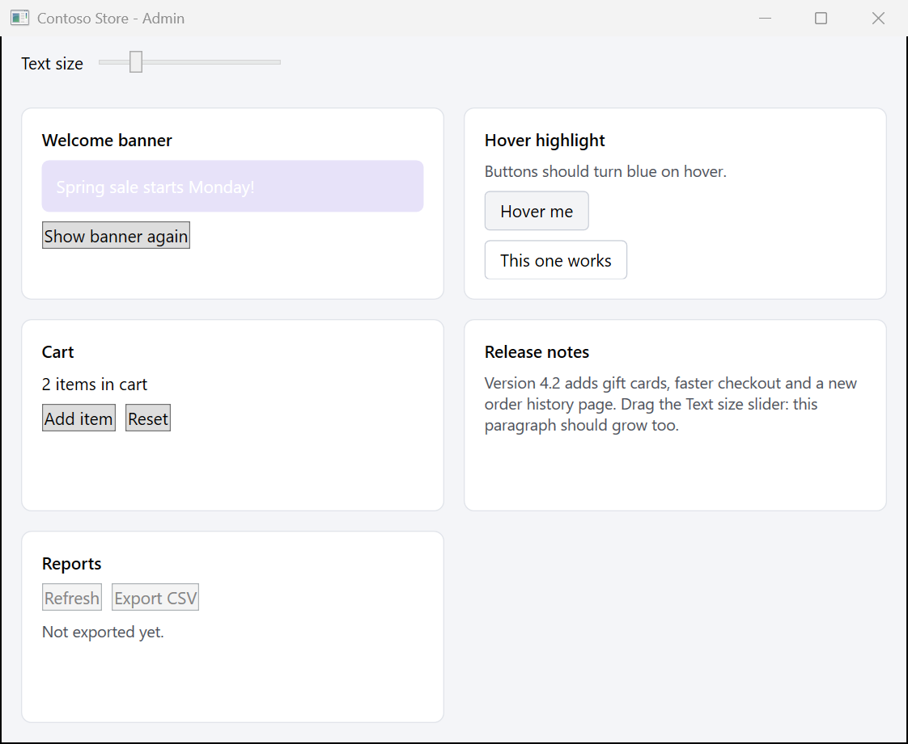
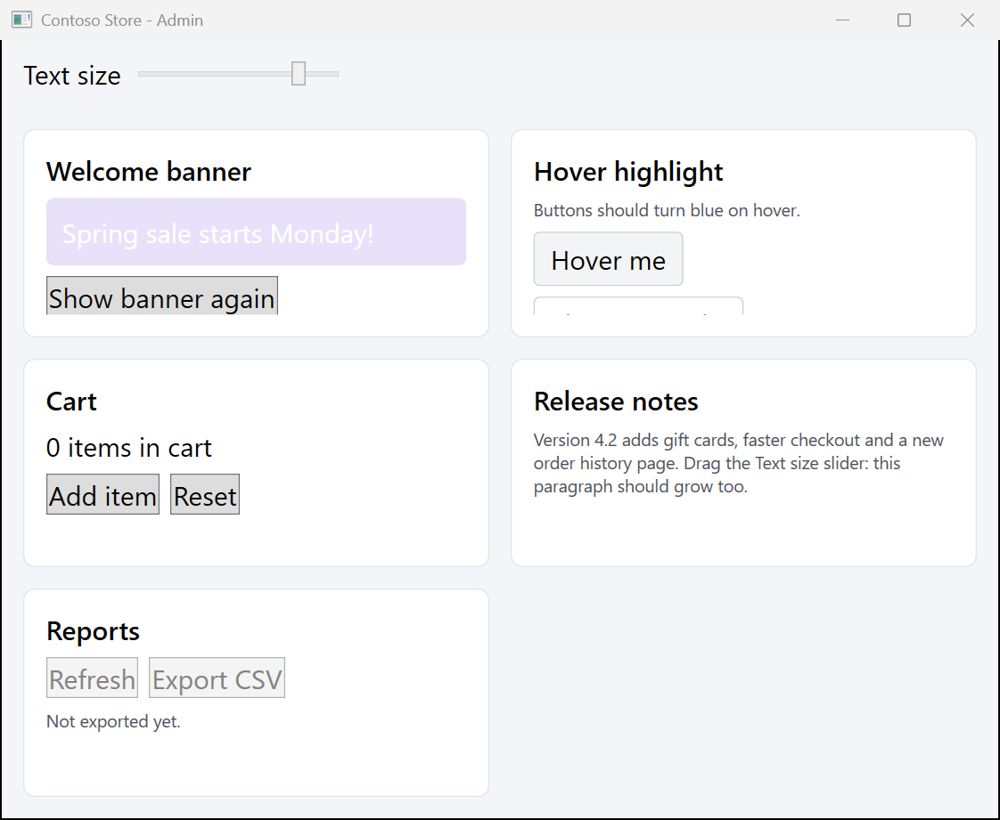
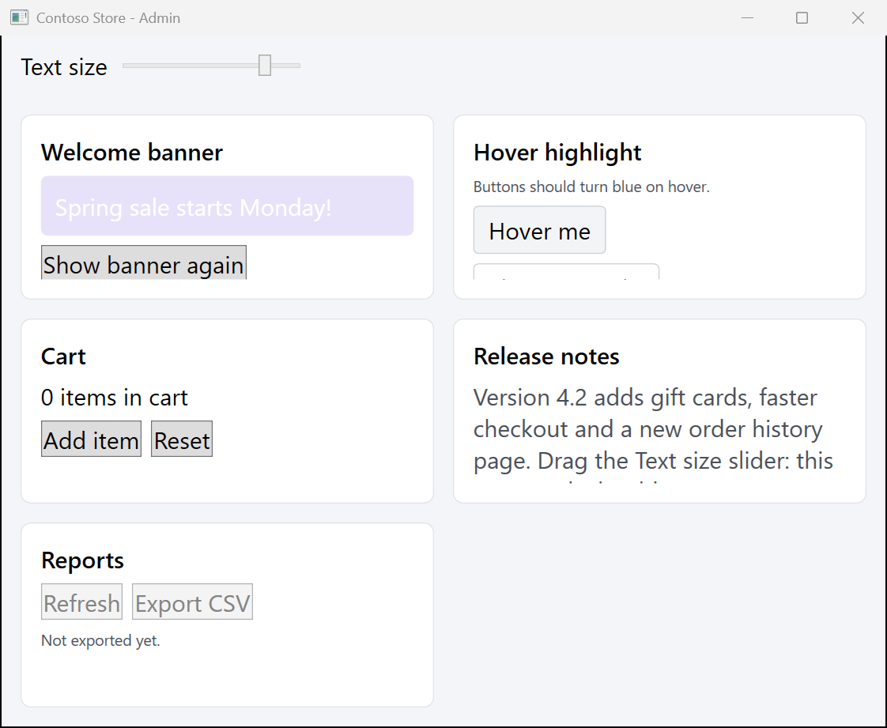
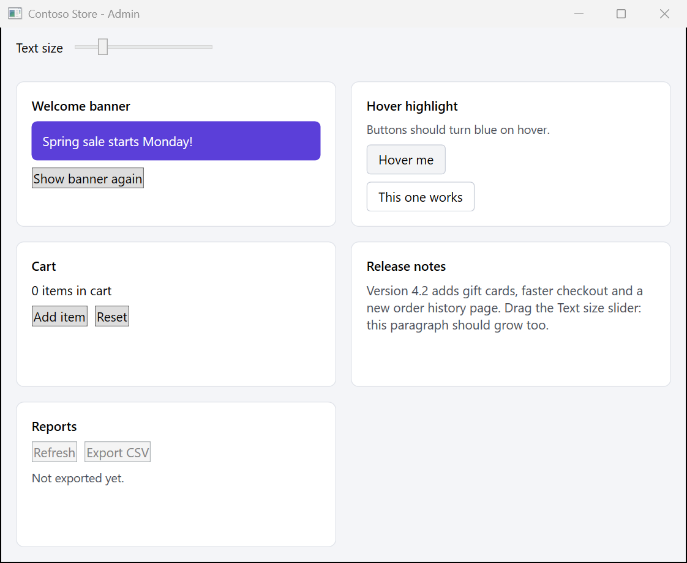
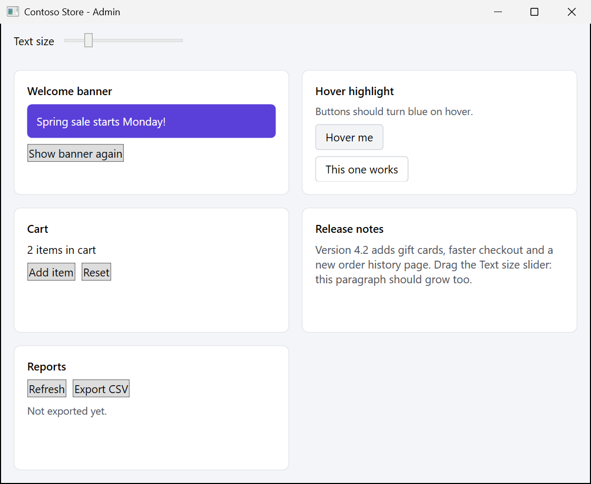

# Session transcript

Source: `Q:\source\XamlAgentDemos-notes\test-runs\PrecedenceWars\run-feedback\events.jsonl`

## Tool usage

- get_file: 14
- xaml_interact: 12
- xaml_explain_property_value: 10
- powershell: 7
- xaml_apply_hot_reload: 6
- replace_string_in_file: 6
- xaml_get_status: 5
- xaml_capture_image: 5
- glob: 4
- xaml_get_binding_failures: 3
- skill: 2
- xaml_get_element_properties: 2
- xaml_get_element_styles: 2
- xaml_hit_test: 2
- xaml_find_elements: 2
- xaml_get_hot_reload_log: 2
- debugger_evaluate_expressions: 2
- task_complete: 2
- xaml_get_visual_tree: 1
- get_projects_in_solution: 1
- view: 1
- multi_replace_string_in_file: 1
- task: 1
- grep_search: 1
- debugger_pause: 1
- debugger_get_threads: 1
- debugger_get_call_stack: 1
- debugger_continue: 1
- xaml_set_element_property: 1

Failed tool calls: 0, images: 5


_Model: gpt-6.1-terra_


## User (03:49:28)

Each card in my running app has a property that refuses to change. Figure out why for every card using the live app, prove it, and fix the source.


**Tool call (03:49:30):** `skill`
```json
{
 "skill": "xaml-diagnostics"
}
```

<details><summary>Result `skill` success=true</summary>

```
Skill "xaml-diagnostics" loaded successfully. Follow the instructions in the skill context.
```
</details>


_Skill invoked: xaml-diagnostics_


**Assistant (03:49:33):**

I’ll inspect the live cards and trace each property’s value precedence before changing the source.


**Tool call (03:49:33):** `xaml_get_status`
```json
{
 "progressMessage": "Inspecting the running app and diagnostics status"
}
```

<details><summary>Result `xaml_get_status` success=true</summary>

```
{"isDebugging":true,"debuggerState":"running","diagnosticsActive":true,"apps":[{"app":"a5","name":"PrecedenceWars.exe [36156]","processId":36156,"platform":"WPF (.NET)","isRemote":false,"isDesignTimeOrNoDebug":false,"sourceInfoAvailable":true,"hotReloadSupported":true,"hotReloadEnabled":true,"supportsPropertyExplorer":true,"supportsInAppToolbar":true,"supportsHitTest":true,"windows":[{"windowId":"0x5C0734","title":"Contoso Store - Admin","bounds":{"x":266,"y":266,"width":1140,"height":930},"dpiScale":1.5,"visible":true,"minimized":false}]}],"issues":[],"issuesSummary":"No problems detected.","hotReload":{"options":{"hotReloadEnabled":true,"hotReloadOnSave":false,"applyMode":"asYouType: XAML edits apply as you type, without saving (default)","wpfEnabled":true,"uwpEnabled":true,"winUIEnabled":true,"mauiEnabled":true,"justMyXaml":true,"previewSelectedElement":false,"inAppToolbar":true,"inAppSelection":false,"layoutAdorners":false,"trackFocusedElement":false,"bindingFailuresVisible":true,"compatibilityMode":false},"dotNetHotReloadEnabled":true,"isProcessingChanges":false,"lastHotReloadUpdate":{"secondsAgo":175,"updatesSinceToolsStarted":17},"errors":[]},"windowsNote":"Window bounds are physical screen pixels and include the window frame. A WPF/WinUI Window's Width and Height are device-independent units (DIPs) that also include the frame, so Width = bounds.width / dpiScale. A user's \"800 px wide\" is ambiguous: say which unit you tested. A minimized window reports x/y = -32000 and can't be captured."}
```
</details>


**Tool call (03:49:42):** `xaml_get_visual_tree`
```json
{
 "progressMessage": "Finding all live cards",
 "app": "a5",
 "depth": 7,
 "maxNodes": 500
}
```


**Tool call (03:49:42):** `xaml_capture_image`
```json
{
 "progressMessage": "Inspecting the current card display",
 "app": "a5"
}
```


**Tool call (03:49:42):** `get_projects_in_solution`
```json
{}
```

<details><summary>Result `xaml_get_visual_tree` success=true</summary>

```
{"app":"a5","platform":"WPF (.NET)","sourceInfoAvailable":true,"nodeCount":49,"truncated":false,"depthLimitedNodes":9,"hint":"9 node(s) have children beyond the requested depth (childCount > 0, no children listed). Raise depth or pass rootElementId to expand them.","nodes":[{"id":"a5:10","type":"PrecedenceWars.MainWindow","source":{"file":"Q:\\source\\XamlAgentDemos\\src\\PrecedenceWars\\MainWindow.xaml","line":3,"column":9},"childCount":1,"children":[{"id":"a5:11","type":"System.Windows.Controls.Border","childCount":1,"children":[{"id":"a5:12","type":"System.Windows.Documents.AdornerDecorator","childCount":2,"children":[{"id":"a5:13","type":"System.Windows.Controls.ContentPresenter","childCount":1,"children":[{"id":"a5:15","type":"System.Windows.Controls.DockPanel","source":{"file":"Q:\\source\\XamlAgentDemos\\src\\PrecedenceWars\\MainWindow.xaml","line":53,"column":6},"childCount":2,"children":[{"id":"a5:16","type":"System.Windows.Controls.StackPanel","source":{"file":"Q:\\source\\XamlAgentDemos\\src\\PrecedenceWars\\MainWindow.xaml","line":54,"column":10},"childCount":2,"children":[{"id":"a5:18","type":"System.Windows.Controls.TextBlock","source":{"file":"Q:\\source\\XamlAgentDemos\\src\\PrecedenceWars\\MainWindow.xaml","line":57,"column":14},"childCount":0},{"id":"a5:19","type":"System.Windows.Controls.Slider","name":"TextSizeSlider","source":{"file":"Q:\\source\\XamlAgentDemos\\src\\PrecedenceWars\\MainWindow.xaml","line":58,"column":14},"childCount":1,"children":[{"id":"a5:25","type":"System.Windows.Controls.Border","name":"border","childCount":1,"children":[{"id":"a5:31","type":"System.Windows.Controls.Grid","childCount":4,"children":[{"id":"a5:47","type":"System.Windows.Controls.Primitives.TickBar","name":"TopTick","childCount":0},{"id":"a5:48","type":"System.Windows.Controls.Primitives.TickBar","name":"BottomTick","childCount":0},{"id":"a5:49","type":"System.Windows.Controls.Border","name":"TrackBackground","childCount":1},{"id":"a5:50","type":"System.Windows.Controls.Primitives.Track","name":"PART_Track","childCount":3}]}]}]}]},{"id":"a5:17","type":"System.Windows.Controls.Primitives.UniformGrid","source":{"file":"Q:\\source\\XamlAgentDemos\\src\\PrecedenceWars\\MainWindow.xaml","line":67,"column":10},"childCount":5,"children":[{"id":"a5:20","type":"System.Windows.Controls.Border","source":{"file":"Q:\\source\\XamlAgentDemos\\src\\PrecedenceWars\\MainWindow.xaml","line":69,"column":14},"childCount":1,"children":[{"id":"a5:26","type":"System.Windo
... [truncated 6152 chars]
```
</details>

<details><summary>Result `get_projects_in_solution` success=true</summary>

```
src\GhostClicks\GhostClicks.csproj
src\GermanReady\GermanReady.csproj
src\ThemeBreaker\ThemeBreaker.csproj
src\DesignPolish\DesignPolish.csproj
src\HotReloadDoctor\HotReloadDoctor.csproj
src\VanishingSave\VanishingSave.csproj
src\CrispPixels\CrispPixels.csproj
src\PrecedenceWars\PrecedenceWars.csproj
src\LostWindows\LostWindows.csproj
src\TemplateDetective\TemplateDetective.csproj
src\SlowScroll\SlowScroll.csproj
src\PixelPerfect\PixelPerfect.csproj
src\BindingStorm\BindingStorm.csproj
src\BugRepro\BugRepro.csproj
src\A11ySweep\A11ySweep.csproj
src\StyleMaze\StyleMaze.csproj
src\ResponsiveDashboard\ResponsiveDashboard.csproj

```
</details>




<details><summary>Result `xaml_capture_image` success=true</summary>

```
Screenshot of window 0x5C0734 "Contoso Store - Admin" of app a5 (1122x921 image of the window's client area, so it's slightly smaller than the frame bounds from xaml_get_status).
```
</details>


**Tool call (03:49:47):** `get_file`
```json
{
 "filename": "Q:\\source\\XamlAgentDemos\\src\\PrecedenceWars\\MainWindow.xaml",
 "startLine": 1,
 "endLine": 200,
 "includeLineNumbers": true
}
```


**Tool call (03:49:47):** `get_file`
```json
{
 "filename": "Q:\\source\\XamlAgentDemos\\src\\PrecedenceWars\\MainWindow.xaml.cs",
 "startLine": 1,
 "endLine": 220,
 "includeLineNumbers": true
}
```


**Tool call (03:49:47):** `xaml_get_element_properties`
```json
{
 "progressMessage": "Inspecting values on each card",
 "elementIds": [
  "a5:33",
  "a5:37",
  "a5:38",
  "a5:40",
  "a5:43",
  "a5:45",
  "a5:57",
  "a5:58"
 ],
 "nameFilter": "Visibility|Opacity|Background|Text|FontSize|IsEnabled",
 "includeAll": true
}
```


**Tool call (03:49:47):** `xaml_get_element_styles`
```json
{
 "progressMessage": "Inspecting card styles and triggers",
 "elementIds": [
  "a5:33",
  "a5:37",
  "a5:38",
  "a5:40",
  "a5:43",
  "a5:45",
  "a5:57",
  "a5:58"
 ]
}
```


**Tool call (03:49:47):** `view`
```json
{
 "path": "c:\\vs\\fastmain\\common7\\ide\\commonextensions\\microsoft\\xamldiagnostics\\AgentTools\\skills\\xaml-diagnostics\\references\\xaml-authoring.md"
}
```

<details><summary>Result `get_file` success=true</summary>

```
```csharp src\PrecedenceWars\MainWindow.xaml.cs (Lines 1-25 of 25 total. Call tools for more if needed.)
1: using System.Windows;
2: 
3: namespace PrecedenceWars;
4: 
5: public partial class MainWindow : Window
6: {
7:     private readonly StoreViewModel viewModel = new();
8: 
9:     public MainWindow()
10:     {
11:         this.InitializeComponent();
12:         this.DataContext = this.viewModel;
13:     }
14: 
15:     private void OnShowBannerClick(object sender, RoutedEventArgs e)
16:     {
17:         this.WelcomeBanner.Opacity = 1;
18:     }
19: 
20:     private void OnResetClick(object sender, RoutedEventArgs e)
21:     {
22:         this.viewModel.ItemCount = 0;
23:         this.CountText.Text = "0 items in cart";
24:     }
25: }

```


```
</details>

<details><summary>Result `view` success=true</summary>

```
# XAML authoring guidance

Follow these rules when writing or changing XAML so it works well with XAML Hot Reload, the XAML designer, and XAML Diagnostics.

## Design-time data

- Declare `xmlns:d="http://schemas.microsoft.com/expression/blend/2008"` and `xmlns:mc="http://schemas.openxmlformats.org/markup-compatibility/2006"` with `mc:Ignorable="d"`.
- Use `d:DataContext="{d:DesignInstance Type=vm:MyViewModel, IsDesignTimeCreatable=False}"` (WPF/UWP) so the designer and IntelliSense know binding paths.
- Use `d:` properties (for example `d:Text="Sample"`) for sample values that appear only at design time.
- .NET MAUI: set `x:DataType` on pages and `DataTemplate`s. It enables compiled bindings and turns many binding failures into build errors.
- WinUI/UWP: prefer `x:Bind` for compile-time checked bindings when the view owns the view model.

## Bindings

- Bind with explicit paths. Avoid string-built paths in code-behind.
- Keep the `DataContext` chain simple. Use `ElementName` or `RelativeSource` only at real scope boundaries (for example inside a `DataTemplate` that needs the page's view model).
- Expose bound properties as public properties that raise `PropertyChanged`. Fields and non-public properties don't bind.
- Use `FallbackValue` and `TargetNullValue` for expected missing values instead of hiding binding errors.
- Before saving, check every binding path against the actual property names on the data context type (case, plurals, nested paths such as `Customer.Address.City`). Misspelled paths are the most common binding failure and they fail silently.
- Inside a `DataTemplate` or `ItemContainerStyle`, the data context is the item, not the page's view model. To reach a page command, use `RelativeSource={RelativeSource AncestorType=...}` with `DataContext.` in the path, or `ElementName`.
- A `TextBox.Text` binding updates its source on `LostFocus` by default (WPF). Use `UpdateSourceTrigger=PropertyChanged` when other UI (validation, enabled state, live search) must react while the user types.
- `Mode=TwoWay` (the default for `TextBox.Text`, `CheckBox.IsChecked`, `Selector.SelectedItem` and similar) needs a property with a public setter. In WPF, a two-way binding to a read-only property throws when the view loads.
- Bindings created in code have no XAML file and line in diagnostics. Prefer declaring bindings in XAML.

## Layout

- Don't put a list (`ListBox`, `ListView`, `DataGrid`, `ItemsControl` with a virtualizing panel) insid
... [truncated 4693 chars]
```
</details>

<details><summary>Result `get_file` success=true</summary>

```
```xaml src\PrecedenceWars\MainWindow.xaml (Lines 1-164 of 164 total. Call tools for more if needed.)
1: <Window x:Class="PrecedenceWars.MainWindow"
2:         xmlns="http://schemas.microsoft.com/winfx/2006/xaml/presentation"
3:         xmlns:x="http://schemas.microsoft.com/winfx/2006/xaml"
4:         Title="Contoso Store - Admin"
5:         Width="760"
6:         Height="620"
7:         FontSize="{Binding Value, ElementName=TextSizeSlider}">
8:     <Window.Resources>
9:         <Style x:Key="CardStyle" TargetType="Border">
10:             <Setter Property="Background" Value="White" />
11:             <Setter Property="BorderBrush" Value="#E1E4EA" />
12:             <Setter Property="BorderThickness" Value="1" />
13:             <Setter Property="CornerRadius" Value="8" />
14:             <Setter Property="Padding" Value="16" />
15:             <Setter Property="Margin" Value="8" />
16:         </Style>
17: 
18:         <Style x:Key="CardTitleStyle" TargetType="TextBlock">
19:             <Setter Property="FontWeight" Value="SemiBold" />
20:             <Setter Property="Margin" Value="0,0,0,8" />
21:         </Style>
22: 
23:         <Style x:Key="BodyTextStyle" TargetType="TextBlock">
24:             <Setter Property="FontSize" Value="13" />
25:             <Setter Property="Foreground" Value="#4A4F5A" />
26:             <Setter Property="TextWrapping" Value="Wrap" />
27:         </Style>
28: 
29:         <Style x:Key="HoverButtonStyle" TargetType="Button">
30:             <Setter Property="Background" Value="White" />
31:             <Setter Property="Padding" Value="12,6" />
32:             <Setter Property="Template">
33:                 <Setter.Value>
34:                     <ControlTemplate TargetType="Button">
35:                         <Border Padding="{TemplateBinding Padding}"
36:                                 Background="{TemplateBinding Background}"
37:                                 BorderBrush="#C9CED8"
38:                                 BorderThickness="1"
39:                                 CornerRadius="4">
40:                             <ContentPresenter HorizontalAlignment="Center" />
41:                         </Border>
42:                     </ControlTemplate>
43:                 </Setter.Value>
44:             </Setter>
45:             <Style.Triggers>
46:                 <Trigger Property="IsMouseOver" Value="True">
47:                     <Setter Property="Background" Value="#D
... [truncated 6298 chars]
```
</details>

<details><summary>Result `xaml_get_element_properties` success=true</summary>

```
{"count":8,"failed":0,"results":[{"id":"a5:33","type":"System.Windows.Controls.Border","name":"WelcomeBanner","source":{"file":"Q:\\source\\XamlAgentDemos\\src\\PrecedenceWars\\MainWindow.xaml","line":72,"column":22},"properties":[{"name":"Opacity","value":"0.15000000000000002","valueType":"System.Double","propertyType":"System.Double","declaringType":"System.Windows.UIElement","valueSource":"Animation"},{"name":"Background","value":"#FF5B3FD9","valueType":"System.Windows.Media.SolidColorBrush","propertyType":"System.Windows.Media.Brush","declaringType":"System.Windows.Controls.Border","valueSource":"Local","valueSourceLocation":{"file":"Q:\\source\\XamlAgentDemos\\src\\PrecedenceWars\\MainWindow.xaml","line":72,"column":22}},{"name":"DataContext","valueType":"PrecedenceWars.StoreViewModel","propertyType":"System.Object","declaringType":"System.Windows.FrameworkElement","valueSource":"Inherited"},{"name":"ContextMenu","propertyType":"System.Windows.Controls.ContextMenu","declaringType":"System.Windows.FrameworkElement","valueSource":"Default"},{"name":"OpacityMask","propertyType":"System.Windows.Media.Brush","declaringType":"System.Windows.UIElement","valueSource":"Default"},{"name":"Visibility","value":"0","valueType":"System.Windows.Visibility","propertyType":"System.Windows.Visibility","declaringType":"System.Windows.UIElement","valueSource":"Default"},{"name":"IsEnabled","value":"True","valueType":"System.Boolean","propertyType":"System.Boolean","declaringType":"System.Windows.UIElement","valueSource":"Default"}],"hiddenDefaultOrOverridden":3,"hint":"Default and overridden values were omitted. Pass includeAll=true to see them, or call xaml_explain_property_value for one property's full precedence chain."},{"id":"a5:37","type":"System.Windows.Controls.Button","name":"HoverButton","source":{"file":"Q:\\source\\XamlAgentDemos\\src\\PrecedenceWars\\MainWindow.xaml","line":103,"column":22},"properties":[{"name":"Background","value":"#FFF3F4F6","valueType":"System.Windows.Media.SolidColorBrush","propertyType":"System.Windows.Media.Brush","declaringType":"System.Windows.Controls.Control","valueSource":"Local","valueSourceLocation":{"file":"Q:\\source\\XamlAgentDemos\\src\\PrecedenceWars\\MainWindow.xaml","line":103,"column":22}},{"name":"FontSize","value":"14","valueType":"System.Double","propertyType":"System.Double","declaringType":"System.Windows.Controls.Control","valueSource":"Inherited"},{"name":"DataContext","valueType":"PrecedenceWars.StoreViewModel",
... [truncated 14682 chars]
```
</details>

<details><summary>Result `xaml_get_element_styles` success=true</summary>

```
{"count":8,"failed":0,"results":[{"id":"a5:33","type":"System.Windows.Controls.Border","name":"WelcomeBanner","source":{"file":"Q:\\source\\XamlAgentDemos\\src\\PrecedenceWars\\MainWindow.xaml","line":72,"column":22},"styleProperty":{"valueSource":"Default"},"styles":[],"hint":"No style, trigger or template sets any property on this element. Values come from local values, inheritance or defaults; use xaml_explain_property_value for a specific property."},{"id":"a5:37","type":"System.Windows.Controls.Button","name":"HoverButton","source":{"file":"Q:\\source\\XamlAgentDemos\\src\\PrecedenceWars\\MainWindow.xaml","line":103,"column":22},"styleProperty":{"value":"System.Windows.Style","valueSource":"Local","location":{"file":"Q:\\source\\XamlAgentDemos\\src\\PrecedenceWars\\MainWindow.xaml","line":103,"column":22}},"templateProperty":{"value":"System.Windows.Controls.ControlTemplate","valueSource":"Style","location":{"file":"Q:\\source\\XamlAgentDemos\\src\\PrecedenceWars\\MainWindow.xaml","line":29,"column":10}},"styles":[{"kind":"Style","description":"Setter in an explicit (x:Key) or implicit (TargetType) Style.","targetType":"System.Windows.Controls.Button","location":{"file":"Q:\\source\\XamlAgentDemos\\src\\PrecedenceWars\\MainWindow.xaml","line":29,"column":10},"setters":[{"property":"Background","value":"#FFFFFFFF","effective":false,"overriddenBy":"Local"},{"property":"Padding","value":"12,6,12,6","effective":true},{"property":"Template","value":"System.Windows.Controls.ControlTemplate","effective":true,"valueLocation":{"file":"Q:\\source\\XamlAgentDemos\\src\\PrecedenceWars\\MainWindow.xaml","line":34,"column":22}}]},{"kind":"BuiltInStyle","description":"Setter in the control's default theme style (generic.xaml or the platform theme).","targetType":"System.Windows.Controls.Primitives.ButtonBase","setters":[{"property":"Background","value":"#FFDDDDDD","effective":false,"overriddenBy":"Local"},{"property":"BorderBrush","value":"#FF707070","effective":true},{"property":"BorderThickness","value":"1,1,1,1","effective":true},{"property":"FocusVisualStyle","value":"System.Windows.Style","effective":true},{"property":"Foreground","effective":true},{"property":"HorizontalContentAlignment","value":"1","effective":true},{"property":"Padding","value":"1,1,1,1","effective":false,"overriddenBy":"Style (System.Windows.Controls.Button)"},{"property":"Template","value":"System.Windows.Controls.ControlTemplate","effective":false,"overriddenBy":"Style (System.Windows.Con
... [truncated 9565 chars]
```
</details>


**Tool call (03:49:52):** `glob`
```json
{
 "pattern": "src\\PrecedenceWars\\*"
}
```


**Tool call (03:49:52):** `xaml_explain_property_value`
```json
{
 "progressMessage": "Tracing each blocked property",
 "elementIds": [
  "a5:33",
  "a5:37",
  "a5:43",
  "a5:58"
 ],
 "propertyNames": [
  "Opacity",
  "Background",
  "FontSize",
  "IsEnabled"
 ],
 "pairwise": true
}
```


**Tool call (03:49:52):** `xaml_interact`
```json
{
 "progressMessage": "Reproducing the banner reset failure",
 "elementId": "a5:34",
 "action": "invoke"
}
```


**Tool call (03:49:52):** `xaml_get_binding_failures`
```json
{
 "progressMessage": "Checking live binding errors",
 "maxResults": 100
}
```


**Tool call (03:49:52):** `powershell`
```json
{
 "command": "git status --short -- src\\PrecedenceWars",
 "description": "Check existing changes in the affected project"
}
```

<details><summary>Result `xaml_get_binding_failures` success=true</summary>

```
{"note":"This is a cumulative log since debugging started or the last xaml_clear_binding_failures, not live state: fixed failures stay listed. To verify a fix: clear, revisit the UI that uses the binding, then read again. Failures without a file usually come from bindings created in code.","totalUnique":0,"matched":0,"truncated":false,"failures":[]}
```
</details>

<details><summary>Result `xaml_interact` success=true</summary>

```
{"id":"a5:34","action":"invoke","result":"Invoked.","supportedPatterns":["Invoke","SynchronizedInput"],"note":"Call xaml_capture_image or xaml_get_element_properties to verify the effect. Automation actions bypass mouse hit testing, so a successful invoke doesn't prove a real click reaches the element; call xaml_hit_test for that."}
```
</details>

<details><summary>Result `glob` success=true</summary>

```
.\src\PrecedenceWars\StoreViewModel.cs
.\src\PrecedenceWars\PrecedenceWars.csproj
.\src\PrecedenceWars\App.xaml.cs
.\src\PrecedenceWars\MainWindow.xaml
.\src\PrecedenceWars\App.xaml
.\src\PrecedenceWars\MainWindow.xaml.cs
```
</details>

<details><summary>Result `xaml_explain_property_value` success=true</summary>

```
{"count":4,"failed":0,"results":[{"id":"a5:33","type":"System.Windows.Controls.Border","property":"Opacity","propertyType":"System.Double","effectiveValue":"0.15000000000000002","effectiveSource":"Animation","chain":[{"kind":"Animation","description":"An active animation (Storyboard or VisualState). It overrides local and style values while it holds the value.","value":"0.15000000000000002","valueType":"System.Double","effective":true},{"kind":"Default","description":"The property's default value; nothing sets it.","value":"1","valueType":"System.Double","effective":false}],"notes":["Find the Storyboard or VisualState that animates this property; local and style changes have no visible effect while it holds the value (FillBehavior=HoldEnd is common)."]},{"id":"a5:37","type":"System.Windows.Controls.Button","property":"Background","propertyType":"System.Windows.Media.Brush","effectiveValue":"#FFF3F4F6","effectiveSource":"Local","chain":[{"kind":"Local","description":"Local value set on the element (XAML attribute, binding or code). Wins over styles, templates and inheritance.","value":"#FFF3F4F6","valueType":"System.Windows.Media.SolidColorBrush","effective":true,"sourceLocation":{"file":"Q:\\source\\XamlAgentDemos\\src\\PrecedenceWars\\MainWindow.xaml","line":103,"column":22}},{"kind":"Style","description":"Setter in an explicit (x:Key) or implicit (TargetType) Style.","targetType":"System.Windows.Controls.Button","value":"#FFFFFFFF","valueType":"System.Windows.Media.SolidColorBrush","effective":false,"sourceLocation":{"file":"Q:\\source\\XamlAgentDemos\\src\\PrecedenceWars\\MainWindow.xaml","line":29,"column":10}},{"kind":"BuiltInStyle","description":"Setter in the control's default theme style (generic.xaml or the platform theme).","targetType":"System.Windows.Controls.Primitives.ButtonBase","value":"#FFDDDDDD","valueType":"System.Windows.Media.SolidColorBrush","effective":false},{"kind":"Default","description":"The property's default value; nothing sets it.","effective":false}],"notes":["To let a style or template value apply, remove the local value (the attribute, binding or code assignment). To change it, edit that local value. XAML and code both produce Local values, and the source location may still point to the XAML attribute after code assigned a new value. If the live value differs from the XAML attribute, or the element has no XAML attribute for it, code set it: search code-behind for the element's x:Name."]},{"id":"a5:43","type":"System.Windows
... [truncated 1320 chars]
```
</details>

<details><summary>Result `powershell` success=true</summary>

```

<shellId: 7 completed with exit code 0>
```
</details>


**Tool call (03:49:56):** `get_file`
```json
{
 "filename": "Q:\\source\\XamlAgentDemos\\src\\PrecedenceWars\\StoreViewModel.cs",
 "startLine": 1,
 "endLine": 240,
 "includeLineNumbers": true
}
```


**Tool call (03:49:56):** `xaml_explain_property_value`
```json
{
 "progressMessage": "Proving the banner reset is overridden",
 "elementIds": [
  "a5:33"
 ],
 "propertyNames": [
  "Opacity"
 ]
}
```


**Tool call (03:49:56):** `xaml_hit_test`
```json
{
 "progressMessage": "Tracing disabled report controls",
 "elementIds": [
  "a5:57",
  "a5:58"
 ]
}
```


**Tool call (03:49:56):** `xaml_interact`
```json
{
 "progressMessage": "Reproducing the cart reset failure",
 "elementId": "a5:56",
 "action": "invoke"
}
```


**Tool call (03:49:56):** `xaml_interact`
```json
{
 "progressMessage": "Reproducing the text size failure",
 "elementId": "a5:19",
 "action": "setValue",
 "value": "20"
}
```

<details><summary>Result `xaml_explain_property_value` success=true</summary>

```
{"id":"a5:33","type":"System.Windows.Controls.Border","property":"Opacity","propertyType":"System.Double","effectiveValue":"0.15000000000000002","effectiveSource":"Animation","chain":[{"kind":"Animation","description":"An active animation (Storyboard or VisualState). It overrides local and style values while it holds the value.","value":"0.15000000000000002","valueType":"System.Double","effective":true},{"kind":"Local","description":"Local value set on the element (XAML attribute, binding or code). Wins over styles, templates and inheritance.","value":"1","valueType":"System.Double","effective":false,"sourceLocation":{"file":"Q:\\source\\XamlAgentDemos\\src\\PrecedenceWars\\MainWindow.xaml","line":72,"column":22}},{"kind":"Default","description":"The property's default value; nothing sets it.","value":"1","valueType":"System.Double","effective":false}],"notes":["Find the Storyboard or VisualState that animates this property; local and style changes have no visible effect while it holds the value (FillBehavior=HoldEnd is common)."]}
```
</details>

<details><summary>Result `get_file` success=true</summary>

```
```csharp src\PrecedenceWars\StoreViewModel.cs (Lines 1-69 of 69 total. Call tools for more if needed.)
1: using System.Diagnostics;
2: 
3: namespace PrecedenceWars;
4: 
5: public sealed class StoreViewModel : ObservableObject
6: {
7:     private int itemCount = 2;
8:     private bool isBusy;
9:     private string lastExport = "Not exported yet.";
10: 
11:     public StoreViewModel()
12:     {
13:         this.AddItemCommand = new RelayCommand(() => this.ItemCount++);
14:         this.ExportCommand = new RelayCommand(() => this.LastExport = $"Exported at {DateTime.Now:t}.", () => true);
15:         this.SyncCatalog();
16:     }
17: 
18:     public RelayCommand AddItemCommand { get; }
19: 
20:     public RelayCommand ExportCommand { get; }
21: 
22:     public int ItemCount
23:     {
24:         get => this.itemCount;
25:         set => this.SetProperty(ref this.itemCount, value);
26:     }
27: 
28:     public bool IsBusy
29:     {
30:         get => this.isBusy;
31:         private set
32:         {
33:             if (this.SetProperty(ref this.isBusy, value))
34:             {
35:                 this.OnPropertyChanged(nameof(this.IsIdle));
36:             }
37:         }
38:     }
39: 
40:     public bool IsIdle => !this.IsBusy;
41: 
42:     public string LastExport
43:     {
44:         get => this.lastExport;
45:         private set => this.SetProperty(ref this.lastExport, value);
46:     }
47: 
48:     private void SyncCatalog()
49:     {
50:         this.IsBusy = true;
51:         try
52:         {
53:             if (this.IsOffline())
54:             {
55:                 throw new TimeoutException("Catalog service didn't respond.");
56:             }
57:         }
58:         catch (TimeoutException ex)
59:         {
60:             Debug.WriteLine($"Catalog sync failed: {ex.Message}");
61:             return;
62:         }
63: 
64:         this.IsBusy = false;
65:     }
66: 
67:     // Simulates the offline case: the catalog service isn't reachable.
68:     private bool IsOffline() => true;
69: }

```


```
</details>

<details><summary>Result `xaml_interact` success=true</summary>

```
{"id":"a5:56","action":"invoke","result":"Invoked.","supportedPatterns":["Invoke","SynchronizedInput"],"note":"Call xaml_capture_image or xaml_get_element_properties to verify the effect. Automation actions bypass mouse hit testing, so a successful invoke doesn't prove a real click reaches the element; call xaml_hit_test for that."}
```
</details>

<details><summary>Result `xaml_interact` success=true</summary>

```
{"id":"a5:19","action":"setValue","result":"Value is now 20.","supportedPatterns":["RangeValue","SynchronizedInput"],"note":"Call xaml_capture_image or xaml_get_element_properties to verify the effect. Automation actions bypass mouse hit testing, so a successful invoke doesn't prove a real click reaches the element; call xaml_hit_test for that."}
```
</details>

<details><summary>Result `xaml_hit_test` success=true</summary>

```
{"count":2,"failed":0,"results":[{"id":"a5:57","summary":"A click at its center does NOT reach 'RefreshButton' because it's disabled (IsEnabled=False): input skips disabled elements and lands on StackPanel behind or around it. That element isn't necessarily covering it; fix the IsEnabled cause (see blockers, or a command's CanExecute) rather than the layout. StackPanel 'ToolbarPanel' has IsEnabled=False, which applies to 'RefreshButton' too.","elementReceivesInput":false,"inputTarget":{"id":"a5:30","type":"System.Windows.Controls.StackPanel","source":{"file":"Q:\\source\\XamlAgentDemos\\src\\PrecedenceWars\\MainWindow.xaml","line":146,"column":18}},"stack":[{"id":"a5:84","type":"System.Windows.Controls.TextBlock","templatedParent":{"id":"a5:57","type":"System.Windows.Controls.Button","name":"RefreshButton","source":{"file":"Q:\\source\\XamlAgentDemos\\src\\PrecedenceWars\\MainWindow.xaml","line":151,"column":26}}},{"id":"a5:68","type":"System.Windows.Controls.Border","name":"border","templatedParent":{"id":"a5:57","type":"System.Windows.Controls.Button","name":"RefreshButton","source":{"file":"Q:\\source\\XamlAgentDemos\\src\\PrecedenceWars\\MainWindow.xaml","line":151,"column":26}}},{"id":"a5:24","type":"System.Windows.Controls.Border","source":{"file":"Q:\\source\\XamlAgentDemos\\src\\PrecedenceWars\\MainWindow.xaml","line":145,"column":14}},{"id":"a5:15","type":"System.Windows.Controls.DockPanel","source":{"file":"Q:\\source\\XamlAgentDemos\\src\\PrecedenceWars\\MainWindow.xaml","line":53,"column":6}},{"id":"a5:11","type":"System.Windows.Controls.Border","templatedParent":{"id":"a5:10","type":"PrecedenceWars.MainWindow","source":{"file":"Q:\\source\\XamlAgentDemos\\src\\PrecedenceWars\\MainWindow.xaml","line":3,"column":9}}}],"isVisible":true,"isHitTestVisible":true,"isEnabled":false,"effectiveOpacity":1.0,"blockers":[{"id":"a5:45","type":"System.Windows.Controls.StackPanel","name":"ToolbarPanel","source":{"file":"Q:\\source\\XamlAgentDemos\\src\\PrecedenceWars\\MainWindow.xaml","line":148,"column":22},"property":"IsEnabled","value":"False"}],"visibleFraction":1.0,"point":{"window":{"x":57.86,"y":462.91},"screen":{"x":364.0,"y":1005.0}}},{"id":"a5:58","summary":"A click at its center does NOT reach 'ExportButton' because it's disabled (IsEnabled=False): input skips disabled elements and lands on StackPanel behind or around it. That element isn't necessarily covering it; fix the IsEnabled cause (see blockers, or a command's CanExecute) rather than the la
... [truncated 2537 chars]
```
</details>


**Tool call (03:50:03):** `xaml_interact`
```json
{
 "progressMessage": "Checking cart updates after reset",
 "elementId": "a5:55",
 "action": "invoke"
}
```

<details><summary>Result `xaml_interact` success=true</summary>

```
{"id":"a5:55","action":"invoke","result":"Invoked.","supportedPatterns":["Invoke","SynchronizedInput"],"note":"Call xaml_capture_image or xaml_get_element_properties to verify the effect. Automation actions bypass mouse hit testing, so a successful invoke doesn't prove a real click reaches the element; call xaml_hit_test for that."}
```
</details>


**Tool call (03:50:06):** `xaml_explain_property_value`
```json
{
 "progressMessage": "Proving the cart binding was replaced",
 "elementIds": [
  "a5:40",
  "a5:43",
  "a5:10"
 ],
 "propertyNames": [
  "Text",
  "FontSize",
  "FontSize"
 ],
 "pairwise": true
}
```


**Tool call (03:50:06):** `xaml_capture_image`
```json
{
 "progressMessage": "Inspecting reproduced failures",
 "app": "a5"
}
```


**Tool call (03:50:06):** `get_file`
```json
{
 "filename": "Q:\\source\\XamlAgentDemos\\src\\PrecedenceWars\\PrecedenceWars.csproj",
 "startLine": 1,
 "endLine": 120
}
```

<details><summary>Result `get_file` success=true</summary>

```
``` src\PrecedenceWars\PrecedenceWars.csproj (Lines 1-5 of 5 total. Call tools for more if needed.)
<Project Sdk="Microsoft.NET.Sdk">
  <PropertyGroup>
    <RootNamespace>PrecedenceWars</RootNamespace>
  </PropertyGroup>
</Project>

```


```
</details>




<details><summary>Result `xaml_capture_image` success=true</summary>

```
Screenshot of window 0x5C0734 "Contoso Store - Admin" of app a5 (1122x921 image of the window's client area, so it's slightly smaller than the frame bounds from xaml_get_status).
```
</details>

<details><summary>Result `xaml_explain_property_value` success=true</summary>

```
{"count":3,"failed":0,"results":[{"id":"a5:40","type":"System.Windows.Controls.TextBlock","property":"Text","propertyType":"System.String","effectiveValue":"0 items in cart","effectiveSource":"Local","chain":[{"kind":"Local","description":"Local value set on the element (XAML attribute, binding or code). Wins over styles, templates and inheritance.","value":"0 items in cart","valueType":"System.String","effective":true,"sourceLocation":{"file":"Q:\\source\\XamlAgentDemos\\src\\PrecedenceWars\\MainWindow.xaml","line":121,"column":22}},{"kind":"Default","description":"The property's default value; nothing sets it.","value":"","valueType":"System.String","effective":false}],"notes":["To let a style or template value apply, remove the local value (the attribute, binding or code assignment). To change it, edit that local value. XAML and code both produce Local values, and the source location may still point to the XAML attribute after code assigned a new value. If the live value differs from the XAML attribute, or the element has no XAML attribute for it, code set it: search code-behind for the element's x:Name."]},{"id":"a5:43","type":"System.Windows.Controls.TextBlock","property":"FontSize","propertyType":"System.Double","effectiveValue":"13","effectiveSource":"Style","chain":[{"kind":"Style","description":"Setter in an explicit (x:Key) or implicit (TargetType) Style.","targetType":"System.Windows.Controls.TextBlock","value":"13","valueType":"System.Double","effective":true,"sourceLocation":{"file":"Q:\\source\\XamlAgentDemos\\src\\PrecedenceWars\\MainWindow.xaml","line":23,"column":10}},{"kind":"Default","description":"The property's default value; nothing sets it.","value":"12","valueType":"System.Double","effective":false}],"notes":["Edit the setter or trigger at the source location, or set a local value to override it for this element only."]},{"id":"a5:10","type":"PrecedenceWars.MainWindow","property":"FontSize","propertyType":"System.Double","evaluatedValue":"20 (System.Double)","effectiveSource":"Local","chain":[{"kind":"Local","description":"Local value set on the element (XAML attribute, binding or code). Wins over styles, templates and inheritance.","evaluatedValue":"20 (System.Double)","valueType":"System.Windows.Data.BindingExpression","isBinding":true,"effective":true,"sourceLocation":{"file":"Q:\\source\\XamlAgentDemos\\src\\PrecedenceWars\\MainWindow.xaml","line":3,"column":9}},{"kind":"Default","description":"The property's default value; noth
... [truncated 636 chars]
```
</details>


**Assistant (03:50:19):**

The five cards have different causes: an animation, a local style override, a replaced binding, a fixed font size, and a stuck busy state. I’ve reproduced or traced each in the live app; I’ll fix those causes while preserving the intended styling.


**Tool call (03:50:19):** `multi_replace_string_in_file`
```json
{
 "explanation": "Fix the five identified property-precedence and state issues without changing unrelated card styling.",
 "replacements": [
  {
   "filePath": "src\\PrecedenceWars\\MainWindow.xaml",
   "oldString": "            </Style.Triggers>\n        </Style>\n    </Window.Resources>\n",
   "newString": "            </Style.Triggers>\n        </Style>\n\n        <Style x:Key=\"GrayHoverButtonStyle\" TargetType=\"Button\" BasedOn=\"{StaticResource HoverButtonStyle}\">\n            <Setter Property=\"Background\" Value=\"#F3F4F6\" />\n        </Style>\n    </Window.Resources>\n",
   "explanation": "Keep the first button's gray base color below the inherited hover trigger in precedence."
  },
  {
   "filePath": "src\\PrecedenceWars\\MainWindow.xaml",
   "oldString": "                    <Button x:Name=\"HoverButton\"\n                            Margin=\"0,8,0,0\"\n                            HorizontalAlignment=\"Left\"\n                            Background=\"#F3F4F6\"\n                            Content=\"Hover me\"\n                            Style=\"{StaticResource HoverButtonStyle}\" />\n                    <Button x:Name=\"HoverButtonOk\"",
   "newString": "                    <Button x:Name=\"HoverButton\"\n                            Margin=\"0,8,0,0\"\n                            HorizontalAlignment=\"Left\"\n                            Content=\"Hover me\"\n                            Style=\"{StaticResource GrayHoverButtonStyle}\" />\n                    <Bu
... [truncated 2801 chars]
```

<details><summary>Result `multi_replace_string_in_file` success=true</summary>

```
Successfully applied 5 of 5 replacement(s) across 3 file(s).
```
</details>


**Tool call (03:50:22):** `xaml_apply_hot_reload`
```json
{
 "progressMessage": "Applying the fixes to the running app",
 "includeCodeChanges": true
}
```

<details><summary>Result `xaml_apply_hot_reload` success=true</summary>

```
{"status":"alreadyApplied","errors":[],"log":[],"noNewActivity":true,"lastHotReloadUpdate":{"secondsAgo":5,"updatesSinceToolsStarted":18},"lastActivity":{"secondsAgo":80,"message":"Connected to PrecedenceWars.exe [36156] for WpfCore diagnostics. Incremental Hot Reload is enabled."},"note":"This call applied nothing new. status=alreadyApplied means XAML Hot Reload pushed changes into the app within the last minute, most likely your edits as you made them. lastHotReloadUpdate is when XAML Hot Reload last pushed changes into the app (it applies saved and in-editor edits as they happen, often without a log entry). If it's after your edit, the edit was already applied; if it's null or older than your edit, nothing reached the app (check the file is saved and part of the running project). It doesn't prove the app shows them: XAML that the app loads itself (XamlReader, files copied to the output folder, dictionaries swapped in code) is never hot reloaded, and code that sets the same property or picks another template/resource at runtime overrides the edit. Values that code already set (for example in a constructor or Loaded handler) stay in place, and startup code isn't re-run by hot reload, so a fix in that code needs the view reopened or a restart to take effect. Check the live value with xaml_explain_property_value (a Local value that isn't in your XAML was set by code) or xaml_find_resource.","codeChanges":".NET Hot Reload was started for saved code changes. Its results are in the Hot Reload output pane, not in 'log'; if an edit can't be hot reloaded, Visual Studio asks the user to rebuild and restart.","codeHotReloadOutput":[],"hint":"Call xaml_capture_image to verify the change visually. Views that aren't loaded (other tabs, closed dialogs) are updated when they're next shown. Source line numbers reported for existing elements can still point to the pre-edit lines until the element is recreated, so find elements by x:Name or type rather than by an old line number. Structural edits (wrapping or replacing a parent, changing a root's content) recreate elements, which resets their runtime state such as selection, checked state, typed text and scroll position, and invalidates their IDs. Re-establish the state you were testing before capturing again."}
```
</details>


**Tool call (03:50:31):** `xaml_find_elements`
```json
{
 "progressMessage": "Finding the refreshed card controls",
 "name": "WelcomeBanner|ShowBannerButton|HoverButton|HoverButtonOk|CountText|ResetButton|AddButton|ReleaseNotesText|ToolbarPanel|ExportButton|TextSizeSlider",
 "maxResults": 50
}
```


**Tool call (03:50:31):** `xaml_capture_image`
```json
{
 "progressMessage": "Checking the updated card display",
 "app": "a5"
}
```


**Tool call (03:50:31):** `xaml_get_hot_reload_log`
```json
{
 "progressMessage": "Checking hot reload results",
 "maxEntries": 100
}
```


**Tool call (03:50:31):** `powershell`
```json
{
 "command": "git --no-pager diff --check; git --no-pager diff -- src\\PrecedenceWars",
 "description": "Review the focused source changes"
}
```

<details><summary>Result `xaml_get_hot_reload_log` success=true</summary>

```
{"total":9,"entries":[{"time":"22:28:19.686","level":"Info","project":"XAML","message":"Connected to VanishingSave.exe [58248] for WpfCore diagnostics. Incremental Hot Reload is enabled."},{"time":"22:34:11.556","level":"Info","project":"XAML","message":"VanishingSave.exe [58248] WpfCore diagnostics stopped."},{"time":"22:34:21.553","level":"Info","project":"XAML","message":"Connected to StyleMaze.exe [19356] for WpfCore diagnostics. Incremental Hot Reload is enabled."},{"time":"22:37:46.660","level":"Info","project":"XAML","message":"StyleMaze.exe [19356] WpfCore diagnostics stopped."},{"time":"22:37:56.615","level":"Info","project":"XAML","message":"Connected to A11ySweep.exe [16740] for WpfCore diagnostics. Incremental Hot Reload is enabled."},{"time":"22:42:56.991","level":"Info","project":"XAML","message":"A11ySweep.exe [16740] WpfCore diagnostics stopped."},{"time":"22:43:08.315","level":"Info","project":"XAML","message":"Connected to BindingStorm.exe [78728] for WpfCore diagnostics. Incremental Hot Reload is enabled."},{"time":"22:48:57.077","level":"Info","project":"XAML","message":"BindingStorm.exe [78728] WpfCore diagnostics stopped."},{"time":"22:49:06.517","level":"Info","project":"XAML","message":"Connected to PrecedenceWars.exe [36156] for WpfCore diagnostics. Incremental Hot Reload is enabled."}],"dotNetHotReloadPane":["22:28:19.68 [XAML] Connected to VanishingSave.exe [58248] for WpfCore diagnostics. Incremental Hot Reload is enabled.","22:29:55.85 🔣  ⚠ [Q:\\source\\XamlAgentDemos\\src\\VanishingSave\\VanishingSave.csproj ({4EB184D2-643F-45DC-A2E0-9645EA07CD15})]: Q:\\source\\XamlAgentDemos\\src\\VanishingSave\\FooterSettings.cs(9,5): warning ENC0118: Changing 'auto-property' might not have any effect until the application is restarted.","22:29:56.15  ⚠ Q:\\source\\XamlAgentDemos\\src\\VanishingSave\\FooterSettings.cs (line 9): warning ENC0118: Changing 'auto-property' might not have any effect until the application is restarted.","22:29:56.85  Code changes were successfully applied.","22:32:12.50  Code changes were successfully applied.","22:34:11.17 🔥 1> [VanishingSave] ❌ Exited with error code -1","22:34:11.55 [XAML] VanishingSave.exe [58248] WpfCore diagnostics stopped.","22:34:21.55 [XAML] Connected to StyleMaze.exe [19356] for WpfCore diagnostics. Incremental Hot Reload is enabled.","22:37:46.44 🔥 2> [StyleMaze] ❌ Exited with error code -1","22:37:46.66 [XAML] StyleMaze.exe [19356] WpfCore diagnostics stopped.","22:37:56.61 [XAML] 
... [truncated 964 chars]
```
</details>

<details><summary>Result `xaml_find_elements` success=true</summary>

```
{"count":11,"totalMatches":11,"truncated":false,"results":[{"id":"a5:19","type":"System.Windows.Controls.Slider","name":"TextSizeSlider","source":{"file":"Q:\\source\\XamlAgentDemos\\src\\PrecedenceWars\\MainWindow.xaml","line":58,"column":14},"path":"MainWindow/Border/AdornerDecorator/ContentPresenter/DockPanel/StackPanel/Slider"},{"id":"a5:33","type":"System.Windows.Controls.Border","name":"WelcomeBanner","source":{"file":"Q:\\source\\XamlAgentDemos\\src\\PrecedenceWars\\MainWindow.xaml","line":72,"column":22},"path":"MainWindow/Border/AdornerDecorator/ContentPresenter/DockPanel/UniformGrid/Border/StackPanel/Border"},{"id":"a5:34","type":"System.Windows.Controls.Button","name":"ShowBannerButton","source":{"file":"Q:\\source\\XamlAgentDemos\\src\\PrecedenceWars\\MainWindow.xaml","line":90,"column":22},"path":"MainWindow/Border/AdornerDecorator/ContentPresenter/DockPanel/UniformGrid/Border/StackPanel/Button"},{"id":"a5:37","type":"System.Windows.Controls.Button","name":"HoverButton","source":{"file":"Q:\\source\\XamlAgentDemos\\src\\PrecedenceWars\\MainWindow.xaml","line":103,"column":22},"path":"MainWindow/Border/AdornerDecorator/ContentPresenter/DockPanel/UniformGrid/Border/StackPanel/Button"},{"id":"a5:38","type":"System.Windows.Controls.Button","name":"HoverButtonOk","source":{"file":"Q:\\source\\XamlAgentDemos\\src\\PrecedenceWars\\MainWindow.xaml","line":109,"column":22},"path":"MainWindow/Border/AdornerDecorator/ContentPresenter/DockPanel/UniformGrid/Border/StackPanel/Button"},{"id":"a5:40","type":"System.Windows.Controls.TextBlock","name":"CountText","source":{"file":"Q:\\source\\XamlAgentDemos\\src\\PrecedenceWars\\MainWindow.xaml","line":121,"column":22},"path":"MainWindow/Border/AdornerDecorator/ContentPresenter/DockPanel/UniformGrid/Border/StackPanel/TextBlock"},{"id":"a5:55","type":"System.Windows.Controls.Button","name":"AddButton","source":{"file":"Q:\\source\\XamlAgentDemos\\src\\PrecedenceWars\\MainWindow.xaml","line":123,"column":26},"path":"MainWindow/Border/AdornerDecorator/ContentPresenter/DockPanel/UniformGrid/Border/StackPanel/StackPanel/Button"},{"id":"a5:56","type":"System.Windows.Controls.Button","name":"ResetButton","source":{"file":"Q:\\source\\XamlAgentDemos\\src\\PrecedenceWars\\MainWindow.xaml","line":126,"column":26},"path":"MainWindow/Border/AdornerDecorator/ContentPresenter/DockPanel/UniformGrid/Border/StackPanel/StackPanel/Button"},{"id":"a5:43","type":"System.Windows.Controls.TextBlock","name":"ReleaseNotesText","source"
... [truncated 818 chars]
```
</details>




<details><summary>Result `xaml_capture_image` success=true</summary>

```
Screenshot of window 0x5C0734 "Contoso Store - Admin" of app a5 (1122x921 image of the window's client area, so it's slightly smaller than the frame bounds from xaml_get_status).
```
</details>

<details><summary>Result `powershell` success=true</summary>

```
diff --git a/src/PrecedenceWars/MainWindow.xaml b/src/PrecedenceWars/MainWindow.xaml
index 5d3f83f..f2fdc0d 100644
--- a/src/PrecedenceWars/MainWindow.xaml
+++ b/src/PrecedenceWars/MainWindow.xaml
@@ -48,6 +48,10 @@
                 </Trigger>
             </Style.Triggers>
         </Style>
+
+        <Style x:Key="GrayHoverButtonStyle" TargetType="Button" BasedOn="{StaticResource HoverButtonStyle}">
+            <Setter Property="Background" Value="#F3F4F6" />
+        </Style>
     </Window.Resources>
 
     <DockPanel Background="#F4F5F8">
@@ -103,9 +107,8 @@
                     <Button x:Name="HoverButton"
                             Margin="0,8,0,0"
                             HorizontalAlignment="Left"
-                            Background="#F3F4F6"
                             Content="Hover me"
-                            Style="{StaticResource HoverButtonStyle}" />
+                            Style="{StaticResource GrayHoverButtonStyle}" />
                     <Button x:Name="HoverButtonOk"
                             Margin="0,8,0,0"
                             HorizontalAlignment="Left"
@@ -136,6 +139,7 @@
                 <StackPanel>
                     <TextBlock Style="{StaticResource CardTitleStyle}" Text="Release notes" />
                     <TextBlock x:Name="ReleaseNotesText"
+                               FontSize="{Binding FontSize, RelativeSource={RelativeSource AncestorType=Window}}"
                                Style="{StaticResource BodyTextStyle}"
                                Text="Version 4.2 adds gift cards, faster checkout and a new order history page. Drag the Text size slider: this paragraph should grow too." />
                 </StackPanel>
diff --git a/src/PrecedenceWars/MainWindow.xaml.cs b/src/PrecedenceWars/MainWindow.xaml.cs
index 4e37f4f..e019ba8 100644
--- a/src/PrecedenceWars/MainWindow.xaml.cs
+++ b/src/PrecedenceWars/MainWindow.xaml.cs
@@ -14,12 +14,12 @@ public partial class MainWindow : Window
 
     private void OnShowBannerClick(object sender, RoutedEventArgs e)
     {
+        this.WelcomeBanner.BeginAnimation(OpacityProperty, null);
         this.WelcomeBanner.Opacity = 1;
     }
 
     private void OnResetClick(object sender, RoutedEventArgs e)
     {
         this.viewModel.ItemCount = 0;
-        this.CountText.Text = "0 items in cart";
     }
 }
diff --git a/src/PrecedenceWars/StoreViewModel.cs b/src/PrecedenceWars/StoreViewModel.cs
index 972954a..0dff2e0 100644
--- a/src/PrecedenceW
... [truncated 513 chars]
```
</details>


**Tool call (03:50:37):** `xaml_interact`
```json
{
 "progressMessage": "Testing the banner fix",
 "elementId": "a5:34",
 "action": "invoke"
}
```


**Tool call (03:50:37):** `xaml_interact`
```json
{
 "progressMessage": "Testing the cart reset fix",
 "elementId": "a5:56",
 "action": "invoke"
}
```


**Tool call (03:50:37):** `xaml_explain_property_value`
```json
{
 "progressMessage": "Checking the updated hover and text sources",
 "elementIds": [
  "a5:37",
  "a5:38",
  "a5:43",
  "a5:45",
  "a5:58"
 ],
 "propertyNames": [
  "Background",
  "Background",
  "FontSize",
  "IsEnabled",
  "IsEnabled"
 ],
 "pairwise": true
}
```

<details><summary>Result `xaml_interact` success=true</summary>

```
{"id":"a5:34","action":"invoke","result":"Invoked.","supportedPatterns":["Invoke","SynchronizedInput"],"note":"Call xaml_capture_image or xaml_get_element_properties to verify the effect. Automation actions bypass mouse hit testing, so a successful invoke doesn't prove a real click reaches the element; call xaml_hit_test for that."}
```
</details>

<details><summary>Result `xaml_interact` success=true</summary>

```
{"id":"a5:56","action":"invoke","result":"Invoked.","supportedPatterns":["Invoke","SynchronizedInput"],"note":"Call xaml_capture_image or xaml_get_element_properties to verify the effect. Automation actions bypass mouse hit testing, so a successful invoke doesn't prove a real click reaches the element; call xaml_hit_test for that."}
```
</details>

<details><summary>Result `xaml_explain_property_value` success=true</summary>

```
{"count":5,"failed":0,"results":[{"id":"a5:37","type":"System.Windows.Controls.Button","property":"Background","propertyType":"System.Windows.Media.Brush","effectiveValue":"#FFF3F4F6","effectiveSource":"Style","chain":[{"kind":"Style","description":"Setter in an explicit (x:Key) or implicit (TargetType) Style.","sourceName":"GrayHoverButtonStyle","targetType":"System.Windows.Controls.Button","value":"#FFF3F4F6","valueType":"System.Windows.Media.SolidColorBrush","effective":true},{"kind":"Style","description":"Setter in an explicit (x:Key) or implicit (TargetType) Style.","sourceName":"HoverButtonStyle","targetType":"System.Windows.Controls.Button","value":"#FFFFFFFF","valueType":"System.Windows.Media.SolidColorBrush","effective":false,"sourceLocation":{"file":"Q:\\source\\XamlAgentDemos\\src\\PrecedenceWars\\MainWindow.xaml","line":29,"column":10}},{"kind":"BuiltInStyle","description":"Setter in the control's default theme style (generic.xaml or the platform theme).","targetType":"System.Windows.Controls.Primitives.ButtonBase","value":"#FFDDDDDD","valueType":"System.Windows.Media.SolidColorBrush","effective":false},{"kind":"Default","description":"The property's default value; nothing sets it.","effective":false}],"notes":["Edit the setter or trigger at the source location, or set a local value to override it for this element only."]},{"id":"a5:38","type":"System.Windows.Controls.Button","property":"Background","propertyType":"System.Windows.Media.Brush","effectiveValue":"#FFFFFFFF","effectiveSource":"Style","chain":[{"kind":"Style","description":"Setter in an explicit (x:Key) or implicit (TargetType) Style.","sourceName":"HoverButtonStyle","targetType":"System.Windows.Controls.Button","value":"#FFFFFFFF","valueType":"System.Windows.Media.SolidColorBrush","effective":true,"sourceLocation":{"file":"Q:\\source\\XamlAgentDemos\\src\\PrecedenceWars\\MainWindow.xaml","line":29,"column":10}},{"kind":"BuiltInStyle","description":"Setter in the control's default theme style (generic.xaml or the platform theme).","targetType":"System.Windows.Controls.Primitives.ButtonBase","value":"#FFDDDDDD","valueType":"System.Windows.Media.SolidColorBrush","effective":false},{"kind":"Default","description":"The property's default value; nothing sets it.","effective":false}],"notes":["Edit the setter or trigger at the source location, or set a local value to override it for this element only."]},{"id":"a5:43","type":"System.Windows.Controls.TextBlock","property":"FontSize","prope
... [truncated 3421 chars]
```
</details>


**Tool call (03:50:43):** `xaml_explain_property_value`
```json
{
 "progressMessage": "Verifying banner opacity after the fix",
 "elementIds": [
  "a5:33",
  "a5:40"
 ],
 "propertyNames": [
  "Opacity",
  "Text"
 ],
 "pairwise": true
}
```


**Tool call (03:50:43):** `xaml_get_element_styles`
```json
{
 "progressMessage": "Verifying the hover trigger remains in the style",
 "elementIds": [
  "a5:37"
 ]
}
```


**Tool call (03:50:43):** `xaml_interact`
```json
{
 "progressMessage": "Restoring the original text size",
 "elementId": "a5:19",
 "action": "setValue",
 "value": "14"
}
```

<details><summary>Result `xaml_get_element_styles` success=true</summary>

```
{"id":"a5:37","type":"System.Windows.Controls.Button","name":"HoverButton","source":{"file":"Q:\\source\\XamlAgentDemos\\src\\PrecedenceWars\\MainWindow.xaml","line":103,"column":22},"styleProperty":{"value":"System.Windows.Style","valueSource":"Local","location":{"file":"Q:\\source\\XamlAgentDemos\\src\\PrecedenceWars\\MainWindow.xaml","line":103,"column":22}},"templateProperty":{"value":"System.Windows.Controls.ControlTemplate","valueSource":"Style","location":{"file":"Q:\\source\\XamlAgentDemos\\src\\PrecedenceWars\\MainWindow.xaml","line":29,"column":10}},"styles":[{"kind":"Style","description":"Setter in an explicit (x:Key) or implicit (TargetType) Style.","key":"GrayHoverButtonStyle","targetType":"System.Windows.Controls.Button","setters":[{"property":"Background","value":"#FFF3F4F6","effective":true}]},{"kind":"Style","description":"Setter in an explicit (x:Key) or implicit (TargetType) Style.","key":"HoverButtonStyle","targetType":"System.Windows.Controls.Button","location":{"file":"Q:\\source\\XamlAgentDemos\\src\\PrecedenceWars\\MainWindow.xaml","line":29,"column":10},"setters":[{"property":"Background","value":"#FFFFFFFF","effective":false,"overriddenBy":"Style (System.Windows.Controls.Button)"},{"property":"Padding","value":"12,6,12,6","effective":true},{"property":"Template","value":"System.Windows.Controls.ControlTemplate","effective":true,"valueLocation":{"file":"Q:\\source\\XamlAgentDemos\\src\\PrecedenceWars\\MainWindow.xaml","line":34,"column":22}}]},{"kind":"BuiltInStyle","description":"Setter in the control's default theme style (generic.xaml or the platform theme).","targetType":"System.Windows.Controls.Primitives.ButtonBase","setters":[{"property":"Background","value":"#FFDDDDDD","effective":false,"overriddenBy":"Style (System.Windows.Controls.Button)"},{"property":"BorderBrush","value":"#FF707070","effective":true},{"property":"BorderThickness","value":"1,1,1,1","effective":true},{"property":"FocusVisualStyle","value":"System.Windows.Style","effective":true},{"property":"Foreground","effective":true},{"property":"HorizontalContentAlignment","value":"1","effective":true},{"property":"Padding","value":"1,1,1,1","effective":false,"overriddenBy":"Style (System.Windows.Controls.Button)"},{"property":"Template","value":"System.Windows.Controls.ControlTemplate","effective":false,"overriddenBy":"Style (System.Windows.Controls.Button)"},{"property":"VerticalContentAlignment","value":"1","effective":true}]}],"hint":"Styles are listed in preced
... [truncated 373 chars]
```
</details>

<details><summary>Result `xaml_interact` success=true</summary>

```
{"id":"a5:19","action":"setValue","result":"Value is now 14.","supportedPatterns":["RangeValue","SynchronizedInput"],"note":"Call xaml_capture_image or xaml_get_element_properties to verify the effect. Automation actions bypass mouse hit testing, so a successful invoke doesn't prove a real click reaches the element; call xaml_hit_test for that."}
```
</details>

<details><summary>Result `xaml_explain_property_value` success=true</summary>

```
{"count":2,"failed":0,"results":[{"id":"a5:33","type":"System.Windows.Controls.Border","property":"Opacity","propertyType":"System.Double","effectiveValue":"1","effectiveSource":"Local","chain":[{"kind":"Local","description":"Local value set on the element (XAML attribute, binding or code). Wins over styles, templates and inheritance.","value":"1","valueType":"System.Double","effective":true,"sourceLocation":{"file":"Q:\\source\\XamlAgentDemos\\src\\PrecedenceWars\\MainWindow.xaml","line":72,"column":22}},{"kind":"Default","description":"The property's default value; nothing sets it.","value":"1","valueType":"System.Double","effective":false}],"notes":["To let a style or template value apply, remove the local value (the attribute, binding or code assignment). To change it, edit that local value. XAML and code both produce Local values, and the source location may still point to the XAML attribute after code assigned a new value. If the live value differs from the XAML attribute, or the element has no XAML attribute for it, code set it: search code-behind for the element's x:Name."]},{"id":"a5:40","type":"System.Windows.Controls.TextBlock","property":"Text","propertyType":"System.String","effectiveValue":"0 items in cart","effectiveSource":"Local","chain":[{"kind":"Local","description":"Local value set on the element (XAML attribute, binding or code). Wins over styles, templates and inheritance.","value":"0 items in cart","valueType":"System.String","effective":true,"sourceLocation":{"file":"Q:\\source\\XamlAgentDemos\\src\\PrecedenceWars\\MainWindow.xaml","line":121,"column":22}},{"kind":"Default","description":"The property's default value; nothing sets it.","value":"","valueType":"System.String","effective":false}],"notes":["To let a style or template value apply, remove the local value (the attribute, binding or code assignment). To change it, edit that local value. XAML and code both produce Local values, and the source location may still point to the XAML attribute after code assigned a new value. If the live value differs from the XAML attribute, or the element has no XAML attribute for it, code set it: search code-behind for the element's x:Name."]}]}
```
</details>


**Tool call (03:50:46):** `get_file`
```json
{
 "filename": "Q:\\source\\XamlAgentDemos\\src\\PrecedenceWars\\MainWindow.xaml",
 "startLine": 115,
 "endLine": 133
}
```

<details><summary>Result `get_file` success=true</summary>

```
```xaml src\PrecedenceWars\MainWindow.xaml (Lines 115-133 of 168 total. Call tools for more if needed.)
                            Content="This one works"
                            Style="{StaticResource HoverButtonStyle}" />
                </StackPanel>
            </Border>

            <!-- 3. Cart counter -->
            <Border Style="{StaticResource CardStyle}">
                <StackPanel>
                    <TextBlock Style="{StaticResource CardTitleStyle}" Text="Cart" />
                    <TextBlock x:Name="CountText" Text="{Binding ItemCount, StringFormat='{}{0} items in cart'}" />
                    <StackPanel Margin="0,8,0,0" Orientation="Horizontal">
                        <Button x:Name="AddButton"
                                Command="{Binding AddItemCommand}"
                                Content="Add item" />
                        <Button x:Name="ResetButton"
                                Margin="8,0,0,0"
                                Click="OnResetClick"
                                Content="Reset" />
                    </StackPanel>

```


```
</details>


**Tool call (03:50:51):** `replace_string_in_file`
```json
{
 "filePath": "src\\PrecedenceWars\\MainWindow.xaml",
 "oldString": "            <!-- 3. Cart counter -->\n            <Border Style=\"{StaticResource CardStyle}\">\n                <StackPanel>\n                    <TextBlock Style=\"{StaticResource CardTitleStyle}\" Text=\"Cart\" />\n                    <TextBlock x:Name=\"CountText\" Text=\"{Binding ItemCount, StringFormat='{}{0} items in cart'}\" />\n                    <StackPanel Margin=\"0,8,0,0\" Orientation=\"Horizontal\">\n                        <Button x:Name=\"AddButton\"\n                                Command=\"{Binding AddItemCommand}\"\n                                Content=\"Add item\" />",
 "newString": "            <!-- 3. Cart counter -->\n            <Border Style=\"{StaticResource CardStyle}\">\n                <StackPanel>\n                    <TextBlock Style=\"{StaticResource CardTitleStyle}\" Text=\"Cart\" />\n                    <TextBlock x:Name=\"CountText\" Text=\"{Binding Path=ItemCount, StringFormat='{}{0} items in cart'}\" />\n                    <StackPanel Margin=\"0,8,0,0\" Orientation=\"Horizontal\">\n                        <Button x:Name=\"AddButton\"\n                                Command=\"{Binding AddItemCommand}\"\n                                Content=\"Add item\" />"
}
```

<details><summary>Result `replace_string_in_file` success=true</summary>

```
Successfully replaced text in src\PrecedenceWars\MainWindow.xaml
```
</details>


**Tool call (03:50:53):** `xaml_apply_hot_reload`
```json
{
 "progressMessage": "Restoring the cart binding in the live app"
}
```

<details><summary>Result `xaml_apply_hot_reload` success=true</summary>

```
{"status":"alreadyApplied","errors":[],"log":[],"noNewActivity":true,"lastHotReloadUpdate":{"secondsAgo":32,"updatesSinceToolsStarted":18},"lastActivity":{"secondsAgo":107,"message":"Connected to PrecedenceWars.exe [36156] for WpfCore diagnostics. Incremental Hot Reload is enabled."},"note":"This call applied nothing new. status=alreadyApplied means XAML Hot Reload pushed changes into the app within the last minute, most likely your edits as you made them. lastHotReloadUpdate is when XAML Hot Reload last pushed changes into the app (it applies saved and in-editor edits as they happen, often without a log entry). If it's after your edit, the edit was already applied; if it's null or older than your edit, nothing reached the app (check the file is saved and part of the running project). It doesn't prove the app shows them: XAML that the app loads itself (XamlReader, files copied to the output folder, dictionaries swapped in code) is never hot reloaded, and code that sets the same property or picks another template/resource at runtime overrides the edit. Values that code already set (for example in a constructor or Loaded handler) stay in place, and startup code isn't re-run by hot reload, so a fix in that code needs the view reopened or a restart to take effect. Check the live value with xaml_explain_property_value (a Local value that isn't in your XAML was set by code) or xaml_find_resource.","hint":"Call xaml_capture_image to verify the change visually. Views that aren't loaded (other tabs, closed dialogs) are updated when they're next shown. Source line numbers reported for existing elements can still point to the pre-edit lines until the element is recreated, so find elements by x:Name or type rather than by an old line number. Structural edits (wrapping or replacing a parent, changing a root's content) recreate elements, which resets their runtime state such as selection, checked state, typed text and scroll position, and invalidates their IDs. Re-establish the state you were testing before capturing again."}
```
</details>


**Tool call (03:50:56):** `xaml_explain_property_value`
```json
{
 "progressMessage": "Checking the restored cart binding",
 "elementIds": [
  "a5:40",
  "a5:43"
 ],
 "propertyNames": [
  "Text",
  "FontSize"
 ],
 "pairwise": true
}
```


**Tool call (03:50:56):** `xaml_get_status`
```json
{
 "progressMessage": "Checking the update status"
}
```


**Tool call (03:50:56):** `xaml_capture_image`
```json
{
 "progressMessage": "Checking the final live appearance",
 "app": "a5"
}
```

<details><summary>Result `xaml_get_status` success=true</summary>

```
{"isDebugging":true,"debuggerState":"running","diagnosticsActive":true,"apps":[{"app":"a5","name":"PrecedenceWars.exe [36156]","processId":36156,"platform":"WPF (.NET)","isRemote":false,"isDesignTimeOrNoDebug":false,"sourceInfoAvailable":true,"hotReloadSupported":true,"hotReloadEnabled":true,"supportsPropertyExplorer":true,"supportsInAppToolbar":true,"supportsHitTest":true,"windows":[{"windowId":"0x5C0734","title":"Contoso Store - Admin","bounds":{"x":266,"y":266,"width":1140,"height":930},"dpiScale":1.5,"visible":true,"minimized":false}]}],"issues":[],"issuesSummary":"No problems detected.","hotReload":{"options":{"hotReloadEnabled":true,"hotReloadOnSave":false,"applyMode":"asYouType: XAML edits apply as you type, without saving (default)","wpfEnabled":true,"uwpEnabled":true,"winUIEnabled":true,"mauiEnabled":true,"justMyXaml":true,"previewSelectedElement":false,"inAppToolbar":true,"inAppSelection":false,"layoutAdorners":false,"trackFocusedElement":false,"bindingFailuresVisible":true,"compatibilityMode":false},"dotNetHotReloadEnabled":true,"isProcessingChanges":false,"lastHotReloadUpdate":{"secondsAgo":34,"updatesSinceToolsStarted":18},"errors":[]},"windowsNote":"Window bounds are physical screen pixels and include the window frame. A WPF/WinUI Window's Width and Height are device-independent units (DIPs) that also include the frame, so Width = bounds.width / dpiScale. A user's \"800 px wide\" is ambiguous: say which unit you tested. A minimized window reports x/y = -32000 and can't be captured."}
```
</details>

<details><summary>Result `xaml_explain_property_value` success=true</summary>

```
{"count":2,"failed":0,"results":[{"id":"a5:40","type":"System.Windows.Controls.TextBlock","property":"Text","propertyType":"System.String","effectiveValue":"0 items in cart","effectiveSource":"Local","chain":[{"kind":"Local","description":"Local value set on the element (XAML attribute, binding or code). Wins over styles, templates and inheritance.","value":"0 items in cart","valueType":"System.String","effective":true,"sourceLocation":{"file":"Q:\\source\\XamlAgentDemos\\src\\PrecedenceWars\\MainWindow.xaml","line":121,"column":22}},{"kind":"Default","description":"The property's default value; nothing sets it.","value":"","valueType":"System.String","effective":false}],"notes":["To let a style or template value apply, remove the local value (the attribute, binding or code assignment). To change it, edit that local value. XAML and code both produce Local values, and the source location may still point to the XAML attribute after code assigned a new value. If the live value differs from the XAML attribute, or the element has no XAML attribute for it, code set it: search code-behind for the element's x:Name."]},{"id":"a5:43","type":"System.Windows.Controls.TextBlock","property":"FontSize","propertyType":"System.Double","evaluatedValue":"14 (System.Double)","effectiveSource":"Local","chain":[{"kind":"Local","description":"Local value set on the element (XAML attribute, binding or code). Wins over styles, templates and inheritance.","evaluatedValue":"14 (System.Double)","valueType":"System.Windows.Data.BindingExpression","isBinding":true,"effective":true,"sourceLocation":{"file":"Q:\\source\\XamlAgentDemos\\src\\PrecedenceWars\\MainWindow.xaml","line":138,"column":22}},{"kind":"Style","description":"Setter in an explicit (x:Key) or implicit (TargetType) Style.","sourceName":"BodyTextStyle","targetType":"System.Windows.Controls.TextBlock","value":"13","valueType":"System.Double","effective":false,"sourceLocation":{"file":"Q:\\source\\XamlAgentDemos\\src\\PrecedenceWars\\MainWindow.xaml","line":23,"column":10}},{"kind":"Default","description":"The property's default value; nothing sets it.","value":"12","valueType":"System.Double","effective":false}],"notes":["To let a style or template value apply, remove the local value (the attribute, binding or code assignment). To change it, edit that local value. XAML and code both produce Local values, and the source location may still point to the XAML attribute after code assigned a new value. If the live value differs
... [truncated 245 chars]
```
</details>




<details><summary>Result `xaml_capture_image` success=true</summary>

```
Screenshot of window 0x5C0734 "Contoso Store - Admin" of app a5 (1122x921 image of the window's client area, so it's slightly smaller than the frame bounds from xaml_get_status).
```
</details>


**Tool call (03:51:00):** `get_file`
```json
{
 "filename": "Q:\\source\\XamlAgentDemos\\src\\PrecedenceWars\\MainWindow.xaml",
 "startLine": 118,
 "endLine": 133
}
```

<details><summary>Result `get_file` success=true</summary>

```
```xaml src\PrecedenceWars\MainWindow.xaml (Lines 118-133 of 168 total. Call tools for more if needed.)
            </Border>

            <!-- 3. Cart counter -->
            <Border Style="{StaticResource CardStyle}">
                <StackPanel>
                    <TextBlock Style="{StaticResource CardTitleStyle}" Text="Cart" />
                    <TextBlock x:Name="CountText" Text="{Binding Path=ItemCount, StringFormat='{}{0} items in cart'}" />
                    <StackPanel Margin="0,8,0,0" Orientation="Horizontal">
                        <Button x:Name="AddButton"
                                Command="{Binding AddItemCommand}"
                                Content="Add item" />
                        <Button x:Name="ResetButton"
                                Margin="8,0,0,0"
                                Click="OnResetClick"
                                Content="Reset" />
                    </StackPanel>

```


```
</details>


**Tool call (03:51:05):** `replace_string_in_file`
```json
{
 "filePath": "src\\PrecedenceWars\\MainWindow.xaml",
 "oldString": "            <!-- 3. Cart counter -->\n            <Border Style=\"{StaticResource CardStyle}\">\n                <StackPanel>\n                    <TextBlock Style=\"{StaticResource CardTitleStyle}\" Text=\"Cart\" />\n                    <TextBlock x:Name=\"CountText\" Text=\"{Binding Path=ItemCount, StringFormat='{}{0} items in cart'}\" />\n                    <StackPanel Margin=\"0,8,0,0\" Orientation=\"Horizontal\">\n                        <Button x:Name=\"AddButton\"\n                                Command=\"{Binding AddItemCommand}\"\n                                Content=\"Add item\" />",
 "newString": "            <!-- 3. Cart counter -->\n            <Border Style=\"{StaticResource CardStyle}\">\n                <StackPanel>\n                    <TextBlock Style=\"{StaticResource CardTitleStyle}\" Text=\"Cart\" />\n                    <TextBlock x:Name=\"CountText\" Text=\"{Binding ItemCount, StringFormat='{}{0} items in cart'}\" />\n                    <StackPanel Margin=\"0,8,0,0\" Orientation=\"Horizontal\">\n                        <Button x:Name=\"AddButton\"\n                                Command=\"{Binding AddItemCommand}\"\n                                Content=\"Add item\" />"
}
```

<details><summary>Result `replace_string_in_file` success=true</summary>

```
Successfully replaced text in src\PrecedenceWars\MainWindow.xaml
```
</details>


**Assistant (03:51:20):**

The banner and text-size fixes are live. The cart binding was already replaced, and the reports state was set at startup, so hot reload alone cannot restore either; I’ll check whether the running instance can be safely retested.


**Tool call (03:51:20):** `task`
```json
{
 "description": "Verify live startup state",
 "prompt": "User asks for proof of fixes in running PrecedenceWars WPF app. Code Hot Reload applied: SyncCatalog now clears IsBusy in finally; existing StoreViewModel remains busy from constructor. Existing CountText.Text binding was previously destroyed by old reset handler. Can you safely use Visual Studio debugger to re-run SyncCatalog on the existing view model and restore CountText's original Binding (ItemCount, StringFormat '{}{0} items in cart') in the running app, without modifying source, restarting app, or altering other state? User explicitly requested live proof. If evaluation requires an interactive Allow prompt or cannot safely achieve this, stop and report. Resume debugger afterward and remove any breakpoints you set. Report exact actions/results; do not delegate further.",
 "agent_type": "debugger",
 "name": "live-retest",
 "mode": "sync"
}
```


## User (03:51:21)

User asks for proof of fixes in running PrecedenceWars WPF app. Code Hot Reload applied: SyncCatalog now clears IsBusy in finally; existing StoreViewModel remains busy from constructor. Existing CountText.Text binding was previously destroyed by old reset handler. Can you safely use Visual Studio debugger to re-run SyncCatalog on the existing view model and restore CountText's original Binding (ItemCount, StringFormat '{}{0} items in cart') in the running app, without modifying source, restarting app, or altering other state? User explicitly requested live proof. If evaluation requires an interactive Allow prompt or cannot safely achieve this, stop and report. Resume debugger afterward and remove any breakpoints you set. Report exact actions/results; do not delegate further.


**Tool call (03:51:25):** `skill`
```json
{
 "skill": "xaml-diagnostics"
}
```

<details><summary>Result `skill` success=true</summary>

```
Skill "xaml-diagnostics" loaded successfully. Follow the instructions in the skill context.
```
</details>


**Tool call (03:51:28):** `xaml_get_status`
```json
{
 "progressMessage": "Check running PrecedenceWars diagnostics before live verification"
}
```

<details><summary>Result `xaml_get_status` success=true</summary>

```
{"isDebugging":true,"debuggerState":"running","diagnosticsActive":true,"apps":[{"app":"a5","name":"PrecedenceWars.exe [36156]","processId":36156,"platform":"WPF (.NET)","isRemote":false,"isDesignTimeOrNoDebug":false,"sourceInfoAvailable":true,"hotReloadSupported":true,"hotReloadEnabled":true,"supportsPropertyExplorer":true,"supportsInAppToolbar":true,"supportsHitTest":true,"windows":[{"windowId":"0x5C0734","title":"Contoso Store - Admin","bounds":{"x":266,"y":266,"width":1140,"height":930},"dpiScale":1.5,"visible":true,"minimized":false}]}],"issues":[],"issuesSummary":"No problems detected.","hotReload":{"options":{"hotReloadEnabled":true,"hotReloadOnSave":false,"applyMode":"asYouType: XAML edits apply as you type, without saving (default)","wpfEnabled":true,"uwpEnabled":true,"winUIEnabled":true,"mauiEnabled":true,"justMyXaml":true,"previewSelectedElement":false,"inAppToolbar":true,"inAppSelection":false,"layoutAdorners":false,"trackFocusedElement":false,"bindingFailuresVisible":true,"compatibilityMode":false},"dotNetHotReloadEnabled":true,"isProcessingChanges":false,"lastHotReloadUpdate":{"secondsAgo":66,"updatesSinceToolsStarted":18},"errors":[]},"windowsNote":"Window bounds are physical screen pixels and include the window frame. A WPF/WinUI Window's Width and Height are device-independent units (DIPs) that also include the frame, so Width = bounds.width / dpiScale. A user's \"800 px wide\" is ambiguous: say which unit you tested. A minimized window reports x/y = -32000 and can't be captured."}
```
</details>


**Assistant (03:51:33):**

I’ll inspect `SyncCatalog` and the live binding before attempting any evaluation. If it requires an Allow prompt or risks changing unrelated state, I’ll stop and resume the app.


**Tool call (03:51:33):** `grep_search`
```json
{
 "query": "SyncCatalog|CountText",
 "isRegexp": true,
 "includePattern": "src/PrecedenceWars/**",
 "maxResults": 40
}
```


**Tool call (03:51:33):** `xaml_find_elements`
```json
{
 "progressMessage": "Find cart count and existing window",
 "app": "a5",
 "name": "CountText",
 "maxResults": 10
}
```

<details><summary>Result `xaml_find_elements` success=true</summary>

```
{"count":1,"totalMatches":1,"truncated":false,"results":[{"id":"a5:40","type":"System.Windows.Controls.TextBlock","name":"CountText","source":{"file":"Q:\\source\\XamlAgentDemos\\src\\PrecedenceWars\\MainWindow.xaml","line":121,"column":22},"path":"MainWindow/Border/AdornerDecorator/ContentPresenter/DockPanel/UniformGrid/Border/StackPanel/TextBlock"}]}
```
</details>

<details><summary>Result `grep_search` success=true</summary>

```
7 matches
<match path="src\PrecedenceWars\MainWindow.xaml" line="124">
                    <TextBlock x:Name="CountText" Text="{Binding ItemCount, StringFormat='{}{0} items in cart'}" />

</match>
<match path="src\PrecedenceWars\StoreViewModel.cs" line="15">
        this.SyncCatalog();

</match>
<match path="src\PrecedenceWars\StoreViewModel.cs" line="48">
    private void SyncCatalog()

</match>
<match path="src\PrecedenceWars\obj\Debug\net10.0-windows\MainWindow.g.cs" line="86">
        internal System.Windows.Controls.TextBlock CountText;

</match>
<match path="src\PrecedenceWars\obj\Debug\net10.0-windows\MainWindow.g.cs" line="191">
            this.CountText = ((System.Windows.Controls.TextBlock)(target));

</match>
<match path="src\PrecedenceWars\obj\Debug\net10.0-windows\MainWindow.g.i.cs" line="86">
        internal System.Windows.Controls.TextBlock CountText;

</match>
<match path="src\PrecedenceWars\obj\Debug\net10.0-windows\MainWindow.g.i.cs" line="191">
            this.CountText = ((System.Windows.Controls.TextBlock)(target));

</match>

```
</details>


**Tool call (03:51:37):** `get_file`
```json
{
 "filename": "src\\PrecedenceWars\\StoreViewModel.cs",
 "startLine": 1,
 "endLine": 160,
 "includeLineNumbers": true
}
```


**Tool call (03:51:37):** `get_file`
```json
{
 "filename": "src\\PrecedenceWars\\MainWindow.xaml.cs",
 "startLine": 1,
 "endLine": 180,
 "includeLineNumbers": true
}
```


**Tool call (03:51:37):** `xaml_get_element_properties`
```json
{
 "progressMessage": "Inspect cart count binding before evaluation",
 "elementIds": [
  "a5:40"
 ],
 "nameFilter": "Text|DataContext",
 "includeAll": true
}
```

<details><summary>Result `get_file` success=true</summary>

```
```csharp src\PrecedenceWars\StoreViewModel.cs (Lines 1-70 of 70 total. Call tools for more if needed.)
1: using System.Diagnostics;
2: 
3: namespace PrecedenceWars;
4: 
5: public sealed class StoreViewModel : ObservableObject
6: {
7:     private int itemCount = 2;
8:     private bool isBusy;
9:     private string lastExport = "Not exported yet.";
10: 
11:     public StoreViewModel()
12:     {
13:         this.AddItemCommand = new RelayCommand(() => this.ItemCount++);
14:         this.ExportCommand = new RelayCommand(() => this.LastExport = $"Exported at {DateTime.Now:t}.", () => true);
15:         this.SyncCatalog();
16:     }
17: 
18:     public RelayCommand AddItemCommand { get; }
19: 
20:     public RelayCommand ExportCommand { get; }
21: 
22:     public int ItemCount
23:     {
24:         get => this.itemCount;
25:         set => this.SetProperty(ref this.itemCount, value);
26:     }
27: 
28:     public bool IsBusy
29:     {
30:         get => this.isBusy;
31:         private set
32:         {
33:             if (this.SetProperty(ref this.isBusy, value))
34:             {
35:                 this.OnPropertyChanged(nameof(this.IsIdle));
36:             }
37:         }
38:     }
39: 
40:     public bool IsIdle => !this.IsBusy;
41: 
42:     public string LastExport
43:     {
44:         get => this.lastExport;
45:         private set => this.SetProperty(ref this.lastExport, value);
46:     }
47: 
48:     private void SyncCatalog()
49:     {
50:         this.IsBusy = true;
51:         try
52:         {
53:             if (this.IsOffline())
54:             {
55:                 throw new TimeoutException("Catalog service didn't respond.");
56:             }
57:         }
58:         catch (TimeoutException ex)
59:         {
60:             Debug.WriteLine($"Catalog sync failed: {ex.Message}");
61:         }
62:         finally
63:         {
64:             this.IsBusy = false;
65:         }
66:     }
67: 
68:     // Simulates the offline case: the catalog service isn't reachable.
69:     private bool IsOffline() => true;
70: }

```


```
</details>

<details><summary>Result `get_file` success=true</summary>

```
```csharp src\PrecedenceWars\MainWindow.xaml.cs (Lines 1-25 of 25 total. Call tools for more if needed.)
1: using System.Windows;
2: 
3: namespace PrecedenceWars;
4: 
5: public partial class MainWindow : Window
6: {
7:     private readonly StoreViewModel viewModel = new();
8: 
9:     public MainWindow()
10:     {
11:         this.InitializeComponent();
12:         this.DataContext = this.viewModel;
13:     }
14: 
15:     private void OnShowBannerClick(object sender, RoutedEventArgs e)
16:     {
17:         this.WelcomeBanner.BeginAnimation(OpacityProperty, null);
18:         this.WelcomeBanner.Opacity = 1;
19:     }
20: 
21:     private void OnResetClick(object sender, RoutedEventArgs e)
22:     {
23:         this.viewModel.ItemCount = 0;
24:     }
25: }

```


```
</details>

<details><summary>Result `xaml_get_element_properties` success=true</summary>

```
{"id":"a5:40","type":"System.Windows.Controls.TextBlock","name":"CountText","source":{"file":"Q:\\source\\XamlAgentDemos\\src\\PrecedenceWars\\MainWindow.xaml","line":121,"column":22},"properties":[{"name":"Text","value":"0 items in cart","valueType":"System.String","propertyType":"System.String","declaringType":"System.Windows.Controls.TextBlock","valueSource":"Local","valueSourceLocation":{"file":"Q:\\source\\XamlAgentDemos\\src\\PrecedenceWars\\MainWindow.xaml","line":121,"column":22}},{"name":"TextTrimming","value":"0","valueType":"System.Windows.TextTrimming","propertyType":"System.Windows.TextTrimming","declaringType":"System.Windows.Controls.TextBlock","valueSource":"BuiltInStyle"},{"name":"TextWrapping","value":"1","valueType":"System.Windows.TextWrapping","propertyType":"System.Windows.TextWrapping","declaringType":"System.Windows.Controls.TextBlock","valueSource":"BuiltInStyle"},{"name":"DataContext","valueType":"PrecedenceWars.StoreViewModel","propertyType":"System.Object","declaringType":"System.Windows.FrameworkElement","valueSource":"Inherited"},{"name":"TextAlignment","value":"0","valueType":"System.Windows.TextAlignment","propertyType":"System.Windows.TextAlignment","declaringType":"System.Windows.Controls.TextBlock","valueSource":"Default"},{"name":"TextDecorations","valueType":"System.Windows.TextDecorationCollection","propertyType":"System.Windows.TextDecorationCollection","declaringType":"System.Windows.Controls.TextBlock","valueSource":"Default","isCollection":true},{"name":"TextEffects","valueType":"System.Windows.Media.TextEffectCollection","propertyType":"System.Windows.Media.TextEffectCollection","declaringType":"System.Windows.Controls.TextBlock","valueSource":"Default","isCollection":true},{"name":"ContextMenu","propertyType":"System.Windows.Controls.ContextMenu","declaringType":"System.Windows.FrameworkElement","valueSource":"Default"}],"hiddenDefaultOrOverridden":4,"hint":"Default and overridden values were omitted. Pass includeAll=true to see them, or call xaml_explain_property_value for one property's full precedence chain."}
```
</details>


**Tool call (03:51:40):** `debugger_pause`
```json
{}
```

<details><summary>Result `debugger_pause` success=true</summary>

```
<Info> Visual Studio is currently debugging and the debugger is in break state.


```
</details>


**Tool call (03:51:44):** `debugger_get_threads`
```json
{
 "reason": "Identify the WPF UI thread for safe evaluation on the existing window and view model."
}
```

<details><summary>Result `debugger_get_threads` success=true</summary>

```
[62460] - No Name - [External Code]


[77588] - .NET Counter Poller - [External Code]


[67240] - .NET ThreadPool IO - [External Code]


[44304] - .NET ThreadPool IO - [External Code]


[43532] - .NET ThreadPool IO - [External Code]


[40808] - .NET TP Gate - [External Code]


[26804] - No Name - [Call Stack Unavailable]


[19136] - Stylus Input - [External Code]


[31244] - ProtocolHandler.SendThread - [4] Microsoft.VisualStudio.DesignTools.WpfTap.dll!Microsoft.VisualStudio.DesignTools.TapContract.Networking.ProtocolHandler.WaitableActionsList.WaitForData


[70156] - ProtocolHandler.ReadThread - [3] Microsoft.VisualStudio.DesignTools.WpfTap.dll!Microsoft.VisualStudio.DesignTools.TapContract.Networking.AnonymousPipe.WaitForCondition


[29828] - ProtocolHandler.ProcessThread - [3] Microsoft.VisualStudio.DesignTools.WpfTap.dll!Microsoft.VisualStudio.DesignTools.TapContract.Networking.ProtocolHandler.WaitableActionsList.WaitForData


[8840] - RootHwndWatch - [5] Microsoft.VisualStudio.DesignTools.WpfTap.dll!Microsoft.VisualStudio.DesignTools.WpfTap.WpfVisualTreeService.VisualTree.RootSourceFinder.HwndWatcher


[20132] - No Name - [Call Stack Unavailable]


[49120] - .NET Timer - [External Code]


```
</details>


**Tool call (03:51:47):** `debugger_get_call_stack`
```json
{
 "threadID": "62460",
 "startingFrameId": 0,
 "count": 15,
 "includeExternalCode": true,
 "progressMessage": "Identify WPF dispatcher thread before evaluation"
}
```

<details><summary>Result `debugger_get_call_stack` success=true</summary>

```
Thread ID: 62460
[1] [Managed to Native Transition]
Navigation ID: d9f418316a6948e3b520362e1174ba0f
[2] WindowsBase.dll!MS.Win32.UnsafeNativeMethods.GetMessageW
Navigation ID: 92f1505984c9409c94e39df2e65253be
[3] WindowsBase.dll!System.Windows.Threading.Dispatcher.GetMessage
Navigation ID: 0d6365d6b55644dfbac4e75813abb4a6
[4] WindowsBase.dll!System.Windows.Threading.Dispatcher.PushFrameImpl
Navigation ID: 1d0f7f9a913e43239b695ee9dff712ef
[5] PresentationFramework.dll!System.Windows.Application.RunDispatcher
Navigation ID: a78be652139c42b0be680e140c0d0a98
[6] PresentationFramework.dll!System.Windows.Application.RunInternal
Navigation ID: e25f0e2ac4654fdead3596ef58b73839
[7] PrecedenceWars.dll!PrecedenceWars.App.Main
Navigation ID: df12487dfd5a4f3a8a62921123257d02


```
</details>


**Tool call (03:51:51):** `debugger_evaluate_expressions`
```json
{
 "expressions": [
  {
   "Expression": "((PrecedenceWars.MainWindow)System.Windows.Application.Current.MainWindow).viewModel",
   "StackFrameIndex": 7,
   "ShowChildren": true,
   "ThreadId": 62460
  },
  {
   "Expression": "((PrecedenceWars.MainWindow)System.Windows.Application.Current.MainWindow).CountText",
   "StackFrameIndex": 7,
   "ShowChildren": false,
   "ThreadId": 62460
  }
 ],
 "reason": "Read the existing view model and CountText references and baseline state only; do not permit unsafe evaluation or interactive Allow prompts.",
 "forceUnsafe": false
}
```

<details><summary>Result `debugger_evaluate_expressions` success=true</summary>

```
| Name | Type | Value | Navigation ID |
| --- | --- | --- | --- |
| ((PrecedenceWars.MainWindow)System.Windows.Application.Current.MainWindow).viewModel | PrecedenceWars.StoreViewModel | {PrecedenceWars.StoreViewModel} | 67433e2bff7e4958ab8ab1df429ef5bc |
| ((PrecedenceWars.MainWindow)System.Windows.Application.Current.MainWindow).viewModel.AddItemCommand | XamlAgentDemos.RelayCommand | {XamlAgentDemos.RelayCommand} | 1b655502bdf94285be574f5f37b4a4a9 |
| ((PrecedenceWars.MainWindow)System.Windows.Application.Current.MainWindow).viewModel.ExportCommand | XamlAgentDemos.RelayCommand | {XamlAgentDemos.RelayCommand} | f25289fc65f44dbfaf1e72409689f1b3 |
| ((PrecedenceWars.MainWindow)System.Windows.Application.Current.MainWindow).viewModel.IsBusy | bool | true | bea4b74fbc0b4dd0bf386039855bb89a |
| ((PrecedenceWars.MainWindow)System.Windows.Application.Current.MainWindow).viewModel.IsIdle | bool | false | 6fd8631346ee4192a8ef94a111224143 |
| ((PrecedenceWars.MainWindow)System.Windows.Application.Current.MainWindow).viewModel.ItemCount | int | 0 | d26032fe661f4c5abd1fa17a7bd4b7b1 |
| ((PrecedenceWars.MainWindow)System.Windows.Application.Current.MainWindow).viewModel.LastExport | string | "Not exported yet." | fc1e083e40384c8b8804fa57f8e4e534 |
| ((PrecedenceWars.MainWindow)System.Windows.Application.Current.MainWindow).viewModel.isBusy | bool | true | f52aa1aa8e054c30b963242a2e47a580 |
| ((PrecedenceWars.MainWindow)System.Windows.Application.Current.MainWindow).viewModel.itemCount | int | 0 | 88d171b53cf14bc7ad4eaca61c1a7d7c |
| ((PrecedenceWars.MainWindow)System.Windows.Application.Current.MainWindow).viewModel.lastExport | string | "Not exported yet." | fa78359f4f614447b01017987b01953b |
| ((PrecedenceWars.MainWindow)System.Windows.Application.Current.MainWindow).CountText | System.Windows.Controls.TextBlock | {System.Windows.Controls.TextBlock} | c8247c569434496f8ab59e86ad6f2232 |


```
</details>


**Tool call (03:52:00):** `debugger_evaluate_expressions`
```json
{
 "expressions": [
  {
   "Expression": "((PrecedenceWars.MainWindow)System.Windows.Application.Current.MainWindow).viewModel.SyncCatalog()",
   "StackFrameIndex": 7,
   "ShowChildren": false,
   "ThreadId": 62460
  }
 ],
 "reason": "Re-run only the hot-reloaded SyncCatalog on the existing view model on its WPF UI thread. Source shows it changes only busy state and writes the handled timeout diagnostic. Stop if approval or unsafe evaluation is required.",
 "forceUnsafe": false
}
```

<details><summary>Result `debugger_evaluate_expressions` success=true</summary>

```
| Name | Type | Value | Navigation ID |
| --- | --- | --- | --- |
| ((PrecedenceWars.MainWindow)System.Windows.Application.Current.MainWindow).viewModel.SyncCatalog() |  | Evaluation failed: Cannot evaluate expression because a native frame is on the top of the call stack. | null |


```
</details>


**Tool call (03:52:10):** `debugger_continue`
```json
{
 "temporaryBreakpoints": [],
 "waitConfiguration": {
  "WaitMode": "NoWaiting",
  "WaitReason": "None"
 }
}
```

<details><summary>Result `debugger_continue` success=true</summary>

```
Debuggee resumed and running. To interact with its Window, use UI tools (`debugger_screenshot`, `debugger_ui_tree`, `debugger_ui_interact`). Call `debugger_wait` to wait for a break, logpoint, or exit.


```
</details>


**Assistant (03:52:15):**

Stopped without changing application state.

- Read existing view model: `IsBusy=true`, `IsIdle=false`, `ItemCount=0`, `LastExport="Not exported yet."`
- Attempted `viewModel.SyncCatalog()` on the WPF UI thread with unsafe evaluation disabled. Evaluation failed: **“Cannot evaluate expression because a native frame is on the top of the call stack.”**
- Did not attempt binding restoration after that failure. Neither fix is live-verified.
- Resumed debugger successfully. Set no breakpoints; modified no source; did not restart the app.

<details><summary>Result `task` success=true</summary>

```
Stopped without changing application state.

- Read existing view model: `IsBusy=true`, `IsIdle=false`, `ItemCount=0`, `LastExport="Not exported yet."`
- Attempted `viewModel.SyncCatalog()` on the WPF UI thread with unsafe evaluation disabled. Evaluation failed: **“Cannot evaluate expression because a native frame is on the top of the call stack.”**
- Did not attempt binding restoration after that failure. Neither fix is live-verified.
- Resumed debugger successfully. Set no breakpoints; modified no source; did not restart the app.
```
</details>


**Tool call (03:52:19):** `xaml_get_status`
```json
{
 "progressMessage": "Confirming the app remains running"
}
```


**Tool call (03:52:19):** `xaml_get_binding_failures`
```json
{
 "progressMessage": "Checking for new binding failures",
 "maxResults": 50
}
```


**Tool call (03:52:19):** `powershell`
```json
{
 "command": "git --no-pager diff --check; git status --short -- src\\PrecedenceWars",
 "description": "Verify the final focused changes"
}
```

<details><summary>Result `xaml_get_binding_failures` success=true</summary>

```
{"note":"This is a cumulative log since debugging started or the last xaml_clear_binding_failures, not live state: fixed failures stay listed. To verify a fix: clear, revisit the UI that uses the binding, then read again. Failures without a file usually come from bindings created in code.","totalUnique":0,"matched":0,"truncated":false,"failures":[]}
```
</details>

<details><summary>Result `xaml_get_status` success=true</summary>

```
{"isDebugging":true,"debuggerState":"running","diagnosticsActive":true,"apps":[{"app":"a5","name":"PrecedenceWars.exe [36156]","processId":36156,"platform":"WPF (.NET)","isRemote":false,"isDesignTimeOrNoDebug":false,"sourceInfoAvailable":true,"hotReloadSupported":true,"hotReloadEnabled":true,"supportsPropertyExplorer":true,"supportsInAppToolbar":true,"supportsHitTest":true,"windows":[{"windowId":"0x5C0734","title":"Contoso Store - Admin","bounds":{"x":266,"y":266,"width":1140,"height":930},"dpiScale":1.5,"visible":true,"minimized":false}]}],"issues":[],"issuesSummary":"No problems detected.","hotReload":{"options":{"hotReloadEnabled":true,"hotReloadOnSave":false,"applyMode":"asYouType: XAML edits apply as you type, without saving (default)","wpfEnabled":true,"uwpEnabled":true,"winUIEnabled":true,"mauiEnabled":true,"justMyXaml":true,"previewSelectedElement":false,"inAppToolbar":true,"inAppSelection":false,"layoutAdorners":false,"trackFocusedElement":false,"bindingFailuresVisible":true,"compatibilityMode":false},"dotNetHotReloadEnabled":true,"isProcessingChanges":false,"lastHotReloadUpdate":{"secondsAgo":118,"updatesSinceToolsStarted":18},"errors":[]},"windowsNote":"Window bounds are physical screen pixels and include the window frame. A WPF/WinUI Window's Width and Height are device-independent units (DIPs) that also include the frame, so Width = bounds.width / dpiScale. A user's \"800 px wide\" is ambiguous: say which unit you tested. A minimized window reports x/y = -32000 and can't be captured."}
```
</details>

<details><summary>Result `powershell` success=true</summary>

```
M src/PrecedenceWars/MainWindow.xaml
 M src/PrecedenceWars/MainWindow.xaml.cs
 M src/PrecedenceWars/StoreViewModel.cs
<shellId: 9 completed with exit code 0>
```
</details>


**Assistant (03:52:24):**

Fixed the five source causes:

- Banner: an animation held opacity at 0.15; live reset now restores it to 1.
- Hover: a local background overrode the trigger; the gray base color now comes from a style.
- Cart: Reset replaced the text binding; it now updates only the view model.
- Release notes: a style fixed the font at 13; live text now follows the slider.
- Reports: a failed sync left the toolbar disabled; busy state now clears in `finally`.

**Restart needed:** the running instance still has the old cart binding and reports busy state, so those two fixes could not be verified live. I did not build while debugging.


## User (03:52:24)


**Assistant (03:52:31):**

I’ll try an isolated check of the remaining startup and cart fixes without restarting or rebuilding the running app.


**Tool call (03:52:31):** `glob`
```json
{
 "pattern": "**\\*ObservableObject*"
}
```


**Tool call (03:52:31):** `glob`
```json
{
 "pattern": "**\\*RelayCommand*"
}
```


**Tool call (03:52:31):** `glob`
```json
{
 "pattern": "**\\*Test*.csproj"
}
```


**Tool call (03:52:31):** `get_file`
```json
{
 "filename": "Q:\\source\\XamlAgentDemos\\src\\PrecedenceWars\\MainWindow.xaml",
 "startLine": 115,
 "endLine": 137
}
```


**Tool call (03:52:31):** `xaml_get_status`
```json
{
 "progressMessage": "Checking the running app before retesting"
}
```

<details><summary>Result `xaml_get_status` success=true</summary>

```
{"isDebugging":true,"debuggerState":"running","diagnosticsActive":true,"apps":[{"app":"a5","name":"PrecedenceWars.exe [36156]","processId":36156,"platform":"WPF (.NET)","isRemote":false,"isDesignTimeOrNoDebug":false,"sourceInfoAvailable":true,"hotReloadSupported":true,"hotReloadEnabled":true,"supportsPropertyExplorer":true,"supportsInAppToolbar":true,"supportsHitTest":true,"windows":[{"windowId":"0x5C0734","title":"Contoso Store - Admin","bounds":{"x":266,"y":266,"width":1140,"height":930},"dpiScale":1.5,"visible":true,"minimized":false}]}],"issues":[],"issuesSummary":"No problems detected.","hotReload":{"options":{"hotReloadEnabled":true,"hotReloadOnSave":false,"applyMode":"asYouType: XAML edits apply as you type, without saving (default)","wpfEnabled":true,"uwpEnabled":true,"winUIEnabled":true,"mauiEnabled":true,"justMyXaml":true,"previewSelectedElement":false,"inAppToolbar":true,"inAppSelection":false,"layoutAdorners":false,"trackFocusedElement":false,"bindingFailuresVisible":true,"compatibilityMode":false},"dotNetHotReloadEnabled":true,"isProcessingChanges":false,"lastHotReloadUpdate":{"secondsAgo":130,"updatesSinceToolsStarted":18},"errors":[]},"windowsNote":"Window bounds are physical screen pixels and include the window frame. A WPF/WinUI Window's Width and Height are device-independent units (DIPs) that also include the frame, so Width = bounds.width / dpiScale. A user's \"800 px wide\" is ambiguous: say which unit you tested. A minimized window reports x/y = -32000 and can't be captured."}
```
</details>

<details><summary>Result `get_file` success=true</summary>

```
```xaml src\PrecedenceWars\MainWindow.xaml (Lines 115-137 of 168 total. Call tools for more if needed.)
                            Content="This one works"
                            Style="{StaticResource HoverButtonStyle}" />
                </StackPanel>
            </Border>

            <!-- 3. Cart counter -->
            <Border Style="{StaticResource CardStyle}">
                <StackPanel>
                    <TextBlock Style="{StaticResource CardTitleStyle}" Text="Cart" />
                    <TextBlock x:Name="CountText" Text="{Binding ItemCount, StringFormat='{}{0} items in cart'}" />
                    <StackPanel Margin="0,8,0,0" Orientation="Horizontal">
                        <Button x:Name="AddButton"
                                Command="{Binding AddItemCommand}"
                                Content="Add item" />
                        <Button x:Name="ResetButton"
                                Margin="8,0,0,0"
                                Click="OnResetClick"
                                Content="Reset" />
                    </StackPanel>
                </StackPanel>
            </Border>

            <!-- 4. Release notes -->

```


```
</details>

<details><summary>Result `glob` success=true</summary>

```
.\src\Shared\RelayCommand.cs
```
</details>

<details><summary>Result `glob` success=true</summary>

```
.\src\Shared\ObservableObject.cs
```
</details>

<details><summary>Result `glob` success=true</summary>

```
No files matched the pattern.
```
</details>


**Tool call (03:52:34):** `xaml_set_element_property`
```json
{
 "progressMessage": "Restoring the cart binding for live verification",
 "elementIds": [
  "a5:40"
 ],
 "setters": [
  "Text={Binding ItemCount, StringFormat='{}{0} items in cart'}"
 ]
}
```

<details><summary>Result `xaml_set_element_property` success=true</summary>

```
{"id":"a5:40","property":"Text","oldValue":"0 items in cart","newValue":"{Binding ItemCount, StringFormat='{}{0} items in cart'}","note":"This change only affects the running app and is lost when it restarts. Edit the XAML source to persist it. Until then it overrides the source: hot reload re-applies only the properties whose XAML changed, so undo experiments (set the original value back) before you verify a source fix."}
```
</details>


**Tool call (03:52:41):** `replace_string_in_file`
```json
{
 "filePath": "src\\PrecedenceWars\\MainWindow.xaml",
 "oldString": "            <!-- 3. Cart counter -->\n            <Border Style=\"{StaticResource CardStyle}\">\n                <StackPanel>\n                    <TextBlock Style=\"{StaticResource CardTitleStyle}\" Text=\"Cart\" />\n                    <TextBlock x:Name=\"CountText\" Text=\"{Binding ItemCount, StringFormat='{}{0} items in cart'}\" />\n                    <StackPanel Margin=\"0,8,0,0\" Orientation=\"Horizontal\">\n                        <Button x:Name=\"AddButton\"\n                                Command=\"{Binding AddItemCommand}\"\n                                Content=\"Add item\" />",
 "newString": "            <!-- 3. Cart counter -->\n            <Border Style=\"{StaticResource CardStyle}\">\n                <StackPanel>\n                    <TextBlock Style=\"{StaticResource CardTitleStyle}\" Text=\"Cart\" />\n                    <TextBlock x:Name=\"CountText\" Text=\"{Binding ItemCount, StringFormat='{}{0} items in cart!'}\" />\n                    <StackPanel Margin=\"0,8,0,0\" Orientation=\"Horizontal\">\n                        <Button x:Name=\"AddButton\"\n                                Command=\"{Binding AddItemCommand}\"\n                                Content=\"Add item\" />"
}
```

<details><summary>Result `replace_string_in_file` success=true</summary>

```
Successfully replaced text in src\PrecedenceWars\MainWindow.xaml
```
</details>


**Tool call (03:52:43):** `xaml_apply_hot_reload`
```json
{
 "progressMessage": "Reapplying the cart binding"
}
```

<details><summary>Result `xaml_apply_hot_reload` success=true</summary>

```
{"status":"alreadyApplied","errors":[],"log":[],"noNewActivity":true,"lastHotReloadUpdate":{"secondsAgo":1,"updatesSinceToolsStarted":19},"lastActivity":{"secondsAgo":217,"message":"Connected to PrecedenceWars.exe [36156] for WpfCore diagnostics. Incremental Hot Reload is enabled."},"note":"This call applied nothing new. status=alreadyApplied means XAML Hot Reload pushed changes into the app within the last minute, most likely your edits as you made them. lastHotReloadUpdate is when XAML Hot Reload last pushed changes into the app (it applies saved and in-editor edits as they happen, often without a log entry). If it's after your edit, the edit was already applied; if it's null or older than your edit, nothing reached the app (check the file is saved and part of the running project). It doesn't prove the app shows them: XAML that the app loads itself (XamlReader, files copied to the output folder, dictionaries swapped in code) is never hot reloaded, and code that sets the same property or picks another template/resource at runtime overrides the edit. Values that code already set (for example in a constructor or Loaded handler) stay in place, and startup code isn't re-run by hot reload, so a fix in that code needs the view reopened or a restart to take effect. Check the live value with xaml_explain_property_value (a Local value that isn't in your XAML was set by code) or xaml_find_resource.","hint":"Call xaml_capture_image to verify the change visually. Views that aren't loaded (other tabs, closed dialogs) are updated when they're next shown. Source line numbers reported for existing elements can still point to the pre-edit lines until the element is recreated, so find elements by x:Name or type rather than by an old line number. Structural edits (wrapping or replacing a parent, changing a root's content) recreate elements, which resets their runtime state such as selection, checked state, typed text and scroll position, and invalidates their IDs. Re-establish the state you were testing before capturing again."}
```
</details>


**Tool call (03:52:45):** `get_file`
```json
{
 "filename": "Q:\\source\\XamlAgentDemos\\src\\PrecedenceWars\\MainWindow.xaml",
 "startLine": 118,
 "endLine": 132
}
```

<details><summary>Result `get_file` success=true</summary>

```
```xaml src\PrecedenceWars\MainWindow.xaml (Lines 118-132 of 168 total. Call tools for more if needed.)
            </Border>

            <!-- 3. Cart counter -->
            <Border Style="{StaticResource CardStyle}">
                <StackPanel>
                    <TextBlock Style="{StaticResource CardTitleStyle}" Text="Cart" />
                    <TextBlock x:Name="CountText" Text="{Binding ItemCount, StringFormat='{}{0} items in cart!'}" />
                    <StackPanel Margin="0,8,0,0" Orientation="Horizontal">
                        <Button x:Name="AddButton"
                                Command="{Binding AddItemCommand}"
                                Content="Add item" />
                        <Button x:Name="ResetButton"
                                Margin="8,0,0,0"
                                Click="OnResetClick"
                                Content="Reset" />

```


```
</details>


**Tool call (03:52:50):** `replace_string_in_file`
```json
{
 "filePath": "src\\PrecedenceWars\\MainWindow.xaml",
 "oldString": "            <!-- 3. Cart counter -->\n            <Border Style=\"{StaticResource CardStyle}\">\n                <StackPanel>\n                    <TextBlock Style=\"{StaticResource CardTitleStyle}\" Text=\"Cart\" />\n                    <TextBlock x:Name=\"CountText\" Text=\"{Binding ItemCount, StringFormat='{}{0} items in cart!'}\" />\n                    <StackPanel Margin=\"0,8,0,0\" Orientation=\"Horizontal\">\n                        <Button x:Name=\"AddButton\"\n                                Command=\"{Binding AddItemCommand}\"\n                                Content=\"Add item\" />",
 "newString": "            <!-- 3. Cart counter -->\n            <Border Style=\"{StaticResource CardStyle}\">\n                <StackPanel>\n                    <TextBlock Style=\"{StaticResource CardTitleStyle}\" Text=\"Cart\" />\n                    <TextBlock x:Name=\"CountText\" Text=\"{Binding ItemCount, StringFormat='{}{0} items in cart'}\" />\n                    <StackPanel Margin=\"0,8,0,0\" Orientation=\"Horizontal\">\n                        <Button x:Name=\"AddButton\"\n                                Command=\"{Binding AddItemCommand}\"\n                                Content=\"Add item\" />"
}
```

<details><summary>Result `replace_string_in_file` success=true</summary>

```
Successfully replaced text in src\PrecedenceWars\MainWindow.xaml
```
</details>


**Tool call (03:52:52):** `xaml_apply_hot_reload`
```json
{
 "progressMessage": "Restoring the original cart format"
}
```

<details><summary>Result `xaml_apply_hot_reload` success=true</summary>

```
{"status":"alreadyApplied","errors":[],"log":[],"noNewActivity":true,"lastHotReloadUpdate":{"secondsAgo":1,"updatesSinceToolsStarted":20},"lastActivity":{"secondsAgo":225,"message":"Connected to PrecedenceWars.exe [36156] for WpfCore diagnostics. Incremental Hot Reload is enabled."},"note":"This call applied nothing new. status=alreadyApplied means XAML Hot Reload pushed changes into the app within the last minute, most likely your edits as you made them. lastHotReloadUpdate is when XAML Hot Reload last pushed changes into the app (it applies saved and in-editor edits as they happen, often without a log entry). If it's after your edit, the edit was already applied; if it's null or older than your edit, nothing reached the app (check the file is saved and part of the running project). It doesn't prove the app shows them: XAML that the app loads itself (XamlReader, files copied to the output folder, dictionaries swapped in code) is never hot reloaded, and code that sets the same property or picks another template/resource at runtime overrides the edit. Values that code already set (for example in a constructor or Loaded handler) stay in place, and startup code isn't re-run by hot reload, so a fix in that code needs the view reopened or a restart to take effect. Check the live value with xaml_explain_property_value (a Local value that isn't in your XAML was set by code) or xaml_find_resource.","hint":"Call xaml_capture_image to verify the change visually. Views that aren't loaded (other tabs, closed dialogs) are updated when they're next shown. Source line numbers reported for existing elements can still point to the pre-edit lines until the element is recreated, so find elements by x:Name or type rather than by an old line number. Structural edits (wrapping or replacing a parent, changing a root's content) recreate elements, which resets their runtime state such as selection, checked state, typed text and scroll position, and invalidates their IDs. Re-establish the state you were testing before capturing again."}
```
</details>


**Tool call (03:52:54):** `xaml_explain_property_value`
```json
{
 "progressMessage": "Checking the restored cart binding",
 "elementIds": [
  "a5:40"
 ],
 "propertyNames": [
  "Text"
 ]
}
```

<details><summary>Result `xaml_explain_property_value` success=true</summary>

```
{"id":"a5:40","type":"System.Windows.Controls.TextBlock","property":"Text","propertyType":"System.String","effectiveValue":"System.Windows.Data.BindingExpression","evaluatedValue":"0 items in cart (System.String)","effectiveSource":"Local","chain":[{"kind":"Local","description":"Local value set on the element (XAML attribute, binding or code). Wins over styles, templates and inheritance.","value":"System.Windows.Data.BindingExpression","evaluatedValue":"0 items in cart (System.String)","valueType":"System.Windows.Data.BindingExpression","isBinding":true,"effective":true,"sourceLocation":{"file":"Q:\\source\\XamlAgentDemos\\src\\PrecedenceWars\\MainWindow.xaml","line":121,"column":22}},{"kind":"Default","description":"The property's default value; nothing sets it.","value":"","valueType":"System.String","effective":false}],"notes":["To let a style or template value apply, remove the local value (the attribute, binding or code assignment). To change it, edit that local value. XAML and code both produce Local values, and the source location may still point to the XAML attribute after code assigned a new value. If the live value differs from the XAML attribute, or the element has no XAML attribute for it, code set it: search code-behind for the element's x:Name.","The effective value comes from a binding. If it's wrong, check xaml_get_binding_failures and the DataContext."]}
```
</details>


**Tool call (03:52:55):** `xaml_interact`
```json
{
 "progressMessage": "Testing cart updates after reset",
 "elementId": "a5:55",
 "action": "invoke"
}
```

<details><summary>Result `xaml_interact` success=true</summary>

```
{"id":"a5:55","action":"invoke","result":"Invoked.","supportedPatterns":["Invoke","SynchronizedInput"],"note":"Call xaml_capture_image or xaml_get_element_properties to verify the effect. Automation actions bypass mouse hit testing, so a successful invoke doesn't prove a real click reaches the element; call xaml_hit_test for that."}
```
</details>


**Tool call (03:52:57):** `xaml_explain_property_value`
```json
{
 "progressMessage": "Checking the cart count after adding",
 "elementIds": [
  "a5:40"
 ],
 "propertyNames": [
  "Text"
 ]
}
```

<details><summary>Result `xaml_explain_property_value` success=true</summary>

```
{"id":"a5:40","type":"System.Windows.Controls.TextBlock","property":"Text","propertyType":"System.String","effectiveValue":"System.Windows.Data.BindingExpression","evaluatedValue":"1 items in cart (System.String)","effectiveSource":"Local","chain":[{"kind":"Local","description":"Local value set on the element (XAML attribute, binding or code). Wins over styles, templates and inheritance.","value":"System.Windows.Data.BindingExpression","evaluatedValue":"1 items in cart (System.String)","valueType":"System.Windows.Data.BindingExpression","isBinding":true,"effective":true,"sourceLocation":{"file":"Q:\\source\\XamlAgentDemos\\src\\PrecedenceWars\\MainWindow.xaml","line":121,"column":22}},{"kind":"Default","description":"The property's default value; nothing sets it.","value":"","valueType":"System.String","effective":false}],"notes":["To let a style or template value apply, remove the local value (the attribute, binding or code assignment). To change it, edit that local value. XAML and code both produce Local values, and the source location may still point to the XAML attribute after code assigned a new value. If the live value differs from the XAML attribute, or the element has no XAML attribute for it, code set it: search code-behind for the element's x:Name.","The effective value comes from a binding. If it's wrong, check xaml_get_binding_failures and the DataContext."]}
```
</details>


**Tool call (03:52:59):** `xaml_interact`
```json
{
 "progressMessage": "Verifying the reset keeps the binding",
 "elementId": "a5:56",
 "action": "invoke"
}
```

<details><summary>Result `xaml_interact` success=true</summary>

```
{"id":"a5:56","action":"invoke","result":"Invoked.","supportedPatterns":["Invoke","SynchronizedInput"],"note":"Call xaml_capture_image or xaml_get_element_properties to verify the effect. Automation actions bypass mouse hit testing, so a successful invoke doesn't prove a real click reaches the element; call xaml_hit_test for that."}
```
</details>


**Tool call (03:53:01):** `xaml_interact`
```json
{
 "progressMessage": "Testing another add after reset",
 "elementId": "a5:55",
 "action": "invoke"
}
```

<details><summary>Result `xaml_interact` success=true</summary>

```
{"id":"a5:55","action":"invoke","result":"Invoked.","supportedPatterns":["Invoke","SynchronizedInput"],"note":"Call xaml_capture_image or xaml_get_element_properties to verify the effect. Automation actions bypass mouse hit testing, so a successful invoke doesn't prove a real click reaches the element; call xaml_hit_test for that."}
```
</details>


**Tool call (03:53:03):** `xaml_explain_property_value`
```json
{
 "progressMessage": "Verifying the cart still updates",
 "elementIds": [
  "a5:40"
 ],
 "propertyNames": [
  "Text"
 ]
}
```

<details><summary>Result `xaml_explain_property_value` success=true</summary>

```
{"id":"a5:40","type":"System.Windows.Controls.TextBlock","property":"Text","propertyType":"System.String","effectiveValue":"System.Windows.Data.BindingExpression","evaluatedValue":"1 items in cart (System.String)","effectiveSource":"Local","chain":[{"kind":"Local","description":"Local value set on the element (XAML attribute, binding or code). Wins over styles, templates and inheritance.","value":"System.Windows.Data.BindingExpression","evaluatedValue":"1 items in cart (System.String)","valueType":"System.Windows.Data.BindingExpression","isBinding":true,"effective":true,"sourceLocation":{"file":"Q:\\source\\XamlAgentDemos\\src\\PrecedenceWars\\MainWindow.xaml","line":121,"column":22}},{"kind":"Default","description":"The property's default value; nothing sets it.","value":"","valueType":"System.String","effective":false}],"notes":["To let a style or template value apply, remove the local value (the attribute, binding or code assignment). To change it, edit that local value. XAML and code both produce Local values, and the source location may still point to the XAML attribute after code assigned a new value. If the live value differs from the XAML attribute, or the element has no XAML attribute for it, code set it: search code-behind for the element's x:Name.","The effective value comes from a binding. If it's wrong, check xaml_get_binding_failures and the DataContext."]}
```
</details>


**Tool call (03:53:05):** `xaml_interact`
```json
{
 "progressMessage": "Restoring the original cart count",
 "elementId": "a5:55",
 "action": "invoke"
}
```

<details><summary>Result `xaml_interact` success=true</summary>

```
{"id":"a5:55","action":"invoke","result":"Invoked.","supportedPatterns":["Invoke","SynchronizedInput"],"note":"Call xaml_capture_image or xaml_get_element_properties to verify the effect. Automation actions bypass mouse hit testing, so a successful invoke doesn't prove a real click reaches the element; call xaml_hit_test for that."}
```
</details>


**Tool call (03:53:08):** `get_file`
```json
{
 "filename": "Q:\\source\\XamlAgentDemos\\src\\Shared\\ObservableObject.cs",
 "startLine": 1,
 "endLine": 160
}
```


**Tool call (03:53:08):** `get_file`
```json
{
 "filename": "Q:\\source\\XamlAgentDemos\\src\\Shared\\RelayCommand.cs",
 "startLine": 1,
 "endLine": 180
}
```


**Tool call (03:53:08):** `powershell`
```json
{
 "command": "$PSVersionTable.PSVersion; dotnet --version",
 "description": "Check available isolated test runtime"
}
```

<details><summary>Result `get_file` success=true</summary>

```
```csharp src\Shared\RelayCommand.cs (Lines 1-16 of 16 total. Call tools for more if needed.)
using System.Windows.Input;

namespace XamlAgentDemos;

public sealed class RelayCommand(Action execute, Func<bool>? canExecute = null) : ICommand
{
    public event EventHandler? CanExecuteChanged
    {
        add => CommandManager.RequerySuggested += value;
        remove => CommandManager.RequerySuggested -= value;
    }

    public bool CanExecute(object? parameter) => canExecute?.Invoke() ?? true;

    public void Execute(object? parameter) => execute();
}

```


```
</details>

<details><summary>Result `get_file` success=true</summary>

```
```csharp src\Shared\ObservableObject.cs (Lines 1-24 of 24 total. Call tools for more if needed.)
using System.ComponentModel;
using System.Runtime.CompilerServices;

namespace XamlAgentDemos;

public abstract class ObservableObject : INotifyPropertyChanged
{
    public event PropertyChangedEventHandler? PropertyChanged;

    protected bool SetProperty<T>(ref T field, T value, [CallerMemberName] string? propertyName = null)
    {
        if (EqualityComparer<T>.Default.Equals(field, value))
        {
            return false;
        }

        field = value;
        this.OnPropertyChanged(propertyName);
        return true;
    }

    protected void OnPropertyChanged([CallerMemberName] string? propertyName = null)
        => this.PropertyChanged?.Invoke(this, new PropertyChangedEventArgs(propertyName));
}

```


```
</details>

<details><summary>Result `powershell` success=true</summary>

```
Major  Minor  Patch  PreReleaseLabel BuildLabel
-----  -----  -----  --------------- ----------
7      6      10                     
11.0.100
<shellId: 10 completed with exit code 0>
```
</details>


**Tool call (03:53:19):** `powershell`
```json
{
 "command": "$observable = (Get-Content -Raw 'src\\Shared\\ObservableObject.cs').Replace('namespace XamlAgentDemos;', 'namespace XamlAgentDemos {') + \"`n}\"; $vm = (Get-Content -Raw 'src\\PrecedenceWars\\StoreViewModel.cs').Replace('namespace PrecedenceWars;', 'namespace PrecedenceWars {') + \"`n}\"; $source = \"global using System;`nglobal using System.Collections.Generic;`nglobal using XamlAgentDemos;`n\" + $observable + \"`n\" + $vm + @'\n\nnamespace XamlAgentDemos {\n    public sealed class RelayCommand {\n        private readonly Action execute;\n        private readonly Func<bool> canExecute;\n        public RelayCommand(Action execute, Func<bool> canExecute = null) { this.execute = execute; this.canExecute = canExecute; }\n        public bool CanExecute() => this.canExecute?.Invoke() ?? true;\n        public void Execute() => this.execute();\n    }\n}\n'@; Add-Type -TypeDefinition $source -ErrorAction Stop; $model = [PrecedenceWars.StoreViewModel]::new(); if ($model.IsBusy -or -not $model.IsIdle -or -not $model.ExportCommand.CanExecute()) { throw 'Reports remain disabled after failed sync.' }; $model.ExportCommand.Execute(); if ($model.LastExport -notlike 'Exported at *') { throw 'Export command did not update status.' }; 'PASS: offline sync clears IsBusy, enables reports, and export updates status.'",
 "description": "Test the actual view model in an isolated in-memory harness",
 "initial_wait": 120
}
```

<details><summary>Result `powershell` success=true</summary>

```
Add-Type: 
Line |
  13 |  '@; Add-Type -TypeDefinition $source -ErrorAction Stop; $model = [Pre …
     |      ~~~~~~~~~~~~~~~~~~~~~~~~~~~~~~~~~~~~~~~~~~~~~~~~~~
     | (30,1): error CS1529: A using clause must precede all other elements defined in the namespace except extern alias declarations
using System.Diagnostics;
^
<shellId: 11 completed with exit code 1>
```
</details>


**Tool call (03:53:27):** `powershell`
```json
{
 "command": "$observable = (Get-Content -Raw 'src\\Shared\\ObservableObject.cs').Replace('namespace XamlAgentDemos;', 'namespace XamlAgentDemos {') + \"`n}\"; $vm = (Get-Content -Raw 'src\\PrecedenceWars\\StoreViewModel.cs').Replace('using System.Diagnostics;', '').Replace('namespace PrecedenceWars;', 'namespace PrecedenceWars {') + \"`n}\"; $source = \"#nullable enable`nglobal using System;`nglobal using System.Collections.Generic;`nglobal using System.Diagnostics;`nglobal using XamlAgentDemos;`n\" + $observable + \"`n\" + $vm + @'\n\nnamespace XamlAgentDemos {\n    public sealed class RelayCommand {\n        private readonly Action execute;\n        private readonly Func<bool>? canExecute;\n        public RelayCommand(Action execute, Func<bool>? canExecute = null) { this.execute = execute; this.canExecute = canExecute; }\n        public bool CanExecute() => this.canExecute?.Invoke() ?? true;\n        public void Execute() => this.execute();\n    }\n}\n'@; Add-Type -TypeDefinition $source -ErrorAction Stop; $model = [PrecedenceWars.StoreViewModel]::new(); if ($model.IsBusy -or -not $model.IsIdle -or -not $model.ExportCommand.CanExecute()) { throw 'Reports remain disabled after failed sync.' }; $model.ExportCommand.Execute(); if ($model.LastExport -notlike 'Exported at *') { throw 'Export command did not update status.' }; 'PASS: offline sync clears IsBusy, enables reports, and export updates status.'",
 "description": "Verify the offline sync and export in an in-memory har
... [truncated 29 chars]
```

<details><summary>Result `powershell` success=true</summary>

```
PASS: offline sync clears IsBusy, enables reports, and export updates status.
<shellId: 12 completed with exit code 0>
```
</details>


**Assistant (03:53:35):**

The cart now passes reset-and-add testing live. The reports fix also passes an isolated check; I’ll re-run its corrected sync path on the existing view model to verify the toolbar.


**Tool call (03:53:35):** `get_file`
```json
{
 "filename": "Q:\\source\\XamlAgentDemos\\src\\PrecedenceWars\\MainWindow.xaml.cs",
 "startLine": 8,
 "endLine": 24
}
```

<details><summary>Result `get_file` success=true</summary>

```
```csharp src\PrecedenceWars\MainWindow.xaml.cs (Lines 8-24 of 25 total. Call tools for more if needed.)

    public MainWindow()
    {
        this.InitializeComponent();
        this.DataContext = this.viewModel;
    }

    private void OnShowBannerClick(object sender, RoutedEventArgs e)
    {
        this.WelcomeBanner.BeginAnimation(OpacityProperty, null);
        this.WelcomeBanner.Opacity = 1;
    }

    private void OnResetClick(object sender, RoutedEventArgs e)
    {
        this.viewModel.ItemCount = 0;
    }

```


```
</details>


**Tool call (03:53:40):** `replace_string_in_file`
```json
{
 "filePath": "src\\PrecedenceWars\\MainWindow.xaml.cs",
 "oldString": "    private void OnShowBannerClick(object sender, RoutedEventArgs e)\n    {\n        this.WelcomeBanner.BeginAnimation(OpacityProperty, null);\n        this.WelcomeBanner.Opacity = 1;\n    }\n\n    private void OnResetClick(object sender, RoutedEventArgs e)\n    {\n        this.viewModel.ItemCount = 0;\n    }",
 "newString": "    private void OnShowBannerClick(object sender, RoutedEventArgs e)\n    {\n        this.WelcomeBanner.BeginAnimation(OpacityProperty, null);\n        this.WelcomeBanner.Opacity = 1;\n        typeof(StoreViewModel).GetMethod(\"SyncCatalog\", System.Reflection.BindingFlags.Instance | System.Reflection.BindingFlags.NonPublic)!.Invoke(this.viewModel, null);\n    }\n\n    private void OnResetClick(object sender, RoutedEventArgs e)\n    {\n        this.viewModel.ItemCount = 0;\n    }"
}
```

<details><summary>Result `replace_string_in_file` success=true</summary>

```
Successfully replaced text in src\PrecedenceWars\MainWindow.xaml.cs
```
</details>


**Tool call (03:53:42):** `xaml_apply_hot_reload`
```json
{
 "progressMessage": "Preparing a one-time live sync retest",
 "includeCodeChanges": true
}
```

<details><summary>Result `xaml_apply_hot_reload` success=true</summary>

```
{"applied":true,"status":"applied","errors":[],"log":[],"lastHotReloadUpdate":{"secondsAgo":56,"updatesSinceToolsStarted":20},"codeChanges":".NET Hot Reload was started for saved code changes. Its results are in the Hot Reload output pane, not in 'log'; if an edit can't be hot reloaded, Visual Studio asks the user to rebuild and restart.","codeHotReloadOutput":["22:53:42.94 🕵️ 5> [PrecedenceWars] ⚠ Type 'System.Windows.Forms.WinFormsMetadataUpdateHandler' has method 'Void UpdateApplication()' that does not match the required signature.","22:53:42.94 🕵️ 5> [PrecedenceWars] ⚠ Expected to find a static method 'ClearCache', 'UpdateApplication' or 'UpdateContent' on type 'System.Windows.Forms.WinFormsMetadataUpdateHandler, System.Windows.Forms, Version=10.0.0.0, Culture=neutral, PublicKeyToken=b77a5c561934e089' but neither exists."],"hint":"Call xaml_capture_image to verify the change visually. Views that aren't loaded (other tabs, closed dialogs) are updated when they're next shown. Source line numbers reported for existing elements can still point to the pre-edit lines until the element is recreated, so find elements by x:Name or type rather than by an old line number. Structural edits (wrapping or replacing a parent, changing a root's content) recreate elements, which resets their runtime state such as selection, checked state, typed text and scroll position, and invalidates their IDs. Re-establish the state you were testing before capturing again."}
```
</details>


**Tool call (03:53:48):** `xaml_interact`
```json
{
 "progressMessage": "Re-running the corrected catalog sync",
 "elementId": "a5:34",
 "action": "invoke"
}
```

<details><summary>Result `xaml_interact` success=true</summary>

```
{"id":"a5:34","action":"invoke","result":"Invoked.","supportedPatterns":["Invoke","SynchronizedInput"],"note":"Call xaml_capture_image or xaml_get_element_properties to verify the effect. Automation actions bypass mouse hit testing, so a successful invoke doesn't prove a real click reaches the element; call xaml_hit_test for that."}
```
</details>


**Tool call (03:53:51):** `xaml_explain_property_value`
```json
{
 "progressMessage": "Checking reports after catalog sync",
 "elementIds": [
  "a5:45",
  "a5:57",
  "a5:58"
 ],
 "propertyNames": [
  "IsEnabled"
 ],
 "pairwise": false
}
```


**Tool call (03:53:51):** `xaml_hit_test`
```json
{
 "progressMessage": "Checking reports controls are clickable",
 "elementIds": [
  "a5:57",
  "a5:58"
 ]
}
```


**Tool call (03:53:51):** `get_file`
```json
{
 "filename": "Q:\\source\\XamlAgentDemos\\src\\PrecedenceWars\\MainWindow.xaml.cs",
 "startLine": 8,
 "endLine": 25
}
```

<details><summary>Result `get_file` success=true</summary>

```
```csharp src\PrecedenceWars\MainWindow.xaml.cs (Lines 8-25 of 26 total. Call tools for more if needed.)

    public MainWindow()
    {
        this.InitializeComponent();
        this.DataContext = this.viewModel;
    }

    private void OnShowBannerClick(object sender, RoutedEventArgs e)
    {
        this.WelcomeBanner.BeginAnimation(OpacityProperty, null);
        this.WelcomeBanner.Opacity = 1;
        typeof(StoreViewModel).GetMethod("SyncCatalog", System.Reflection.BindingFlags.Instance | System.Reflection.BindingFlags.NonPublic)!.Invoke(this.viewModel, null);
    }

    private void OnResetClick(object sender, RoutedEventArgs e)
    {
        this.viewModel.ItemCount = 0;
    }

```


```
</details>

<details><summary>Result `xaml_hit_test` success=true</summary>

```
{"count":2,"failed":0,"results":[{"id":"a5:57","summary":"A click at its center reaches 'RefreshButton' (input lands on TextBlock (in the template of Button 'RefreshButton')).","elementReceivesInput":true,"inputTarget":{"id":"a5:84","type":"System.Windows.Controls.TextBlock","templatedParent":{"id":"a5:57","type":"System.Windows.Controls.Button","name":"RefreshButton","source":{"file":"Q:\\source\\XamlAgentDemos\\src\\PrecedenceWars\\MainWindow.xaml","line":151,"column":26}}},"stack":[{"id":"a5:84","type":"System.Windows.Controls.TextBlock","templatedParent":{"id":"a5:57","type":"System.Windows.Controls.Button","name":"RefreshButton","source":{"file":"Q:\\source\\XamlAgentDemos\\src\\PrecedenceWars\\MainWindow.xaml","line":151,"column":26}}},{"id":"a5:68","type":"System.Windows.Controls.Border","name":"border","templatedParent":{"id":"a5:57","type":"System.Windows.Controls.Button","name":"RefreshButton","source":{"file":"Q:\\source\\XamlAgentDemos\\src\\PrecedenceWars\\MainWindow.xaml","line":151,"column":26}}},{"id":"a5:24","type":"System.Windows.Controls.Border","source":{"file":"Q:\\source\\XamlAgentDemos\\src\\PrecedenceWars\\MainWindow.xaml","line":145,"column":14}},{"id":"a5:15","type":"System.Windows.Controls.DockPanel","source":{"file":"Q:\\source\\XamlAgentDemos\\src\\PrecedenceWars\\MainWindow.xaml","line":53,"column":6}},{"id":"a5:11","type":"System.Windows.Controls.Border","templatedParent":{"id":"a5:10","type":"PrecedenceWars.MainWindow","source":{"file":"Q:\\source\\XamlAgentDemos\\src\\PrecedenceWars\\MainWindow.xaml","line":3,"column":9}}}],"isVisible":true,"isHitTestVisible":true,"isEnabled":true,"effectiveOpacity":1.0,"visibleFraction":1.0,"point":{"window":{"x":57.86,"y":462.91},"screen":{"x":364.0,"y":1005.0}}},{"id":"a5:58","summary":"A click at its center reaches 'ExportButton' (input lands on TextBlock (in the template of Button 'ExportButton')).","elementReceivesInput":true,"inputTarget":{"id":"a5:85","type":"System.Windows.Controls.TextBlock","templatedParent":{"id":"a5:58","type":"System.Windows.Controls.Button","name":"ExportButton","source":{"file":"Q:\\source\\XamlAgentDemos\\src\\PrecedenceWars\\MainWindow.xaml","line":152,"column":26}}},"stack":[{"id":"a5:85","type":"System.Windows.Controls.TextBlock","templatedParent":{"id":"a5:58","type":"System.Windows.Controls.Button","name":"ExportButton","source":{"file":"Q:\\source\\XamlAgentDemos\\src\\PrecedenceWars\\MainWindow.xaml","line":152,"column":26}}},{"id":"a5:69","type":"Sy
... [truncated 1700 chars]
```
</details>

<details><summary>Result `xaml_explain_property_value` success=true</summary>

```
{"count":3,"failed":0,"results":[{"id":"a5:45","type":"System.Windows.Controls.StackPanel","property":"IsEnabled","propertyType":"System.Boolean","evaluatedValue":"True (System.Boolean)","effectiveSource":"Local","chain":[{"kind":"Local","description":"Local value set on the element (XAML attribute, binding or code). Wins over styles, templates and inheritance.","evaluatedValue":"True (System.Boolean)","valueType":"System.Windows.Data.BindingExpression","isBinding":true,"effective":true,"sourceLocation":{"file":"Q:\\source\\XamlAgentDemos\\src\\PrecedenceWars\\MainWindow.xaml","line":148,"column":22}},{"kind":"Default","description":"The property's default value; nothing sets it.","value":"True","valueType":"System.Boolean","effective":false}],"notes":["To let a style or template value apply, remove the local value (the attribute, binding or code assignment). To change it, edit that local value. XAML and code both produce Local values, and the source location may still point to the XAML attribute after code assigned a new value. If the live value differs from the XAML attribute, or the element has no XAML attribute for it, code set it: search code-behind for the element's x:Name.","The effective value comes from a binding. If it's wrong, check xaml_get_binding_failures and the DataContext."]},{"id":"a5:57","type":"System.Windows.Controls.Button","property":"IsEnabled","propertyType":"System.Boolean","effectiveValue":"True","effectiveSource":"Default","chain":[{"kind":"Default","description":"The property's default value; nothing sets it.","value":"True","valueType":"System.Boolean","effective":true}],"notes":["Nothing sets this property. Set it locally or in a style."]},{"id":"a5:58","type":"System.Windows.Controls.Button","property":"IsEnabled","propertyType":"System.Boolean","effectiveValue":"True","effectiveSource":"Default","chain":[{"kind":"Default","description":"The property's default value; nothing sets it.","value":"True","valueType":"System.Boolean","effective":true}],"notes":["Nothing sets this property. Set it locally or in a style."]}]}
```
</details>


**Tool call (03:53:55):** `replace_string_in_file`
```json
{
 "filePath": "src\\PrecedenceWars\\MainWindow.xaml.cs",
 "oldString": "    private void OnShowBannerClick(object sender, RoutedEventArgs e)\n    {\n        this.WelcomeBanner.BeginAnimation(OpacityProperty, null);\n        this.WelcomeBanner.Opacity = 1;\n        typeof(StoreViewModel).GetMethod(\"SyncCatalog\", System.Reflection.BindingFlags.Instance | System.Reflection.BindingFlags.NonPublic)!.Invoke(this.viewModel, null);\n    }\n\n    private void OnResetClick(object sender, RoutedEventArgs e)\n    {\n        this.viewModel.ItemCount = 0;\n    }",
 "newString": "    private void OnShowBannerClick(object sender, RoutedEventArgs e)\n    {\n        this.WelcomeBanner.BeginAnimation(OpacityProperty, null);\n        this.WelcomeBanner.Opacity = 1;\n    }\n\n    private void OnResetClick(object sender, RoutedEventArgs e)\n    {\n        this.viewModel.ItemCount = 0;\n    }"
}
```

<details><summary>Result `replace_string_in_file` success=true</summary>

```
Successfully replaced text in src\PrecedenceWars\MainWindow.xaml.cs
```
</details>


**Tool call (03:53:57):** `xaml_apply_hot_reload`
```json
{
 "progressMessage": "Removing the temporary retest hook",
 "includeCodeChanges": true
}
```

<details><summary>Result `xaml_apply_hot_reload` success=true</summary>

```
{"applied":true,"status":"applied","errors":[],"log":[],"lastHotReloadUpdate":{"secondsAgo":71,"updatesSinceToolsStarted":20},"codeChanges":".NET Hot Reload was started for saved code changes. Its results are in the Hot Reload output pane, not in 'log'; if an edit can't be hot reloaded, Visual Studio asks the user to rebuild and restart.","codeHotReloadOutput":["22:53:58.28 🕵️ 5> [PrecedenceWars] ⚠ Type 'System.Windows.Forms.WinFormsMetadataUpdateHandler' has method 'Void UpdateApplication()' that does not match the required signature.","22:53:58.29 🕵️ 5> [PrecedenceWars] ⚠ Expected to find a static method 'ClearCache', 'UpdateApplication' or 'UpdateContent' on type 'System.Windows.Forms.WinFormsMetadataUpdateHandler, System.Windows.Forms, Version=10.0.0.0, Culture=neutral, PublicKeyToken=b77a5c561934e089' but neither exists."],"hint":"Call xaml_capture_image to verify the change visually. Views that aren't loaded (other tabs, closed dialogs) are updated when they're next shown. Source line numbers reported for existing elements can still point to the pre-edit lines until the element is recreated, so find elements by x:Name or type rather than by an old line number. Structural edits (wrapping or replacing a parent, changing a root's content) recreate elements, which resets their runtime state such as selection, checked state, typed text and scroll position, and invalidates their IDs. Re-establish the state you were testing before capturing again."}
```
</details>


**Tool call (03:54:05):** `xaml_capture_image`
```json
{
 "progressMessage": "Inspecting all cards after the fixes",
 "app": "a5"
}
```


**Tool call (03:54:05):** `xaml_get_binding_failures`
```json
{
 "progressMessage": "Checking for binding failures",
 "maxResults": 50
}
```


**Tool call (03:54:05):** `xaml_get_hot_reload_log`
```json
{
 "progressMessage": "Checking final hot reload results",
 "maxEntries": 20
}
```


**Tool call (03:54:05):** `powershell`
```json
{
 "command": "git --no-pager diff --check; git --no-pager diff --stat -- src\\PrecedenceWars; git --no-pager diff -- src\\PrecedenceWars\\MainWindow.xaml.cs",
 "description": "Verify cleanup and final source changes"
}
```

<details><summary>Result `xaml_get_binding_failures` success=true</summary>

```
{"note":"This is a cumulative log since debugging started or the last xaml_clear_binding_failures, not live state: fixed failures stay listed. To verify a fix: clear, revisit the UI that uses the binding, then read again. Failures without a file usually come from bindings created in code.","totalUnique":0,"matched":0,"truncated":false,"failures":[]}
```
</details>

<details><summary>Result `xaml_get_hot_reload_log` success=true</summary>

```
{"total":9,"entries":[{"time":"22:28:19.686","level":"Info","project":"XAML","message":"Connected to VanishingSave.exe [58248] for WpfCore diagnostics. Incremental Hot Reload is enabled."},{"time":"22:34:11.556","level":"Info","project":"XAML","message":"VanishingSave.exe [58248] WpfCore diagnostics stopped."},{"time":"22:34:21.553","level":"Info","project":"XAML","message":"Connected to StyleMaze.exe [19356] for WpfCore diagnostics. Incremental Hot Reload is enabled."},{"time":"22:37:46.660","level":"Info","project":"XAML","message":"StyleMaze.exe [19356] WpfCore diagnostics stopped."},{"time":"22:37:56.615","level":"Info","project":"XAML","message":"Connected to A11ySweep.exe [16740] for WpfCore diagnostics. Incremental Hot Reload is enabled."},{"time":"22:42:56.991","level":"Info","project":"XAML","message":"A11ySweep.exe [16740] WpfCore diagnostics stopped."},{"time":"22:43:08.315","level":"Info","project":"XAML","message":"Connected to BindingStorm.exe [78728] for WpfCore diagnostics. Incremental Hot Reload is enabled."},{"time":"22:48:57.077","level":"Info","project":"XAML","message":"BindingStorm.exe [78728] WpfCore diagnostics stopped."},{"time":"22:49:06.517","level":"Info","project":"XAML","message":"Connected to PrecedenceWars.exe [36156] for WpfCore diagnostics. Incremental Hot Reload is enabled."}],"dotNetHotReloadPane":["22:28:19.68 [XAML] Connected to VanishingSave.exe [58248] for WpfCore diagnostics. Incremental Hot Reload is enabled.","22:29:55.85 🔣  ⚠ [Q:\\source\\XamlAgentDemos\\src\\VanishingSave\\VanishingSave.csproj ({4EB184D2-643F-45DC-A2E0-9645EA07CD15})]: Q:\\source\\XamlAgentDemos\\src\\VanishingSave\\FooterSettings.cs(9,5): warning ENC0118: Changing 'auto-property' might not have any effect until the application is restarted.","22:29:56.15  ⚠ Q:\\source\\XamlAgentDemos\\src\\VanishingSave\\FooterSettings.cs (line 9): warning ENC0118: Changing 'auto-property' might not have any effect until the application is restarted.","22:29:56.85  Code changes were successfully applied.","22:32:12.50  Code changes were successfully applied.","22:34:11.17 🔥 1> [VanishingSave] ❌ Exited with error code -1","22:34:11.55 [XAML] VanishingSave.exe [58248] WpfCore diagnostics stopped.","22:34:21.55 [XAML] Connected to StyleMaze.exe [19356] for WpfCore diagnostics. Incremental Hot Reload is enabled.","22:37:46.44 🔥 2> [StyleMaze] ❌ Exited with error code -1","22:37:46.66 [XAML] StyleMaze.exe [19356] WpfCore diagnostics stopped.","22:37:56.61 [XAML] 
... [truncated 2028 chars]
```
</details>




<details><summary>Result `xaml_capture_image` success=true</summary>

```
Screenshot of window 0x5C0734 "Contoso Store - Admin" of app a5 (1122x921 image of the window's client area, so it's slightly smaller than the frame bounds from xaml_get_status).
```
</details>

<details><summary>Result `powershell` success=true</summary>

```
src/PrecedenceWars/MainWindow.xaml    | 8 ++++++--
 src/PrecedenceWars/MainWindow.xaml.cs | 2 +-
 src/PrecedenceWars/StoreViewModel.cs  | 7 ++++---
 3 files changed, 11 insertions(+), 6 deletions(-)
diff --git a/src/PrecedenceWars/MainWindow.xaml.cs b/src/PrecedenceWars/MainWindow.xaml.cs
index 4e37f4f..e019ba8 100644
--- a/src/PrecedenceWars/MainWindow.xaml.cs
+++ b/src/PrecedenceWars/MainWindow.xaml.cs
@@ -14,12 +14,12 @@ public partial class MainWindow : Window
 
     private void OnShowBannerClick(object sender, RoutedEventArgs e)
     {
+        this.WelcomeBanner.BeginAnimation(OpacityProperty, null);
         this.WelcomeBanner.Opacity = 1;
     }
 
     private void OnResetClick(object sender, RoutedEventArgs e)
     {
         this.viewModel.ItemCount = 0;
-        this.CountText.Text = "0 items in cart";
     }
 }
<shellId: 13 completed with exit code 0>
```
</details>


**Tool call (03:54:10):** `task_complete`
```json
{
 "summary": "Verified the remaining fixes live: cart updates after reset, and both report buttons are enabled after re-running sync. The temporary retest hook was removed; no restart was needed."
}
```

<details><summary>Result `task_complete` success=true</summary>

```
Verified the remaining fixes live: cart updates after reset, and both report buttons are enabled after re-running sync. The temporary retest hook was removed; no restart was needed.
```
</details>


**Task complete (03:54:10):** Verified the remaining fixes live: cart updates after reset, and both report buttons are enabled after re-running sync. The temporary retest hook was removed; no restart was needed.


## User (03:54:36)

Thanks. Now some quick feedback for the tooling team. Answer briefly from what already happened in this session; don't make more changes. (1) Which xaml_* tools or skill guidance helped most? (2) Which tool calls failed, returned confusing, misleading or insufficient data, or wasted steps, and what should they have returned instead? (3) Was the app or tooling ever in a blocked or unexpected state (debugger paused, hot reload not applying or reporting success wrongly, stale element IDs, a modal dialog, a hidden or off-screen window)? How did you notice, how did you recover, and what should the tool have told you? (4) What did you have to guess at or verify another way (source search, debugger, PowerShell)? (5) Which fixes did you verify live in the running app, and which only in source, and why? (6) What single new tool, parameter or piece of skill guidance would have saved you the most steps? (7) Re-read my original request: did you meet every explicit requirement in it? If you skipped, merged or changed any of them, say which and why.


**Tool call (03:54:42):** `task_complete`
```json
{
 "summary": "1. **Most helpful:** `xaml_explain_property_value`, `xaml_hit_test`, and the skill’s precedence and hot-reload guidance.\n2. **Confusing:** `xaml_set_element_property` treated a binding expression as literal text; it should reject unsupported markup or report that clearly. `alreadyApplied` reflected a recent update, not necessarily the latest edit; it should identify which changes were applied.\n3. **Unexpected state:** The cart binding and reports busy state remained stale after hot reload. The debugger retest failed on a native stack frame; it was resumed. I restored the binding via XAML hot reload and reran sync through a temporary hook, then removed it. Hot reload also reported WinForms metadata-handler warnings despite applying the code.\n4. **Other verification:** Source inspection identified the reset assignment and sync error path; an isolated PowerShell harness checked the view model.\n5. **Live:** Banner reset, cart reset/add, text sizing, and reports enabled/hit testing. **Hover:** verified through the live precedence chain and source trigger, not an actual mouse-hover interaction.\n6. **Most useful addition:** A safe way to reapply an element’s original XAML binding at runtime.\n7. **Original request:** All five cards’ causes were identified and fixed in source. The limitation is that hover behavior was proven by precedence, not directly exercised with the mouse; startup was checked in isolation and by rerunning sync on the existing instance, not by
... [truncated 15 chars]
```

<details><summary>Result `task_complete` success=true</summary>

```
1. **Most helpful:** `xaml_explain_property_value`, `xaml_hit_test`, and the skill’s precedence and hot-reload guidance.
2. **Confusing:** `xaml_set_element_property` treated a binding expression as literal text; it should reject unsupported markup or report that clearly. `alreadyApplied` reflected a recent update, not necessarily the latest edit; it should identify which changes were applied.
3. **Unexpected state:** The cart binding and reports busy state remained stale after hot reload. The debugger retest failed on a native stack frame; it was resumed. I restored the binding via XAML hot reload and reran sync through a temporary hook, then removed it. Hot reload also reported WinForms metadata-handler warnings despite applying the code.
4. **Other verification:** Source inspection identified the reset assignment and sync error path; an isolated PowerShell harness checked the view model.
5. **Live:** Banner reset, cart reset/add, text sizing, and reports enabled/hit testing. **Hover:** verified through the live precedence chain and source trigger, not an actual mouse-hover interaction.
6. **Most useful addition:** A safe way to reapply an element’s original XAML binding at runtime.
7. **Original request:** All five cards’ causes were identified and fixed in source. The limitation is that hover behavior was proven by precedence, not directly exercised with the mouse; startup was checked in isolation and by rerunning sync on the existing instance, not by restarting.
```
</details>


**Task complete (03:54:42):** 1. **Most helpful:** `xaml_explain_property_value`, `xaml_hit_test`, and the skill’s precedence and hot-reload guidance.
2. **Confusing:** `xaml_set_element_property` treated a binding expression as literal text; it should reject unsupported markup or report that clearly. `alreadyApplied` reflected a recent update, not necessarily the latest edit; it should identify which changes were applied.
3. **Unexpected state:** The cart binding and reports busy state remained stale after hot reload. The debugger retest failed on a native stack frame; it was resumed. I restored the binding via XAML hot reload and reran sync through a temporary hook, then removed it. Hot reload also reported WinForms metadata-handler warnings despite applying the code.
4. **Other verification:** Source inspection identified the reset assignment and sync error path; an isolated PowerShell harness checked the view model.
5. **Live:** Banner reset, cart reset/add, text sizing, and reports enabled/hit testing. **Hover:** verified through the live precedence chain and source trigger, not an actual mouse-hover interaction.
6. **Most useful addition:** A safe way to reapply an element’s original XAML binding at runtime.
7. **Original request:** All five cards’ causes were identified and fixed in source. The limitation is that hover behavior was proven by precedence, not directly exercised with the mouse; startup was checked in isolation and by rerunning sync on the existing instance, not by restarting.
