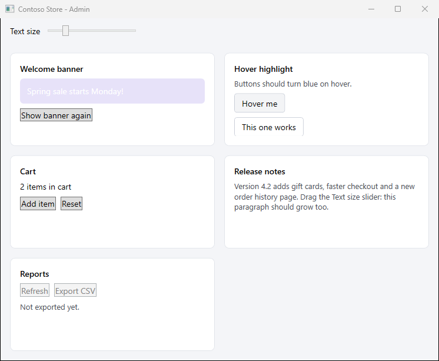
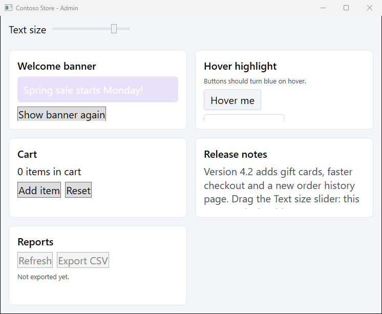
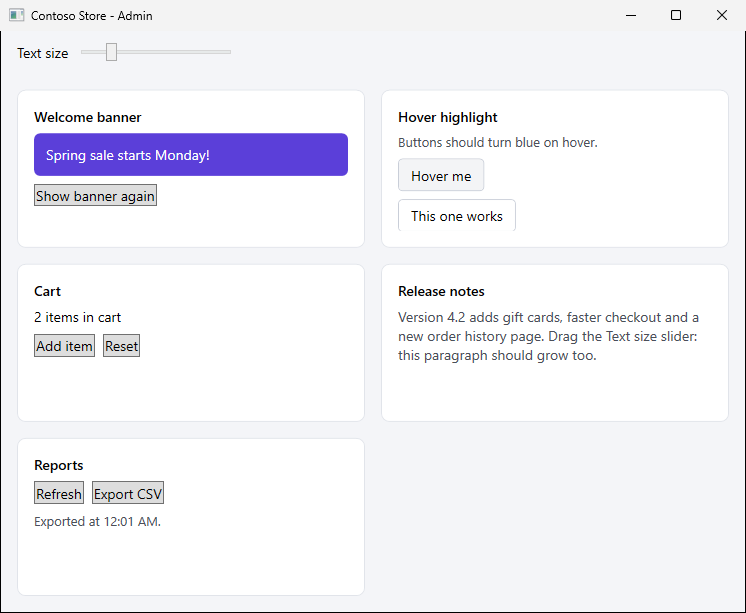

# Session transcript

Source: `Q:\source\XamlAgentDemos-notes\test-runs\PrecedenceWars\run-final2\events.jsonl`

## Tool usage

- xaml_interact: 11
- get_file: 5
- xaml_capture_image: 4
- debugger_evaluate_expressions: 4
- xaml_get_status: 3
- powershell: 3
- skill: 2
- xaml_explain_property_value: 2
- xaml_get_element_styles: 2
- xaml_get_binding_failures: 2
- xaml_hit_test: 2
- xaml_apply_hot_reload: 2
- xaml_find_elements: 2
- debugger_get_call_stack: 2
- debugger_continue: 2
- task_complete: 2
- xaml_get_visual_tree: 1
- get_projects_in_solution: 1
- glob: 1
- view: 1
- multi_replace_string_in_file: 1
- xaml_get_hot_reload_log: 1
- replace_string_in_file: 1
- task: 1
- grep_search: 1
- debugger_pause: 1
- debugger_get_threads: 1
- debugger_set_breakpoints: 1
- debugger_remove_breakpoints: 1
- debugger_get_output_window_text: 1

Failed tool calls: 0, images: 4


_Model: gpt-6.1-terra_


## User (04:57:51)

Each card in my running app has a property that refuses to change. Figure out why for every card using the live app, prove it, and fix the source.


**Tool call (04:57:53):** `skill`
```json
{
 "skill": "xaml-diagnostics"
}
```

<details><summary>Result `skill` success=true</summary>

```
Skill "xaml-diagnostics" loaded successfully. Follow the instructions in the skill context.
```
</details>


_Skill invoked: xaml-diagnostics_


**Assistant (04:57:56):**

I’ll inspect the live cards and trace each property’s value precedence before fixing the source.


**Tool call (04:57:56):** `xaml_get_status`
```json
{
 "progressMessage": "Inspecting the running XAML app"
}
```

<details><summary>Result `xaml_get_status` success=true</summary>

```
{"isDebugging":true,"debuggerState":"running","diagnosticsActive":true,"apps":[{"app":"a2","name":"PrecedenceWars.exe [72520]","processId":72520,"platform":"WPF (.NET)","isRemote":false,"isDesignTimeOrNoDebug":false,"sourceInfoAvailable":true,"hotReloadSupported":true,"hotReloadEnabled":true,"supportsPropertyExplorer":true,"supportsInAppToolbar":true,"supportsHitTest":true,"windows":[{"windowId":"0xB40426","title":"Contoso Store - Admin","bounds":{"x":26,"y":26,"width":760,"height":620},"dpiScale":1.0,"visible":true,"minimized":false}]}],"issues":[],"issuesSummary":"No problems detected.","hotReload":{"options":{"hotReloadEnabled":true,"hotReloadOnSave":false,"applyMode":"asYouType: XAML edits apply as you type, without saving (default)","wpfEnabled":true,"uwpEnabled":true,"winUIEnabled":true,"mauiEnabled":true,"justMyXaml":true,"previewSelectedElement":false,"inAppToolbar":true,"inAppSelection":false,"layoutAdorners":false,"trackFocusedElement":false,"bindingFailuresVisible":true,"compatibilityMode":false},"dotNetHotReloadEnabled":true,"isProcessingChanges":false,"lastHotReloadUpdate":{"secondsAgo":175,"updatesSinceToolsStarted":5},"errors":[]},"windowsNote":"Window bounds are physical screen pixels and include the window frame. A WPF/WinUI Window's Width and Height are device-independent units (DIPs) that also include the frame, so Width = bounds.width / dpiScale. A user's \"800 px wide\" is ambiguous: say which unit you tested. A minimized window reports x/y = -32000 and can't be captured."}
```
</details>


**Tool call (04:57:58):** `xaml_get_visual_tree`
```json
{
 "progressMessage": "Finding the cards in the live tree",
 "depth": 8,
 "maxNodes": 500
}
```


**Tool call (04:57:58):** `xaml_capture_image`
```json
{
 "progressMessage": "Inspecting the current card appearance"
}
```


**Tool call (04:57:58):** `get_projects_in_solution`
```json
{}
```

<details><summary>Result `xaml_get_visual_tree` success=true</summary>

```
{"app":"a2","platform":"WPF (.NET)","sourceInfoAvailable":true,"nodeCount":60,"truncated":false,"depthLimitedNodes":11,"hint":"11 node(s) have children beyond the requested depth (childCount > 0, no children listed). Raise depth or pass rootElementId to expand them.","nodes":[{"id":"a2:10","type":"PrecedenceWars.MainWindow","source":{"file":"Q:\\source\\XamlAgentDemos\\src\\PrecedenceWars\\MainWindow.xaml","line":3,"column":9},"childCount":1,"children":[{"id":"a2:11","type":"System.Windows.Controls.Border","childCount":1,"children":[{"id":"a2:12","type":"System.Windows.Documents.AdornerDecorator","childCount":2,"children":[{"id":"a2:13","type":"System.Windows.Controls.ContentPresenter","childCount":1,"children":[{"id":"a2:15","type":"System.Windows.Controls.DockPanel","source":{"file":"Q:\\source\\XamlAgentDemos\\src\\PrecedenceWars\\MainWindow.xaml","line":53,"column":6},"childCount":2,"children":[{"id":"a2:16","type":"System.Windows.Controls.StackPanel","source":{"file":"Q:\\source\\XamlAgentDemos\\src\\PrecedenceWars\\MainWindow.xaml","line":54,"column":10},"childCount":2,"children":[{"id":"a2:18","type":"System.Windows.Controls.TextBlock","source":{"file":"Q:\\source\\XamlAgentDemos\\src\\PrecedenceWars\\MainWindow.xaml","line":57,"column":14},"childCount":0},{"id":"a2:19","type":"System.Windows.Controls.Slider","name":"TextSizeSlider","source":{"file":"Q:\\source\\XamlAgentDemos\\src\\PrecedenceWars\\MainWindow.xaml","line":58,"column":14},"childCount":1,"children":[{"id":"a2:25","type":"System.Windows.Controls.Border","name":"border","childCount":1,"children":[{"id":"a2:31","type":"System.Windows.Controls.Grid","childCount":4,"children":[{"id":"a2:47","type":"System.Windows.Controls.Primitives.TickBar","name":"TopTick","childCount":0},{"id":"a2:48","type":"System.Windows.Controls.Primitives.TickBar","name":"BottomTick","childCount":0},{"id":"a2:49","type":"System.Windows.Controls.Border","name":"TrackBackground","childCount":1,"children":[{"id":"a2:59","type":"System.Windows.Controls.Canvas","childCount":1}]},{"id":"a2:50","type":"System.Windows.Controls.Primitives.Track","name":"PART_Track","childCount":3,"children":[{"id":"a2:60","type":"System.Windows.Controls.Primitives.RepeatButton","childCount":1},{"id":"a2:61","type":"System.Windows.Controls.Primitives.RepeatButton","childCount":1},{"id":"a2:62","type":"System.Windows.Controls.Primitives.Thumb","name":"Thumb","childCount":1}]}]}]}]}]},{"id":"a2:17","type":"System.Windows.Controls.Primitives.Un
... [truncated 7434 chars]
```
</details>

<details><summary>Result `get_projects_in_solution` success=true</summary>

```
src\GhostClicks\GhostClicks.csproj
src\GermanReady\GermanReady.csproj
src\ThemeBreaker\ThemeBreaker.csproj
src\DesignPolish\DesignPolish.csproj
src\HotReloadDoctor\HotReloadDoctor.csproj
src\VanishingSave\VanishingSave.csproj
src\CrispPixels\CrispPixels.csproj
src\PrecedenceWars\PrecedenceWars.csproj
src\LostWindows\LostWindows.csproj
src\TemplateDetective\TemplateDetective.csproj
src\SlowScroll\SlowScroll.csproj
src\PixelPerfect\PixelPerfect.csproj
src\BindingStorm\BindingStorm.csproj
src\BugRepro\BugRepro.csproj
src\A11ySweep\A11ySweep.csproj
src\StyleMaze\StyleMaze.csproj
src\ResponsiveDashboard\ResponsiveDashboard.csproj

```
</details>




<details><summary>Result `xaml_capture_image` success=true</summary>

```
Screenshot of window 0xB40426 "Contoso Store - Admin" of app a2 (746x613 image of the window's client area, so it's slightly smaller than the frame bounds from xaml_get_status).
```
</details>


**Tool call (04:58:03):** `get_file`
```json
{
 "filename": "src\\PrecedenceWars\\MainWindow.xaml",
 "startLine": 1,
 "endLine": 180,
 "includeLineNumbers": true
}
```


**Tool call (04:58:03):** `get_file`
```json
{
 "filename": "src\\PrecedenceWars\\MainWindow.xaml.cs",
 "startLine": 1,
 "endLine": 240,
 "includeLineNumbers": true
}
```


**Tool call (04:58:03):** `xaml_explain_property_value`
```json
{
 "progressMessage": "Tracing precedence for all five cards",
 "elementIds": [
  "a2:33",
  "a2:37",
  "a2:38",
  "a2:40",
  "a2:43",
  "a2:45",
  "a2:57",
  "a2:58"
 ],
 "propertyNames": [
  "Opacity",
  "Background",
  "Background",
  "Text",
  "FontSize",
  "IsEnabled",
  "IsEnabled",
  "IsEnabled"
 ],
 "pairwise": true
}
```


**Tool call (04:58:03):** `xaml_get_element_styles`
```json
{
 "progressMessage": "Comparing the card styles and triggers",
 "elementIds": [
  "a2:33",
  "a2:37",
  "a2:38",
  "a2:40",
  "a2:43",
  "a2:45"
 ]
}
```


**Tool call (04:58:03):** `powershell`
```json
{
 "command": "git status --short",
 "description": "Check existing workspace changes"
}
```

<details><summary>Result `get_file` success=true</summary>

```
```csharp src\PrecedenceWars\MainWindow.xaml.cs (Lines 1-25 of 25 total. Call tools for more if needed.)
1: using System.Windows;
2: 
3: namespace PrecedenceWars;
4: 
5: public partial class MainWindow : Window
6: {
7:     private readonly StoreViewModel viewModel = new();
8: 
9:     public MainWindow()
10:     {
11:         this.InitializeComponent();
12:         this.DataContext = this.viewModel;
13:     }
14: 
15:     private void OnShowBannerClick(object sender, RoutedEventArgs e)
16:     {
17:         this.WelcomeBanner.Opacity = 1;
18:     }
19: 
20:     private void OnResetClick(object sender, RoutedEventArgs e)
21:     {
22:         this.viewModel.ItemCount = 0;
23:         this.CountText.Text = "0 items in cart";
24:     }
25: }

```


```
</details>

<details><summary>Result `get_file` success=true</summary>

```
```xaml src\PrecedenceWars\MainWindow.xaml (Lines 1-164 of 164 total. Call tools for more if needed.)
1: <Window x:Class="PrecedenceWars.MainWindow"
2:         xmlns="http://schemas.microsoft.com/winfx/2006/xaml/presentation"
3:         xmlns:x="http://schemas.microsoft.com/winfx/2006/xaml"
4:         Title="Contoso Store - Admin"
5:         Width="760"
6:         Height="620"
7:         FontSize="{Binding Value, ElementName=TextSizeSlider}">
8:     <Window.Resources>
9:         <Style x:Key="CardStyle" TargetType="Border">
10:             <Setter Property="Background" Value="White" />
11:             <Setter Property="BorderBrush" Value="#E1E4EA" />
12:             <Setter Property="BorderThickness" Value="1" />
13:             <Setter Property="CornerRadius" Value="8" />
14:             <Setter Property="Padding" Value="16" />
15:             <Setter Property="Margin" Value="8" />
16:         </Style>
17: 
18:         <Style x:Key="CardTitleStyle" TargetType="TextBlock">
19:             <Setter Property="FontWeight" Value="SemiBold" />
20:             <Setter Property="Margin" Value="0,0,0,8" />
21:         </Style>
22: 
23:         <Style x:Key="BodyTextStyle" TargetType="TextBlock">
24:             <Setter Property="FontSize" Value="13" />
25:             <Setter Property="Foreground" Value="#4A4F5A" />
26:             <Setter Property="TextWrapping" Value="Wrap" />
27:         </Style>
28: 
29:         <Style x:Key="HoverButtonStyle" TargetType="Button">
30:             <Setter Property="Background" Value="White" />
31:             <Setter Property="Padding" Value="12,6" />
32:             <Setter Property="Template">
33:                 <Setter.Value>
34:                     <ControlTemplate TargetType="Button">
35:                         <Border Padding="{TemplateBinding Padding}"
36:                                 Background="{TemplateBinding Background}"
37:                                 BorderBrush="#C9CED8"
38:                                 BorderThickness="1"
39:                                 CornerRadius="4">
40:                             <ContentPresenter HorizontalAlignment="Center" />
41:                         </Border>
42:                     </ControlTemplate>
43:                 </Setter.Value>
44:             </Setter>
45:             <Style.Triggers>
46:                 <Trigger Property="IsMouseOver" Value="True">
47:                     <Setter Property="Background" Value="#D
... [truncated 6298 chars]
```
</details>

<details><summary>Result `xaml_get_element_styles` success=true</summary>

```
{"count":6,"failed":0,"results":[{"id":"a2:33","type":"System.Windows.Controls.Border","name":"WelcomeBanner","source":{"file":"Q:\\source\\XamlAgentDemos\\src\\PrecedenceWars\\MainWindow.xaml","line":72,"column":22},"styleProperty":{"valueSource":"Default"},"styles":[],"hint":"No style, trigger or template sets any property on this element. Values come from local values, inheritance or defaults; use xaml_explain_property_value for a specific property."},{"id":"a2:37","type":"System.Windows.Controls.Button","name":"HoverButton","source":{"file":"Q:\\source\\XamlAgentDemos\\src\\PrecedenceWars\\MainWindow.xaml","line":103,"column":22},"styleProperty":{"value":"System.Windows.Style","valueSource":"Local","location":{"file":"Q:\\source\\XamlAgentDemos\\src\\PrecedenceWars\\MainWindow.xaml","line":103,"column":22}},"templateProperty":{"value":"System.Windows.Controls.ControlTemplate","valueSource":"Style","location":{"file":"Q:\\source\\XamlAgentDemos\\src\\PrecedenceWars\\MainWindow.xaml","line":29,"column":10}},"styles":[{"kind":"Style","description":"Setter in an explicit (x:Key) or implicit (TargetType) Style.","targetType":"System.Windows.Controls.Button","location":{"file":"Q:\\source\\XamlAgentDemos\\src\\PrecedenceWars\\MainWindow.xaml","line":29,"column":10},"setters":[{"property":"Background","value":"#FFFFFFFF","effective":false,"overriddenBy":"Local"},{"property":"Padding","value":"12,6,12,6","effective":true},{"property":"Template","value":"System.Windows.Controls.ControlTemplate","effective":true,"valueLocation":{"file":"Q:\\source\\XamlAgentDemos\\src\\PrecedenceWars\\MainWindow.xaml","line":34,"column":22}}]},{"kind":"BuiltInStyle","description":"Setter in the control's default theme style (generic.xaml or the platform theme).","targetType":"System.Windows.Controls.Primitives.ButtonBase","setters":[{"property":"Background","value":"#FFDDDDDD","effective":false,"overriddenBy":"Local"},{"property":"BorderBrush","value":"#FF707070","effective":true},{"property":"BorderThickness","value":"1,1,1,1","effective":true},{"property":"FocusVisualStyle","value":"System.Windows.Style","effective":true},{"property":"Foreground","effective":true},{"property":"HorizontalContentAlignment","value":"1","effective":true},{"property":"Padding","value":"1,1,1,1","effective":false,"overriddenBy":"Style (System.Windows.Controls.Button)"},{"property":"Template","value":"System.Windows.Controls.ControlTemplate","effective":false,"overriddenBy":"Style (System.Windows.Con
... [truncated 6008 chars]
```
</details>

<details><summary>Result `xaml_explain_property_value` success=true</summary>

```
{"count":8,"failed":0,"results":[{"id":"a2:33","type":"System.Windows.Controls.Border","property":"Opacity","propertyType":"System.Double","effectiveValue":"0.15000000000000002","effectiveSource":"Animation","chain":[{"kind":"Animation","description":"An active animation (Storyboard or VisualState). It overrides local and style values while it holds the value.","value":"0.15000000000000002","valueType":"System.Double","effective":true},{"kind":"Default","description":"The property's default value; nothing sets it.","value":"1","valueType":"System.Double","effective":false}],"notes":["Find the Storyboard or VisualState that animates this property; local and style changes have no visible effect while it holds the value (FillBehavior=HoldEnd is common)."]},{"id":"a2:37","type":"System.Windows.Controls.Button","property":"Background","propertyType":"System.Windows.Media.Brush","effectiveValue":"#FFF3F4F6","effectiveSource":"Local","chain":[{"kind":"Local","description":"Local value set on the element (XAML attribute, binding or code). Wins over styles, templates and inheritance.","value":"#FFF3F4F6","valueType":"System.Windows.Media.SolidColorBrush","effective":true,"sourceLocation":{"file":"Q:\\source\\XamlAgentDemos\\src\\PrecedenceWars\\MainWindow.xaml","line":103,"column":22}},{"kind":"Style","description":"Setter in an explicit (x:Key) or implicit (TargetType) Style.","targetType":"System.Windows.Controls.Button","value":"#FFFFFFFF","valueType":"System.Windows.Media.SolidColorBrush","effective":false,"sourceLocation":{"file":"Q:\\source\\XamlAgentDemos\\src\\PrecedenceWars\\MainWindow.xaml","line":29,"column":10}},{"kind":"BuiltInStyle","description":"Setter in the control's default theme style (generic.xaml or the platform theme).","targetType":"System.Windows.Controls.Primitives.ButtonBase","value":"#FFDDDDDD","valueType":"System.Windows.Media.SolidColorBrush","effective":false},{"kind":"Default","description":"The property's default value; nothing sets it.","effective":false}],"notes":["To let a style or template value apply, remove the local value (the attribute, binding or code assignment). To change it, edit that local value. XAML and code both produce Local values, and the source location may still point to the XAML attribute after code assigned a new value. If the live value differs from the XAML attribute, or the element has no XAML attribute for it, code set it: search code-behind for the element's x:Name."]},{"id":"a2:38","type":"System.Windows
... [truncated 5629 chars]
```
</details>

<details><summary>Result `powershell` success=true</summary>

```

<shellId: 1 completed with exit code 0>
```
</details>


**Tool call (04:58:09):** `glob`
```json
{
 "pattern": "src\\PrecedenceWars\\**\\*.cs"
}
```


**Tool call (04:58:09):** `view`
```json
{
 "path": "c:\\vs\\fastmain\\common7\\ide\\commonextensions\\microsoft\\xamldiagnostics\\AgentTools\\skills\\xaml-diagnostics\\references\\xaml-authoring.md"
}
```


**Tool call (04:58:09):** `xaml_interact`
```json
{
 "progressMessage": "Reproducing the banner problem",
 "elementId": "a2:34",
 "action": "invoke",
 "checkProperties": "Opacity",
 "checkElementIds": [
  "a2:33"
 ]
}
```


**Tool call (04:58:09):** `xaml_interact`
```json
{
 "progressMessage": "Reproducing the cart reset problem",
 "elementId": "a2:56",
 "action": "invoke",
 "checkProperties": "Text",
 "checkElementIds": [
  "a2:40"
 ]
}
```


**Tool call (04:58:09):** `xaml_get_binding_failures`
```json
{
 "progressMessage": "Checking live binding failures"
}
```

<details><summary>Result `view` success=true</summary>

```
# XAML authoring guidance

Follow these rules when writing or changing XAML so it works well with XAML Hot Reload, the XAML designer, and XAML Diagnostics.

## Design-time data

- Declare `xmlns:d="http://schemas.microsoft.com/expression/blend/2008"` and `xmlns:mc="http://schemas.openxmlformats.org/markup-compatibility/2006"` with `mc:Ignorable="d"`.
- Use `d:DataContext="{d:DesignInstance Type=vm:MyViewModel, IsDesignTimeCreatable=False}"` (WPF/UWP) so the designer and IntelliSense know binding paths.
- Use `d:` properties (for example `d:Text="Sample"`) for sample values that appear only at design time.
- .NET MAUI: set `x:DataType` on pages and `DataTemplate`s. It enables compiled bindings and turns many binding failures into build errors.
- WinUI/UWP: prefer `x:Bind` for compile-time checked bindings when the view owns the view model.

## Bindings

- Bind with explicit paths. Avoid string-built paths in code-behind.
- Keep the `DataContext` chain simple. Use `ElementName` or `RelativeSource` only at real scope boundaries (for example inside a `DataTemplate` that needs the page's view model).
- Expose bound properties as public properties that raise `PropertyChanged`. Fields and non-public properties don't bind.
- Use `FallbackValue` and `TargetNullValue` for expected missing values instead of hiding binding errors.
- Before saving, check every binding path against the actual property names on the data context type (case, plurals, nested paths such as `Customer.Address.City`). Misspelled paths are the most common binding failure and they fail silently.
- Inside a `DataTemplate` or `ItemContainerStyle`, the data context is the item, not the page's view model. To reach a page command, use `RelativeSource={RelativeSource AncestorType=...}` with `DataContext.` in the path, or `ElementName`.
- A `TextBox.Text` binding updates its source on `LostFocus` by default (WPF). Use `UpdateSourceTrigger=PropertyChanged` when other UI (validation, enabled state, live search) must react while the user types.
- `Mode=TwoWay` (the default for `TextBox.Text`, `CheckBox.IsChecked`, `Selector.SelectedItem` and similar) needs a property with a public setter. In WPF, a two-way binding to a read-only property throws when the view loads.
- Bindings created in code have no XAML file and line in diagnostics. Prefer declaring bindings in XAML.

## Layout

- Don't put a list (`ListBox`, `ListView`, `DataGrid`, `ItemsControl` with a virtualizing panel) insid
... [truncated 4693 chars]
```
</details>

<details><summary>Result `xaml_get_binding_failures` success=true</summary>

```
{"note":"This is a cumulative log since debugging started or the last xaml_clear_binding_failures, not live state: fixed failures stay listed. To verify a fix: clear, revisit the UI that uses the binding, then read again. Failures without a file usually come from bindings created in code.","totalUnique":0,"matched":0,"truncated":false,"failures":[]}
```
</details>

<details><summary>Result `glob` success=true</summary>

```
.\src\PrecedenceWars\StoreViewModel.cs
.\src\PrecedenceWars\MainWindow.xaml.cs
.\src\PrecedenceWars\App.xaml.cs
```
</details>

<details><summary>Result `xaml_interact` success=true</summary>

```
{"id":"a2:34","action":"invoke","result":"Invoked.","supportedPatterns":["Invoke","SynchronizedInput"],"checks":[{"id":"a2:33","changed":false,"before":[{"name":"Opacity","value":"0.15000000000000002","evaluatedValue":null,"valueType":"System.Double","propertyType":"System.Double","declaringType":"System.Windows.UIElement","valueSource":"Animation","valueSourceName":null,"valueSourceLocation":null,"valueLocation":null,"isBinding":null,"isCollection":null,"isAttached":null,"readOnly":null,"overridden":null},{"name":"OpacityMask","value":null,"evaluatedValue":null,"valueType":null,"propertyType":"System.Windows.Media.Brush","declaringType":"System.Windows.UIElement","valueSource":"Default","valueSourceName":null,"valueSourceLocation":null,"valueLocation":null,"isBinding":null,"isCollection":null,"isAttached":null,"readOnly":null,"overridden":null}],"after":[{"name":"Opacity","value":"0.15000000000000002","evaluatedValue":null,"valueType":"System.Double","propertyType":"System.Double","declaringType":"System.Windows.UIElement","valueSource":"Animation","valueSourceName":null,"valueSourceLocation":null,"valueLocation":null,"isBinding":null,"isCollection":null,"isAttached":null,"readOnly":null,"overridden":null},{"name":"OpacityMask","value":null,"evaluatedValue":null,"valueType":null,"propertyType":"System.Windows.Media.Brush","declaringType":"System.Windows.UIElement","valueSource":"Default","valueSourceName":null,"valueSourceLocation":null,"valueLocation":null,"isBinding":null,"isCollection":null,"isAttached":null,"readOnly":null,"overridden":null}]}],"checksNote":"changed=false means none of the checked properties changed 300 ms after the action: the action reached the control but its handler, command or binding had no visible effect (or the effect is elsewhere, so check other elements). Slow async work may need another read.","note":"Call xaml_capture_image or xaml_get_element_properties to verify the effect, or pass checkProperties next time to compare values before and after. Automation actions bypass mouse hit testing, so a successful invoke doesn't prove a real click reaches the element; call xaml_hit_test for that."}
```
</details>

<details><summary>Result `xaml_interact` success=true</summary>

```
{"id":"a2:56","action":"invoke","result":"Invoked.","supportedPatterns":["Invoke","SynchronizedInput"],"checks":[{"id":"a2:40","changed":true,"before":[{"name":"Text","value":"System.Windows.Data.BindingExpression","evaluatedValue":"2 items in cart (System.String)","valueType":"System.Windows.Data.BindingExpression","propertyType":"System.String","declaringType":"System.Windows.Controls.TextBlock","valueSource":"Local","valueSourceName":null,"valueSourceLocation":{"file":"Q:\\source\\XamlAgentDemos\\src\\PrecedenceWars\\MainWindow.xaml","line":121,"column":22},"valueLocation":null,"isBinding":true,"isCollection":null,"isAttached":null,"readOnly":null,"overridden":null},{"name":"TextTrimming","value":"0","evaluatedValue":null,"valueType":"System.Windows.TextTrimming","propertyType":"System.Windows.TextTrimming","declaringType":"System.Windows.Controls.TextBlock","valueSource":"BuiltInStyle","valueSourceName":null,"valueSourceLocation":null,"valueLocation":null,"isBinding":null,"isCollection":null,"isAttached":null,"readOnly":null,"overridden":null},{"name":"TextWrapping","value":"1","evaluatedValue":null,"valueType":"System.Windows.TextWrapping","propertyType":"System.Windows.TextWrapping","declaringType":"System.Windows.Controls.TextBlock","valueSource":"BuiltInStyle","valueSourceName":null,"valueSourceLocation":null,"valueLocation":null,"isBinding":null,"isCollection":null,"isAttached":null,"readOnly":null,"overridden":null},{"name":"DataContext","value":null,"evaluatedValue":null,"valueType":"PrecedenceWars.StoreViewModel","propertyType":"System.Object","declaringType":"System.Windows.FrameworkElement","valueSource":"Inherited","valueSourceName":null,"valueSourceLocation":null,"valueLocation":null,"isBinding":null,"isCollection":null,"isAttached":null,"readOnly":null,"overridden":null},{"name":"TextAlignment","value":"0","evaluatedValue":null,"valueType":"System.Windows.TextAlignment","propertyType":"System.Windows.TextAlignment","declaringType":"System.Windows.Controls.TextBlock","valueSource":"Default","valueSourceName":null,"valueSourceLocation":null,"valueLocation":null,"isBinding":null,"isCollection":null,"isAttached":null,"readOnly":null,"overridden":null},{"name":"TextDecorations","value":null,"evaluatedValue":null,"valueType":"System.Windows.TextDecorationCollection","propertyType":"System.Windows.TextDecorationCollection","declaringType":"System.Windows.Controls.TextBlock","valueSource":"Default","valueSourceName":null,"valueSourceLocation":null
... [truncated 4635 chars]
```
</details>


**Tool call (04:58:13):** `get_file`
```json
{
 "filename": "src\\PrecedenceWars\\StoreViewModel.cs",
 "startLine": 1,
 "endLine": 240,
 "includeLineNumbers": true
}
```


**Tool call (04:58:13):** `xaml_interact`
```json
{
 "progressMessage": "Confirming the cart stops updating",
 "elementId": "a2:55",
 "action": "invoke",
 "checkProperties": "Text",
 "checkElementIds": [
  "a2:40"
 ]
}
```


**Tool call (04:58:13):** `xaml_interact`
```json
{
 "progressMessage": "Testing text size inheritance",
 "elementId": "a2:19",
 "action": "setValue",
 "value": "20",
 "checkProperties": "FontSize",
 "checkElementIds": [
  "a2:43",
  "a2:32"
 ]
}
```


**Tool call (04:58:13):** `xaml_hit_test`
```json
{
 "progressMessage": "Checking disabled report buttons",
 "elementIds": [
  "a2:57",
  "a2:58"
 ]
}
```

<details><summary>Result `get_file` success=true</summary>

```
```csharp src\PrecedenceWars\StoreViewModel.cs (Lines 1-69 of 69 total. Call tools for more if needed.)
1: using System.Diagnostics;
2: 
3: namespace PrecedenceWars;
4: 
5: public sealed class StoreViewModel : ObservableObject
6: {
7:     private int itemCount = 2;
8:     private bool isBusy;
9:     private string lastExport = "Not exported yet.";
10: 
11:     public StoreViewModel()
12:     {
13:         this.AddItemCommand = new RelayCommand(() => this.ItemCount++);
14:         this.ExportCommand = new RelayCommand(() => this.LastExport = $"Exported at {DateTime.Now:t}.", () => true);
15:         this.SyncCatalog();
16:     }
17: 
18:     public RelayCommand AddItemCommand { get; }
19: 
20:     public RelayCommand ExportCommand { get; }
21: 
22:     public int ItemCount
23:     {
24:         get => this.itemCount;
25:         set => this.SetProperty(ref this.itemCount, value);
26:     }
27: 
28:     public bool IsBusy
29:     {
30:         get => this.isBusy;
31:         private set
32:         {
33:             if (this.SetProperty(ref this.isBusy, value))
34:             {
35:                 this.OnPropertyChanged(nameof(this.IsIdle));
36:             }
37:         }
38:     }
39: 
40:     public bool IsIdle => !this.IsBusy;
41: 
42:     public string LastExport
43:     {
44:         get => this.lastExport;
45:         private set => this.SetProperty(ref this.lastExport, value);
46:     }
47: 
48:     private void SyncCatalog()
49:     {
50:         this.IsBusy = true;
51:         try
52:         {
53:             if (this.IsOffline())
54:             {
55:                 throw new TimeoutException("Catalog service didn't respond.");
56:             }
57:         }
58:         catch (TimeoutException ex)
59:         {
60:             Debug.WriteLine($"Catalog sync failed: {ex.Message}");
61:             return;
62:         }
63: 
64:         this.IsBusy = false;
65:     }
66: 
67:     // Simulates the offline case: the catalog service isn't reachable.
68:     private bool IsOffline() => true;
69: }

```


```
</details>

<details><summary>Result `xaml_hit_test` success=true</summary>

```
{"count":2,"failed":0,"results":[{"id":"a2:57","summary":"A click at its center does NOT reach 'RefreshButton' because it's disabled (IsEnabled=False): input skips disabled elements and lands on StackPanel behind or around it. That element isn't necessarily covering it; fix the IsEnabled cause (see blockers, or a command's CanExecute) rather than the layout. StackPanel 'ToolbarPanel' has IsEnabled=False, which applies to 'RefreshButton' too.","elementReceivesInput":false,"inputTarget":{"id":"a2:30","type":"System.Windows.Controls.StackPanel","source":{"file":"Q:\\source\\XamlAgentDemos\\src\\PrecedenceWars\\MainWindow.xaml","line":146,"column":18}},"stack":[{"id":"a2:84","type":"System.Windows.Controls.TextBlock","templatedParent":{"id":"a2:57","type":"System.Windows.Controls.Button","name":"RefreshButton","source":{"file":"Q:\\source\\XamlAgentDemos\\src\\PrecedenceWars\\MainWindow.xaml","line":151,"column":26}}},{"id":"a2:68","type":"System.Windows.Controls.Border","name":"border","templatedParent":{"id":"a2:57","type":"System.Windows.Controls.Button","name":"RefreshButton","source":{"file":"Q:\\source\\XamlAgentDemos\\src\\PrecedenceWars\\MainWindow.xaml","line":151,"column":26}}},{"id":"a2:24","type":"System.Windows.Controls.Border","source":{"file":"Q:\\source\\XamlAgentDemos\\src\\PrecedenceWars\\MainWindow.xaml","line":145,"column":14}},{"id":"a2:15","type":"System.Windows.Controls.DockPanel","source":{"file":"Q:\\source\\XamlAgentDemos\\src\\PrecedenceWars\\MainWindow.xaml","line":53,"column":6}},{"id":"a2:11","type":"System.Windows.Controls.Border","templatedParent":{"id":"a2:10","type":"PrecedenceWars.MainWindow","source":{"file":"Q:\\source\\XamlAgentDemos\\src\\PrecedenceWars\\MainWindow.xaml","line":3,"column":9}}}],"isVisible":true,"isHitTestVisible":true,"isEnabled":false,"effectiveOpacity":1.0,"blockers":[{"id":"a2:45","type":"System.Windows.Controls.StackPanel","name":"ToolbarPanel","source":{"file":"Q:\\source\\XamlAgentDemos\\src\\PrecedenceWars\\MainWindow.xaml","line":148,"column":22},"property":"IsEnabled","value":"False"}],"visibleFraction":1.0,"point":{"window":{"x":57.86,"y":461.8},"screen":{"x":92.0,"y":519.0}}},{"id":"a2:58","summary":"A click at its center does NOT reach 'ExportButton' because it's disabled (IsEnabled=False): input skips disabled elements and lands on StackPanel behind or around it. That element isn't necessarily covering it; fix the IsEnabled cause (see blockers, or a command's CanExecute) rather than the layou
... [truncated 2532 chars]
```
</details>

<details><summary>Result `xaml_interact` success=true</summary>

```
{"id":"a2:55","action":"invoke","result":"Invoked.","supportedPatterns":["Invoke","SynchronizedInput"],"checks":[{"id":"a2:40","changed":false,"before":[{"name":"Text","value":"0 items in cart","evaluatedValue":null,"valueType":"System.String","propertyType":"System.String","declaringType":"System.Windows.Controls.TextBlock","valueSource":"Local","valueSourceName":null,"valueSourceLocation":{"file":"Q:\\source\\XamlAgentDemos\\src\\PrecedenceWars\\MainWindow.xaml","line":121,"column":22},"valueLocation":null,"isBinding":null,"isCollection":null,"isAttached":null,"readOnly":null,"overridden":null},{"name":"TextTrimming","value":"0","evaluatedValue":null,"valueType":"System.Windows.TextTrimming","propertyType":"System.Windows.TextTrimming","declaringType":"System.Windows.Controls.TextBlock","valueSource":"BuiltInStyle","valueSourceName":null,"valueSourceLocation":null,"valueLocation":null,"isBinding":null,"isCollection":null,"isAttached":null,"readOnly":null,"overridden":null},{"name":"TextWrapping","value":"1","evaluatedValue":null,"valueType":"System.Windows.TextWrapping","propertyType":"System.Windows.TextWrapping","declaringType":"System.Windows.Controls.TextBlock","valueSource":"BuiltInStyle","valueSourceName":null,"valueSourceLocation":null,"valueLocation":null,"isBinding":null,"isCollection":null,"isAttached":null,"readOnly":null,"overridden":null},{"name":"DataContext","value":null,"evaluatedValue":null,"valueType":"PrecedenceWars.StoreViewModel","propertyType":"System.Object","declaringType":"System.Windows.FrameworkElement","valueSource":"Inherited","valueSourceName":null,"valueSourceLocation":null,"valueLocation":null,"isBinding":null,"isCollection":null,"isAttached":null,"readOnly":null,"overridden":null},{"name":"TextAlignment","value":"0","evaluatedValue":null,"valueType":"System.Windows.TextAlignment","propertyType":"System.Windows.TextAlignment","declaringType":"System.Windows.Controls.TextBlock","valueSource":"Default","valueSourceName":null,"valueSourceLocation":null,"valueLocation":null,"isBinding":null,"isCollection":null,"isAttached":null,"readOnly":null,"overridden":null},{"name":"TextDecorations","value":null,"evaluatedValue":null,"valueType":"System.Windows.TextDecorationCollection","propertyType":"System.Windows.TextDecorationCollection","declaringType":"System.Windows.Controls.TextBlock","valueSource":"Default","valueSourceName":null,"valueSourceLocation":null,"valueLocation":null,"isBinding":null,"isCollection":true,"isAttached":nu
... [truncated 4561 chars]
```
</details>

<details><summary>Result `xaml_interact` success=true</summary>

```
{"id":"a2:19","action":"setValue","result":"Value is now 20.","supportedPatterns":["RangeValue","SynchronizedInput"],"checks":[{"id":"a2:43","changed":false,"before":[{"name":"FontSize","value":"13","evaluatedValue":null,"valueType":"System.Double","propertyType":"System.Double","declaringType":"System.Windows.Controls.TextBlock","valueSource":"Style","valueSourceName":null,"valueSourceLocation":{"file":"Q:\\source\\XamlAgentDemos\\src\\PrecedenceWars\\MainWindow.xaml","line":23,"column":10},"valueLocation":null,"isBinding":null,"isCollection":null,"isAttached":null,"readOnly":null,"overridden":null}],"after":[{"name":"FontSize","value":"13","evaluatedValue":null,"valueType":"System.Double","propertyType":"System.Double","declaringType":"System.Windows.Controls.TextBlock","valueSource":"Style","valueSourceName":null,"valueSourceLocation":{"file":"Q:\\source\\XamlAgentDemos\\src\\PrecedenceWars\\MainWindow.xaml","line":23,"column":10},"valueLocation":null,"isBinding":null,"isCollection":null,"isAttached":null,"readOnly":null,"overridden":null}]},{"id":"a2:32","changed":true,"before":[{"name":"FontSize","value":"14","evaluatedValue":null,"valueType":"System.Double","propertyType":"System.Double","declaringType":"System.Windows.Controls.TextBlock","valueSource":"Inherited","valueSourceName":null,"valueSourceLocation":null,"valueLocation":null,"isBinding":null,"isCollection":null,"isAttached":null,"readOnly":null,"overridden":null}],"after":[{"name":"FontSize","value":"20","evaluatedValue":null,"valueType":"System.Double","propertyType":"System.Double","declaringType":"System.Windows.Controls.TextBlock","valueSource":"Inherited","valueSourceName":null,"valueSourceLocation":null,"valueLocation":null,"isBinding":null,"isCollection":null,"isAttached":null,"readOnly":null,"overridden":null}]}],"checksNote":"changed=false means none of the checked properties changed 300 ms after the action: the action reached the control but its handler, command or binding had no visible effect (or the effect is elsewhere, so check other elements). Slow async work may need another read.","note":"Call xaml_capture_image or xaml_get_element_properties to verify the effect, or pass checkProperties next time to compare values before and after. Automation actions bypass mouse hit testing, so a successful invoke doesn't prove a real click reaches the element; call xaml_hit_test for that."}
```
</details>


**Assistant (04:58:29):**

The live app shows five different causes: an animation, a local background, a replaced binding, a font-size setter, and a stuck busy state. I’ll fix each at its source, then retest what Hot Reload can apply.


**Tool call (04:58:29):** `multi_replace_string_in_file`
```json
{
 "explanation": "Fix the five independent property precedence and state problems while preserving the existing appearance and behavior.",
 "replacements": [
  {
   "filePath": "src\\PrecedenceWars\\MainWindow.xaml",
   "oldString": "                    <Button x:Name=\"HoverButton\"\n                            Margin=\"0,8,0,0\"\n                            HorizontalAlignment=\"Left\"\n                            Background=\"#F3F4F6\"\n                            Content=\"Hover me\"\n                            Style=\"{StaticResource HoverButtonStyle}\" />\n                    <Button x:Name=\"HoverButtonOk\"",
   "newString": "                    <Button x:Name=\"HoverButton\"\n                            Margin=\"0,8,0,0\"\n                            HorizontalAlignment=\"Left\"\n                            Content=\"Hover me\">\n                        <Button.Style>\n                            <Style BasedOn=\"{StaticResource HoverButtonStyle}\" TargetType=\"Button\">\n                                <Setter Property=\"Background\" Value=\"#F3F4F6\" />\n                            </Style>\n                        </Button.Style>\n                    </Button>\n                    <Button x:Name=\"HoverButtonOk\"",
   "explanation": "Preserve the gray normal background in a style setter, allowing the inherited hover trigger to win."
  },
  {
   "filePath": "src\\PrecedenceWars\\MainWindow.xaml",
   "oldString": "                <StackPanel>\n                    <
... [truncated 2773 chars]
```

<details><summary>Result `multi_replace_string_in_file` success=true</summary>

```
Successfully applied 4 of 4 replacement(s) across 3 file(s).
```
</details>


**Tool call (04:58:32):** `xaml_apply_hot_reload`
```json
{
 "progressMessage": "Applying the fixes to the running app",
 "includeCodeChanges": true
}
```

<details><summary>Result `xaml_apply_hot_reload` success=true</summary>

```
{"summary":"XAML: Already applied: XAML Hot Reload last pushed changes into the app 5 s ago, so your saved edits most likely reached the app before this call and there was nothing left to apply. .NET code: no output from .NET Hot Reload yet; there may have been no code changes, or check xaml_get_hot_reload_log.","status":"alreadyApplied","errors":[],"log":[],"noNewActivity":true,"lastHotReloadUpdate":{"secondsAgo":5,"updatesSinceToolsStarted":6},"lastActivity":{"secondsAgo":66,"message":"Connected to PrecedenceWars.exe [72520] for WpfCore diagnostics. Incremental Hot Reload is enabled."},"note":"This call applied nothing new. status=alreadyApplied means XAML Hot Reload pushed changes into the app within the last minute, most likely your edits as you made them. lastHotReloadUpdate is when XAML Hot Reload last pushed changes into the app (it applies saved and in-editor edits as they happen, often without a log entry). If it's after your edit, the edit was already applied; if it's null or older than your edit, nothing reached the app (check the file is saved and part of the running project). It doesn't prove the app shows them: XAML that the app loads itself (XamlReader, files copied to the output folder, dictionaries swapped in code) is never hot reloaded, and code that sets the same property or picks another template/resource at runtime overrides the edit. Values that code already set (for example in a constructor or Loaded handler) stay in place, and startup code isn't re-run by hot reload, so a fix in that code needs the view reopened or a restart to take effect. Check the live value with xaml_explain_property_value (a Local value that isn't in your XAML was set by code) or xaml_find_resource.","codeChanges":".NET Hot Reload was started for saved code changes. Its results are in the Hot Reload output pane, not in 'log'; if an edit can't be hot reloaded, Visual Studio asks the user to rebuild and restart.","codeStatus":"noOutput","codeHotReloadOutput":[],"hint":"Call xaml_capture_image to verify the change visually. Views that aren't loaded (other tabs, closed dialogs) are updated when they're next shown. Source line numbers reported for existing elements can still point to the pre-edit lines until the element is recreated, so find elements by x:Name or type rather than by an old line number. Structural edits (wrapping or replacing a parent, changing a root's content) recreate elements, which resets their runtime state such as selection, checked state, typ
... [truncated 121 chars]
```
</details>


**Tool call (04:58:40):** `xaml_find_elements`
```json
{
 "progressMessage": "Finding refreshed card controls",
 "name": "WelcomeBanner|ShowBannerButton|HoverButton*|CountText|AddButton|ResetButton|ReleaseNotesText|TextSizeSlider|ToolbarPanel|RefreshButton|ExportButton",
 "maxResults": 50
}
```


**Tool call (04:58:40):** `xaml_capture_image`
```json
{
 "progressMessage": "Checking the updated card appearance"
}
```


**Tool call (04:58:40):** `xaml_get_hot_reload_log`
```json
{
 "progressMessage": "Checking hot reload results",
 "maxEntries": 100
}
```


**Tool call (04:58:40):** `powershell`
```json
{
 "command": "git --no-pager diff --check; git --no-pager diff -- src\\PrecedenceWars\\MainWindow.xaml src\\PrecedenceWars\\MainWindow.xaml.cs src\\PrecedenceWars\\StoreViewModel.cs",
 "description": "Verify the focused source changes"
}
```

<details><summary>Result `xaml_find_elements` success=true</summary>

```
{"count":12,"totalMatches":12,"truncated":false,"results":[{"id":"a2:19","type":"System.Windows.Controls.Slider","name":"TextSizeSlider","source":{"file":"Q:\\source\\XamlAgentDemos\\src\\PrecedenceWars\\MainWindow.xaml","line":58,"column":14},"path":"MainWindow/Border/AdornerDecorator/ContentPresenter/DockPanel/StackPanel/Slider"},{"id":"a2:33","type":"System.Windows.Controls.Border","name":"WelcomeBanner","source":{"file":"Q:\\source\\XamlAgentDemos\\src\\PrecedenceWars\\MainWindow.xaml","line":72,"column":22},"path":"MainWindow/Border/AdornerDecorator/ContentPresenter/DockPanel/UniformGrid/Border/StackPanel/Border"},{"id":"a2:34","type":"System.Windows.Controls.Button","name":"ShowBannerButton","source":{"file":"Q:\\source\\XamlAgentDemos\\src\\PrecedenceWars\\MainWindow.xaml","line":90,"column":22},"path":"MainWindow/Border/AdornerDecorator/ContentPresenter/DockPanel/UniformGrid/Border/StackPanel/Button"},{"id":"a2:37","type":"System.Windows.Controls.Button","name":"HoverButton","source":{"file":"Q:\\source\\XamlAgentDemos\\src\\PrecedenceWars\\MainWindow.xaml","line":103,"column":22},"path":"MainWindow/Border/AdornerDecorator/ContentPresenter/DockPanel/UniformGrid/Border/StackPanel/Button"},{"id":"a2:38","type":"System.Windows.Controls.Button","name":"HoverButtonOk","source":{"file":"Q:\\source\\XamlAgentDemos\\src\\PrecedenceWars\\MainWindow.xaml","line":109,"column":22},"path":"MainWindow/Border/AdornerDecorator/ContentPresenter/DockPanel/UniformGrid/Border/StackPanel/Button"},{"id":"a2:40","type":"System.Windows.Controls.TextBlock","name":"CountText","source":{"file":"Q:\\source\\XamlAgentDemos\\src\\PrecedenceWars\\MainWindow.xaml","line":121,"column":22},"path":"MainWindow/Border/AdornerDecorator/ContentPresenter/DockPanel/UniformGrid/Border/StackPanel/TextBlock"},{"id":"a2:55","type":"System.Windows.Controls.Button","name":"AddButton","source":{"file":"Q:\\source\\XamlAgentDemos\\src\\PrecedenceWars\\MainWindow.xaml","line":123,"column":26},"path":"MainWindow/Border/AdornerDecorator/ContentPresenter/DockPanel/UniformGrid/Border/StackPanel/StackPanel/Button"},{"id":"a2:56","type":"System.Windows.Controls.Button","name":"ResetButton","source":{"file":"Q:\\source\\XamlAgentDemos\\src\\PrecedenceWars\\MainWindow.xaml","line":126,"column":26},"path":"MainWindow/Border/AdornerDecorator/ContentPresenter/DockPanel/UniformGrid/Border/StackPanel/StackPanel/Button"},{"id":"a2:43","type":"System.Windows.Controls.TextBlock","name":"ReleaseNotesText","source"
... [truncated 1123 chars]
```
</details>

<details><summary>Result `xaml_get_hot_reload_log` success=true</summary>

```
{"total":3,"entries":[{"time":"23:51:50.212","level":"Info","project":"XAML","message":"Connected to BindingStorm.exe [38772] for WpfCore diagnostics. Incremental Hot Reload is enabled."},{"time":"23:57:01.258","level":"Info","project":"XAML","message":"BindingStorm.exe [38772] WpfCore diagnostics stopped."},{"time":"23:57:30.239","level":"Info","project":"XAML","message":"Connected to PrecedenceWars.exe [72520] for WpfCore diagnostics. Incremental Hot Reload is enabled."}],"dotNetHotReloadPane":["23:51:50.21 [XAML] Connected to BindingStorm.exe [38772] for WpfCore diagnostics. Incremental Hot Reload is enabled.","23:57:00.89 🔥 1> [BindingStorm] ❌ Exited with error code -1","23:57:01.25 [XAML] BindingStorm.exe [38772] WpfCore diagnostics stopped.","23:57:30.23 [XAML] Connected to PrecedenceWars.exe [72520] for WpfCore diagnostics. Incremental Hot Reload is enabled.","23:58:34.40  Code changes were successfully applied."],"dotNetHotReloadPaneNote":"Raw lines from the Hot Reload output pane: they cover every project and earlier debug sessions in this VS instance, and only textFilter applies to them. Use the project names in the lines to pick the ones for your app."}
```
</details>




<details><summary>Result `xaml_capture_image` success=true</summary>

```
Screenshot of window 0xB40426 "Contoso Store - Admin" of app a2 (746x613 image of the window's client area, so it's slightly smaller than the frame bounds from xaml_get_status).
```
</details>

<details><summary>Result `powershell` success=true</summary>

```
diff --git a/src/PrecedenceWars/MainWindow.xaml b/src/PrecedenceWars/MainWindow.xaml
index 5d3f83f..048cf77 100644
--- a/src/PrecedenceWars/MainWindow.xaml
+++ b/src/PrecedenceWars/MainWindow.xaml
@@ -103,9 +103,13 @@
                     <Button x:Name="HoverButton"
                             Margin="0,8,0,0"
                             HorizontalAlignment="Left"
-                            Background="#F3F4F6"
-                            Content="Hover me"
-                            Style="{StaticResource HoverButtonStyle}" />
+                            Content="Hover me">
+                        <Button.Style>
+                            <Style BasedOn="{StaticResource HoverButtonStyle}" TargetType="Button">
+                                <Setter Property="Background" Value="#F3F4F6" />
+                            </Style>
+                        </Button.Style>
+                    </Button>
                     <Button x:Name="HoverButtonOk"
                             Margin="0,8,0,0"
                             HorizontalAlignment="Left"
@@ -136,6 +140,7 @@
                 <StackPanel>
                     <TextBlock Style="{StaticResource CardTitleStyle}" Text="Release notes" />
                     <TextBlock x:Name="ReleaseNotesText"
+                               FontSize="{Binding FontSize, RelativeSource={RelativeSource AncestorType=Window}}"
                                Style="{StaticResource BodyTextStyle}"
                                Text="Version 4.2 adds gift cards, faster checkout and a new order history page. Drag the Text size slider: this paragraph should grow too." />
                 </StackPanel>
diff --git a/src/PrecedenceWars/MainWindow.xaml.cs b/src/PrecedenceWars/MainWindow.xaml.cs
index 4e37f4f..e019ba8 100644
--- a/src/PrecedenceWars/MainWindow.xaml.cs
+++ b/src/PrecedenceWars/MainWindow.xaml.cs
@@ -14,12 +14,12 @@ public partial class MainWindow : Window
 
     private void OnShowBannerClick(object sender, RoutedEventArgs e)
     {
+        this.WelcomeBanner.BeginAnimation(OpacityProperty, null);
         this.WelcomeBanner.Opacity = 1;
     }
 
     private void OnResetClick(object sender, RoutedEventArgs e)
     {
         this.viewModel.ItemCount = 0;
-        this.CountText.Text = "0 items in cart";
     }
 }
diff --git a/src/PrecedenceWars/StoreViewModel.cs b/src/PrecedenceWars/StoreViewModel.cs
index 972954a..0dff2e0 100644
--- a/src/PrecedenceWars/StoreViewModel.cs
+++ b/src/PrecedenceWars/S
... [truncated 465 chars]
```
</details>


**Tool call (04:58:48):** `replace_string_in_file`
```json
{
 "filePath": "src\\PrecedenceWars\\MainWindow.xaml",
 "oldString": "            <!-- 3. Cart counter -->\n            <Border Style=\"{StaticResource CardStyle}\">\n                <StackPanel>\n                    <TextBlock Style=\"{StaticResource CardTitleStyle}\" Text=\"Cart\" />\n                    <TextBlock x:Name=\"CountText\" Text=\"{Binding ItemCount, StringFormat='{}{0} items in cart'}\" />\n                    <StackPanel Margin=\"0,8,0,0\" Orientation=\"Horizontal\">\n                        <Button x:Name=\"AddButton\"\n                                Command=\"{Binding AddItemCommand}\"\n                                Content=\"Add item\" />",
 "newString": "            <!-- 3. Cart counter -->\n            <Border Style=\"{StaticResource CardStyle}\">\n                <StackPanel>\n                    <TextBlock Style=\"{StaticResource CardTitleStyle}\" Text=\"Cart\" />\n                    <TextBlock x:Name=\"CountText\" Text=\"{Binding ItemCount, Mode=OneWay, StringFormat='{}{0} items in cart'}\" />\n                    <StackPanel Margin=\"0,8,0,0\" Orientation=\"Horizontal\">\n                        <Button x:Name=\"AddButton\"\n                                Command=\"{Binding AddItemCommand}\"\n                                Content=\"Add item\" />"
}
```

<details><summary>Result `replace_string_in_file` success=true</summary>

```
Successfully replaced text in src\PrecedenceWars\MainWindow.xaml
```
</details>


**Tool call (04:58:50):** `xaml_apply_hot_reload`
```json
{
 "progressMessage": "Restoring the cart binding in the live app"
}
```

<details><summary>Result `xaml_apply_hot_reload` success=true</summary>

```
{"summary":"Already applied: XAML Hot Reload last pushed changes into the app 1 s ago, so your saved edits most likely reached the app before this call and there was nothing left to apply.","status":"alreadyApplied","errors":[],"log":[],"noNewActivity":true,"lastHotReloadUpdate":{"secondsAgo":1,"updatesSinceToolsStarted":7},"lastActivity":{"secondsAgo":79,"message":"Connected to PrecedenceWars.exe [72520] for WpfCore diagnostics. Incremental Hot Reload is enabled."},"note":"This call applied nothing new. status=alreadyApplied means XAML Hot Reload pushed changes into the app within the last minute, most likely your edits as you made them. lastHotReloadUpdate is when XAML Hot Reload last pushed changes into the app (it applies saved and in-editor edits as they happen, often without a log entry). If it's after your edit, the edit was already applied; if it's null or older than your edit, nothing reached the app (check the file is saved and part of the running project). It doesn't prove the app shows them: XAML that the app loads itself (XamlReader, files copied to the output folder, dictionaries swapped in code) is never hot reloaded, and code that sets the same property or picks another template/resource at runtime overrides the edit. Values that code already set (for example in a constructor or Loaded handler) stay in place, and startup code isn't re-run by hot reload, so a fix in that code needs the view reopened or a restart to take effect. Check the live value with xaml_explain_property_value (a Local value that isn't in your XAML was set by code) or xaml_find_resource.","hint":"Call xaml_capture_image to verify the change visually. Views that aren't loaded (other tabs, closed dialogs) are updated when they're next shown. Source line numbers reported for existing elements can still point to the pre-edit lines until the element is recreated, so find elements by x:Name or type rather than by an old line number. Structural edits (wrapping or replacing a parent, changing a root's content) recreate elements, which resets their runtime state such as selection, checked state, typed text and scroll position, and invalidates their IDs. Re-establish the state you were testing before capturing again."}
```
</details>


**Tool call (04:58:52):** `xaml_find_elements`
```json
{
 "progressMessage": "Finding controls after the update",
 "name": "WelcomeBanner|ShowBannerButton|HoverButton*|CountText|AddButton|ResetButton|ReleaseNotesText|TextSizeSlider|ToolbarPanel",
 "maxResults": 50
}
```


**Tool call (04:58:52):** `xaml_get_status`
```json
{
 "progressMessage": "Checking debugging and hot reload state"
}
```


**Tool call (04:58:52):** `xaml_capture_image`
```json
{
 "progressMessage": "Reviewing the updated app"
}
```

<details><summary>Result `xaml_get_status` success=true</summary>

```
{"isDebugging":true,"debuggerState":"running","diagnosticsActive":true,"apps":[{"app":"a2","name":"PrecedenceWars.exe [72520]","processId":72520,"platform":"WPF (.NET)","isRemote":false,"isDesignTimeOrNoDebug":false,"sourceInfoAvailable":true,"hotReloadSupported":true,"hotReloadEnabled":true,"supportsPropertyExplorer":true,"supportsInAppToolbar":true,"supportsHitTest":true,"windows":[{"windowId":"0xB40426","title":"Contoso Store - Admin","bounds":{"x":26,"y":26,"width":760,"height":620},"dpiScale":1.0,"visible":true,"minimized":false}]}],"issues":[],"issuesSummary":"No problems detected.","hotReload":{"options":{"hotReloadEnabled":true,"hotReloadOnSave":false,"applyMode":"asYouType: XAML edits apply as you type, without saving (default)","wpfEnabled":true,"uwpEnabled":true,"winUIEnabled":true,"mauiEnabled":true,"justMyXaml":true,"previewSelectedElement":false,"inAppToolbar":true,"inAppSelection":false,"layoutAdorners":false,"trackFocusedElement":false,"bindingFailuresVisible":true,"compatibilityMode":false},"dotNetHotReloadEnabled":true,"isProcessingChanges":false,"lastHotReloadUpdate":{"secondsAgo":4,"updatesSinceToolsStarted":7},"errors":[]},"windowsNote":"Window bounds are physical screen pixels and include the window frame. A WPF/WinUI Window's Width and Height are device-independent units (DIPs) that also include the frame, so Width = bounds.width / dpiScale. A user's \"800 px wide\" is ambiguous: say which unit you tested. A minimized window reports x/y = -32000 and can't be captured."}
```
</details>

<details><summary>Result `xaml_find_elements` success=true</summary>

```
{"count":10,"totalMatches":10,"truncated":false,"results":[{"id":"a2:19","type":"System.Windows.Controls.Slider","name":"TextSizeSlider","source":{"file":"Q:\\source\\XamlAgentDemos\\src\\PrecedenceWars\\MainWindow.xaml","line":58,"column":14},"path":"MainWindow/Border/AdornerDecorator/ContentPresenter/DockPanel/StackPanel/Slider"},{"id":"a2:33","type":"System.Windows.Controls.Border","name":"WelcomeBanner","source":{"file":"Q:\\source\\XamlAgentDemos\\src\\PrecedenceWars\\MainWindow.xaml","line":72,"column":22},"path":"MainWindow/Border/AdornerDecorator/ContentPresenter/DockPanel/UniformGrid/Border/StackPanel/Border"},{"id":"a2:34","type":"System.Windows.Controls.Button","name":"ShowBannerButton","source":{"file":"Q:\\source\\XamlAgentDemos\\src\\PrecedenceWars\\MainWindow.xaml","line":90,"column":22},"path":"MainWindow/Border/AdornerDecorator/ContentPresenter/DockPanel/UniformGrid/Border/StackPanel/Button"},{"id":"a2:37","type":"System.Windows.Controls.Button","name":"HoverButton","source":{"file":"Q:\\source\\XamlAgentDemos\\src\\PrecedenceWars\\MainWindow.xaml","line":103,"column":22},"path":"MainWindow/Border/AdornerDecorator/ContentPresenter/DockPanel/UniformGrid/Border/StackPanel/Button"},{"id":"a2:38","type":"System.Windows.Controls.Button","name":"HoverButtonOk","source":{"file":"Q:\\source\\XamlAgentDemos\\src\\PrecedenceWars\\MainWindow.xaml","line":109,"column":22},"path":"MainWindow/Border/AdornerDecorator/ContentPresenter/DockPanel/UniformGrid/Border/StackPanel/Button"},{"id":"a2:40","type":"System.Windows.Controls.TextBlock","name":"CountText","source":{"file":"Q:\\source\\XamlAgentDemos\\src\\PrecedenceWars\\MainWindow.xaml","line":121,"column":22},"path":"MainWindow/Border/AdornerDecorator/ContentPresenter/DockPanel/UniformGrid/Border/StackPanel/TextBlock"},{"id":"a2:55","type":"System.Windows.Controls.Button","name":"AddButton","source":{"file":"Q:\\source\\XamlAgentDemos\\src\\PrecedenceWars\\MainWindow.xaml","line":123,"column":26},"path":"MainWindow/Border/AdornerDecorator/ContentPresenter/DockPanel/UniformGrid/Border/StackPanel/StackPanel/Button"},{"id":"a2:56","type":"System.Windows.Controls.Button","name":"ResetButton","source":{"file":"Q:\\source\\XamlAgentDemos\\src\\PrecedenceWars\\MainWindow.xaml","line":126,"column":26},"path":"MainWindow/Border/AdornerDecorator/ContentPresenter/DockPanel/UniformGrid/Border/StackPanel/StackPanel/Button"},{"id":"a2:43","type":"System.Windows.Controls.TextBlock","name":"ReleaseNotesText","source"
... [truncated 514 chars]
```
</details>


<details><summary>Result `xaml_capture_image` success=true</summary>

```
Screenshot of window 0xB40426 "Contoso Store - Admin" of app a2 (746x613 image of the window's client area, so it's slightly smaller than the frame bounds from xaml_get_status).
```
</details>


**Tool call (04:58:57):** `xaml_interact`
```json
{
 "progressMessage": "Verifying the banner can be shown again",
 "elementId": "a2:34",
 "action": "invoke",
 "checkProperties": "Opacity",
 "checkElementIds": [
  "a2:33"
 ]
}
```


**Tool call (04:58:57):** `xaml_interact`
```json
{
 "progressMessage": "Verifying the release notes resize",
 "elementId": "a2:19",
 "action": "setValue",
 "value": "16",
 "checkProperties": "FontSize",
 "checkElementIds": [
  "a2:43"
 ]
}
```


**Tool call (04:58:57):** `xaml_explain_property_value`
```json
{
 "progressMessage": "Verifying hover precedence and cart binding",
 "elementIds": [
  "a2:37",
  "a2:40",
  "a2:45"
 ],
 "propertyNames": [
  "Background",
  "Text",
  "IsEnabled"
 ],
 "pairwise": true
}
```

<details><summary>Result `xaml_explain_property_value` success=true</summary>

```
{"count":3,"failed":0,"results":[{"id":"a2:37","type":"System.Windows.Controls.Button","property":"Background","propertyType":"System.Windows.Media.Brush","effectiveValue":"#FFF3F4F6","effectiveSource":"Style","chain":[{"kind":"Style","description":"Setter in an explicit (x:Key) or implicit (TargetType) Style.","targetType":"System.Windows.Controls.Button","value":"#FFF3F4F6","valueType":"System.Windows.Media.SolidColorBrush","effective":true},{"kind":"Style","description":"Setter in an explicit (x:Key) or implicit (TargetType) Style.","sourceName":"HoverButtonStyle","targetType":"System.Windows.Controls.Button","value":"#FFFFFFFF","valueType":"System.Windows.Media.SolidColorBrush","effective":false,"sourceLocation":{"file":"Q:\\source\\XamlAgentDemos\\src\\PrecedenceWars\\MainWindow.xaml","line":29,"column":10}},{"kind":"BuiltInStyle","description":"Setter in the control's default theme style (generic.xaml or the platform theme).","targetType":"System.Windows.Controls.Primitives.ButtonBase","value":"#FFDDDDDD","valueType":"System.Windows.Media.SolidColorBrush","effective":false},{"kind":"Default","description":"The property's default value; nothing sets it.","effective":false}],"notes":["Edit the setter or trigger at the source location, or set a local value to override it for this element only."]},{"id":"a2:40","type":"System.Windows.Controls.TextBlock","property":"Text","propertyType":"System.String","effectiveValue":"System.Windows.Data.BindingExpression","evaluatedValue":"1 items in cart (System.String)","effectiveSource":"Local","chain":[{"kind":"Local","description":"Local value set on the element (XAML attribute, binding or code). Wins over styles, templates and inheritance.","value":"System.Windows.Data.BindingExpression","evaluatedValue":"1 items in cart (System.String)","valueType":"System.Windows.Data.BindingExpression","isBinding":true,"effective":true,"sourceLocation":{"file":"Q:\\source\\XamlAgentDemos\\src\\PrecedenceWars\\MainWindow.xaml","line":121,"column":22}},{"kind":"Default","description":"The property's default value; nothing sets it.","value":"","valueType":"System.String","effective":false}],"notes":["To let a style or template value apply, remove the local value (the attribute, binding or code assignment). To change it, edit that local value. XAML and code both produce Local values, and the source location may still point to the XAML attribute after code assigned a new value. If the live value differs from the XAML attribute, or 
... [truncated 1499 chars]
```
</details>

<details><summary>Result `xaml_interact` success=true</summary>

```
{"id":"a2:34","action":"invoke","result":"Invoked.","supportedPatterns":["Invoke","SynchronizedInput"],"checks":[{"id":"a2:33","changed":true,"before":[{"name":"Opacity","value":"0.15000000000000002","evaluatedValue":null,"valueType":"System.Double","propertyType":"System.Double","declaringType":"System.Windows.UIElement","valueSource":"Animation","valueSourceName":null,"valueSourceLocation":null,"valueLocation":null,"isBinding":null,"isCollection":null,"isAttached":null,"readOnly":null,"overridden":null},{"name":"OpacityMask","value":null,"evaluatedValue":null,"valueType":null,"propertyType":"System.Windows.Media.Brush","declaringType":"System.Windows.UIElement","valueSource":"Default","valueSourceName":null,"valueSourceLocation":null,"valueLocation":null,"isBinding":null,"isCollection":null,"isAttached":null,"readOnly":null,"overridden":null}],"after":[{"name":"Opacity","value":"1","evaluatedValue":null,"valueType":"System.Double","propertyType":"System.Double","declaringType":"System.Windows.UIElement","valueSource":"Local","valueSourceName":null,"valueSourceLocation":{"file":"Q:\\source\\XamlAgentDemos\\src\\PrecedenceWars\\MainWindow.xaml","line":72,"column":22},"valueLocation":null,"isBinding":null,"isCollection":null,"isAttached":null,"readOnly":null,"overridden":null},{"name":"OpacityMask","value":null,"evaluatedValue":null,"valueType":null,"propertyType":"System.Windows.Media.Brush","declaringType":"System.Windows.UIElement","valueSource":"Default","valueSourceName":null,"valueSourceLocation":null,"valueLocation":null,"isBinding":null,"isCollection":null,"isAttached":null,"readOnly":null,"overridden":null}]}],"checksNote":"changed=false means none of the checked properties changed 300 ms after the action: the action reached the control but its handler, command or binding had no visible effect (or the effect is elsewhere, so check other elements). Slow async work may need another read.","note":"Call xaml_capture_image or xaml_get_element_properties to verify the effect, or pass checkProperties next time to compare values before and after. Automation actions bypass mouse hit testing, so a successful invoke doesn't prove a real click reaches the element; call xaml_hit_test for that."}
```
</details>

<details><summary>Result `xaml_interact` success=true</summary>

```
{"id":"a2:19","action":"setValue","result":"Value is now 16.","supportedPatterns":["RangeValue","SynchronizedInput"],"checks":[{"id":"a2:43","changed":true,"before":[{"name":"FontSize","value":null,"evaluatedValue":"20 (System.Double)","valueType":"System.Windows.Data.BindingExpression","propertyType":"System.Double","declaringType":"System.Windows.Controls.TextBlock","valueSource":"Local","valueSourceName":null,"valueSourceLocation":{"file":"Q:\\source\\XamlAgentDemos\\src\\PrecedenceWars\\MainWindow.xaml","line":138,"column":22},"valueLocation":null,"isBinding":true,"isCollection":null,"isAttached":null,"readOnly":null,"overridden":null}],"after":[{"name":"FontSize","value":null,"evaluatedValue":"16 (System.Double)","valueType":"System.Windows.Data.BindingExpression","propertyType":"System.Double","declaringType":"System.Windows.Controls.TextBlock","valueSource":"Local","valueSourceName":null,"valueSourceLocation":{"file":"Q:\\source\\XamlAgentDemos\\src\\PrecedenceWars\\MainWindow.xaml","line":138,"column":22},"valueLocation":null,"isBinding":true,"isCollection":null,"isAttached":null,"readOnly":null,"overridden":null}]}],"checksNote":"changed=false means none of the checked properties changed 300 ms after the action: the action reached the control but its handler, command or binding had no visible effect (or the effect is elsewhere, so check other elements). Slow async work may need another read.","note":"Call xaml_capture_image or xaml_get_element_properties to verify the effect, or pass checkProperties next time to compare values before and after. Automation actions bypass mouse hit testing, so a successful invoke doesn't prove a real click reaches the element; call xaml_hit_test for that."}
```
</details>


**Tool call (04:59:00):** `task`
```json
{
 "description": "Verify catalog sync recovery",
 "prompt": "Using Visual Studio debugger, verify the running PrecedenceWars app's already hot-reloaded StoreViewModel.SyncCatalog fix by safely rerunning SyncCatalog on its existing window's viewModel, and confirm IsBusy/IsIdle afterwards. This method simulates a timeout and logs it; rerunning is appropriate and user requests live proof. Do not edit files or restart app. Resume the debugger before returning and remove any breakpoints you add. Report exact evidence or any blocker; if evaluation prompts for approval, stop and report.",
 "agent_type": "debugger",
 "name": "sync-verification",
 "mode": "sync"
}
```


## User (04:59:01)

Using Visual Studio debugger, verify the running PrecedenceWars app's already hot-reloaded StoreViewModel.SyncCatalog fix by safely rerunning SyncCatalog on its existing window's viewModel, and confirm IsBusy/IsIdle afterwards. This method simulates a timeout and logs it; rerunning is appropriate and user requests live proof. Do not edit files or restart app. Resume the debugger before returning and remove any breakpoints you add. Report exact evidence or any blocker; if evaluation prompts for approval, stop and report.


**Tool call (04:59:05):** `skill`
```json
{
 "skill": "xaml-diagnostics"
}
```

<details><summary>Result `skill` success=true</summary>

```
Skill "xaml-diagnostics" loaded successfully. Follow the instructions in the skill context.
```
</details>


**Tool call (04:59:07):** `xaml_get_status`
```json
{
 "progressMessage": "Check running PrecedenceWars session before live verification"
}
```

<details><summary>Result `xaml_get_status` success=true</summary>

```
{"isDebugging":true,"debuggerState":"running","diagnosticsActive":true,"apps":[{"app":"a2","name":"PrecedenceWars.exe [72520]","processId":72520,"platform":"WPF (.NET)","isRemote":false,"isDesignTimeOrNoDebug":false,"sourceInfoAvailable":true,"hotReloadSupported":true,"hotReloadEnabled":true,"supportsPropertyExplorer":true,"supportsInAppToolbar":true,"supportsHitTest":true,"windows":[{"windowId":"0xB40426","title":"Contoso Store - Admin","bounds":{"x":26,"y":26,"width":760,"height":620},"dpiScale":1.0,"visible":true,"minimized":false}]}],"issues":[],"issuesSummary":"No problems detected.","hotReload":{"options":{"hotReloadEnabled":true,"hotReloadOnSave":false,"applyMode":"asYouType: XAML edits apply as you type, without saving (default)","wpfEnabled":true,"uwpEnabled":true,"winUIEnabled":true,"mauiEnabled":true,"justMyXaml":true,"previewSelectedElement":false,"inAppToolbar":true,"inAppSelection":false,"layoutAdorners":false,"trackFocusedElement":false,"bindingFailuresVisible":true,"compatibilityMode":false},"dotNetHotReloadEnabled":true,"isProcessingChanges":false,"lastHotReloadUpdate":{"secondsAgo":19,"updatesSinceToolsStarted":7},"errors":[]},"windowsNote":"Window bounds are physical screen pixels and include the window frame. A WPF/WinUI Window's Width and Height are device-independent units (DIPs) that also include the frame, so Width = bounds.width / dpiScale. A user's \"800 px wide\" is ambiguous: say which unit you tested. A minimized window reports x/y = -32000 and can't be captured."}
```
</details>


**Tool call (04:59:11):** `grep_search`
```json
{
 "query": "SyncCatalog|viewModel",
 "isRegexp": true,
 "includePattern": "src/PrecedenceWars/**/*.cs",
 "maxResults": 40
}
```

<details><summary>Result `grep_search` success=true</summary>

```
7 matches
<match path="src\PrecedenceWars\StoreViewModel.cs" line="5">
public sealed class StoreViewModel : ObservableObject

</match>
<match path="src\PrecedenceWars\StoreViewModel.cs" line="11">
    public StoreViewModel()

</match>
<match path="src\PrecedenceWars\StoreViewModel.cs" line="15">
        this.SyncCatalog();

</match>
<match path="src\PrecedenceWars\StoreViewModel.cs" line="48">
    private void SyncCatalog()

</match>
<match path="src\PrecedenceWars\MainWindow.xaml.cs" line="7">
    private readonly StoreViewModel viewModel = new();

</match>
<match path="src\PrecedenceWars\MainWindow.xaml.cs" line="12">
        this.DataContext = this.viewModel;

</match>
<match path="src\PrecedenceWars\MainWindow.xaml.cs" line="23">
        this.viewModel.ItemCount = 0;

</match>

```
</details>


**Tool call (04:59:18):** `get_file`
```json
{
 "filename": "src/PrecedenceWars/StoreViewModel.cs",
 "startLine": 1,
 "endLine": 110
}
```


**Tool call (04:59:18):** `get_file`
```json
{
 "filename": "src/PrecedenceWars/MainWindow.xaml.cs",
 "startLine": 1,
 "endLine": 80
}
```

<details><summary>Result `get_file` success=true</summary>

```
```csharp src\PrecedenceWars\MainWindow.xaml.cs (Lines 1-25 of 25 total. Call tools for more if needed.)
using System.Windows;

namespace PrecedenceWars;

public partial class MainWindow : Window
{
    private readonly StoreViewModel viewModel = new();

    public MainWindow()
    {
        this.InitializeComponent();
        this.DataContext = this.viewModel;
    }

    private void OnShowBannerClick(object sender, RoutedEventArgs e)
    {
        this.WelcomeBanner.BeginAnimation(OpacityProperty, null);
        this.WelcomeBanner.Opacity = 1;
    }

    private void OnResetClick(object sender, RoutedEventArgs e)
    {
        this.viewModel.ItemCount = 0;
    }
}

```


```
</details>

<details><summary>Result `get_file` success=true</summary>

```
```csharp src\PrecedenceWars\StoreViewModel.cs (Lines 1-70 of 70 total. Call tools for more if needed.)
using System.Diagnostics;

namespace PrecedenceWars;

public sealed class StoreViewModel : ObservableObject
{
    private int itemCount = 2;
    private bool isBusy;
    private string lastExport = "Not exported yet.";

    public StoreViewModel()
    {
        this.AddItemCommand = new RelayCommand(() => this.ItemCount++);
        this.ExportCommand = new RelayCommand(() => this.LastExport = $"Exported at {DateTime.Now:t}.", () => true);
        this.SyncCatalog();
    }

    public RelayCommand AddItemCommand { get; }

    public RelayCommand ExportCommand { get; }

    public int ItemCount
    {
        get => this.itemCount;
        set => this.SetProperty(ref this.itemCount, value);
    }

    public bool IsBusy
    {
        get => this.isBusy;
        private set
        {
            if (this.SetProperty(ref this.isBusy, value))
            {
                this.OnPropertyChanged(nameof(this.IsIdle));
            }
        }
    }

    public bool IsIdle => !this.IsBusy;

    public string LastExport
    {
        get => this.lastExport;
        private set => this.SetProperty(ref this.lastExport, value);
    }

    private void SyncCatalog()
    {
        this.IsBusy = true;
        try
        {
            if (this.IsOffline())
            {
                throw new TimeoutException("Catalog service didn't respond.");
            }
        }
        catch (TimeoutException ex)
        {
            Debug.WriteLine($"Catalog sync failed: {ex.Message}");
        }
        finally
        {
            this.IsBusy = false;
        }
    }

    // Simulates the offline case: the catalog service isn't reachable.
    private bool IsOffline() => true;
}

```


```
</details>


**Assistant (04:59:23):**

The method only simulates and logs a timeout, then clears `IsBusy` in `finally`. I’ll pause, rerun it on the existing window’s `viewModel`, check both flags, and resume—without edits or new breakpoints. If evaluation requests approval, I’ll stop and report it.


**Tool call (04:59:23):** `debugger_pause`
```json
{}
```

<details><summary>Result `debugger_pause` success=true</summary>

```
<Info> Visual Studio is currently debugging and the debugger is in break state.


```
</details>


**Tool call (04:59:27):** `debugger_get_threads`
```json
{
 "reason": "Identify the WPF UI thread to safely evaluate SyncCatalog on the existing MainWindow viewModel."
}
```

<details><summary>Result `debugger_get_threads` success=true</summary>

```
[74032] - No Name - [External Code]


[73732] - .NET Counter Poller - [External Code]


[69916] - .NET ThreadPool IO - [External Code]


[45248] - .NET ThreadPool IO - [External Code]


[28864] - .NET ThreadPool IO - [External Code]


[37688] - .NET TP Gate - [External Code]


[38000] - No Name - [Call Stack Unavailable]


[30180] - Stylus Input - [External Code]


[54360] - ProtocolHandler.SendThread - [4] Microsoft.VisualStudio.DesignTools.WpfTap.dll!Microsoft.VisualStudio.DesignTools.TapContract.Networking.ProtocolHandler.WaitableActionsList.WaitForData


[31016] - ProtocolHandler.ReadThread - [3] Microsoft.VisualStudio.DesignTools.WpfTap.dll!Microsoft.VisualStudio.DesignTools.TapContract.Networking.AnonymousPipe.WaitForCondition


[62120] - ProtocolHandler.ProcessThread - [3] Microsoft.VisualStudio.DesignTools.WpfTap.dll!Microsoft.VisualStudio.DesignTools.TapContract.Networking.ProtocolHandler.WaitableActionsList.WaitForData


[44632] - RootHwndWatch - [5] Microsoft.VisualStudio.DesignTools.WpfTap.dll!Microsoft.VisualStudio.DesignTools.WpfTap.WpfVisualTreeService.VisualTree.RootSourceFinder.HwndWatcher


[74876] - No Name - [Call Stack Unavailable]


[47968] - .NET Timer - [External Code]


```
</details>


**Tool call (04:59:31):** `debugger_get_call_stack`
```json
{
 "threadID": "74032",
 "startingFrameId": 0,
 "count": 20,
 "includeExternalCode": true,
 "progressMessage": "Identify UI dispatcher frame for safe method evaluation"
}
```

<details><summary>Result `debugger_get_call_stack` success=true</summary>

```
Thread ID: 74032
[1] [Managed to Native Transition]
Navigation ID: ac00607093a043cdaa7ce5e66921c015
[2] WindowsBase.dll!MS.Win32.UnsafeNativeMethods.GetMessageW
Navigation ID: 7e29be30c2e945409a97660dfe78e0b7
[3] WindowsBase.dll!System.Windows.Threading.Dispatcher.GetMessage
Navigation ID: 29c70852bf2c40b883e514d42ac5bbb3
[4] WindowsBase.dll!System.Windows.Threading.Dispatcher.PushFrameImpl
Navigation ID: c72713d802fc428c98b2c641a03af807
[5] PresentationFramework.dll!System.Windows.Application.RunDispatcher
Navigation ID: 7f7d2065b4b249fc97763be4f59c1ba6
[6] PresentationFramework.dll!System.Windows.Application.RunInternal
Navigation ID: 213c00367e9244a79fd839522d38ca51
[7] PrecedenceWars.dll!PrecedenceWars.App.Main
Navigation ID: 28773e6c240c4f39a9c43b5eacf76a93


```
</details>


**Tool call (04:59:34):** `debugger_evaluate_expressions`
```json
{
 "expressions": [
  {
   "Expression": "((PrecedenceWars.MainWindow)System.Windows.Application.Current.MainWindow).viewModel",
   "StackFrameIndex": 7,
   "ShowChildren": true,
   "ThreadId": 74032
  }
 ],
 "reason": "Confirm the existing window's viewModel and initial flags on the UI thread before the user-requested safe rerun.",
 "forceUnsafe": false
}
```

<details><summary>Result `debugger_evaluate_expressions` success=true</summary>

```
| Name | Type | Value | Navigation ID |
| --- | --- | --- | --- |
| ((PrecedenceWars.MainWindow)System.Windows.Application.Current.MainWindow).viewModel | PrecedenceWars.StoreViewModel | {PrecedenceWars.StoreViewModel} | 831a16ec5ef244f3aba76b408d2042cc |
| ((PrecedenceWars.MainWindow)System.Windows.Application.Current.MainWindow).viewModel.AddItemCommand | XamlAgentDemos.RelayCommand | {XamlAgentDemos.RelayCommand} | 593a207393354e52900c00e63e6185bd |
| ((PrecedenceWars.MainWindow)System.Windows.Application.Current.MainWindow).viewModel.ExportCommand | XamlAgentDemos.RelayCommand | {XamlAgentDemos.RelayCommand} | b4793aafacb14f62b153587541f85735 |
| ((PrecedenceWars.MainWindow)System.Windows.Application.Current.MainWindow).viewModel.IsBusy | bool | true | 4db8ebc862b64838a9467e8e9c6ef551 |
| ((PrecedenceWars.MainWindow)System.Windows.Application.Current.MainWindow).viewModel.IsIdle | bool | false | b5b2767020a44178a8f4eb23e9fc539a |
| ((PrecedenceWars.MainWindow)System.Windows.Application.Current.MainWindow).viewModel.ItemCount | int | 1 | 2d157a4841e1413781d9fe225d530c58 |
| ((PrecedenceWars.MainWindow)System.Windows.Application.Current.MainWindow).viewModel.LastExport | string | "Not exported yet." | caa99944892a42658e9709984f1bd703 |
| ((PrecedenceWars.MainWindow)System.Windows.Application.Current.MainWindow).viewModel.isBusy | bool | true | 739e0f47f72443ecace2eeba7fcb45f3 |
| ((PrecedenceWars.MainWindow)System.Windows.Application.Current.MainWindow).viewModel.itemCount | int | 1 | 07d769f390c84c78a56c493dcc1b6dce |
| ((PrecedenceWars.MainWindow)System.Windows.Application.Current.MainWindow).viewModel.lastExport | string | "Not exported yet." | e174860a80f24870b823fad5710471fb |


```
</details>


**Tool call (04:59:38):** `debugger_evaluate_expressions`
```json
{
 "expressions": [
  {
   "Expression": "((PrecedenceWars.MainWindow)System.Windows.Application.Current.MainWindow).viewModel.SyncCatalog()",
   "StackFrameIndex": 7,
   "ShowChildren": false,
   "ThreadId": 74032
  }
 ],
 "reason": "User explicitly requests live proof by rerunning this inspected, timeout-simulating method on the existing window's viewModel; it only logs the caught timeout and resets busy state.",
 "forceUnsafe": false
}
```

<details><summary>Result `debugger_evaluate_expressions` success=true</summary>

```
| Name | Type | Value | Navigation ID |
| --- | --- | --- | --- |
| ((PrecedenceWars.MainWindow)System.Windows.Application.Current.MainWindow).viewModel.SyncCatalog() |  | Evaluation failed: Cannot evaluate expression because a native frame is on the top of the call stack. | null |


```
</details>


**Assistant (04:59:54):**

The existing instance has `IsBusy=true` and `IsIdle=false`. The rerun was blocked because the UI thread is stopped in a native message-wait frame; no approval prompt appeared. I’ll try a temporary managed dispatcher breakpoint to get a safe evaluation point, then remove it.


**Tool call (04:59:54):** `debugger_set_breakpoints`
```json
{
 "sourceBreakpoints": [],
 "functionBreakpoints": [
  {
   "functionName": "System.Windows.Threading.Dispatcher.GetMessage",
   "condition": ""
  }
 ]
}
```

<details><summary>Result `debugger_set_breakpoints` success=true</summary>

```
Breakpoints set successfully
```
</details>


**Tool call (04:59:57):** `debugger_continue`
```json
{
 "temporaryBreakpoints": [],
 "waitConfiguration": {
  "WaitMode": "NoWaiting",
  "WaitReason": "None"
 }
}
```

<details><summary>Result `debugger_continue` success=true</summary>

```
Debuggee resumed but paused again at a breakpoint or exception. Inspect the current paused state with the debugger inspection tools, or call debugger_continue to resume.


```
</details>


**Tool call (05:00:06):** `debugger_get_call_stack`
```json
{
 "threadID": "74032",
 "startingFrameId": 0,
 "count": 10,
 "includeExternalCode": true,
 "progressMessage": "Inspect managed dispatcher breakpoint before rerunning SyncCatalog"
}
```

<details><summary>Result `debugger_get_call_stack` success=true</summary>

```
Thread ID: 74032
[1] WindowsBase.dll!System.Windows.Threading.Dispatcher.GetMessage
Navigation ID: 5a427ebaf4ae4119b15abc19c8f77ff1
This is the current user focused stack frame, but you may evaluate expressions, list local variables, and retrieve code for any frame.
Code for the stack frame:
```csharp C:\Users\peterspa\AppData\Local\Temp\.vsdbgsrc\fde918d603314be99ec13ee1e82d8dad948d620758908a3db2581ecc6f855acb\Dispatcher.cs
1263: 	private bool GetMessage(ref MSG msg, nint hwnd, int minMessage, int maxMessage)
1264: 	{
1265: 		UnsafeNativeMethods.ITfMessagePump messagePump = GetMessagePump();
1266: 		try
1267: 		{
1268: 			if (messagePump == null)
1269: 			{
1270: 				return UnsafeNativeMethods.GetMessageW(ref msg, new HandleRef(this, hwnd), minMessage, maxMessage);
1271: 			}
1272: 			messagePump.GetMessageW(ref msg, hwnd, minMessage, maxMessage, out var result);
1273: 			return result switch
1274: 			{
1275: 				-1 => throw new Win32Exception(), 
1276: 				0 => false, 
1277: 				_ => true, 
1278: 			};
1279: 		}
1280: 		finally
1281: 		{
1282: 			if (messagePump != null)
1283: 			{
1284: 				Marshal.ReleaseComObject(messagePump);
1285: 			}
1286: 		}
1287: 	}
```
Current statement: line 1265
[2] WindowsBase.dll!System.Windows.Threading.Dispatcher.PushFrameImpl
Navigation ID: b2abfcaeb623467096c0929a1f19e56f
Code for the stack frame:
```csharp C:\Users\peterspa\AppData\Local\Temp\.vsdbgsrc\fde918d603314be99ec13ee1e82d8dad948d620758908a3db2581ecc6f855acb\Dispatcher.cs
1228: 	private void PushFrameImpl(DispatcherFrame frame)
1229: 	{
1230: 		SynchronizationContext synchronizationContext = null;
1231: 		MSG msg = default(MSG);
1232: 		_frameDepth++;
1233: 		try
1234: 		{
1235: 			synchronizationContext = SynchronizationContext.Current;
1236: 			SynchronizationContext.SetSynchronizationContext(new DispatcherSynchronizationContext(this));
1237: 			try
1238: 			{
1239: 				while (frame.Continue && GetMessage(ref msg, IntPtr.Zero, 0, 0))
1240: 				{
1241: 					TranslateAndDispatchMessage(ref msg);
1242: 				}
1243: 				if (_frameDepth == 1 && _hasShutdownStarted)
1244: 				{
1245: 					ShutdownImpl();
1246: 				}
1247: 			}
1248: 			finally
1249: 			{
1250: 				SynchronizationContext.SetSynchronizationContext(synchronizationContext);
1251: 			}
1252: 		}
1253: 		finally
1254: 		{
1255: 			_frameDepth--;
1256: 			if (_frameDepth == 0)
1257: 			{
1258: 				_exitAllFrames = false;
1259: 			}
1260:
... [truncated 394 chars]
```
</details>


**Tool call (05:00:10):** `debugger_remove_breakpoints`
```json
{
 "sourceBreakpoints": [],
 "functionBreakpoints": [
  {
   "functionName": "System.Windows.Threading.Dispatcher.GetMessage",
   "condition": ""
  }
 ],
 "removeAll": false
}
```

<details><summary>Result `debugger_remove_breakpoints` success=true</summary>

```
Breakpoints removed successfully
```
</details>


**Tool call (05:00:15):** `debugger_evaluate_expressions`
```json
{
 "expressions": [
  {
   "Expression": "((PrecedenceWars.MainWindow)System.Windows.Application.Current.MainWindow).viewModel.SyncCatalog()",
   "StackFrameIndex": 5,
   "ShowChildren": false,
   "ThreadId": 74032
  }
 ],
 "reason": "Safely rerun the user-requested timeout simulation on the existing MainWindow viewModel from a managed UI-thread stop; the temporary breakpoint is already removed.",
 "forceUnsafe": false
}
```

<details><summary>Result `debugger_evaluate_expressions` success=true</summary>

```
| Name | Type | Value | Navigation ID |
| --- | --- | --- | --- |
| ((PrecedenceWars.MainWindow)System.Windows.Application.Current.MainWindow).viewModel.SyncCatalog() | void | Expression has been evaluated and has no value | 06c3da889909425b8816f6003c7f8f3e |


```
</details>


**Tool call (05:00:50):** `debugger_evaluate_expressions`
```json
{
 "expressions": [
  {
   "Expression": "((PrecedenceWars.MainWindow)System.Windows.Application.Current.MainWindow).viewModel.IsBusy",
   "StackFrameIndex": 5,
   "ShowChildren": false,
   "ThreadId": 74032
  },
  {
   "Expression": "((PrecedenceWars.MainWindow)System.Windows.Application.Current.MainWindow).viewModel.IsIdle",
   "StackFrameIndex": 5,
   "ShowChildren": false,
   "ThreadId": 74032
  }
 ],
 "reason": "Read exact final flags on the same existing window viewModel after the successful SyncCatalog evaluation.",
 "forceUnsafe": false
}
```


**Tool call (05:00:50):** `debugger_get_output_window_text`
```json
{
 "reason": "Confirm the simulated timeout was logged during the rerun; historical log messages are not available from current flags or stack alone.",
 "category": "ProgramOutput"
}
```

<details><summary>Result `debugger_evaluate_expressions` success=true</summary>

```
| Name | Type | Value | Navigation ID |
| --- | --- | --- | --- |
| ((PrecedenceWars.MainWindow)System.Windows.Application.Current.MainWindow).viewModel.IsBusy | bool | false | 54ccb7173956473ca17aae54086d6656 |
| ((PrecedenceWars.MainWindow)System.Windows.Application.Current.MainWindow).viewModel.IsIdle | bool | true | 2e8881e8372440b39968f0f80d10f95e |


```
</details>

<details><summary>Result `debugger_get_output_window_text` success=true</summary>

```
## From full 'Debug' logs:
Catalog sync failed: Catalog service didn't respond.
Catalog sync failed: Catalog service didn't respond.


```
</details>


**Tool call (05:00:54):** `debugger_continue`
```json
{
 "temporaryBreakpoints": [],
 "waitConfiguration": {
  "WaitMode": "NoWaiting",
  "WaitReason": "None"
 }
}
```

<details><summary>Result `debugger_continue` success=true</summary>

```
Debuggee resumed and running. To interact with its Window, use UI tools (`debugger_screenshot`, `debugger_ui_tree`, `debugger_ui_interact`). Call `debugger_wait` to wait for a break, logpoint, or exit.


```
</details>


**Assistant (05:00:59):**

Verified live on the existing window’s `viewModel`:

- `SyncCatalog()` evaluation completed successfully.
- Before: `IsBusy=true`, `IsIdle=false`.
- After: `IsBusy=false`, `IsIdle=true`.
- Debug output contains: `Catalog sync failed: Catalog service didn't respond.`

No approval prompt occurred. Temporary breakpoint removed; debugger resumed and running. No files edited or app restarted.

<details><summary>Result `task` success=true</summary>

```
Verified live on the existing window’s `viewModel`:

- `SyncCatalog()` evaluation completed successfully.
- Before: `IsBusy=true`, `IsIdle=false`.
- After: `IsBusy=false`, `IsIdle=true`.
- Debug output contains: `Catalog sync failed: Catalog service didn't respond.`

No approval prompt occurred. Temporary breakpoint removed; debugger resumed and running. No files edited or app restarted.
```
</details>


**Tool call (05:01:03):** `xaml_interact`
```json
{
 "progressMessage": "Verifying cart reset preserves the binding",
 "elementId": "a2:56",
 "action": "invoke",
 "checkProperties": "Text",
 "checkElementIds": [
  "a2:40"
 ]
}
```


**Tool call (05:01:03):** `xaml_interact`
```json
{
 "progressMessage": "Returning text size to its original value",
 "elementId": "a2:19",
 "action": "setValue",
 "value": "14",
 "checkProperties": "FontSize",
 "checkElementIds": [
  "a2:43"
 ]
}
```


**Tool call (05:01:03):** `xaml_hit_test`
```json
{
 "progressMessage": "Verifying report buttons are enabled",
 "elementIds": [
  "a2:57",
  "a2:58"
 ]
}
```


**Tool call (05:01:03):** `xaml_get_element_styles`
```json
{
 "progressMessage": "Verifying the hover trigger is retained",
 "elementIds": [
  "a2:37"
 ]
}
```

<details><summary>Result `xaml_get_element_styles` success=true</summary>

```
{"id":"a2:37","type":"System.Windows.Controls.Button","name":"HoverButton","source":{"file":"Q:\\source\\XamlAgentDemos\\src\\PrecedenceWars\\MainWindow.xaml","line":103,"column":22},"styleProperty":{"value":"System.Windows.Style","valueSource":"Local","location":{"file":"Q:\\source\\XamlAgentDemos\\src\\PrecedenceWars\\MainWindow.xaml","line":103,"column":22}},"templateProperty":{"value":"System.Windows.Controls.ControlTemplate","valueSource":"Style","location":{"file":"Q:\\source\\XamlAgentDemos\\src\\PrecedenceWars\\MainWindow.xaml","line":29,"column":10}},"styles":[{"kind":"Style","description":"Setter in an explicit (x:Key) or implicit (TargetType) Style.","targetType":"System.Windows.Controls.Button","setters":[{"property":"Background","value":"#FFF3F4F6","effective":true}]},{"kind":"Style","description":"Setter in an explicit (x:Key) or implicit (TargetType) Style.","key":"HoverButtonStyle","targetType":"System.Windows.Controls.Button","location":{"file":"Q:\\source\\XamlAgentDemos\\src\\PrecedenceWars\\MainWindow.xaml","line":29,"column":10},"setters":[{"property":"Background","value":"#FFFFFFFF","effective":false,"overriddenBy":"Style (System.Windows.Controls.Button)"},{"property":"Padding","value":"12,6,12,6","effective":true},{"property":"Template","value":"System.Windows.Controls.ControlTemplate","effective":true,"valueLocation":{"file":"Q:\\source\\XamlAgentDemos\\src\\PrecedenceWars\\MainWindow.xaml","line":34,"column":22}}]},{"kind":"BuiltInStyle","description":"Setter in the control's default theme style (generic.xaml or the platform theme).","targetType":"System.Windows.Controls.Primitives.ButtonBase","setters":[{"property":"Background","value":"#FFDDDDDD","effective":false,"overriddenBy":"Style (System.Windows.Controls.Button)"},{"property":"BorderBrush","value":"#FF707070","effective":true},{"property":"BorderThickness","value":"1,1,1,1","effective":true},{"property":"FocusVisualStyle","value":"System.Windows.Style","effective":true},{"property":"Foreground","effective":true},{"property":"HorizontalContentAlignment","value":"1","effective":true},{"property":"Padding","value":"1,1,1,1","effective":false,"overriddenBy":"Style (System.Windows.Controls.Button)"},{"property":"Template","value":"System.Windows.Controls.ControlTemplate","effective":false,"overriddenBy":"Style (System.Windows.Controls.Button)"},{"property":"VerticalContentAlignment","value":"1","effective":true}]}],"hint":"Styles are listed in precedence order, highest first. 'e
... [truncated 344 chars]
```
</details>

<details><summary>Result `xaml_hit_test` success=true</summary>

```
{"count":2,"failed":0,"results":[{"id":"a2:57","summary":"A click at its center reaches 'RefreshButton' (input lands on TextBlock (in the template of Button 'RefreshButton')).","elementReceivesInput":true,"inputTarget":{"id":"a2:84","type":"System.Windows.Controls.TextBlock","templatedParent":{"id":"a2:57","type":"System.Windows.Controls.Button","name":"RefreshButton","source":{"file":"Q:\\source\\XamlAgentDemos\\src\\PrecedenceWars\\MainWindow.xaml","line":151,"column":26}}},"stack":[{"id":"a2:84","type":"System.Windows.Controls.TextBlock","templatedParent":{"id":"a2:57","type":"System.Windows.Controls.Button","name":"RefreshButton","source":{"file":"Q:\\source\\XamlAgentDemos\\src\\PrecedenceWars\\MainWindow.xaml","line":151,"column":26}}},{"id":"a2:68","type":"System.Windows.Controls.Border","name":"border","templatedParent":{"id":"a2:57","type":"System.Windows.Controls.Button","name":"RefreshButton","source":{"file":"Q:\\source\\XamlAgentDemos\\src\\PrecedenceWars\\MainWindow.xaml","line":151,"column":26}}},{"id":"a2:24","type":"System.Windows.Controls.Border","source":{"file":"Q:\\source\\XamlAgentDemos\\src\\PrecedenceWars\\MainWindow.xaml","line":145,"column":14}},{"id":"a2:15","type":"System.Windows.Controls.DockPanel","source":{"file":"Q:\\source\\XamlAgentDemos\\src\\PrecedenceWars\\MainWindow.xaml","line":53,"column":6}},{"id":"a2:11","type":"System.Windows.Controls.Border","templatedParent":{"id":"a2:10","type":"PrecedenceWars.MainWindow","source":{"file":"Q:\\source\\XamlAgentDemos\\src\\PrecedenceWars\\MainWindow.xaml","line":3,"column":9}}}],"isVisible":true,"isHitTestVisible":true,"isEnabled":true,"effectiveOpacity":1.0,"visibleFraction":1.0,"point":{"window":{"x":61.12,"y":466.68},"screen":{"x":95.0,"y":524.0}}},{"id":"a2:58","summary":"A click at its center reaches 'ExportButton' (input lands on TextBlock (in the template of Button 'ExportButton')).","elementReceivesInput":true,"inputTarget":{"id":"a2:85","type":"System.Windows.Controls.TextBlock","templatedParent":{"id":"a2:58","type":"System.Windows.Controls.Button","name":"ExportButton","source":{"file":"Q:\\source\\XamlAgentDemos\\src\\PrecedenceWars\\MainWindow.xaml","line":152,"column":26}}},"stack":[{"id":"a2:85","type":"System.Windows.Controls.TextBlock","templatedParent":{"id":"a2:58","type":"System.Windows.Controls.Button","name":"ExportButton","source":{"file":"Q:\\source\\XamlAgentDemos\\src\\PrecedenceWars\\MainWindow.xaml","line":152,"column":26}}},{"id":"a2:69","type":"Syst
... [truncated 1697 chars]
```
</details>

<details><summary>Result `xaml_interact` success=true</summary>

```
{"id":"a2:19","action":"setValue","result":"Value is now 14.","supportedPatterns":["RangeValue","SynchronizedInput"],"checks":[{"id":"a2:43","changed":true,"before":[{"name":"FontSize","value":null,"evaluatedValue":"16 (System.Double)","valueType":"System.Windows.Data.BindingExpression","propertyType":"System.Double","declaringType":"System.Windows.Controls.TextBlock","valueSource":"Local","valueSourceName":null,"valueSourceLocation":{"file":"Q:\\source\\XamlAgentDemos\\src\\PrecedenceWars\\MainWindow.xaml","line":138,"column":22},"valueLocation":null,"isBinding":true,"isCollection":null,"isAttached":null,"readOnly":null,"overridden":null}],"after":[{"name":"FontSize","value":null,"evaluatedValue":"14 (System.Double)","valueType":"System.Windows.Data.BindingExpression","propertyType":"System.Double","declaringType":"System.Windows.Controls.TextBlock","valueSource":"Local","valueSourceName":null,"valueSourceLocation":{"file":"Q:\\source\\XamlAgentDemos\\src\\PrecedenceWars\\MainWindow.xaml","line":138,"column":22},"valueLocation":null,"isBinding":true,"isCollection":null,"isAttached":null,"readOnly":null,"overridden":null}]}],"checksNote":"changed=false means none of the checked properties changed 300 ms after the action: the action reached the control but its handler, command or binding had no visible effect (or the effect is elsewhere, so check other elements). Slow async work may need another read.","note":"Call xaml_capture_image or xaml_get_element_properties to verify the effect, or pass checkProperties next time to compare values before and after. Automation actions bypass mouse hit testing, so a successful invoke doesn't prove a real click reaches the element; call xaml_hit_test for that."}
```
</details>

<details><summary>Result `xaml_interact` success=true</summary>

```
{"id":"a2:56","action":"invoke","result":"Invoked.","supportedPatterns":["Invoke","SynchronizedInput"],"checks":[{"id":"a2:40","changed":true,"before":[{"name":"Text","value":"System.Windows.Data.BindingExpression","evaluatedValue":"1 items in cart (System.String)","valueType":"System.Windows.Data.BindingExpression","propertyType":"System.String","declaringType":"System.Windows.Controls.TextBlock","valueSource":"Local","valueSourceName":null,"valueSourceLocation":{"file":"Q:\\source\\XamlAgentDemos\\src\\PrecedenceWars\\MainWindow.xaml","line":121,"column":22},"valueLocation":null,"isBinding":true,"isCollection":null,"isAttached":null,"readOnly":null,"overridden":null},{"name":"TextTrimming","value":"0","evaluatedValue":null,"valueType":"System.Windows.TextTrimming","propertyType":"System.Windows.TextTrimming","declaringType":"System.Windows.Controls.TextBlock","valueSource":"BuiltInStyle","valueSourceName":null,"valueSourceLocation":null,"valueLocation":null,"isBinding":null,"isCollection":null,"isAttached":null,"readOnly":null,"overridden":null},{"name":"TextWrapping","value":"1","evaluatedValue":null,"valueType":"System.Windows.TextWrapping","propertyType":"System.Windows.TextWrapping","declaringType":"System.Windows.Controls.TextBlock","valueSource":"BuiltInStyle","valueSourceName":null,"valueSourceLocation":null,"valueLocation":null,"isBinding":null,"isCollection":null,"isAttached":null,"readOnly":null,"overridden":null},{"name":"DataContext","value":null,"evaluatedValue":null,"valueType":"PrecedenceWars.StoreViewModel","propertyType":"System.Object","declaringType":"System.Windows.FrameworkElement","valueSource":"Inherited","valueSourceName":null,"valueSourceLocation":null,"valueLocation":null,"isBinding":null,"isCollection":null,"isAttached":null,"readOnly":null,"overridden":null},{"name":"TextAlignment","value":"0","evaluatedValue":null,"valueType":"System.Windows.TextAlignment","propertyType":"System.Windows.TextAlignment","declaringType":"System.Windows.Controls.TextBlock","valueSource":"Default","valueSourceName":null,"valueSourceLocation":null,"valueLocation":null,"isBinding":null,"isCollection":null,"isAttached":null,"readOnly":null,"overridden":null},{"name":"TextDecorations","value":null,"evaluatedValue":null,"valueType":"System.Windows.TextDecorationCollection","propertyType":"System.Windows.TextDecorationCollection","declaringType":"System.Windows.Controls.TextBlock","valueSource":"Default","valueSourceName":null,"valueSourceLocation":null
... [truncated 4710 chars]
```
</details>


**Tool call (05:01:08):** `xaml_interact`
```json
{
 "progressMessage": "Verifying cart updates after reset",
 "elementId": "a2:55",
 "action": "invoke",
 "checkProperties": "Text",
 "checkElementIds": [
  "a2:40"
 ]
}
```


**Tool call (05:01:08):** `xaml_interact`
```json
{
 "progressMessage": "Verifying the report command",
 "elementId": "a2:58",
 "action": "invoke",
 "checkProperties": "Text",
 "checkElementIds": [
  "a2:46"
 ]
}
```


**Tool call (05:01:08):** `xaml_get_binding_failures`
```json
{
 "progressMessage": "Checking for binding errors after fixes"
}
```

<details><summary>Result `xaml_get_binding_failures` success=true</summary>

```
{"note":"This is a cumulative log since debugging started or the last xaml_clear_binding_failures, not live state: fixed failures stay listed. To verify a fix: clear, revisit the UI that uses the binding, then read again. Failures without a file usually come from bindings created in code.","totalUnique":0,"matched":0,"truncated":false,"failures":[]}
```
</details>

<details><summary>Result `xaml_interact` success=true</summary>

```
{"id":"a2:55","action":"invoke","result":"Invoked.","supportedPatterns":["Invoke","SynchronizedInput"],"checks":[{"id":"a2:40","changed":true,"before":[{"name":"Text","value":"System.Windows.Data.BindingExpression","evaluatedValue":"0 items in cart (System.String)","valueType":"System.Windows.Data.BindingExpression","propertyType":"System.String","declaringType":"System.Windows.Controls.TextBlock","valueSource":"Local","valueSourceName":null,"valueSourceLocation":{"file":"Q:\\source\\XamlAgentDemos\\src\\PrecedenceWars\\MainWindow.xaml","line":121,"column":22},"valueLocation":null,"isBinding":true,"isCollection":null,"isAttached":null,"readOnly":null,"overridden":null},{"name":"TextTrimming","value":"0","evaluatedValue":null,"valueType":"System.Windows.TextTrimming","propertyType":"System.Windows.TextTrimming","declaringType":"System.Windows.Controls.TextBlock","valueSource":"BuiltInStyle","valueSourceName":null,"valueSourceLocation":null,"valueLocation":null,"isBinding":null,"isCollection":null,"isAttached":null,"readOnly":null,"overridden":null},{"name":"TextWrapping","value":"1","evaluatedValue":null,"valueType":"System.Windows.TextWrapping","propertyType":"System.Windows.TextWrapping","declaringType":"System.Windows.Controls.TextBlock","valueSource":"BuiltInStyle","valueSourceName":null,"valueSourceLocation":null,"valueLocation":null,"isBinding":null,"isCollection":null,"isAttached":null,"readOnly":null,"overridden":null},{"name":"DataContext","value":null,"evaluatedValue":null,"valueType":"PrecedenceWars.StoreViewModel","propertyType":"System.Object","declaringType":"System.Windows.FrameworkElement","valueSource":"Inherited","valueSourceName":null,"valueSourceLocation":null,"valueLocation":null,"isBinding":null,"isCollection":null,"isAttached":null,"readOnly":null,"overridden":null},{"name":"TextAlignment","value":"0","evaluatedValue":null,"valueType":"System.Windows.TextAlignment","propertyType":"System.Windows.TextAlignment","declaringType":"System.Windows.Controls.TextBlock","valueSource":"Default","valueSourceName":null,"valueSourceLocation":null,"valueLocation":null,"isBinding":null,"isCollection":null,"isAttached":null,"readOnly":null,"overridden":null},{"name":"TextDecorations","value":null,"evaluatedValue":null,"valueType":"System.Windows.TextDecorationCollection","propertyType":"System.Windows.TextDecorationCollection","declaringType":"System.Windows.Controls.TextBlock","valueSource":"Default","valueSourceName":null,"valueSourceLocation":null
... [truncated 4710 chars]
```
</details>

<details><summary>Result `xaml_interact` success=true</summary>

```
{"id":"a2:58","action":"invoke","result":"Invoked.","supportedPatterns":["Invoke","SynchronizedInput"],"checks":[{"id":"a2:46","changed":true,"before":[{"name":"Text","value":"System.Windows.Data.BindingExpression","evaluatedValue":"Not exported yet. (System.String)","valueType":"System.Windows.Data.BindingExpression","propertyType":"System.String","declaringType":"System.Windows.Controls.TextBlock","valueSource":"Local","valueSourceName":null,"valueSourceLocation":{"file":"Q:\\source\\XamlAgentDemos\\src\\PrecedenceWars\\MainWindow.xaml","line":157,"column":22},"valueLocation":null,"isBinding":true,"isCollection":null,"isAttached":null,"readOnly":null,"overridden":null},{"name":"TextWrapping","value":"2","evaluatedValue":null,"valueType":"System.Windows.TextWrapping","propertyType":"System.Windows.TextWrapping","declaringType":"System.Windows.Controls.TextBlock","valueSource":"Style","valueSourceName":null,"valueSourceLocation":{"file":"Q:\\source\\XamlAgentDemos\\src\\PrecedenceWars\\MainWindow.xaml","line":23,"column":10},"valueLocation":null,"isBinding":null,"isCollection":null,"isAttached":null,"readOnly":null,"overridden":null},{"name":"TextTrimming","value":"0","evaluatedValue":null,"valueType":"System.Windows.TextTrimming","propertyType":"System.Windows.TextTrimming","declaringType":"System.Windows.Controls.TextBlock","valueSource":"BuiltInStyle","valueSourceName":null,"valueSourceLocation":null,"valueLocation":null,"isBinding":null,"isCollection":null,"isAttached":null,"readOnly":null,"overridden":null},{"name":"DataContext","value":null,"evaluatedValue":null,"valueType":"PrecedenceWars.StoreViewModel","propertyType":"System.Object","declaringType":"System.Windows.FrameworkElement","valueSource":"Inherited","valueSourceName":null,"valueSourceLocation":null,"valueLocation":null,"isBinding":null,"isCollection":null,"isAttached":null,"readOnly":null,"overridden":null},{"name":"TextAlignment","value":"0","evaluatedValue":null,"valueType":"System.Windows.TextAlignment","propertyType":"System.Windows.TextAlignment","declaringType":"System.Windows.Controls.TextBlock","valueSource":"Default","valueSourceName":null,"valueSourceLocation":null,"valueLocation":null,"isBinding":null,"isCollection":null,"isAttached":null,"readOnly":null,"overridden":null},{"name":"TextDecorations","value":null,"evaluatedValue":null,"valueType":"System.Windows.TextDecorationCollection","propertyType":"System.Windows.TextDecorationCollection","declaringType":"System.Windows.Contr
... [truncated 4890 chars]
```
</details>


**Tool call (05:01:11):** `xaml_interact`
```json
{
 "progressMessage": "Restoring the original cart count",
 "elementId": "a2:55",
 "action": "invoke",
 "checkProperties": "Text",
 "checkElementIds": [
  "a2:40"
 ]
}
```


**Tool call (05:01:11):** `powershell`
```json
{
 "command": "git --no-pager diff --check; git status --short",
 "description": "Verify final patch and changed files"
}
```

<details><summary>Result `xaml_interact` success=true</summary>

```
{"id":"a2:55","action":"invoke","result":"Invoked.","supportedPatterns":["Invoke","SynchronizedInput"],"checks":[{"id":"a2:40","changed":true,"before":[{"name":"Text","value":"System.Windows.Data.BindingExpression","evaluatedValue":"1 items in cart (System.String)","valueType":"System.Windows.Data.BindingExpression","propertyType":"System.String","declaringType":"System.Windows.Controls.TextBlock","valueSource":"Local","valueSourceName":null,"valueSourceLocation":{"file":"Q:\\source\\XamlAgentDemos\\src\\PrecedenceWars\\MainWindow.xaml","line":121,"column":22},"valueLocation":null,"isBinding":true,"isCollection":null,"isAttached":null,"readOnly":null,"overridden":null},{"name":"TextTrimming","value":"0","evaluatedValue":null,"valueType":"System.Windows.TextTrimming","propertyType":"System.Windows.TextTrimming","declaringType":"System.Windows.Controls.TextBlock","valueSource":"BuiltInStyle","valueSourceName":null,"valueSourceLocation":null,"valueLocation":null,"isBinding":null,"isCollection":null,"isAttached":null,"readOnly":null,"overridden":null},{"name":"TextWrapping","value":"1","evaluatedValue":null,"valueType":"System.Windows.TextWrapping","propertyType":"System.Windows.TextWrapping","declaringType":"System.Windows.Controls.TextBlock","valueSource":"BuiltInStyle","valueSourceName":null,"valueSourceLocation":null,"valueLocation":null,"isBinding":null,"isCollection":null,"isAttached":null,"readOnly":null,"overridden":null},{"name":"DataContext","value":null,"evaluatedValue":null,"valueType":"PrecedenceWars.StoreViewModel","propertyType":"System.Object","declaringType":"System.Windows.FrameworkElement","valueSource":"Inherited","valueSourceName":null,"valueSourceLocation":null,"valueLocation":null,"isBinding":null,"isCollection":null,"isAttached":null,"readOnly":null,"overridden":null},{"name":"TextAlignment","value":"0","evaluatedValue":null,"valueType":"System.Windows.TextAlignment","propertyType":"System.Windows.TextAlignment","declaringType":"System.Windows.Controls.TextBlock","valueSource":"Default","valueSourceName":null,"valueSourceLocation":null,"valueLocation":null,"isBinding":null,"isCollection":null,"isAttached":null,"readOnly":null,"overridden":null},{"name":"TextDecorations","value":null,"evaluatedValue":null,"valueType":"System.Windows.TextDecorationCollection","propertyType":"System.Windows.TextDecorationCollection","declaringType":"System.Windows.Controls.TextBlock","valueSource":"Default","valueSourceName":null,"valueSourceLocation":null
... [truncated 4710 chars]
```
</details>

<details><summary>Result `powershell` success=true</summary>

```
M src/PrecedenceWars/MainWindow.xaml
 M src/PrecedenceWars/MainWindow.xaml.cs
 M src/PrecedenceWars/StoreViewModel.cs
<shellId: 3 completed with exit code 0>
```
</details>


**Tool call (05:01:14):** `xaml_capture_image`
```json
{
 "progressMessage": "Inspecting all cards after the fixes"
}
```




<details><summary>Result `xaml_capture_image` success=true</summary>

```
Screenshot of window 0xB40426 "Contoso Store - Admin" of app a2 (746x613 image of the window's client area, so it's slightly smaller than the frame bounds from xaml_get_status).
```
</details>


**Tool call (05:01:19):** `task_complete`
```json
{
 "summary": "Fixed and checked all five cards in the live app:\n\n- **Banner:** a held animation overrode opacity; Show now restores it from 0.15 to 1.\n- **Hover:** a local background overrode the trigger; live precedence now shows a style setter instead. Hover itself was verified by precedence, not simulated mouse movement.\n- **Cart:** Reset replaced the binding; Reset then Add now updates 0 → 1.\n- **Release notes:** a style blocked inherited font size; the text now follows the slider.\n- **Reports:** a timeout left the app busy; rerunning sync cleared busy, enabled both buttons, and the simulated export updated its status.\n\nHot Reload applied the fixes; no binding errors were reported. I didn’t build while the app was being debugged."
}
```

<details><summary>Result `task_complete` success=true</summary>

```
Fixed and checked all five cards in the live app:

- **Banner:** a held animation overrode opacity; Show now restores it from 0.15 to 1.
- **Hover:** a local background overrode the trigger; live precedence now shows a style setter instead. Hover itself was verified by precedence, not simulated mouse movement.
- **Cart:** Reset replaced the binding; Reset then Add now updates 0 → 1.
- **Release notes:** a style blocked inherited font size; the text now follows the slider.
- **Reports:** a timeout left the app busy; rerunning sync cleared busy, enabled both buttons, and the simulated export updated its status.

Hot Reload applied the fixes; no binding errors were reported. I didn’t build while the app was being debugged.
```
</details>


**Task complete (05:01:19):** Fixed and checked all five cards in the live app:

- **Banner:** a held animation overrode opacity; Show now restores it from 0.15 to 1.
- **Hover:** a local background overrode the trigger; live precedence now shows a style setter instead. Hover itself was verified by precedence, not simulated mouse movement.
- **Cart:** Reset replaced the binding; Reset then Add now updates 0 → 1.
- **Release notes:** a style blocked inherited font size; the text now follows the slider.
- **Reports:** a timeout left the app busy; rerunning sync cleared busy, enabled both buttons, and the simulated export updated its status.

Hot Reload applied the fixes; no binding errors were reported. I didn’t build while the app was being debugged.


## User (05:01:36)

Thanks. Now some quick feedback for the tooling team. Answer briefly from what already happened in this session; don't make more changes. (1) Which xaml_* tools or skill guidance helped most? (2) Which tool calls failed, returned confusing, misleading or insufficient data, or wasted steps, and what should they have returned instead? (3) Was the app or tooling ever in a blocked or unexpected state (debugger paused, hot reload not applying or reporting success wrongly, stale element IDs, a modal dialog, a hidden or off-screen window)? How did you notice, how did you recover, and what should the tool have told you? (4) What did you have to guess at or verify another way (source search, debugger, PowerShell)? (5) Which fixes did you verify live in the running app, and which only in source, and why? (6) What single new tool, parameter or piece of skill guidance would have saved you the most steps? (7) Re-read my original request: did you meet every explicit requirement in it? If you skipped, merged or changed any of them, say which and why.


**Tool call (05:01:44):** `task_complete`
```json
{
 "summary": "1. **Most helpful:** `xaml_explain_property_value`, `xaml_interact` with before/after checks, and `xaml_hit_test`. The skill’s precedence and Hot Reload guidance was essential.\n2. **Confusing:** Hot Reload reported `noOutput` for code even though its log later said the changes applied; it should await and return that result. `IsEnabled` was labeled “Coercion” without identifying the disabled parent; the explanation should name it. Property filters also returned unrelated fields.\n3. **Unexpected state:** The cart binding was already replaced, and the reports view model remained busy because startup code hadn’t rerun. I restored the binding through XAML Hot Reload and reran sync in the debugger. The debugger was resumed afterward. No stale IDs, modal, or hidden window were observed.\n4. **Other verification:** Source explained the inactive hover trigger and timeout path; the debugger reran sync. PowerShell checked the diff.\n5. **Live:** banner, cart, text size, and reports were exercised. Hover was verified by its live precedence chain and source trigger, **not by an actual hover**. Startup recovery was tested by rerunning sync, not restarting the app.\n6. **Best addition:** a reliable way to drive mouse hover and inspect the resulting property transition.\n7. **Original request:** I investigated and fixed every card, but did not demonstrate the hover transition itself or a fresh startup. Those live proofs were replaced by precedence analysis and rerunning the
... [truncated 33 chars]
```

<details><summary>Result `task_complete` success=true</summary>

```
1. **Most helpful:** `xaml_explain_property_value`, `xaml_interact` with before/after checks, and `xaml_hit_test`. The skill’s precedence and Hot Reload guidance was essential.
2. **Confusing:** Hot Reload reported `noOutput` for code even though its log later said the changes applied; it should await and return that result. `IsEnabled` was labeled “Coercion” without identifying the disabled parent; the explanation should name it. Property filters also returned unrelated fields.
3. **Unexpected state:** The cart binding was already replaced, and the reports view model remained busy because startup code hadn’t rerun. I restored the binding through XAML Hot Reload and reran sync in the debugger. The debugger was resumed afterward. No stale IDs, modal, or hidden window were observed.
4. **Other verification:** Source explained the inactive hover trigger and timeout path; the debugger reran sync. PowerShell checked the diff.
5. **Live:** banner, cart, text size, and reports were exercised. Hover was verified by its live precedence chain and source trigger, **not by an actual hover**. Startup recovery was tested by rerunning sync, not restarting the app.
6. **Best addition:** a reliable way to drive mouse hover and inspect the resulting property transition.
7. **Original request:** I investigated and fixed every card, but did not demonstrate the hover transition itself or a fresh startup. Those live proofs were replaced by precedence analysis and rerunning the startup method, respectively.
```
</details>


**Task complete (05:01:44):** 1. **Most helpful:** `xaml_explain_property_value`, `xaml_interact` with before/after checks, and `xaml_hit_test`. The skill’s precedence and Hot Reload guidance was essential.
2. **Confusing:** Hot Reload reported `noOutput` for code even though its log later said the changes applied; it should await and return that result. `IsEnabled` was labeled “Coercion” without identifying the disabled parent; the explanation should name it. Property filters also returned unrelated fields.
3. **Unexpected state:** The cart binding was already replaced, and the reports view model remained busy because startup code hadn’t rerun. I restored the binding through XAML Hot Reload and reran sync in the debugger. The debugger was resumed afterward. No stale IDs, modal, or hidden window were observed.
4. **Other verification:** Source explained the inactive hover trigger and timeout path; the debugger reran sync. PowerShell checked the diff.
5. **Live:** banner, cart, text size, and reports were exercised. Hover was verified by its live precedence chain and source trigger, **not by an actual hover**. Startup recovery was tested by rerunning sync, not restarting the app.
6. **Best addition:** a reliable way to drive mouse hover and inspect the resulting property transition.
7. **Original request:** I investigated and fixed every card, but did not demonstrate the hover transition itself or a fresh startup. Those live proofs were replaced by precedence analysis and rerunning the startup method, respectively.
