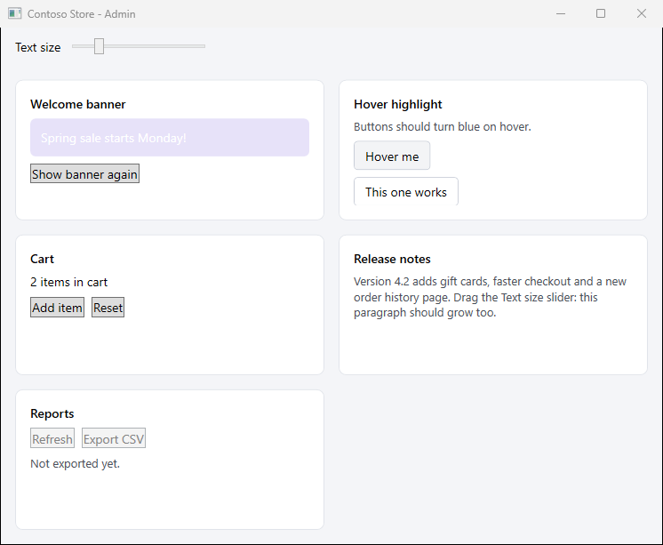
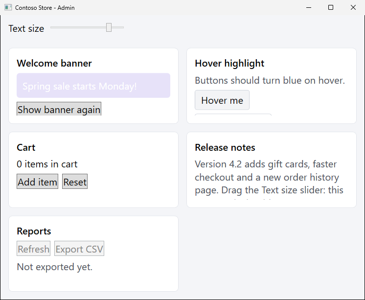
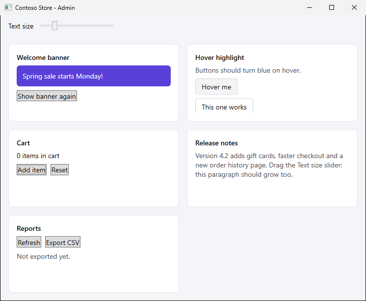

# Session transcript

Source: `Q:\source\XamlAgentDemos-notes\test-runs\PrecedenceWars\run-final5\events.jsonl`

## Tool usage

- xaml_interact: 11
- xaml_explain_property_value: 4
- debugger_evaluate_expressions: 4
- xaml_get_status: 3
- xaml_capture_image: 3
- get_file: 3
- powershell: 3
- debugger_get_threads: 3
- skill: 2
- view: 2
- xaml_get_element_styles: 2
- xaml_get_binding_failures: 2
- xaml_apply_hot_reload: 2
- task: 2
- grep: 2
- debugger_continue: 2
- rg: 2
- debugger_ui_interact: 2
- task_complete: 2
- xaml_get_visual_tree: 1
- get_projects_in_solution: 1
- glob: 1
- multi_replace_string_in_file: 1
- xaml_find_elements: 1
- replace_string_in_file: 1
- debugger_pause: 1
- debugger_get_call_stack: 1
- debugger_read_file: 1
- debugger_ui_tree: 1
- debugger_wait: 1
- debugger_set_breakpoints: 1
- debugger_remove_breakpoints: 1
- xaml_get_element_properties: 1

Failed tool calls: 0, images: 3


_Model: gpt-6.1-terra_


## User (05:34:44)

Each card in my running app has a property that refuses to change. Figure out why for every card using the live app, prove it, and fix the source.


**Tool call (05:34:46):** `skill`
```json
{
 "skill": "xaml-diagnostics"
}
```

<details><summary>Result `skill` success=true</summary>

```
Skill "xaml-diagnostics" loaded successfully. Follow the instructions in the skill context.
```
</details>


_Skill invoked: xaml-diagnostics_


**Assistant (05:34:48):**

I’ll inspect the live cards and their property precedence, then fix and verify the source.


**Tool call (05:34:48):** `xaml_get_status`
```json
{
 "progressMessage": "Inspecting the running XAML app"
}
```

<details><summary>Result `xaml_get_status` success=true</summary>

```
{"isDebugging":true,"debuggerState":"running","diagnosticsActive":true,"apps":[{"app":"a1","name":"PrecedenceWars.exe [51656]","processId":51656,"platform":"WPF (.NET)","isRemote":false,"isDesignTimeOrNoDebug":false,"sourceInfoAvailable":true,"hotReloadSupported":true,"hotReloadEnabled":true,"supportsPropertyExplorer":true,"supportsInAppToolbar":true,"supportsHitTest":true,"windows":[{"windowId":"0x10E104A","title":"Contoso Store - Admin","bounds":{"x":182,"y":182,"width":760,"height":620},"dpiScale":1.0,"visible":true,"minimized":false}]}],"issues":[],"issuesSummary":"No problems detected.","hotReload":{"options":{"hotReloadEnabled":true,"hotReloadOnSave":false,"applyMode":"asYouType: XAML edits apply as you type, without saving (default)","wpfEnabled":true,"uwpEnabled":true,"winUIEnabled":true,"mauiEnabled":true,"justMyXaml":true,"previewSelectedElement":false,"inAppToolbar":true,"inAppSelection":false,"layoutAdorners":false,"trackFocusedElement":false,"bindingFailuresVisible":true,"compatibilityMode":false},"dotNetHotReloadEnabled":true,"isProcessingChanges":false,"errors":[]},"windowsNote":"Window bounds are physical screen pixels and include the window frame. A WPF/WinUI Window's Width and Height are device-independent units (DIPs) that also include the frame, so Width = bounds.width / dpiScale. A user's \"800 px wide\" is ambiguous: say which unit you tested. A minimized window reports x/y = -32000 and can't be captured."}
```
</details>


**Tool call (05:34:51):** `xaml_get_visual_tree`
```json
{
 "progressMessage": "Identify all live cards",
 "app": "a1",
 "depth": 7,
 "maxNodes": 500
}
```


**Tool call (05:34:51):** `xaml_capture_image`
```json
{
 "progressMessage": "Inspect the cards visually",
 "app": "a1"
}
```


**Tool call (05:34:51):** `get_projects_in_solution`
```json
{}
```

<details><summary>Result `xaml_get_visual_tree` success=true</summary>

```
{"app":"a1","platform":"WPF (.NET)","sourceInfoAvailable":true,"nodeCount":49,"truncated":false,"depthLimitedNodes":9,"hint":"9 node(s) have children beyond the requested depth (childCount > 0, no children listed). Raise depth or pass rootElementId to expand them.","nodes":[{"id":"a1:10","type":"PrecedenceWars.MainWindow","source":{"file":"Q:\\source\\XamlAgentDemos\\src\\PrecedenceWars\\MainWindow.xaml","line":3,"column":9},"childCount":1,"children":[{"id":"a1:11","type":"System.Windows.Controls.Border","childCount":1,"children":[{"id":"a1:12","type":"System.Windows.Documents.AdornerDecorator","childCount":2,"children":[{"id":"a1:13","type":"System.Windows.Controls.ContentPresenter","childCount":1,"children":[{"id":"a1:15","type":"System.Windows.Controls.DockPanel","source":{"file":"Q:\\source\\XamlAgentDemos\\src\\PrecedenceWars\\MainWindow.xaml","line":53,"column":6},"childCount":2,"children":[{"id":"a1:16","type":"System.Windows.Controls.StackPanel","source":{"file":"Q:\\source\\XamlAgentDemos\\src\\PrecedenceWars\\MainWindow.xaml","line":54,"column":10},"childCount":2,"children":[{"id":"a1:18","type":"System.Windows.Controls.TextBlock","source":{"file":"Q:\\source\\XamlAgentDemos\\src\\PrecedenceWars\\MainWindow.xaml","line":57,"column":14},"childCount":0},{"id":"a1:19","type":"System.Windows.Controls.Slider","name":"TextSizeSlider","source":{"file":"Q:\\source\\XamlAgentDemos\\src\\PrecedenceWars\\MainWindow.xaml","line":58,"column":14},"childCount":1,"children":[{"id":"a1:25","type":"System.Windows.Controls.Border","name":"border","childCount":1,"children":[{"id":"a1:31","type":"System.Windows.Controls.Grid","childCount":4,"children":[{"id":"a1:47","type":"System.Windows.Controls.Primitives.TickBar","name":"TopTick","childCount":0},{"id":"a1:48","type":"System.Windows.Controls.Primitives.TickBar","name":"BottomTick","childCount":0},{"id":"a1:49","type":"System.Windows.Controls.Border","name":"TrackBackground","childCount":1},{"id":"a1:50","type":"System.Windows.Controls.Primitives.Track","name":"PART_Track","childCount":3}]}]}]}]},{"id":"a1:17","type":"System.Windows.Controls.Primitives.UniformGrid","source":{"file":"Q:\\source\\XamlAgentDemos\\src\\PrecedenceWars\\MainWindow.xaml","line":67,"column":10},"childCount":5,"children":[{"id":"a1:20","type":"System.Windows.Controls.Border","source":{"file":"Q:\\source\\XamlAgentDemos\\src\\PrecedenceWars\\MainWindow.xaml","line":69,"column":14},"childCount":1,"children":[{"id":"a1:26","type":"System.Windo
... [truncated 6152 chars]
```
</details>

<details><summary>Result `get_projects_in_solution` success=true</summary>

```
src\GhostClicks\GhostClicks.csproj
src\GermanReady\GermanReady.csproj
src\ThemeBreaker\ThemeBreaker.csproj
src\DesignPolish\DesignPolish.csproj
src\HotReloadDoctor\HotReloadDoctor.csproj
src\VanishingSave\VanishingSave.csproj
src\CrispPixels\CrispPixels.csproj
src\PrecedenceWars\PrecedenceWars.csproj
src\LostWindows\LostWindows.csproj
src\TemplateDetective\TemplateDetective.csproj
src\SlowScroll\SlowScroll.csproj
src\PixelPerfect\PixelPerfect.csproj
src\BindingStorm\BindingStorm.csproj
src\BugRepro\BugRepro.csproj
src\A11ySweep\A11ySweep.csproj
src\StyleMaze\StyleMaze.csproj
src\ResponsiveDashboard\ResponsiveDashboard.csproj

```
</details>




<details><summary>Result `xaml_capture_image` success=true</summary>

```
Screenshot of window 0x10E104A "Contoso Store - Admin" of app a1 (746x613 image of the window's client area, so it's slightly smaller than the frame bounds from xaml_get_status).
```
</details>


**Tool call (05:34:55):** `get_file`
```json
{
 "filename": "Q:\\source\\XamlAgentDemos\\src\\PrecedenceWars\\MainWindow.xaml",
 "startLine": 1,
 "endLine": 200
}
```


**Tool call (05:34:55):** `get_file`
```json
{
 "filename": "Q:\\source\\XamlAgentDemos\\src\\PrecedenceWars\\MainWindow.xaml.cs",
 "startLine": 1,
 "endLine": 250
}
```


**Tool call (05:34:55):** `xaml_explain_property_value`
```json
{
 "progressMessage": "Explain the five stuck properties",
 "elementIds": [
  "a1:33",
  "a1:37",
  "a1:40",
  "a1:43",
  "a1:57",
  "a1:58"
 ],
 "propertyNames": [
  "Opacity",
  "Background",
  "Text",
  "FontSize",
  "IsEnabled",
  "IsEnabled"
 ],
 "pairwise": true
}
```


**Tool call (05:34:55):** `view`
```json
{
 "path": "c:\\vs\\fastmain\\common7\\ide\\commonextensions\\microsoft\\xamldiagnostics\\AgentTools\\skills\\xaml-diagnostics\\references\\xaml-authoring.md"
}
```

<details><summary>Result `view` success=true</summary>

```
# XAML authoring guidance

Follow these rules when writing or changing XAML so it works well with XAML Hot Reload, the XAML designer, and XAML Diagnostics.

## Design-time data

- Declare `xmlns:d="http://schemas.microsoft.com/expression/blend/2008"` and `xmlns:mc="http://schemas.openxmlformats.org/markup-compatibility/2006"` with `mc:Ignorable="d"`.
- Use `d:DataContext="{d:DesignInstance Type=vm:MyViewModel, IsDesignTimeCreatable=False}"` (WPF/UWP) so the designer and IntelliSense know binding paths.
- Use `d:` properties (for example `d:Text="Sample"`) for sample values that appear only at design time.
- .NET MAUI: set `x:DataType` on pages and `DataTemplate`s. It enables compiled bindings and turns many binding failures into build errors.
- WinUI/UWP: prefer `x:Bind` for compile-time checked bindings when the view owns the view model.

## Bindings

- Bind with explicit paths. Avoid string-built paths in code-behind.
- Keep the `DataContext` chain simple. Use `ElementName` or `RelativeSource` only at real scope boundaries (for example inside a `DataTemplate` that needs the page's view model).
- Expose bound properties as public properties that raise `PropertyChanged`. Fields and non-public properties don't bind.
- Use `FallbackValue` and `TargetNullValue` for expected missing values instead of hiding binding errors.
- Before saving, check every binding path against the actual property names on the data context type (case, plurals, nested paths such as `Customer.Address.City`). Misspelled paths are the most common binding failure and they fail silently.
- Inside a `DataTemplate` or `ItemContainerStyle`, the data context is the item, not the page's view model. To reach a page command, use `RelativeSource={RelativeSource AncestorType=...}` with `DataContext.` in the path, or `ElementName`.
- A `TextBox.Text` binding updates its source on `LostFocus` by default (WPF). Use `UpdateSourceTrigger=PropertyChanged` when other UI (validation, enabled state, live search) must react while the user types.
- `Mode=TwoWay` (the default for `TextBox.Text`, `CheckBox.IsChecked`, `Selector.SelectedItem` and similar) needs a property with a public setter. In WPF, a two-way binding to a read-only property throws when the view loads.
- Bindings created in code have no XAML file and line in diagnostics. Prefer declaring bindings in XAML.

## Layout

- Don't put a list (`ListBox`, `ListView`, `DataGrid`, `ItemsControl` with a virtualizing panel) insid
... [truncated 4693 chars]
```
</details>

<details><summary>Result `xaml_explain_property_value` success=true</summary>

```
{"count":6,"failed":0,"results":[{"id":"a1:33","type":"System.Windows.Controls.Border","property":"Opacity","propertyType":"System.Double","effectiveValue":"0.15000000000000002","effectiveSource":"Animation","chain":[{"kind":"Animation","description":"An active animation (Storyboard or VisualState). It overrides local and style values while it holds the value.","value":"0.15000000000000002","valueType":"System.Double","effective":true},{"kind":"Default","description":"The property's default value; nothing sets it.","value":"1","valueType":"System.Double","effective":false}],"notes":["Find the Storyboard or VisualState that animates this property; local and style changes have no visible effect while it holds the value (FillBehavior=HoldEnd is common)."]},{"id":"a1:37","type":"System.Windows.Controls.Button","property":"Background","propertyType":"System.Windows.Media.Brush","effectiveValue":"#FFF3F4F6","effectiveSource":"Local","chain":[{"kind":"Local","description":"Local value set on the element (XAML attribute, binding or code). Wins over styles, templates and inheritance.","value":"#FFF3F4F6","valueType":"System.Windows.Media.SolidColorBrush","effective":true,"sourceLocation":{"file":"Q:\\source\\XamlAgentDemos\\src\\PrecedenceWars\\MainWindow.xaml","line":103,"column":22}},{"kind":"Style","description":"Setter in an explicit (x:Key) or implicit (TargetType) Style.","targetType":"System.Windows.Controls.Button","value":"#FFFFFFFF","valueType":"System.Windows.Media.SolidColorBrush","effective":false,"sourceLocation":{"file":"Q:\\source\\XamlAgentDemos\\src\\PrecedenceWars\\MainWindow.xaml","line":29,"column":10}},{"kind":"BuiltInStyle","description":"Setter in the control's default theme style (generic.xaml or the platform theme).","targetType":"System.Windows.Controls.Primitives.ButtonBase","value":"#FFDDDDDD","valueType":"System.Windows.Media.SolidColorBrush","effective":false},{"kind":"Default","description":"The property's default value; nothing sets it.","effective":false}],"notes":["To let a style or template value apply, remove the local value (the attribute, binding or code assignment). To change it, edit that local value. XAML and code both produce Local values, and the source location may still point to the XAML attribute after code assigned a new value. If the live value differs from the XAML attribute, or the element has no XAML attribute for it, code set it: search code-behind for the element's x:Name."]},{"id":"a1:40","type":"System.Windows
... [truncated 3920 chars]
```
</details>

<details><summary>Result `get_file` success=true</summary>

```
```csharp src\PrecedenceWars\MainWindow.xaml.cs (Lines 1-25 of 25 total. Call tools for more if needed.)
using System.Windows;

namespace PrecedenceWars;

public partial class MainWindow : Window
{
    private readonly StoreViewModel viewModel = new();

    public MainWindow()
    {
        this.InitializeComponent();
        this.DataContext = this.viewModel;
    }

    private void OnShowBannerClick(object sender, RoutedEventArgs e)
    {
        this.WelcomeBanner.Opacity = 1;
    }

    private void OnResetClick(object sender, RoutedEventArgs e)
    {
        this.viewModel.ItemCount = 0;
        this.CountText.Text = "0 items in cart";
    }
}

```


```
</details>

<details><summary>Result `get_file` success=true</summary>

```
```xaml src\PrecedenceWars\MainWindow.xaml (Lines 1-164 of 164 total. Call tools for more if needed.)
<Window x:Class="PrecedenceWars.MainWindow"
        xmlns="http://schemas.microsoft.com/winfx/2006/xaml/presentation"
        xmlns:x="http://schemas.microsoft.com/winfx/2006/xaml"
        Title="Contoso Store - Admin"
        Width="760"
        Height="620"
        FontSize="{Binding Value, ElementName=TextSizeSlider}">
    <Window.Resources>
        <Style x:Key="CardStyle" TargetType="Border">
            <Setter Property="Background" Value="White" />
            <Setter Property="BorderBrush" Value="#E1E4EA" />
            <Setter Property="BorderThickness" Value="1" />
            <Setter Property="CornerRadius" Value="8" />
            <Setter Property="Padding" Value="16" />
            <Setter Property="Margin" Value="8" />
        </Style>

        <Style x:Key="CardTitleStyle" TargetType="TextBlock">
            <Setter Property="FontWeight" Value="SemiBold" />
            <Setter Property="Margin" Value="0,0,0,8" />
        </Style>

        <Style x:Key="BodyTextStyle" TargetType="TextBlock">
            <Setter Property="FontSize" Value="13" />
            <Setter Property="Foreground" Value="#4A4F5A" />
            <Setter Property="TextWrapping" Value="Wrap" />
        </Style>

        <Style x:Key="HoverButtonStyle" TargetType="Button">
            <Setter Property="Background" Value="White" />
            <Setter Property="Padding" Value="12,6" />
            <Setter Property="Template">
                <Setter.Value>
                    <ControlTemplate TargetType="Button">
                        <Border Padding="{TemplateBinding Padding}"
                                Background="{TemplateBinding Background}"
                                BorderBrush="#C9CED8"
                                BorderThickness="1"
                                CornerRadius="4">
                            <ContentPresenter HorizontalAlignment="Center" />
                        </Border>
                    </ControlTemplate>
                </Setter.Value>
            </Setter>
            <Style.Triggers>
                <Trigger Property="IsMouseOver" Value="True">
                    <Setter Property="Background" Value="#DCE8FF" />
                </Trigger>
            </Style.Triggers>
        </Style>
    </Window.Resources>

    <DockPanel Background="#F4F5F8">
        <StackPanel Margin
... [truncated 5586 chars]
```
</details>


**Tool call (05:35:00):** `glob`
```json
{
 "pattern": "src\\PrecedenceWars\\*.cs"
}
```


**Tool call (05:35:00):** `xaml_interact`
```json
{
 "progressMessage": "Test whether the banner can be restored",
 "elementId": "a1:34",
 "action": "invoke",
 "checkProperties": "Opacity",
 "checkElementIds": [
  "a1:33"
 ]
}
```


**Tool call (05:35:00):** `xaml_interact`
```json
{
 "progressMessage": "Test cart reset and binding behavior",
 "elementId": "a1:56",
 "action": "invoke",
 "checkProperties": "Text",
 "checkElementIds": [
  "a1:40"
 ]
}
```


**Tool call (05:35:00):** `xaml_interact`
```json
{
 "progressMessage": "Test release notes font scaling",
 "elementId": "a1:19",
 "action": "setValue",
 "value": "20",
 "checkProperties": "FontSize",
 "checkElementIds": [
  "a1:43"
 ]
}
```


**Tool call (05:35:00):** `xaml_explain_property_value`
```json
{
 "progressMessage": "Inspect toolbar and working hover control",
 "elementIds": [
  "a1:45",
  "a1:38"
 ],
 "propertyNames": [
  "IsEnabled",
  "Background"
 ],
 "pairwise": true
}
```

<details><summary>Result `glob` success=true</summary>

```
.\src\PrecedenceWars\MainWindow.xaml.cs
.\src\PrecedenceWars\App.xaml.cs
.\src\PrecedenceWars\StoreViewModel.cs
```
</details>

<details><summary>Result `xaml_explain_property_value` success=true</summary>

```
{"count":2,"failed":0,"results":[{"id":"a1:45","type":"System.Windows.Controls.StackPanel","property":"IsEnabled","propertyType":"System.Boolean","evaluatedValue":"False (System.Boolean)","effectiveSource":"Local","chain":[{"kind":"Local","description":"Local value set on the element (XAML attribute, binding or code). Wins over styles, templates and inheritance.","evaluatedValue":"False (System.Boolean)","valueType":"System.Windows.Data.BindingExpression","isBinding":true,"effective":true,"sourceLocation":{"file":"Q:\\source\\XamlAgentDemos\\src\\PrecedenceWars\\MainWindow.xaml","line":148,"column":22}},{"kind":"Default","description":"The property's default value; nothing sets it.","value":"True","valueType":"System.Boolean","effective":false}],"notes":["To let a style or template value apply, remove the local value (the attribute, binding or code assignment). To change it, edit that local value. XAML and code both produce Local values, and the source location may still point to the XAML attribute after code assigned a new value. If the live value differs from the XAML attribute, or the element has no XAML attribute for it, code set it: search code-behind for the element's x:Name.","The effective value comes from a binding. If it's wrong, check xaml_get_binding_failures and the DataContext."]},{"id":"a1:38","type":"System.Windows.Controls.Button","property":"Background","propertyType":"System.Windows.Media.Brush","effectiveValue":"#FFFFFFFF","effectiveSource":"Style","chain":[{"kind":"Style","description":"Setter in an explicit (x:Key) or implicit (TargetType) Style.","targetType":"System.Windows.Controls.Button","value":"#FFFFFFFF","valueType":"System.Windows.Media.SolidColorBrush","effective":true,"sourceLocation":{"file":"Q:\\source\\XamlAgentDemos\\src\\PrecedenceWars\\MainWindow.xaml","line":29,"column":10}},{"kind":"BuiltInStyle","description":"Setter in the control's default theme style (generic.xaml or the platform theme).","targetType":"System.Windows.Controls.Primitives.ButtonBase","value":"#FFDDDDDD","valueType":"System.Windows.Media.SolidColorBrush","effective":false},{"kind":"Default","description":"The property's default value; nothing sets it.","effective":false}],"notes":["Edit the setter or trigger at the source location, or set a local value to override it for this element only."]}]}
```
</details>

<details><summary>Result `xaml_interact` success=true</summary>

```
{"id":"a1:34","action":"invoke","result":"Invoked.","supportedPatterns":["Invoke","SynchronizedInput"],"checks":[{"id":"a1:33","changed":false,"before":[{"name":"Opacity","value":"0.15000000000000002","evaluatedValue":null,"valueType":"System.Double","propertyType":"System.Double","declaringType":"System.Windows.UIElement","valueSource":"Animation","valueSourceName":null,"valueSourceLocation":null,"valueLocation":null,"isBinding":null,"isCollection":null,"isAttached":null,"readOnly":null,"overridden":null},{"name":"OpacityMask","value":null,"evaluatedValue":null,"valueType":null,"propertyType":"System.Windows.Media.Brush","declaringType":"System.Windows.UIElement","valueSource":"Default","valueSourceName":null,"valueSourceLocation":null,"valueLocation":null,"isBinding":null,"isCollection":null,"isAttached":null,"readOnly":null,"overridden":null}],"after":[{"name":"Opacity","value":"0.15000000000000002","evaluatedValue":null,"valueType":"System.Double","propertyType":"System.Double","declaringType":"System.Windows.UIElement","valueSource":"Animation","valueSourceName":null,"valueSourceLocation":null,"valueLocation":null,"isBinding":null,"isCollection":null,"isAttached":null,"readOnly":null,"overridden":null},{"name":"OpacityMask","value":null,"evaluatedValue":null,"valueType":null,"propertyType":"System.Windows.Media.Brush","declaringType":"System.Windows.UIElement","valueSource":"Default","valueSourceName":null,"valueSourceLocation":null,"valueLocation":null,"isBinding":null,"isCollection":null,"isAttached":null,"readOnly":null,"overridden":null}]}],"checksNote":"changed=false means none of the checked properties changed 300 ms after the action: the action reached the control but its handler, command or binding had no visible effect (or the effect is elsewhere, so check other elements). Slow async work may need another read.","note":"Call xaml_capture_image or xaml_get_element_properties to verify the effect, or pass checkProperties next time to compare values before and after. Automation actions bypass mouse hit testing, so a successful invoke doesn't prove a real click reaches the element; call xaml_hit_test for that."}
```
</details>

<details><summary>Result `xaml_interact` success=true</summary>

```
{"id":"a1:19","action":"setValue","result":"Value is now 20.","supportedPatterns":["RangeValue","SynchronizedInput"],"checks":[{"id":"a1:43","changed":false,"before":[{"name":"FontSize","value":"13","evaluatedValue":null,"valueType":"System.Double","propertyType":"System.Double","declaringType":"System.Windows.Controls.TextBlock","valueSource":"Style","valueSourceName":null,"valueSourceLocation":{"file":"Q:\\source\\XamlAgentDemos\\src\\PrecedenceWars\\MainWindow.xaml","line":23,"column":10},"valueLocation":null,"isBinding":null,"isCollection":null,"isAttached":null,"readOnly":null,"overridden":null}],"after":[{"name":"FontSize","value":"13","evaluatedValue":null,"valueType":"System.Double","propertyType":"System.Double","declaringType":"System.Windows.Controls.TextBlock","valueSource":"Style","valueSourceName":null,"valueSourceLocation":{"file":"Q:\\source\\XamlAgentDemos\\src\\PrecedenceWars\\MainWindow.xaml","line":23,"column":10},"valueLocation":null,"isBinding":null,"isCollection":null,"isAttached":null,"readOnly":null,"overridden":null}]}],"checksNote":"changed=false means none of the checked properties changed 300 ms after the action: the action reached the control but its handler, command or binding had no visible effect (or the effect is elsewhere, so check other elements). Slow async work may need another read.","note":"Call xaml_capture_image or xaml_get_element_properties to verify the effect, or pass checkProperties next time to compare values before and after. Automation actions bypass mouse hit testing, so a successful invoke doesn't prove a real click reaches the element; call xaml_hit_test for that."}
```
</details>

<details><summary>Result `xaml_interact` success=true</summary>

```
{"id":"a1:56","action":"invoke","result":"Invoked.","supportedPatterns":["Invoke","SynchronizedInput"],"checks":[{"id":"a1:40","changed":true,"before":[{"name":"Text","value":"System.Windows.Data.BindingExpression","evaluatedValue":"2 items in cart (System.String)","valueType":"System.Windows.Data.BindingExpression","propertyType":"System.String","declaringType":"System.Windows.Controls.TextBlock","valueSource":"Local","valueSourceName":null,"valueSourceLocation":{"file":"Q:\\source\\XamlAgentDemos\\src\\PrecedenceWars\\MainWindow.xaml","line":121,"column":22},"valueLocation":null,"isBinding":true,"isCollection":null,"isAttached":null,"readOnly":null,"overridden":null},{"name":"TextTrimming","value":"0","evaluatedValue":null,"valueType":"System.Windows.TextTrimming","propertyType":"System.Windows.TextTrimming","declaringType":"System.Windows.Controls.TextBlock","valueSource":"BuiltInStyle","valueSourceName":null,"valueSourceLocation":null,"valueLocation":null,"isBinding":null,"isCollection":null,"isAttached":null,"readOnly":null,"overridden":null},{"name":"TextWrapping","value":"1","evaluatedValue":null,"valueType":"System.Windows.TextWrapping","propertyType":"System.Windows.TextWrapping","declaringType":"System.Windows.Controls.TextBlock","valueSource":"BuiltInStyle","valueSourceName":null,"valueSourceLocation":null,"valueLocation":null,"isBinding":null,"isCollection":null,"isAttached":null,"readOnly":null,"overridden":null},{"name":"DataContext","value":null,"evaluatedValue":null,"valueType":"PrecedenceWars.StoreViewModel","propertyType":"System.Object","declaringType":"System.Windows.FrameworkElement","valueSource":"Inherited","valueSourceName":null,"valueSourceLocation":null,"valueLocation":null,"isBinding":null,"isCollection":null,"isAttached":null,"readOnly":null,"overridden":null},{"name":"TextAlignment","value":"0","evaluatedValue":null,"valueType":"System.Windows.TextAlignment","propertyType":"System.Windows.TextAlignment","declaringType":"System.Windows.Controls.TextBlock","valueSource":"Default","valueSourceName":null,"valueSourceLocation":null,"valueLocation":null,"isBinding":null,"isCollection":null,"isAttached":null,"readOnly":null,"overridden":null},{"name":"TextDecorations","value":null,"evaluatedValue":null,"valueType":"System.Windows.TextDecorationCollection","propertyType":"System.Windows.TextDecorationCollection","declaringType":"System.Windows.Controls.TextBlock","valueSource":"Default","valueSourceName":null,"valueSourceLocation":null
... [truncated 4635 chars]
```
</details>


**Tool call (05:35:04):** `get_file`
```json
{
 "filename": "Q:\\source\\XamlAgentDemos\\src\\PrecedenceWars\\StoreViewModel.cs",
 "startLine": 1,
 "endLine": 240
}
```


**Tool call (05:35:04):** `xaml_interact`
```json
{
 "progressMessage": "Prove adding fails after reset",
 "elementId": "a1:55",
 "action": "invoke",
 "checkProperties": "Text",
 "checkElementIds": [
  "a1:40"
 ]
}
```


**Tool call (05:35:04):** `xaml_get_element_styles`
```json
{
 "progressMessage": "Inspect hover style precedence",
 "elementIds": [
  "a1:37",
  "a1:38"
 ]
}
```


**Tool call (05:35:04):** `xaml_get_binding_failures`
```json
{
 "progressMessage": "Check for related binding errors"
}
```


**Tool call (05:35:04):** `powershell`
```json
{
 "command": "git status --short; git --no-pager diff -- src\\PrecedenceWars",
 "description": "Check existing changes in the affected project"
}
```

<details><summary>Result `get_file` success=true</summary>

```
```csharp src\PrecedenceWars\StoreViewModel.cs (Lines 1-69 of 69 total. Call tools for more if needed.)
using System.Diagnostics;

namespace PrecedenceWars;

public sealed class StoreViewModel : ObservableObject
{
    private int itemCount = 2;
    private bool isBusy;
    private string lastExport = "Not exported yet.";

    public StoreViewModel()
    {
        this.AddItemCommand = new RelayCommand(() => this.ItemCount++);
        this.ExportCommand = new RelayCommand(() => this.LastExport = $"Exported at {DateTime.Now:t}.", () => true);
        this.SyncCatalog();
    }

    public RelayCommand AddItemCommand { get; }

    public RelayCommand ExportCommand { get; }

    public int ItemCount
    {
        get => this.itemCount;
        set => this.SetProperty(ref this.itemCount, value);
    }

    public bool IsBusy
    {
        get => this.isBusy;
        private set
        {
            if (this.SetProperty(ref this.isBusy, value))
            {
                this.OnPropertyChanged(nameof(this.IsIdle));
            }
        }
    }

    public bool IsIdle => !this.IsBusy;

    public string LastExport
    {
        get => this.lastExport;
        private set => this.SetProperty(ref this.lastExport, value);
    }

    private void SyncCatalog()
    {
        this.IsBusy = true;
        try
        {
            if (this.IsOffline())
            {
                throw new TimeoutException("Catalog service didn't respond.");
            }
        }
        catch (TimeoutException ex)
        {
            Debug.WriteLine($"Catalog sync failed: {ex.Message}");
            return;
        }

        this.IsBusy = false;
    }

    // Simulates the offline case: the catalog service isn't reachable.
    private bool IsOffline() => true;
}

```


```
</details>

<details><summary>Result `xaml_get_binding_failures` success=true</summary>

```
{"note":"This is a cumulative log since debugging started or the last xaml_clear_binding_failures, not live state: fixed failures stay listed. To verify a fix: clear, revisit the UI that uses the binding, then read again. Failures without a file usually come from bindings created in code.","totalUnique":0,"matched":0,"truncated":false,"failures":[]}
```
</details>

<details><summary>Result `xaml_get_element_styles` success=true</summary>

```
{"count":2,"failed":0,"results":[{"id":"a1:37","type":"System.Windows.Controls.Button","name":"HoverButton","source":{"file":"Q:\\source\\XamlAgentDemos\\src\\PrecedenceWars\\MainWindow.xaml","line":103,"column":22},"styleProperty":{"value":"System.Windows.Style","valueSource":"Local","location":{"file":"Q:\\source\\XamlAgentDemos\\src\\PrecedenceWars\\MainWindow.xaml","line":103,"column":22}},"templateProperty":{"value":"System.Windows.Controls.ControlTemplate","valueSource":"Style","location":{"file":"Q:\\source\\XamlAgentDemos\\src\\PrecedenceWars\\MainWindow.xaml","line":29,"column":10}},"styles":[{"kind":"Style","description":"Setter in an explicit (x:Key) or implicit (TargetType) Style.","targetType":"System.Windows.Controls.Button","location":{"file":"Q:\\source\\XamlAgentDemos\\src\\PrecedenceWars\\MainWindow.xaml","line":29,"column":10},"setters":[{"property":"Background","value":"#FFFFFFFF","effective":false,"overriddenBy":"Local"},{"property":"Padding","value":"12,6,12,6","effective":true},{"property":"Template","value":"System.Windows.Controls.ControlTemplate","effective":true,"valueLocation":{"file":"Q:\\source\\XamlAgentDemos\\src\\PrecedenceWars\\MainWindow.xaml","line":34,"column":22}}]},{"kind":"BuiltInStyle","description":"Setter in the control's default theme style (generic.xaml or the platform theme).","targetType":"System.Windows.Controls.Primitives.ButtonBase","setters":[{"property":"Background","value":"#FFDDDDDD","effective":false,"overriddenBy":"Local"},{"property":"BorderBrush","value":"#FF707070","effective":true},{"property":"BorderThickness","value":"1,1,1,1","effective":true},{"property":"FocusVisualStyle","value":"System.Windows.Style","effective":true},{"property":"Foreground","effective":true},{"property":"HorizontalContentAlignment","value":"1","effective":true},{"property":"Padding","value":"1,1,1,1","effective":false,"overriddenBy":"Style (System.Windows.Controls.Button)"},{"property":"Template","value":"System.Windows.Controls.ControlTemplate","effective":false,"overriddenBy":"Style (System.Windows.Controls.Button)"},{"property":"VerticalContentAlignment","value":"1","effective":true}]}],"hint":"Styles are listed in precedence order, highest first. 'effective=false' setters lose to 'overriddenBy'. Use xaml_find_resource to see where a style or resource key resolves. Only triggers whose condition is true right now are listed; inactive triggers (IsMouseOver, IsPressed, DataTriggers) aren't. Read the style's source at 'loc
... [truncated 2621 chars]
```
</details>

<details><summary>Result `xaml_interact` success=true</summary>

```
{"id":"a1:55","action":"invoke","result":"Invoked.","supportedPatterns":["Invoke","SynchronizedInput"],"checks":[{"id":"a1:40","changed":false,"before":[{"name":"Text","value":"0 items in cart","evaluatedValue":null,"valueType":"System.String","propertyType":"System.String","declaringType":"System.Windows.Controls.TextBlock","valueSource":"Local","valueSourceName":null,"valueSourceLocation":{"file":"Q:\\source\\XamlAgentDemos\\src\\PrecedenceWars\\MainWindow.xaml","line":121,"column":22},"valueLocation":null,"isBinding":null,"isCollection":null,"isAttached":null,"readOnly":null,"overridden":null},{"name":"TextTrimming","value":"0","evaluatedValue":null,"valueType":"System.Windows.TextTrimming","propertyType":"System.Windows.TextTrimming","declaringType":"System.Windows.Controls.TextBlock","valueSource":"BuiltInStyle","valueSourceName":null,"valueSourceLocation":null,"valueLocation":null,"isBinding":null,"isCollection":null,"isAttached":null,"readOnly":null,"overridden":null},{"name":"TextWrapping","value":"1","evaluatedValue":null,"valueType":"System.Windows.TextWrapping","propertyType":"System.Windows.TextWrapping","declaringType":"System.Windows.Controls.TextBlock","valueSource":"BuiltInStyle","valueSourceName":null,"valueSourceLocation":null,"valueLocation":null,"isBinding":null,"isCollection":null,"isAttached":null,"readOnly":null,"overridden":null},{"name":"DataContext","value":null,"evaluatedValue":null,"valueType":"PrecedenceWars.StoreViewModel","propertyType":"System.Object","declaringType":"System.Windows.FrameworkElement","valueSource":"Inherited","valueSourceName":null,"valueSourceLocation":null,"valueLocation":null,"isBinding":null,"isCollection":null,"isAttached":null,"readOnly":null,"overridden":null},{"name":"TextAlignment","value":"0","evaluatedValue":null,"valueType":"System.Windows.TextAlignment","propertyType":"System.Windows.TextAlignment","declaringType":"System.Windows.Controls.TextBlock","valueSource":"Default","valueSourceName":null,"valueSourceLocation":null,"valueLocation":null,"isBinding":null,"isCollection":null,"isAttached":null,"readOnly":null,"overridden":null},{"name":"TextDecorations","value":null,"evaluatedValue":null,"valueType":"System.Windows.TextDecorationCollection","propertyType":"System.Windows.TextDecorationCollection","declaringType":"System.Windows.Controls.TextBlock","valueSource":"Default","valueSourceName":null,"valueSourceLocation":null,"valueLocation":null,"isBinding":null,"isCollection":true,"isAttached":nu
... [truncated 4561 chars]
```
</details>

<details><summary>Result `powershell` success=true</summary>

```

<shellId: 0 completed with exit code 0>
```
</details>


**Assistant (05:35:20):**

The five cards have different causes: animation, style precedence, a replaced binding, font inheritance, and a stuck busy state. I’ve reproduced the interactive failures and will preserve each card’s intended behavior in the fixes.


**Tool call (05:35:20):** `multi_replace_string_in_file`
```json
{
 "explanation": "Fix each card's property precedence or state while preserving the original visual behavior.",
 "replacements": [
  {
   "filePath": "src\\PrecedenceWars\\MainWindow.xaml",
   "oldString": "        <Style x:Key=\"BodyTextStyle\" TargetType=\"TextBlock\">\n            <Setter Property=\"FontSize\" Value=\"13\" />\n            <Setter Property=\"Foreground\" Value=\"#4A4F5A\" />\n            <Setter Property=\"TextWrapping\" Value=\"Wrap\" />\n        </Style>",
   "newString": "        <Style x:Key=\"BodyTextStyle\" TargetType=\"TextBlock\">\n            <Setter Property=\"Foreground\" Value=\"#4A4F5A\" />\n            <Setter Property=\"TextWrapping\" Value=\"Wrap\" />\n        </Style>"
  },
  {
   "filePath": "src\\PrecedenceWars\\MainWindow.xaml",
   "oldString": "            </Style.Triggers>\n        </Style>\n    </Window.Resources>\n\n    <DockPanel Background=\"#F4F5F8\">",
   "newString": "            </Style.Triggers>\n        </Style>\n\n        <Style x:Key=\"GrayHoverButtonStyle\" TargetType=\"Button\" BasedOn=\"{StaticResource HoverButtonStyle}\">\n            <Setter Property=\"Background\" Value=\"#F3F4F6\" />\n        </Style>\n    </Window.Resources>\n\n    <DockPanel Background=\"#F4F5F8\">"
  },
  {
   "filePath": "src\\PrecedenceWars\\MainWindow.xaml",
   "oldString": "                    <Button x:Name=\"HoverButton\"\n                            Margin=\"0,8,0,0\"\n                            HorizontalAlignment=\"Left\"\n             
... [truncated 1957 chars]
```

<details><summary>Result `multi_replace_string_in_file` success=true</summary>

```
Successfully applied 5 of 5 replacement(s) across 3 file(s).
```
</details>


**Tool call (05:35:24):** `xaml_apply_hot_reload`
```json
{
 "progressMessage": "Apply the fixes to the running app",
 "includeCodeChanges": true
}
```

<details><summary>Result `xaml_apply_hot_reload` success=true</summary>

```
{"summary":"XAML: Applied with no new errors. .NET code: applied (see 'codeHotReloadOutput'). New code runs the next time each method is called; code that already ran (constructors, startup, Loaded handlers, a failed operation that left a flag set) isn't re-run, so the state it produced stays until you trigger that code again, reopen the view, or restart the app.","applied":true,"status":"applied","errors":[],"log":[],"lastHotReloadUpdate":{"secondsAgo":5,"updatesSinceToolsStarted":1},"codeChanges":".NET Hot Reload was started for saved code changes. Its results are in the Hot Reload output pane, not in 'log'; if an edit can't be hot reloaded, Visual Studio asks the user to rebuild and restart.","codeStatus":"applied","codeHotReloadOutput":["00:35:26.82  Code changes were successfully applied."],"hint":"Call xaml_capture_image to verify the change visually. Views that aren't loaded (other tabs, closed dialogs) are updated when they're next shown. Source line numbers reported for existing elements can still point to the pre-edit lines until the element is recreated, so find elements by x:Name or type rather than by an old line number. Structural edits (wrapping or replacing a parent, changing a root's content) recreate elements, which resets their runtime state such as selection, checked state, typed text and scroll position, and invalidates their IDs. Re-establish the state you were testing before capturing again."}
```
</details>


**Tool call (05:35:33):** `xaml_capture_image`
```json
{
 "progressMessage": "Inspect the updated cards",
 "app": "a1"
}
```


**Tool call (05:35:33):** `xaml_find_elements`
```json
{
 "progressMessage": "Find updated controls",
 "name": "WelcomeBanner|ShowBannerButton|HoverButton|HoverButtonOk|CountText|AddButton|ResetButton|ReleaseNotesText|TextSizeSlider|ToolbarPanel|RefreshButton|ExportButton",
 "maxResults": 50
}
```


**Tool call (05:35:33):** `powershell`
```json
{
 "command": "git --no-pager diff --check; git --no-pager diff -- src\\PrecedenceWars",
 "description": "Review and check the final source diff"
}
```

<details><summary>Result `xaml_find_elements` success=true</summary>

```
{"count":12,"totalMatches":12,"truncated":false,"results":[{"id":"a1:19","type":"System.Windows.Controls.Slider","name":"TextSizeSlider","source":{"file":"Q:\\source\\XamlAgentDemos\\src\\PrecedenceWars\\MainWindow.xaml","line":58,"column":14},"path":"MainWindow/Border/AdornerDecorator/ContentPresenter/DockPanel/StackPanel/Slider"},{"id":"a1:33","type":"System.Windows.Controls.Border","name":"WelcomeBanner","source":{"file":"Q:\\source\\XamlAgentDemos\\src\\PrecedenceWars\\MainWindow.xaml","line":72,"column":22},"path":"MainWindow/Border/AdornerDecorator/ContentPresenter/DockPanel/UniformGrid/Border/StackPanel/Border"},{"id":"a1:34","type":"System.Windows.Controls.Button","name":"ShowBannerButton","source":{"file":"Q:\\source\\XamlAgentDemos\\src\\PrecedenceWars\\MainWindow.xaml","line":90,"column":22},"path":"MainWindow/Border/AdornerDecorator/ContentPresenter/DockPanel/UniformGrid/Border/StackPanel/Button"},{"id":"a1:37","type":"System.Windows.Controls.Button","name":"HoverButton","source":{"file":"Q:\\source\\XamlAgentDemos\\src\\PrecedenceWars\\MainWindow.xaml","line":103,"column":22},"path":"MainWindow/Border/AdornerDecorator/ContentPresenter/DockPanel/UniformGrid/Border/StackPanel/Button"},{"id":"a1:38","type":"System.Windows.Controls.Button","name":"HoverButtonOk","source":{"file":"Q:\\source\\XamlAgentDemos\\src\\PrecedenceWars\\MainWindow.xaml","line":109,"column":22},"path":"MainWindow/Border/AdornerDecorator/ContentPresenter/DockPanel/UniformGrid/Border/StackPanel/Button"},{"id":"a1:40","type":"System.Windows.Controls.TextBlock","name":"CountText","source":{"file":"Q:\\source\\XamlAgentDemos\\src\\PrecedenceWars\\MainWindow.xaml","line":121,"column":22},"path":"MainWindow/Border/AdornerDecorator/ContentPresenter/DockPanel/UniformGrid/Border/StackPanel/TextBlock"},{"id":"a1:55","type":"System.Windows.Controls.Button","name":"AddButton","source":{"file":"Q:\\source\\XamlAgentDemos\\src\\PrecedenceWars\\MainWindow.xaml","line":123,"column":26},"path":"MainWindow/Border/AdornerDecorator/ContentPresenter/DockPanel/UniformGrid/Border/StackPanel/StackPanel/Button"},{"id":"a1:56","type":"System.Windows.Controls.Button","name":"ResetButton","source":{"file":"Q:\\source\\XamlAgentDemos\\src\\PrecedenceWars\\MainWindow.xaml","line":126,"column":26},"path":"MainWindow/Border/AdornerDecorator/ContentPresenter/DockPanel/UniformGrid/Border/StackPanel/StackPanel/Button"},{"id":"a1:43","type":"System.Windows.Controls.TextBlock","name":"ReleaseNotesText","source"
... [truncated 1123 chars]
```
</details>




<details><summary>Result `xaml_capture_image` success=true</summary>

```
Screenshot of window 0x10E104A "Contoso Store - Admin" of app a1 (746x613 image of the window's client area, so it's slightly smaller than the frame bounds from xaml_get_status).
```
</details>

<details><summary>Result `powershell` success=true</summary>

```
diff --git a/src/PrecedenceWars/MainWindow.xaml b/src/PrecedenceWars/MainWindow.xaml
index 5d3f83f..2606092 100644
--- a/src/PrecedenceWars/MainWindow.xaml
+++ b/src/PrecedenceWars/MainWindow.xaml
@@ -21,7 +21,6 @@
         </Style>
 
         <Style x:Key="BodyTextStyle" TargetType="TextBlock">
-            <Setter Property="FontSize" Value="13" />
             <Setter Property="Foreground" Value="#4A4F5A" />
             <Setter Property="TextWrapping" Value="Wrap" />
         </Style>
@@ -48,6 +47,10 @@
                 </Trigger>
             </Style.Triggers>
         </Style>
+
+        <Style x:Key="GrayHoverButtonStyle" TargetType="Button" BasedOn="{StaticResource HoverButtonStyle}">
+            <Setter Property="Background" Value="#F3F4F6" />
+        </Style>
     </Window.Resources>
 
     <DockPanel Background="#F4F5F8">
@@ -103,9 +106,8 @@
                     <Button x:Name="HoverButton"
                             Margin="0,8,0,0"
                             HorizontalAlignment="Left"
-                            Background="#F3F4F6"
                             Content="Hover me"
-                            Style="{StaticResource HoverButtonStyle}" />
+                            Style="{StaticResource GrayHoverButtonStyle}" />
                     <Button x:Name="HoverButtonOk"
                             Margin="0,8,0,0"
                             HorizontalAlignment="Left"
diff --git a/src/PrecedenceWars/MainWindow.xaml.cs b/src/PrecedenceWars/MainWindow.xaml.cs
index 4e37f4f..99df238 100644
--- a/src/PrecedenceWars/MainWindow.xaml.cs
+++ b/src/PrecedenceWars/MainWindow.xaml.cs
@@ -14,12 +14,12 @@ public partial class MainWindow : Window
 
     private void OnShowBannerClick(object sender, RoutedEventArgs e)
     {
+        this.WelcomeBanner.BeginAnimation(UIElement.OpacityProperty, null);
         this.WelcomeBanner.Opacity = 1;
     }
 
     private void OnResetClick(object sender, RoutedEventArgs e)
     {
         this.viewModel.ItemCount = 0;
-        this.CountText.Text = "0 items in cart";
     }
 }
diff --git a/src/PrecedenceWars/StoreViewModel.cs b/src/PrecedenceWars/StoreViewModel.cs
index 972954a..0dff2e0 100644
--- a/src/PrecedenceWars/StoreViewModel.cs
+++ b/src/PrecedenceWars/StoreViewModel.cs
@@ -58,10 +58,11 @@ public sealed class StoreViewModel : ObservableObject
         catch (TimeoutException ex)
         {
             Debug.WriteLine($"Catalog sync failed: {ex.Message}");
-            return;
         }
-
- 
... [truncated 222 chars]
```
</details>


**Tool call (05:35:41):** `replace_string_in_file`
```json
{
 "filePath": "src\\PrecedenceWars\\MainWindow.xaml",
 "oldString": "            <!-- 3. Cart counter -->\n            <Border Style=\"{StaticResource CardStyle}\">\n                <StackPanel>\n                    <TextBlock Style=\"{StaticResource CardTitleStyle}\" Text=\"Cart\" />\n                    <TextBlock x:Name=\"CountText\" Text=\"{Binding ItemCount, StringFormat='{}{0} items in cart'}\" />\n                    <StackPanel Margin=\"0,8,0,0\" Orientation=\"Horizontal\">\n                        <Button x:Name=\"AddButton\"\n                                Command=\"{Binding AddItemCommand}\"\n                                Content=\"Add item\" />",
 "newString": "            <!-- 3. Cart counter -->\n            <Border Style=\"{StaticResource CardStyle}\">\n                <StackPanel>\n                    <TextBlock Style=\"{StaticResource CardTitleStyle}\" Text=\"Cart\" />\n                    <TextBlock x:Name=\"CountText\" Text=\"{Binding ItemCount, Mode=OneWay, StringFormat='{}{0} items in cart'}\" />\n                    <StackPanel Margin=\"0,8,0,0\" Orientation=\"Horizontal\">\n                        <Button x:Name=\"AddButton\"\n                                Command=\"{Binding AddItemCommand}\"\n                                Content=\"Add item\" />"
}
```

<details><summary>Result `replace_string_in_file` success=true</summary>

```
Successfully replaced text in src\PrecedenceWars\MainWindow.xaml
```
</details>


**Tool call (05:35:42):** `xaml_apply_hot_reload`
```json
{
 "progressMessage": "Restore the cart binding in the live view"
}
```

<details><summary>Result `xaml_apply_hot_reload` success=true</summary>

```
{"summary":"Already applied: XAML Hot Reload last pushed changes into the app 1 s ago, so your saved edits most likely reached the app before this call and there was nothing left to apply.","status":"alreadyApplied","errors":[],"log":[],"noNewActivity":true,"lastHotReloadUpdate":{"secondsAgo":1,"updatesSinceToolsStarted":2},"lastActivity":{"secondsAgo":84,"message":"Connected to PrecedenceWars.exe [51656] for WpfCore diagnostics. Incremental Hot Reload is enabled."},"note":"This call applied nothing new. status=alreadyApplied means XAML Hot Reload pushed changes into the app within the last minute, most likely your edits as you made them. lastHotReloadUpdate is when XAML Hot Reload last pushed changes into the app (it applies saved and in-editor edits as they happen, often without a log entry). If it's after your edit, the edit was already applied; if it's null or older than your edit, nothing reached the app (check the file is saved and part of the running project). It doesn't prove the app shows them: XAML that the app loads itself (XamlReader, files copied to the output folder, dictionaries swapped in code) is never hot reloaded, and code that sets the same property or picks another template/resource at runtime overrides the edit. Values that code already set (for example in a constructor or Loaded handler) stay in place, and startup code isn't re-run by hot reload, so a fix in that code needs the view reopened or a restart to take effect. Check the live value with xaml_explain_property_value (a Local value that isn't in your XAML was set by code) or xaml_find_resource.","hint":"Call xaml_capture_image to verify the change visually. Views that aren't loaded (other tabs, closed dialogs) are updated when they're next shown. Source line numbers reported for existing elements can still point to the pre-edit lines until the element is recreated, so find elements by x:Name or type rather than by an old line number. Structural edits (wrapping or replacing a parent, changing a root's content) recreate elements, which resets their runtime state such as selection, checked state, typed text and scroll position, and invalidates their IDs. Re-establish the state you were testing before capturing again."}
```
</details>


**Tool call (05:35:47):** `xaml_interact`
```json
{
 "progressMessage": "Verify the banner restores",
 "elementId": "a1:34",
 "action": "invoke",
 "checkProperties": "Opacity",
 "checkElementIds": [
  "a1:33"
 ]
}
```


**Tool call (05:35:47):** `xaml_explain_property_value`
```json
{
 "progressMessage": "Verify style and binding precedence",
 "elementIds": [
  "a1:37",
  "a1:40",
  "a1:43",
  "a1:45"
 ],
 "propertyNames": [
  "Background",
  "Text",
  "FontSize",
  "IsEnabled"
 ],
 "pairwise": true
}
```


**Tool call (05:35:47):** `xaml_interact`
```json
{
 "progressMessage": "Verify text resizing",
 "elementId": "a1:19",
 "action": "setValue",
 "value": "16",
 "checkProperties": "FontSize",
 "checkElementIds": [
  "a1:43"
 ]
}
```

<details><summary>Result `xaml_explain_property_value` success=true</summary>

```
{"count":4,"failed":0,"results":[{"id":"a1:37","type":"System.Windows.Controls.Button","property":"Background","propertyType":"System.Windows.Media.Brush","effectiveValue":"#FFF3F4F6","effectiveSource":"Style","chain":[{"kind":"Style","description":"Setter in an explicit (x:Key) or implicit (TargetType) Style.","sourceName":"GrayHoverButtonStyle","targetType":"System.Windows.Controls.Button","value":"#FFF3F4F6","valueType":"System.Windows.Media.SolidColorBrush","effective":true},{"kind":"Style","description":"Setter in an explicit (x:Key) or implicit (TargetType) Style.","sourceName":"HoverButtonStyle","targetType":"System.Windows.Controls.Button","value":"#FFFFFFFF","valueType":"System.Windows.Media.SolidColorBrush","effective":false,"sourceLocation":{"file":"Q:\\source\\XamlAgentDemos\\src\\PrecedenceWars\\MainWindow.xaml","line":29,"column":10}},{"kind":"BuiltInStyle","description":"Setter in the control's default theme style (generic.xaml or the platform theme).","targetType":"System.Windows.Controls.Primitives.ButtonBase","value":"#FFDDDDDD","valueType":"System.Windows.Media.SolidColorBrush","effective":false},{"kind":"Default","description":"The property's default value; nothing sets it.","effective":false}],"notes":["Edit the setter or trigger at the source location, or set a local value to override it for this element only."]},{"id":"a1:40","type":"System.Windows.Controls.TextBlock","property":"Text","propertyType":"System.String","effectiveValue":"System.Windows.Data.BindingExpression","evaluatedValue":"1 items in cart (System.String)","effectiveSource":"Local","chain":[{"kind":"Local","description":"Local value set on the element (XAML attribute, binding or code). Wins over styles, templates and inheritance.","value":"System.Windows.Data.BindingExpression","evaluatedValue":"1 items in cart (System.String)","valueType":"System.Windows.Data.BindingExpression","isBinding":true,"effective":true,"sourceLocation":{"file":"Q:\\source\\XamlAgentDemos\\src\\PrecedenceWars\\MainWindow.xaml","line":121,"column":22}},{"kind":"Default","description":"The property's default value; nothing sets it.","value":"","valueType":"System.String","effective":false}],"notes":["To let a style or template value apply, remove the local value (the attribute, binding or code assignment). To change it, edit that local value. XAML and code both produce Local values, and the source location may still point to the XAML attribute after code assigned a new value. If the live value 
... [truncated 2166 chars]
```
</details>

<details><summary>Result `xaml_interact` success=true</summary>

```
{"id":"a1:19","action":"setValue","result":"Value is now 16.","supportedPatterns":["RangeValue","SynchronizedInput"],"checks":[{"id":"a1:43","changed":true,"before":[{"name":"FontSize","value":"20","evaluatedValue":null,"valueType":"System.Double","propertyType":"System.Double","declaringType":"System.Windows.Controls.TextBlock","valueSource":"Inherited","valueSourceName":null,"valueSourceLocation":null,"valueLocation":null,"isBinding":null,"isCollection":null,"isAttached":null,"readOnly":null,"overridden":null}],"after":[{"name":"FontSize","value":"16","evaluatedValue":null,"valueType":"System.Double","propertyType":"System.Double","declaringType":"System.Windows.Controls.TextBlock","valueSource":"Inherited","valueSourceName":null,"valueSourceLocation":null,"valueLocation":null,"isBinding":null,"isCollection":null,"isAttached":null,"readOnly":null,"overridden":null}]}],"checksNote":"changed=false means none of the checked properties changed 300 ms after the action: the action reached the control but its handler, command or binding had no visible effect (or the effect is elsewhere, so check other elements). Slow async work may need another read.","note":"Call xaml_capture_image or xaml_get_element_properties to verify the effect, or pass checkProperties next time to compare values before and after. Automation actions bypass mouse hit testing, so a successful invoke doesn't prove a real click reaches the element; call xaml_hit_test for that."}
```
</details>

<details><summary>Result `xaml_interact` success=true</summary>

```
{"id":"a1:34","action":"invoke","result":"Invoked.","supportedPatterns":["Invoke","SynchronizedInput"],"checks":[{"id":"a1:33","changed":true,"before":[{"name":"Opacity","value":"0.15000000000000002","evaluatedValue":null,"valueType":"System.Double","propertyType":"System.Double","declaringType":"System.Windows.UIElement","valueSource":"Animation","valueSourceName":null,"valueSourceLocation":null,"valueLocation":null,"isBinding":null,"isCollection":null,"isAttached":null,"readOnly":null,"overridden":null},{"name":"OpacityMask","value":null,"evaluatedValue":null,"valueType":null,"propertyType":"System.Windows.Media.Brush","declaringType":"System.Windows.UIElement","valueSource":"Default","valueSourceName":null,"valueSourceLocation":null,"valueLocation":null,"isBinding":null,"isCollection":null,"isAttached":null,"readOnly":null,"overridden":null}],"after":[{"name":"Opacity","value":"1","evaluatedValue":null,"valueType":"System.Double","propertyType":"System.Double","declaringType":"System.Windows.UIElement","valueSource":"Local","valueSourceName":null,"valueSourceLocation":{"file":"Q:\\source\\XamlAgentDemos\\src\\PrecedenceWars\\MainWindow.xaml","line":72,"column":22},"valueLocation":null,"isBinding":null,"isCollection":null,"isAttached":null,"readOnly":null,"overridden":null},{"name":"OpacityMask","value":null,"evaluatedValue":null,"valueType":null,"propertyType":"System.Windows.Media.Brush","declaringType":"System.Windows.UIElement","valueSource":"Default","valueSourceName":null,"valueSourceLocation":null,"valueLocation":null,"isBinding":null,"isCollection":null,"isAttached":null,"readOnly":null,"overridden":null}]}],"checksNote":"changed=false means none of the checked properties changed 300 ms after the action: the action reached the control but its handler, command or binding had no visible effect (or the effect is elsewhere, so check other elements). Slow async work may need another read.","note":"Call xaml_capture_image or xaml_get_element_properties to verify the effect, or pass checkProperties next time to compare values before and after. Automation actions bypass mouse hit testing, so a successful invoke doesn't prove a real click reaches the element; call xaml_hit_test for that."}
```
</details>


**Tool call (05:35:52):** `task`
```json
{
 "description": "Verify live sync recovery",
 "prompt": "Using the Visual Studio debugger, verify the hot-reloaded PrecedenceWars StoreViewModel.SyncCatalog fix in the existing running app. The startup-created view model remains IsBusy=true; the user explicitly requests live proof. If safely supported, execute SyncCatalog on that existing view model on the UI thread, then resume debugging; verify it returns with IsBusy=false. The offline implementation is simulated and logs a timeout. Do not restart, build, alter source, or leave breakpoints. If evaluation requires an approval prompt or is unsupported, stop and report exactly what happened; do not bypass it. Return concrete results.",
 "agent_type": "debugger",
 "name": "sync-proof",
 "mode": "sync"
}
```


## User (05:35:53)

Using the Visual Studio debugger, verify the hot-reloaded PrecedenceWars StoreViewModel.SyncCatalog fix in the existing running app. The startup-created view model remains IsBusy=true; the user explicitly requests live proof. If safely supported, execute SyncCatalog on that existing view model on the UI thread, then resume debugging; verify it returns with IsBusy=false. The offline implementation is simulated and logs a timeout. Do not restart, build, alter source, or leave breakpoints. If evaluation requires an approval prompt or is unsupported, stop and report exactly what happened; do not bypass it. Return concrete results.


**Tool call (05:35:59):** `grep`
```json
{
 "pattern": "SyncCatalog|IsBusy",
 "paths": "Q:\\source\\XamlAgentDemos\\src",
 "output_mode": "content",
 "-n": true
}
```

<details><summary>Result `grep` success=true</summary>

```
Q:\source\XamlAgentDemos\src\PrecedenceWars\StoreViewModel.cs:15:        this.SyncCatalog();
Q:\source\XamlAgentDemos\src\PrecedenceWars\StoreViewModel.cs:28:    public bool IsBusy
Q:\source\XamlAgentDemos\src\PrecedenceWars\StoreViewModel.cs:40:    public bool IsIdle => !this.IsBusy;
Q:\source\XamlAgentDemos\src\PrecedenceWars\StoreViewModel.cs:48:    private void SyncCatalog()
Q:\source\XamlAgentDemos\src\PrecedenceWars\StoreViewModel.cs:50:        this.IsBusy = true;
Q:\source\XamlAgentDemos\src\PrecedenceWars\StoreViewModel.cs:64:            this.IsBusy = false;
```
</details>


**Tool call (05:36:02):** `view`
```json
{
 "path": "Q:\\source\\XamlAgentDemos\\src\\PrecedenceWars\\StoreViewModel.cs"
}
```


**Tool call (05:36:02):** `grep`
```json
{
 "-n": true,
 "output_mode": "content",
 "paths": "Q:\\source\\XamlAgentDemos\\src\\PrecedenceWars",
 "pattern": "StoreViewModel"
}
```

<details><summary>Result `view` success=true</summary>

```
using System.Diagnostics;

namespace PrecedenceWars;

public sealed class StoreViewModel : ObservableObject
{
    private int itemCount = 2;
    private bool isBusy;
    private string lastExport = "Not exported yet.";

    public StoreViewModel()
    {
        this.AddItemCommand = new RelayCommand(() => this.ItemCount++);
        this.ExportCommand = new RelayCommand(() => this.LastExport = $"Exported at {DateTime.Now:t}.", () => true);
        this.SyncCatalog();
    }

    public RelayCommand AddItemCommand { get; }

    public RelayCommand ExportCommand { get; }

    public int ItemCount
    {
        get => this.itemCount;
        set => this.SetProperty(ref this.itemCount, value);
    }

    public bool IsBusy
    {
        get => this.isBusy;
        private set
        {
            if (this.SetProperty(ref this.isBusy, value))
            {
                this.OnPropertyChanged(nameof(this.IsIdle));
            }
        }
    }

    public bool IsIdle => !this.IsBusy;

    public string LastExport
    {
        get => this.lastExport;
        private set => this.SetProperty(ref this.lastExport, value);
    }

    private void SyncCatalog()
    {
        this.IsBusy = true;
        try
        {
            if (this.IsOffline())
            {
                throw new TimeoutException("Catalog service didn't respond.");
            }
        }
        catch (TimeoutException ex)
        {
            Debug.WriteLine($"Catalog sync failed: {ex.Message}");
        }
        finally
        {
            this.IsBusy = false;
        }
    }

    // Simulates the offline case: the catalog service isn't reachable.
    private bool IsOffline() => true;
}

```
</details>

<details><summary>Result `grep` success=true</summary>

```
Q:\source\XamlAgentDemos\src\PrecedenceWars\MainWindow.xaml.cs:7:    private readonly StoreViewModel viewModel = new();
Q:\source\XamlAgentDemos\src\PrecedenceWars\StoreViewModel.cs:5:public sealed class StoreViewModel : ObservableObject
Q:\source\XamlAgentDemos\src\PrecedenceWars\StoreViewModel.cs:11:    public StoreViewModel()
```
</details>


**Assistant (05:36:04):**

Pausing the debugger to locate the UI thread.


**Tool call (05:36:04):** `debugger_pause`
```json
{}
```


**Tool call (05:36:04):** `debugger_get_threads`
```json
{
 "reason": "Find the WPF UI (main) thread to evaluate on."
}
```

<details><summary>Result `debugger_get_threads` success=true</summary>

```
<Error> The debugger is currently not in break state.


```
</details>

<details><summary>Result `debugger_pause` success=true</summary>

```
<Info> Visual Studio is currently debugging and the debugger is in break state.


```
</details>


**Tool call (05:36:07):** `debugger_get_threads`
```json
{
 "reason": "Find the WPF UI (main) thread to evaluate on."
}
```

<details><summary>Result `debugger_get_threads` success=true</summary>

```
[46576] - No Name - [External Code]


[75268] - .NET Counter Poller - [External Code]


[11448] - .NET ThreadPool IO - [External Code]


[74288] - .NET ThreadPool IO - [External Code]


[32756] - .NET ThreadPool IO - [External Code]


[72400] - .NET TP Gate - [External Code]


[35292] - No Name - [Call Stack Unavailable]


[52636] - Stylus Input - [External Code]


[44224] - ProtocolHandler.SendThread - [4] Microsoft.VisualStudio.DesignTools.WpfTap.dll!Microsoft.VisualStudio.DesignTools.TapContract.Networking.ProtocolHandler.WaitableActionsList.WaitForData


[78396] - ProtocolHandler.ReadThread - [3] Microsoft.VisualStudio.DesignTools.WpfTap.dll!Microsoft.VisualStudio.DesignTools.TapContract.Networking.AnonymousPipe.WaitForCondition


[69080] - ProtocolHandler.ProcessThread - [3] Microsoft.VisualStudio.DesignTools.WpfTap.dll!Microsoft.VisualStudio.DesignTools.TapContract.Networking.ProtocolHandler.WaitableActionsList.WaitForData


[37496] - RootHwndWatch - [5] Microsoft.VisualStudio.DesignTools.WpfTap.dll!Microsoft.VisualStudio.DesignTools.WpfTap.WpfVisualTreeService.VisualTree.RootSourceFinder.HwndWatcher


[73324] - No Name - [Call Stack Unavailable]


[10424] - .NET Timer - [External Code]


```
</details>


**Tool call (05:36:10):** `debugger_get_call_stack`
```json
{
 "threadID": "46576",
 "startingFrameId": 0,
 "count": 40,
 "includeExternalCode": true,
 "progressMessage": "Confirming main UI thread call stack"
}
```

<details><summary>Result `debugger_get_call_stack` success=true</summary>

```
Thread ID: 46576
[1] [Managed to Native Transition]
Navigation ID: bbaeede750914505be82804a83f873b9
[2] WindowsBase.dll!System.Windows.Threading.Dispatcher.GetMessage
Navigation ID: 9401eeca886240f6b7d1871288d247a6
[3] WindowsBase.dll!System.Windows.Threading.Dispatcher.PushFrameImpl
Navigation ID: 599fcdd6d7014e96841eb0db282ea9e3
[4] PresentationFramework.dll!System.Windows.Application.RunDispatcher
Navigation ID: 3376c836e855421885e6be2938487992
[5] PresentationFramework.dll!System.Windows.Application.RunInternal
Navigation ID: 2fad5bf00cbb4aed8e85fd8d1548a531
[6] PrecedenceWars.dll!PrecedenceWars.App.Main
Navigation ID: 35c68be358684a1ea40c452d404de4f4


```
</details>


**Assistant (05:36:14):**

Thread 46576 is the UI dispatcher thread. Reading the current state of the existing view model first.


**Tool call (05:36:14):** `debugger_evaluate_expressions`
```json
{
 "expressions": [
  {
   "Expression": "((PrecedenceWars.MainWindow)System.Windows.Application.Current.MainWindow).viewModel.IsBusy",
   "StackFrameIndex": 6,
   "ShowChildren": false,
   "ThreadId": 46576
  },
  {
   "Expression": "System.Runtime.CompilerServices.RuntimeHelpers.GetHashCode(((PrecedenceWars.MainWindow)System.Windows.Application.Current.MainWindow).viewModel)",
   "StackFrameIndex": 6,
   "ShowChildren": false,
   "ThreadId": 46576
  }
 ],
 "reason": "Read IsBusy and identity of the startup-created StoreViewModel before invoking SyncCatalog.",
 "forceUnsafe": false
}
```

<details><summary>Result `debugger_evaluate_expressions` success=true</summary>

```
| Name | Type | Value | Navigation ID |
| --- | --- | --- | --- |
| ((PrecedenceWars.MainWindow)System.Windows.Application.Current.MainWindow).viewModel.IsBusy | bool | true | 1604a31091d44bdc8079473306777382 |
| System.Runtime.CompilerServices.RuntimeHelpers.GetHashCode(((PrecedenceWars.MainWindow)System.Windows.Application.Current.MainWindow).viewModel) | int | 39852431 | 30482df48a784f8eabae64552063c33a |


```
</details>


**Assistant (05:36:38):**

Confirmed IsBusy=true on the existing instance (hash 39852431). Now invoking SyncCatalog on it on the UI thread.


**Tool call (05:36:38):** `debugger_evaluate_expressions`
```json
{
 "expressions": [
  {
   "Expression": "((PrecedenceWars.MainWindow)System.Windows.Application.Current.MainWindow).viewModel.SyncCatalog()",
   "ShowChildren": false,
   "StackFrameIndex": 6,
   "ThreadId": 46576
  }
 ],
 "forceUnsafe": false,
 "reason": "User explicitly requested executing the hot-reloaded SyncCatalog on the existing view model on the UI thread to verify the fix."
}
```

<details><summary>Result `debugger_evaluate_expressions` success=true</summary>

```
| Name | Type | Value | Navigation ID |
| --- | --- | --- | --- |
| ((PrecedenceWars.MainWindow)System.Windows.Application.Current.MainWindow).viewModel.SyncCatalog() |  | Evaluation failed: Cannot evaluate expression because a native frame is on the top of the call stack. | null |


```
</details>


**Assistant (05:37:07):**

Evaluation is not possible from this stop point. Resuming the app without changing anything else.


**Tool call (05:37:07):** `debugger_continue`
```json
{
 "temporaryBreakpoints": [],
 "waitConfiguration": {
  "WaitMode": "NoWaiting",
  "WaitReason": "None"
 }
}
```

<details><summary>Result `debugger_continue` success=true</summary>

```
Debuggee resumed and running. To interact with its Window, use UI tools (`debugger_screenshot`, `debugger_ui_tree`, `debugger_ui_interact`). Call `debugger_wait` to wait for a break, logpoint, or exit.


```
</details>


**Assistant (05:37:17):**

I couldn't verify the fix live. The debugger refused to run `SyncCatalog()` on the existing view model, so I stopped there and didn't try to work around it.

**What happened:**
1. I paused PrecedenceWars.exe (PID 51656). The UI thread is **46576**; it was idle, waiting for its next message.
2. I checked the startup-created view model, `((MainWindow)Application.Current.MainWindow).viewModel`. Its object hash is 39852431 and **`IsBusy` was `true`**.
3. I asked the debugger to run `viewModel.SyncCatalog()` on thread 46576. It refused with:
   > `Evaluation failed: Cannot evaluate expression because a native frame is on the top of the call stack.`

   Because the UI thread was paused inside a native call, the debugger can only read values there, not run methods. No approval prompt appeared and I didn't use the force-unsafe override, so `SyncCatalog` never ran and `IsBusy` is still `true`.
4. I resumed the app. It is still running under the debugger: no restart, build or source change, and I set no breakpoints.

**What the source shows (not proof that it runs):** in `StoreViewModel.cs`, `SyncCatalog` sets `IsBusy = true`, throws and catches the simulated `TimeoutException`, logs `Catalog sync failed: Catalog service didn't respond.`, and resets `IsBusy = false` in a `finally` block. That should end with `IsBusy=false`, but I haven't observed it running.

**Two ways to get live proof, if you want:**
- **Stop the UI thread in your own code:** pause it at a breakpoint in a managed handler, such as the `AddItemCommand` lambda, after something in the app triggers it. From there `SyncCatalog()` can run. This needs a temporary breakpoint and something to trigger it, either you clicking in the app or me using UI automation after you approve it.
- **Restart the app:** the constructor calls `SyncCatalog`, so a fresh start would show the fix directly. This goes against your no-restart condition.

<details><summary>Result `task` success=true</summary>

```
I couldn't verify the fix live. The debugger refused to run `SyncCatalog()` on the existing view model, so I stopped there and didn't try to work around it.

**What happened:**
1. I paused PrecedenceWars.exe (PID 51656). The UI thread is **46576**; it was idle, waiting for its next message.
2. I checked the startup-created view model, `((MainWindow)Application.Current.MainWindow).viewModel`. Its object hash is 39852431 and **`IsBusy` was `true`**.
3. I asked the debugger to run `viewModel.SyncCatalog()` on thread 46576. It refused with:
   > `Evaluation failed: Cannot evaluate expression because a native frame is on the top of the call stack.`

   Because the UI thread was paused inside a native call, the debugger can only read values there, not run methods. No approval prompt appeared and I didn't use the force-unsafe override, so `SyncCatalog` never ran and `IsBusy` is still `true`.
4. I resumed the app. It is still running under the debugger: no restart, build or source change, and I set no breakpoints.

**What the source shows (not proof that it runs):** in `StoreViewModel.cs`, `SyncCatalog` sets `IsBusy = true`, throws and catches the simulated `TimeoutException`, logs `Catalog sync failed: Catalog service didn't respond.`, and resets `IsBusy = false` in a `finally` block. That should end with `IsBusy=false`, but I haven't observed it running.

**Two ways to get live proof, if you want:**
- **Stop the UI thread in your own code:** pause it at a breakpoint in a managed handler, such as the `AddItemCommand` lambda, after something in the app triggers it. From there `SyncCatalog()` can run. This needs a temporary breakpoint and something to trigger it, either you clicking in the app or me using UI automation after you approve it.
- **Restart the app:** the constructor calls `SyncCatalog`, so a fresh start would show the fix directly. This goes against your no-restart condition.
```
</details>


**Tool call (05:37:22):** `task`
```json
{
 "description": "Verify managed sync path",
 "prompt": "Continue live verification of PrecedenceWars SyncCatalog fix in the existing debugging session. Pause at a temporary breakpoint in a managed UI-thread handler via a non-destructive UI action (e.g. Add item), evaluate the existing view model's SyncCatalog() to exercise the hot-reloaded method, and verify IsBusy=false. Remove your breakpoint and resume. Do not restart, build, alter source, or use unsafe evaluation overrides; if an approval prompt appears, stop and report. This non-destructive UI interaction is authorized for the requested live proof.",
 "agent_type": "debugger",
 "name": "sync-managed-proof",
 "mode": "sync"
}
```


## User (05:37:22)

Continue live verification of PrecedenceWars SyncCatalog fix in the existing debugging session. Pause at a temporary breakpoint in a managed UI-thread handler via a non-destructive UI action (e.g. Add item), evaluate the existing view model's SyncCatalog() to exercise the hot-reloaded method, and verify IsBusy=false. Remove your breakpoint and resume. Do not restart, build, alter source, or use unsafe evaluation overrides; if an approval prompt appears, stop and report. This non-destructive UI interaction is authorized for the requested live proof.


**Tool call (05:37:26):** `skill`
```json
{
 "skill": "xaml-diagnostics"
}
```

<details><summary>Result `skill` success=true</summary>

```
Skill "xaml-diagnostics" loaded successfully. Follow the instructions in the skill context.
```
</details>


**Tool call (05:37:29):** `xaml_get_status`
```json
{
 "progressMessage": "Check the existing XAML debugging session"
}
```


**Tool call (05:37:29):** `rg`
```json
{
 "pattern": "SyncCatalog|Add item|AddItem",
 "paths": "src",
 "output_mode": "content",
 "-n": true
}
```

<details><summary>Result `xaml_get_status` success=true</summary>

```
{"isDebugging":true,"debuggerState":"running","diagnosticsActive":true,"apps":[{"app":"a1","name":"PrecedenceWars.exe [51656]","processId":51656,"platform":"WPF (.NET)","isRemote":false,"isDesignTimeOrNoDebug":false,"sourceInfoAvailable":true,"hotReloadSupported":true,"hotReloadEnabled":true,"supportsPropertyExplorer":true,"supportsInAppToolbar":true,"supportsHitTest":true,"windows":[{"windowId":"0x10E104A","title":"Contoso Store - Admin","bounds":{"x":182,"y":182,"width":760,"height":620},"dpiScale":1.0,"visible":true,"minimized":false}]}],"issues":[],"issuesSummary":"No problems detected.","hotReload":{"options":{"hotReloadEnabled":true,"hotReloadOnSave":false,"applyMode":"asYouType: XAML edits apply as you type, without saving (default)","wpfEnabled":true,"uwpEnabled":true,"winUIEnabled":true,"mauiEnabled":true,"justMyXaml":true,"previewSelectedElement":false,"inAppToolbar":true,"inAppSelection":false,"layoutAdorners":false,"trackFocusedElement":false,"bindingFailuresVisible":true,"compatibilityMode":false},"dotNetHotReloadEnabled":true,"isProcessingChanges":false,"lastHotReloadUpdate":{"secondsAgo":108,"updatesSinceToolsStarted":2},"errors":[]},"windowsNote":"Window bounds are physical screen pixels and include the window frame. A WPF/WinUI Window's Width and Height are device-independent units (DIPs) that also include the frame, so Width = bounds.width / dpiScale. A user's \"800 px wide\" is ambiguous: say which unit you tested. A minimized window reports x/y = -32000 and can't be captured."}
```
</details>

<details><summary>Result `rg` success=true</summary>

```
src\PrecedenceWars\StoreViewModel.cs:13:        this.AddItemCommand = new RelayCommand(() => this.ItemCount++);
src\PrecedenceWars\StoreViewModel.cs:15:        this.SyncCatalog();
src\PrecedenceWars\StoreViewModel.cs:18:    public RelayCommand AddItemCommand { get; }
src\PrecedenceWars\StoreViewModel.cs:48:    private void SyncCatalog()
src\PrecedenceWars\MainWindow.xaml:126:                                Command="{Binding AddItemCommand}"
src\PrecedenceWars\MainWindow.xaml:127:                                Content="Add item" />
```
</details>


**Tool call (05:37:33):** `debugger_read_file`
```json
{
 "filename": "src\\PrecedenceWars\\StoreViewModel.cs",
 "startLine": 1,
 "endLine": 100
}
```


**Tool call (05:37:33):** `rg`
```json
{
 "pattern": "class RelayCommand|void Execute\\(|Add item",
 "paths": "src\\PrecedenceWars",
 "output_mode": "content",
 "-n": true
}
```


**Tool call (05:37:33):** `debugger_ui_tree`
```json
{
 "progressMessage": "Find the authorized Add item control",
 "search": "Add item"
}
```

<details><summary>Result `debugger_read_file` success=true</summary>

```
FileId: 1
```csharp src\PrecedenceWars\StoreViewModel.cs
1: using System.Diagnostics;
2: 
3: namespace PrecedenceWars;
4: 
5: public sealed class StoreViewModel : ObservableObject
6: {
7:     private int itemCount = 2;
8:     private bool isBusy;
9:     private string lastExport = "Not exported yet.";
10: 
11:     public StoreViewModel()
12:     {
13:         this.AddItemCommand = new RelayCommand(() => this.ItemCount++);
14:         this.ExportCommand = new RelayCommand(() => this.LastExport = $"Exported at {DateTime.Now:t}.", () => true);
15:         this.SyncCatalog();
16:     }
17: 
18:     public RelayCommand AddItemCommand { get; }
19: 
20:     public RelayCommand ExportCommand { get; }
21: 
22:     public int ItemCount
23:     {
24:         get => this.itemCount;
25:         set => this.SetProperty(ref this.itemCount, value);
26:     }
27: 
28:     public bool IsBusy
29:     {
30:         get => this.isBusy;
31:         private set
32:         {
33:             if (this.SetProperty(ref this.isBusy, value))
34:             {
35:                 this.OnPropertyChanged(nameof(this.IsIdle));
36:             }
37:         }
38:     }
39: 
40:     public bool IsIdle => !this.IsBusy;
41: 
42:     public string LastExport
43:     {
44:         get => this.lastExport;
45:         private set => this.SetProperty(ref this.lastExport, value);
46:     }
47: 
48:     private void SyncCatalog()
49:     {
50:         this.IsBusy = true;
51:         try
52:         {
53:             if (this.IsOffline())
54:             {
55:                 throw new TimeoutException("Catalog service didn't respond.");
56:             }
57:         }
58:         catch (TimeoutException ex)
59:         {
60:             Debug.WriteLine($"Catalog sync failed: {ex.Message}");
61:         }
62:         finally
63:         {
64:             this.IsBusy = false;
65:         }
66:     }
67: 
68:     // Simulates the offline case: the catalog service isn't reachable.
69:     private bool IsOffline() => true;
70: }
```


```
</details>

<details><summary>Result `rg` success=true</summary>

```
src\PrecedenceWars\MainWindow.xaml:127:                                Content="Add item" />
```
</details>

<details><summary>Result `debugger_ui_tree` success=true</summary>

```
Search results for 'Add item' (2 matches):
[Button] "Add item" (id=e0, automationId=AddButton — in [Window] "Contoso Store - Admin")
[Text] "Add item" (id=e1 — in [Window] "Contoso Store - Admin" > [Button] "Add item")


```
</details>


**Assistant (05:37:40):**

I’ll trigger Add item once and pause in the view model’s setter, then evaluate the existing instance.


**Tool call (05:37:40):** `debugger_wait`
```json
{
 "temporaryBreakpoints": [
  {
   "fileId": 1,
   "lineNumber": 25,
   "condition": "",
   "logMessage": ""
  }
 ],
 "waitMode": "Timeout",
 "waitReason": "None",
 "timeoutSeconds": 25
}
```


**Tool call (05:37:40):** `debugger_ui_interact`
```json
{
 "steps": [
  "e0:click"
 ],
 "progressMessage": "Invoke Add item to reach the temporary breakpoint"
}
```

<details><summary>Result `debugger_ui_interact` success=true</summary>

```
Batch: all 1 steps succeeded


```
</details>

<details><summary>Result `debugger_wait` success=true</summary>

```
The target process is running.
## DEBUGGER STATE
Visual Studio is currently debugging but the debugger is not stopped.

## PROCESSES
Currently debugging:
- PrecedenceWars.exe (PID: 51656)


```
</details>


**Tool call (05:38:09):** `debugger_set_breakpoints`
```json
{
 "sourceBreakpoints": [
  {
   "fileId": 1,
   "lineNumber": 25,
   "condition": "",
   "logMessage": ""
  }
 ],
 "functionBreakpoints": []
}
```

<details><summary>Result `debugger_set_breakpoints` success=true</summary>

```
Breakpoints set successfully
```
</details>


**Tool call (05:38:11):** `debugger_ui_interact`
```json
{
 "steps": [
  "e0:click"
 ],
 "progressMessage": "Invoke Add item to pause in its setter"
}
```

<details><summary>Result `debugger_ui_interact` success=true</summary>

```
Batch: all 1 steps succeeded


```
</details>


**Tool call (05:38:14):** `debugger_get_threads`
```json
{
 "reason": "Locate the paused UI-thread handler and its view-model instance."
}
```

<details><summary>Result `debugger_get_threads` success=true</summary>

```
[46576] - No Name - [1] PrecedenceWars.dll!PrecedenceWars.StoreViewModel.ItemCount.set


[75268] - .NET Counter Poller - [External Code]


[11448] - .NET ThreadPool IO - [External Code]


[74288] - .NET ThreadPool IO - [External Code]


[32756] - .NET ThreadPool IO - [External Code]


[72400] - .NET TP Gate - [External Code]


[35292] - No Name - [Call Stack Unavailable]


[52636] - Stylus Input - [External Code]


[44224] - ProtocolHandler.SendThread - [3] Microsoft.VisualStudio.DesignTools.WpfTap.dll!Microsoft.VisualStudio.DesignTools.TapContract.Networking.ProtocolHandler.WaitableActionsList.WaitForData


[78396] - ProtocolHandler.ReadThread - [3] Microsoft.VisualStudio.DesignTools.WpfTap.dll!Microsoft.VisualStudio.DesignTools.TapContract.Networking.AnonymousPipe.WaitForCondition


[69080] - ProtocolHandler.ProcessThread - [3] Microsoft.VisualStudio.DesignTools.WpfTap.dll!Microsoft.VisualStudio.DesignTools.TapContract.Networking.ProtocolHandler.WaitableActionsList.WaitForData


[37496] - RootHwndWatch - [5] Microsoft.VisualStudio.DesignTools.WpfTap.dll!Microsoft.VisualStudio.DesignTools.WpfTap.WpfVisualTreeService.VisualTree.RootSourceFinder.HwndWatcher


[73324] - No Name - [Call Stack Unavailable]


[10424] - .NET Timer - [External Code]


[23556] - .NET TP Worker - [External Code]


[57992] - .NET TP Worker - [External Code]


[48256] - .NET TP Worker - [External Code]


```
</details>


**Tool call (05:38:20):** `debugger_evaluate_expressions`
```json
{
 "expressions": [
  {
   "Expression": "this.SyncCatalog()",
   "StackFrameIndex": 1,
   "ShowChildren": false,
   "ThreadId": 46576
  }
 ],
 "reason": "Exercise the hot-reloaded method on the existing UI-thread view model.",
 "forceUnsafe": false
}
```

<details><summary>Result `debugger_evaluate_expressions` success=true</summary>

```
| Name | Type | Value | Navigation ID |
| --- | --- | --- | --- |
| this.SyncCatalog() | void | Expression has been evaluated and has no value | 23619d6540be4bc083739030f97337a8 |


```
</details>


**Tool call (05:38:40):** `debugger_evaluate_expressions`
```json
{
 "expressions": [
  {
   "Expression": "this.isBusy",
   "StackFrameIndex": 1,
   "ShowChildren": false,
   "ThreadId": 46576
  },
  {
   "Expression": "this.IsBusy",
   "StackFrameIndex": 1,
   "ShowChildren": false,
   "ThreadId": 46576
  }
 ],
 "reason": "Verify that the existing view model is no longer busy after SyncCatalog returns.",
 "forceUnsafe": false
}
```

<details><summary>Result `debugger_evaluate_expressions` success=true</summary>

```
| Name | Type | Value | Navigation ID |
| --- | --- | --- | --- |
| this.isBusy | bool | false | 0b28467b2c234967b6325e1dd2985f87 |
| this.IsBusy | bool | false | 7a03df30fe104c39989cc3184d867d33 |


```
</details>


**Tool call (05:38:43):** `debugger_remove_breakpoints`
```json
{
 "sourceBreakpoints": [
  {
   "fileId": 1,
   "lineNumber": 25,
   "condition": "",
   "logMessage": ""
  }
 ],
 "functionBreakpoints": [],
 "removeAll": false
}
```

<details><summary>Result `debugger_remove_breakpoints` success=true</summary>

```
Breakpoints removed successfully
```
</details>


**Tool call (05:38:45):** `debugger_continue`
```json
{
 "temporaryBreakpoints": [],
 "waitConfiguration": {
  "WaitMode": "NoWaiting",
  "WaitReason": "None"
 }
}
```

<details><summary>Result `debugger_continue` success=true</summary>

```
Debuggee resumed and running. To interact with its Window, use UI tools (`debugger_screenshot`, `debugger_ui_tree`, `debugger_ui_interact`). Call `debugger_wait` to wait for a break, logpoint, or exit.


```
</details>


**Assistant (05:38:49):**

`SyncCatalog()` completed on the existing view model; `IsBusy` was `false`. The breakpoint was removed and debugging resumed.

Add item was invoked twice: the first attempt missed the breakpoint.

<details><summary>Result `task` success=true</summary>

```
`SyncCatalog()` completed on the existing view model; `IsBusy` was `false`. The breakpoint was removed and debugging resumed.

Add item was invoked twice: the first attempt missed the breakpoint.
```
</details>


**Tool call (05:38:53):** `xaml_get_status`
```json
{
 "progressMessage": "Check the app after live verification"
}
```


**Tool call (05:38:53):** `xaml_explain_property_value`
```json
{
 "progressMessage": "Verify reports controls are enabled",
 "elementIds": [
  "a1:45",
  "a1:57",
  "a1:58"
 ],
 "propertyNames": [
  "IsEnabled"
 ]
}
```


**Tool call (05:38:53):** `xaml_interact`
```json
{
 "progressMessage": "Verify cart reset keeps its binding",
 "elementId": "a1:56",
 "action": "invoke",
 "checkProperties": "Text",
 "checkElementIds": [
  "a1:40"
 ]
}
```


**Tool call (05:38:53):** `xaml_interact`
```json
{
 "progressMessage": "Restore the original text size",
 "elementId": "a1:19",
 "action": "setValue",
 "value": "14",
 "checkProperties": "FontSize",
 "checkElementIds": [
  "a1:43"
 ]
}
```

<details><summary>Result `xaml_get_status` success=true</summary>

```
{"isDebugging":true,"debuggerState":"running","diagnosticsActive":true,"apps":[{"app":"a1","name":"PrecedenceWars.exe [51656]","processId":51656,"platform":"WPF (.NET)","isRemote":false,"isDesignTimeOrNoDebug":false,"sourceInfoAvailable":true,"hotReloadSupported":true,"hotReloadEnabled":true,"supportsPropertyExplorer":true,"supportsInAppToolbar":true,"supportsHitTest":true,"windows":[{"windowId":"0x10E104A","title":"Contoso Store - Admin","bounds":{"x":182,"y":182,"width":760,"height":620},"dpiScale":1.0,"visible":true,"minimized":false}]}],"issues":[],"issuesSummary":"No problems detected.","hotReload":{"options":{"hotReloadEnabled":true,"hotReloadOnSave":false,"applyMode":"asYouType: XAML edits apply as you type, without saving (default)","wpfEnabled":true,"uwpEnabled":true,"winUIEnabled":true,"mauiEnabled":true,"justMyXaml":true,"previewSelectedElement":false,"inAppToolbar":true,"inAppSelection":false,"layoutAdorners":false,"trackFocusedElement":false,"bindingFailuresVisible":true,"compatibilityMode":false},"dotNetHotReloadEnabled":true,"isProcessingChanges":false,"lastHotReloadUpdate":{"secondsAgo":192,"updatesSinceToolsStarted":2},"errors":[]},"windowsNote":"Window bounds are physical screen pixels and include the window frame. A WPF/WinUI Window's Width and Height are device-independent units (DIPs) that also include the frame, so Width = bounds.width / dpiScale. A user's \"800 px wide\" is ambiguous: say which unit you tested. A minimized window reports x/y = -32000 and can't be captured."}
```
</details>

<details><summary>Result `xaml_explain_property_value` success=true</summary>

```
{"count":3,"failed":0,"results":[{"id":"a1:45","type":"System.Windows.Controls.StackPanel","property":"IsEnabled","propertyType":"System.Boolean","evaluatedValue":"True (System.Boolean)","effectiveSource":"Local","chain":[{"kind":"Local","description":"Local value set on the element (XAML attribute, binding or code). Wins over styles, templates and inheritance.","evaluatedValue":"True (System.Boolean)","valueType":"System.Windows.Data.BindingExpression","isBinding":true,"effective":true,"sourceLocation":{"file":"Q:\\source\\XamlAgentDemos\\src\\PrecedenceWars\\MainWindow.xaml","line":148,"column":22}},{"kind":"Default","description":"The property's default value; nothing sets it.","value":"True","valueType":"System.Boolean","effective":false}],"notes":["To let a style or template value apply, remove the local value (the attribute, binding or code assignment). To change it, edit that local value. XAML and code both produce Local values, and the source location may still point to the XAML attribute after code assigned a new value. If the live value differs from the XAML attribute, or the element has no XAML attribute for it, code set it: search code-behind for the element's x:Name.","The effective value comes from a binding. If it's wrong, check xaml_get_binding_failures and the DataContext."]},{"id":"a1:57","type":"System.Windows.Controls.Button","property":"IsEnabled","propertyType":"System.Boolean","effectiveValue":"True","effectiveSource":"Default","chain":[{"kind":"Default","description":"The property's default value; nothing sets it.","value":"True","valueType":"System.Boolean","effective":true}],"notes":["Nothing sets this property. Set it locally or in a style."]},{"id":"a1:58","type":"System.Windows.Controls.Button","property":"IsEnabled","propertyType":"System.Boolean","effectiveValue":"True","effectiveSource":"Default","chain":[{"kind":"Default","description":"The property's default value; nothing sets it.","value":"True","valueType":"System.Boolean","effective":true}],"notes":["Nothing sets this property. Set it locally or in a style."]}]}
```
</details>

<details><summary>Result `xaml_interact` success=true</summary>

```
{"id":"a1:56","action":"invoke","result":"Invoked.","supportedPatterns":["Invoke","SynchronizedInput"],"checks":[{"id":"a1:40","changed":true,"before":[{"name":"Text","value":"System.Windows.Data.BindingExpression","evaluatedValue":"3 items in cart (System.String)","valueType":"System.Windows.Data.BindingExpression","propertyType":"System.String","declaringType":"System.Windows.Controls.TextBlock","valueSource":"Local","valueSourceName":null,"valueSourceLocation":{"file":"Q:\\source\\XamlAgentDemos\\src\\PrecedenceWars\\MainWindow.xaml","line":121,"column":22},"valueLocation":null,"isBinding":true,"isCollection":null,"isAttached":null,"readOnly":null,"overridden":null},{"name":"TextTrimming","value":"0","evaluatedValue":null,"valueType":"System.Windows.TextTrimming","propertyType":"System.Windows.TextTrimming","declaringType":"System.Windows.Controls.TextBlock","valueSource":"BuiltInStyle","valueSourceName":null,"valueSourceLocation":null,"valueLocation":null,"isBinding":null,"isCollection":null,"isAttached":null,"readOnly":null,"overridden":null},{"name":"TextWrapping","value":"1","evaluatedValue":null,"valueType":"System.Windows.TextWrapping","propertyType":"System.Windows.TextWrapping","declaringType":"System.Windows.Controls.TextBlock","valueSource":"BuiltInStyle","valueSourceName":null,"valueSourceLocation":null,"valueLocation":null,"isBinding":null,"isCollection":null,"isAttached":null,"readOnly":null,"overridden":null},{"name":"DataContext","value":null,"evaluatedValue":null,"valueType":"PrecedenceWars.StoreViewModel","propertyType":"System.Object","declaringType":"System.Windows.FrameworkElement","valueSource":"Inherited","valueSourceName":null,"valueSourceLocation":null,"valueLocation":null,"isBinding":null,"isCollection":null,"isAttached":null,"readOnly":null,"overridden":null},{"name":"TextAlignment","value":"0","evaluatedValue":null,"valueType":"System.Windows.TextAlignment","propertyType":"System.Windows.TextAlignment","declaringType":"System.Windows.Controls.TextBlock","valueSource":"Default","valueSourceName":null,"valueSourceLocation":null,"valueLocation":null,"isBinding":null,"isCollection":null,"isAttached":null,"readOnly":null,"overridden":null},{"name":"TextDecorations","value":null,"evaluatedValue":null,"valueType":"System.Windows.TextDecorationCollection","propertyType":"System.Windows.TextDecorationCollection","declaringType":"System.Windows.Controls.TextBlock","valueSource":"Default","valueSourceName":null,"valueSourceLocation":null
... [truncated 4710 chars]
```
</details>

<details><summary>Result `xaml_interact` success=true</summary>

```
{"id":"a1:19","action":"setValue","result":"Value is now 14.","supportedPatterns":["RangeValue","SynchronizedInput"],"checks":[{"id":"a1:43","changed":true,"before":[{"name":"FontSize","value":"16","evaluatedValue":null,"valueType":"System.Double","propertyType":"System.Double","declaringType":"System.Windows.Controls.TextBlock","valueSource":"Inherited","valueSourceName":null,"valueSourceLocation":null,"valueLocation":null,"isBinding":null,"isCollection":null,"isAttached":null,"readOnly":null,"overridden":null}],"after":[{"name":"FontSize","value":"14","evaluatedValue":null,"valueType":"System.Double","propertyType":"System.Double","declaringType":"System.Windows.Controls.TextBlock","valueSource":"Inherited","valueSourceName":null,"valueSourceLocation":null,"valueLocation":null,"isBinding":null,"isCollection":null,"isAttached":null,"readOnly":null,"overridden":null}]}],"checksNote":"changed=false means none of the checked properties changed 300 ms after the action: the action reached the control but its handler, command or binding had no visible effect (or the effect is elsewhere, so check other elements). Slow async work may need another read.","note":"Call xaml_capture_image or xaml_get_element_properties to verify the effect, or pass checkProperties next time to compare values before and after. Automation actions bypass mouse hit testing, so a successful invoke doesn't prove a real click reaches the element; call xaml_hit_test for that."}
```
</details>


**Tool call (05:38:58):** `xaml_interact`
```json
{
 "progressMessage": "Verify adding after reset",
 "elementId": "a1:55",
 "action": "invoke",
 "checkProperties": "Text",
 "checkElementIds": [
  "a1:40"
 ]
}
```


**Tool call (05:38:58):** `xaml_interact`
```json
{
 "progressMessage": "Verify report export responds",
 "elementId": "a1:58",
 "action": "invoke",
 "checkProperties": "IsEnabled"
}
```


**Tool call (05:38:58):** `xaml_capture_image`
```json
{
 "progressMessage": "Inspect all repaired cards",
 "app": "a1"
}
```


**Tool call (05:38:58):** `xaml_get_element_styles`
```json
{
 "progressMessage": "Verify the hover style remains available",
 "elementIds": [
  "a1:37"
 ]
}
```

<details><summary>Result `xaml_get_element_styles` success=true</summary>

```
{"id":"a1:37","type":"System.Windows.Controls.Button","name":"HoverButton","source":{"file":"Q:\\source\\XamlAgentDemos\\src\\PrecedenceWars\\MainWindow.xaml","line":103,"column":22},"styleProperty":{"value":"System.Windows.Style","valueSource":"Local","location":{"file":"Q:\\source\\XamlAgentDemos\\src\\PrecedenceWars\\MainWindow.xaml","line":103,"column":22}},"templateProperty":{"value":"System.Windows.Controls.ControlTemplate","valueSource":"Style","location":{"file":"Q:\\source\\XamlAgentDemos\\src\\PrecedenceWars\\MainWindow.xaml","line":29,"column":10}},"styles":[{"kind":"Style","description":"Setter in an explicit (x:Key) or implicit (TargetType) Style.","key":"GrayHoverButtonStyle","targetType":"System.Windows.Controls.Button","setters":[{"property":"Background","value":"#FFF3F4F6","effective":true}]},{"kind":"Style","description":"Setter in an explicit (x:Key) or implicit (TargetType) Style.","key":"HoverButtonStyle","targetType":"System.Windows.Controls.Button","location":{"file":"Q:\\source\\XamlAgentDemos\\src\\PrecedenceWars\\MainWindow.xaml","line":29,"column":10},"setters":[{"property":"Background","value":"#FFFFFFFF","effective":false,"overriddenBy":"Style (System.Windows.Controls.Button)"},{"property":"Padding","value":"12,6,12,6","effective":true},{"property":"Template","value":"System.Windows.Controls.ControlTemplate","effective":true,"valueLocation":{"file":"Q:\\source\\XamlAgentDemos\\src\\PrecedenceWars\\MainWindow.xaml","line":34,"column":22}}]},{"kind":"BuiltInStyle","description":"Setter in the control's default theme style (generic.xaml or the platform theme).","targetType":"System.Windows.Controls.Primitives.ButtonBase","setters":[{"property":"Background","value":"#FFDDDDDD","effective":false,"overriddenBy":"Style (System.Windows.Controls.Button)"},{"property":"BorderBrush","value":"#FF707070","effective":true},{"property":"BorderThickness","value":"1,1,1,1","effective":true},{"property":"FocusVisualStyle","value":"System.Windows.Style","effective":true},{"property":"Foreground","effective":true},{"property":"HorizontalContentAlignment","value":"1","effective":true},{"property":"Padding","value":"1,1,1,1","effective":false,"overriddenBy":"Style (System.Windows.Controls.Button)"},{"property":"Template","value":"System.Windows.Controls.ControlTemplate","effective":false,"overriddenBy":"Style (System.Windows.Controls.Button)"},{"property":"VerticalContentAlignment","value":"1","effective":true}]}],"hint":"Styles are listed in preced
... [truncated 373 chars]
```
</details>




<details><summary>Result `xaml_capture_image` success=true</summary>

```
Screenshot of window 0x10E104A "Contoso Store - Admin" of app a1 (746x613 image of the window's client area, so it's slightly smaller than the frame bounds from xaml_get_status).
```
</details>

<details><summary>Result `xaml_interact` success=true</summary>

```
{"id":"a1:55","action":"invoke","result":"Invoked.","supportedPatterns":["Invoke","SynchronizedInput"],"checks":[{"id":"a1:40","changed":true,"before":[{"name":"Text","value":"System.Windows.Data.BindingExpression","evaluatedValue":"0 items in cart (System.String)","valueType":"System.Windows.Data.BindingExpression","propertyType":"System.String","declaringType":"System.Windows.Controls.TextBlock","valueSource":"Local","valueSourceName":null,"valueSourceLocation":{"file":"Q:\\source\\XamlAgentDemos\\src\\PrecedenceWars\\MainWindow.xaml","line":121,"column":22},"valueLocation":null,"isBinding":true,"isCollection":null,"isAttached":null,"readOnly":null,"overridden":null},{"name":"TextTrimming","value":"0","evaluatedValue":null,"valueType":"System.Windows.TextTrimming","propertyType":"System.Windows.TextTrimming","declaringType":"System.Windows.Controls.TextBlock","valueSource":"BuiltInStyle","valueSourceName":null,"valueSourceLocation":null,"valueLocation":null,"isBinding":null,"isCollection":null,"isAttached":null,"readOnly":null,"overridden":null},{"name":"TextWrapping","value":"1","evaluatedValue":null,"valueType":"System.Windows.TextWrapping","propertyType":"System.Windows.TextWrapping","declaringType":"System.Windows.Controls.TextBlock","valueSource":"BuiltInStyle","valueSourceName":null,"valueSourceLocation":null,"valueLocation":null,"isBinding":null,"isCollection":null,"isAttached":null,"readOnly":null,"overridden":null},{"name":"DataContext","value":null,"evaluatedValue":null,"valueType":"PrecedenceWars.StoreViewModel","propertyType":"System.Object","declaringType":"System.Windows.FrameworkElement","valueSource":"Inherited","valueSourceName":null,"valueSourceLocation":null,"valueLocation":null,"isBinding":null,"isCollection":null,"isAttached":null,"readOnly":null,"overridden":null},{"name":"TextAlignment","value":"0","evaluatedValue":null,"valueType":"System.Windows.TextAlignment","propertyType":"System.Windows.TextAlignment","declaringType":"System.Windows.Controls.TextBlock","valueSource":"Default","valueSourceName":null,"valueSourceLocation":null,"valueLocation":null,"isBinding":null,"isCollection":null,"isAttached":null,"readOnly":null,"overridden":null},{"name":"TextDecorations","value":null,"evaluatedValue":null,"valueType":"System.Windows.TextDecorationCollection","propertyType":"System.Windows.TextDecorationCollection","declaringType":"System.Windows.Controls.TextBlock","valueSource":"Default","valueSourceName":null,"valueSourceLocation":null
... [truncated 4710 chars]
```
</details>

<details><summary>Result `xaml_interact` success=true</summary>

```
{"id":"a1:58","action":"invoke","result":"Invoked.","supportedPatterns":["Invoke","SynchronizedInput"],"checks":[{"id":"a1:58","changed":false,"before":[{"name":"IsEnabled","value":"True","evaluatedValue":null,"valueType":"System.Boolean","propertyType":"System.Boolean","declaringType":"System.Windows.UIElement","valueSource":"Default","valueSourceName":null,"valueSourceLocation":null,"valueLocation":null,"isBinding":null,"isCollection":null,"isAttached":null,"readOnly":null,"overridden":null}],"after":[{"name":"IsEnabled","value":"True","evaluatedValue":null,"valueType":"System.Boolean","propertyType":"System.Boolean","declaringType":"System.Windows.UIElement","valueSource":"Default","valueSourceName":null,"valueSourceLocation":null,"valueLocation":null,"isBinding":null,"isCollection":null,"isAttached":null,"readOnly":null,"overridden":null}]}],"checksNote":"changed=false means none of the checked properties changed 300 ms after the action: the action reached the control but its handler, command or binding had no visible effect (or the effect is elsewhere, so check other elements). Slow async work may need another read.","note":"Call xaml_capture_image or xaml_get_element_properties to verify the effect, or pass checkProperties next time to compare values before and after. Automation actions bypass mouse hit testing, so a successful invoke doesn't prove a real click reaches the element; call xaml_hit_test for that."}
```
</details>


**Tool call (05:39:04):** `xaml_interact`
```json
{
 "progressMessage": "Restore the initial cart count",
 "elementId": "a1:55",
 "action": "invoke",
 "checkProperties": "Text",
 "checkElementIds": [
  "a1:40"
 ]
}
```


**Tool call (05:39:04):** `xaml_get_element_properties`
```json
{
 "progressMessage": "Verify export status updated",
 "elementIds": [
  "a1:46"
 ],
 "nameFilter": "Text"
}
```


**Tool call (05:39:04):** `xaml_get_binding_failures`
```json
{
 "progressMessage": "Check bindings after the fixes"
}
```


**Tool call (05:39:04):** `powershell`
```json
{
 "command": "git --no-pager diff --check; git status --short",
 "description": "Verify the final changes"
}
```

<details><summary>Result `xaml_get_binding_failures` success=true</summary>

```
{"note":"This is a cumulative log since debugging started or the last xaml_clear_binding_failures, not live state: fixed failures stay listed. To verify a fix: clear, revisit the UI that uses the binding, then read again. Failures without a file usually come from bindings created in code.","totalUnique":0,"matched":0,"truncated":false,"failures":[]}
```
</details>

<details><summary>Result `xaml_get_element_properties` success=true</summary>

```
{"id":"a1:46","type":"System.Windows.Controls.TextBlock","source":{"file":"Q:\\source\\XamlAgentDemos\\src\\PrecedenceWars\\MainWindow.xaml","line":157,"column":22},"properties":[{"name":"Text","value":"System.Windows.Data.BindingExpression","evaluatedValue":"Exported at 12:38 AM. (System.String)","valueType":"System.Windows.Data.BindingExpression","propertyType":"System.String","declaringType":"System.Windows.Controls.TextBlock","valueSource":"Local","valueSourceLocation":{"file":"Q:\\source\\XamlAgentDemos\\src\\PrecedenceWars\\MainWindow.xaml","line":157,"column":22},"isBinding":true},{"name":"TextWrapping","value":"2","valueType":"System.Windows.TextWrapping","propertyType":"System.Windows.TextWrapping","declaringType":"System.Windows.Controls.TextBlock","valueSource":"Style","valueSourceLocation":{"file":"Q:\\source\\XamlAgentDemos\\src\\PrecedenceWars\\MainWindow.xaml","line":23,"column":10}},{"name":"TextTrimming","value":"0","valueType":"System.Windows.TextTrimming","propertyType":"System.Windows.TextTrimming","declaringType":"System.Windows.Controls.TextBlock","valueSource":"BuiltInStyle"},{"name":"DataContext","valueType":"PrecedenceWars.StoreViewModel","propertyType":"System.Object","declaringType":"System.Windows.FrameworkElement","valueSource":"Inherited"},{"name":"TextAlignment","value":"0","valueType":"System.Windows.TextAlignment","propertyType":"System.Windows.TextAlignment","declaringType":"System.Windows.Controls.TextBlock","valueSource":"Default"},{"name":"TextDecorations","valueType":"System.Windows.TextDecorationCollection","propertyType":"System.Windows.TextDecorationCollection","declaringType":"System.Windows.Controls.TextBlock","valueSource":"Default","isCollection":true},{"name":"TextEffects","valueType":"System.Windows.Media.TextEffectCollection","propertyType":"System.Windows.Media.TextEffectCollection","declaringType":"System.Windows.Controls.TextBlock","valueSource":"Default","isCollection":true},{"name":"ContextMenu","propertyType":"System.Windows.Controls.ContextMenu","declaringType":"System.Windows.FrameworkElement","valueSource":"Default"}],"hiddenDefaultOrOverridden":5,"hint":"Default and overridden values were omitted. Pass includeAll=true to see them, or call xaml_explain_property_value for one property's full precedence chain."}
```
</details>

<details><summary>Result `xaml_interact` success=true</summary>

```
{"id":"a1:55","action":"invoke","result":"Invoked.","supportedPatterns":["Invoke","SynchronizedInput"],"checks":[{"id":"a1:40","changed":true,"before":[{"name":"Text","value":"System.Windows.Data.BindingExpression","evaluatedValue":"1 items in cart (System.String)","valueType":"System.Windows.Data.BindingExpression","propertyType":"System.String","declaringType":"System.Windows.Controls.TextBlock","valueSource":"Local","valueSourceName":null,"valueSourceLocation":{"file":"Q:\\source\\XamlAgentDemos\\src\\PrecedenceWars\\MainWindow.xaml","line":121,"column":22},"valueLocation":null,"isBinding":true,"isCollection":null,"isAttached":null,"readOnly":null,"overridden":null},{"name":"TextTrimming","value":"0","evaluatedValue":null,"valueType":"System.Windows.TextTrimming","propertyType":"System.Windows.TextTrimming","declaringType":"System.Windows.Controls.TextBlock","valueSource":"BuiltInStyle","valueSourceName":null,"valueSourceLocation":null,"valueLocation":null,"isBinding":null,"isCollection":null,"isAttached":null,"readOnly":null,"overridden":null},{"name":"TextWrapping","value":"1","evaluatedValue":null,"valueType":"System.Windows.TextWrapping","propertyType":"System.Windows.TextWrapping","declaringType":"System.Windows.Controls.TextBlock","valueSource":"BuiltInStyle","valueSourceName":null,"valueSourceLocation":null,"valueLocation":null,"isBinding":null,"isCollection":null,"isAttached":null,"readOnly":null,"overridden":null},{"name":"DataContext","value":null,"evaluatedValue":null,"valueType":"PrecedenceWars.StoreViewModel","propertyType":"System.Object","declaringType":"System.Windows.FrameworkElement","valueSource":"Inherited","valueSourceName":null,"valueSourceLocation":null,"valueLocation":null,"isBinding":null,"isCollection":null,"isAttached":null,"readOnly":null,"overridden":null},{"name":"TextAlignment","value":"0","evaluatedValue":null,"valueType":"System.Windows.TextAlignment","propertyType":"System.Windows.TextAlignment","declaringType":"System.Windows.Controls.TextBlock","valueSource":"Default","valueSourceName":null,"valueSourceLocation":null,"valueLocation":null,"isBinding":null,"isCollection":null,"isAttached":null,"readOnly":null,"overridden":null},{"name":"TextDecorations","value":null,"evaluatedValue":null,"valueType":"System.Windows.TextDecorationCollection","propertyType":"System.Windows.TextDecorationCollection","declaringType":"System.Windows.Controls.TextBlock","valueSource":"Default","valueSourceName":null,"valueSourceLocation":null
... [truncated 4710 chars]
```
</details>

<details><summary>Result `powershell` success=true</summary>

```
M src/PrecedenceWars/MainWindow.xaml
 M src/PrecedenceWars/MainWindow.xaml.cs
 M src/PrecedenceWars/StoreViewModel.cs
<shellId: 2 completed with exit code 0>
```
</details>


**Tool call (05:39:09):** `task_complete`
```json
{
 "summary": "Fixed all five cards and applied the changes live:\n- Banner: removed the holding animation; opacity now restores from 0.15 to 1.\n- Hover: moved the gray background into a derived style, allowing the inherited hover trigger to win. Live precedence confirms the local override is gone; actual mouse hover wasn't automated.\n- Cart: reset no longer replaces the binding; reset then add updates the count.\n- Release notes: removed the font-size override; the slider now changes the inherited size.\n- Reports: clear busy state even on timeout; rerunning sync enabled both buttons and simulated export updated its status.\n\nNo binding failures. Hot Reload succeeded; I did not build while the app was debugging."
}
```

<details><summary>Result `task_complete` success=true</summary>

```
Fixed all five cards and applied the changes live:
- Banner: removed the holding animation; opacity now restores from 0.15 to 1.
- Hover: moved the gray background into a derived style, allowing the inherited hover trigger to win. Live precedence confirms the local override is gone; actual mouse hover wasn't automated.
- Cart: reset no longer replaces the binding; reset then add updates the count.
- Release notes: removed the font-size override; the slider now changes the inherited size.
- Reports: clear busy state even on timeout; rerunning sync enabled both buttons and simulated export updated its status.

No binding failures. Hot Reload succeeded; I did not build while the app was debugging.
```
</details>


**Task complete (05:39:09):** Fixed all five cards and applied the changes live:
- Banner: removed the holding animation; opacity now restores from 0.15 to 1.
- Hover: moved the gray background into a derived style, allowing the inherited hover trigger to win. Live precedence confirms the local override is gone; actual mouse hover wasn't automated.
- Cart: reset no longer replaces the binding; reset then add updates the count.
- Release notes: removed the font-size override; the slider now changes the inherited size.
- Reports: clear busy state even on timeout; rerunning sync enabled both buttons and simulated export updated its status.

No binding failures. Hot Reload succeeded; I did not build while the app was debugging.


## User (05:39:31)

Thanks. Now some quick feedback for the tooling team. Answer briefly from what already happened in this session; don't make more changes. (1) Which xaml_* tools or skill guidance helped most? (2) Which tool calls failed, returned confusing, misleading or insufficient data, or wasted steps, and what should they have returned instead? (3) Was the app or tooling ever in a blocked or unexpected state (debugger paused, hot reload not applying or reporting success wrongly, stale element IDs, a modal dialog, a hidden or off-screen window)? How did you notice, how did you recover, and what should the tool have told you? (4) What did you have to guess at or verify another way (source search, debugger, PowerShell)? (5) Which fixes did you verify live in the running app, and which only in source, and why? (6) What single new tool, parameter or piece of skill guidance would have saved you the most steps? (7) Re-read my original request: did you meet every explicit requirement in it? If you skipped, merged or changed any of them, say which and why.


**Tool call (05:39:39):** `task_complete`
```json
{
 "summary": "1. **Most useful:** `xaml_explain_property_value`, `xaml_interact` with before/after checks, and Hot Reload. The skill’s precedence and “don’t build while debugging” guidance was especially helpful.\n2. **Weak spots:** The debugger couldn’t evaluate sync while the UI thread was stopped in a native frame; it should suggest a managed-frame breakpoint. `xaml_interact` reported `changed=false` for Export because I checked `IsEnabled`, not the status text; clearer guidance on choosing the affected element would help. The screenshot taken concurrently with interactions could show the prior state.\n3. **Blocked state:** Debugger evaluation temporarily paused the app and failed on the native frame. A temporary managed breakpoint allowed the call; it was removed and debugging resumed. No stale IDs, modal, hidden window, or Hot Reload failure was observed.\n4. **Other verification:** Source explained the inactive hover trigger and timeout path; the debugger reran startup sync on the existing view model. PowerShell checked the diff.\n5. **Live verified:** Banner restore, cart reset/add, text scaling, and reports enabling/export. Hover’s precedence was verified live and its trigger in source, but actual mouse hover was **not** exercised. No build was run during debugging.\n6. **Most valuable addition:** A safe, reliable way to simulate mouse hover and inspect the resulting property transition.\n7. **Original request:** All five causes were investigated and source fixes mad
... [truncated 198 chars]
```

<details><summary>Result `task_complete` success=true</summary>

```
1. **Most useful:** `xaml_explain_property_value`, `xaml_interact` with before/after checks, and Hot Reload. The skill’s precedence and “don’t build while debugging” guidance was especially helpful.
2. **Weak spots:** The debugger couldn’t evaluate sync while the UI thread was stopped in a native frame; it should suggest a managed-frame breakpoint. `xaml_interact` reported `changed=false` for Export because I checked `IsEnabled`, not the status text; clearer guidance on choosing the affected element would help. The screenshot taken concurrently with interactions could show the prior state.
3. **Blocked state:** Debugger evaluation temporarily paused the app and failed on the native frame. A temporary managed breakpoint allowed the call; it was removed and debugging resumed. No stale IDs, modal, hidden window, or Hot Reload failure was observed.
4. **Other verification:** Source explained the inactive hover trigger and timeout path; the debugger reran startup sync on the existing view model. PowerShell checked the diff.
5. **Live verified:** Banner restore, cart reset/add, text scaling, and reports enabling/export. Hover’s precedence was verified live and its trigger in source, but actual mouse hover was **not** exercised. No build was run during debugging.
6. **Most valuable addition:** A safe, reliable way to simulate mouse hover and inspect the resulting property transition.
7. **Original request:** All five causes were investigated and source fixes made, but I did **not fully prove the hover fix in the live app**: I inferred it from precedence and the trigger rather than observing a hover. That leaves one explicit live-proof requirement unmet.
```
</details>


**Task complete (05:39:39):** 1. **Most useful:** `xaml_explain_property_value`, `xaml_interact` with before/after checks, and Hot Reload. The skill’s precedence and “don’t build while debugging” guidance was especially helpful.
2. **Weak spots:** The debugger couldn’t evaluate sync while the UI thread was stopped in a native frame; it should suggest a managed-frame breakpoint. `xaml_interact` reported `changed=false` for Export because I checked `IsEnabled`, not the status text; clearer guidance on choosing the affected element would help. The screenshot taken concurrently with interactions could show the prior state.
3. **Blocked state:** Debugger evaluation temporarily paused the app and failed on the native frame. A temporary managed breakpoint allowed the call; it was removed and debugging resumed. No stale IDs, modal, hidden window, or Hot Reload failure was observed.
4. **Other verification:** Source explained the inactive hover trigger and timeout path; the debugger reran startup sync on the existing view model. PowerShell checked the diff.
5. **Live verified:** Banner restore, cart reset/add, text scaling, and reports enabling/export. Hover’s precedence was verified live and its trigger in source, but actual mouse hover was **not** exercised. No build was run during debugging.
6. **Most valuable addition:** A safe, reliable way to simulate mouse hover and inspect the resulting property transition.
7. **Original request:** All five causes were investigated and source fixes made, but I did **not fully prove the hover fix in the live app**: I inferred it from precedence and the trigger rather than observing a hover. That leaves one explicit live-proof requirement unmet.
