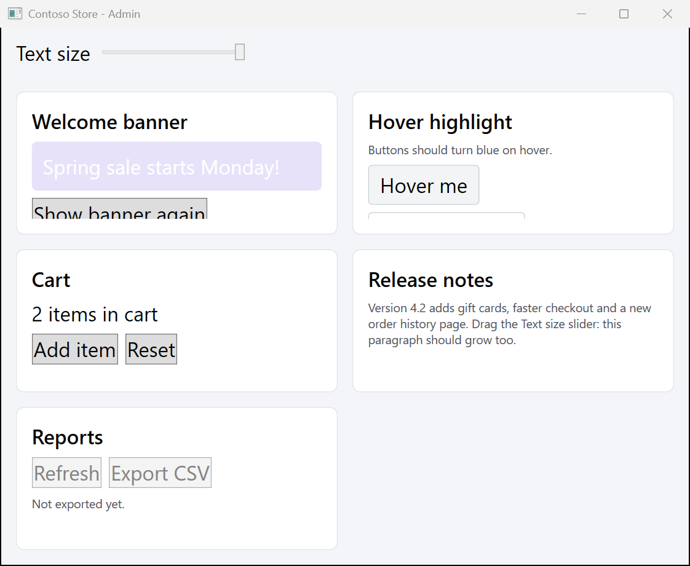
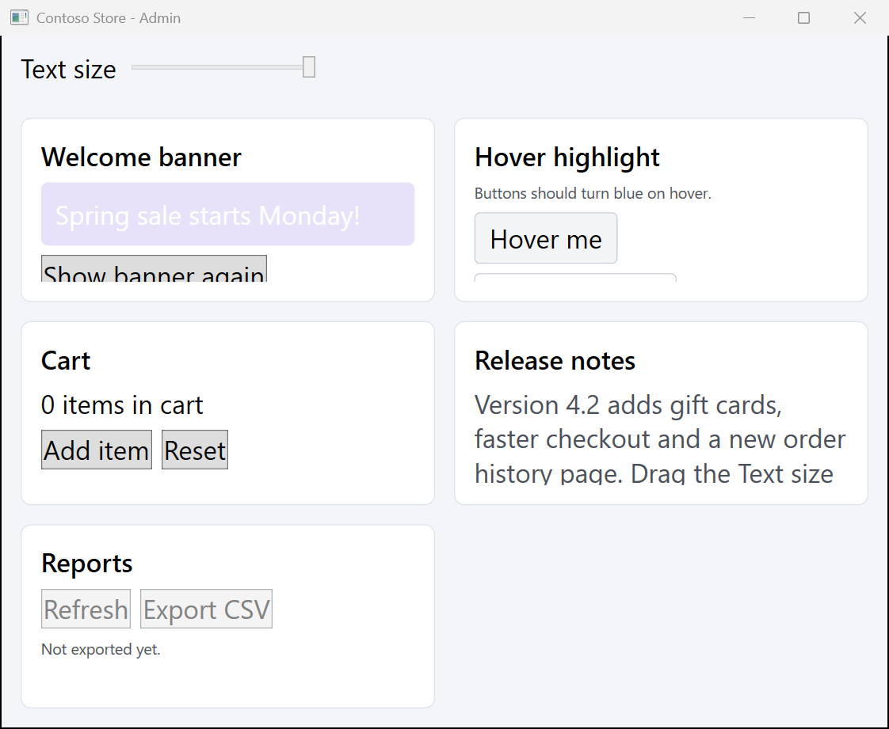

# Session transcript

Source: `Q:\source\XamlAgentDemos-notes\test-runs\PrecedenceWars\run1\events.jsonl`

## Tool usage

- xaml_explain_property_value: 14
- get_file: 6
- xaml_interact: 6
- xaml_capture_image: 4
- powershell: 3
- xaml_find_elements: 3
- skill: 2
- xaml_get_element_styles: 2
- xaml_get_hot_reload_status: 2
- xaml_apply_hot_reload: 2
- debugger_evaluate_expressions: 2
- debugger_read_file: 2
- xaml_list_apps: 1
- xaml_get_visual_tree: 1
- xaml_get_binding_failures: 1
- get_projects_in_solution: 1
- view: 1
- xaml_find_resource: 1
- xaml_get_element_properties: 1
- glob: 1
- rg: 1
- xaml_get_resource_dictionaries: 1
- multi_replace_string_in_file: 1
- xaml_get_hot_reload_log: 1
- replace_string_in_file: 1
- task: 1
- xaml_get_element_bounds: 1
- debugger_pause: 1
- debugger_get_threads: 1
- debugger_get_call_stack: 1
- read_powershell: 1
- file_search: 1
- read_agent: 1

Failed tool calls: 1, images: 3


_Model: gpt-6.1-terra_


## User (14:05:20)

Each card in my running app has a property that refuses to change. Figure out why for every card using the live app, prove it, and fix the source.


**Tool call (14:05:22):** `skill`
```json
{
 "skill": "xaml-diagnostics"
}
```

<details><summary>Result `skill` success=true</summary>

```
Skill "xaml-diagnostics" loaded successfully. Follow the instructions in the skill context.
```
</details>


_Skill invoked: xaml-diagnostics_


**Assistant (14:05:26):**

I’ll inspect the live cards and trace each blocked property to its source, then verify the fixes in the running app.


**Tool call (14:05:26):** `xaml_list_apps`
```json
{
 "progressMessage": "Inspecting connected XAML applications"
}
```

<details><summary>Result `xaml_list_apps` success=true</summary>

```
{"isDebugging":true,"diagnosticsActive":true,"apps":[{"app":"a2","name":"PrecedenceWars.exe [67548]","processId":67548,"platform":"WPF (.NET)","isRemote":false,"isDesignTimeOrNoDebug":false,"sourceInfoAvailable":true,"hotReloadSupported":true,"hotReloadEnabled":true,"supportsPropertyExplorer":true,"supportsInAppToolbar":true,"windowCount":1}]}
```
</details>


**Tool call (14:05:29):** `xaml_get_visual_tree`
```json
{
 "progressMessage": "Inspecting card layout",
 "app": "a2",
 "depth": 6,
 "maxNodes": 300
}
```


**Tool call (14:05:29):** `xaml_capture_image`
```json
{
 "progressMessage": "Viewing the running app",
 "app": "a2"
}
```


**Tool call (14:05:29):** `xaml_get_binding_failures`
```json
{
 "progressMessage": "Checking live binding failures"
}
```


**Tool call (14:05:29):** `get_projects_in_solution`
```json
{}
```

<details><summary>Result `get_projects_in_solution` success=true</summary>

```
src\GhostClicks\GhostClicks.csproj
src\GermanReady\GermanReady.csproj
src\ThemeBreaker\ThemeBreaker.csproj
src\DesignPolish\DesignPolish.csproj
src\HotReloadDoctor\HotReloadDoctor.csproj
src\VanishingSave\VanishingSave.csproj
src\CrispPixels\CrispPixels.csproj
src\PrecedenceWars\PrecedenceWars.csproj
src\LostWindows\LostWindows.csproj
src\TemplateDetective\TemplateDetective.csproj
src\SlowScroll\SlowScroll.csproj
src\PixelPerfect\PixelPerfect.csproj
src\BindingStorm\BindingStorm.csproj
src\BugRepro\BugRepro.csproj
src\A11ySweep\A11ySweep.csproj
src\StyleMaze\StyleMaze.csproj
src\ResponsiveDashboard\ResponsiveDashboard.csproj

```
</details>

<details><summary>Result `xaml_get_binding_failures` success=true</summary>

```
{"note":"This is a cumulative log since debugging started or the last xaml_clear_binding_failures, not live state: fixed failures stay listed. To verify a fix: clear, revisit the UI that uses the binding, then read again. Failures without a file usually come from bindings created in code.","totalUnique":0,"matched":0,"truncated":false,"failures":[]}
```
</details>

<details><summary>Result `xaml_get_visual_tree` success=true</summary>

```
{"app":"a2","platform":"WPF (.NET)","sourceInfoAvailable":true,"nodeCount":37,"truncated":false,"depthLimitedNodes":7,"hint":"7 node(s) have children beyond the requested depth (childCount > 0, no children listed). Raise depth or pass rootElementId to expand them.","nodes":[{"id":"a2:10","type":"PrecedenceWars.MainWindow","source":{"file":"Q:\\source\\XamlAgentDemos\\src\\PrecedenceWars\\MainWindow.xaml","line":3,"column":9},"childCount":1,"children":[{"id":"a2:11","type":"System.Windows.Controls.Border","childCount":1,"children":[{"id":"a2:12","type":"System.Windows.Documents.AdornerDecorator","childCount":2,"children":[{"id":"a2:13","type":"System.Windows.Controls.ContentPresenter","childCount":1,"children":[{"id":"a2:15","type":"System.Windows.Controls.DockPanel","source":{"file":"Q:\\source\\XamlAgentDemos\\src\\PrecedenceWars\\MainWindow.xaml","line":53,"column":6},"childCount":2,"children":[{"id":"a2:16","type":"System.Windows.Controls.StackPanel","source":{"file":"Q:\\source\\XamlAgentDemos\\src\\PrecedenceWars\\MainWindow.xaml","line":54,"column":10},"childCount":2,"children":[{"id":"a2:18","type":"System.Windows.Controls.TextBlock","source":{"file":"Q:\\source\\XamlAgentDemos\\src\\PrecedenceWars\\MainWindow.xaml","line":57,"column":14},"childCount":0},{"id":"a2:19","type":"System.Windows.Controls.Slider","name":"TextSizeSlider","source":{"file":"Q:\\source\\XamlAgentDemos\\src\\PrecedenceWars\\MainWindow.xaml","line":58,"column":14},"childCount":1,"children":[{"id":"a2:25","type":"System.Windows.Controls.Border","name":"border","childCount":1,"children":[{"id":"a2:31","type":"System.Windows.Controls.Grid","childCount":4}]}]}]},{"id":"a2:17","type":"System.Windows.Controls.Primitives.UniformGrid","source":{"file":"Q:\\source\\XamlAgentDemos\\src\\PrecedenceWars\\MainWindow.xaml","line":67,"column":10},"childCount":5,"children":[{"id":"a2:20","type":"System.Windows.Controls.Border","source":{"file":"Q:\\source\\XamlAgentDemos\\src\\PrecedenceWars\\MainWindow.xaml","line":69,"column":14},"childCount":1,"children":[{"id":"a2:26","type":"System.Windows.Controls.StackPanel","source":{"file":"Q:\\source\\XamlAgentDemos\\src\\PrecedenceWars\\MainWindow.xaml","line":70,"column":18},"childCount":3,"children":[{"id":"a2:32","type":"System.Windows.Controls.TextBlock","source":{"file":"Q:\\source\\XamlAgentDemos\\src\\PrecedenceWars\\MainWindow.xaml","line":71,"column":22},"childCount":0},{"id":"a2:33","type":"System.Windows.Controls.Border","name":"WelcomeBa
... [truncated 4248 chars]
```
</details>


<details><summary>Result `xaml_capture_image` success=true</summary>

```
Screenshot of window 0x15B0C68 "Contoso Store - Admin" of app a2 (1122x921).
```
</details>


**Tool call (14:05:36):** `get_file`
```json
{
 "filename": "Q:\\source\\XamlAgentDemos\\src\\PrecedenceWars\\MainWindow.xaml",
 "startLine": 1,
 "endLine": 200
}
```


**Tool call (14:05:36):** `get_file`
```json
{
 "filename": "Q:\\source\\XamlAgentDemos\\src\\PrecedenceWars\\MainWindow.xaml.cs",
 "startLine": 1,
 "endLine": 250
}
```


**Tool call (14:05:36):** `view`
```json
{
 "path": "c:\\vs\\fastmain\\common7\\ide\\commonextensions\\microsoft\\xamldiagnostics\\AgentTools\\skills\\xaml-diagnostics\\references\\xaml-authoring.md"
}
```


**Tool call (14:05:36):** `powershell`
```json
{
 "command": "git status --short; Get-ChildItem src\\PrecedenceWars",
 "description": "Inspect project files and working tree"
}
```


**Tool call (14:05:36):** `xaml_explain_property_value`
```json
{
 "progressMessage": "Tracing banner visibility",
 "elementId": "a2:33",
 "propertyName": "Opacity"
}
```


**Tool call (14:05:36):** `xaml_explain_property_value`
```json
{
 "progressMessage": "Tracing hover button background",
 "elementId": "a2:37",
 "propertyName": "Background"
}
```


**Tool call (14:05:36):** `xaml_explain_property_value`
```json
{
 "progressMessage": "Tracing cart text",
 "elementId": "a2:40",
 "propertyName": "Text"
}
```


**Tool call (14:05:36):** `xaml_explain_property_value`
```json
{
 "progressMessage": "Tracing release note font size",
 "elementId": "a2:43",
 "propertyName": "FontSize"
}
```


**Tool call (14:05:36):** `xaml_explain_property_value`
```json
{
 "progressMessage": "Tracing reports toolbar state",
 "elementId": "a2:45",
 "propertyName": "IsEnabled"
}
```

<details><summary>Result `view` success=true</summary>

```
# XAML authoring guidance

Follow these rules when writing or changing XAML so it works well with XAML Hot Reload, the XAML designer, and XAML Diagnostics.

## Design-time data

- Declare `xmlns:d="http://schemas.microsoft.com/expression/blend/2008"` and `xmlns:mc="http://schemas.openxmlformats.org/markup-compatibility/2006"` with `mc:Ignorable="d"`.
- Use `d:DataContext="{d:DesignInstance Type=vm:MyViewModel, IsDesignTimeCreatable=False}"` (WPF/UWP) so the designer and IntelliSense know binding paths.
- Use `d:` properties (for example `d:Text="Sample"`) for sample values that appear only at design time.
- .NET MAUI: set `x:DataType` on pages and `DataTemplate`s. It enables compiled bindings and turns many binding failures into build errors.
- WinUI/UWP: prefer `x:Bind` for compile-time checked bindings when the view owns the view model.

## Bindings

- Bind with explicit paths. Avoid string-built paths in code-behind.
- Keep the `DataContext` chain simple. Use `ElementName` or `RelativeSource` only at real scope boundaries (for example inside a `DataTemplate` that needs the page's view model).
- Expose bound properties as public properties that raise `PropertyChanged`. Fields and non-public properties don't bind.
- Use `FallbackValue` and `TargetNullValue` for expected missing values instead of hiding binding errors.

## Hot reload and designer friendly code

- Keep control and page constructors cheap. Don't call services, open files, or start network calls in constructors or `InitializeComponent` paths. The designer and hot reload create instances again.
- Keep a public parameterless constructor on custom controls.
- Guard runtime-only work with `DesignerProperties.GetIsInDesignMode(this)` (WPF) or `Windows.ApplicationModel.DesignMode.DesignModeEnabled` (UWP/WinUI).
- Put styles, templates, and visual states in XAML, not code-behind. Hot reload can't update UI built in code.
- Don't walk the visual tree from code-behind to change visuals. Use bindings, triggers, and visual states.
- Use `x:Name` only for elements code-behind needs. Don't rename `x:Class` while the app is running.

## Resources

- Put shared resources in `App.xaml` merged dictionaries or the closest scope that uses them.
- A `StaticResource` must be defined earlier in load order. Use `DynamicResource` (WPF) or `ThemeResource` (UWP/WinUI) for theme values that change at runtime.
- To check where a key resolves at runtime, or whether a dictionary is merged a
... [truncated 618 chars]
```
</details>

<details><summary>Result `get_file` success=true</summary>

```
```csharp src\PrecedenceWars\MainWindow.xaml.cs (Lines 1-25 of 25 total. Call tools for more if needed.)
using System.Windows;

namespace PrecedenceWars;

public partial class MainWindow : Window
{
    private readonly StoreViewModel viewModel = new();

    public MainWindow()
    {
        this.InitializeComponent();
        this.DataContext = this.viewModel;
    }

    private void OnShowBannerClick(object sender, RoutedEventArgs e)
    {
        this.WelcomeBanner.Opacity = 1;
    }

    private void OnResetClick(object sender, RoutedEventArgs e)
    {
        this.viewModel.ItemCount = 0;
        this.CountText.Text = "0 items in cart";
    }
}

```


```
</details>

<details><summary>Result `get_file` success=true</summary>

```
```xaml src\PrecedenceWars\MainWindow.xaml (Lines 1-164 of 164 total. Call tools for more if needed.)
<Window x:Class="PrecedenceWars.MainWindow"
        xmlns="http://schemas.microsoft.com/winfx/2006/xaml/presentation"
        xmlns:x="http://schemas.microsoft.com/winfx/2006/xaml"
        Title="Contoso Store - Admin"
        Width="760"
        Height="620"
        FontSize="{Binding Value, ElementName=TextSizeSlider}">
    <Window.Resources>
        <Style x:Key="CardStyle" TargetType="Border">
            <Setter Property="Background" Value="White" />
            <Setter Property="BorderBrush" Value="#E1E4EA" />
            <Setter Property="BorderThickness" Value="1" />
            <Setter Property="CornerRadius" Value="8" />
            <Setter Property="Padding" Value="16" />
            <Setter Property="Margin" Value="8" />
        </Style>

        <Style x:Key="CardTitleStyle" TargetType="TextBlock">
            <Setter Property="FontWeight" Value="SemiBold" />
            <Setter Property="Margin" Value="0,0,0,8" />
        </Style>

        <Style x:Key="BodyTextStyle" TargetType="TextBlock">
            <Setter Property="FontSize" Value="13" />
            <Setter Property="Foreground" Value="#4A4F5A" />
            <Setter Property="TextWrapping" Value="Wrap" />
        </Style>

        <Style x:Key="HoverButtonStyle" TargetType="Button">
            <Setter Property="Background" Value="White" />
            <Setter Property="Padding" Value="12,6" />
            <Setter Property="Template">
                <Setter.Value>
                    <ControlTemplate TargetType="Button">
                        <Border Padding="{TemplateBinding Padding}"
                                Background="{TemplateBinding Background}"
                                BorderBrush="#C9CED8"
                                BorderThickness="1"
                                CornerRadius="4">
                            <ContentPresenter HorizontalAlignment="Center" />
                        </Border>
                    </ControlTemplate>
                </Setter.Value>
            </Setter>
            <Style.Triggers>
                <Trigger Property="IsMouseOver" Value="True">
                    <Setter Property="Background" Value="#DCE8FF" />
                </Trigger>
            </Style.Triggers>
        </Style>
    </Window.Resources>

    <DockPanel Background="#F4F5F8">
        <StackPanel Margin
... [truncated 5586 chars]
```
</details>

<details><summary>Result `xaml_explain_property_value` success=true</summary>

```
{"id":"a2:37","type":"System.Windows.Controls.Button","property":"Background","propertyType":"System.Windows.Media.Brush","effectiveValue":"#FFF3F4F6","effectiveSource":"Local","chain":[{"kind":"Local","description":"Local value set on the element (XAML attribute, binding or code). Wins over styles, templates and inheritance.","value":"#FFF3F4F6","valueType":"System.Windows.Media.SolidColorBrush","effective":true,"sourceLocation":{"file":"Q:\\source\\XamlAgentDemos\\src\\PrecedenceWars\\MainWindow.xaml","line":103,"column":22}},{"kind":"Style","description":"Setter in an explicit (x:Key) or implicit (TargetType) Style.","targetType":"System.Windows.Controls.Button","value":"#FFFFFFFF","valueType":"System.Windows.Media.SolidColorBrush","effective":false,"sourceLocation":{"file":"Q:\\source\\XamlAgentDemos\\src\\PrecedenceWars\\MainWindow.xaml","line":29,"column":10}},{"kind":"BuiltInStyle","description":"Setter in the control's default theme style (generic.xaml or the platform theme).","targetType":"System.Windows.Controls.Primitives.ButtonBase","value":"#FFDDDDDD","valueType":"System.Windows.Media.SolidColorBrush","effective":false},{"kind":"Default","description":"The property's default value; nothing sets it.","effective":false}],"notes":["To let a style or template value apply, remove the local value (the attribute, binding or code assignment). To change it, edit that local value."]}
```
</details>

<details><summary>Result `xaml_explain_property_value` success=true</summary>

```
{"id":"a2:45","type":"System.Windows.Controls.StackPanel","property":"IsEnabled","propertyType":"System.Boolean","evaluatedValue":"False (System.Boolean)","effectiveSource":"Local","chain":[{"kind":"Local","description":"Local value set on the element (XAML attribute, binding or code). Wins over styles, templates and inheritance.","evaluatedValue":"False (System.Boolean)","valueType":"System.Windows.Data.BindingExpression","isBinding":true,"effective":true,"sourceLocation":{"file":"Q:\\source\\XamlAgentDemos\\src\\PrecedenceWars\\MainWindow.xaml","line":148,"column":22}},{"kind":"Default","description":"The property's default value; nothing sets it.","value":"True","valueType":"System.Boolean","effective":false}],"notes":["To let a style or template value apply, remove the local value (the attribute, binding or code assignment). To change it, edit that local value.","The effective value comes from a binding. If it's wrong, check xaml_get_binding_failures and the DataContext."]}
```
</details>

<details><summary>Result `xaml_explain_property_value` success=true</summary>

```
{"id":"a2:40","type":"System.Windows.Controls.TextBlock","property":"Text","propertyType":"System.String","effectiveValue":"System.Windows.Data.BindingExpression","evaluatedValue":"2 items in cart (System.String)","effectiveSource":"Local","chain":[{"kind":"Local","description":"Local value set on the element (XAML attribute, binding or code). Wins over styles, templates and inheritance.","value":"System.Windows.Data.BindingExpression","evaluatedValue":"2 items in cart (System.String)","valueType":"System.Windows.Data.BindingExpression","isBinding":true,"effective":true,"sourceLocation":{"file":"Q:\\source\\XamlAgentDemos\\src\\PrecedenceWars\\MainWindow.xaml","line":121,"column":22}},{"kind":"Default","description":"The property's default value; nothing sets it.","value":"","valueType":"System.String","effective":false}],"notes":["To let a style or template value apply, remove the local value (the attribute, binding or code assignment). To change it, edit that local value.","The effective value comes from a binding. If it's wrong, check xaml_get_binding_failures and the DataContext."]}
```
</details>

<details><summary>Result `xaml_explain_property_value` success=true</summary>

```
{"id":"a2:33","type":"System.Windows.Controls.Border","property":"Opacity","propertyType":"System.Double","effectiveValue":"0.15000000000000002","effectiveSource":"Animation","chain":[{"kind":"Animation","description":"An active animation (Storyboard or VisualState). It overrides local and style values while it holds the value.","value":"0.15000000000000002","valueType":"System.Double","effective":true},{"kind":"Default","description":"The property's default value; nothing sets it.","value":"1","valueType":"System.Double","effective":false}],"notes":["Find the Storyboard or VisualState that animates this property; local and style changes have no visible effect while it holds the value (FillBehavior=HoldEnd is common)."]}
```
</details>

<details><summary>Result `xaml_explain_property_value` success=true</summary>

```
{"id":"a2:43","type":"System.Windows.Controls.TextBlock","property":"FontSize","propertyType":"System.Double","effectiveValue":"13","effectiveSource":"Style","chain":[{"kind":"Style","description":"Setter in an explicit (x:Key) or implicit (TargetType) Style.","targetType":"System.Windows.Controls.TextBlock","value":"13","valueType":"System.Double","effective":true,"sourceLocation":{"file":"Q:\\source\\XamlAgentDemos\\src\\PrecedenceWars\\MainWindow.xaml","line":23,"column":10}},{"kind":"Default","description":"The property's default value; nothing sets it.","value":"12","valueType":"System.Double","effective":false}],"notes":["Edit the setter or trigger at the source location, or set a local value to override it for this element only."]}
```
</details>

<details><summary>Result `powershell` success=true</summary>

```
Directory: Q:\source\XamlAgentDemos\src\PrecedenceWars

Mode                 LastWriteTime         Length Name
----                 -------------         ------ ----
d----          11/13/2026  1:15 PM                bin
d----          11/13/2026  1:15 PM                obj
-a---          11/12/2026  5:14 PM            238 App.xaml
-a---          11/12/2026  5:14 PM            245 App.xaml.cs
-a---          11/12/2026  5:15 PM           7972 MainWindow.xaml
-a---          11/12/2026  5:15 PM            577 MainWindow.xaml.cs
-a---          11/12/2026  5:14 PM            137 PrecedenceWars.csproj
-a---          11/12/2026  5:15 PM           1738 StoreViewModel.cs
<shellId: 3 completed with exit code 0>
```
</details>


**Tool call (14:05:41):** `get_file`
```json
{
 "filename": "Q:\\source\\XamlAgentDemos\\src\\PrecedenceWars\\StoreViewModel.cs",
 "startLine": 1,
 "endLine": 250
}
```


**Tool call (14:05:41):** `xaml_find_elements`
```json
{
 "progressMessage": "Finding card controls",
 "app": "a2",
 "type": "Button",
 "maxResults": 100
}
```


**Tool call (14:05:41):** `xaml_interact`
```json
{
 "progressMessage": "Testing banner restore",
 "elementId": "a2:34",
 "action": "invoke"
}
```


**Tool call (14:05:41):** `xaml_explain_property_value`
```json
{
 "progressMessage": "Tracing report button enablement",
 "elementId": "a2:45",
 "propertyName": "IsEnabled"
}
```


**Tool call (14:05:41):** `xaml_get_element_styles`
```json
{
 "progressMessage": "Inspecting hover styles",
 "elementId": "a2:37"
}
```


**Tool call (14:05:41):** `xaml_interact`
```json
{
 "progressMessage": "Testing font size control",
 "elementId": "a2:19",
 "action": "setValue",
 "value": "22"
}
```

<details><summary>Result `xaml_find_elements` success=true</summary>

```
{"count":7,"truncated":false,"results":[{"id":"a2:34","type":"System.Windows.Controls.Button","name":"ShowBannerButton","source":{"file":"Q:\\source\\XamlAgentDemos\\src\\PrecedenceWars\\MainWindow.xaml","line":90,"column":22},"path":"MainWindow/Border/AdornerDecorator/ContentPresenter/DockPanel/UniformGrid/Border/StackPanel/Button"},{"id":"a2:37","type":"System.Windows.Controls.Button","name":"HoverButton","source":{"file":"Q:\\source\\XamlAgentDemos\\src\\PrecedenceWars\\MainWindow.xaml","line":103,"column":22},"path":"MainWindow/Border/AdornerDecorator/ContentPresenter/DockPanel/UniformGrid/Border/StackPanel/Button"},{"id":"a2:38","type":"System.Windows.Controls.Button","name":"HoverButtonOk","source":{"file":"Q:\\source\\XamlAgentDemos\\src\\PrecedenceWars\\MainWindow.xaml","line":109,"column":22},"path":"MainWindow/Border/AdornerDecorator/ContentPresenter/DockPanel/UniformGrid/Border/StackPanel/Button"},{"id":"a2:55","type":"System.Windows.Controls.Button","name":"AddButton","source":{"file":"Q:\\source\\XamlAgentDemos\\src\\PrecedenceWars\\MainWindow.xaml","line":123,"column":26},"path":"MainWindow/Border/AdornerDecorator/ContentPresenter/DockPanel/UniformGrid/Border/StackPanel/StackPanel/Button"},{"id":"a2:56","type":"System.Windows.Controls.Button","name":"ResetButton","source":{"file":"Q:\\source\\XamlAgentDemos\\src\\PrecedenceWars\\MainWindow.xaml","line":126,"column":26},"path":"MainWindow/Border/AdornerDecorator/ContentPresenter/DockPanel/UniformGrid/Border/StackPanel/StackPanel/Button"},{"id":"a2:57","type":"System.Windows.Controls.Button","name":"RefreshButton","source":{"file":"Q:\\source\\XamlAgentDemos\\src\\PrecedenceWars\\MainWindow.xaml","line":151,"column":26},"path":"MainWindow/Border/AdornerDecorator/ContentPresenter/DockPanel/UniformGrid/Border/StackPanel/StackPanel/Button"},{"id":"a2:58","type":"System.Windows.Controls.Button","name":"ExportButton","source":{"file":"Q:\\source\\XamlAgentDemos\\src\\PrecedenceWars\\MainWindow.xaml","line":152,"column":26},"path":"MainWindow/Border/AdornerDecorator/ContentPresenter/DockPanel/UniformGrid/Border/StackPanel/StackPanel/Button"}]}
```
</details>

<details><summary>Result `get_file` success=true</summary>

```
```csharp src\PrecedenceWars\StoreViewModel.cs (Lines 1-69 of 69 total. Call tools for more if needed.)
using System.Diagnostics;

namespace PrecedenceWars;

public sealed class StoreViewModel : ObservableObject
{
    private int itemCount = 2;
    private bool isBusy;
    private string lastExport = "Not exported yet.";

    public StoreViewModel()
    {
        this.AddItemCommand = new RelayCommand(() => this.ItemCount++);
        this.ExportCommand = new RelayCommand(() => this.LastExport = $"Exported at {DateTime.Now:t}.", () => true);
        this.SyncCatalog();
    }

    public RelayCommand AddItemCommand { get; }

    public RelayCommand ExportCommand { get; }

    public int ItemCount
    {
        get => this.itemCount;
        set => this.SetProperty(ref this.itemCount, value);
    }

    public bool IsBusy
    {
        get => this.isBusy;
        private set
        {
            if (this.SetProperty(ref this.isBusy, value))
            {
                this.OnPropertyChanged(nameof(this.IsIdle));
            }
        }
    }

    public bool IsIdle => !this.IsBusy;

    public string LastExport
    {
        get => this.lastExport;
        private set => this.SetProperty(ref this.lastExport, value);
    }

    private void SyncCatalog()
    {
        this.IsBusy = true;
        try
        {
            if (this.IsOffline())
            {
                throw new TimeoutException("Catalog service didn't respond.");
            }
        }
        catch (TimeoutException ex)
        {
            Debug.WriteLine($"Catalog sync failed: {ex.Message}");
            return;
        }

        this.IsBusy = false;
    }

    // Simulates the offline case: the catalog service isn't reachable.
    private bool IsOffline() => true;
}

```


```
</details>

<details><summary>Result `xaml_explain_property_value` success=true</summary>

```
{"id":"a2:45","type":"System.Windows.Controls.StackPanel","property":"IsEnabled","propertyType":"System.Boolean","evaluatedValue":"False (System.Boolean)","effectiveSource":"Local","chain":[{"kind":"Local","description":"Local value set on the element (XAML attribute, binding or code). Wins over styles, templates and inheritance.","evaluatedValue":"False (System.Boolean)","valueType":"System.Windows.Data.BindingExpression","isBinding":true,"effective":true,"sourceLocation":{"file":"Q:\\source\\XamlAgentDemos\\src\\PrecedenceWars\\MainWindow.xaml","line":148,"column":22}},{"kind":"Default","description":"The property's default value; nothing sets it.","value":"True","valueType":"System.Boolean","effective":false}],"notes":["To let a style or template value apply, remove the local value (the attribute, binding or code assignment). To change it, edit that local value.","The effective value comes from a binding. If it's wrong, check xaml_get_binding_failures and the DataContext."]}
```
</details>

<details><summary>Result `xaml_get_element_styles` success=true</summary>

```
{"id":"a2:37","type":"System.Windows.Controls.Button","name":"HoverButton","source":{"file":"Q:\\source\\XamlAgentDemos\\src\\PrecedenceWars\\MainWindow.xaml","line":103,"column":22},"styleProperty":{"value":"System.Windows.Style","valueSource":"Local","location":{"file":"Q:\\source\\XamlAgentDemos\\src\\PrecedenceWars\\MainWindow.xaml","line":103,"column":22}},"templateProperty":{"value":"System.Windows.Controls.ControlTemplate","valueSource":"Style","location":{"file":"Q:\\source\\XamlAgentDemos\\src\\PrecedenceWars\\MainWindow.xaml","line":29,"column":10}},"styles":[{"kind":"Style","description":"Setter in an explicit (x:Key) or implicit (TargetType) Style.","targetType":"System.Windows.Controls.Button","location":{"file":"Q:\\source\\XamlAgentDemos\\src\\PrecedenceWars\\MainWindow.xaml","line":29,"column":10},"setters":[{"property":"Background","value":"#FFFFFFFF","effective":false,"overriddenBy":"Local"},{"property":"Padding","value":"12,6,12,6","effective":true},{"property":"Template","value":"System.Windows.Controls.ControlTemplate","effective":true,"valueLocation":{"file":"Q:\\source\\XamlAgentDemos\\src\\PrecedenceWars\\MainWindow.xaml","line":34,"column":22}}]},{"kind":"BuiltInStyle","description":"Setter in the control's default theme style (generic.xaml or the platform theme).","targetType":"System.Windows.Controls.Primitives.ButtonBase","setters":[{"property":"Background","value":"#FFDDDDDD","effective":false,"overriddenBy":"Local"},{"property":"BorderBrush","value":"#FF707070","effective":true},{"property":"BorderThickness","value":"1,1,1,1","effective":true},{"property":"FocusVisualStyle","value":"System.Windows.Style","effective":true},{"property":"Foreground","effective":true},{"property":"HorizontalContentAlignment","value":"1","effective":true},{"property":"Padding","value":"1,1,1,1","effective":false,"overriddenBy":"Style (System.Windows.Controls.Button)"},{"property":"Template","value":"System.Windows.Controls.ControlTemplate","effective":false,"overriddenBy":"Style (System.Windows.Controls.Button)"},{"property":"VerticalContentAlignment","value":"1","effective":true}]}],"hint":"Styles are listed in precedence order, highest first. 'effective=false' setters lose to 'overriddenBy'. Use xaml_find_resource to see where a style or resource key resolves."}
```
</details>

<details><summary>Result `xaml_interact` success=true</summary>

```
{"id":"a2:34","action":"invoke","result":"Invoked.","supportedPatterns":["Invoke","SynchronizedInput"],"note":"Call xaml_capture_image or xaml_get_element_properties to verify the effect."}
```
</details>

<details><summary>Result `xaml_interact` success=true</summary>

```
{"id":"a2:19","action":"setValue","result":"Value is now 22.","supportedPatterns":["RangeValue","SynchronizedInput"],"note":"Call xaml_capture_image or xaml_get_element_properties to verify the effect."}
```
</details>


**Tool call (14:05:46):** `xaml_explain_property_value`
```json
{
 "progressMessage": "Verifying banner restore failure",
 "elementId": "a2:33",
 "propertyName": "Opacity"
}
```


**Tool call (14:05:46):** `xaml_explain_property_value`
```json
{
 "progressMessage": "Verifying slider effect",
 "elementId": "a2:43",
 "propertyName": "FontSize"
}
```


**Tool call (14:05:46):** `xaml_explain_property_value`
```json
{
 "progressMessage": "Tracing export enablement",
 "elementId": "a2:58",
 "propertyName": "IsEnabled"
}
```


**Tool call (14:05:46):** `xaml_interact`
```json
{
 "progressMessage": "Reproducing cart reset",
 "elementId": "a2:56",
 "action": "invoke"
}
```


**Tool call (14:05:46):** `xaml_find_resource`
```json
{
 "progressMessage": "Inspecting hover resource",
 "elementId": "a2:37",
 "key": "HoverButtonStyle"
}
```


**Tool call (14:05:46):** `xaml_capture_image`
```json
{
 "progressMessage": "Checking initial failures visually",
 "app": "a2"
}
```

<details><summary>Result `xaml_explain_property_value` success=true</summary>

```
{"id":"a2:43","type":"System.Windows.Controls.TextBlock","property":"FontSize","propertyType":"System.Double","effectiveValue":"13","effectiveSource":"Style","chain":[{"kind":"Style","description":"Setter in an explicit (x:Key) or implicit (TargetType) Style.","targetType":"System.Windows.Controls.TextBlock","value":"13","valueType":"System.Double","effective":true,"sourceLocation":{"file":"Q:\\source\\XamlAgentDemos\\src\\PrecedenceWars\\MainWindow.xaml","line":23,"column":10}},{"kind":"Default","description":"The property's default value; nothing sets it.","value":"12","valueType":"System.Double","effective":false}],"notes":["Edit the setter or trigger at the source location, or set a local value to override it for this element only."]}
```
</details>

<details><summary>Result `xaml_explain_property_value` success=true</summary>

```
{"id":"a2:33","type":"System.Windows.Controls.Border","property":"Opacity","propertyType":"System.Double","effectiveValue":"0.15000000000000002","effectiveSource":"Animation","chain":[{"kind":"Animation","description":"An active animation (Storyboard or VisualState). It overrides local and style values while it holds the value.","value":"0.15000000000000002","valueType":"System.Double","effective":true},{"kind":"Local","description":"Local value set on the element (XAML attribute, binding or code). Wins over styles, templates and inheritance.","value":"1","valueType":"System.Double","effective":false,"sourceLocation":{"file":"Q:\\source\\XamlAgentDemos\\src\\PrecedenceWars\\MainWindow.xaml","line":72,"column":22}},{"kind":"Default","description":"The property's default value; nothing sets it.","value":"1","valueType":"System.Double","effective":false}],"notes":["Find the Storyboard or VisualState that animates this property; local and style changes have no visible effect while it holds the value (FillBehavior=HoldEnd is common)."]}
```
</details>

<details><summary>Result `xaml_explain_property_value` success=true</summary>

```
{"id":"a2:58","type":"System.Windows.Controls.Button","property":"IsEnabled","propertyType":"System.Boolean","effectiveValue":"False","effectiveSource":"Coercion","chain":[{"kind":"Coercion","description":"The control coerced the value (for example clamped to a minimum or maximum).","value":"False","valueType":"System.Boolean","effective":true},{"kind":"Default","description":"The property's default value; nothing sets it.","value":"True","valueType":"System.Boolean","effective":false}],"notes":["Check related properties that constrain this one (for example Minimum/Maximum or MinWidth/MaxWidth)."]}
```
</details>

<details><summary>Result `xaml_find_resource` success=true</summary>

```
{"app":"a2","scope":"a2:37","key":"HoverButtonStyle","found":true,"definitions":[{"effective":true,"key":"HoverButtonStyle","scope":"Element","owner":{"id":"a2:10","source":{"file":"Q:\\source\\XamlAgentDemos\\src\\PrecedenceWars\\MainWindow.xaml","line":3,"column":9}},"ownerType":"PrecedenceWars.MainWindow","dictionaryPath":"Element","valueType":"System.Windows.Style","value":"Style TargetType=System.Windows.Controls.Button Setters=3","location":{"file":"Q:\\source\\XamlAgentDemos\\src\\PrecedenceWars\\MainWindow.xaml","line":29,"column":10}}],"hint":"Edit the definition at 'location' (or in 'dictionarySource') to change this resource."}
```
</details>

<details><summary>Result `xaml_interact` success=true</summary>

```
{"id":"a2:56","action":"invoke","result":"Invoked.","supportedPatterns":["Invoke","SynchronizedInput"],"note":"Call xaml_capture_image or xaml_get_element_properties to verify the effect."}
```
</details>




<details><summary>Result `xaml_capture_image` success=true</summary>

```
Screenshot of window 0x15B0C68 "Contoso Store - Admin" of app a2 (1122x921).
```
</details>


**Tool call (14:05:50):** `xaml_interact`
```json
{
 "progressMessage": "Testing cart after reset",
 "elementId": "a2:55",
 "action": "invoke"
}
```

<details><summary>Result `xaml_interact` success=true</summary>

```
{"id":"a2:55","action":"invoke","result":"Invoked.","supportedPatterns":["Invoke","SynchronizedInput"],"note":"Call xaml_capture_image or xaml_get_element_properties to verify the effect."}
```
</details>


**Tool call (14:05:55):** `xaml_explain_property_value`
```json
{
 "progressMessage": "Tracing cart after reset",
 "elementId": "a2:40",
 "propertyName": "Text"
}
```


**Tool call (14:05:55):** `xaml_get_element_properties`
```json
{
 "progressMessage": "Inspecting report data context",
 "elementId": "a2:45",
 "nameFilter": "DataContext"
}
```


**Tool call (14:05:55):** `get_file`
```json
{
 "filename": "Q:\\source\\XamlAgentDemos\\src\\PrecedenceWars\\App.xaml.cs",
 "startLine": 1,
 "endLine": 120
}
```


**Tool call (14:05:55):** `get_file`
```json
{
 "filename": "Q:\\source\\XamlAgentDemos\\src\\PrecedenceWars\\PrecedenceWars.csproj",
 "startLine": 1,
 "endLine": 120
}
```


**Tool call (14:05:55):** `glob`
```json
{
 "pattern": "**\\*Precedence*"
}
```

<details><summary>Result `get_file` success=true</summary>

```
```csharp src\PrecedenceWars\App.xaml.cs (Lines 1-12 of 12 total. Call tools for more if needed.)
using System.Windows;

namespace PrecedenceWars;

public partial class App : Application
{
    protected override void OnStartup(StartupEventArgs e)
    {
        base.OnStartup(e);
        DemoHost.Initialize(this, e.Args);
    }
}

```


```
</details>

<details><summary>Result `get_file` success=true</summary>

```
``` src\PrecedenceWars\PrecedenceWars.csproj (Lines 1-5 of 5 total. Call tools for more if needed.)
<Project Sdk="Microsoft.NET.Sdk">
  <PropertyGroup>
    <RootNamespace>PrecedenceWars</RootNamespace>
  </PropertyGroup>
</Project>

```


```
</details>

<details><summary>Result `xaml_get_element_properties` success=true</summary>

```
{"id":"a2:45","type":"System.Windows.Controls.StackPanel","name":"ToolbarPanel","source":{"file":"Q:\\source\\XamlAgentDemos\\src\\PrecedenceWars\\MainWindow.xaml","line":148,"column":22},"properties":[{"name":"DataContext","valueType":"PrecedenceWars.StoreViewModel","propertyType":"System.Object","declaringType":"System.Windows.FrameworkElement","valueSource":"Inherited"}],"hiddenDefaultOrOverridden":1,"hint":"Default and overridden values were omitted. Pass includeAll=true to see them, or call xaml_explain_property_value for one property's full precedence chain."}
```
</details>

<details><summary>Result `xaml_explain_property_value` success=true</summary>

```
{"id":"a2:40","type":"System.Windows.Controls.TextBlock","property":"Text","propertyType":"System.String","effectiveValue":"0 items in cart","effectiveSource":"Local","chain":[{"kind":"Local","description":"Local value set on the element (XAML attribute, binding or code). Wins over styles, templates and inheritance.","value":"0 items in cart","valueType":"System.String","effective":true,"sourceLocation":{"file":"Q:\\source\\XamlAgentDemos\\src\\PrecedenceWars\\MainWindow.xaml","line":121,"column":22}},{"kind":"Default","description":"The property's default value; nothing sets it.","value":"","valueType":"System.String","effective":false}],"notes":["To let a style or template value apply, remove the local value (the attribute, binding or code assignment). To change it, edit that local value."]}
```
</details>

<details><summary>Result `glob` success=true</summary>

```
.\src\PrecedenceWars\PrecedenceWars.csproj
```
</details>


**Assistant (14:06:04):**

The live app shows five different causes: an animation, a local style override, a replaced binding, a font-size setter, and a busy state left set after a timeout. I’ll fix each at its source and retest the affected controls.


**Tool call (14:06:04):** `rg`
```json
{
 "pattern": "class (ObservableObject|RelayCommand)",
 "glob": "*.cs",
 "output_mode": "content",
 "-n": true
}
```


**Tool call (14:06:04):** `get_file`
```json
{
 "filename": "Q:\\source\\XamlAgentDemos\\src\\PrecedenceWars\\MainWindow.xaml",
 "startLine": 19,
 "endLine": 52
}
```


**Tool call (14:06:04):** `xaml_get_hot_reload_status`
```json
{
 "progressMessage": "Checking hot reload availability"
}
```


**Tool call (14:06:04):** `xaml_get_resource_dictionaries`
```json
{
 "progressMessage": "Checking live style resources",
 "elementId": "a2:37",
 "includeKeys": false
}
```

<details><summary>Result `xaml_get_hot_reload_status` success=true</summary>

```
{"options":{"hotReloadEnabled":true,"hotReloadOnSave":false,"wpfEnabled":true,"uwpEnabled":true,"winUIEnabled":true,"mauiEnabled":true,"justMyXaml":true,"previewSelectedElement":false,"inAppToolbar":true,"inAppSelection":false,"layoutAdorners":false,"trackFocusedElement":false,"bindingFailuresVisible":true,"compatibilityMode":false},"dotNetHotReloadEnabled":true,"isProcessingChanges":false,"apps":[{"app":"a2","platform":"WPF (.NET)","hotReloadSupported":true,"hotReloadEnabled":true,"sourceInfoAvailable":true}],"errors":[]}
```
</details>

<details><summary>Result `get_file` success=true</summary>

```
```xaml src\PrecedenceWars\MainWindow.xaml (Lines 19-52 of 164 total. Call tools for more if needed.)
            <Setter Property="FontWeight" Value="SemiBold" />
            <Setter Property="Margin" Value="0,0,0,8" />
        </Style>

        <Style x:Key="BodyTextStyle" TargetType="TextBlock">
            <Setter Property="FontSize" Value="13" />
            <Setter Property="Foreground" Value="#4A4F5A" />
            <Setter Property="TextWrapping" Value="Wrap" />
        </Style>

        <Style x:Key="HoverButtonStyle" TargetType="Button">
            <Setter Property="Background" Value="White" />
            <Setter Property="Padding" Value="12,6" />
            <Setter Property="Template">
                <Setter.Value>
                    <ControlTemplate TargetType="Button">
                        <Border Padding="{TemplateBinding Padding}"
                                Background="{TemplateBinding Background}"
                                BorderBrush="#C9CED8"
                                BorderThickness="1"
                                CornerRadius="4">
                            <ContentPresenter HorizontalAlignment="Center" />
                        </Border>
                    </ControlTemplate>
                </Setter.Value>
            </Setter>
            <Style.Triggers>
                <Trigger Property="IsMouseOver" Value="True">
                    <Setter Property="Background" Value="#DCE8FF" />
                </Trigger>
            </Style.Triggers>
        </Style>
    </Window.Resources>


```


```
</details>

<details><summary>Result `rg` success=true</summary>

```
.\src\Shared\ObservableObject.cs:6:public abstract class ObservableObject : INotifyPropertyChanged
.\src\Shared\RelayCommand.cs:5:public sealed class RelayCommand(Action execute, Func<bool>? canExecute = null) : ICommand
```
</details>

<details><summary>Result `xaml_get_resource_dictionaries` success=true</summary>

```
{"app":"a2","scope":"a2:37","note":"Scopes are in lookup order (closest first). Within a dictionary, own keys win over theme dictionaries, then merged dictionaries from last to first.","scopes":[{"scope":"Element","owner":{"id":"a2:10","source":{"file":"Q:\\source\\XamlAgentDemos\\src\\PrecedenceWars\\MainWindow.xaml","line":3,"column":9}},"ownerType":"PrecedenceWars.MainWindow","dictionary":{"path":"Element","type":"System.Windows.ResourceDictionary","keyCount":4}},{"scope":"Application","ownerType":"PrecedenceWars.App","dictionary":{"path":"Application","type":"System.Windows.ResourceDictionary","keyCount":0}}]}
```
</details>


**Tool call (14:06:16):** `multi_replace_string_in_file`
```json
{
 "explanation": "Remove precedence conflicts and restore the busy state after a failed catalog sync.",
 "replacements": [
  {
   "filePath": "src\\PrecedenceWars\\MainWindow.xaml",
   "oldString": "                    <Button x:Name=\"HoverButton\"\n                            Margin=\"0,8,0,0\"\n                            HorizontalAlignment=\"Left\"\n                            Background=\"#F3F4F6\"\n                            Content=\"Hover me\"\n                            Style=\"{StaticResource HoverButtonStyle}\" />\n                    <Button x:Name=\"HoverButtonOk\"",
   "newString": "                    <Button x:Name=\"HoverButton\"\n                            Margin=\"0,8,0,0\"\n                            HorizontalAlignment=\"Left\"\n                            Content=\"Hover me\">\n                        <Button.Style>\n                            <Style BasedOn=\"{StaticResource HoverButtonStyle}\" TargetType=\"Button\">\n                                <Setter Property=\"Background\" Value=\"#F3F4F6\" />\n                            </Style>\n                        </Button.Style>\n                    </Button>\n                    <Button x:Name=\"HoverButtonOk\"",
   "explanation": "Keep the gray base color as a style setter so the inherited hover trigger can override it."
  },
  {
   "filePath": "src\\PrecedenceWars\\MainWindow.xaml",
   "oldString": "                    <TextBlock Style=\"{StaticResource CardTitleStyle}\" Text=\"Release notes\"
... [truncated 2651 chars]
```

<details><summary>Result `multi_replace_string_in_file` success=true</summary>

```
Successfully applied 4 of 4 replacement(s) across 3 file(s).
```
</details>


**Tool call (14:06:21):** `xaml_apply_hot_reload`
```json
{
 "progressMessage": "Applying fixes to the running app",
 "includeCodeChanges": true
}
```

<details><summary>Result `xaml_apply_hot_reload` success=true</summary>

```
{"applied":true,"errors":[],"log":[],"codeChanges":".NET Hot Reload was started for saved code changes. Its results are in the Hot Reload output pane, not in 'log'; if an edit can't be hot reloaded, Visual Studio asks the user to rebuild and restart.","codeHotReloadOutput":[],"hint":"Call xaml_capture_image to verify the change visually. Views that aren't loaded (other tabs, closed dialogs) are updated when they're next shown. Source line numbers reported for existing elements can still point to the pre-edit lines until the element is recreated, so find elements by x:Name or type rather than by an old line number."}
```
</details>


**Tool call (14:06:30):** `xaml_capture_image`
```json
{
 "progressMessage": "Inspecting applied fixes",
 "app": "a2"
}
```


**Tool call (14:06:30):** `xaml_find_elements`
```json
{
 "progressMessage": "Finding refreshed card controls",
 "app": "a2",
 "type": "Button",
 "maxResults": 100
}
```


**Tool call (14:06:30):** `xaml_find_elements`
```json
{
 "progressMessage": "Finding refreshed text elements",
 "app": "a2",
 "type": "TextBlock",
 "maxResults": 100
}
```


**Tool call (14:06:30):** `xaml_get_hot_reload_log`
```json
{
 "progressMessage": "Checking hot reload results",
 "maxEntries": 100
}
```


**Tool call (14:06:30):** `xaml_get_hot_reload_status`
```json
{
 "progressMessage": "Checking hot reload status"
}
```

<details><summary>Result `xaml_find_elements` success=true</summary>

```
{"count":7,"truncated":false,"results":[{"id":"a2:34","type":"System.Windows.Controls.Button","name":"ShowBannerButton","source":{"file":"Q:\\source\\XamlAgentDemos\\src\\PrecedenceWars\\MainWindow.xaml","line":90,"column":22},"path":"MainWindow/Border/AdornerDecorator/ContentPresenter/DockPanel/UniformGrid/Border/StackPanel/Button"},{"id":"a2:37","type":"System.Windows.Controls.Button","name":"HoverButton","source":{"file":"Q:\\source\\XamlAgentDemos\\src\\PrecedenceWars\\MainWindow.xaml","line":103,"column":22},"path":"MainWindow/Border/AdornerDecorator/ContentPresenter/DockPanel/UniformGrid/Border/StackPanel/Button"},{"id":"a2:38","type":"System.Windows.Controls.Button","name":"HoverButtonOk","source":{"file":"Q:\\source\\XamlAgentDemos\\src\\PrecedenceWars\\MainWindow.xaml","line":109,"column":22},"path":"MainWindow/Border/AdornerDecorator/ContentPresenter/DockPanel/UniformGrid/Border/StackPanel/Button"},{"id":"a2:55","type":"System.Windows.Controls.Button","name":"AddButton","source":{"file":"Q:\\source\\XamlAgentDemos\\src\\PrecedenceWars\\MainWindow.xaml","line":123,"column":26},"path":"MainWindow/Border/AdornerDecorator/ContentPresenter/DockPanel/UniformGrid/Border/StackPanel/StackPanel/Button"},{"id":"a2:56","type":"System.Windows.Controls.Button","name":"ResetButton","source":{"file":"Q:\\source\\XamlAgentDemos\\src\\PrecedenceWars\\MainWindow.xaml","line":126,"column":26},"path":"MainWindow/Border/AdornerDecorator/ContentPresenter/DockPanel/UniformGrid/Border/StackPanel/StackPanel/Button"},{"id":"a2:57","type":"System.Windows.Controls.Button","name":"RefreshButton","source":{"file":"Q:\\source\\XamlAgentDemos\\src\\PrecedenceWars\\MainWindow.xaml","line":151,"column":26},"path":"MainWindow/Border/AdornerDecorator/ContentPresenter/DockPanel/UniformGrid/Border/StackPanel/StackPanel/Button"},{"id":"a2:58","type":"System.Windows.Controls.Button","name":"ExportButton","source":{"file":"Q:\\source\\XamlAgentDemos\\src\\PrecedenceWars\\MainWindow.xaml","line":152,"column":26},"path":"MainWindow/Border/AdornerDecorator/ContentPresenter/DockPanel/UniformGrid/Border/StackPanel/StackPanel/Button"}]}
```
</details>

<details><summary>Result `xaml_get_hot_reload_status` success=true</summary>

```
{"options":{"hotReloadEnabled":true,"hotReloadOnSave":false,"wpfEnabled":true,"uwpEnabled":true,"winUIEnabled":true,"mauiEnabled":true,"justMyXaml":true,"previewSelectedElement":false,"inAppToolbar":true,"inAppSelection":false,"layoutAdorners":false,"trackFocusedElement":false,"bindingFailuresVisible":true,"compatibilityMode":false},"dotNetHotReloadEnabled":true,"isProcessingChanges":false,"apps":[{"app":"a2","platform":"WPF (.NET)","hotReloadSupported":true,"hotReloadEnabled":true,"sourceInfoAvailable":true}],"errors":[]}
```
</details>

<details><summary>Result `xaml_get_hot_reload_log` success=true</summary>

```
{"total":5,"entries":[{"time":"08:48:44.661","level":"Info","project":"XAML","message":"Connected to GermanReady.exe [55480] for WpfCore diagnostics. Incremental Hot Reload is enabled."},{"time":"08:58:39.619","level":"Info","project":"XAML","message":"GermanReady.exe [55480] WpfCore diagnostics stopped."},{"time":"08:58:56.546","level":"Info","project":"XAML","message":"Connected to GermanReady.exe [45552] for WpfCore diagnostics. Incremental Hot Reload is enabled."},{"time":"09:03:09.646","level":"Info","project":"XAML","message":"GermanReady.exe [45552] WpfCore diagnostics stopped."},{"time":"09:04:41.400","level":"Info","project":"XAML","message":"Connected to PrecedenceWars.exe [67548] for WpfCore diagnostics. Incremental Hot Reload is enabled."}],"dotNetHotReloadPane":["08:48:44.66 [XAML] Connected to GermanReady.exe [55480] for WpfCore diagnostics. Incremental Hot Reload is enabled.","08:58:38.87 🔥 1> [GermanReady] ❌ Exited with error code -1","08:58:39.61 [XAML] GermanReady.exe [55480] WpfCore diagnostics stopped.","08:58:56.54 [XAML] Connected to GermanReady.exe [45552] for WpfCore diagnostics. Incremental Hot Reload is enabled.","09:03:09.29 🔥 2> [GermanReady] ❌ Exited with error code -1","09:03:09.64 [XAML] GermanReady.exe [45552] WpfCore diagnostics stopped.","09:04:41.40 [XAML] Connected to PrecedenceWars.exe [67548] for WpfCore diagnostics. Incremental Hot Reload is enabled.","09:06:23.50  Code changes were successfully applied."]}
```
</details>

<details><summary>Result `xaml_find_elements` success=true</summary>

```
{"count":18,"truncated":false,"results":[{"id":"a2:18","type":"System.Windows.Controls.TextBlock","source":{"file":"Q:\\source\\XamlAgentDemos\\src\\PrecedenceWars\\MainWindow.xaml","line":57,"column":14},"path":"MainWindow/Border/AdornerDecorator/ContentPresenter/DockPanel/StackPanel/TextBlock"},{"id":"a2:32","type":"System.Windows.Controls.TextBlock","source":{"file":"Q:\\source\\XamlAgentDemos\\src\\PrecedenceWars\\MainWindow.xaml","line":71,"column":22},"path":"MainWindow/Border/AdornerDecorator/ContentPresenter/DockPanel/UniformGrid/Border/StackPanel/TextBlock"},{"id":"a2:51","type":"System.Windows.Controls.TextBlock","source":{"file":"Q:\\source\\XamlAgentDemos\\src\\PrecedenceWars\\MainWindow.xaml","line":88,"column":26},"path":"MainWindow/Border/AdornerDecorator/ContentPresenter/DockPanel/UniformGrid/Border/StackPanel/Border/TextBlock"},{"id":"a2:74","type":"System.Windows.Controls.TextBlock","path":"MainWindow/Border/AdornerDecorator/ContentPresenter/DockPanel/UniformGrid/Border/StackPanel/Button/Border/ContentPresenter/TextBlock"},{"id":"a2:35","type":"System.Windows.Controls.TextBlock","source":{"file":"Q:\\source\\XamlAgentDemos\\src\\PrecedenceWars\\MainWindow.xaml","line":101,"column":22},"path":"MainWindow/Border/AdornerDecorator/ContentPresenter/DockPanel/UniformGrid/Border/StackPanel/TextBlock"},{"id":"a2:36","type":"System.Windows.Controls.TextBlock","source":{"file":"Q:\\source\\XamlAgentDemos\\src\\PrecedenceWars\\MainWindow.xaml","line":102,"column":22},"path":"MainWindow/Border/AdornerDecorator/ContentPresenter/DockPanel/UniformGrid/Border/StackPanel/TextBlock"},{"id":"a2:75","type":"System.Windows.Controls.TextBlock","path":"MainWindow/Border/AdornerDecorator/ContentPresenter/DockPanel/UniformGrid/Border/StackPanel/Button/Border/ContentPresenter/TextBlock"},{"id":"a2:76","type":"System.Windows.Controls.TextBlock","path":"MainWindow/Border/AdornerDecorator/ContentPresenter/DockPanel/UniformGrid/Border/StackPanel/Button/Border/ContentPresenter/TextBlock"},{"id":"a2:39","type":"System.Windows.Controls.TextBlock","source":{"file":"Q:\\source\\XamlAgentDemos\\src\\PrecedenceWars\\MainWindow.xaml","line":120,"column":22},"path":"MainWindow/Border/AdornerDecorator/ContentPresenter/DockPanel/UniformGrid/Border/StackPanel/TextBlock"},{"id":"a2:40","type":"System.Windows.Controls.TextBlock","name":"CountText","source":{"file":"Q:\\source\\XamlAgentDemos\\src\\PrecedenceWars\\MainWindow.xaml","line":121,"column":22},"path":"MainWindow/Border/Ad
... [truncated 2063 chars]
```
</details>




<details><summary>Result `xaml_capture_image` success=true</summary>

```
Screenshot of window 0x15B0C68 "Contoso Store - Admin" of app a2 (1122x921).
```
</details>


**Tool call (14:06:39):** `replace_string_in_file`
```json
{
 "filePath": "src\\PrecedenceWars\\MainWindow.xaml",
 "oldString": "            <Border Style=\"{StaticResource CardStyle}\">\n                <StackPanel>\n                    <TextBlock Style=\"{StaticResource CardTitleStyle}\" Text=\"Cart\" />\n                    <TextBlock x:Name=\"CountText\" Text=\"{Binding ItemCount, StringFormat='{}{0} items in cart'}\" />\n                    <StackPanel Margin=\"0,8,0,0\" Orientation=\"Horizontal\">\n                        <Button x:Name=\"AddButton\"\n                                Command=\"{Binding AddItemCommand}\"\n                                Content=\"Add item\" />",
 "newString": "            <Border Style=\"{StaticResource CardStyle}\">\n                <StackPanel>\n                    <TextBlock Style=\"{StaticResource CardTitleStyle}\" Text=\"Cart\" />\n                    <TextBlock x:Name=\"CountText\" Text=\"{Binding Path=ItemCount, StringFormat='{}{0} items in cart'}\" />\n                    <StackPanel Margin=\"0,8,0,0\" Orientation=\"Horizontal\">\n                        <Button x:Name=\"AddButton\"\n                                Command=\"{Binding AddItemCommand}\"\n                                Content=\"Add item\" />"
}
```

<details><summary>Result `replace_string_in_file` success=true</summary>

```
Successfully replaced text in src\PrecedenceWars\MainWindow.xaml
```
</details>


**Tool call (14:06:41):** `xaml_apply_hot_reload`
```json
{
 "progressMessage": "Restoring the cart binding"
}
```

<details><summary>Result `xaml_apply_hot_reload` success=true</summary>

```
{"applied":true,"errors":[],"log":[],"hint":"Call xaml_capture_image to verify the change visually. Views that aren't loaded (other tabs, closed dialogs) are updated when they're next shown. Source line numbers reported for existing elements can still point to the pre-edit lines until the element is recreated, so find elements by x:Name or type rather than by an old line number."}
```
</details>


**Tool call (14:06:45):** `xaml_interact`
```json
{
 "progressMessage": "Testing banner restoration",
 "elementId": "a2:34",
 "action": "invoke"
}
```


**Tool call (14:06:45):** `xaml_explain_property_value`
```json
{
 "progressMessage": "Checking restored cart binding",
 "elementId": "a2:40",
 "propertyName": "Text"
}
```


**Tool call (14:06:45):** `xaml_explain_property_value`
```json
{
 "progressMessage": "Checking release notes binding",
 "elementId": "a2:43",
 "propertyName": "FontSize"
}
```


**Tool call (14:06:45):** `xaml_get_element_styles`
```json
{
 "progressMessage": "Checking hover trigger precedence",
 "elementId": "a2:37"
}
```


**Tool call (14:06:45):** `xaml_capture_image`
```json
{
 "progressMessage": "Viewing reloaded cards",
 "app": "a2"
}
```

<details><summary>Result `xaml_explain_property_value` success=true</summary>

```
{"id":"a2:40","type":"System.Windows.Controls.TextBlock","property":"Text","propertyType":"System.String","effectiveValue":"0 items in cart","effectiveSource":"Local","chain":[{"kind":"Local","description":"Local value set on the element (XAML attribute, binding or code). Wins over styles, templates and inheritance.","value":"0 items in cart","valueType":"System.String","effective":true,"sourceLocation":{"file":"Q:\\source\\XamlAgentDemos\\src\\PrecedenceWars\\MainWindow.xaml","line":121,"column":22}},{"kind":"Default","description":"The property's default value; nothing sets it.","value":"","valueType":"System.String","effective":false}],"notes":["To let a style or template value apply, remove the local value (the attribute, binding or code assignment). To change it, edit that local value."]}
```
</details>

<details><summary>Result `xaml_explain_property_value` success=true</summary>

```
{"id":"a2:43","type":"System.Windows.Controls.TextBlock","property":"FontSize","propertyType":"System.Double","evaluatedValue":"22 (System.Double)","effectiveSource":"Local","chain":[{"kind":"Local","description":"Local value set on the element (XAML attribute, binding or code). Wins over styles, templates and inheritance.","evaluatedValue":"22 (System.Double)","valueType":"System.Windows.Data.BindingExpression","isBinding":true,"effective":true,"sourceLocation":{"file":"Q:\\source\\XamlAgentDemos\\src\\PrecedenceWars\\MainWindow.xaml","line":138,"column":22}},{"kind":"Style","description":"Setter in an explicit (x:Key) or implicit (TargetType) Style.","sourceName":"BodyTextStyle","targetType":"System.Windows.Controls.TextBlock","value":"13","valueType":"System.Double","effective":false,"sourceLocation":{"file":"Q:\\source\\XamlAgentDemos\\src\\PrecedenceWars\\MainWindow.xaml","line":23,"column":10}},{"kind":"Default","description":"The property's default value; nothing sets it.","value":"12","valueType":"System.Double","effective":false}],"notes":["To let a style or template value apply, remove the local value (the attribute, binding or code assignment). To change it, edit that local value.","The effective value comes from a binding. If it's wrong, check xaml_get_binding_failures and the DataContext."]}
```
</details>

<details><summary>Result `xaml_interact` success=true</summary>

```
{"id":"a2:34","action":"invoke","result":"Invoked.","supportedPatterns":["Invoke","SynchronizedInput"],"note":"Call xaml_capture_image or xaml_get_element_properties to verify the effect."}
```
</details>

<details><summary>Result `xaml_get_element_styles` success=true</summary>

```
{"id":"a2:37","type":"System.Windows.Controls.Button","name":"HoverButton","source":{"file":"Q:\\source\\XamlAgentDemos\\src\\PrecedenceWars\\MainWindow.xaml","line":103,"column":22},"styleProperty":{"value":"System.Windows.Style","valueSource":"Local","location":{"file":"Q:\\source\\XamlAgentDemos\\src\\PrecedenceWars\\MainWindow.xaml","line":103,"column":22}},"templateProperty":{"value":"System.Windows.Controls.ControlTemplate","valueSource":"Style","location":{"file":"Q:\\source\\XamlAgentDemos\\src\\PrecedenceWars\\MainWindow.xaml","line":29,"column":10}},"styles":[{"kind":"Style","description":"Setter in an explicit (x:Key) or implicit (TargetType) Style.","targetType":"System.Windows.Controls.Button","setters":[{"property":"Background","value":"#FFF3F4F6","effective":true}]},{"kind":"Style","description":"Setter in an explicit (x:Key) or implicit (TargetType) Style.","key":"HoverButtonStyle","targetType":"System.Windows.Controls.Button","location":{"file":"Q:\\source\\XamlAgentDemos\\src\\PrecedenceWars\\MainWindow.xaml","line":29,"column":10},"setters":[{"property":"Background","value":"#FFFFFFFF","effective":false,"overriddenBy":"Style (System.Windows.Controls.Button)"},{"property":"Padding","value":"12,6,12,6","effective":true},{"property":"Template","value":"System.Windows.Controls.ControlTemplate","effective":true,"valueLocation":{"file":"Q:\\source\\XamlAgentDemos\\src\\PrecedenceWars\\MainWindow.xaml","line":34,"column":22}}]},{"kind":"BuiltInStyle","description":"Setter in the control's default theme style (generic.xaml or the platform theme).","targetType":"System.Windows.Controls.Primitives.ButtonBase","setters":[{"property":"Background","value":"#FFDDDDDD","effective":false,"overriddenBy":"Style (System.Windows.Controls.Button)"},{"property":"BorderBrush","value":"#FF707070","effective":true},{"property":"BorderThickness","value":"1,1,1,1","effective":true},{"property":"FocusVisualStyle","value":"System.Windows.Style","effective":true},{"property":"Foreground","effective":true},{"property":"HorizontalContentAlignment","value":"1","effective":true},{"property":"Padding","value":"1,1,1,1","effective":false,"overriddenBy":"Style (System.Windows.Controls.Button)"},{"property":"Template","value":"System.Windows.Controls.ControlTemplate","effective":false,"overriddenBy":"Style (System.Windows.Controls.Button)"},{"property":"VerticalContentAlignment","value":"1","effective":true}]}],"hint":"Styles are listed in precedence order, highest first. 'e
... [truncated 119 chars]
```
</details>

<details><summary>Result `xaml_capture_image` success=true</summary>

```
Screenshot of window 0x15B0C68 "Contoso Store - Admin" of app a2 (1122x921).
```
</details>


**Tool call (14:06:49):** `xaml_explain_property_value`
```json
{
 "progressMessage": "Verifying banner opacity",
 "elementId": "a2:33",
 "propertyName": "Opacity"
}
```


**Tool call (14:06:49):** `xaml_interact`
```json
{
 "progressMessage": "Restoring slider size",
 "elementId": "a2:19",
 "action": "setValue",
 "value": "14"
}
```


**Tool call (14:06:49):** `powershell`
```json
{
 "command": "git --no-pager diff --check; git --no-pager diff -- src\\PrecedenceWars",
 "description": "Review the focused source changes"
}
```

<details><summary>Result `xaml_interact` success=true</summary>

```
{"id":"a2:19","action":"setValue","result":"Value is now 14.","supportedPatterns":["RangeValue","SynchronizedInput"],"note":"Call xaml_capture_image or xaml_get_element_properties to verify the effect."}
```
</details>

<details><summary>Result `xaml_explain_property_value` success=true</summary>

```
{"id":"a2:33","type":"System.Windows.Controls.Border","property":"Opacity","propertyType":"System.Double","effectiveValue":"1","effectiveSource":"Local","chain":[{"kind":"Local","description":"Local value set on the element (XAML attribute, binding or code). Wins over styles, templates and inheritance.","value":"1","valueType":"System.Double","effective":true,"sourceLocation":{"file":"Q:\\source\\XamlAgentDemos\\src\\PrecedenceWars\\MainWindow.xaml","line":72,"column":22}},{"kind":"Default","description":"The property's default value; nothing sets it.","value":"1","valueType":"System.Double","effective":false}],"notes":["To let a style or template value apply, remove the local value (the attribute, binding or code assignment). To change it, edit that local value."]}
```
</details>

<details><summary>Result `powershell` success=true</summary>

```
diff --git a/src/PrecedenceWars/MainWindow.xaml b/src/PrecedenceWars/MainWindow.xaml
index 5d3f83f..d9e5997 100644
--- a/src/PrecedenceWars/MainWindow.xaml
+++ b/src/PrecedenceWars/MainWindow.xaml
@@ -103,9 +103,13 @@
                     <Button x:Name="HoverButton"
                             Margin="0,8,0,0"
                             HorizontalAlignment="Left"
-                            Background="#F3F4F6"
-                            Content="Hover me"
-                            Style="{StaticResource HoverButtonStyle}" />
+                            Content="Hover me">
+                        <Button.Style>
+                            <Style BasedOn="{StaticResource HoverButtonStyle}" TargetType="Button">
+                                <Setter Property="Background" Value="#F3F4F6" />
+                            </Style>
+                        </Button.Style>
+                    </Button>
                     <Button x:Name="HoverButtonOk"
                             Margin="0,8,0,0"
                             HorizontalAlignment="Left"
@@ -118,7 +122,7 @@
             <Border Style="{StaticResource CardStyle}">
                 <StackPanel>
                     <TextBlock Style="{StaticResource CardTitleStyle}" Text="Cart" />
-                    <TextBlock x:Name="CountText" Text="{Binding ItemCount, StringFormat='{}{0} items in cart'}" />
+                    <TextBlock x:Name="CountText" Text="{Binding Path=ItemCount, StringFormat='{}{0} items in cart'}" />
                     <StackPanel Margin="0,8,0,0" Orientation="Horizontal">
                         <Button x:Name="AddButton"
                                 Command="{Binding AddItemCommand}"
@@ -136,6 +140,7 @@
                 <StackPanel>
                     <TextBlock Style="{StaticResource CardTitleStyle}" Text="Release notes" />
                     <TextBlock x:Name="ReleaseNotesText"
+                               FontSize="{Binding Value, ElementName=TextSizeSlider}"
                                Style="{StaticResource BodyTextStyle}"
                                Text="Version 4.2 adds gift cards, faster checkout and a new order history page. Drag the Text size slider: this paragraph should grow too." />
                 </StackPanel>
diff --git a/src/PrecedenceWars/MainWindow.xaml.cs b/src/PrecedenceWars/MainWindow.xaml.cs
index 4e37f4f..e019ba8 100644
--- a/src/PrecedenceWars/MainWindow.xaml.cs
+++ b/src/PrecedenceWars/MainWindow.xaml.cs
@@ -14,12 +14,1
... [truncated 1066 chars]
```
</details>


**Tool call (14:06:55):** `task`
```json
{
 "description": "Verify live state fixes",
 "prompt": "Using Visual Studio debugger on running PrecedenceWars only, verify the hot-reloaded StoreViewModel.SyncCatalog fix on the existing view model by invoking SyncCatalog if debugger supports safe function evaluation; report exact evidence and ensure debugger resumed. Also if possible restore the CountText Text binding destroyed by the pre-fix reset (Binding path ItemCount with StringFormat '{0} items in cart') so the fixed live reset/add can be tested, without modifying source. Do not restart app or change other state. Stop if debugger cannot safely do this. Report actions and outcomes precisely.",
 "agent_type": "debugger",
 "name": "live-verification",
 "mode": "background"
}
```

<details><summary>Result `task` success=true</summary>

```
Agent started in background with agent_id: 542b4abc-6f8a-4364-b600-16d977cb9428. You'll be notified when it completes. Tell the user you're waiting and end your response, or continue unrelated work until notified. The agent supports multi-turn conversations. Use write_agent only for same-task follow-ups where retained context is useful. For unrelated work or the next independent batch item, use a fresh task when available rather than repurposing an existing agent.
```
</details>


## User (14:06:56)

Using Visual Studio debugger on running PrecedenceWars only, verify the hot-reloaded StoreViewModel.SyncCatalog fix on the existing view model by invoking SyncCatalog if debugger supports safe function evaluation; report exact evidence and ensure debugger resumed. Also if possible restore the CountText Text binding destroyed by the pre-fix reset (Binding path ItemCount with StringFormat '{0} items in cart') so the fixed live reset/add can be tested, without modifying source. Do not restart app or change other state. Stop if debugger cannot safely do this. Report actions and outcomes precisely.


**Tool call (14:06:59):** `skill`
```json
{
 "skill": "xaml-diagnostics"
}
```

<details><summary>Result `skill` success=true</summary>

```
Skill "xaml-diagnostics" loaded successfully. Follow the instructions in the skill context.
```
</details>


**Tool call (14:07:01):** `xaml_get_element_bounds`
```json
{
 "progressMessage": "Locating hover control",
 "elementIds": [
  "a2:37"
 ]
}
```

<details><summary>Result `xaml_get_element_bounds` success=true</summary>

```
{"note":"'screen' is in physical screen pixels. 'window' is in device-independent units relative to the element's root window (multiply by dpiScale for pixels). Fractional screen pixel values (for example x=18.75) mean edges fall between device pixels, so thin lines and text render blurry unless layout rounding snaps them. isVisible only reflects Visibility/opacity; insideWindowFraction < 1 (clippedByWindow) means part of the element is outside the window's client area, so the user can't see that part. Ancestor clipping (ScrollViewer, Grid cell, ClipToBounds) isn't included; compare with the parent's bounds or call xaml_capture_image.","bounds":[{"id":"a2:37","isVisible":true,"insideWindowFraction":1.0,"windowHandle":"0x15B0C68","dpiScale":1.5,"screen":{"x":760.0,"y":388.0,"width":129.0,"height":49.0},"window":{"x":397.67,"y":127.53,"width":86.25,"height":32.62}}]}
```
</details>


**Assistant (14:07:06):**

I’ll pause PrecedenceWars and check whether safe function evaluation is available before invoking anything. I won’t force unsafe evaluation, edit source, restart, or change unrelated state, and I’ll resume the debugger afterward.


**Tool call (14:07:06):** `debugger_pause`
```json
{}
```


**Tool call (14:07:06):** `powershell`
```json
{
 "description": "Hover over the test button and restore the cursor",
 "command": "Add-Type -TypeDefinition 'using System; using System.Runtime.InteropServices; public static class CursorProbe { [StructLayout(LayoutKind.Sequential)] public struct Point { public int X; public int Y; } [DllImport(\"user32.dll\")] public static extern bool GetCursorPos(out Point p); [DllImport(\"user32.dll\")] public static extern bool SetCursorPos(int x, int y); }'; $point = New-Object CursorProbe+Point; if (-not [CursorProbe]::GetCursorPos([ref]$point)) { throw 'Cannot read cursor position' }; try { if (-not [CursorProbe]::SetCursorPos(820, 410)) { throw 'Cannot move cursor' }; Write-Output 'Hover active'; Start-Sleep -Seconds 30 } finally { [void][CursorProbe]::SetCursorPos($point.X, $point.Y) }",
 "mode": "async"
}
```

<details><summary>Result `powershell` success=true</summary>

```
<command started in background with shellId: 5>
```
</details>

<details><summary>Result `debugger_pause` success=true</summary>

```
<Info> Visual Studio is currently debugging and the debugger is in break state.


```
</details>


**Tool call (14:07:08):** `xaml_explain_property_value`
```json
{
 "progressMessage": "Proving hover trigger takes precedence",
 "elementId": "a2:37",
 "propertyName": "Background"
}
```


**Tool call (14:07:10):** `debugger_get_threads`
```json
{
 "reason": "Find the PrecedenceWars UI thread and its current safe-point context before attempting any permitted function evaluation."
}
```

<details><summary>Result `debugger_get_threads` success=true</summary>

```
[13212] - No Name - [External Code]


[46480] - .NET Counter Poller - [External Code]


[28704] - .NET ThreadPool IO - [External Code]


[19440] - .NET ThreadPool IO - [External Code]


[10760] - .NET ThreadPool IO - [External Code]


[61484] - .NET TP Gate - [External Code]


[41040] - No Name - [Call Stack Unavailable]


[31876] - Stylus Input - [External Code]


[4764] - ProtocolHandler.SendThread - [4] Microsoft.VisualStudio.DesignTools.WpfTap.dll!Microsoft.VisualStudio.DesignTools.TapContract.Networking.ProtocolHandler.WaitableActionsList.WaitForData


[21776] - ProtocolHandler.ReadThread - [3] Microsoft.VisualStudio.DesignTools.WpfTap.dll!Microsoft.VisualStudio.DesignTools.TapContract.Networking.AnonymousPipe.WaitForCondition


[50236] - ProtocolHandler.ProcessThread - [3] Microsoft.VisualStudio.DesignTools.WpfTap.dll!Microsoft.VisualStudio.DesignTools.TapContract.Networking.ProtocolHandler.WaitableActionsList.WaitForData


[57588] - RootHwndWatch - [5] Microsoft.VisualStudio.DesignTools.WpfTap.dll!Microsoft.VisualStudio.DesignTools.WpfTap.WpfVisualTreeService.VisualTree.RootSourceFinder.HwndWatcher


[56588] - No Name - [Call Stack Unavailable]


[53064] - .NET Timer - [External Code]


```
</details>


**Tool call (14:07:13):** `debugger_get_call_stack`
```json
{
 "threadID": "13212",
 "startingFrameId": 0,
 "count": 15,
 "includeExternalCode": true,
 "progressMessage": "Inspect UI thread safe evaluation context"
}
```

<details><summary>Result `debugger_get_call_stack` success=true</summary>

```
Thread ID: 13212
[1] [Managed to Native Transition]
Navigation ID: 0c19ee046d1f44d39a01a48cbd9bc034
[2] WindowsBase.dll!MS.Win32.UnsafeNativeMethods.GetMessageW
Navigation ID: 9f679b9223bc4fabb08dafaa63376186
[3] WindowsBase.dll!System.Windows.Threading.Dispatcher.GetMessage
Navigation ID: 7948eea9991b4768bed96ceb7dc725b1
[4] WindowsBase.dll!System.Windows.Threading.Dispatcher.PushFrameImpl
Navigation ID: e00e3c0440e441429e873b29c7f7f75f
[5] PresentationFramework.dll!System.Windows.Application.RunDispatcher
Navigation ID: 1f7bbbfd9de642d48325693b5edacc9a
[6] PresentationFramework.dll!System.Windows.Application.RunInternal
Navigation ID: 7bf5f08554924021866735cbc9d824c5
[7] PrecedenceWars.dll!PrecedenceWars.App.Main
Navigation ID: f9c9441a97da44f68a38e7d6490ee1bf


```
</details>


**Tool call (14:07:16):** `debugger_evaluate_expressions`
```json
{
 "expressions": [
  {
   "Expression": "System.Windows.Application.Current.MainWindow",
   "StackFrameIndex": 7,
   "ShowChildren": false,
   "ThreadId": 13212
  },
  {
   "Expression": "System.Windows.Application.Current.MainWindow.DataContext",
   "StackFrameIndex": 7,
   "ShowChildren": false,
   "ThreadId": 13212
  }
 ],
 "reason": "Read the existing window and view model without forcing unsafe evaluation; stop if debugger rejects this evaluation context.",
 "forceUnsafe": false
}
```

<details><summary>Result `debugger_evaluate_expressions` success=true</summary>

```
| Name | Type | Value | Navigation ID |
| --- | --- | --- | --- |
| System.Windows.Application.Current.MainWindow | System.Windows.Window {PrecedenceWars.MainWindow} | {PrecedenceWars.MainWindow} | 370e68329cf04ea28650cb855fe25e16 |
| System.Windows.Application.Current.MainWindow.DataContext | object {PrecedenceWars.StoreViewModel} | {PrecedenceWars.StoreViewModel} | e4389f8de6db4ae980185d1926d369ce |


```
</details>

<details><summary>Result `xaml_explain_property_value` success=false</summary>

```
{
 "message": "{\"error\":\"TAP_TIMEOUT\",\"message\":\"The running app didn't respond in time.\",\"hint\":\"The app may be paused at a breakpoint or busy. Continue (F5) and try again.\"}",
 "code": "failure"
}
```
</details>


**Tool call (14:07:21):** `read_powershell`
```json
{
 "shellId": "5",
 "delay": 5
}
```

<details><summary>Result `read_powershell` success=true</summary>

```
Exception: 
Line |
   2 |  … CursorPos([ref]$point)) { throw 'Cannot read cursor position' }; try  …
     |                              ~~~~~~~~~~~~~~~~~~~~~~~~~~~~~~~~~~~
     | Cannot read cursor position
<shellId: 5 completed with exit code 1>
```
</details>


**Tool call (14:07:24):** `file_search`
```json
{
 "queries": [
  "StoreViewModel.cs",
  "PrecedenceWars/MainWindow.xaml.cs"
 ],
 "maxResults": 10
}
```

<details><summary>Result `file_search` success=true</summary>

```
src\PrecedenceWars\StoreViewModel.cs
src\PrecedenceWars\MainWindow.xaml.cs

```
</details>


**Tool call (14:07:25):** `read_agent`
```json
{
 "agent_id": "542b4abc-6f8a-4364-b600-16d977cb9428",
 "wait": true,
 "timeout": 180
}
```


**Tool call (14:07:27):** `debugger_read_file`
```json
{
 "filename": "Q:\\source\\XamlAgentDemos\\src\\PrecedenceWars\\StoreViewModel.cs",
 "startLine": 1,
 "endLine": 250
}
```


**Tool call (14:07:27):** `debugger_read_file`
```json
{
 "filename": "Q:\\source\\XamlAgentDemos\\src\\PrecedenceWars\\MainWindow.xaml.cs",
 "startLine": 1,
 "endLine": 220
}
```

<details><summary>Result `debugger_read_file` success=true</summary>

```
FileId: 2
```csharp src\PrecedenceWars\MainWindow.xaml.cs
1: using System.Windows;
2: 
3: namespace PrecedenceWars;
4: 
5: public partial class MainWindow : Window
6: {
7:     private readonly StoreViewModel viewModel = new();
8: 
9:     public MainWindow()
10:     {
11:         this.InitializeComponent();
12:         this.DataContext = this.viewModel;
13:     }
14: 
15:     private void OnShowBannerClick(object sender, RoutedEventArgs e)
16:     {
17:         this.WelcomeBanner.BeginAnimation(OpacityProperty, null);
18:         this.WelcomeBanner.Opacity = 1;
19:     }
20: 
21:     private void OnResetClick(object sender, RoutedEventArgs e)
22:     {
23:         this.viewModel.ItemCount = 0;
24:     }
25: }
```


```
</details>

<details><summary>Result `debugger_read_file` success=true</summary>

```
FileId: 1
```csharp src\PrecedenceWars\StoreViewModel.cs
1: using System.Diagnostics;
2: 
3: namespace PrecedenceWars;
4: 
5: public sealed class StoreViewModel : ObservableObject
6: {
7:     private int itemCount = 2;
8:     private bool isBusy;
9:     private string lastExport = "Not exported yet.";
10: 
11:     public StoreViewModel()
12:     {
13:         this.AddItemCommand = new RelayCommand(() => this.ItemCount++);
14:         this.ExportCommand = new RelayCommand(() => this.LastExport = $"Exported at {DateTime.Now:t}.", () => true);
15:         this.SyncCatalog();
16:     }
17: 
18:     public RelayCommand AddItemCommand { get; }
19: 
20:     public RelayCommand ExportCommand { get; }
21: 
22:     public int ItemCount
23:     {
24:         get => this.itemCount;
25:         set => this.SetProperty(ref this.itemCount, value);
26:     }
27: 
28:     public bool IsBusy
29:     {
30:         get => this.isBusy;
31:         private set
32:         {
33:             if (this.SetProperty(ref this.isBusy, value))
34:             {
35:                 this.OnPropertyChanged(nameof(this.IsIdle));
36:             }
37:         }
38:     }
39: 
40:     public bool IsIdle => !this.IsBusy;
41: 
42:     public string LastExport
43:     {
44:         get => this.lastExport;
45:         private set => this.SetProperty(ref this.lastExport, value);
46:     }
47: 
48:     private void SyncCatalog()
49:     {
50:         this.IsBusy = true;
51:         try
52:         {
53:             if (this.IsOffline())
54:             {
55:                 throw new TimeoutException("Catalog service didn't respond.");
56:             }
57:         }
58:         catch (TimeoutException ex)
59:         {
60:             Debug.WriteLine($"Catalog sync failed: {ex.Message}");
61:         }
62:         finally
63:         {
64:             this.IsBusy = false;
65:         }
66:     }
67: 
68:     // Simulates the offline case: the catalog service isn't reachable.
69:     private bool IsOffline() => true;
70: }
```


```
</details>


**Tool call (14:07:34):** `debugger_evaluate_expressions`
```json
{
 "expressions": [
  {
   "Expression": "((PrecedenceWars.StoreViewModel)System.Windows.Application.Current.MainWindow.DataContext).IsBusy",
   "StackFrameIndex": 7,
   "ShowChildren": false,
   "ThreadId": 13212
  },
  {
   "Expression": "((PrecedenceWars.StoreViewModel)System.Windows.Application.Current.MainWindow.DataContext).IsIdle",
   "StackFrameIndex": 7,
   "ShowChildren": false,
   "ThreadId": 13212
  },
  {
   "Expression": "((PrecedenceWars.StoreViewModel)System.Windows.Application.Current.MainWindow.DataContext).ItemCount",
   "StackFrameIndex": 7,
   "ShowChildren": false,
   "ThreadId": 13212
  },
  {
   "Expression": "((PrecedenceWars.MainWindow)System.Windows.Application.Current.MainWindow).CountText.Text",
   "StackFrameIndex": 7,
   "ShowChildren": false,
   "ThreadId": 13212
  },
  {
   "Expression": "System.Windows.Data.BindingOperations.GetBinding(((PrecedenceWars.MainWindow)System.Windows.Application.Current.MainWindow).CountText, System.Windows.Controls.TextBlock.TextProperty)",
   "StackFrameIndex": 7,
   "ShowChildren": false,
   "ThreadId": 13212
  }
 ],
 "reason": "Record busy/idle and cart state plus the existing CountText binding before the specifically authorized SyncCatalog invocation or binding restoration.",
 "forceUnsafe": false
}
```

<details><summary>Result `read_agent` success=true</summary>

```
Agent is still running after waiting 180s. agent_id: 542b4abc-6f8a-4364-b600-16d977cb9428, agent_type: debugger, status: running, description: Verify live state fixes, elapsed: 210s, total_turns: 0, tool_calls_completed: 8, (timed out waiting for completion) Keep using this agent_id; do not call list_agents to rediscover it. Consider telling the user you're waiting, then end your response with no further tool calls. A completion notification will arrive as a new turn; no need to poll or redo its work.
```
</details>


**Assistant (14:10:28):**

I’ve applied the source fixes and verified the banner and font-size changes live. I’m waiting for debugger verification of the cart and reports fixes; hover verification is also still outstanding.
