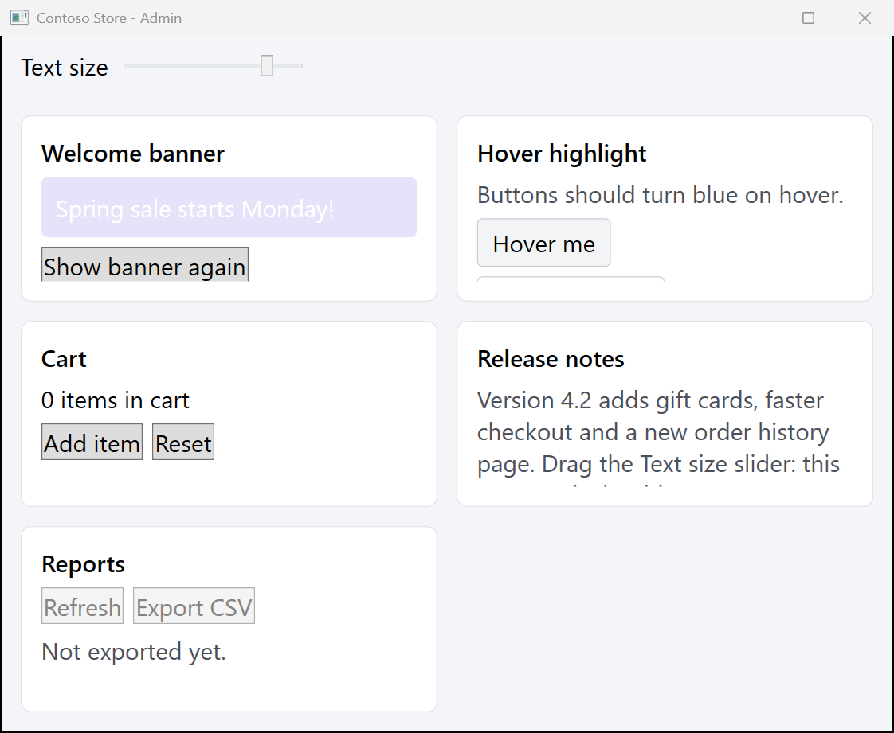
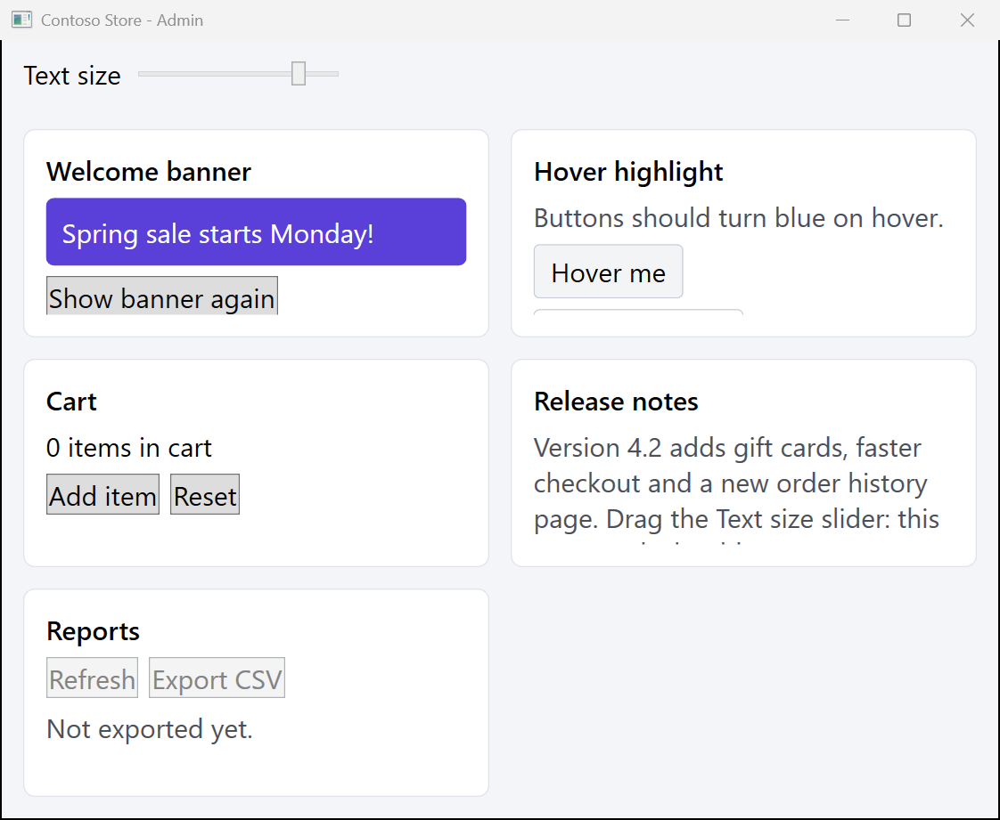
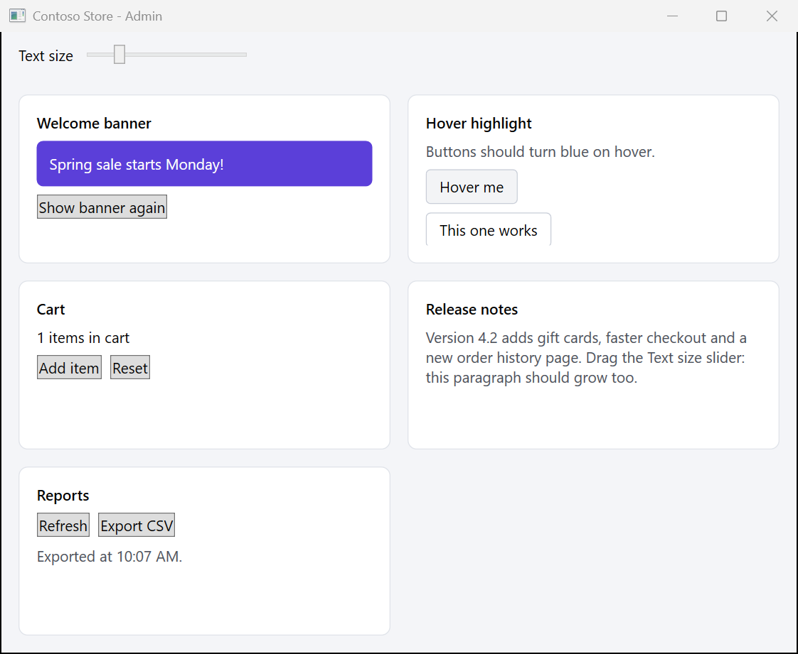

# Session transcript

Source: `Q:\source\XamlAgentDemos-notes\test-runs\PrecedenceWars\run2\events.jsonl`

## Tool usage

- xaml_explain_property_value: 23
- get_file: 14
- xaml_interact: 9
- xaml_capture_image: 5
- debugger_evaluate_expressions: 5
- powershell: 4
- glob: 4
- skill: 2
- xaml_list_apps: 2
- xaml_get_visual_tree: 2
- xaml_get_binding_failures: 2
- xaml_get_element_styles: 2
- xaml_apply_hot_reload: 2
- read_agent: 2
- debugger_continue: 2
- task_complete: 2
- get_projects_in_solution: 1
- view: 1
- multi_replace_string_in_file: 1
- xaml_get_hot_reload_log: 1
- replace_string_in_file: 1
- task: 1
- rg: 1
- file_search: 1
- debugger_pause: 1
- debugger_get_threads: 1
- debugger_get_call_stack: 1
- write_agent: 1
- debugger_read_file: 1
- debugger_ui_tree: 1
- debugger_set_breakpoints: 1
- debugger_ui_interact: 1
- debugger_wait: 1
- debugger_remove_breakpoints: 1
- xaml_get_hot_reload_status: 1

Failed tool calls: 0, images: 4


_Model: gpt-6.1-terra_


## User (15:03:19)

Each card in my running app has a property that refuses to change. Figure out why for every card using the live app, prove it, and fix the source.


**Tool call (15:03:21):** `skill`
```json
{
 "skill": "xaml-diagnostics"
}
```

<details><summary>Result `skill` success=true</summary>

```
Skill "xaml-diagnostics" loaded successfully. Follow the instructions in the skill context.
```
</details>


_Skill invoked: xaml-diagnostics_


**Assistant (15:03:23):**

I’ll inspect each card’s live property precedence, then fix and verify the source.


**Tool call (15:03:23):** `xaml_list_apps`
```json
{
 "progressMessage": "Inspecting the running XAML app"
}
```

<details><summary>Result `xaml_list_apps` success=true</summary>

```
{"isDebugging":true,"debuggerState":"running","diagnosticsActive":true,"apps":[{"app":"a1","name":"PrecedenceWars.exe [35208]","processId":35208,"platform":"WPF (.NET)","isRemote":false,"isDesignTimeOrNoDebug":false,"sourceInfoAvailable":true,"hotReloadSupported":true,"hotReloadEnabled":true,"supportsPropertyExplorer":true,"supportsInAppToolbar":true,"windowCount":1}]}
```
</details>


**Tool call (15:03:26):** `xaml_get_visual_tree`
```json
{
 "progressMessage": "Finding all live cards",
 "app": "a1",
 "depth": 7,
 "maxNodes": 500
}
```


**Tool call (15:03:26):** `xaml_capture_image`
```json
{
 "progressMessage": "Inspecting the current card display",
 "app": "a1"
}
```


**Tool call (15:03:26):** `xaml_get_binding_failures`
```json
{
 "progressMessage": "Checking live binding failures"
}
```


**Tool call (15:03:26):** `get_projects_in_solution`
```json
{}
```

<details><summary>Result `xaml_get_binding_failures` success=true</summary>

```
{"note":"This is a cumulative log since debugging started or the last xaml_clear_binding_failures, not live state: fixed failures stay listed. To verify a fix: clear, revisit the UI that uses the binding, then read again. Failures without a file usually come from bindings created in code.","totalUnique":0,"matched":0,"truncated":false,"failures":[]}
```
</details>

<details><summary>Result `xaml_get_visual_tree` success=true</summary>

```
{"app":"a1","platform":"WPF (.NET)","sourceInfoAvailable":true,"nodeCount":49,"truncated":false,"depthLimitedNodes":9,"hint":"9 node(s) have children beyond the requested depth (childCount > 0, no children listed). Raise depth or pass rootElementId to expand them.","nodes":[{"id":"a1:10","type":"PrecedenceWars.MainWindow","source":{"file":"Q:\\source\\XamlAgentDemos\\src\\PrecedenceWars\\MainWindow.xaml","line":3,"column":9},"childCount":1,"children":[{"id":"a1:11","type":"System.Windows.Controls.Border","childCount":1,"children":[{"id":"a1:12","type":"System.Windows.Documents.AdornerDecorator","childCount":2,"children":[{"id":"a1:13","type":"System.Windows.Controls.ContentPresenter","childCount":1,"children":[{"id":"a1:15","type":"System.Windows.Controls.DockPanel","source":{"file":"Q:\\source\\XamlAgentDemos\\src\\PrecedenceWars\\MainWindow.xaml","line":53,"column":6},"childCount":2,"children":[{"id":"a1:16","type":"System.Windows.Controls.StackPanel","source":{"file":"Q:\\source\\XamlAgentDemos\\src\\PrecedenceWars\\MainWindow.xaml","line":54,"column":10},"childCount":2,"children":[{"id":"a1:18","type":"System.Windows.Controls.TextBlock","source":{"file":"Q:\\source\\XamlAgentDemos\\src\\PrecedenceWars\\MainWindow.xaml","line":57,"column":14},"childCount":0},{"id":"a1:19","type":"System.Windows.Controls.Slider","name":"TextSizeSlider","source":{"file":"Q:\\source\\XamlAgentDemos\\src\\PrecedenceWars\\MainWindow.xaml","line":58,"column":14},"childCount":1,"children":[{"id":"a1:25","type":"System.Windows.Controls.Border","name":"border","childCount":1,"children":[{"id":"a1:31","type":"System.Windows.Controls.Grid","childCount":4,"children":[{"id":"a1:47","type":"System.Windows.Controls.Primitives.TickBar","name":"TopTick","childCount":0},{"id":"a1:48","type":"System.Windows.Controls.Primitives.TickBar","name":"BottomTick","childCount":0},{"id":"a1:49","type":"System.Windows.Controls.Border","name":"TrackBackground","childCount":1},{"id":"a1:50","type":"System.Windows.Controls.Primitives.Track","name":"PART_Track","childCount":3}]}]}]}]},{"id":"a1:17","type":"System.Windows.Controls.Primitives.UniformGrid","source":{"file":"Q:\\source\\XamlAgentDemos\\src\\PrecedenceWars\\MainWindow.xaml","line":67,"column":10},"childCount":5,"children":[{"id":"a1:20","type":"System.Windows.Controls.Border","source":{"file":"Q:\\source\\XamlAgentDemos\\src\\PrecedenceWars\\MainWindow.xaml","line":69,"column":14},"childCount":1,"children":[{"id":"a1:26","type":"System.Windo
... [truncated 6152 chars]
```
</details>


<details><summary>Result `xaml_capture_image` success=true</summary>

```
Screenshot of window 0x3306B8 "Contoso Store - Admin" of app a1 (1122x921).
```
</details>

<details><summary>Result `get_projects_in_solution` success=true</summary>

```
src\GhostClicks\GhostClicks.csproj
src\GermanReady\GermanReady.csproj
src\ThemeBreaker\ThemeBreaker.csproj
src\DesignPolish\DesignPolish.csproj
src\HotReloadDoctor\HotReloadDoctor.csproj
src\VanishingSave\VanishingSave.csproj
src\CrispPixels\CrispPixels.csproj
src\PrecedenceWars\PrecedenceWars.csproj
src\LostWindows\LostWindows.csproj
src\TemplateDetective\TemplateDetective.csproj
src\SlowScroll\SlowScroll.csproj
src\PixelPerfect\PixelPerfect.csproj
src\BindingStorm\BindingStorm.csproj
src\BugRepro\BugRepro.csproj
src\A11ySweep\A11ySweep.csproj
src\StyleMaze\StyleMaze.csproj
src\ResponsiveDashboard\ResponsiveDashboard.csproj

```
</details>


**Tool call (15:03:34):** `get_file`
```json
{
 "filename": "Q:\\source\\XamlAgentDemos\\src\\PrecedenceWars\\MainWindow.xaml",
 "startLine": 1,
 "endLine": 200
}
```


**Tool call (15:03:34):** `get_file`
```json
{
 "filename": "Q:\\source\\XamlAgentDemos\\src\\PrecedenceWars\\MainWindow.xaml.cs",
 "startLine": 1,
 "endLine": 240
}
```


**Tool call (15:03:34):** `view`
```json
{
 "path": "c:\\vs\\fastmain\\common7\\ide\\commonextensions\\microsoft\\xamldiagnostics\\AgentTools\\skills\\xaml-diagnostics\\references\\xaml-authoring.md"
}
```


**Tool call (15:03:34):** `xaml_explain_property_value`
```json
{
 "progressMessage": "Tracing banner visibility",
 "elementId": "a1:33",
 "propertyName": "Opacity"
}
```


**Tool call (15:03:34):** `xaml_explain_property_value`
```json
{
 "progressMessage": "Tracing hover highlight",
 "elementId": "a1:37",
 "propertyName": "Background"
}
```


**Tool call (15:03:34):** `xaml_explain_property_value`
```json
{
 "progressMessage": "Tracing cart count text",
 "elementId": "a1:40",
 "propertyName": "Text"
}
```


**Tool call (15:03:34):** `xaml_explain_property_value`
```json
{
 "progressMessage": "Tracing release note text size",
 "elementId": "a1:43",
 "propertyName": "FontSize"
}
```


**Tool call (15:03:34):** `xaml_explain_property_value`
```json
{
 "progressMessage": "Tracing report button availability",
 "elementId": "a1:57",
 "propertyName": "IsEnabled"
}
```


**Tool call (15:03:34):** `powershell`
```json
{
 "command": "git status --short",
 "description": "Check existing workspace changes"
}
```

<details><summary>Result `view` success=true</summary>

```
# XAML authoring guidance

Follow these rules when writing or changing XAML so it works well with XAML Hot Reload, the XAML designer, and XAML Diagnostics.

## Design-time data

- Declare `xmlns:d="http://schemas.microsoft.com/expression/blend/2008"` and `xmlns:mc="http://schemas.openxmlformats.org/markup-compatibility/2006"` with `mc:Ignorable="d"`.
- Use `d:DataContext="{d:DesignInstance Type=vm:MyViewModel, IsDesignTimeCreatable=False}"` (WPF/UWP) so the designer and IntelliSense know binding paths.
- Use `d:` properties (for example `d:Text="Sample"`) for sample values that appear only at design time.
- .NET MAUI: set `x:DataType` on pages and `DataTemplate`s. It enables compiled bindings and turns many binding failures into build errors.
- WinUI/UWP: prefer `x:Bind` for compile-time checked bindings when the view owns the view model.

## Bindings

- Bind with explicit paths. Avoid string-built paths in code-behind.
- Keep the `DataContext` chain simple. Use `ElementName` or `RelativeSource` only at real scope boundaries (for example inside a `DataTemplate` that needs the page's view model).
- Expose bound properties as public properties that raise `PropertyChanged`. Fields and non-public properties don't bind.
- Use `FallbackValue` and `TargetNullValue` for expected missing values instead of hiding binding errors.

## Hot reload and designer friendly code

- Keep control and page constructors cheap. Don't call services, open files, or start network calls in constructors or `InitializeComponent` paths. The designer and hot reload create instances again.
- Keep a public parameterless constructor on custom controls.
- Guard runtime-only work with `DesignerProperties.GetIsInDesignMode(this)` (WPF) or `Windows.ApplicationModel.DesignMode.DesignModeEnabled` (UWP/WinUI).
- Put styles, templates, and visual states in XAML, not code-behind. Hot reload can't update UI built in code.
- Don't walk the visual tree from code-behind to change visuals. Use bindings, triggers, and visual states.
- Use `x:Name` only for elements code-behind needs. Don't rename `x:Class` while the app is running.

## Resources

- Put shared resources in `App.xaml` merged dictionaries or the closest scope that uses them.
- A `StaticResource` must be defined earlier in load order. Use `DynamicResource` (WPF) or `ThemeResource` (UWP/WinUI) for theme values that change at runtime.
- To check where a key resolves at runtime, or whether a dictionary is merged a
... [truncated 618 chars]
```
</details>

<details><summary>Result `xaml_explain_property_value` success=true</summary>

```
{"id":"a1:37","type":"System.Windows.Controls.Button","property":"Background","propertyType":"System.Windows.Media.Brush","effectiveValue":"#FFF3F4F6","effectiveSource":"Local","chain":[{"kind":"Local","description":"Local value set on the element (XAML attribute, binding or code). Wins over styles, templates and inheritance.","value":"#FFF3F4F6","valueType":"System.Windows.Media.SolidColorBrush","effective":true,"sourceLocation":{"file":"Q:\\source\\XamlAgentDemos\\src\\PrecedenceWars\\MainWindow.xaml","line":103,"column":22}},{"kind":"Style","description":"Setter in an explicit (x:Key) or implicit (TargetType) Style.","targetType":"System.Windows.Controls.Button","value":"#FFFFFFFF","valueType":"System.Windows.Media.SolidColorBrush","effective":false,"sourceLocation":{"file":"Q:\\source\\XamlAgentDemos\\src\\PrecedenceWars\\MainWindow.xaml","line":29,"column":10}},{"kind":"BuiltInStyle","description":"Setter in the control's default theme style (generic.xaml or the platform theme).","targetType":"System.Windows.Controls.Primitives.ButtonBase","value":"#FFDDDDDD","valueType":"System.Windows.Media.SolidColorBrush","effective":false},{"kind":"Default","description":"The property's default value; nothing sets it.","effective":false}],"notes":["To let a style or template value apply, remove the local value (the attribute, binding or code assignment). To change it, edit that local value."]}
```
</details>

<details><summary>Result `xaml_explain_property_value` success=true</summary>

```
{"id":"a1:33","type":"System.Windows.Controls.Border","property":"Opacity","propertyType":"System.Double","effectiveValue":"0.15000000000000002","effectiveSource":"Animation","chain":[{"kind":"Animation","description":"An active animation (Storyboard or VisualState). It overrides local and style values while it holds the value.","value":"0.15000000000000002","valueType":"System.Double","effective":true},{"kind":"Default","description":"The property's default value; nothing sets it.","value":"1","valueType":"System.Double","effective":false}],"notes":["Find the Storyboard or VisualState that animates this property; local and style changes have no visible effect while it holds the value (FillBehavior=HoldEnd is common)."]}
```
</details>

<details><summary>Result `xaml_explain_property_value` success=true</summary>

```
{"id":"a1:40","type":"System.Windows.Controls.TextBlock","property":"Text","propertyType":"System.String","effectiveValue":"System.Windows.Data.BindingExpression","evaluatedValue":"2 items in cart (System.String)","effectiveSource":"Local","chain":[{"kind":"Local","description":"Local value set on the element (XAML attribute, binding or code). Wins over styles, templates and inheritance.","value":"System.Windows.Data.BindingExpression","evaluatedValue":"2 items in cart (System.String)","valueType":"System.Windows.Data.BindingExpression","isBinding":true,"effective":true,"sourceLocation":{"file":"Q:\\source\\XamlAgentDemos\\src\\PrecedenceWars\\MainWindow.xaml","line":121,"column":22}},{"kind":"Default","description":"The property's default value; nothing sets it.","value":"","valueType":"System.String","effective":false}],"notes":["To let a style or template value apply, remove the local value (the attribute, binding or code assignment). To change it, edit that local value.","The effective value comes from a binding. If it's wrong, check xaml_get_binding_failures and the DataContext."]}
```
</details>

<details><summary>Result `xaml_explain_property_value` success=true</summary>

```
{"id":"a1:57","type":"System.Windows.Controls.Button","property":"IsEnabled","propertyType":"System.Boolean","effectiveValue":"False","effectiveSource":"Coercion","chain":[{"kind":"Coercion","description":"The control coerced the value (for example clamped to a minimum or maximum).","value":"False","valueType":"System.Boolean","effective":true},{"kind":"Default","description":"The property's default value; nothing sets it.","value":"True","valueType":"System.Boolean","effective":false}],"notes":["Check related properties that constrain this one (for example Minimum/Maximum or MinWidth/MaxWidth)."]}
```
</details>

<details><summary>Result `xaml_explain_property_value` success=true</summary>

```
{"id":"a1:43","type":"System.Windows.Controls.TextBlock","property":"FontSize","propertyType":"System.Double","effectiveValue":"13","effectiveSource":"Style","chain":[{"kind":"Style","description":"Setter in an explicit (x:Key) or implicit (TargetType) Style.","targetType":"System.Windows.Controls.TextBlock","value":"13","valueType":"System.Double","effective":true,"sourceLocation":{"file":"Q:\\source\\XamlAgentDemos\\src\\PrecedenceWars\\MainWindow.xaml","line":23,"column":10}},{"kind":"Default","description":"The property's default value; nothing sets it.","value":"12","valueType":"System.Double","effective":false}],"notes":["Edit the setter or trigger at the source location, or set a local value to override it for this element only."]}
```
</details>

<details><summary>Result `get_file` success=true</summary>

```
```csharp src\PrecedenceWars\MainWindow.xaml.cs (Lines 1-25 of 25 total. Call tools for more if needed.)
using System.Windows;

namespace PrecedenceWars;

public partial class MainWindow : Window
{
    private readonly StoreViewModel viewModel = new();

    public MainWindow()
    {
        this.InitializeComponent();
        this.DataContext = this.viewModel;
    }

    private void OnShowBannerClick(object sender, RoutedEventArgs e)
    {
        this.WelcomeBanner.Opacity = 1;
    }

    private void OnResetClick(object sender, RoutedEventArgs e)
    {
        this.viewModel.ItemCount = 0;
        this.CountText.Text = "0 items in cart";
    }
}

```


```
</details>

<details><summary>Result `get_file` success=true</summary>

```
```xaml src\PrecedenceWars\MainWindow.xaml (Lines 1-164 of 164 total. Call tools for more if needed.)
<Window x:Class="PrecedenceWars.MainWindow"
        xmlns="http://schemas.microsoft.com/winfx/2006/xaml/presentation"
        xmlns:x="http://schemas.microsoft.com/winfx/2006/xaml"
        Title="Contoso Store - Admin"
        Width="760"
        Height="620"
        FontSize="{Binding Value, ElementName=TextSizeSlider}">
    <Window.Resources>
        <Style x:Key="CardStyle" TargetType="Border">
            <Setter Property="Background" Value="White" />
            <Setter Property="BorderBrush" Value="#E1E4EA" />
            <Setter Property="BorderThickness" Value="1" />
            <Setter Property="CornerRadius" Value="8" />
            <Setter Property="Padding" Value="16" />
            <Setter Property="Margin" Value="8" />
        </Style>

        <Style x:Key="CardTitleStyle" TargetType="TextBlock">
            <Setter Property="FontWeight" Value="SemiBold" />
            <Setter Property="Margin" Value="0,0,0,8" />
        </Style>

        <Style x:Key="BodyTextStyle" TargetType="TextBlock">
            <Setter Property="FontSize" Value="13" />
            <Setter Property="Foreground" Value="#4A4F5A" />
            <Setter Property="TextWrapping" Value="Wrap" />
        </Style>

        <Style x:Key="HoverButtonStyle" TargetType="Button">
            <Setter Property="Background" Value="White" />
            <Setter Property="Padding" Value="12,6" />
            <Setter Property="Template">
                <Setter.Value>
                    <ControlTemplate TargetType="Button">
                        <Border Padding="{TemplateBinding Padding}"
                                Background="{TemplateBinding Background}"
                                BorderBrush="#C9CED8"
                                BorderThickness="1"
                                CornerRadius="4">
                            <ContentPresenter HorizontalAlignment="Center" />
                        </Border>
                    </ControlTemplate>
                </Setter.Value>
            </Setter>
            <Style.Triggers>
                <Trigger Property="IsMouseOver" Value="True">
                    <Setter Property="Background" Value="#DCE8FF" />
                </Trigger>
            </Style.Triggers>
        </Style>
    </Window.Resources>

    <DockPanel Background="#F4F5F8">
        <StackPanel Margin
... [truncated 5586 chars]
```
</details>

<details><summary>Result `powershell` success=true</summary>

```

<shellId: 0 completed with exit code 0>
```
</details>


**Tool call (15:03:40):** `glob`
```json
{
 "pattern": "src\\PrecedenceWars\\*.cs"
}
```


**Tool call (15:03:40):** `xaml_interact`
```json
{
 "progressMessage": "Reproducing the banner issue",
 "elementId": "a1:34",
 "action": "invoke"
}
```


**Tool call (15:03:40):** `xaml_explain_property_value`
```json
{
 "progressMessage": "Tracing report toolbar availability",
 "elementId": "a1:45",
 "propertyName": "IsEnabled"
}
```


**Tool call (15:03:40):** `xaml_get_element_styles`
```json
{
 "progressMessage": "Inspecting hover trigger precedence",
 "elementId": "a1:37"
}
```


**Tool call (15:03:40):** `xaml_interact`
```json
{
 "progressMessage": "Reproducing the cart reset issue",
 "elementId": "a1:56",
 "action": "invoke"
}
```


**Tool call (15:03:40):** `xaml_interact`
```json
{
 "progressMessage": "Testing the text size slider",
 "elementId": "a1:19",
 "action": "setValue",
 "value": "20"
}
```

<details><summary>Result `glob` success=true</summary>

```
.\src\PrecedenceWars\StoreViewModel.cs
.\src\PrecedenceWars\App.xaml.cs
.\src\PrecedenceWars\MainWindow.xaml.cs
```
</details>

<details><summary>Result `xaml_explain_property_value` success=true</summary>

```
{"id":"a1:45","type":"System.Windows.Controls.StackPanel","property":"IsEnabled","propertyType":"System.Boolean","evaluatedValue":"False (System.Boolean)","effectiveSource":"Local","chain":[{"kind":"Local","description":"Local value set on the element (XAML attribute, binding or code). Wins over styles, templates and inheritance.","evaluatedValue":"False (System.Boolean)","valueType":"System.Windows.Data.BindingExpression","isBinding":true,"effective":true,"sourceLocation":{"file":"Q:\\source\\XamlAgentDemos\\src\\PrecedenceWars\\MainWindow.xaml","line":148,"column":22}},{"kind":"Default","description":"The property's default value; nothing sets it.","value":"True","valueType":"System.Boolean","effective":false}],"notes":["To let a style or template value apply, remove the local value (the attribute, binding or code assignment). To change it, edit that local value.","The effective value comes from a binding. If it's wrong, check xaml_get_binding_failures and the DataContext."]}
```
</details>

<details><summary>Result `xaml_get_element_styles` success=true</summary>

```
{"id":"a1:37","type":"System.Windows.Controls.Button","name":"HoverButton","source":{"file":"Q:\\source\\XamlAgentDemos\\src\\PrecedenceWars\\MainWindow.xaml","line":103,"column":22},"styleProperty":{"value":"System.Windows.Style","valueSource":"Local","location":{"file":"Q:\\source\\XamlAgentDemos\\src\\PrecedenceWars\\MainWindow.xaml","line":103,"column":22}},"templateProperty":{"value":"System.Windows.Controls.ControlTemplate","valueSource":"Style","location":{"file":"Q:\\source\\XamlAgentDemos\\src\\PrecedenceWars\\MainWindow.xaml","line":29,"column":10}},"styles":[{"kind":"Style","description":"Setter in an explicit (x:Key) or implicit (TargetType) Style.","targetType":"System.Windows.Controls.Button","location":{"file":"Q:\\source\\XamlAgentDemos\\src\\PrecedenceWars\\MainWindow.xaml","line":29,"column":10},"setters":[{"property":"Background","value":"#FFFFFFFF","effective":false,"overriddenBy":"Local"},{"property":"Padding","value":"12,6,12,6","effective":true},{"property":"Template","value":"System.Windows.Controls.ControlTemplate","effective":true,"valueLocation":{"file":"Q:\\source\\XamlAgentDemos\\src\\PrecedenceWars\\MainWindow.xaml","line":34,"column":22}}]},{"kind":"BuiltInStyle","description":"Setter in the control's default theme style (generic.xaml or the platform theme).","targetType":"System.Windows.Controls.Primitives.ButtonBase","setters":[{"property":"Background","value":"#FFDDDDDD","effective":false,"overriddenBy":"Local"},{"property":"BorderBrush","value":"#FF707070","effective":true},{"property":"BorderThickness","value":"1,1,1,1","effective":true},{"property":"FocusVisualStyle","value":"System.Windows.Style","effective":true},{"property":"Foreground","effective":true},{"property":"HorizontalContentAlignment","value":"1","effective":true},{"property":"Padding","value":"1,1,1,1","effective":false,"overriddenBy":"Style (System.Windows.Controls.Button)"},{"property":"Template","value":"System.Windows.Controls.ControlTemplate","effective":false,"overriddenBy":"Style (System.Windows.Controls.Button)"},{"property":"VerticalContentAlignment","value":"1","effective":true}]}],"hint":"Styles are listed in precedence order, highest first. 'effective=false' setters lose to 'overriddenBy'. Use xaml_find_resource to see where a style or resource key resolves."}
```
</details>

<details><summary>Result `xaml_interact` success=true</summary>

```
{"id":"a1:34","action":"invoke","result":"Invoked.","supportedPatterns":["Invoke","SynchronizedInput"],"note":"Call xaml_capture_image or xaml_get_element_properties to verify the effect."}
```
</details>

<details><summary>Result `xaml_interact` success=true</summary>

```
{"id":"a1:19","action":"setValue","result":"Value is now 20.","supportedPatterns":["RangeValue","SynchronizedInput"],"note":"Call xaml_capture_image or xaml_get_element_properties to verify the effect."}
```
</details>

<details><summary>Result `xaml_interact` success=true</summary>

```
{"id":"a1:56","action":"invoke","result":"Invoked.","supportedPatterns":["Invoke","SynchronizedInput"],"note":"Call xaml_capture_image or xaml_get_element_properties to verify the effect."}
```
</details>


**Tool call (15:03:44):** `get_file`
```json
{
 "filename": "Q:\\source\\XamlAgentDemos\\src\\PrecedenceWars\\StoreViewModel.cs",
 "startLine": 1,
 "endLine": 260
}
```


**Tool call (15:03:44):** `xaml_explain_property_value`
```json
{
 "progressMessage": "Proving the banner remains animated",
 "elementId": "a1:33",
 "propertyName": "Opacity"
}
```


**Tool call (15:03:44):** `xaml_explain_property_value`
```json
{
 "progressMessage": "Checking cart binding after reset",
 "elementId": "a1:40",
 "propertyName": "Text"
}
```


**Tool call (15:03:44):** `xaml_explain_property_value`
```json
{
 "progressMessage": "Checking font size after slider change",
 "elementId": "a1:43",
 "propertyName": "FontSize"
}
```


**Tool call (15:03:44):** `xaml_explain_property_value`
```json
{
 "progressMessage": "Checking export command availability",
 "elementId": "a1:58",
 "propertyName": "IsEnabled"
}
```


**Tool call (15:03:44):** `xaml_interact`
```json
{
 "progressMessage": "Testing cart updates after reset",
 "elementId": "a1:55",
 "action": "invoke"
}
```

<details><summary>Result `xaml_explain_property_value` success=true</summary>

```
{"id":"a1:33","type":"System.Windows.Controls.Border","property":"Opacity","propertyType":"System.Double","effectiveValue":"0.15000000000000002","effectiveSource":"Animation","chain":[{"kind":"Animation","description":"An active animation (Storyboard or VisualState). It overrides local and style values while it holds the value.","value":"0.15000000000000002","valueType":"System.Double","effective":true},{"kind":"Local","description":"Local value set on the element (XAML attribute, binding or code). Wins over styles, templates and inheritance.","value":"1","valueType":"System.Double","effective":false,"sourceLocation":{"file":"Q:\\source\\XamlAgentDemos\\src\\PrecedenceWars\\MainWindow.xaml","line":72,"column":22}},{"kind":"Default","description":"The property's default value; nothing sets it.","value":"1","valueType":"System.Double","effective":false}],"notes":["Find the Storyboard or VisualState that animates this property; local and style changes have no visible effect while it holds the value (FillBehavior=HoldEnd is common)."]}
```
</details>

<details><summary>Result `get_file` success=true</summary>

```
```csharp src\PrecedenceWars\StoreViewModel.cs (Lines 1-69 of 69 total. Call tools for more if needed.)
using System.Diagnostics;

namespace PrecedenceWars;

public sealed class StoreViewModel : ObservableObject
{
    private int itemCount = 2;
    private bool isBusy;
    private string lastExport = "Not exported yet.";

    public StoreViewModel()
    {
        this.AddItemCommand = new RelayCommand(() => this.ItemCount++);
        this.ExportCommand = new RelayCommand(() => this.LastExport = $"Exported at {DateTime.Now:t}.", () => true);
        this.SyncCatalog();
    }

    public RelayCommand AddItemCommand { get; }

    public RelayCommand ExportCommand { get; }

    public int ItemCount
    {
        get => this.itemCount;
        set => this.SetProperty(ref this.itemCount, value);
    }

    public bool IsBusy
    {
        get => this.isBusy;
        private set
        {
            if (this.SetProperty(ref this.isBusy, value))
            {
                this.OnPropertyChanged(nameof(this.IsIdle));
            }
        }
    }

    public bool IsIdle => !this.IsBusy;

    public string LastExport
    {
        get => this.lastExport;
        private set => this.SetProperty(ref this.lastExport, value);
    }

    private void SyncCatalog()
    {
        this.IsBusy = true;
        try
        {
            if (this.IsOffline())
            {
                throw new TimeoutException("Catalog service didn't respond.");
            }
        }
        catch (TimeoutException ex)
        {
            Debug.WriteLine($"Catalog sync failed: {ex.Message}");
            return;
        }

        this.IsBusy = false;
    }

    // Simulates the offline case: the catalog service isn't reachable.
    private bool IsOffline() => true;
}

```


```
</details>

<details><summary>Result `xaml_explain_property_value` success=true</summary>

```
{"id":"a1:43","type":"System.Windows.Controls.TextBlock","property":"FontSize","propertyType":"System.Double","effectiveValue":"13","effectiveSource":"Style","chain":[{"kind":"Style","description":"Setter in an explicit (x:Key) or implicit (TargetType) Style.","targetType":"System.Windows.Controls.TextBlock","value":"13","valueType":"System.Double","effective":true,"sourceLocation":{"file":"Q:\\source\\XamlAgentDemos\\src\\PrecedenceWars\\MainWindow.xaml","line":23,"column":10}},{"kind":"Default","description":"The property's default value; nothing sets it.","value":"12","valueType":"System.Double","effective":false}],"notes":["Edit the setter or trigger at the source location, or set a local value to override it for this element only."]}
```
</details>

<details><summary>Result `xaml_explain_property_value` success=true</summary>

```
{"id":"a1:40","type":"System.Windows.Controls.TextBlock","property":"Text","propertyType":"System.String","effectiveValue":"0 items in cart","effectiveSource":"Local","chain":[{"kind":"Local","description":"Local value set on the element (XAML attribute, binding or code). Wins over styles, templates and inheritance.","value":"0 items in cart","valueType":"System.String","effective":true,"sourceLocation":{"file":"Q:\\source\\XamlAgentDemos\\src\\PrecedenceWars\\MainWindow.xaml","line":121,"column":22}},{"kind":"Default","description":"The property's default value; nothing sets it.","value":"","valueType":"System.String","effective":false}],"notes":["To let a style or template value apply, remove the local value (the attribute, binding or code assignment). To change it, edit that local value."]}
```
</details>

<details><summary>Result `xaml_explain_property_value` success=true</summary>

```
{"id":"a1:58","type":"System.Windows.Controls.Button","property":"IsEnabled","propertyType":"System.Boolean","effectiveValue":"False","effectiveSource":"Coercion","chain":[{"kind":"Coercion","description":"The control coerced the value (for example clamped to a minimum or maximum).","value":"False","valueType":"System.Boolean","effective":true},{"kind":"Default","description":"The property's default value; nothing sets it.","value":"True","valueType":"System.Boolean","effective":false}],"notes":["Check related properties that constrain this one (for example Minimum/Maximum or MinWidth/MaxWidth)."]}
```
</details>

<details><summary>Result `xaml_interact` success=true</summary>

```
{"id":"a1:55","action":"invoke","result":"Invoked.","supportedPatterns":["Invoke","SynchronizedInput"],"note":"Call xaml_capture_image or xaml_get_element_properties to verify the effect."}
```
</details>


**Assistant (15:03:52):**

The five cards have different causes: an animation, local-value precedence, a replaced binding, a style setter, and a stuck busy state. I’ll fix each at its source while preserving the existing behavior.


**Tool call (15:03:52):** `xaml_explain_property_value`
```json
{
 "progressMessage": "Confirming cart stays stale after adding",
 "elementId": "a1:40",
 "propertyName": "Text"
}
```


**Tool call (15:03:52):** `xaml_explain_property_value`
```json
{
 "progressMessage": "Checking slider inheritance at the window",
 "elementId": "a1:10",
 "propertyName": "FontSize"
}
```


**Tool call (15:03:52):** `xaml_explain_property_value`
```json
{
 "progressMessage": "Checking working hover button precedence",
 "elementId": "a1:38",
 "propertyName": "Background"
}
```


**Tool call (15:03:52):** `get_file`
```json
{
 "filename": "Q:\\source\\XamlAgentDemos\\src\\PrecedenceWars\\PrecedenceWars.csproj",
 "startLine": 1,
 "endLine": 100
}
```

<details><summary>Result `get_file` success=true</summary>

```
``` src\PrecedenceWars\PrecedenceWars.csproj (Lines 1-5 of 5 total. Call tools for more if needed.)
<Project Sdk="Microsoft.NET.Sdk">
  <PropertyGroup>
    <RootNamespace>PrecedenceWars</RootNamespace>
  </PropertyGroup>
</Project>

```


```
</details>

<details><summary>Result `xaml_explain_property_value` success=true</summary>

```
{"id":"a1:40","type":"System.Windows.Controls.TextBlock","property":"Text","propertyType":"System.String","effectiveValue":"0 items in cart","effectiveSource":"Local","chain":[{"kind":"Local","description":"Local value set on the element (XAML attribute, binding or code). Wins over styles, templates and inheritance.","value":"0 items in cart","valueType":"System.String","effective":true,"sourceLocation":{"file":"Q:\\source\\XamlAgentDemos\\src\\PrecedenceWars\\MainWindow.xaml","line":121,"column":22}},{"kind":"Default","description":"The property's default value; nothing sets it.","value":"","valueType":"System.String","effective":false}],"notes":["To let a style or template value apply, remove the local value (the attribute, binding or code assignment). To change it, edit that local value."]}
```
</details>

<details><summary>Result `xaml_explain_property_value` success=true</summary>

```
{"id":"a1:10","type":"PrecedenceWars.MainWindow","property":"FontSize","propertyType":"System.Double","evaluatedValue":"20 (System.Double)","effectiveSource":"Local","chain":[{"kind":"Local","description":"Local value set on the element (XAML attribute, binding or code). Wins over styles, templates and inheritance.","evaluatedValue":"20 (System.Double)","valueType":"System.Windows.Data.BindingExpression","isBinding":true,"effective":true,"sourceLocation":{"file":"Q:\\source\\XamlAgentDemos\\src\\PrecedenceWars\\MainWindow.xaml","line":3,"column":9}},{"kind":"Default","description":"The property's default value; nothing sets it.","value":"12","valueType":"System.Double","effective":false}],"notes":["To let a style or template value apply, remove the local value (the attribute, binding or code assignment). To change it, edit that local value.","The effective value comes from a binding. If it's wrong, check xaml_get_binding_failures and the DataContext."]}
```
</details>

<details><summary>Result `xaml_explain_property_value` success=true</summary>

```
{"id":"a1:38","type":"System.Windows.Controls.Button","property":"Background","propertyType":"System.Windows.Media.Brush","effectiveValue":"#FFFFFFFF","effectiveSource":"Style","chain":[{"kind":"Style","description":"Setter in an explicit (x:Key) or implicit (TargetType) Style.","targetType":"System.Windows.Controls.Button","value":"#FFFFFFFF","valueType":"System.Windows.Media.SolidColorBrush","effective":true,"sourceLocation":{"file":"Q:\\source\\XamlAgentDemos\\src\\PrecedenceWars\\MainWindow.xaml","line":29,"column":10}},{"kind":"BuiltInStyle","description":"Setter in the control's default theme style (generic.xaml or the platform theme).","targetType":"System.Windows.Controls.Primitives.ButtonBase","value":"#FFDDDDDD","valueType":"System.Windows.Media.SolidColorBrush","effective":false},{"kind":"Default","description":"The property's default value; nothing sets it.","effective":false}],"notes":["Edit the setter or trigger at the source location, or set a local value to override it for this element only."]}
```
</details>


**Tool call (15:04:03):** `multi_replace_string_in_file`
```json
{
 "explanation": "Correct the five independent precedence and state issues without changing intended card behavior.",
 "replacements": [
  {
   "filePath": "src\\PrecedenceWars\\MainWindow.xaml",
   "oldString": "        <Style x:Key=\"BodyTextStyle\" TargetType=\"TextBlock\">\n            <Setter Property=\"FontSize\" Value=\"13\" />\n            <Setter Property=\"Foreground\" Value=\"#4A4F5A\" />\n            <Setter Property=\"TextWrapping\" Value=\"Wrap\" />\n        </Style>",
   "newString": "        <Style x:Key=\"BodyTextStyle\" TargetType=\"TextBlock\">\n            <Setter Property=\"Foreground\" Value=\"#4A4F5A\" />\n            <Setter Property=\"TextWrapping\" Value=\"Wrap\" />\n        </Style>",
   "explanation": "Allow body text to inherit the slider-controlled font size."
  },
  {
   "filePath": "src\\PrecedenceWars\\MainWindow.xaml",
   "oldString": "                    <Button x:Name=\"HoverButton\"\n                            Margin=\"0,8,0,0\"\n                            HorizontalAlignment=\"Left\"\n                            Background=\"#F3F4F6\"\n                            Content=\"Hover me\"\n                            Style=\"{StaticResource HoverButtonStyle}\" />\n                    <Button x:Name=\"HoverButtonOk\"",
   "newString": "                    <Button x:Name=\"HoverButton\"\n                            Margin=\"0,8,0,0\"\n                            HorizontalAlignment=\"Left\"\n                            Content=\"Hover me\">\n
... [truncated 2081 chars]
```

<details><summary>Result `multi_replace_string_in_file` success=true</summary>

```
Successfully applied 4 of 4 replacement(s) across 3 file(s).
```
</details>


**Tool call (15:04:12):** `xaml_apply_hot_reload`
```json
{
 "progressMessage": "Applying the five fixes to the running app",
 "includeCodeChanges": true
}
```

<details><summary>Result `xaml_apply_hot_reload` success=true</summary>

```
{"applied":true,"errors":[],"log":[],"codeChanges":".NET Hot Reload was started for saved code changes. Its results are in the Hot Reload output pane, not in 'log'; if an edit can't be hot reloaded, Visual Studio asks the user to rebuild and restart.","codeHotReloadOutput":[],"hint":"Call xaml_capture_image to verify the change visually. Views that aren't loaded (other tabs, closed dialogs) are updated when they're next shown. Source line numbers reported for existing elements can still point to the pre-edit lines until the element is recreated, so find elements by x:Name or type rather than by an old line number. Structural edits (wrapping or replacing a parent, changing a root's content) recreate elements, which resets their runtime state such as selection, checked state, typed text and scroll position, and invalidates their IDs. Re-establish the state you were testing before capturing again."}
```
</details>


**Tool call (15:04:21):** `xaml_capture_image`
```json
{
 "progressMessage": "Inspecting the reloaded app",
 "app": "a1"
}
```


**Tool call (15:04:21):** `xaml_get_hot_reload_log`
```json
{
 "progressMessage": "Checking hot reload results",
 "maxEntries": 100
}
```


**Tool call (15:04:21):** `xaml_get_visual_tree`
```json
{
 "progressMessage": "Finding the updated card controls",
 "app": "a1",
 "depth": 7,
 "maxNodes": 500
}
```

<details><summary>Result `xaml_get_visual_tree` success=true</summary>

```
{"app":"a1","platform":"WPF (.NET)","sourceInfoAvailable":true,"nodeCount":49,"truncated":false,"depthLimitedNodes":9,"hint":"9 node(s) have children beyond the requested depth (childCount > 0, no children listed). Raise depth or pass rootElementId to expand them.","nodes":[{"id":"a1:10","type":"PrecedenceWars.MainWindow","source":{"file":"Q:\\source\\XamlAgentDemos\\src\\PrecedenceWars\\MainWindow.xaml","line":3,"column":9},"childCount":1,"children":[{"id":"a1:11","type":"System.Windows.Controls.Border","childCount":1,"children":[{"id":"a1:12","type":"System.Windows.Documents.AdornerDecorator","childCount":2,"children":[{"id":"a1:13","type":"System.Windows.Controls.ContentPresenter","childCount":1,"children":[{"id":"a1:15","type":"System.Windows.Controls.DockPanel","source":{"file":"Q:\\source\\XamlAgentDemos\\src\\PrecedenceWars\\MainWindow.xaml","line":53,"column":6},"childCount":2,"children":[{"id":"a1:16","type":"System.Windows.Controls.StackPanel","source":{"file":"Q:\\source\\XamlAgentDemos\\src\\PrecedenceWars\\MainWindow.xaml","line":54,"column":10},"childCount":2,"children":[{"id":"a1:18","type":"System.Windows.Controls.TextBlock","source":{"file":"Q:\\source\\XamlAgentDemos\\src\\PrecedenceWars\\MainWindow.xaml","line":57,"column":14},"childCount":0},{"id":"a1:19","type":"System.Windows.Controls.Slider","name":"TextSizeSlider","source":{"file":"Q:\\source\\XamlAgentDemos\\src\\PrecedenceWars\\MainWindow.xaml","line":58,"column":14},"childCount":1,"children":[{"id":"a1:25","type":"System.Windows.Controls.Border","name":"border","childCount":1,"children":[{"id":"a1:31","type":"System.Windows.Controls.Grid","childCount":4,"children":[{"id":"a1:47","type":"System.Windows.Controls.Primitives.TickBar","name":"TopTick","childCount":0},{"id":"a1:48","type":"System.Windows.Controls.Primitives.TickBar","name":"BottomTick","childCount":0},{"id":"a1:49","type":"System.Windows.Controls.Border","name":"TrackBackground","childCount":1},{"id":"a1:50","type":"System.Windows.Controls.Primitives.Track","name":"PART_Track","childCount":3}]}]}]}]},{"id":"a1:17","type":"System.Windows.Controls.Primitives.UniformGrid","source":{"file":"Q:\\source\\XamlAgentDemos\\src\\PrecedenceWars\\MainWindow.xaml","line":67,"column":10},"childCount":5,"children":[{"id":"a1:20","type":"System.Windows.Controls.Border","source":{"file":"Q:\\source\\XamlAgentDemos\\src\\PrecedenceWars\\MainWindow.xaml","line":69,"column":14},"childCount":1,"children":[{"id":"a1:26","type":"System.Windo
... [truncated 6152 chars]
```
</details>

<details><summary>Result `xaml_get_hot_reload_log` success=true</summary>

```
{"total":1,"entries":[{"time":"10:02:54.808","level":"Info","project":"XAML","message":"Connected to PrecedenceWars.exe [35208] for WpfCore diagnostics. Incremental Hot Reload is enabled."}],"dotNetHotReloadPane":["10:02:54.80 [XAML] Connected to PrecedenceWars.exe [35208] for WpfCore diagnostics. Incremental Hot Reload is enabled.","10:04:14.74  Code changes were successfully applied."]}
```
</details>




<details><summary>Result `xaml_capture_image` success=true</summary>

```
Screenshot of window 0x3306B8 "Contoso Store - Admin" of app a1 (1122x921).
```
</details>


**Tool call (15:04:27):** `xaml_interact`
```json
{
 "progressMessage": "Testing banner restoration",
 "elementId": "a1:34",
 "action": "invoke"
}
```


**Tool call (15:04:27):** `xaml_interact`
```json
{
 "progressMessage": "Testing cart reset after the fix",
 "elementId": "a1:56",
 "action": "invoke"
}
```


**Tool call (15:04:27):** `xaml_explain_property_value`
```json
{
 "progressMessage": "Checking updated hover precedence",
 "elementId": "a1:37",
 "propertyName": "Background"
}
```


**Tool call (15:04:27):** `xaml_explain_property_value`
```json
{
 "progressMessage": "Checking updated font inheritance",
 "elementId": "a1:43",
 "propertyName": "FontSize"
}
```


**Tool call (15:04:27):** `xaml_explain_property_value`
```json
{
 "progressMessage": "Checking current report state",
 "elementId": "a1:45",
 "propertyName": "IsEnabled"
}
```

<details><summary>Result `xaml_explain_property_value` success=true</summary>

```
{"id":"a1:37","type":"System.Windows.Controls.Button","property":"Background","propertyType":"System.Windows.Media.Brush","effectiveValue":"#FFF3F4F6","effectiveSource":"Style","chain":[{"kind":"Style","description":"Setter in an explicit (x:Key) or implicit (TargetType) Style.","targetType":"System.Windows.Controls.Button","value":"#FFF3F4F6","valueType":"System.Windows.Media.SolidColorBrush","effective":true},{"kind":"Style","description":"Setter in an explicit (x:Key) or implicit (TargetType) Style.","sourceName":"HoverButtonStyle","targetType":"System.Windows.Controls.Button","value":"#FFFFFFFF","valueType":"System.Windows.Media.SolidColorBrush","effective":false,"sourceLocation":{"file":"Q:\\source\\XamlAgentDemos\\src\\PrecedenceWars\\MainWindow.xaml","line":29,"column":10}},{"kind":"BuiltInStyle","description":"Setter in the control's default theme style (generic.xaml or the platform theme).","targetType":"System.Windows.Controls.Primitives.ButtonBase","value":"#FFDDDDDD","valueType":"System.Windows.Media.SolidColorBrush","effective":false},{"kind":"Default","description":"The property's default value; nothing sets it.","effective":false}],"notes":["Edit the setter or trigger at the source location, or set a local value to override it for this element only."]}
```
</details>

<details><summary>Result `xaml_explain_property_value` success=true</summary>

```
{"id":"a1:45","type":"System.Windows.Controls.StackPanel","property":"IsEnabled","propertyType":"System.Boolean","evaluatedValue":"False (System.Boolean)","effectiveSource":"Local","chain":[{"kind":"Local","description":"Local value set on the element (XAML attribute, binding or code). Wins over styles, templates and inheritance.","evaluatedValue":"False (System.Boolean)","valueType":"System.Windows.Data.BindingExpression","isBinding":true,"effective":true,"sourceLocation":{"file":"Q:\\source\\XamlAgentDemos\\src\\PrecedenceWars\\MainWindow.xaml","line":148,"column":22}},{"kind":"Default","description":"The property's default value; nothing sets it.","value":"True","valueType":"System.Boolean","effective":false}],"notes":["To let a style or template value apply, remove the local value (the attribute, binding or code assignment). To change it, edit that local value.","The effective value comes from a binding. If it's wrong, check xaml_get_binding_failures and the DataContext."]}
```
</details>

<details><summary>Result `xaml_explain_property_value` success=true</summary>

```
{"id":"a1:43","type":"System.Windows.Controls.TextBlock","property":"FontSize","propertyType":"System.Double","effectiveValue":"20","effectiveSource":"Inherited","chain":[{"kind":"Inherited","description":"Inherited from an ancestor element (for example FontSize, Foreground, DataContext or FlowDirection).","value":"20","valueType":"System.Double","effective":true},{"kind":"Default","description":"The property's default value; nothing sets it.","value":"12","valueType":"System.Double","effective":false}],"notes":["Set the property on this element to override the inherited value, or change it on the ancestor that sets it."]}
```
</details>

<details><summary>Result `xaml_interact` success=true</summary>

```
{"id":"a1:56","action":"invoke","result":"Invoked.","supportedPatterns":["Invoke","SynchronizedInput"],"note":"Call xaml_capture_image or xaml_get_element_properties to verify the effect."}
```
</details>

<details><summary>Result `xaml_interact` success=true</summary>

```
{"id":"a1:34","action":"invoke","result":"Invoked.","supportedPatterns":["Invoke","SynchronizedInput"],"note":"Call xaml_capture_image or xaml_get_element_properties to verify the effect."}
```
</details>


**Tool call (15:04:32):** `xaml_explain_property_value`
```json
{
 "progressMessage": "Confirming banner animation is cleared",
 "elementId": "a1:33",
 "propertyName": "Opacity"
}
```


**Tool call (15:04:32):** `xaml_get_element_styles`
```json
{
 "progressMessage": "Checking the inherited hover trigger",
 "elementId": "a1:37"
}
```


**Tool call (15:04:32):** `xaml_capture_image`
```json
{
 "progressMessage": "Checking the restored banner visually",
 "app": "a1"
}
```


**Tool call (15:04:32):** `glob`
```json
{
 "pattern": "src\\PrecedenceWars\\*"
}
```


**Tool call (15:04:32):** `powershell`
```json
{
 "command": "$PSVersionTable.PSVersion; git --no-pager diff -- src/PrecedenceWars",
 "description": "Inspect PowerShell version and changes"
}
```

<details><summary>Result `xaml_get_element_styles` success=true</summary>

```
{"id":"a1:37","type":"System.Windows.Controls.Button","name":"HoverButton","source":{"file":"Q:\\source\\XamlAgentDemos\\src\\PrecedenceWars\\MainWindow.xaml","line":103,"column":22},"styleProperty":{"value":"System.Windows.Style","valueSource":"Local","location":{"file":"Q:\\source\\XamlAgentDemos\\src\\PrecedenceWars\\MainWindow.xaml","line":103,"column":22}},"templateProperty":{"value":"System.Windows.Controls.ControlTemplate","valueSource":"Style","location":{"file":"Q:\\source\\XamlAgentDemos\\src\\PrecedenceWars\\MainWindow.xaml","line":29,"column":10}},"styles":[{"kind":"Style","description":"Setter in an explicit (x:Key) or implicit (TargetType) Style.","targetType":"System.Windows.Controls.Button","setters":[{"property":"Background","value":"#FFF3F4F6","effective":true}]},{"kind":"Style","description":"Setter in an explicit (x:Key) or implicit (TargetType) Style.","key":"HoverButtonStyle","targetType":"System.Windows.Controls.Button","location":{"file":"Q:\\source\\XamlAgentDemos\\src\\PrecedenceWars\\MainWindow.xaml","line":29,"column":10},"setters":[{"property":"Background","value":"#FFFFFFFF","effective":false,"overriddenBy":"Style (System.Windows.Controls.Button)"},{"property":"Padding","value":"12,6,12,6","effective":true},{"property":"Template","value":"System.Windows.Controls.ControlTemplate","effective":true,"valueLocation":{"file":"Q:\\source\\XamlAgentDemos\\src\\PrecedenceWars\\MainWindow.xaml","line":34,"column":22}}]},{"kind":"BuiltInStyle","description":"Setter in the control's default theme style (generic.xaml or the platform theme).","targetType":"System.Windows.Controls.Primitives.ButtonBase","setters":[{"property":"Background","value":"#FFDDDDDD","effective":false,"overriddenBy":"Style (System.Windows.Controls.Button)"},{"property":"BorderBrush","value":"#FF707070","effective":true},{"property":"BorderThickness","value":"1,1,1,1","effective":true},{"property":"FocusVisualStyle","value":"System.Windows.Style","effective":true},{"property":"Foreground","effective":true},{"property":"HorizontalContentAlignment","value":"1","effective":true},{"property":"Padding","value":"1,1,1,1","effective":false,"overriddenBy":"Style (System.Windows.Controls.Button)"},{"property":"Template","value":"System.Windows.Controls.ControlTemplate","effective":false,"overriddenBy":"Style (System.Windows.Controls.Button)"},{"property":"VerticalContentAlignment","value":"1","effective":true}]}],"hint":"Styles are listed in precedence order, highest first. 'e
... [truncated 119 chars]
```
</details>

<details><summary>Result `xaml_explain_property_value` success=true</summary>

```
{"id":"a1:33","type":"System.Windows.Controls.Border","property":"Opacity","propertyType":"System.Double","effectiveValue":"1","effectiveSource":"Local","chain":[{"kind":"Local","description":"Local value set on the element (XAML attribute, binding or code). Wins over styles, templates and inheritance.","value":"1","valueType":"System.Double","effective":true,"sourceLocation":{"file":"Q:\\source\\XamlAgentDemos\\src\\PrecedenceWars\\MainWindow.xaml","line":72,"column":22}},{"kind":"Default","description":"The property's default value; nothing sets it.","value":"1","valueType":"System.Double","effective":false}],"notes":["To let a style or template value apply, remove the local value (the attribute, binding or code assignment). To change it, edit that local value."]}
```
</details>

<details><summary>Result `glob` success=true</summary>

```
.\src\PrecedenceWars\StoreViewModel.cs
.\src\PrecedenceWars\PrecedenceWars.csproj
.\src\PrecedenceWars\App.xaml
.\src\PrecedenceWars\App.xaml.cs
.\src\PrecedenceWars\MainWindow.xaml
.\src\PrecedenceWars\MainWindow.xaml.cs
```
</details>




<details><summary>Result `xaml_capture_image` success=true</summary>

```
Screenshot of window 0x3306B8 "Contoso Store - Admin" of app a1 (1122x921).
```
</details>

<details><summary>Result `powershell` success=true</summary>

```
Major  Minor  Patch  PreReleaseLabel BuildLabel
-----  -----  -----  --------------- ----------
7      6      10                     
diff --git a/src/PrecedenceWars/MainWindow.xaml b/src/PrecedenceWars/MainWindow.xaml
index 5d3f83f..6cc65e8 100644
--- a/src/PrecedenceWars/MainWindow.xaml
+++ b/src/PrecedenceWars/MainWindow.xaml
@@ -21,7 +21,6 @@
         </Style>
 
         <Style x:Key="BodyTextStyle" TargetType="TextBlock">
-            <Setter Property="FontSize" Value="13" />
             <Setter Property="Foreground" Value="#4A4F5A" />
             <Setter Property="TextWrapping" Value="Wrap" />
         </Style>
@@ -103,9 +102,13 @@
                     <Button x:Name="HoverButton"
                             Margin="0,8,0,0"
                             HorizontalAlignment="Left"
-                            Background="#F3F4F6"
-                            Content="Hover me"
-                            Style="{StaticResource HoverButtonStyle}" />
+                            Content="Hover me">
+                        <Button.Style>
+                            <Style BasedOn="{StaticResource HoverButtonStyle}" TargetType="Button">
+                                <Setter Property="Background" Value="#F3F4F6" />
+                            </Style>
+                        </Button.Style>
+                    </Button>
                     <Button x:Name="HoverButtonOk"
                             Margin="0,8,0,0"
                             HorizontalAlignment="Left"
diff --git a/src/PrecedenceWars/MainWindow.xaml.cs b/src/PrecedenceWars/MainWindow.xaml.cs
index 4e37f4f..e019ba8 100644
--- a/src/PrecedenceWars/MainWindow.xaml.cs
+++ b/src/PrecedenceWars/MainWindow.xaml.cs
@@ -14,12 +14,12 @@ public partial class MainWindow : Window
 
     private void OnShowBannerClick(object sender, RoutedEventArgs e)
     {
+        this.WelcomeBanner.BeginAnimation(OpacityProperty, null);
         this.WelcomeBanner.Opacity = 1;
     }
 
     private void OnResetClick(object sender, RoutedEventArgs e)
     {
         this.viewModel.ItemCount = 0;
-        this.CountText.Text = "0 items in cart";
     }
 }
diff --git a/src/PrecedenceWars/StoreViewModel.cs b/src/PrecedenceWars/StoreViewModel.cs
index 972954a..0dff2e0 100644
--- a/src/PrecedenceWars/StoreViewModel.cs
+++ b/src/PrecedenceWars/StoreViewModel.cs
@@ -58,10 +58,11 @@ public sealed class StoreViewModel : ObservableObject
         catch (TimeoutException ex)
         {
             Debug.WriteLine
... [truncated 298 chars]
```
</details>


**Tool call (15:04:40):** `get_file`
```json
{
 "filename": "Q:\\source\\XamlAgentDemos\\src\\PrecedenceWars\\MainWindow.xaml",
 "startLine": 115,
 "endLine": 137
}
```

<details><summary>Result `get_file` success=true</summary>

```
```xaml src\PrecedenceWars\MainWindow.xaml (Lines 115-137 of 167 total. Call tools for more if needed.)
                            Content="This one works"
                            Style="{StaticResource HoverButtonStyle}" />
                </StackPanel>
            </Border>

            <!-- 3. Cart counter -->
            <Border Style="{StaticResource CardStyle}">
                <StackPanel>
                    <TextBlock Style="{StaticResource CardTitleStyle}" Text="Cart" />
                    <TextBlock x:Name="CountText" Text="{Binding ItemCount, StringFormat='{}{0} items in cart'}" />
                    <StackPanel Margin="0,8,0,0" Orientation="Horizontal">
                        <Button x:Name="AddButton"
                                Command="{Binding AddItemCommand}"
                                Content="Add item" />
                        <Button x:Name="ResetButton"
                                Margin="8,0,0,0"
                                Click="OnResetClick"
                                Content="Reset" />
                    </StackPanel>
                </StackPanel>
            </Border>

            <!-- 4. Release notes -->

```


```
</details>


**Tool call (15:04:45):** `replace_string_in_file`
```json
{
 "filePath": "src\\PrecedenceWars\\MainWindow.xaml",
 "oldString": "            <Border Style=\"{StaticResource CardStyle}\">\n                <StackPanel>\n                    <TextBlock Style=\"{StaticResource CardTitleStyle}\" Text=\"Cart\" />\n                    <TextBlock x:Name=\"CountText\" Text=\"{Binding ItemCount, StringFormat='{}{0} items in cart'}\" />\n                    <StackPanel Margin=\"0,8,0,0\" Orientation=\"Horizontal\">\n                        <Button x:Name=\"AddButton\"\n                                Command=\"{Binding AddItemCommand}\"",
 "newString": "            <Border Style=\"{StaticResource CardStyle}\">\n                <StackPanel>\n                    <TextBlock Style=\"{StaticResource CardTitleStyle}\" Text=\"Cart\" />\n                    <TextBlock x:Name=\"CountText\" Text=\"{Binding ItemCount, Mode=OneWay, StringFormat='{}{0} items in cart'}\" />\n                    <StackPanel Margin=\"0,8,0,0\" Orientation=\"Horizontal\">\n                        <Button x:Name=\"AddButton\"\n                                Command=\"{Binding AddItemCommand}\""
}
```

<details><summary>Result `replace_string_in_file` success=true</summary>

```
Successfully replaced text in src\PrecedenceWars\MainWindow.xaml
```
</details>


**Tool call (15:04:47):** `xaml_apply_hot_reload`
```json
{
 "progressMessage": "Restoring the cart binding in the live app"
}
```

<details><summary>Result `xaml_apply_hot_reload` success=true</summary>

```
{"applied":true,"errors":[],"log":[],"hint":"Call xaml_capture_image to verify the change visually. Views that aren't loaded (other tabs, closed dialogs) are updated when they're next shown. Source line numbers reported for existing elements can still point to the pre-edit lines until the element is recreated, so find elements by x:Name or type rather than by an old line number. Structural edits (wrapping or replacing a parent, changing a root's content) recreate elements, which resets their runtime state such as selection, checked state, typed text and scroll position, and invalidates their IDs. Re-establish the state you were testing before capturing again."}
```
</details>


**Tool call (15:04:49):** `xaml_explain_property_value`
```json
{
 "progressMessage": "Verifying the cart binding is restored",
 "elementId": "a1:40",
 "propertyName": "Text"
}
```


**Tool call (15:04:49):** `xaml_interact`
```json
{
 "progressMessage": "Setting a readable text size",
 "elementId": "a1:19",
 "action": "setValue",
 "value": "14"
}
```


**Tool call (15:04:49):** `xaml_capture_image`
```json
{
 "progressMessage": "Inspecting the refreshed cards",
 "app": "a1"
}
```

<details><summary>Result `xaml_explain_property_value` success=true</summary>

```
{"id":"a1:40","type":"System.Windows.Controls.TextBlock","property":"Text","propertyType":"System.String","effectiveValue":"System.Windows.Data.BindingExpression","evaluatedValue":"0 items in cart (System.String)","effectiveSource":"Local","chain":[{"kind":"Local","description":"Local value set on the element (XAML attribute, binding or code). Wins over styles, templates and inheritance.","value":"System.Windows.Data.BindingExpression","evaluatedValue":"0 items in cart (System.String)","valueType":"System.Windows.Data.BindingExpression","isBinding":true,"effective":true,"sourceLocation":{"file":"Q:\\source\\XamlAgentDemos\\src\\PrecedenceWars\\MainWindow.xaml","line":121,"column":22}},{"kind":"Default","description":"The property's default value; nothing sets it.","value":"","valueType":"System.String","effective":false}],"notes":["To let a style or template value apply, remove the local value (the attribute, binding or code assignment). To change it, edit that local value.","The effective value comes from a binding. If it's wrong, check xaml_get_binding_failures and the DataContext."]}
```
</details>

<details><summary>Result `xaml_interact` success=true</summary>

```
{"id":"a1:19","action":"setValue","result":"Value is now 14.","supportedPatterns":["RangeValue","SynchronizedInput"],"note":"Call xaml_capture_image or xaml_get_element_properties to verify the effect."}
```
</details>

<details><summary>Result `xaml_capture_image` success=true</summary>

```
Screenshot of window 0x3306B8 "Contoso Store - Admin" of app a1 (1122x921).
```
</details>


**Assistant (15:04:54):**

The banner and text-size fixes are live. I’m verifying the restored cart binding and the reports state, which was already stuck before hot reload.


**Tool call (15:04:54):** `task`
```json
{
 "description": "Verify reports sync live",
 "name": "verify-reports",
 "agent_type": "debugger",
 "mode": "background",
 "prompt": "Using the existing running PrecedenceWars debug session, verify the hot-reloaded StoreViewModel.SyncCatalog fix against the existing window's viewModel. The constructor already ran and left IsBusy true before the fix. If Visual Studio debugger supports safely evaluating the existing instance's private SyncCatalog method, invoke it once (the method only simulates an offline timeout), confirm IsBusy/IsIdle afterward, and resume the debugger before finishing. Do not edit source, restart/stop app, change unrelated state, or invent an alternative UI. If evaluation isn't possible, report the exact blocker and ensure debugger is running. Stop after this bounded verification."
}
```

<details><summary>Result `task` success=true</summary>

```
Agent started in background with agent_id: bcf5dfc7-b201-4307-a940-2f402c0fad5f. You'll be notified when it completes. Tell the user you're waiting and end your response, or continue unrelated work until notified. The agent supports multi-turn conversations. Use write_agent only for same-task follow-ups where retained context is useful. For unrelated work or the next independent batch item, use a fresh task when available rather than repurposing an existing agent.
```
</details>


## User (15:04:55)

Using the existing running PrecedenceWars debug session, verify the hot-reloaded StoreViewModel.SyncCatalog fix against the existing window's viewModel. The constructor already ran and left IsBusy true before the fix. If Visual Studio debugger supports safely evaluating the existing instance's private SyncCatalog method, invoke it once (the method only simulates an offline timeout), confirm IsBusy/IsIdle afterward, and resume the debugger before finishing. Do not edit source, restart/stop app, change unrelated state, or invent an alternative UI. If evaluation isn't possible, report the exact blocker and ensure debugger is running. Stop after this bounded verification.


**Tool call (15:04:58):** `glob`
```json
{
 "pattern": "**\\*Tests*.csproj"
}
```


**Tool call (15:04:58):** `rg`
```json
{
 "pattern": "class (ObservableObject|RelayCommand)",
 "glob": "**\\*.cs",
 "output_mode": "content",
 "-n": true
}
```


**Tool call (15:04:58):** `powershell`
```json
{
 "command": "git diff --check; git status --short",
 "description": "Verify patch formatting and changed files"
}
```

<details><summary>Result `glob` success=true</summary>

```
No files matched the pattern.
```
</details>

<details><summary>Result `rg` success=true</summary>

```
.\src\Shared\ObservableObject.cs:6:public abstract class ObservableObject : INotifyPropertyChanged
.\src\Shared\RelayCommand.cs:5:public sealed class RelayCommand(Action execute, Func<bool>? canExecute = null) : ICommand
```
</details>


**Tool call (15:04:59):** `skill`
```json
{
 "skill": "xaml-diagnostics"
}
```

<details><summary>Result `skill` success=true</summary>

```
Skill "xaml-diagnostics" loaded successfully. Follow the instructions in the skill context.
```
</details>

<details><summary>Result `powershell` success=true</summary>

```
M src/PrecedenceWars/MainWindow.xaml
 M src/PrecedenceWars/MainWindow.xaml.cs
 M src/PrecedenceWars/StoreViewModel.cs
<shellId: 2 completed with exit code 0>
```
</details>


**Tool call (15:05:01):** `get_file`
```json
{
 "filename": "Q:\\source\\XamlAgentDemos\\src\\Shared\\ObservableObject.cs",
 "startLine": 1,
 "endLine": 120
}
```


**Tool call (15:05:01):** `get_file`
```json
{
 "filename": "Q:\\source\\XamlAgentDemos\\src\\Shared\\RelayCommand.cs",
 "startLine": 1,
 "endLine": 120
}
```


**Tool call (15:05:01):** `glob`
```json
{
 "pattern": "**\\Directory.Build.*"
}
```

<details><summary>Result `get_file` success=true</summary>

```
```csharp src\Shared\ObservableObject.cs (Lines 1-24 of 24 total. Call tools for more if needed.)
using System.ComponentModel;
using System.Runtime.CompilerServices;

namespace XamlAgentDemos;

public abstract class ObservableObject : INotifyPropertyChanged
{
    public event PropertyChangedEventHandler? PropertyChanged;

    protected bool SetProperty<T>(ref T field, T value, [CallerMemberName] string? propertyName = null)
    {
        if (EqualityComparer<T>.Default.Equals(field, value))
        {
            return false;
        }

        field = value;
        this.OnPropertyChanged(propertyName);
        return true;
    }

    protected void OnPropertyChanged([CallerMemberName] string? propertyName = null)
        => this.PropertyChanged?.Invoke(this, new PropertyChangedEventArgs(propertyName));
}

```


```
</details>

<details><summary>Result `get_file` success=true</summary>

```
```csharp src\Shared\RelayCommand.cs (Lines 1-16 of 16 total. Call tools for more if needed.)
using System.Windows.Input;

namespace XamlAgentDemos;

public sealed class RelayCommand(Action execute, Func<bool>? canExecute = null) : ICommand
{
    public event EventHandler? CanExecuteChanged
    {
        add => CommandManager.RequerySuggested += value;
        remove => CommandManager.RequerySuggested -= value;
    }

    public bool CanExecute(object? parameter) => canExecute?.Invoke() ?? true;

    public void Execute(object? parameter) => execute();
}

```


```
</details>

<details><summary>Result `glob` success=true</summary>

```
.\Directory.Build.props
```
</details>


**Assistant (15:05:04):**

I’ll inspect the existing instance, attempt the single method evaluation if supported safely, then resume the debugger. I won’t edit source or restart the app.


**Tool call (15:05:04):** `xaml_list_apps`
```json
{
 "progressMessage": "Identify the existing PrecedenceWars debug session"
}
```


**Tool call (15:05:04):** `file_search`
```json
{
 "queries": [
  "StoreViewModel.cs",
  "MainWindow.xaml.cs"
 ],
 "maxResults": 30
}
```

<details><summary>Result `xaml_list_apps` success=true</summary>

```
{"isDebugging":true,"debuggerState":"running","diagnosticsActive":true,"apps":[{"app":"a1","name":"PrecedenceWars.exe [35208]","processId":35208,"platform":"WPF (.NET)","isRemote":false,"isDesignTimeOrNoDebug":false,"sourceInfoAvailable":true,"hotReloadSupported":true,"hotReloadEnabled":true,"supportsPropertyExplorer":true,"supportsInAppToolbar":true,"windowCount":1}]}
```
</details>

<details><summary>Result `file_search` success=true</summary>

```
src\PrecedenceWars\StoreViewModel.cs
src\A11ySweep\MainWindow.xaml.cs
src\BindingStorm\MainWindow.xaml.cs
src\BugRepro\MainWindow.xaml.cs
src\CrispPixels\MainWindow.xaml.cs
src\DesignPolish\MainWindow.xaml.cs
src\GermanReady\MainWindow.xaml.cs
src\GhostClicks\MainWindow.xaml.cs
src\HotReloadDoctor\MainWindow.xaml.cs
src\LostWindows\MainWindow.xaml.cs
src\PixelPerfect\MainWindow.xaml.cs
src\PrecedenceWars\MainWindow.xaml.cs
src\ResponsiveDashboard\MainWindow.xaml.cs
src\SlowScroll\MainWindow.xaml.cs
src\StyleMaze\MainWindow.xaml.cs
src\TemplateDetective\MainWindow.xaml.cs
src\ThemeBreaker\MainWindow.xaml.cs
src\VanishingSave\MainWindow.xaml.cs

```
</details>


**Tool call (15:05:05):** `get_file`
```json
{
 "filename": "Q:\\source\\XamlAgentDemos\\Directory.Build.props",
 "startLine": 1,
 "endLine": 140
}
```

<details><summary>Result `get_file` success=true</summary>

```
``` Directory.Build.props (Lines 1-15 of 15 total. Call tools for more if needed.)
<Project>
  <PropertyGroup>
    <TargetFramework>net10.0-windows</TargetFramework>
    <OutputType>WinExe</OutputType>
    <UseWPF>true</UseWPF>
    <Nullable>enable</Nullable>
    <ImplicitUsings>enable</ImplicitUsings>
    <LangVersion>latest</LangVersion>
  </PropertyGroup>

  <ItemGroup>
    <Compile Include="$(MSBuildThisFileDirectory)src\Shared\*.cs" Link="Shared\%(Filename)%(Extension)" />
    <Using Include="XamlAgentDemos" />
  </ItemGroup>
</Project>

```


```
</details>


**Tool call (15:05:06):** `get_file`
```json
{
 "filename": "src\\PrecedenceWars\\StoreViewModel.cs",
 "startLine": 1,
 "endLine": 220
}
```


**Tool call (15:05:06):** `get_file`
```json
{
 "filename": "src\\PrecedenceWars\\MainWindow.xaml.cs",
 "startLine": 1,
 "endLine": 140
}
```


**Tool call (15:05:06):** `debugger_pause`
```json
{}
```

<details><summary>Result `get_file` success=true</summary>

```
```csharp src\PrecedenceWars\StoreViewModel.cs (Lines 1-70 of 70 total. Call tools for more if needed.)
using System.Diagnostics;

namespace PrecedenceWars;

public sealed class StoreViewModel : ObservableObject
{
    private int itemCount = 2;
    private bool isBusy;
    private string lastExport = "Not exported yet.";

    public StoreViewModel()
    {
        this.AddItemCommand = new RelayCommand(() => this.ItemCount++);
        this.ExportCommand = new RelayCommand(() => this.LastExport = $"Exported at {DateTime.Now:t}.", () => true);
        this.SyncCatalog();
    }

    public RelayCommand AddItemCommand { get; }

    public RelayCommand ExportCommand { get; }

    public int ItemCount
    {
        get => this.itemCount;
        set => this.SetProperty(ref this.itemCount, value);
    }

    public bool IsBusy
    {
        get => this.isBusy;
        private set
        {
            if (this.SetProperty(ref this.isBusy, value))
            {
                this.OnPropertyChanged(nameof(this.IsIdle));
            }
        }
    }

    public bool IsIdle => !this.IsBusy;

    public string LastExport
    {
        get => this.lastExport;
        private set => this.SetProperty(ref this.lastExport, value);
    }

    private void SyncCatalog()
    {
        this.IsBusy = true;
        try
        {
            if (this.IsOffline())
            {
                throw new TimeoutException("Catalog service didn't respond.");
            }
        }
        catch (TimeoutException ex)
        {
            Debug.WriteLine($"Catalog sync failed: {ex.Message}");
        }
        finally
        {
            this.IsBusy = false;
        }
    }

    // Simulates the offline case: the catalog service isn't reachable.
    private bool IsOffline() => true;
}

```


```
</details>

<details><summary>Result `get_file` success=true</summary>

```
```csharp src\PrecedenceWars\MainWindow.xaml.cs (Lines 1-25 of 25 total. Call tools for more if needed.)
using System.Windows;

namespace PrecedenceWars;

public partial class MainWindow : Window
{
    private readonly StoreViewModel viewModel = new();

    public MainWindow()
    {
        this.InitializeComponent();
        this.DataContext = this.viewModel;
    }

    private void OnShowBannerClick(object sender, RoutedEventArgs e)
    {
        this.WelcomeBanner.BeginAnimation(OpacityProperty, null);
        this.WelcomeBanner.Opacity = 1;
    }

    private void OnResetClick(object sender, RoutedEventArgs e)
    {
        this.viewModel.ItemCount = 0;
    }
}

```


```
</details>

<details><summary>Result `debugger_pause` success=true</summary>

```
<Info> Visual Studio is currently debugging and the debugger is in break state.


```
</details>


**Tool call (15:05:08):** `read_agent`
```json
{
 "agent_id": "bcf5dfc7-b201-4307-a940-2f402c0fad5f",
 "wait": true,
 "timeout": 180
}
```


**Tool call (15:05:12):** `debugger_get_threads`
```json
{
 "reason": "Find the WPF UI thread to safely inspect the existing MainWindow viewModel and evaluate SyncCatalog once."
}
```

<details><summary>Result `debugger_get_threads` success=true</summary>

```
[44840] - No Name - [External Code]


[56708] - .NET Counter Poller - [External Code]


[76724] - .NET ThreadPool IO - [External Code]


[21836] - .NET ThreadPool IO - [External Code]


[3256] - .NET ThreadPool IO - [External Code]


[8500] - .NET TP Gate - [External Code]


[57852] - No Name - [Call Stack Unavailable]


[71960] - Stylus Input - [External Code]


[66492] - ProtocolHandler.SendThread - [4] Microsoft.VisualStudio.DesignTools.WpfTap.dll!Microsoft.VisualStudio.DesignTools.TapContract.Networking.ProtocolHandler.WaitableActionsList.WaitForData


[14728] - ProtocolHandler.ReadThread - [3] Microsoft.VisualStudio.DesignTools.WpfTap.dll!Microsoft.VisualStudio.DesignTools.TapContract.Networking.AnonymousPipe.WaitForCondition


[40292] - ProtocolHandler.ProcessThread - [3] Microsoft.VisualStudio.DesignTools.WpfTap.dll!Microsoft.VisualStudio.DesignTools.TapContract.Networking.ProtocolHandler.WaitableActionsList.WaitForData


[22996] - RootHwndWatch - [5] Microsoft.VisualStudio.DesignTools.WpfTap.dll!Microsoft.VisualStudio.DesignTools.WpfTap.WpfVisualTreeService.VisualTree.RootSourceFinder.HwndWatcher


[51308] - No Name - [Call Stack Unavailable]


[78672] - .NET Timer - [External Code]


```
</details>


**Tool call (15:05:15):** `debugger_get_call_stack`
```json
{
 "threadID": "44840",
 "startingFrameId": 0,
 "count": 20,
 "includeExternalCode": true,
 "progressMessage": "Identify the application's UI thread evaluation context"
}
```

<details><summary>Result `debugger_get_call_stack` success=true</summary>

```
Thread ID: 44840
[1] [Managed to Native Transition]
Navigation ID: 491453abd19d40f291206006696a437e
[2] WindowsBase.dll!System.Windows.Threading.Dispatcher.GetMessage
Navigation ID: 05ed743bc8824d1eb9086ae644013dd8
[3] WindowsBase.dll!System.Windows.Threading.Dispatcher.PushFrameImpl
Navigation ID: e66b66fe115a434f87a8c96ba280083a
[4] PresentationFramework.dll!System.Windows.Application.RunDispatcher
Navigation ID: 293131d526d34397887f9959c7e2afe2
[5] PresentationFramework.dll!System.Windows.Application.RunInternal
Navigation ID: 6c1d06b6cc0843fcb3037beafd03ab2c
[6] PrecedenceWars.dll!PrecedenceWars.App.Main
Navigation ID: 11d7b60035f448ed870d821713cd6e5a


```
</details>


**Tool call (15:05:18):** `debugger_evaluate_expressions`
```json
{
 "expressions": [
  {
   "Expression": "((PrecedenceWars.MainWindow)System.Windows.Application.Current.MainWindow).viewModel",
   "StackFrameIndex": 6,
   "ShowChildren": true,
   "ThreadId": 44840
  }
 ],
 "reason": "Inspect the existing window's viewModel and baseline IsBusy/IsIdle without creating or replacing any instance.",
 "forceUnsafe": false
}
```

<details><summary>Result `debugger_evaluate_expressions` success=true</summary>

```
| Name | Type | Value | Navigation ID |
| --- | --- | --- | --- |
| ((PrecedenceWars.MainWindow)System.Windows.Application.Current.MainWindow).viewModel | PrecedenceWars.StoreViewModel | {PrecedenceWars.StoreViewModel} | 3abe3b063f5e4248a924459d12e7f569 |
| ((PrecedenceWars.MainWindow)System.Windows.Application.Current.MainWindow).viewModel.AddItemCommand | XamlAgentDemos.RelayCommand | {XamlAgentDemos.RelayCommand} | 13e3f90d76264d8e99900df4de3c298f |
| ((PrecedenceWars.MainWindow)System.Windows.Application.Current.MainWindow).viewModel.ExportCommand | XamlAgentDemos.RelayCommand | {XamlAgentDemos.RelayCommand} | e271215e9f3a40b58c4e922a13234357 |
| ((PrecedenceWars.MainWindow)System.Windows.Application.Current.MainWindow).viewModel.IsBusy | bool | true | 5b827e120d1848be85e5d37b10fe4b35 |
| ((PrecedenceWars.MainWindow)System.Windows.Application.Current.MainWindow).viewModel.IsIdle | bool | false | a8b104863a8b4f77a0411f5497b1d8ac |
| ((PrecedenceWars.MainWindow)System.Windows.Application.Current.MainWindow).viewModel.ItemCount | int | 0 | 08432749b5e54f9685c96ba2b9e7d15d |
| ((PrecedenceWars.MainWindow)System.Windows.Application.Current.MainWindow).viewModel.LastExport | string | "Not exported yet." | 5d910d7e5db54588b6d720cb444c9038 |
| ((PrecedenceWars.MainWindow)System.Windows.Application.Current.MainWindow).viewModel.isBusy | bool | true | b6255ae05edd4868a413853d1f49438d |
| ((PrecedenceWars.MainWindow)System.Windows.Application.Current.MainWindow).viewModel.itemCount | int | 0 | 2a94787bddda4a74915ffa0cfaa5b227 |
| ((PrecedenceWars.MainWindow)System.Windows.Application.Current.MainWindow).viewModel.lastExport | string | "Not exported yet." | 0c66231040474b1cad16b5b424326cb7 |


```
</details>


**Tool call (15:05:21):** `debugger_evaluate_expressions`
```json
{
 "expressions": [
  {
   "Expression": "((PrecedenceWars.MainWindow)System.Windows.Application.Current.MainWindow).viewModel.SyncCatalog()",
   "StackFrameIndex": 6,
   "ShowChildren": false,
   "ThreadId": 44840
  }
 ],
 "reason": "Invoke the existing instance's private SyncCatalog exactly once to verify the hot-reloaded finally clears the pre-existing busy state after its simulated offline timeout.",
 "forceUnsafe": false
}
```

<details><summary>Result `debugger_evaluate_expressions` success=true</summary>

```
| Name | Type | Value | Navigation ID |
| --- | --- | --- | --- |
| ((PrecedenceWars.MainWindow)System.Windows.Application.Current.MainWindow).viewModel.SyncCatalog() |  | Evaluation failed: Cannot evaluate expression because a native frame is on the top of the call stack. | null |


```
</details>


**Tool call (15:05:33):** `debugger_continue`
```json
{
 "temporaryBreakpoints": [],
 "waitConfiguration": {
  "WaitMode": "NoWaiting",
  "WaitReason": "None"
 }
}
```

<details><summary>Result `debugger_continue` success=true</summary>

```
Debuggee resumed and running. To interact with its Window, use UI tools (`debugger_screenshot`, `debugger_ui_tree`, `debugger_ui_interact`). Call `debugger_wait` to wait for a break, logpoint, or exit.


```
</details>


**Assistant (15:05:38):**

Verification blocked. The existing viewModel had `IsBusy = true`, `IsIdle = false`.

The single invocation attempt failed: “Cannot evaluate expression because a native frame is on the top of the call stack.” The fix therefore remains unverified.

Debugger resumed and running. No source edits or app restart.

<details><summary>Result `read_agent` success=true</summary>

```
Agent is idle (waiting for messages). agent_id: bcf5dfc7-b201-4307-a940-2f402c0fad5f, agent_type: debugger, status: idle, description: Verify reports sync live, elapsed: 43s, total_turns: 1

[Turn 0]
Verification blocked. The existing viewModel had `IsBusy = true`, `IsIdle = false`.

The single invocation attempt failed: “Cannot evaluate expression because a native frame is on the top of the call stack.” The fix therefore remains unverified.

Debugger resumed and running. No source edits or app restart.
```
</details>


**Tool call (15:05:44):** `write_agent`
```json
{
 "agent_id": "bcf5dfc7-b201-4307-a940-2f402c0fad5f",
 "message": "Can you verify via a managed frame instead? If supported, temporarily break at OnResetClick using a debugger-owned breakpoint, trigger Reset via UI, invoke viewModel.SyncCatalog() once there, verify IsBusy and IsIdle, then remove only your breakpoint and resume. Avoid all changes to existing user breakpoints; if the UI cannot be triggered with your tools, report that and resume."
}
```

<details><summary>Result `write_agent` success=true</summary>

```
Message delivered to agent bcf5dfc7-b201-4307-a940-2f402c0fad5f. Use read_agent to check the agent's response.
```
</details>


## User (15:05:44)

Can you verify via a managed frame instead? If supported, temporarily break at OnResetClick using a debugger-owned breakpoint, trigger Reset via UI, invoke viewModel.SyncCatalog() once there, verify IsBusy and IsIdle, then remove only your breakpoint and resume. Avoid all changes to existing user breakpoints; if the UI cannot be triggered with your tools, report that and resume.


**Tool call (15:05:46):** `read_agent`
```json
{
 "agent_id": "bcf5dfc7-b201-4307-a940-2f402c0fad5f",
 "wait": true,
 "timeout": 180,
 "since_turn": 1
}
```


**Assistant (15:05:51):**

I’ll set a debugger-owned breakpoint in `OnResetClick`, trigger Reset as requested, and try the evaluation from that managed frame. Then I’ll remove only my breakpoint and resume.


**Tool call (15:05:51):** `debugger_read_file`
```json
{
 "filename": "Q:\\source\\XamlAgentDemos\\src\\PrecedenceWars\\MainWindow.xaml.cs",
 "startLine": 1,
 "endLine": 30
}
```


**Tool call (15:05:51):** `debugger_ui_tree`
```json
{
 "progressMessage": "Find the existing window's Reset button",
 "search": "Reset",
 "maxResults": 10
}
```

<details><summary>Result `debugger_read_file` success=true</summary>

```
FileId: 1
```csharp src\PrecedenceWars\MainWindow.xaml.cs
1: using System.Windows;
2: 
3: namespace PrecedenceWars;
4: 
5: public partial class MainWindow : Window
6: {
7:     private readonly StoreViewModel viewModel = new();
8: 
9:     public MainWindow()
10:     {
11:         this.InitializeComponent();
12:         this.DataContext = this.viewModel;
13:     }
14: 
15:     private void OnShowBannerClick(object sender, RoutedEventArgs e)
16:     {
17:         this.WelcomeBanner.BeginAnimation(OpacityProperty, null);
18:         this.WelcomeBanner.Opacity = 1;
19:     }
20: 
21:     private void OnResetClick(object sender, RoutedEventArgs e)
22:     {
23:         this.viewModel.ItemCount = 0;
24:     }
25: }
```


```
</details>

<details><summary>Result `debugger_ui_tree` success=true</summary>

```
Search results for 'Reset' (2 matches):
[Button] "Reset" (id=e0, automationId=ResetButton — in [Window] "Contoso Store - Admin")
[Text] "Reset" (id=e1 — in [Window] "Contoso Store - Admin" > [Button] "Reset")


```
</details>


**Tool call (15:05:56):** `debugger_set_breakpoints`
```json
{
 "sourceBreakpoints": [
  {
   "fileId": 1,
   "lineNumber": 23,
   "condition": "",
   "logMessage": ""
  }
 ],
 "functionBreakpoints": []
}
```

<details><summary>Result `debugger_set_breakpoints` success=true</summary>

```
Breakpoints set successfully
```
</details>


**Tool call (15:05:58):** `debugger_ui_interact`
```json
{
 "steps": [
  "e0:click"
 ],
 "progressMessage": "Trigger Reset to reach the managed handler"
}
```

<details><summary>Result `debugger_ui_interact` success=true</summary>

```
Batch: all 1 steps succeeded


```
</details>


**Tool call (15:06:01):** `debugger_wait`
```json
{
 "temporaryBreakpoints": [],
 "waitMode": "Timeout",
 "waitReason": "None",
 "timeoutSeconds": 5
}
```

<details><summary>Result `debugger_wait` success=true</summary>

```
The target process stopped at a breakpoint.
## DEBUGGER STATE
Visual Studio is currently debugging and the debugger is in break state.

## PROCESSES
Currently debugging:
- PrecedenceWars.exe (PID: 35208)

## CALLSTACK
Thread ID: 44840
[1] PrecedenceWars.dll!PrecedenceWars.MainWindow.OnResetClick
Navigation ID: 364b3ea62a864544839c835b95ad3a64
This is the current user focused stack frame, but you may evaluate expressions, list local variables, and retrieve code for any frame.
Code for the stack frame:
```csharp Q:\source\XamlAgentDemos\src\PrecedenceWars\MainWindow.xaml.cs
21:     private void OnResetClick(object sender, RoutedEventArgs e)
22:     {
23:         this.viewModel.ItemCount = 0;
24:     }
```
Current statement: line 23
[2] [External Code]
Navigation ID: 731a24e473254ce28e59420d58892872

## BREAKPOINTS
Breakpoints:
- Breakpoint set in file with id '1' at line number 23 was enabled, bound successfully, and hit 1 times.


```
</details>


**Tool call (15:06:04):** `debugger_evaluate_expressions`
```json
{
 "expressions": [
  {
   "Expression": "this.viewModel.IsBusy",
   "StackFrameIndex": 1,
   "ShowChildren": false,
   "ThreadId": 44840
  },
  {
   "Expression": "this.viewModel.IsIdle",
   "StackFrameIndex": 1,
   "ShowChildren": false,
   "ThreadId": 44840
  }
 ],
 "reason": "Confirm the existing window's viewModel baseline in its managed Reset handler before the single SyncCatalog invocation.",
 "forceUnsafe": false
}
```

<details><summary>Result `debugger_evaluate_expressions` success=true</summary>

```
| Name | Type | Value | Navigation ID |
| --- | --- | --- | --- |
| this.viewModel.IsBusy | bool | true | 73d33dd908d44c82921006189bd4a86d |
| this.viewModel.IsIdle | bool | false | 0bb730b444174ab48df766f9ed7c1bbd |


```
</details>


**Tool call (15:06:08):** `debugger_evaluate_expressions`
```json
{
 "expressions": [
  {
   "Expression": "this.viewModel.SyncCatalog()",
   "StackFrameIndex": 1,
   "ShowChildren": false,
   "ThreadId": 44840
  }
 ],
 "reason": "Invoke private SyncCatalog exactly once on the existing viewModel from the managed handler to verify the hot-reloaded offline-timeout fix.",
 "forceUnsafe": false
}
```

<details><summary>Result `debugger_evaluate_expressions` success=true</summary>

```
| Name | Type | Value | Navigation ID |
| --- | --- | --- | --- |
| this.viewModel.SyncCatalog() | void | Expression has been evaluated and has no value | 233734d8dab94018b3e581e490295154 |


```
</details>


**Tool call (15:07:07):** `debugger_evaluate_expressions`
```json
{
 "expressions": [
  {
   "Expression": "this.viewModel.IsBusy",
   "StackFrameIndex": 1,
   "ShowChildren": false,
   "ThreadId": 44840
  },
  {
   "Expression": "this.viewModel.IsIdle",
   "StackFrameIndex": 1,
   "ShowChildren": false,
   "ThreadId": 44840
  }
 ],
 "reason": "Verify IsBusy is cleared and IsIdle is true after the single successful SyncCatalog evaluation.",
 "forceUnsafe": false
}
```

<details><summary>Result `debugger_evaluate_expressions` success=true</summary>

```
| Name | Type | Value | Navigation ID |
| --- | --- | --- | --- |
| this.viewModel.IsBusy | bool | false | 7796daac104d42d0bc1fc5daa28480e7 |
| this.viewModel.IsIdle | bool | true | 321761d7b00041bba0d605375a16ece5 |


```
</details>


**Tool call (15:07:10):** `debugger_remove_breakpoints`
```json
{
 "sourceBreakpoints": [
  {
   "fileId": 1,
   "lineNumber": 23,
   "condition": "",
   "logMessage": ""
  }
 ],
 "functionBreakpoints": [],
 "removeAll": false
}
```

<details><summary>Result `debugger_remove_breakpoints` success=true</summary>

```
Breakpoints removed successfully
```
</details>


**Tool call (15:07:14):** `debugger_continue`
```json
{
 "temporaryBreakpoints": [],
 "waitConfiguration": {
  "WaitMode": "NoWaiting",
  "WaitReason": "None"
 }
}
```

<details><summary>Result `debugger_continue` success=true</summary>

```
Debuggee resumed and running. To interact with its Window, use UI tools (`debugger_screenshot`, `debugger_ui_tree`, `debugger_ui_interact`). Call `debugger_wait` to wait for a break, logpoint, or exit.


```
</details>


**Assistant (15:07:19):**

Verified on the existing viewModel from `OnResetClick`: `SyncCatalog()` executed once successfully.

- Before: `IsBusy = true`, `IsIdle = false`
- After: `IsBusy = false`, `IsIdle = true`

Removed only my breakpoint; user breakpoints untouched. Debugger resumed and running.

<details><summary>Result `read_agent` success=true</summary>

```
Agent is idle (waiting for messages). agent_id: bcf5dfc7-b201-4307-a940-2f402c0fad5f, agent_type: debugger, status: idle, description: Verify reports sync live, elapsed: 144s, total_turns: 2

[Turn 1]
[Message]
Can you verify via a managed frame instead? If supported, temporarily break at OnResetClick using a debugger-owned breakpoint, trigger Reset via UI, invoke viewModel.SyncCatalog() once there, verify IsBusy and IsIdle, then remove only your breakpoint and resume. Avoid all changes to existing user breakpoints; if the UI cannot be triggered with your tools, report that and resume.

[Response]
Verified on the existing viewModel from `OnResetClick`: `SyncCatalog()` executed once successfully.

- Before: `IsBusy = true`, `IsIdle = false`
- After: `IsBusy = false`, `IsIdle = true`

Removed only my breakpoint; user breakpoints untouched. Debugger resumed and running.
```
</details>


**Tool call (15:07:22):** `xaml_explain_property_value`
```json
{
 "progressMessage": "Verifying reports are enabled",
 "elementId": "a1:58",
 "propertyName": "IsEnabled"
}
```


**Tool call (15:07:22):** `xaml_explain_property_value`
```json
{
 "progressMessage": "Verifying the new text size",
 "elementId": "a1:43",
 "propertyName": "FontSize"
}
```


**Tool call (15:07:22):** `xaml_explain_property_value`
```json
{
 "progressMessage": "Verifying the cart reset retained its binding",
 "elementId": "a1:40",
 "propertyName": "Text"
}
```


**Tool call (15:07:22):** `xaml_get_hot_reload_status`
```json
{
 "progressMessage": "Checking hot reload status"
}
```

<details><summary>Result `xaml_get_hot_reload_status` success=true</summary>

```
{"options":{"hotReloadEnabled":true,"hotReloadOnSave":false,"wpfEnabled":true,"uwpEnabled":true,"winUIEnabled":true,"mauiEnabled":true,"justMyXaml":true,"previewSelectedElement":false,"inAppToolbar":true,"inAppSelection":false,"layoutAdorners":false,"trackFocusedElement":false,"bindingFailuresVisible":true,"compatibilityMode":false},"dotNetHotReloadEnabled":true,"isProcessingChanges":false,"apps":[{"app":"a1","platform":"WPF (.NET)","hotReloadSupported":true,"hotReloadEnabled":true,"sourceInfoAvailable":true}],"errors":[]}
```
</details>

<details><summary>Result `xaml_explain_property_value` success=true</summary>

```
{"id":"a1:58","type":"System.Windows.Controls.Button","property":"IsEnabled","propertyType":"System.Boolean","effectiveValue":"True","effectiveSource":"Default","chain":[{"kind":"Default","description":"The property's default value; nothing sets it.","value":"True","valueType":"System.Boolean","effective":true}],"notes":["Nothing sets this property. Set it locally or in a style."]}
```
</details>

<details><summary>Result `xaml_explain_property_value` success=true</summary>

```
{"id":"a1:40","type":"System.Windows.Controls.TextBlock","property":"Text","propertyType":"System.String","effectiveValue":"System.Windows.Data.BindingExpression","evaluatedValue":"0 items in cart (System.String)","effectiveSource":"Local","chain":[{"kind":"Local","description":"Local value set on the element (XAML attribute, binding or code). Wins over styles, templates and inheritance.","value":"System.Windows.Data.BindingExpression","evaluatedValue":"0 items in cart (System.String)","valueType":"System.Windows.Data.BindingExpression","isBinding":true,"effective":true,"sourceLocation":{"file":"Q:\\source\\XamlAgentDemos\\src\\PrecedenceWars\\MainWindow.xaml","line":121,"column":22}},{"kind":"Default","description":"The property's default value; nothing sets it.","value":"","valueType":"System.String","effective":false}],"notes":["To let a style or template value apply, remove the local value (the attribute, binding or code assignment). To change it, edit that local value.","The effective value comes from a binding. If it's wrong, check xaml_get_binding_failures and the DataContext."]}
```
</details>

<details><summary>Result `xaml_explain_property_value` success=true</summary>

```
{"id":"a1:43","type":"System.Windows.Controls.TextBlock","property":"FontSize","propertyType":"System.Double","effectiveValue":"14","effectiveSource":"Inherited","chain":[{"kind":"Inherited","description":"Inherited from an ancestor element (for example FontSize, Foreground, DataContext or FlowDirection).","value":"14","valueType":"System.Double","effective":true},{"kind":"Default","description":"The property's default value; nothing sets it.","value":"12","valueType":"System.Double","effective":false}],"notes":["Set the property on this element to override the inherited value, or change it on the ancestor that sets it."]}
```
</details>


**Tool call (15:07:26):** `xaml_interact`
```json
{
 "progressMessage": "Testing cart updates after reset",
 "elementId": "a1:55",
 "action": "invoke"
}
```


**Tool call (15:07:26):** `xaml_interact`
```json
{
 "progressMessage": "Testing the enabled export command",
 "elementId": "a1:58",
 "action": "invoke"
}
```

<details><summary>Result `xaml_interact` success=true</summary>

```
{"id":"a1:55","action":"invoke","result":"Invoked.","supportedPatterns":["Invoke","SynchronizedInput"],"note":"Call xaml_capture_image or xaml_get_element_properties to verify the effect."}
```
</details>

<details><summary>Result `xaml_interact` success=true</summary>

```
{"id":"a1:58","action":"invoke","result":"Invoked.","supportedPatterns":["Invoke","SynchronizedInput"],"note":"Call xaml_capture_image or xaml_get_element_properties to verify the effect."}
```
</details>


**Tool call (15:07:29):** `xaml_explain_property_value`
```json
{
 "progressMessage": "Confirming the cart count updated",
 "elementId": "a1:40",
 "propertyName": "Text"
}
```


**Tool call (15:07:29):** `xaml_explain_property_value`
```json
{
 "progressMessage": "Confirming export status updated",
 "elementId": "a1:46",
 "propertyName": "Text"
}
```


**Tool call (15:07:29):** `xaml_capture_image`
```json
{
 "progressMessage": "Inspecting all corrected cards",
 "app": "a1"
}
```


**Tool call (15:07:29):** `xaml_get_binding_failures`
```json
{
 "progressMessage": "Checking for binding errors"
}
```

<details><summary>Result `xaml_get_binding_failures` success=true</summary>

```
{"note":"This is a cumulative log since debugging started or the last xaml_clear_binding_failures, not live state: fixed failures stay listed. To verify a fix: clear, revisit the UI that uses the binding, then read again. Failures without a file usually come from bindings created in code.","totalUnique":0,"matched":0,"truncated":false,"failures":[]}
```
</details>

<details><summary>Result `xaml_explain_property_value` success=true</summary>

```
{"id":"a1:40","type":"System.Windows.Controls.TextBlock","property":"Text","propertyType":"System.String","effectiveValue":"System.Windows.Data.BindingExpression","evaluatedValue":"1 items in cart (System.String)","effectiveSource":"Local","chain":[{"kind":"Local","description":"Local value set on the element (XAML attribute, binding or code). Wins over styles, templates and inheritance.","value":"System.Windows.Data.BindingExpression","evaluatedValue":"1 items in cart (System.String)","valueType":"System.Windows.Data.BindingExpression","isBinding":true,"effective":true,"sourceLocation":{"file":"Q:\\source\\XamlAgentDemos\\src\\PrecedenceWars\\MainWindow.xaml","line":121,"column":22}},{"kind":"Default","description":"The property's default value; nothing sets it.","value":"","valueType":"System.String","effective":false}],"notes":["To let a style or template value apply, remove the local value (the attribute, binding or code assignment). To change it, edit that local value.","The effective value comes from a binding. If it's wrong, check xaml_get_binding_failures and the DataContext."]}
```
</details>

<details><summary>Result `xaml_explain_property_value` success=true</summary>

```
{"id":"a1:46","type":"System.Windows.Controls.TextBlock","property":"Text","propertyType":"System.String","effectiveValue":"System.Windows.Data.BindingExpression","evaluatedValue":"Exported at 10:07 AM. (System.String)","effectiveSource":"Local","chain":[{"kind":"Local","description":"Local value set on the element (XAML attribute, binding or code). Wins over styles, templates and inheritance.","value":"System.Windows.Data.BindingExpression","evaluatedValue":"Exported at 10:07 AM. (System.String)","valueType":"System.Windows.Data.BindingExpression","isBinding":true,"effective":true,"sourceLocation":{"file":"Q:\\source\\XamlAgentDemos\\src\\PrecedenceWars\\MainWindow.xaml","line":157,"column":22}},{"kind":"Default","description":"The property's default value; nothing sets it.","value":"","valueType":"System.String","effective":false}],"notes":["To let a style or template value apply, remove the local value (the attribute, binding or code assignment). To change it, edit that local value.","The effective value comes from a binding. If it's wrong, check xaml_get_binding_failures and the DataContext."]}
```
</details>




<details><summary>Result `xaml_capture_image` success=true</summary>

```
Screenshot of window 0x3306B8 "Contoso Store - Admin" of app a1 (1122x921).
```
</details>


**Tool call (15:07:35):** `get_file`
```json
{
 "filename": "Q:\\source\\XamlAgentDemos\\src\\PrecedenceWars\\MainWindow.xaml",
 "startLine": 19,
 "endLine": 53,
 "includeLineNumbers": true
}
```


**Tool call (15:07:35):** `get_file`
```json
{
 "filename": "Q:\\source\\XamlAgentDemos\\src\\PrecedenceWars\\MainWindow.xaml",
 "startLine": 98,
 "endLine": 132,
 "includeLineNumbers": true
}
```


**Tool call (15:07:35):** `get_file`
```json
{
 "filename": "Q:\\source\\XamlAgentDemos\\src\\PrecedenceWars\\MainWindow.xaml.cs",
 "startLine": 10,
 "endLine": 25,
 "includeLineNumbers": true
}
```


**Tool call (15:07:35):** `get_file`
```json
{
 "filename": "Q:\\source\\XamlAgentDemos\\src\\PrecedenceWars\\StoreViewModel.cs",
 "startLine": 46,
 "endLine": 70,
 "includeLineNumbers": true
}
```


**Tool call (15:07:35):** `powershell`
```json
{
 "command": "git diff --check",
 "description": "Verify the final patch has no whitespace errors"
}
```

<details><summary>Result `get_file` success=true</summary>

```
```csharp src\PrecedenceWars\MainWindow.xaml.cs (Lines 10-25 of 25 total. Call tools for more if needed.)
10:     {
11:         this.InitializeComponent();
12:         this.DataContext = this.viewModel;
13:     }
14: 
15:     private void OnShowBannerClick(object sender, RoutedEventArgs e)
16:     {
17:         this.WelcomeBanner.BeginAnimation(OpacityProperty, null);
18:         this.WelcomeBanner.Opacity = 1;
19:     }
20: 
21:     private void OnResetClick(object sender, RoutedEventArgs e)
22:     {
23:         this.viewModel.ItemCount = 0;
24:     }
25: }

```


```
</details>

<details><summary>Result `get_file` success=true</summary>

```
```xaml src\PrecedenceWars\MainWindow.xaml (Lines 19-53 of 167 total. Call tools for more if needed.)
19:             <Setter Property="FontWeight" Value="SemiBold" />
20:             <Setter Property="Margin" Value="0,0,0,8" />
21:         </Style>
22: 
23:         <Style x:Key="BodyTextStyle" TargetType="TextBlock">
24:             <Setter Property="Foreground" Value="#4A4F5A" />
25:             <Setter Property="TextWrapping" Value="Wrap" />
26:         </Style>
27: 
28:         <Style x:Key="HoverButtonStyle" TargetType="Button">
29:             <Setter Property="Background" Value="White" />
30:             <Setter Property="Padding" Value="12,6" />
31:             <Setter Property="Template">
32:                 <Setter.Value>
33:                     <ControlTemplate TargetType="Button">
34:                         <Border Padding="{TemplateBinding Padding}"
35:                                 Background="{TemplateBinding Background}"
36:                                 BorderBrush="#C9CED8"
37:                                 BorderThickness="1"
38:                                 CornerRadius="4">
39:                             <ContentPresenter HorizontalAlignment="Center" />
40:                         </Border>
41:                     </ControlTemplate>
42:                 </Setter.Value>
43:             </Setter>
44:             <Style.Triggers>
45:                 <Trigger Property="IsMouseOver" Value="True">
46:                     <Setter Property="Background" Value="#DCE8FF" />
47:                 </Trigger>
48:             </Style.Triggers>
49:         </Style>
50:     </Window.Resources>
51: 
52:     <DockPanel Background="#F4F5F8">
53:         <StackPanel Margin="16,12"

```


```
</details>

<details><summary>Result `get_file` success=true</summary>

```
```xaml src\PrecedenceWars\MainWindow.xaml (Lines 98-132 of 167 total. Call tools for more if needed.)
98:             <Border Style="{StaticResource CardStyle}">
99:                 <StackPanel>
100:                     <TextBlock Style="{StaticResource CardTitleStyle}" Text="Hover highlight" />
101:                     <TextBlock Style="{StaticResource BodyTextStyle}" Text="Buttons should turn blue on hover." />
102:                     <Button x:Name="HoverButton"
103:                             Margin="0,8,0,0"
104:                             HorizontalAlignment="Left"
105:                             Content="Hover me">
106:                         <Button.Style>
107:                             <Style BasedOn="{StaticResource HoverButtonStyle}" TargetType="Button">
108:                                 <Setter Property="Background" Value="#F3F4F6" />
109:                             </Style>
110:                         </Button.Style>
111:                     </Button>
112:                     <Button x:Name="HoverButtonOk"
113:                             Margin="0,8,0,0"
114:                             HorizontalAlignment="Left"
115:                             Content="This one works"
116:                             Style="{StaticResource HoverButtonStyle}" />
117:                 </StackPanel>
118:             </Border>
119: 
120:             <!-- 3. Cart counter -->
121:             <Border Style="{StaticResource CardStyle}">
122:                 <StackPanel>
123:                     <TextBlock Style="{StaticResource CardTitleStyle}" Text="Cart" />
124:                     <TextBlock x:Name="CountText" Text="{Binding ItemCount, Mode=OneWay, StringFormat='{}{0} items in cart'}" />
125:                     <StackPanel Margin="0,8,0,0" Orientation="Horizontal">
126:                         <Button x:Name="AddButton"
127:                                 Command="{Binding AddItemCommand}"
128:                                 Content="Add item" />
129:                         <Button x:Name="ResetButton"
130:                                 Margin="8,0,0,0"
131:                                 Click="OnResetClick"
132:                                 Content="Reset" />

```


```
</details>

<details><summary>Result `get_file` success=true</summary>

```
```csharp src\PrecedenceWars\StoreViewModel.cs (Lines 46-70 of 70 total. Call tools for more if needed.)
46:     }
47: 
48:     private void SyncCatalog()
49:     {
50:         this.IsBusy = true;
51:         try
52:         {
53:             if (this.IsOffline())
54:             {
55:                 throw new TimeoutException("Catalog service didn't respond.");
56:             }
57:         }
58:         catch (TimeoutException ex)
59:         {
60:             Debug.WriteLine($"Catalog sync failed: {ex.Message}");
61:         }
62:         finally
63:         {
64:             this.IsBusy = false;
65:         }
66:     }
67: 
68:     // Simulates the offline case: the catalog service isn't reachable.
69:     private bool IsOffline() => true;
70: }

```


```
</details>

<details><summary>Result `powershell` success=true</summary>

```

<shellId: 3 completed with exit code 0>
```
</details>


**Tool call (15:07:40):** `task_complete`
```json
{
 "summary": "Fixed all five cards and verified the running app:\n- Banner: removed the holding animation; opacity now reaches 1.\n- Hover: moved the local background into a style setter, allowing the hover trigger to win. Mouse-over itself could not be simulated.\n- Cart: preserved its binding; reset then add updates the count.\n- Release notes: removed the font-size override; text follows the slider.\n- Reports: cleared the busy state after sync failure; export works.\n\nHot reload succeeded with no binding errors. No build was run while debugging."
}
```

<details><summary>Result `task_complete` success=true</summary>

```
Fixed all five cards and verified the running app:
- Banner: removed the holding animation; opacity now reaches 1.
- Hover: moved the local background into a style setter, allowing the hover trigger to win. Mouse-over itself could not be simulated.
- Cart: preserved its binding; reset then add updates the count.
- Release notes: removed the font-size override; text follows the slider.
- Reports: cleared the busy state after sync failure; export works.

Hot reload succeeded with no binding errors. No build was run while debugging.
```
</details>


**Task complete (15:07:40):** Fixed all five cards and verified the running app:
- Banner: removed the holding animation; opacity now reaches 1.
- Hover: moved the local background into a style setter, allowing the hover trigger to win. Mouse-over itself could not be simulated.
- Cart: preserved its binding; reset then add updates the count.
- Release notes: removed the font-size override; text follows the slider.
- Reports: cleared the busy state after sync failure; export works.

Hot reload succeeded with no binding errors. No build was run while debugging.


## User (15:08:01)

Thanks. Now some quick feedback for the tooling team. Answer briefly from what already happened in this session; don't make more changes. (1) Which xaml_* tools or skill guidance helped most? (2) Which tool calls failed, returned confusing, misleading or insufficient data, or wasted steps, and what should they have returned instead? (3) Was the app or tooling ever in a blocked or unexpected state (debugger paused, hot reload not applying or reporting success wrongly, stale element IDs, a modal dialog, a hidden or off-screen window)? How did you notice, how did you recover, and what should the tool have told you? (4) What did you have to guess at or verify another way (source search, debugger, PowerShell)? (5) Which fixes did you verify live in the running app, and which only in source, and why? (6) What single new tool, parameter or piece of skill guidance would have saved you the most steps?


**Tool call (15:08:09):** `task_complete`
```json
{
 "summary": "1. **Most useful:** `xaml_explain_property_value` exposed animation, local-value, style, inheritance and coercion precedence. The skill’s hot-reload and mouse-over guidance was valuable.\n2. **Insufficient output:** `xaml_get_element_styles` omitted the hover trigger; it should show inherited triggers and whether they can win. Hot reload reported success without explaining that existing state and the broken cart binding remained unchanged; per-element/state caveats would help.\n3. **Unexpected state:** Reports stayed disabled because its constructor had already run; the cart binding was already replaced. I re-ran sync through the debugger and reapplied the binding via XAML hot reload. A debugger evaluation initially failed on a native frame; a managed breakpoint worked, and the debugger was resumed.\n4. **Other verification:** Source revealed the timeout path and hover trigger; the debugger verified busy-state recovery. A simultaneous screenshot and slider change produced an ordering-dependent capture.\n5. **Live verified:** Banner, cart, text size and reports, including export. Hover was verified by live precedence plus source, not an actual mouse-over: the interaction tool cannot drive it.\n6. **Best improvement:** Include all applicable triggers, their conditions and precedence in `xaml_explain_property_value`, including inactive triggers."
}
```

<details><summary>Result `task_complete` success=true</summary>

```
1. **Most useful:** `xaml_explain_property_value` exposed animation, local-value, style, inheritance and coercion precedence. The skill’s hot-reload and mouse-over guidance was valuable.
2. **Insufficient output:** `xaml_get_element_styles` omitted the hover trigger; it should show inherited triggers and whether they can win. Hot reload reported success without explaining that existing state and the broken cart binding remained unchanged; per-element/state caveats would help.
3. **Unexpected state:** Reports stayed disabled because its constructor had already run; the cart binding was already replaced. I re-ran sync through the debugger and reapplied the binding via XAML hot reload. A debugger evaluation initially failed on a native frame; a managed breakpoint worked, and the debugger was resumed.
4. **Other verification:** Source revealed the timeout path and hover trigger; the debugger verified busy-state recovery. A simultaneous screenshot and slider change produced an ordering-dependent capture.
5. **Live verified:** Banner, cart, text size and reports, including export. Hover was verified by live precedence plus source, not an actual mouse-over: the interaction tool cannot drive it.
6. **Best improvement:** Include all applicable triggers, their conditions and precedence in `xaml_explain_property_value`, including inactive triggers.
```
</details>


**Task complete (15:08:09):** 1. **Most useful:** `xaml_explain_property_value` exposed animation, local-value, style, inheritance and coercion precedence. The skill’s hot-reload and mouse-over guidance was valuable.
2. **Insufficient output:** `xaml_get_element_styles` omitted the hover trigger; it should show inherited triggers and whether they can win. Hot reload reported success without explaining that existing state and the broken cart binding remained unchanged; per-element/state caveats would help.
3. **Unexpected state:** Reports stayed disabled because its constructor had already run; the cart binding was already replaced. I re-ran sync through the debugger and reapplied the binding via XAML hot reload. A debugger evaluation initially failed on a native frame; a managed breakpoint worked, and the debugger was resumed.
4. **Other verification:** Source revealed the timeout path and hover trigger; the debugger verified busy-state recovery. A simultaneous screenshot and slider change produced an ordering-dependent capture.
5. **Live verified:** Banner, cart, text size and reports, including export. Hover was verified by live precedence plus source, not an actual mouse-over: the interaction tool cannot drive it.
6. **Best improvement:** Include all applicable triggers, their conditions and precedence in `xaml_explain_property_value`, including inactive triggers.
