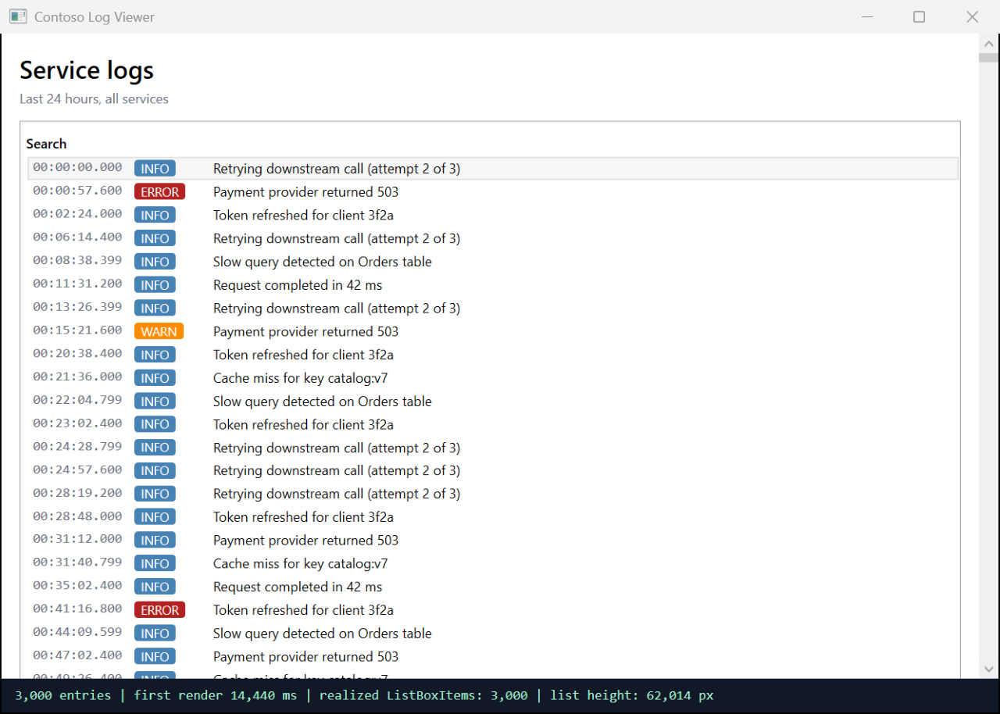
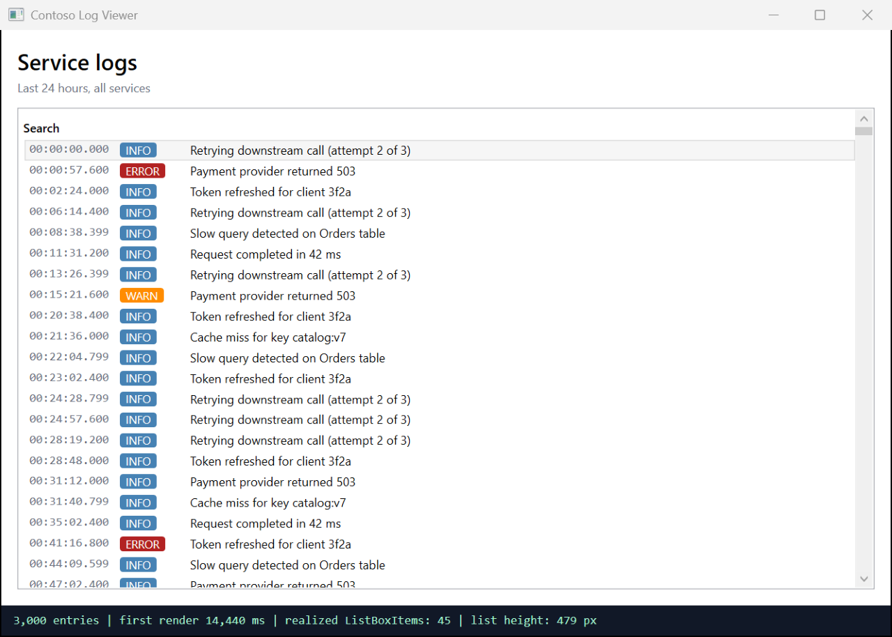
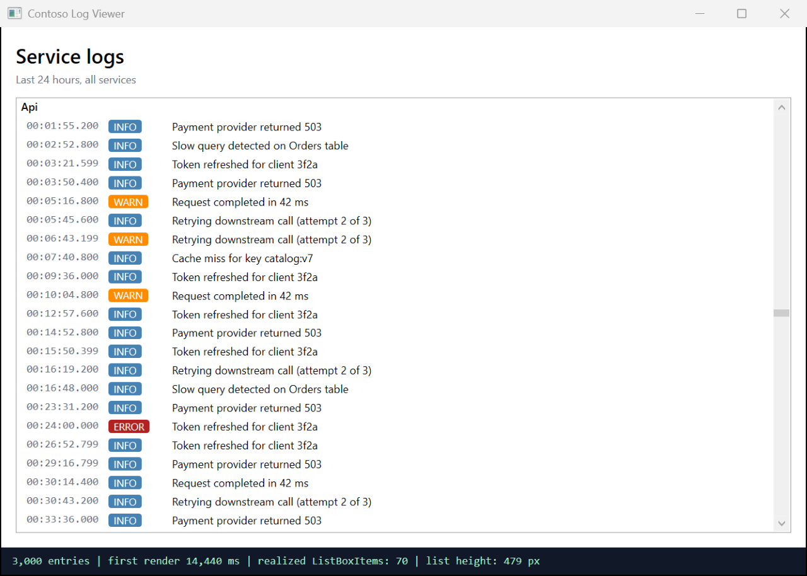
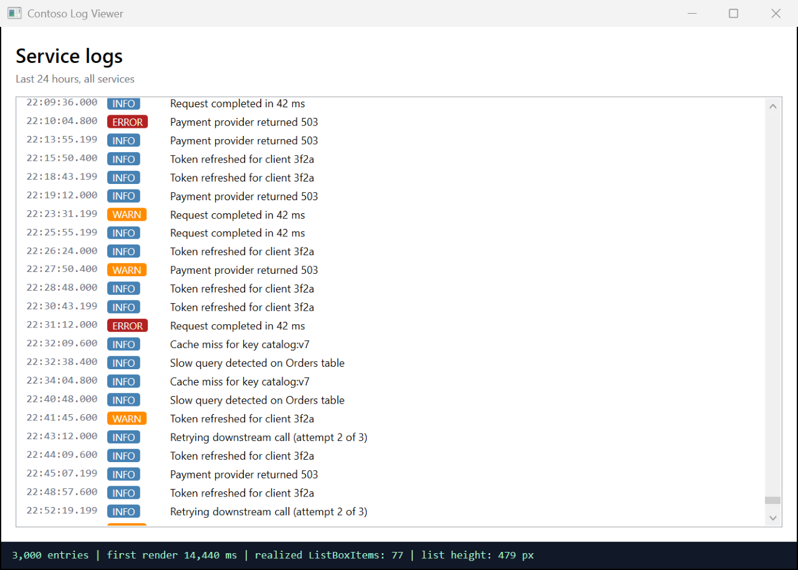
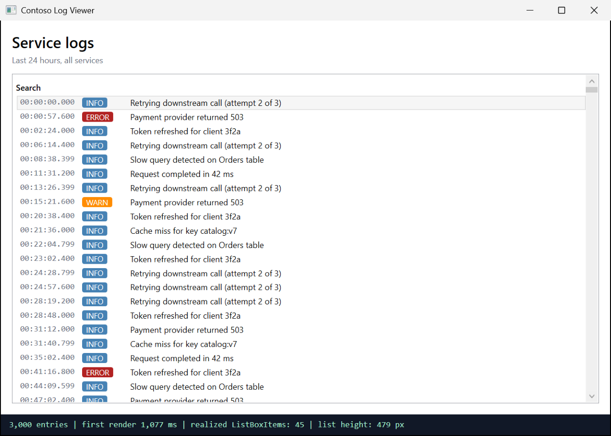

# Session transcript

Source: `Q:\source\XamlAgentDemos-notes\test-runs\SlowScroll\run2\events.jsonl`

## Tool usage

- xaml_find_elements: 12
- get_file: 12
- xaml_capture_image: 9
- xaml_get_element_properties: 9
- xaml_explain_property_value: 6
- xaml_apply_hot_reload: 5
- get_output_window_logs: 5
- replace_string_in_file: 4
- xaml_list_apps: 3
- powershell: 3
- xaml_get_binding_failures: 3
- xaml_interact: 3
- debugger_ui_tree: 3
- task: 2
- get_projects_in_solution: 2
- view: 2
- xaml_get_element_bounds: 2
- xaml_get_visual_tree: 2
- rg: 2
- read_agent: 2
- task_complete: 2
- skill: 1
- glob: 1
- get_files_in_project: 1
- xaml_list_windows: 1
- collect_trace_from_app: 1
- get_open_perf_traces: 1
- lookup_vs: 1
- multi_replace_string_in_file: 1
- xaml_get_hot_reload_status: 1
- ask_question: 1
- debugger_launch: 1
- debugger_get_threads: 1
- debugger_wait: 1
- debugger_get_output_window_text: 1

Failed tool calls: 6, images: 5


_Model: gpt-6.1-terra_


## User (16:00:07)

My log viewer is very slow to open and scroll. Use the running app to prove what's wrong, then fix it and show me the improvement after each change.


**Tool call (16:00:11):** `skill`
```json
{
 "skill": "xaml-diagnostics"
}
```

<details><summary>Result `skill` success=true</summary>

```
Skill "xaml-diagnostics" loaded successfully. Follow the instructions in the skill context.
```
</details>


_Skill invoked: xaml-diagnostics_


**Assistant (16:00:15):**

I’ll measure the running viewer first, then apply and check each fix separately.


**Tool call (16:00:15):** `task`
```json
{
 "description": "Profile log viewer performance",
 "prompt": "Investigate the running log viewer's slow opening and scrolling with Visual Studio Profiler. Measure a baseline and identify concrete runtime bottlenecks with evidence and reproducible steps. Do not edit code or stop the running app. Report measurements, relevant source locations and profiler limitations. Do not delegate.",
 "agent_type": "profiler",
 "name": "viewer-profile",
 "mode": "background"
}
```

<details><summary>Result `task` success=true</summary>

```
Agent started in background with agent_id: a4abc8db-4bcb-4729-814f-50b026bc2e42. You'll be notified when it completes. Tell the user you're waiting and end your response, or continue unrelated work until notified. The agent supports multi-turn conversations. Use write_agent only for same-task follow-ups where retained context is useful. For unrelated work or the next independent batch item, use a fresh task when available rather than repurposing an existing agent.
```
</details>


## User (16:00:16)

Investigate the running log viewer's slow opening and scrolling with Visual Studio Profiler. Measure a baseline and identify concrete runtime bottlenecks with evidence and reproducible steps. Do not edit code or stop the running app. Report measurements, relevant source locations and profiler limitations. Do not delegate.


**Tool call (16:00:17):** `xaml_list_apps`
```json
{
 "progressMessage": "Inspect the running log viewer"
}
```


**Tool call (16:00:17):** `get_projects_in_solution`
```json
{}
```


**Tool call (16:00:17):** `powershell`
```json
{
 "command": "git status --short",
 "description": "Check working tree changes"
}
```

<details><summary>Result `get_projects_in_solution` success=true</summary>

```
src\GhostClicks\GhostClicks.csproj
src\GermanReady\GermanReady.csproj
src\ThemeBreaker\ThemeBreaker.csproj
src\DesignPolish\DesignPolish.csproj
src\HotReloadDoctor\HotReloadDoctor.csproj
src\VanishingSave\VanishingSave.csproj
src\CrispPixels\CrispPixels.csproj
src\PrecedenceWars\PrecedenceWars.csproj
src\LostWindows\LostWindows.csproj
src\TemplateDetective\TemplateDetective.csproj
src\SlowScroll\SlowScroll.csproj
src\PixelPerfect\PixelPerfect.csproj
src\BindingStorm\BindingStorm.csproj
src\BugRepro\BugRepro.csproj
src\A11ySweep\A11ySweep.csproj
src\StyleMaze\StyleMaze.csproj
src\ResponsiveDashboard\ResponsiveDashboard.csproj

```
</details>

<details><summary>Result `xaml_list_apps` success=true</summary>

```
{"isDebugging":true,"debuggerState":"running","diagnosticsActive":true,"apps":[{"app":"a1","name":"SlowScroll.exe [59740]","processId":59740,"platform":"WPF (.NET)","isRemote":false,"isDesignTimeOrNoDebug":false,"sourceInfoAvailable":true,"hotReloadSupported":true,"hotReloadEnabled":true,"supportsPropertyExplorer":true,"supportsInAppToolbar":true,"windowCount":1}]}
```
</details>


**Tool call (16:00:19):** `get_projects_in_solution`
```json
{}
```

<details><summary>Result `powershell` success=true</summary>

```

<shellId: 0 completed with exit code 0>
```
</details>

<details><summary>Result `get_projects_in_solution` success=true</summary>

```
src\GhostClicks\GhostClicks.csproj
src\GermanReady\GermanReady.csproj
src\ThemeBreaker\ThemeBreaker.csproj
src\DesignPolish\DesignPolish.csproj
src\HotReloadDoctor\HotReloadDoctor.csproj
src\VanishingSave\VanishingSave.csproj
src\CrispPixels\CrispPixels.csproj
src\PrecedenceWars\PrecedenceWars.csproj
src\LostWindows\LostWindows.csproj
src\TemplateDetective\TemplateDetective.csproj
src\SlowScroll\SlowScroll.csproj
src\PixelPerfect\PixelPerfect.csproj
src\BindingStorm\BindingStorm.csproj
src\BugRepro\BugRepro.csproj
src\A11ySweep\A11ySweep.csproj
src\StyleMaze\StyleMaze.csproj
src\ResponsiveDashboard\ResponsiveDashboard.csproj

```
</details>


**Tool call (16:00:22):** `xaml_find_elements`
```json
{
 "progressMessage": "Count realized log entries",
 "type": "ListBoxItem",
 "maxResults": 3
}
```


**Tool call (16:00:22):** `xaml_find_elements`
```json
{
 "progressMessage": "Locate the log viewer",
 "type": "ListBox",
 "maxResults": 10
}
```


**Tool call (16:00:22):** `xaml_capture_image`
```json
{
 "progressMessage": "Capture the current viewer"
}
```


**Tool call (16:00:22):** `view`
```json
{
 "path": "Q:\\source\\XamlAgentDemos\\src\\SlowScroll"
}
```


**Tool call (16:00:22):** `glob`
```json
{
 "patterns": "**/*",
 "paths": [
  "Q:\\source\\XamlAgentDemos\\src\\SlowScroll"
 ]
}
```

<details><summary>Result `glob` success=false</summary>

```
Invalid input: "pattern": Required
```
</details>

<details><summary>Result `xaml_find_elements` success=true</summary>

```
{"count":1,"totalMatches":1,"truncated":false,"results":[{"id":"a1:29","type":"System.Windows.Controls.ListBox","name":"LogList","source":{"file":"Q:\\source\\XamlAgentDemos\\src\\SlowScroll\\MainWindow.xaml","line":35,"column":18},"path":"MainWindow/Border/AdornerDecorator/ContentPresenter/DockPanel/ScrollViewer/Grid/ScrollContentPresenter/StackPanel/ListBox"}]}
```
</details>

<details><summary>Result `xaml_find_elements` success=true</summary>

```
{"count":3,"totalMatches":3000,"truncated":true,"results":[{"id":"a1:80","type":"System.Windows.Controls.ListBoxItem","path":"MainWindow/Border/AdornerDecorator/ContentPresenter/DockPanel/ScrollViewer/Grid/ScrollContentPresenter/StackPanel/ListBox/Border/ScrollViewer/Grid/ScrollContentPresenter/ItemsPresenter/StackPanel/GroupItem/StackPanel/ItemsPresenter/VirtualizingStackPanel/ListBoxItem"},{"id":"a1:81","type":"System.Windows.Controls.ListBoxItem","path":"MainWindow/Border/AdornerDecorator/ContentPresenter/DockPanel/ScrollViewer/Grid/ScrollContentPresenter/StackPanel/ListBox/Border/ScrollViewer/Grid/ScrollContentPresenter/ItemsPresenter/StackPanel/GroupItem/StackPanel/ItemsPresenter/VirtualizingStackPanel/ListBoxItem"},{"id":"a1:82","type":"System.Windows.Controls.ListBoxItem","path":"MainWindow/Border/AdornerDecorator/ContentPresenter/DockPanel/ScrollViewer/Grid/ScrollContentPresenter/StackPanel/ListBox/Border/ScrollViewer/Grid/ScrollContentPresenter/ItemsPresenter/StackPanel/GroupItem/StackPanel/ItemsPresenter/VirtualizingStackPanel/ListBoxItem"}]}
```
</details>


**Tool call (16:00:22):** `get_files_in_project`
```json
{
 "projectPath": "src\\SlowScroll\\SlowScroll.csproj"
}
```

<details><summary>Result `view` success=true</summary>

```
App.xaml
App.xaml.cs
MainWindow.xaml
MainWindow.xaml.cs
SlowScroll.csproj
bin
obj
```
</details>

<details><summary>Result `get_files_in_project` success=true</summary>

```
src\SlowScroll\App.xaml
src\Shared\DemoHost.cs
src\Shared\ObservableObject.cs
src\Shared\RelayCommand.cs
src\SlowScroll\App.xaml.cs
src\SlowScroll\MainWindow.xaml.cs
src\SlowScroll\MainWindow.xaml

```
</details>




<details><summary>Result `xaml_capture_image` success=true</summary>

```
Screenshot of window 0x9F0560 "Contoso Log Viewer" of app a1 (1280x914 image of the window's client area, so it's slightly smaller than the frame bounds from xaml_list_windows).
```
</details>


**Tool call (16:00:25):** `get_file`
```json
{
 "filename": "src\\SlowScroll\\MainWindow.xaml",
 "startLine": 1,
 "endLine": 240,
 "includeLineNumbers": true
}
```


**Tool call (16:00:25):** `get_file`
```json
{
 "filename": "src\\SlowScroll\\MainWindow.xaml.cs",
 "startLine": 1,
 "endLine": 300,
 "includeLineNumbers": true
}
```


**Tool call (16:00:25):** `get_file`
```json
{
 "filename": "src\\SlowScroll\\SlowScroll.csproj",
 "startLine": 1,
 "endLine": 100,
 "includeLineNumbers": true
}
```

<details><summary>Result `get_file` success=true</summary>

```
``` src\SlowScroll\SlowScroll.csproj (Lines 1-5 of 5 total. Call tools for more if needed.)
1: <Project Sdk="Microsoft.NET.Sdk">
2:   <PropertyGroup>
3:     <RootNamespace>SlowScroll</RootNamespace>
4:   </PropertyGroup>
5: </Project>

```


```
</details>

<details><summary>Result `get_file` success=true</summary>

```
```csharp src\SlowScroll\MainWindow.xaml.cs (Lines 1-89 of 89 total. Call tools for more if needed.)
1: using System.Diagnostics;
2: using System.Windows;
3: using System.Windows.Controls;
4: using System.Windows.Media;
5: using System.Windows.Threading;
6: 
7: namespace SlowScroll;
8: 
9: public sealed record LogEntry(DateTime Time, string Level, string Source, string Message)
10: {
11:     public Brush LevelBrush => this.Level switch
12:     {
13:         "ERROR" => Brushes.Firebrick,
14:         "WARN" => Brushes.DarkOrange,
15:         _ => Brushes.SteelBlue,
16:     };
17: }
18: 
19: public partial class MainWindow : Window
20: {
21:     private const int EntryCount = 3000;
22:     private readonly Stopwatch startup = Stopwatch.StartNew();
23:     private readonly DispatcherTimer perfTimer = new() { Interval = TimeSpan.FromSeconds(1) };
24:     private long renderedMs;
25: 
26:     public MainWindow()
27:     {
28:         this.InitializeComponent();
29:         this.DataContext = new { Entries = CreateEntries() };
30:         this.perfTimer.Tick += (_, _) => this.UpdatePerfText();
31:     }
32: 
33:     private static List<LogEntry> CreateEntries()
34:     {
35:         string[] sources = ["Api", "Auth", "Billing", "Search"];
36:         string[] messages =
37:         [
38:             "Request completed in 42 ms",
39:             "Cache miss for key catalog:v7",
40:             "Token refreshed for client 3f2a",
41:             "Retrying downstream call (attempt 2 of 3)",
42:             "Slow query detected on Orders table",
43:             "Payment provider returned 503",
44:         ];
45: 
46:         var random = new Random(7);
47:         DateTime start = DateTime.Today;
48:         return Enumerable.Range(0, EntryCount)
49:             .Select(i =>
50:             {
51:                 int roll = random.Next(100);
52:                 string level = roll < 5 ? "ERROR" : roll < 20 ? "WARN" : "INFO";
53:                 return new LogEntry(start.AddSeconds(i * 28.8), level, sources[random.Next(sources.Length)], messages[random.Next(messages.Length)]);
54:             })
55:             .ToList();
56:     }
57: 
58:     private void OnContentRendered(object? sender, EventArgs e)
59:     {
60:         this.renderedMs = this.startup.ElapsedMilliseconds;
61:         this.UpdatePerfText();
62:         this.perfTimer.Start();
63:     }
64: 
65:     private void UpdatePerfText()
66:    
... [truncated 885 chars]
```
</details>


**Tool call (16:00:26):** `get_file`
```json
{
 "filename": "src\\SlowScroll\\MainWindow.xaml",
 "startLine": 1,
 "endLine": 240
}
```


**Tool call (16:00:26):** `get_file`
```json
{
 "filename": "src\\SlowScroll\\MainWindow.xaml.cs",
 "startLine": 1,
 "endLine": 260
}
```


**Tool call (16:00:26):** `get_file`
```json
{
 "filename": "src\\SlowScroll\\SlowScroll.csproj",
 "startLine": 1,
 "endLine": 120
}
```


**Tool call (16:00:26):** `xaml_get_element_bounds`
```json
{
 "progressMessage": "Measure the log list viewport",
 "elementIds": [
  "a1:29"
 ]
}
```


**Tool call (16:00:26):** `xaml_get_element_properties`
```json
{
 "progressMessage": "Inspect scrolling and virtualization settings",
 "elementId": "a1:29",
 "includeAll": true
}
```


**Tool call (16:00:26):** `xaml_list_windows`
```json
{
 "progressMessage": "Measure the app window"
}
```

<details><summary>Result `get_file` success=true</summary>

```
```xaml src\SlowScroll\MainWindow.xaml (Lines 1-81 of 81 total. Call tools for more if needed.)
1: <Window x:Class="SlowScroll.MainWindow"
2:         xmlns="http://schemas.microsoft.com/winfx/2006/xaml/presentation"
3:         xmlns:x="http://schemas.microsoft.com/winfx/2006/xaml"
4:         Title="Contoso Log Viewer"
5:         Width="900"
6:         Height="640"
7:         ContentRendered="OnContentRendered">
8:     <Window.Resources>
9:         <CollectionViewSource x:Key="GroupedEntries" Source="{Binding Entries}">
10:             <CollectionViewSource.GroupDescriptions>
11:                 <PropertyGroupDescription PropertyName="Source" />
12:             </CollectionViewSource.GroupDescriptions>
13:         </CollectionViewSource>
14:     </Window.Resources>
15: 
16:     <DockPanel>
17:         <Border Padding="12,8"
18:                 Background="#111827"
19:                 DockPanel.Dock="Bottom">
20:             <TextBlock x:Name="PerfText"
21:                        FontFamily="Consolas"
22:                        Foreground="#A7F3D0"
23:                        Text="Measuring..." />
24:         </Border>
25: 
26:         <ScrollViewer x:Name="PageScroller" VerticalScrollBarVisibility="Auto">
27:             <StackPanel Margin="16">
28:                 <TextBlock FontSize="22"
29:                            FontWeight="SemiBold"
30:                            Text="Service logs" />
31:                 <TextBlock Margin="0,4,0,12"
32:                            Foreground="#6B7280"
33:                            Text="Last 24 hours, all services" />
34: 
35:                 <ListBox x:Name="LogList"
36:                          HorizontalContentAlignment="Stretch"
37:                          ItemsSource="{Binding Source={StaticResource GroupedEntries}}"
38:                          ScrollViewer.CanContentScroll="False">
39:                     <ListBox.GroupStyle>
40:                         <GroupStyle>
41:                             <GroupStyle.HeaderTemplate>
42:                                 <DataTemplate>
43:                                     <TextBlock Margin="4,10,0,4"
44:                                                FontWeight="SemiBold"
45:                                                Text="{Binding Name}" />
46:                                 </DataTemplate>
47:                             </GroupStyle.HeaderTemplate>
48:                         </GroupStyle>
49:              
... [truncated 1898 chars]
```
</details>

<details><summary>Result `xaml_list_windows` success=true</summary>

```
{"windows":[{"windowId":"0x9F0560","app":"a1","title":"Contoso Log Viewer","bounds":{"x":38,"y":38,"width":1350,"height":960},"dpiScale":1.5,"visible":true,"minimized":false}],"note":"bounds are physical screen pixels and include the window frame. A WPF/WinUI Window's Width and Height are device-independent units (DIPs) that also include the frame, so Width = bounds.width / dpiScale. A user's \"800 px wide\" is ambiguous: say which unit you tested. A minimized window reports x/y = -32000 and can't be captured."}
```
</details>

<details><summary>Result `get_file` success=true</summary>

```
```csharp src\SlowScroll\MainWindow.xaml.cs (Lines 1-89 of 89 total. Call tools for more if needed.)
using System.Diagnostics;
using System.Windows;
using System.Windows.Controls;
using System.Windows.Media;
using System.Windows.Threading;

namespace SlowScroll;

public sealed record LogEntry(DateTime Time, string Level, string Source, string Message)
{
    public Brush LevelBrush => this.Level switch
    {
        "ERROR" => Brushes.Firebrick,
        "WARN" => Brushes.DarkOrange,
        _ => Brushes.SteelBlue,
    };
}

public partial class MainWindow : Window
{
    private const int EntryCount = 3000;
    private readonly Stopwatch startup = Stopwatch.StartNew();
    private readonly DispatcherTimer perfTimer = new() { Interval = TimeSpan.FromSeconds(1) };
    private long renderedMs;

    public MainWindow()
    {
        this.InitializeComponent();
        this.DataContext = new { Entries = CreateEntries() };
        this.perfTimer.Tick += (_, _) => this.UpdatePerfText();
    }

    private static List<LogEntry> CreateEntries()
    {
        string[] sources = ["Api", "Auth", "Billing", "Search"];
        string[] messages =
        [
            "Request completed in 42 ms",
            "Cache miss for key catalog:v7",
            "Token refreshed for client 3f2a",
            "Retrying downstream call (attempt 2 of 3)",
            "Slow query detected on Orders table",
            "Payment provider returned 503",
        ];

        var random = new Random(7);
        DateTime start = DateTime.Today;
        return Enumerable.Range(0, EntryCount)
            .Select(i =>
            {
                int roll = random.Next(100);
                string level = roll < 5 ? "ERROR" : roll < 20 ? "WARN" : "INFO";
                return new LogEntry(start.AddSeconds(i * 28.8), level, sources[random.Next(sources.Length)], messages[random.Next(messages.Length)]);
            })
            .ToList();
    }

    private void OnContentRendered(object? sender, EventArgs e)
    {
        this.renderedMs = this.startup.ElapsedMilliseconds;
        this.UpdatePerfText();
        this.perfTimer.Start();
    }

    private void UpdatePerfText()
    {
        int realized = CountDescendants<ListBoxItem>(this.LogList);
        this.PerfText.Text = $"{EntryCount:N0} entries | first render {this.renderedMs:N0} ms | realized ListBoxItems: {realized:N0} | list height: {this.LogList.ActualHeight:N0} px"
... [truncated 538 chars]
```
</details>

<details><summary>Result `get_file` success=true</summary>

```
```xaml src\SlowScroll\MainWindow.xaml (Lines 1-81 of 81 total. Call tools for more if needed.)
<Window x:Class="SlowScroll.MainWindow"
        xmlns="http://schemas.microsoft.com/winfx/2006/xaml/presentation"
        xmlns:x="http://schemas.microsoft.com/winfx/2006/xaml"
        Title="Contoso Log Viewer"
        Width="900"
        Height="640"
        ContentRendered="OnContentRendered">
    <Window.Resources>
        <CollectionViewSource x:Key="GroupedEntries" Source="{Binding Entries}">
            <CollectionViewSource.GroupDescriptions>
                <PropertyGroupDescription PropertyName="Source" />
            </CollectionViewSource.GroupDescriptions>
        </CollectionViewSource>
    </Window.Resources>

    <DockPanel>
        <Border Padding="12,8"
                Background="#111827"
                DockPanel.Dock="Bottom">
            <TextBlock x:Name="PerfText"
                       FontFamily="Consolas"
                       Foreground="#A7F3D0"
                       Text="Measuring..." />
        </Border>

        <ScrollViewer x:Name="PageScroller" VerticalScrollBarVisibility="Auto">
            <StackPanel Margin="16">
                <TextBlock FontSize="22"
                           FontWeight="SemiBold"
                           Text="Service logs" />
                <TextBlock Margin="0,4,0,12"
                           Foreground="#6B7280"
                           Text="Last 24 hours, all services" />

                <ListBox x:Name="LogList"
                         HorizontalContentAlignment="Stretch"
                         ItemsSource="{Binding Source={StaticResource GroupedEntries}}"
                         ScrollViewer.CanContentScroll="False">
                    <ListBox.GroupStyle>
                        <GroupStyle>
                            <GroupStyle.HeaderTemplate>
                                <DataTemplate>
                                    <TextBlock Margin="4,10,0,4"
                                               FontWeight="SemiBold"
                                               Text="{Binding Name}" />
                                </DataTemplate>
                            </GroupStyle.HeaderTemplate>
                        </GroupStyle>
                    </ListBox.GroupStyle>
                    <ListBox.ItemTemplate>
                        <DataTemplate>
                            <Grid>
                                <Grid
... [truncated 1583 chars]
```
</details>

<details><summary>Result `get_file` success=true</summary>

```
``` src\SlowScroll\SlowScroll.csproj (Lines 1-5 of 5 total. Call tools for more if needed.)
<Project Sdk="Microsoft.NET.Sdk">
  <PropertyGroup>
    <RootNamespace>SlowScroll</RootNamespace>
  </PropertyGroup>
</Project>

```


```
</details>

<details><summary>Result `xaml_get_element_properties` success=true</summary>

```
Output too large to read at once (24.9 KB). Saved to: C:\Users\peterspa\AppData\Local\Microsoft\VisualStudio\CopilotCli\6d448f68-7520-4a49-94f5-76ba9687376a\temp\1794672027259-copilot-tool-output-4add7d094ce44ac68728f2d812b3e269.txt
Consider using tools like rg (for searching), head/tail (for viewing start/end), view with view_range (for specific sections), or jq (for JSON) to examine portions of the output.

Preview (first 500 chars):
{"id":"a1:29","type":"System.Windows.Controls.ListBox","name":"LogList","source":{"file":"Q:\\source\\XamlAgentDemos\\src\\SlowScroll\\MainWindow.xaml","line":35,"column":18},"properties":[{"name":"SelectedIndex","value":"0","valueType":"System.Int32","propertyType":"System.Int32","declaringType":"System.Windows.Controls.Primitives.Selector","valueSource":"Coercion"},{"name":"SelectedItem","valueType":"SlowScroll.LogEntry","propertyType":"System.Object","declaringType":"System.Windows.Controls.P
```
</details>

<details><summary>Result `xaml_get_element_bounds` success=true</summary>

```
{"note":"'screen' is in physical screen pixels. 'window' is in device-independent units relative to the element's root window (multiply by dpiScale for pixels). Fractional screen pixel values (for example x=18.75) mean edges fall between device pixels, so thin lines and text render blurry unless layout rounding snaps them. isVisible only reflects Visibility/opacity; insideWindowFraction < 1 (clippedByWindow) means part of the element is outside the window's client area, so the user can't see that part. Ancestor clipping (ScrollViewer, Grid cell, ClipToBounds) isn't included; compare with the parent's bounds or call xaml_capture_image.","bounds":[{"id":"a1:29","isVisible":true,"insideWindowFraction":0.01,"clippedByWindow":true,"windowHandle":"0x9F0560","dpiScale":1.5,"screen":{"x":73.0,"y":199.0,"width":1254.0,"height":93021.0},"window":{"x":16.0,"y":77.22,"width":836.0,"height":62013.84}}]}
```
</details>


**Tool call (16:00:31):** `view`
```json
{
 "path": "C:\\vs\\fastmain\\common7\\ide\\commonextensions\\microsoft\\xamldiagnostics\\AgentTools\\skills\\xaml-diagnostics\\references\\xaml-authoring.md"
}
```


**Tool call (16:00:31):** `xaml_get_element_properties`
```json
{
 "progressMessage": "Inspect content scrolling",
 "elementId": "a1:29",
 "nameFilter": "CanContentScroll",
 "includeAll": true
}
```


**Tool call (16:00:31):** `xaml_get_element_properties`
```json
{
 "progressMessage": "Inspect grouped virtualization",
 "elementId": "a1:29",
 "nameFilter": "Virtualiz",
 "includeAll": true
}
```


**Tool call (16:00:31):** `xaml_get_visual_tree`
```json
{
 "progressMessage": "Inspect the list layout",
 "rootElementId": "a1:29",
 "depth": 3,
 "maxNodes": 30
}
```

<details><summary>Result `view` success=true</summary>

```
# XAML authoring guidance

Follow these rules when writing or changing XAML so it works well with XAML Hot Reload, the XAML designer, and XAML Diagnostics.

## Design-time data

- Declare `xmlns:d="http://schemas.microsoft.com/expression/blend/2008"` and `xmlns:mc="http://schemas.openxmlformats.org/markup-compatibility/2006"` with `mc:Ignorable="d"`.
- Use `d:DataContext="{d:DesignInstance Type=vm:MyViewModel, IsDesignTimeCreatable=False}"` (WPF/UWP) so the designer and IntelliSense know binding paths.
- Use `d:` properties (for example `d:Text="Sample"`) for sample values that appear only at design time.
- .NET MAUI: set `x:DataType` on pages and `DataTemplate`s. It enables compiled bindings and turns many binding failures into build errors.
- WinUI/UWP: prefer `x:Bind` for compile-time checked bindings when the view owns the view model.

## Bindings

- Bind with explicit paths. Avoid string-built paths in code-behind.
- Keep the `DataContext` chain simple. Use `ElementName` or `RelativeSource` only at real scope boundaries (for example inside a `DataTemplate` that needs the page's view model).
- Expose bound properties as public properties that raise `PropertyChanged`. Fields and non-public properties don't bind.
- Use `FallbackValue` and `TargetNullValue` for expected missing values instead of hiding binding errors.

## Hot reload and designer friendly code

- Keep control and page constructors cheap. Don't call services, open files, or start network calls in constructors or `InitializeComponent` paths. The designer and hot reload create instances again.
- Keep a public parameterless constructor on custom controls.
- Guard runtime-only work with `DesignerProperties.GetIsInDesignMode(this)` (WPF) or `Windows.ApplicationModel.DesignMode.DesignModeEnabled` (UWP/WinUI).
- Put styles, templates, and visual states in XAML, not code-behind. Hot reload can't update UI built in code.
- Don't walk the visual tree from code-behind to change visuals. Use bindings, triggers, and visual states.
- Use `x:Name` only for elements code-behind needs. Don't rename `x:Class` while the app is running.

## Resources

- Put shared resources in `App.xaml` merged dictionaries or the closest scope that uses them.
- A `StaticResource` must be defined earlier in load order. Use `DynamicResource` (WPF) or `ThemeResource` (UWP/WinUI) for theme values that change at runtime.
- To check where a key resolves at runtime, or whether a dictionary is merged a
... [truncated 618 chars]
```
</details>

<details><summary>Result `xaml_get_visual_tree` success=true</summary>

```
{"app":"a1","platform":"WPF (.NET)","sourceInfoAvailable":true,"nodeCount":30,"truncated":true,"depthLimitedNodes":2,"hint":"Output stopped at maxNodes. Pass rootElementId with a node's id to drill into a subtree, or use xaml_find_elements.","nodes":[{"id":"a1:29","type":"System.Windows.Controls.ListBox","name":"LogList","source":{"file":"Q:\\source\\XamlAgentDemos\\src\\SlowScroll\\MainWindow.xaml","line":35,"column":18},"childCount":1,"children":[{"id":"a1:34","type":"System.Windows.Controls.Border","name":"Bd","childCount":1,"children":[{"id":"a1:40","type":"System.Windows.Controls.ScrollViewer","childCount":1,"children":[{"id":"a1:46","type":"System.Windows.Controls.Grid","childCount":4,"children":[{"id":"a1:49","type":"System.Windows.Shapes.Rectangle","childCount":0},{"id":"a1:50","type":"System.Windows.Controls.ScrollContentPresenter","childCount":2,"children":[{"id":"a1:53","type":"System.Windows.Controls.ItemsPresenter","childCount":1,"children":[{"id":"a1:55","type":"System.Windows.Controls.StackPanel","childCount":4,"children":[{"id":"a1:56","type":"System.Windows.Controls.GroupItem","childCount":1,"children":[{"id":"a1:60","type":"System.Windows.Controls.StackPanel","childCount":2,"children":[{"id":"a1:64","type":"System.Windows.Controls.ContentPresenter","name":"PART_Header","childCount":1,"children":[{"id":"a1:72","type":"System.Windows.Controls.TextBlock","source":{"file":"Q:\\source\\XamlAgentDemos\\src\\SlowScroll\\MainWindow.xaml","line":43,"column":38},"childCount":0}]},{"id":"a1:65","type":"System.Windows.Controls.ItemsPresenter","name":"ItemsPresenter","childCount":1,"children":[{"id":"a1:73","type":"System.Windows.Controls.VirtualizingStackPanel","childCount":739,"children":[{"id":"a1:80","type":"System.Windows.Controls.ListBoxItem","childCount":1,"children":[{"id":"a1:3080","type":"System.Windows.Controls.Border","name":"Bd","childCount":1,"children":[{"id":"a1:6080","type":"System.Windows.Controls.ContentPresenter","childCount":1,"children":[{"id":"a1:9080","type":"System.Windows.Controls.Grid","source":{"file":"Q:\\source\\XamlAgentDemos\\src\\SlowScroll\\MainWindow.xaml","line":52,"column":30},"childCount":3,"children":[{"id":"a1:12080","type":"System.Windows.Controls.TextBlock","source":{"file":"Q:\\source\\XamlAgentDemos\\src\\SlowScroll\\MainWindow.xaml","line":58,"column":34},"childCount":0},{"id":"a1:12081","type":"System.Windows.Controls.Border","source":{"file":"Q:\\source\\XamlAgentDemos\\src\\SlowScroll\\MainWindow.xaml","
... [truncated 1521 chars]
```
</details>

<details><summary>Result `xaml_get_element_properties` success=true</summary>

```
{"id":"a1:29","type":"System.Windows.Controls.ListBox","name":"LogList","source":{"file":"Q:\\source\\XamlAgentDemos\\src\\SlowScroll\\MainWindow.xaml","line":35,"column":18},"properties":[{"name":"ScrollViewer.CanContentScroll","value":"False","valueType":"System.Boolean","propertyType":"System.Boolean","declaringType":"System.Windows.Controls.ScrollViewer","valueSource":"Local","valueSourceLocation":{"file":"Q:\\source\\XamlAgentDemos\\src\\SlowScroll\\MainWindow.xaml","line":35,"column":18},"isAttached":true}],"hiddenDefaultOrOverridden":2,"hint":"Default and overridden values were omitted. Pass includeAll=true to see them, or call xaml_explain_property_value for one property's full precedence chain."}
```
</details>

<details><summary>Result `xaml_get_element_properties` success=true</summary>

```
{"id":"a1:29","type":"System.Windows.Controls.ListBox","name":"LogList","source":{"file":"Q:\\source\\XamlAgentDemos\\src\\SlowScroll\\MainWindow.xaml","line":35,"column":18},"properties":[]}
```
</details>


**Tool call (16:00:32):** `get_file`
```json
{
 "filename": "src\\SlowScroll\\App.xaml.cs",
 "startLine": 1,
 "endLine": 120,
 "includeLineNumbers": true
}
```


**Tool call (16:00:32):** `get_file`
```json
{
 "filename": "src\\Shared\\DemoHost.cs",
 "startLine": 1,
 "endLine": 240,
 "includeLineNumbers": true
}
```


**Tool call (16:00:32):** `get_file`
```json
{
 "filename": "Directory.Build.props",
 "startLine": 1,
 "endLine": 180,
 "includeLineNumbers": true
}
```

<details><summary>Result `get_file` success=true</summary>

```
``` Directory.Build.props (Lines 1-15 of 15 total. Call tools for more if needed.)
1: <Project>
2:   <PropertyGroup>
3:     <TargetFramework>net10.0-windows</TargetFramework>
4:     <OutputType>WinExe</OutputType>
5:     <UseWPF>true</UseWPF>
6:     <Nullable>enable</Nullable>
7:     <ImplicitUsings>enable</ImplicitUsings>
8:     <LangVersion>latest</LangVersion>
9:   </PropertyGroup>
10: 
11:   <ItemGroup>
12:     <Compile Include="$(MSBuildThisFileDirectory)src\Shared\*.cs" Link="Shared\%(Filename)%(Extension)" />
13:     <Using Include="XamlAgentDemos" />
14:   </ItemGroup>
15: </Project>

```


```
</details>

<details><summary>Result `get_file` success=true</summary>

```
```csharp src\Shared\DemoHost.cs (Lines 1-96 of 96 total. Call tools for more if needed.)
1: using System.Diagnostics;
2: using System.IO;
3: using System.Windows;
4: using System.Windows.Media;
5: using System.Windows.Media.Imaging;
6: using System.Windows.Threading;
7: 
8: namespace XamlAgentDemos;
9: 
10: /// <summary>
11: /// Optional command-line switches used to validate the demos without Visual Studio.
12: /// They aren't needed for the demos themselves.
13: ///   --trace-bindings &lt;file&gt;   append WPF binding errors to a text file
14: ///   --snapshot &lt;file.png&gt;     render the main window to a PNG once it's settled, then exit
15: ///   --width / --height &lt;n&gt;    resize the main window after it loads
16: /// </summary>
17: public static class DemoHost
18: {
19:     public static void Initialize(Application app, string[] args)
20:     {
21:         if (GetArg(args, "--trace-bindings") is string tracePath)
22:         {
23:             var listener = new TextWriterTraceListener(tracePath);
24:             PresentationTraceSources.Refresh();
25:             PresentationTraceSources.DataBindingSource.Listeners.Add(listener);
26:             PresentationTraceSources.DataBindingSource.Switch.Level = SourceLevels.Warning;
27:             Trace.AutoFlush = true;
28:             app.Exit += (_, _) => listener.Flush();
29:         }
30: 
31:         string? width = GetArg(args, "--width");
32:         string? height = GetArg(args, "--height");
33:         if (width != null || height != null)
34:         {
35:             app.Dispatcher.BeginInvoke(DispatcherPriority.Loaded, () =>
36:             {
37:                 if (app.MainWindow is Window window)
38:                 {
39:                     window.SizeToContent = SizeToContent.Manual;
40:                     if (width != null)
41:                     {
42:                         window.Width = double.Parse(width);
43:                     }
44: 
45:                     if (height != null)
46:                     {
47:                         window.Height = double.Parse(height);
48:                     }
49:                 }
50:             });
51:         }
52: 
53:         if (GetArg(args, "--snapshot") is string snapshotPath)
54:         {
55:             var timer = new DispatcherTimer { Interval = TimeSpan.FromSeconds(2) };
56:             timer.Tick += (_, _) =>
57:             {
58:                 timer.Stop();
59:     
... [truncated 1754 chars]
```
</details>

<details><summary>Result `get_file` success=true</summary>

```
```csharp src\SlowScroll\App.xaml.cs (Lines 1-12 of 12 total. Call tools for more if needed.)
1: using System.Windows;
2: 
3: namespace SlowScroll;
4: 
5: public partial class App : Application
6: {
7:     protected override void OnStartup(StartupEventArgs e)
8:     {
9:         base.OnStartup(e);
10:         DemoHost.Initialize(this, e.Args);
11:     }
12: }

```


```
</details>


**Tool call (16:00:36):** `rg`
```json
{
 "pattern": "SlowScroll|Contoso Log Viewer",
 "glob": "*.md",
 "output_mode": "content",
 "-n": true
}
```

<details><summary>Result `rg` success=true</summary>

```
No matches found.
```
</details>


**Assistant (16:00:38):**

The log viewer is the `SlowScroll` WPF app. The available profiler collection starts an application; it cannot attach to the existing process. I’ll attempt a separate-instance baseline without stopping the running viewer, and distinguish measured results from source-only findings.


**Tool call (16:00:38):** `collect_trace_from_app`
```json
{
 "projectPath": "Q:\\source\\XamlAgentDemos\\src\\SlowScroll\\SlowScroll.csproj",
 "profilerType": "CPU"
}
```


**Tool call (16:00:41):** `xaml_explain_property_value`
```json
{
 "progressMessage": "Inspect grouping virtualization",
 "elementId": "a1:29",
 "propertyName": "VirtualizingPanel.IsVirtualizingWhenGrouping"
}
```

<details><summary>Result `xaml_explain_property_value` success=false</summary>

```
{
 "message": "{\"error\":\"PROPERTY_NOT_FOUND\",\"message\":\"Element 'a1:29' has no property named 'VirtualizingPanel.IsVirtualizingWhenGrouping'.\",\"hint\":\"Attached properties such as 'VirtualizingPanel.IsVirtualizingWhenGrouping' are listed only when the element has a value for them (set locally, by a style, or inherited). If it isn't listed, it has its framework default value. It can't be added at runtime with xaml_set_element_property; to try it, add it to the XAML and call xaml_apply_hot_reload.\"}",
 "code": "failure"
}
```
</details>

<details><summary>Result `collect_trace_from_app` success=false</summary>

```
{
 "message": "A RemoteInvocationException was thrown when calling tool collect_trace_from_app, its message: \"Cannot find session for document 'C:\\Users\\peterspa\\AppData\\Local\\Temp\\dh\\Report-739921f6cdd94324.diagsession'.\". Consider what you were trying to do, why, and whether you should continue or stop and ask for guidance.",
 "code": "failure"
}
```
</details>


**Assistant (16:00:43):**

The running viewer has already exposed a major problem: it creates all **3,000** row controls, and the list is about **62,014 DIPs** tall. Its displayed first-render time is **14,440 ms**. I’m waiting for the profiler’s baseline before changing the app so the comparison remains valid.


**Tool call (16:00:49):** `get_open_perf_traces`
```json
{}
```

<details><summary>Result `get_open_perf_traces` success=true</summary>

```
{"count":0,"traces":[]}
```
</details>


**Tool call (16:00:57):** `lookup_vs`
```json
{
 "terms": [
  "Performance Profiler attach to running process CPU Usage .NET WPF",
  "Performance Profiler stop collection leave target application running"
 ]
}
```

<details><summary>Result `lookup_vs` success=true</summary>

```
The following JSON describes some new Visual Studio 2026 settings that might be relevant:
```json
[{"Id":"Microsoft.VisualStudio.Component.VC.DiagnosticTools","Title":"Install C\u002B\u002B profiling tools","Description":"profiling profiler diagnostic tools diagnostics memory CPU performance graphics debugging","KeyboardShortcut":null},{"Id":"5EFC7975-14BC-11CF-9B2B-00AA00573819;213","Title":"Debug \u200E\u003E Attach to Process...","Description":null,"KeyboardShortcut":"Ctrl\u002BAlt\u002BP"},{"Id":"test.testExecutionEngine.keepHostProcessAlive","Title":"Keep test execution engine running between test runs","Description":null,"KeyboardShortcut":null},{"Id":"9B529DC2-A902-4EEA-9DCE-9E348551ABA6;775","Title":"Debug \u200E\u003E Performance Profiler...","Description":null,"KeyboardShortcut":"Alt\u002BF2"},{"Id":"9B529DC2-A902-4EEA-9DCE-9E348551ABA6;777","Title":"Debug \u200E\u003E Relaunch Performance Profiler","Description":null,"KeyboardShortcut":"Shift\u002BAlt\u002BF2"},{"Id":"Microsoft.VisualStudio.Component.Graphics.Tools","Title":"Install Graphics debugger and GPU profiler for DirectX","Description":"debug DirectX Game gpu graphics performance profile render shader","KeyboardShortcut":null},{"Id":"Microsoft.VisualStudio.Component.Windows11Sdk.WindowsPerformanceToolkit","Title":"Install Windows Performance Toolkit","Description":null,"KeyboardShortcut":null}]
```
```
</details>


**Assistant (16:01:13):**

## Result: baseline blocked

Visual Studio’s CPU-profiler collection failed with:

> `Cannot find session for document '…\Report-739921f6cdd94324.diagsession'`

No trace was available afterward. **No valid startup timing, CPU samples, scrolling latency, or allocation measurements were obtained.** I made no code changes and issued no stop/terminate command.

## Concrete source findings—not runtime-confirmed bottlenecks

| Suspected cost | Evidence |
|---|---|
| Excessive row realization and layout | `src/SlowScroll/MainWindow.xaml:26–38`: an outer `ScrollViewer` and vertical `StackPanel` contain the grouped list, with `CanContentScroll="False"`. This arrangement undermines viewport-based virtualization. |
| Grouped-list virtualization | `MainWindow.xaml:9–12,39–49`: grouping is enabled without explicitly enabling virtualization when grouping. Verify actual realized-container count before attributing cost. |
| Recurring UI-thread diagnostic work | `MainWindow.xaml.cs:23,30,65–85`: every second, the dispatcher recursively traverses the list’s entire visual tree and updates the footer. This could contribute periodic scrolling hitches. |
| Startup creates the entire dataset synchronously | `MainWindow.xaml.cs:21,26–55`: 3,000 entries are created before rendering. Its relative cost versus WPF layout remains unmeasured. |

## Reproducible baseline procedure

1. Preserve the current process. Use a separate launch for opening measurements; attaching after opening cannot recover startup activity.
2. Keep the default **900 × 640** window and **3,000 entries**.
3. Record the footer’s **first render**, **realized ListBoxItems**, and **list height** after opening.
4. Capture distinct idle and scrolling phases: idle 10 seconds, scroll down continuously 10 seconds, then back up 10 seconds.
5. Compare CPU stacks for WPF layout/container generation against `CountDescendants<T>` and `UpdatePerfText`. Repeat three times under identical conditions.

## Profiler limitations

- The available collection interface launches an app; it exposes no attach-to-running-process operation.
- The failed collection provides no evidence that the scrolling interaction was captured.
- The footer’s startup stopwatch begins during window construction—not process launch—and ends at `ContentRendered`.
- CPU samples alone do not measure frame latency or prove a virtualization failure.

**The likely investigation targets are clear, but runtime bottlenecks and a measured baseline remain unverified.**


**Tool call (16:01:13):** `read_agent`
```json
{
 "agent_id": "a4abc8db-4bcb-4729-814f-50b026bc2e42",
 "since_turn": 0
}
```

<details><summary>Result `read_agent` success=true</summary>

```
Agent is idle (waiting for messages). agent_id: a4abc8db-4bcb-4729-814f-50b026bc2e42, agent_type: profiler, status: idle, description: Profile log viewer performance, elapsed: 58s, total_turns: 1

[Turn 0]
## Result: baseline blocked

Visual Studio’s CPU-profiler collection failed with:

> `Cannot find session for document '…\Report-739921f6cdd94324.diagsession'`

No trace was available afterward. **No valid startup timing, CPU samples, scrolling latency, or allocation measurements were obtained.** I made no code changes and issued no stop/terminate command.

## Concrete source findings—not runtime-confirmed bottlenecks

| Suspected cost | Evidence |
|---|---|
| Excessive row realization and layout | `src/SlowScroll/MainWindow.xaml:26–38`: an outer `ScrollViewer` and vertical `StackPanel` contain the grouped list, with `CanContentScroll="False"`. This arrangement undermines viewport-based virtualization. |
| Grouped-list virtualization | `MainWindow.xaml:9–12,39–49`: grouping is enabled without explicitly enabling virtualization when grouping. Verify actual realized-container count before attributing cost. |
| Recurring UI-thread diagnostic work | `MainWindow.xaml.cs:23,30,65–85`: every second, the dispatcher recursively traverses the list’s entire visual tree and updates the footer. This could contribute periodic scrolling hitches. |
| Startup creates the entire dataset synchronously | `MainWindow.xaml.cs:21,26–55`: 3,000 entries are created before rendering. Its relative cost versus WPF layout remains unmeasured. |

## Reproducible baseline procedure

1. Preserve the current process. Use a separate launch for opening measurements; attaching after opening cannot recover startup activity.
2. Keep the default **900 × 640** window and **3,000 entries**.
3. Record the footer’s **first render**, **realized ListBoxItems**, and **list height** after opening.
4. Capture distinct idle and scrolling phases: idle 10 seconds, scroll down continuously 10 seconds, then back up 10 seconds.
5. Compare CPU stacks for WPF layout/container generation against `CountDescendants<T>` and `UpdatePerfText`. Repeat three times under identical conditions.

## Profiler limitations

- The available collection interface launches an app; it exposes no attach-to-running-process operation.
- The failed collection provides no evidence that the scrolling interaction was captured.
- The footer’s startup stopwatch begins during window construction—not process launch—and ends at `ContentRende
... [truncated 205 chars]
```
</details>


**Assistant (16:01:18):**

The profiler couldn’t collect a trace, but the live tree confirms all rows are realized. I’ll remove the three virtualization blockers one at a time and measure each result.


**Tool call (16:01:18):** `replace_string_in_file`
```json
{
 "filePath": "src\\SlowScroll\\MainWindow.xaml",
 "oldString": "                <ListBox x:Name=\"LogList\"\n                         HorizontalContentAlignment=\"Stretch\"\n                         ItemsSource=\"{Binding Source={StaticResource GroupedEntries}}\"\n                         ScrollViewer.CanContentScroll=\"False\">\n                    <ListBox.GroupStyle>\n                        <GroupStyle>\n                            <GroupStyle.HeaderTemplate>",
 "newString": "                <ListBox x:Name=\"LogList\"\n                         HorizontalContentAlignment=\"Stretch\"\n                         ItemsSource=\"{Binding Source={StaticResource GroupedEntries}}\"\n                         ScrollViewer.CanContentScroll=\"True\">\n                    <ListBox.GroupStyle>\n                        <GroupStyle>\n                            <GroupStyle.HeaderTemplate>"
}
```

<details><summary>Result `replace_string_in_file` success=true</summary>

```
Successfully replaced text in src\SlowScroll\MainWindow.xaml
```
</details>


**Tool call (16:01:22):** `xaml_apply_hot_reload`
```json
{
 "progressMessage": "Apply content-scrolling change"
}
```

<details><summary>Result `xaml_apply_hot_reload` success=true</summary>

```
{"applied":true,"errors":[],"log":[],"noNewActivity":true,"note":"Nothing new was logged by this apply. Usually the edits were already applied when they were made (XAML Hot Reload applies edits as they happen when it's enabled), or nothing was pending. It doesn't prove the app shows them: XAML that the app loads itself (XamlReader, files copied to the output folder, dictionaries swapped in code) is never hot reloaded, and code that sets the same property or picks another template/resource at runtime overrides the edit. Check the live value with xaml_explain_property_value or xaml_find_resource.","hint":"Call xaml_capture_image to verify the change visually. Views that aren't loaded (other tabs, closed dialogs) are updated when they're next shown. Source line numbers reported for existing elements can still point to the pre-edit lines until the element is recreated, so find elements by x:Name or type rather than by an old line number. Structural edits (wrapping or replacing a parent, changing a root's content) recreate elements, which resets their runtime state such as selection, checked state, typed text and scroll position, and invalidates their IDs. Re-establish the state you were testing before capturing again."}
```
</details>


**Tool call (16:01:24):** `xaml_find_elements`
```json
{
 "progressMessage": "Count rows after first change",
 "type": "ListBoxItem",
 "maxResults": 1
}
```


**Tool call (16:01:24):** `xaml_find_elements`
```json
{
 "progressMessage": "Find the refreshed log list",
 "name": "LogList",
 "maxResults": 2
}
```


**Tool call (16:01:24):** `xaml_capture_image`
```json
{
 "progressMessage": "Capture the first change"
}
```

<details><summary>Result `xaml_find_elements` success=true</summary>

```
{"count":1,"totalMatches":3000,"truncated":true,"results":[{"id":"a1:80","type":"System.Windows.Controls.ListBoxItem","path":"MainWindow/Border/AdornerDecorator/ContentPresenter/DockPanel/ScrollViewer/Grid/ScrollContentPresenter/StackPanel/ListBox/Border/ScrollViewer/Grid/ScrollContentPresenter/ItemsPresenter/StackPanel/GroupItem/StackPanel/ItemsPresenter/VirtualizingStackPanel/ListBoxItem"}]}
```
</details>

<details><summary>Result `xaml_find_elements` success=true</summary>

```
{"count":1,"totalMatches":1,"truncated":false,"results":[{"id":"a1:29","type":"System.Windows.Controls.ListBox","name":"LogList","source":{"file":"Q:\\source\\XamlAgentDemos\\src\\SlowScroll\\MainWindow.xaml","line":35,"column":18},"path":"MainWindow/Border/AdornerDecorator/ContentPresenter/DockPanel/ScrollViewer/Grid/ScrollContentPresenter/StackPanel/ListBox"}]}
```
</details>

<details><summary>Result `xaml_capture_image` success=true</summary>

```
Screenshot of window 0x9F0560 "Contoso Log Viewer" of app a1 (1280x914 image of the window's client area, so it's slightly smaller than the frame bounds from xaml_list_windows). Note: this image is pixel-identical to the previous capture of this window, so nothing visible changed since then (the chat may show it as a reference to the earlier image).
```
</details>


**Tool call (16:01:27):** `xaml_explain_property_value`
```json
{
 "progressMessage": "Verify content scrolling applied",
 "elementId": "a1:29",
 "propertyName": "ScrollViewer.CanContentScroll"
}
```

<details><summary>Result `xaml_explain_property_value` success=true</summary>

```
{"id":"a1:29","type":"System.Windows.Controls.ListBox","property":"ScrollViewer.CanContentScroll","propertyType":"System.Boolean","effectiveValue":"True","effectiveSource":"Local","chain":[{"kind":"Local","description":"Local value set on the element (XAML attribute, binding or code). Wins over styles, templates and inheritance.","value":"True","valueType":"System.Boolean","effective":true,"sourceLocation":{"file":"Q:\\source\\XamlAgentDemos\\src\\SlowScroll\\MainWindow.xaml","line":35,"column":18}},{"kind":"BuiltInStyle","description":"Setter in the control's default theme style (generic.xaml or the platform theme).","targetType":"System.Windows.Controls.ListBox","value":"True","valueType":"System.Boolean","effective":false},{"kind":"Default","description":"The property's default value; nothing sets it.","value":"False","valueType":"System.Boolean","effective":false}],"notes":["To let a style or template value apply, remove the local value (the attribute, binding or code assignment). To change it, edit that local value. XAML and code both produce Local values, and the source location may still point to the XAML attribute after code assigned a new value. If the live value differs from the XAML attribute, or the element has no XAML attribute for it, code set it: search code-behind for the element's x:Name."]}
```
</details>


**Assistant (16:01:32):**

Change 1 is live, but the count remains **3,000**: content scrolling alone cannot overcome the other blockers. The first-render number remains the original startup measurement.


**Tool call (16:01:32):** `replace_string_in_file`
```json
{
 "filePath": "src\\SlowScroll\\MainWindow.xaml",
 "oldString": "                <ListBox x:Name=\"LogList\"\n                         HorizontalContentAlignment=\"Stretch\"\n                         ItemsSource=\"{Binding Source={StaticResource GroupedEntries}}\"\n                         ScrollViewer.CanContentScroll=\"True\">\n                    <ListBox.GroupStyle>\n                        <GroupStyle>\n                            <GroupStyle.HeaderTemplate>",
 "newString": "                <ListBox x:Name=\"LogList\"\n                         HorizontalContentAlignment=\"Stretch\"\n                         ItemsSource=\"{Binding Source={StaticResource GroupedEntries}}\"\n                         ScrollViewer.CanContentScroll=\"True\"\n                         VirtualizingPanel.IsVirtualizingWhenGrouping=\"True\">\n                    <ListBox.GroupStyle>\n                        <GroupStyle>\n                            <GroupStyle.HeaderTemplate>"
}
```

<details><summary>Result `replace_string_in_file` success=true</summary>

```
Successfully replaced text in src\SlowScroll\MainWindow.xaml
```
</details>


**Tool call (16:01:34):** `xaml_apply_hot_reload`
```json
{
 "progressMessage": "Apply grouped virtualization"
}
```

<details><summary>Result `xaml_apply_hot_reload` success=true</summary>

```
{"applied":true,"errors":[],"log":[],"noNewActivity":true,"note":"Nothing new was logged by this apply. Usually the edits were already applied when they were made (XAML Hot Reload applies edits as they happen when it's enabled), or nothing was pending. It doesn't prove the app shows them: XAML that the app loads itself (XamlReader, files copied to the output folder, dictionaries swapped in code) is never hot reloaded, and code that sets the same property or picks another template/resource at runtime overrides the edit. Check the live value with xaml_explain_property_value or xaml_find_resource.","hint":"Call xaml_capture_image to verify the change visually. Views that aren't loaded (other tabs, closed dialogs) are updated when they're next shown. Source line numbers reported for existing elements can still point to the pre-edit lines until the element is recreated, so find elements by x:Name or type rather than by an old line number. Structural edits (wrapping or replacing a parent, changing a root's content) recreate elements, which resets their runtime state such as selection, checked state, typed text and scroll position, and invalidates their IDs. Re-establish the state you were testing before capturing again."}
```
</details>


**Tool call (16:01:39):** `xaml_find_elements`
```json
{
 "progressMessage": "Count rows after second change",
 "type": "ListBoxItem",
 "maxResults": 1
}
```


**Tool call (16:01:39):** `xaml_explain_property_value`
```json
{
 "progressMessage": "Verify grouped virtualization applied",
 "elementId": "a1:29",
 "propertyName": "VirtualizingPanel.IsVirtualizingWhenGrouping"
}
```


**Tool call (16:01:39):** `xaml_capture_image`
```json
{
 "progressMessage": "Capture the second change"
}
```

<details><summary>Result `xaml_find_elements` success=true</summary>

```
{"count":1,"totalMatches":3000,"truncated":true,"results":[{"id":"a1:24132","type":"System.Windows.Controls.ListBoxItem","path":"MainWindow/Border/AdornerDecorator/ContentPresenter/DockPanel/ScrollViewer/Grid/ScrollContentPresenter/StackPanel/ListBox/Border/ScrollViewer/Grid/ScrollContentPresenter/ItemsPresenter/VirtualizingStackPanel/GroupItem/StackPanel/ItemsPresenter/VirtualizingStackPanel/ListBoxItem"}]}
```
</details>

<details><summary>Result `xaml_explain_property_value` success=false</summary>

```
{
 "message": "{\"error\":\"TAP_TIMEOUT\",\"message\":\"The running app didn't respond in time.\",\"hint\":\"The app may be paused at a breakpoint or busy (for example a long-running UI thread operation). Call xaml_list_apps to check debuggerState, continue it if it's paused, and try again.\"}",
 "code": "failure"
}
```
</details>

<details><summary>Result `xaml_capture_image` success=true</summary>

```
Screenshot of window 0x9F0560 "Contoso Log Viewer" of app a1 (1280x914 image of the window's client area, so it's slightly smaller than the frame bounds from xaml_list_windows). Note: this image is pixel-identical to the previous capture of this window, so nothing visible changed since then (the chat may show it as a reference to the earlier image).
```
</details>


**Tool call (16:02:07):** `xaml_list_apps`
```json
{
 "progressMessage": "Check the app is responsive"
}
```


**Tool call (16:02:07):** `rg`
```json
{
 "pattern": "PageScroller",
 "paths": "Q:\\source\\XamlAgentDemos\\src\\SlowScroll",
 "glob": "*.{xaml,cs}",
 "output_mode": "content",
 "-n": true
}
```


**Tool call (16:02:07):** `get_file`
```json
{
 "filename": "src\\SlowScroll\\MainWindow.xaml",
 "startLine": 19,
 "endLine": 85
}
```

<details><summary>Result `xaml_list_apps` success=true</summary>

```
{"isDebugging":true,"debuggerState":"running","diagnosticsActive":true,"apps":[{"app":"a1","name":"SlowScroll.exe [59740]","processId":59740,"platform":"WPF (.NET)","isRemote":false,"isDesignTimeOrNoDebug":false,"sourceInfoAvailable":true,"hotReloadSupported":true,"hotReloadEnabled":true,"supportsPropertyExplorer":true,"supportsInAppToolbar":true,"windowCount":1}]}
```
</details>

<details><summary>Result `get_file` success=true</summary>

```
```xaml src\SlowScroll\MainWindow.xaml (Lines 19-82 of 82 total. Call tools for more if needed.)
                DockPanel.Dock="Bottom">
            <TextBlock x:Name="PerfText"
                       FontFamily="Consolas"
                       Foreground="#A7F3D0"
                       Text="Measuring..." />
        </Border>

        <ScrollViewer x:Name="PageScroller" VerticalScrollBarVisibility="Auto">
            <StackPanel Margin="16">
                <TextBlock FontSize="22"
                           FontWeight="SemiBold"
                           Text="Service logs" />
                <TextBlock Margin="0,4,0,12"
                           Foreground="#6B7280"
                           Text="Last 24 hours, all services" />

                <ListBox x:Name="LogList"
                         HorizontalContentAlignment="Stretch"
                         ItemsSource="{Binding Source={StaticResource GroupedEntries}}"
                         ScrollViewer.CanContentScroll="True"
                         VirtualizingPanel.IsVirtualizingWhenGrouping="True">
                    <ListBox.GroupStyle>
                        <GroupStyle>
                            <GroupStyle.HeaderTemplate>
                                <DataTemplate>
                                    <TextBlock Margin="4,10,0,4"
                                               FontWeight="SemiBold"
                                               Text="{Binding Name}" />
                                </DataTemplate>
                            </GroupStyle.HeaderTemplate>
                        </GroupStyle>
                    </ListBox.GroupStyle>
                    <ListBox.ItemTemplate>
                        <DataTemplate>
                            <Grid>
                                <Grid.ColumnDefinitions>
                                    <ColumnDefinition Width="90" />
                                    <ColumnDefinition Width="70" />
                                    <ColumnDefinition Width="*" />
                                </Grid.ColumnDefinitions>
                                <TextBlock FontFamily="Consolas"
                                           Foreground="#6B7280"
                                           Text="{Binding Time, StringFormat=HH:mm:ss.fff}" />
                                <Border Grid.Column="1"
                                        Margin="0,1,8,1"
                             
... [truncated 926 chars]
```
</details>

<details><summary>Result `rg` success=true</summary>

```
Q:\source\XamlAgentDemos\src\SlowScroll\MainWindow.xaml:26:        <ScrollViewer x:Name="PageScroller" VerticalScrollBarVisibility="Auto">
```
</details>


**Assistant (16:02:14):**

Change 2 also leaves **3,000** realized rows. The list is still being given an effectively unlimited height by its outer scroller; I’ll give it a bounded viewport next.


**Tool call (16:02:14):** `multi_replace_string_in_file`
```json
{
 "explanation": "Replace the outer unbounded scrolling layout with a bounded list viewport.",
 "replacements": [
  {
   "filePath": "src\\SlowScroll\\MainWindow.xaml",
   "oldString": "        <ScrollViewer x:Name=\"PageScroller\" VerticalScrollBarVisibility=\"Auto\">\n            <StackPanel Margin=\"16\">\n                <TextBlock FontSize=\"22\"\n                           FontWeight=\"SemiBold\"\n                           Text=\"Service logs\" />\n                <TextBlock Margin=\"0,4,0,12\"\n                           Foreground=\"#6B7280\"\n                           Text=\"Last 24 hours, all services\" />\n\n                <ListBox x:Name=\"LogList\"",
   "newString": "        <DockPanel Margin=\"16\">\n                <TextBlock DockPanel.Dock=\"Top\"\n                           FontSize=\"22\"\n                           FontWeight=\"SemiBold\"\n                           Text=\"Service logs\" />\n                <TextBlock DockPanel.Dock=\"Top\"\n                           Margin=\"0,4,0,12\"\n                           Foreground=\"#6B7280\"\n                           Text=\"Last 24 hours, all services\" />\n\n                <ListBox x:Name=\"LogList\"",
   "explanation": "Give the list the remaining finite space after the headings."
  },
  {
   "filePath": "src\\SlowScroll\\MainWindow.xaml",
   "oldString": "                    </ListBox.ItemTemplate>\n                </ListBox>\n            </StackPanel>\n        </ScrollViewer>\n    </DockPanel>\n</Win
... [truncated 215 chars]
```

<details><summary>Result `multi_replace_string_in_file` success=true</summary>

```
Successfully applied 2 of 2 replacement(s) across 1 file(s).
```
</details>


**Tool call (16:02:16):** `xaml_apply_hot_reload`
```json
{
 "progressMessage": "Apply the bounded viewport"
}
```

<details><summary>Result `xaml_apply_hot_reload` success=true</summary>

```
{"applied":true,"errors":[],"log":[],"noNewActivity":true,"note":"Nothing new was logged by this apply. Usually the edits were already applied when they were made (XAML Hot Reload applies edits as they happen when it's enabled), or nothing was pending. It doesn't prove the app shows them: XAML that the app loads itself (XamlReader, files copied to the output folder, dictionaries swapped in code) is never hot reloaded, and code that sets the same property or picks another template/resource at runtime overrides the edit. Check the live value with xaml_explain_property_value or xaml_find_resource.","hint":"Call xaml_capture_image to verify the change visually. Views that aren't loaded (other tabs, closed dialogs) are updated when they're next shown. Source line numbers reported for existing elements can still point to the pre-edit lines until the element is recreated, so find elements by x:Name or type rather than by an old line number. Structural edits (wrapping or replacing a parent, changing a root's content) recreate elements, which resets their runtime state such as selection, checked state, typed text and scroll position, and invalidates their IDs. Re-establish the state you were testing before capturing again."}
```
</details>


**Tool call (16:02:19):** `xaml_find_elements`
```json
{
 "progressMessage": "Count rows after viewport change",
 "type": "ListBoxItem",
 "maxResults": 2
}
```


**Tool call (16:02:19):** `xaml_find_elements`
```json
{
 "progressMessage": "Find the resized log list",
 "name": "LogList",
 "maxResults": 2
}
```


**Tool call (16:02:19):** `xaml_capture_image`
```json
{
 "progressMessage": "Capture the bounded log viewer"
}
```


**Tool call (16:02:19):** `xaml_get_hot_reload_status`
```json
{
 "progressMessage": "Check hot reload status"
}
```

<details><summary>Result `xaml_find_elements` success=true</summary>

```
{"count":1,"totalMatches":1,"truncated":false,"results":[{"id":"a1:48135","type":"System.Windows.Controls.ListBox","name":"LogList","path":"MainWindow/Border/AdornerDecorator/ContentPresenter/DockPanel/DockPanel/ListBox"}]}
```
</details>

<details><summary>Result `xaml_find_elements` success=true</summary>

```
{"count":2,"totalMatches":45,"truncated":true,"results":[{"id":"a1:48357","type":"System.Windows.Controls.ListBoxItem","path":"MainWindow/Border/AdornerDecorator/ContentPresenter/DockPanel/DockPanel/ListBox/Border/ScrollViewer/Grid/ScrollContentPresenter/ItemsPresenter/VirtualizingStackPanel/GroupItem/StackPanel/ItemsPresenter/VirtualizingStackPanel/ListBoxItem"},{"id":"a1:48358","type":"System.Windows.Controls.ListBoxItem","path":"MainWindow/Border/AdornerDecorator/ContentPresenter/DockPanel/DockPanel/ListBox/Border/ScrollViewer/Grid/ScrollContentPresenter/ItemsPresenter/VirtualizingStackPanel/GroupItem/StackPanel/ItemsPresenter/VirtualizingStackPanel/ListBoxItem"}]}
```
</details>

<details><summary>Result `xaml_get_hot_reload_status` success=true</summary>

```
{"options":{"hotReloadEnabled":true,"hotReloadOnSave":false,"applyMode":"asYouType: XAML edits apply as you type, without saving (default)","wpfEnabled":true,"uwpEnabled":true,"winUIEnabled":true,"mauiEnabled":true,"justMyXaml":true,"previewSelectedElement":false,"inAppToolbar":true,"inAppSelection":false,"layoutAdorners":false,"trackFocusedElement":false,"bindingFailuresVisible":true,"compatibilityMode":false},"dotNetHotReloadEnabled":true,"isProcessingChanges":false,"apps":[{"app":"a1","platform":"WPF (.NET)","hotReloadSupported":true,"hotReloadEnabled":true,"sourceInfoAvailable":true}],"errors":[]}
```
</details>




<details><summary>Result `xaml_capture_image` success=true</summary>

```
Screenshot of window 0x9F0560 "Contoso Log Viewer" of app a1 (1280x914 image of the window's client area, so it's slightly smaller than the frame bounds from xaml_list_windows).
```
</details>


**Assistant (16:02:26):**

Change 3 reduced realized rows from **3,000 to 45** and list height from **62,014 to 479 DIPs**. The screenshot confirms the list now owns the scrollbar; I’ll verify navigation and preserve smooth pixel scrolling.


**Tool call (16:02:26):** `xaml_find_elements`
```json
{
 "progressMessage": "Find the list scrollbar",
 "type": "ScrollBar",
 "maxResults": 15
}
```


**Tool call (16:02:26):** `xaml_get_element_bounds`
```json
{
 "progressMessage": "Measure the bounded list",
 "elementIds": [
  "a1:48135"
 ]
}
```


**Tool call (16:02:26):** `xaml_get_binding_failures`
```json
{
 "progressMessage": "Check for new binding failures",
 "maxResults": 10
}
```


**Tool call (16:02:26):** `xaml_explain_property_value`
```json
{
 "progressMessage": "Verify grouped virtualization",
 "elementId": "a1:48135",
 "propertyName": "VirtualizingPanel.IsVirtualizingWhenGrouping"
}
```

<details><summary>Result `xaml_find_elements` success=true</summary>

```
{"count":2,"totalMatches":2,"truncated":false,"results":[{"id":"a1:48330","type":"System.Windows.Controls.Primitives.ScrollBar","path":"MainWindow/Border/AdornerDecorator/ContentPresenter/DockPanel/DockPanel/ListBox/Border/ScrollViewer/Grid/ScrollBar"},{"id":"a1:48331","type":"System.Windows.Controls.Primitives.ScrollBar","path":"MainWindow/Border/AdornerDecorator/ContentPresenter/DockPanel/DockPanel/ListBox/Border/ScrollViewer/Grid/ScrollBar"}]}
```
</details>

<details><summary>Result `xaml_get_binding_failures` success=true</summary>

```
{"note":"This is a cumulative log since debugging started or the last xaml_clear_binding_failures, not live state: fixed failures stay listed. To verify a fix: clear, revisit the UI that uses the binding, then read again. Failures without a file usually come from bindings created in code.","totalUnique":0,"matched":0,"truncated":false,"failures":[]}
```
</details>

<details><summary>Result `xaml_explain_property_value` success=true</summary>

```
{"id":"a1:48135","type":"System.Windows.Controls.ListBox","property":"VirtualizingPanel.IsVirtualizingWhenGrouping","propertyType":"System.Boolean","effectiveValue":"True","effectiveSource":"Local","chain":[{"kind":"Local","description":"Local value set on the element (XAML attribute, binding or code). Wins over styles, templates and inheritance.","value":"True","valueType":"System.Boolean","effective":true},{"kind":"Default","description":"The property's default value; nothing sets it.","value":"False","valueType":"System.Boolean","effective":false}],"notes":["To let a style or template value apply, remove the local value (the attribute, binding or code assignment). To change it, edit that local value. XAML and code both produce Local values, and the source location may still point to the XAML attribute after code assigned a new value. If the live value differs from the XAML attribute, or the element has no XAML attribute for it, code set it: search code-behind for the element's x:Name."]}
```
</details>

<details><summary>Result `xaml_get_element_bounds` success=true</summary>

```
{"note":"'screen' is in physical screen pixels. 'window' is in device-independent units relative to the element's root window (multiply by dpiScale for pixels). Fractional screen pixel values (for example x=18.75) mean edges fall between device pixels, so thin lines and text render blurry unless layout rounding snaps them. isVisible only reflects Visibility/opacity; insideWindowFraction < 1 (clippedByWindow) means part of the element is outside the window's client area, so the user can't see that part. Ancestor clipping (ScrollViewer, Grid cell, ClipToBounds) isn't included; compare with the parent's bounds or call xaml_capture_image.","bounds":[{"id":"a1:48135","isVisible":true,"insideWindowFraction":1.0,"windowHandle":"0x9F0560","dpiScale":1.5,"screen":{"x":73.0,"y":199.0,"width":1280.0,"height":719.0},"window":{"x":16.0,"y":77.22,"width":853.33,"height":479.39}}]}
```
</details>


**Tool call (16:02:28):** `xaml_get_element_properties`
```json
{
 "progressMessage": "Inspect the first scrollbar",
 "elementId": "a1:48330",
 "includeAll": true,
 "nameFilter": "Orientation"
}
```


**Tool call (16:02:28):** `xaml_get_element_properties`
```json
{
 "progressMessage": "Inspect the second scrollbar",
 "elementId": "a1:48331",
 "includeAll": true,
 "nameFilter": "Orientation"
}
```


**Tool call (16:02:28):** `xaml_get_element_properties`
```json
{
 "progressMessage": "Inspect scroll range",
 "elementId": "a1:48330",
 "includeAll": true,
 "nameFilter": "Maximum"
}
```

<details><summary>Result `xaml_get_element_properties` success=true</summary>

```
{"id":"a1:48330","type":"System.Windows.Controls.Primitives.ScrollBar","properties":[{"name":"Orientation","value":"1","valueType":"System.Windows.Controls.Orientation","propertyType":"System.Windows.Controls.Orientation","declaringType":"System.Windows.Controls.Primitives.ScrollBar","valueSource":"Default"}]}
```
</details>

<details><summary>Result `xaml_get_element_properties` success=true</summary>

```
{"id":"a1:48330","type":"System.Windows.Controls.Primitives.ScrollBar","properties":[{"name":"Maximum","value":"60626.72666666667","valueType":"System.Double","propertyType":"System.Double","declaringType":"System.Windows.Controls.Primitives.RangeBase","valueSource":"Local"}],"hiddenDefaultOrOverridden":1,"hint":"Default and overridden values were omitted. Pass includeAll=true to see them, or call xaml_explain_property_value for one property's full precedence chain."}
```
</details>

<details><summary>Result `xaml_get_element_properties` success=true</summary>

```
{"id":"a1:48331","type":"System.Windows.Controls.Primitives.ScrollBar","properties":[{"name":"Orientation","value":"0","valueType":"System.Windows.Controls.Orientation","propertyType":"System.Windows.Controls.Orientation","declaringType":"System.Windows.Controls.Primitives.ScrollBar","valueSource":"Local"}],"hiddenDefaultOrOverridden":1,"hint":"Default and overridden values were omitted. Pass includeAll=true to see them, or call xaml_explain_property_value for one property's full precedence chain."}
```
</details>


**Tool call (16:02:31):** `xaml_explain_property_value`
```json
{
 "progressMessage": "Inspect scrolling mode",
 "elementId": "a1:48135",
 "propertyName": "VirtualizingPanel.ScrollUnit"
}
```

<details><summary>Result `xaml_explain_property_value` success=false</summary>

```
{
 "message": "{\"error\":\"PROPERTY_NOT_FOUND\",\"message\":\"Element 'a1:48135' has no property named 'VirtualizingPanel.ScrollUnit'.\",\"hint\":\"Attached properties such as 'VirtualizingPanel.ScrollUnit' are listed only when the element has a value for them (set locally, by a style, or inherited). If it isn't listed, it has its framework default value. It can't be added at runtime with xaml_set_element_property; to try it, add it to the XAML and call xaml_apply_hot_reload.\"}",
 "code": "failure"
}
```
</details>


**Tool call (16:02:35):** `get_file`
```json
{
 "filename": "src\\SlowScroll\\MainWindow.xaml",
 "startLine": 25,
 "endLine": 47
}
```

<details><summary>Result `get_file` success=true</summary>

```
```xaml src\SlowScroll\MainWindow.xaml (Lines 25-47 of 82 total. Call tools for more if needed.)

        <DockPanel Margin="16">
                <TextBlock DockPanel.Dock="Top"
                           FontSize="22"
                           FontWeight="SemiBold"
                           Text="Service logs" />
                <TextBlock DockPanel.Dock="Top"
                           Margin="0,4,0,12"
                           Foreground="#6B7280"
                           Text="Last 24 hours, all services" />

                <ListBox x:Name="LogList"
                         HorizontalContentAlignment="Stretch"
                         ItemsSource="{Binding Source={StaticResource GroupedEntries}}"
                         ScrollViewer.CanContentScroll="True"
                         VirtualizingPanel.IsVirtualizingWhenGrouping="True">
                    <ListBox.GroupStyle>
                        <GroupStyle>
                            <GroupStyle.HeaderTemplate>
                                <DataTemplate>
                                    <TextBlock Margin="4,10,0,4"
                                               FontWeight="SemiBold"
                                               Text="{Binding Name}" />

```


```
</details>


**Tool call (16:02:39):** `replace_string_in_file`
```json
{
 "filePath": "src\\SlowScroll\\MainWindow.xaml",
 "oldString": "                <ListBox x:Name=\"LogList\"\n                         HorizontalContentAlignment=\"Stretch\"\n                         ItemsSource=\"{Binding Source={StaticResource GroupedEntries}}\"\n                         ScrollViewer.CanContentScroll=\"True\"\n                         VirtualizingPanel.IsVirtualizingWhenGrouping=\"True\">\n                    <ListBox.GroupStyle>\n                        <GroupStyle>\n                            <GroupStyle.HeaderTemplate>",
 "newString": "                <ListBox x:Name=\"LogList\"\n                         HorizontalContentAlignment=\"Stretch\"\n                         ItemsSource=\"{Binding Source={StaticResource GroupedEntries}}\"\n                         ScrollViewer.CanContentScroll=\"True\"\n                         VirtualizingPanel.IsVirtualizingWhenGrouping=\"True\"\n                         VirtualizingPanel.ScrollUnit=\"Pixel\">\n                    <ListBox.GroupStyle>\n                        <GroupStyle>\n                            <GroupStyle.HeaderTemplate>"
}
```

<details><summary>Result `replace_string_in_file` success=true</summary>

```
Successfully replaced text in src\SlowScroll\MainWindow.xaml
```
</details>


**Tool call (16:02:40):** `xaml_apply_hot_reload`
```json
{
 "progressMessage": "Apply pixel scrolling"
}
```

<details><summary>Result `xaml_apply_hot_reload` success=true</summary>

```
{"applied":true,"errors":[],"log":[],"noNewActivity":true,"note":"Nothing new was logged by this apply. Usually the edits were already applied when they were made (XAML Hot Reload applies edits as they happen when it's enabled), or nothing was pending. It doesn't prove the app shows them: XAML that the app loads itself (XamlReader, files copied to the output folder, dictionaries swapped in code) is never hot reloaded, and code that sets the same property or picks another template/resource at runtime overrides the edit. Check the live value with xaml_explain_property_value or xaml_find_resource.","hint":"Call xaml_capture_image to verify the change visually. Views that aren't loaded (other tabs, closed dialogs) are updated when they're next shown. Source line numbers reported for existing elements can still point to the pre-edit lines until the element is recreated, so find elements by x:Name or type rather than by an old line number. Structural edits (wrapping or replacing a parent, changing a root's content) recreate elements, which resets their runtime state such as selection, checked state, typed text and scroll position, and invalidates their IDs. Re-establish the state you were testing before capturing again."}
```
</details>


**Tool call (16:02:43):** `xaml_find_elements`
```json
{
 "progressMessage": "Count rows after pixel scrolling",
 "type": "ListBoxItem",
 "maxResults": 1
}
```


**Tool call (16:02:43):** `xaml_find_elements`
```json
{
 "progressMessage": "Find the current log list",
 "name": "LogList",
 "maxResults": 1
}
```


**Tool call (16:02:43):** `xaml_capture_image`
```json
{
 "progressMessage": "Capture pixel scrolling change"
}
```

<details><summary>Result `xaml_find_elements` success=true</summary>

```
{"count":1,"totalMatches":1,"truncated":false,"results":[{"id":"a1:48135","type":"System.Windows.Controls.ListBox","name":"LogList","path":"MainWindow/Border/AdornerDecorator/ContentPresenter/DockPanel/DockPanel/ListBox"}]}
```
</details>

<details><summary>Result `xaml_find_elements` success=true</summary>

```
{"count":1,"totalMatches":45,"truncated":true,"results":[{"id":"a1:48357","type":"System.Windows.Controls.ListBoxItem","path":"MainWindow/Border/AdornerDecorator/ContentPresenter/DockPanel/DockPanel/ListBox/Border/ScrollViewer/Grid/ScrollContentPresenter/ItemsPresenter/VirtualizingStackPanel/GroupItem/StackPanel/ItemsPresenter/VirtualizingStackPanel/ListBoxItem"}]}
```
</details>

<details><summary>Result `xaml_capture_image` success=true</summary>

```
Screenshot of window 0x9F0560 "Contoso Log Viewer" of app a1 (1280x914 image of the window's client area, so it's slightly smaller than the frame bounds from xaml_list_windows). Note: this image is pixel-identical to the previous capture of this window, so nothing visible changed since then (the chat may show it as a reference to the earlier image).
```
</details>


**Tool call (16:02:46):** `xaml_explain_property_value`
```json
{
 "progressMessage": "Verify pixel scrolling",
 "elementId": "a1:48135",
 "propertyName": "VirtualizingPanel.ScrollUnit"
}
```


**Tool call (16:02:46):** `xaml_get_element_properties`
```json
{
 "progressMessage": "Check scrollbar range",
 "elementId": "a1:48330",
 "nameFilter": "Maximum"
}
```

<details><summary>Result `xaml_get_element_properties` success=true</summary>

```
{"id":"a1:48330","type":"System.Windows.Controls.Primitives.ScrollBar","properties":[{"name":"Maximum","value":"60626.72666666667","valueType":"System.Double","propertyType":"System.Double","declaringType":"System.Windows.Controls.Primitives.RangeBase","valueSource":"Local"}],"hiddenDefaultOrOverridden":1,"hint":"Default and overridden values were omitted. Pass includeAll=true to see them, or call xaml_explain_property_value for one property's full precedence chain."}
```
</details>

<details><summary>Result `xaml_explain_property_value` success=true</summary>

```
{"id":"a1:48135","type":"System.Windows.Controls.ListBox","property":"VirtualizingPanel.ScrollUnit","propertyType":"System.Windows.Controls.ScrollUnit","effectiveValue":"0","effectiveSource":"Local","chain":[{"kind":"Local","description":"Local value set on the element (XAML attribute, binding or code). Wins over styles, templates and inheritance.","value":"0","valueType":"System.Windows.Controls.ScrollUnit","effective":true},{"kind":"Default","description":"The property's default value; nothing sets it.","value":"1","valueType":"System.Windows.Controls.ScrollUnit","effective":false}],"notes":["To let a style or template value apply, remove the local value (the attribute, binding or code assignment). To change it, edit that local value. XAML and code both produce Local values, and the source location may still point to the XAML attribute after code assigned a new value. If the live value differs from the XAML attribute, or the element has no XAML attribute for it, code set it: search code-behind for the element's x:Name."]}
```
</details>


**Assistant (16:02:49):**

Pixel scrolling is now enabled, with the realized count still **45**. I’ll check that scrolling reaches later groups without recreating the whole list.


**Tool call (16:02:49):** `xaml_interact`
```json
{
 "progressMessage": "Scroll to later log entries",
 "elementId": "a1:48330",
 "action": "setValue",
 "value": "30000"
}
```

<details><summary>Result `xaml_interact` success=true</summary>

```
{"id":"a1:48330","action":"setValue","result":"Value is now 0.","supportedPatterns":["RangeValue","SynchronizedInput"],"note":"Call xaml_capture_image or xaml_get_element_properties to verify the effect."}
```
</details>


**Tool call (16:02:53):** `xaml_capture_image`
```json
{
 "progressMessage": "Inspect scrolled log entries"
}
```


**Tool call (16:02:53):** `xaml_get_element_properties`
```json
{
 "progressMessage": "Inspect scrollbar position",
 "elementId": "a1:48330",
 "includeAll": true,
 "nameFilter": "Value"
}
```


**Tool call (16:02:53):** `xaml_get_visual_tree`
```json
{
 "progressMessage": "Inspect list scrolling controls",
 "rootElementId": "a1:48135",
 "depth": 2,
 "maxNodes": 25
}
```

<details><summary>Result `xaml_get_visual_tree` success=true</summary>

```
{"app":"a1","platform":"WPF (.NET)","sourceInfoAvailable":true,"nodeCount":25,"truncated":true,"depthLimitedNodes":2,"hint":"Output stopped at maxNodes. Pass rootElementId with a node's id to drill into a subtree, or use xaml_find_elements.","nodes":[{"id":"a1:48135","type":"System.Windows.Controls.ListBox","name":"LogList","childCount":1,"children":[{"id":"a1:48325","type":"System.Windows.Controls.Border","name":"Bd","childCount":1,"children":[{"id":"a1:48326","type":"System.Windows.Controls.ScrollViewer","childCount":1,"children":[{"id":"a1:48327","type":"System.Windows.Controls.Grid","childCount":4,"children":[{"id":"a1:48328","type":"System.Windows.Shapes.Rectangle","childCount":0},{"id":"a1:48329","type":"System.Windows.Controls.ScrollContentPresenter","childCount":2,"children":[{"id":"a1:48332","type":"System.Windows.Controls.ItemsPresenter","childCount":1,"children":[{"id":"a1:48335","type":"System.Windows.Controls.VirtualizingStackPanel","childCount":2,"children":[{"id":"a1:49265","type":"System.Windows.Controls.GroupItem","childCount":1,"children":[{"id":"a1:49267","type":"System.Windows.Controls.StackPanel","childCount":2,"children":[{"id":"a1:49269","type":"System.Windows.Controls.ContentPresenter","name":"PART_Header","childCount":1,"children":[{"id":"a1:48703","type":"System.Windows.Controls.TextBlock","childCount":0}]},{"id":"a1:49270","type":"System.Windows.Controls.ItemsPresenter","name":"ItemsPresenter","childCount":1,"children":[{"id":"a1:49273","type":"System.Windows.Controls.VirtualizingStackPanel","childCount":24,"children":[{"id":"a1:49275","type":"System.Windows.Controls.ListBoxItem","childCount":1,"children":[{"id":"a1:49345","type":"System.Windows.Controls.Border","name":"Bd","childCount":1,"children":[{"id":"a1:49415","type":"System.Windows.Controls.ContentPresenter","childCount":1,"children":[{"id":"a1:48704","type":"System.Windows.Controls.Grid","childCount":3}]}]}]},{"id":"a1:49276","type":"System.Windows.Controls.ListBoxItem","childCount":1,"children":[{"id":"a1:49346","type":"System.Windows.Controls.Border","name":"Bd","childCount":1,"children":[{"id":"a1:49416","type":"System.Windows.Controls.ContentPresenter","childCount":1,"children":[{"id":"a1:49257","type":"System.Windows.Controls.Grid","childCount":3}]}]}]},{"id":"a1:49277","type":"System.Windows.Controls.ListBoxItem","childCount":1,"children":[{"id":"a1:49347","type":"System.Windows.Controls.Border","name":"Bd","childCount":1,"children":[{"id":"a1:49417","type":"System
... [truncated 179 chars]
```
</details>

<details><summary>Result `xaml_get_element_properties` success=true</summary>

```
{"id":"a1:48330","type":"System.Windows.Controls.Primitives.ScrollBar","properties":[{"name":"Value","evaluatedValue":"30148.557856912328 (System.Double)","valueType":"System.Windows.Data.BindingExpression","propertyType":"System.Double","declaringType":"System.Windows.Controls.Primitives.RangeBase","valueSource":"Local","isBinding":true},{"name":"IRangeValueProvider","valueType":"Microsoft.VisualStudio.DesignTools.WpfTap.WpfVisualTreeService.Properties.Automation.RangeValueProvider","propertyType":"Microsoft.VisualStudio.DesignTools.WpfTap.WpfVisualTreeService.Properties.Automation.UIElementAutomationObject","declaringType":"Microsoft.VisualStudio.DesignTools.WpfTap.WpfVisualTreeService.Properties.Automation.UIElementAutomationObject","valueSource":"Accessibility"}],"hiddenDefaultOrOverridden":1,"hint":"Default and overridden values were omitted. Pass includeAll=true to see them, or call xaml_explain_property_value for one property's full precedence chain."}
```
</details>




<details><summary>Result `xaml_capture_image` success=true</summary>

```
Screenshot of window 0x9F0560 "Contoso Log Viewer" of app a1 (1280x914 image of the window's client area, so it's slightly smaller than the frame bounds from xaml_list_windows).
```
</details>


**Tool call (16:02:58):** `xaml_interact`
```json
{
 "progressMessage": "Scroll near the last entries",
 "elementId": "a1:48330",
 "action": "setValue",
 "value": "60000"
}
```

<details><summary>Result `xaml_interact` success=true</summary>

```
{"id":"a1:48330","action":"setValue","result":"Value is now 30148.557856912328.","supportedPatterns":["RangeValue","SynchronizedInput"],"note":"Call xaml_capture_image or xaml_get_element_properties to verify the effect."}
```
</details>


**Tool call (16:03:02):** `xaml_capture_image`
```json
{
 "progressMessage": "Inspect entries near the end"
}
```


**Tool call (16:03:02):** `xaml_find_elements`
```json
{
 "progressMessage": "Count rows after scrolling",
 "type": "ListBoxItem",
 "maxResults": 1
}
```


**Tool call (16:03:02):** `xaml_get_element_properties`
```json
{
 "progressMessage": "Verify scrollbar position",
 "elementId": "a1:48330",
 "nameFilter": "Value"
}
```


**Tool call (16:03:02):** `xaml_get_binding_failures`
```json
{
 "progressMessage": "Check bindings after scrolling",
 "maxResults": 10
}
```

<details><summary>Result `xaml_find_elements` success=true</summary>

```
{"count":1,"totalMatches":77,"truncated":true,"results":[{"id":"a1:50107","type":"System.Windows.Controls.ListBoxItem","path":"MainWindow/Border/AdornerDecorator/ContentPresenter/DockPanel/DockPanel/ListBox/Border/ScrollViewer/Grid/ScrollContentPresenter/ItemsPresenter/VirtualizingStackPanel/GroupItem/StackPanel/ItemsPresenter/VirtualizingStackPanel/ListBoxItem"}]}
```
</details>

<details><summary>Result `xaml_get_binding_failures` success=true</summary>

```
{"note":"This is a cumulative log since debugging started or the last xaml_clear_binding_failures, not live state: fixed failures stay listed. To verify a fix: clear, revisit the UI that uses the binding, then read again. Failures without a file usually come from bindings created in code.","totalUnique":0,"matched":0,"truncated":false,"failures":[]}
```
</details>

<details><summary>Result `xaml_get_element_properties` success=true</summary>

```
{"id":"a1:48330","type":"System.Windows.Controls.Primitives.ScrollBar","properties":[{"name":"Value","evaluatedValue":"60591.30333577108 (System.Double)","valueType":"System.Windows.Data.BindingExpression","propertyType":"System.Double","declaringType":"System.Windows.Controls.Primitives.RangeBase","valueSource":"Local","isBinding":true},{"name":"IRangeValueProvider","valueType":"Microsoft.VisualStudio.DesignTools.WpfTap.WpfVisualTreeService.Properties.Automation.RangeValueProvider","propertyType":"Microsoft.VisualStudio.DesignTools.WpfTap.WpfVisualTreeService.Properties.Automation.UIElementAutomationObject","declaringType":"Microsoft.VisualStudio.DesignTools.WpfTap.WpfVisualTreeService.Properties.Automation.UIElementAutomationObject","valueSource":"Accessibility"}],"hiddenDefaultOrOverridden":1,"hint":"Default and overridden values were omitted. Pass includeAll=true to see them, or call xaml_explain_property_value for one property's full precedence chain."}
```
</details>




<details><summary>Result `xaml_capture_image` success=true</summary>

```
Screenshot of window 0x9F0560 "Contoso Log Viewer" of app a1 (1280x914 image of the window's client area, so it's slightly smaller than the frame bounds from xaml_list_windows).
```
</details>


**Tool call (16:03:13):** `xaml_interact`
```json
{
 "progressMessage": "Return to the first entries",
 "elementId": "a1:48330",
 "action": "setValue",
 "value": "0"
}
```

<details><summary>Result `xaml_interact` success=true</summary>

```
{"id":"a1:48330","action":"setValue","result":"Value is now 60591.30333577108.","supportedPatterns":["RangeValue","SynchronizedInput"],"note":"Call xaml_capture_image or xaml_get_element_properties to verify the effect."}
```
</details>


**Assistant (16:03:17):**

Scrolling to later entries keeps only **77** rows realized, and no binding failures appeared. To measure opening time, the existing debug session must restart; Hot Reload cannot rerun startup.


**Tool call (16:03:17):** `task`
```json
{
 "description": "Restart and measure startup",
 "prompt": "Using Visual Studio debugger, restart the existing running SlowScroll debug session (do not launch a second instance or change source), so the current saved XAML is compiled and loaded. Measure the newly displayed first-render footer time and realized count, verify session is running and report any build/debugger errors. Stop after obtaining the result. Do not delegate.",
 "agent_type": "debugger",
 "name": "startup-check",
 "mode": "background"
}
```

<details><summary>Result `task` success=true</summary>

```
Agent started in background with agent_id: b432fe65-7845-463c-9f09-077254c1f5cf. You'll be notified when it completes. Tell the user you're waiting and end your response, or continue unrelated work until notified. The agent supports multi-turn conversations. Use write_agent only for same-task follow-ups where retained context is useful. For unrelated work or the next independent batch item, use a fresh task when available rather than repurposing an existing agent.
```
</details>


## User (16:03:18)

Using Visual Studio debugger, restart the existing running SlowScroll debug session (do not launch a second instance or change source), so the current saved XAML is compiled and loaded. Measure the newly displayed first-render footer time and realized count, verify session is running and report any build/debugger errors. Stop after obtaining the result. Do not delegate.


**Tool call (16:03:20):** `powershell`
```json
{
 "command": "git --no-pager diff --check; git --no-pager diff -- src\\SlowScroll\\MainWindow.xaml",
 "description": "Review the saved XAML change"
}
```

<details><summary>Result `powershell` success=true</summary>

```
diff --git a/src/SlowScroll/MainWindow.xaml b/src/SlowScroll/MainWindow.xaml
index 8d63bd6..b961c8f 100644
--- a/src/SlowScroll/MainWindow.xaml
+++ b/src/SlowScroll/MainWindow.xaml
@@ -23,19 +23,22 @@
                        Text="Measuring..." />
         </Border>
 
-        <ScrollViewer x:Name="PageScroller" VerticalScrollBarVisibility="Auto">
-            <StackPanel Margin="16">
-                <TextBlock FontSize="22"
+        <DockPanel Margin="16">
+                <TextBlock DockPanel.Dock="Top"
+                           FontSize="22"
                            FontWeight="SemiBold"
                            Text="Service logs" />
-                <TextBlock Margin="0,4,0,12"
+                <TextBlock DockPanel.Dock="Top"
+                           Margin="0,4,0,12"
                            Foreground="#6B7280"
                            Text="Last 24 hours, all services" />
 
                 <ListBox x:Name="LogList"
                          HorizontalContentAlignment="Stretch"
                          ItemsSource="{Binding Source={StaticResource GroupedEntries}}"
-                         ScrollViewer.CanContentScroll="False">
+                         ScrollViewer.CanContentScroll="True"
+                         VirtualizingPanel.IsVirtualizingWhenGrouping="True"
+                         VirtualizingPanel.ScrollUnit="Pixel">
                     <ListBox.GroupStyle>
                         <GroupStyle>
                             <GroupStyle.HeaderTemplate>
@@ -75,7 +78,6 @@
                         </DataTemplate>
                     </ListBox.ItemTemplate>
                 </ListBox>
-            </StackPanel>
-        </ScrollViewer>
+        </DockPanel>
     </DockPanel>
 </Window>
<shellId: 1 completed with exit code 0>
```
</details>


**Assistant (16:03:24):**

The viewport fix is live. I’m waiting for the restarted app’s startup measurement.


**Assistant (16:03:28):**

I’ll use Visual Studio’s **Debug > Restart** on the active SlowScroll session, then read the first-render footer and debugger/build output. I won’t edit source or start another instance. May I automate that UI interaction?


**Tool call (16:03:28):** `ask_question`
```json
{
 "questions": "[{\"question\":\"May I use the Visual Studio UI to restart the active SlowScroll debugging session and inspect its first-render result?\",\"options\":[\"Yes, proceed\",\"No\"]}]"
}
```

<details><summary>Result `ask_question` success=true</summary>

```
The user is not available. Proceed with reasonable defaults and note any assumptions.
```
</details>


**Assistant (16:03:35):**

I’ll inspect the active Visual Studio window and current build/debug output, then invoke Restart and verify the resulting footer and running state.


**Tool call (16:03:35):** `debugger_ui_tree`
```json
{
 "progressMessage": "Inspecting Visual Studio restart controls",
 "search": "Debug",
 "maxResults": 30
}
```


**Tool call (16:03:35):** `get_output_window_logs`
```json
{
 "paneId": "1bd8a850-02d1-11d1-bee7-00a0c913d1f8"
}
```


**Tool call (16:03:35):** `get_output_window_logs`
```json
{
 "paneId": "fc076020-078a-11d1-a7df-00a0c9110051"
}
```

<details><summary>Result `get_output_window_logs` success=true</summary>

```
## From full 'Build' logs:
Build started at 10:59 AM...
1>------ Build started: Project: SlowScroll, Configuration: Debug Any CPU ------
1>  Skipping analyzers to speed up the build. You can execute 'Build' or 'Rebuild' command to run analyzers.
1>  SlowScroll -> Q:\source\XamlAgentDemos\src\SlowScroll\bin\Debug\net10.0-windows\SlowScroll.dll
========== Build: 1 succeeded, 0 failed, 0 up-to-date, 0 skipped ==========
========== Build completed at 10:59 AM and took 05.602 seconds ==========

```
</details>

<details><summary>Result `get_output_window_logs` success=true</summary>

```
## From full 'Debug' logs:
'SlowScroll.exe' (CoreCLR: DefaultDomain): Loaded 'C:\Program Files\dotnet\shared\Microsoft.NETCore.App\10.0.15\System.Private.CoreLib.dll'. Skipped loading symbols. Module is optimized and the debugger option 'Just My Code' is enabled.
'SlowScroll.exe' (CoreCLR: clrhost): Loaded 'Q:\source\XamlAgentDemos\src\SlowScroll\bin\Debug\net10.0-windows\SlowScroll.dll'. Symbols loaded.
'SlowScroll.exe' (CoreCLR: clrhost): Loaded 'C:\Program Files\dotnet\shared\Microsoft.WindowsDesktop.App\10.0.15\PresentationFramework.dll'. Skipped loading symbols. Module is optimized and the debugger option 'Just My Code' is enabled.
'SlowScroll.exe' (CoreCLR: clrhost): Loaded 'C:\Program Files\dotnet\shared\Microsoft.WindowsDesktop.App\10.0.15\WindowsBase.dll'. Skipped loading symbols. Module is optimized and the debugger option 'Just My Code' is enabled.
'SlowScroll.exe' (CoreCLR: clrhost): Loaded 'C:\Program Files\dotnet\shared\Microsoft.NETCore.App\10.0.15\System.Runtime.dll'. Skipped loading symbols. Module is optimized and the debugger option 'Just My Code' is enabled.
'SlowScroll.exe' (CoreCLR: clrhost): Loaded 'C:\Program Files\dotnet\shared\Microsoft.WindowsDesktop.App\10.0.15\System.Xaml.dll'. Skipped loading symbols. Module is optimized and the debugger option 'Just My Code' is enabled.
'SlowScroll.exe' (CoreCLR: clrhost): Loaded 'c:\vs\fastmain\common7\ide\commonextensions\microsoft\hotreload\HotReload\net10.0\Microsoft.Extensions.DotNetDeltaApplier.dll'. Skipped loading symbols. Module is optimized and the debugger option 'Just My Code' is enabled.
'SlowScroll.exe' (CoreCLR: clrhost): Loaded 'C:\Program Files\dotnet\shared\Microsoft.NETCore.App\10.0.15\System.Linq.dll'. Skipped loading symbols. Module is optimized and the debugger option 'Just My Code' is enabled.
'SlowScroll.exe' (CoreCLR: clrhost): Loaded 'C:\Program Files\dotnet\shared\Microsoft.NETCore.App\10.0.15\System.Runtime.Loader.dll'. Skipped loading symbols. Module is optimized and the debugger option 'Just My Code' is enabled.
'SlowScroll.exe' (CoreCLR: clrhost): Loaded 'C:\Program Files\dotnet\shared\Microsoft.NETCore.App\10.0.15\System.Console.dll'. Skipped loading symbols. Module is optimized and the debugger option 'Just My Code' is enabled.
'SlowScroll.exe' (CoreCLR: clrhost): Loaded 'C:\Program Files\dotnet\shared\Microsoft.NETCore.App\10.0.15\System.Private.Uri.dll'. Skipped loading symbols. Module is optimized and the debugger option 'Just My Code' is enabled
... [truncated 15437 chars]
```
</details>

<details><summary>Result `debugger_ui_tree` success=true</summary>

```
No elements found matching 'Debug'.


```
</details>


**Tool call (16:03:40):** `debugger_ui_tree`
```json
{
 "progressMessage": "Inspecting Visual Studio command controls",
 "depth": 2
}
```

<details><summary>Result `debugger_ui_tree` success=true</summary>

```
UI tree (1 top-level windows):
[Window] "Contoso Log Viewer" (id=e0)
  [Window] (id=e1)
    [Button] "Show Live Visual Tree" (id=e2, automationId=ShowLiveVisualTree, helpText="Go to Live Visual Tree")
    [Button] "Show in XAML Live Preview" (id=e3, automationId=StartLivePreview, helpText="Show in XAML Live Preview")
    [Button] "Toggle In App Selection" (id=e4, automationId=InAppSelection, [Off], helpText="Select Element (Ctrl+Shift+K, C)")
    [Button] "Toggle Layout Adorners" (id=e5, automationId=LayoutAdorners, [Off], helpText="Display Layout Adorners")
    [Button] "Track Focused Element" (id=e6, automationId=TrackFocusedElement, [Off], helpText="Track Focused Element")
    [Button] "Show Binding Failures" (id=e7, automationId=BindingFailures, helpText="Binding failures: 0")
    [Button] "Show Accessibility Checker" (id=e8, automationId=ShowAccessibilityChecker, helpText="Scan for Accessibility Issues")
    [Button] "Hot Reload Help" (id=e9, automationId=HotReloadHelp, helpText="XAML Hot Reload available (open docs)")
    [Button] "Copilot" (id=e10, automationId=Copilot, [Off], helpText="GitHub Copilot")
    [Button] "Hot reload area expander" (id=e11, automationId=HotReloadExpander)
  [TitleBar] "Contoso Log Viewer" (id=e12, automationId=TitleBar)
    [MenuBar] "System Menu Bar" (id=e13, automationId=SystemMenuBar)
    [Button] "Minimize" (id=e14, automationId=Minimize)
    [Button] "Maximize" (id=e15, automationId=Maximize)
    [Button] "Close" (id=e16, automationId=Close)
  [Text] "3,000 entries | first render 14,440 ms | realized ListBoxItems: 45 | list height: 479 px" (id=e17, automationId=PerfText)
  [Text] "Service logs" (id=e18)
  [Text] "Last 24 hours, all services" (id=e19)
  [List] (id=e20, automationId=LogList)
    [Group] "Search" (id=e21)


```
</details>


**Tool call (16:03:49):** `debugger_launch`
```json
{
 "temporaryBreakpoints": [],
 "waitConfiguration": {
  "WaitMode": "NoWaiting",
  "WaitReason": "None"
 }
}
```

<details><summary>Result `debugger_launch` success=true</summary>

```
Debuggee launched and running. To interact with its Window, use UI tools (`debugger_screenshot`, `debugger_ui_tree`, `debugger_ui_interact`). Call `debugger_wait` to wait for a break, logpoint, or exit.


```
</details>


**Tool call (16:03:58):** `debugger_ui_tree`
```json
{
 "progressMessage": "Reading refreshed render metrics",
 "search": "PerfText",
 "maxResults": 10
}
```


**Tool call (16:03:58):** `get_output_window_logs`
```json
{
 "paneId": "1bd8a850-02d1-11d1-bee7-00a0c913d1f8"
}
```


**Tool call (16:03:58):** `get_output_window_logs`
```json
{
 "paneId": "fc076020-078a-11d1-a7df-00c0a9110051"
}
```


**Tool call (16:03:58):** `debugger_get_threads`
```json
{
 "reason": "Verify the restarted SlowScroll debuggee remains active and responsive."
}
```

<details><summary>Result `get_output_window_logs` success=true</summary>

```
## From full 'Build' logs:
Build started at 11:03 AM...
1>------ Build started: Project: SlowScroll, Configuration: Debug Any CPU ------
1>  Skipping analyzers to speed up the build. You can execute 'Build' or 'Rebuild' command to run analyzers.
1>  SlowScroll -> Q:\source\XamlAgentDemos\src\SlowScroll\bin\Debug\net10.0-windows\SlowScroll.dll
========== Build: 1 succeeded, 0 failed, 0 up-to-date, 0 skipped ==========
========== Build completed at 11:03 AM and took 01.160 seconds ==========

```
</details>

<details><summary>Result `debugger_get_threads` success=true</summary>

```
<Error> The debugger is currently not in break state.


```
</details>

<details><summary>Result `get_output_window_logs` success=false</summary>

```
{
 "message": "A RemoteInvocationException was thrown when calling tool get_output_window_logs, its message: \"No output window with specified paneId was found, please use a valid paneId.\". Consider what you were trying to do, why, and whether you should continue or stop and ask for guidance.",
 "code": "failure"
}
```
</details>

<details><summary>Result `debugger_ui_tree` success=true</summary>

```
Search results for 'PerfText' (1 matches):
[Text] "3,000 entries | first render 1,077 ms | realized ListBoxItems: 45 | list height: 479 px" (id=e0, automationId=PerfText — in [Window] "Contoso Log Viewer")


```
</details>


**Tool call (16:04:07):** `get_output_window_logs`
```json
{
 "paneId": "fc076020-078a-11d1-a7df-00a0c9110051"
}
```


**Tool call (16:04:07):** `debugger_wait`
```json
{
 "temporaryBreakpoints": [],
 "waitMode": "Timeout",
 "waitReason": "None",
 "timeoutSeconds": 2
}
```

<details><summary>Result `get_output_window_logs` success=true</summary>

```
## From full 'Debug' logs:
'SlowScroll.exe' (CoreCLR: DefaultDomain): Loaded 'C:\Program Files\dotnet\shared\Microsoft.NETCore.App\10.0.15\System.Private.CoreLib.dll'. Skipped loading symbols. Module is optimized and the debugger option 'Just My Code' is enabled.
'SlowScroll.exe' (CoreCLR: clrhost): Loaded 'Q:\source\XamlAgentDemos\src\SlowScroll\bin\Debug\net10.0-windows\SlowScroll.dll'. Symbols loaded.
'SlowScroll.exe' (CoreCLR: clrhost): Loaded 'C:\Program Files\dotnet\shared\Microsoft.WindowsDesktop.App\10.0.15\PresentationFramework.dll'. Skipped loading symbols. Module is optimized and the debugger option 'Just My Code' is enabled.
'SlowScroll.exe' (CoreCLR: clrhost): Loaded 'C:\Program Files\dotnet\shared\Microsoft.WindowsDesktop.App\10.0.15\WindowsBase.dll'. Skipped loading symbols. Module is optimized and the debugger option 'Just My Code' is enabled.
'SlowScroll.exe' (CoreCLR: clrhost): Loaded 'C:\Program Files\dotnet\shared\Microsoft.NETCore.App\10.0.15\System.Runtime.dll'. Skipped loading symbols. Module is optimized and the debugger option 'Just My Code' is enabled.
'SlowScroll.exe' (CoreCLR: clrhost): Loaded 'C:\Program Files\dotnet\shared\Microsoft.WindowsDesktop.App\10.0.15\System.Xaml.dll'. Skipped loading symbols. Module is optimized and the debugger option 'Just My Code' is enabled.
'SlowScroll.exe' (CoreCLR: clrhost): Loaded 'c:\vs\fastmain\common7\ide\commonextensions\microsoft\hotreload\HotReload\net10.0\Microsoft.Extensions.DotNetDeltaApplier.dll'. Skipped loading symbols. Module is optimized and the debugger option 'Just My Code' is enabled.
'SlowScroll.exe' (CoreCLR: clrhost): Loaded 'C:\Program Files\dotnet\shared\Microsoft.NETCore.App\10.0.15\System.Linq.dll'. Skipped loading symbols. Module is optimized and the debugger option 'Just My Code' is enabled.
'SlowScroll.exe' (CoreCLR: clrhost): Loaded 'C:\Program Files\dotnet\shared\Microsoft.NETCore.App\10.0.15\System.Runtime.Loader.dll'. Skipped loading symbols. Module is optimized and the debugger option 'Just My Code' is enabled.
'SlowScroll.exe' (CoreCLR: clrhost): Loaded 'C:\Program Files\dotnet\shared\Microsoft.NETCore.App\10.0.15\System.Console.dll'. Skipped loading symbols. Module is optimized and the debugger option 'Just My Code' is enabled.
'SlowScroll.exe' (CoreCLR: clrhost): Loaded 'C:\Program Files\dotnet\shared\Microsoft.NETCore.App\10.0.15\System.Private.Uri.dll'. Skipped loading symbols. Module is optimized and the debugger option 'Just My Code' is enabled
... [truncated 13667 chars]
```
</details>

<details><summary>Result `debugger_wait` success=true</summary>

```
The target process is running.
## DEBUGGER STATE
Visual Studio is currently debugging but the debugger is not stopped.

## PROCESSES
Currently debugging:
- SlowScroll.exe (PID: 72884)


```
</details>


**Tool call (16:04:13):** `debugger_get_output_window_text`
```json
{
 "reason": "Check the debugger Exception output after restarting to identify any runtime errors from the fresh launch.",
 "category": "Exception"
}
```

<details><summary>Result `debugger_get_output_window_text` success=true</summary>

```
No output window text was found for the provided category.


```
</details>


**Assistant (16:04:23):**

Restarted the active SlowScroll session; the fresh run is still debugging (PID **72884**).

- **First-render footer:** 1,077 ms
- **Realized ListBoxItems:** 45
- **Build:** succeeded, 0 failed; the refreshed app rendered.
- **Debugger errors:** no exception output was found after restart. The previously accumulated Debug pane contained `ArgumentException` messages about a `BindingExpression` not being a valid `Double`; those were from before the restart.

No source changes were made.


**Tool call (16:04:24):** `read_agent`
```json
{
 "agent_id": "b432fe65-7845-463c-9f09-077254c1f5cf",
 "since_turn": 0
}
```

<details><summary>Result `read_agent` success=true</summary>

```
Agent is idle (waiting for messages). agent_id: b432fe65-7845-463c-9f09-077254c1f5cf, agent_type: debugger, status: idle, description: Restart and measure startup, elapsed: 65s, total_turns: 1

[Turn 0]
Restarted the active SlowScroll session; the fresh run is still debugging (PID **72884**).

- **First-render footer:** 1,077 ms
- **Realized ListBoxItems:** 45
- **Build:** succeeded, 0 failed; the refreshed app rendered.
- **Debugger errors:** no exception output was found after restart. The previously accumulated Debug pane contained `ArgumentException` messages about a `BindingExpression` not being a valid `Double`; those were from before the restart.

No source changes were made.
```
</details>


**Tool call (16:04:28):** `xaml_list_apps`
```json
{
 "progressMessage": "Inspect the restarted viewer"
}
```


**Tool call (16:04:28):** `xaml_capture_image`
```json
{
 "progressMessage": "Capture the new startup measurement"
}
```


**Tool call (16:04:28):** `get_file`
```json
{
 "filename": "src\\SlowScroll\\MainWindow.xaml",
 "startLine": 19,
 "endLine": 90
}
```

<details><summary>Result `xaml_list_apps` success=true</summary>

```
{"isDebugging":true,"debuggerState":"running","diagnosticsActive":true,"apps":[{"app":"a2","name":"SlowScroll.exe [72884]","processId":72884,"platform":"WPF (.NET)","isRemote":false,"isDesignTimeOrNoDebug":false,"sourceInfoAvailable":true,"hotReloadSupported":true,"hotReloadEnabled":true,"supportsPropertyExplorer":true,"supportsInAppToolbar":true,"windowCount":1}]}
```
</details>

<details><summary>Result `get_file` success=true</summary>

```
```xaml src\SlowScroll\MainWindow.xaml (Lines 19-83 of 83 total. Call tools for more if needed.)
                DockPanel.Dock="Bottom">
            <TextBlock x:Name="PerfText"
                       FontFamily="Consolas"
                       Foreground="#A7F3D0"
                       Text="Measuring..." />
        </Border>

        <DockPanel Margin="16">
                <TextBlock DockPanel.Dock="Top"
                           FontSize="22"
                           FontWeight="SemiBold"
                           Text="Service logs" />
                <TextBlock DockPanel.Dock="Top"
                           Margin="0,4,0,12"
                           Foreground="#6B7280"
                           Text="Last 24 hours, all services" />

                <ListBox x:Name="LogList"
                         HorizontalContentAlignment="Stretch"
                         ItemsSource="{Binding Source={StaticResource GroupedEntries}}"
                         ScrollViewer.CanContentScroll="True"
                         VirtualizingPanel.IsVirtualizingWhenGrouping="True"
                         VirtualizingPanel.ScrollUnit="Pixel">
                    <ListBox.GroupStyle>
                        <GroupStyle>
                            <GroupStyle.HeaderTemplate>
                                <DataTemplate>
                                    <TextBlock Margin="4,10,0,4"
                                               FontWeight="SemiBold"
                                               Text="{Binding Name}" />
                                </DataTemplate>
                            </GroupStyle.HeaderTemplate>
                        </GroupStyle>
                    </ListBox.GroupStyle>
                    <ListBox.ItemTemplate>
                        <DataTemplate>
                            <Grid>
                                <Grid.ColumnDefinitions>
                                    <ColumnDefinition Width="90" />
                                    <ColumnDefinition Width="70" />
                                    <ColumnDefinition Width="*" />
                                </Grid.ColumnDefinitions>
                                <TextBlock FontFamily="Consolas"
                                           Foreground="#6B7280"
                                           Text="{Binding Time, StringFormat=HH:mm:ss.fff}" />
                                <Border Grid.Column="1"
            
... [truncated 971 chars]
```
</details>




<details><summary>Result `xaml_capture_image` success=true</summary>

```
Screenshot of window 0x830DD2 "Contoso Log Viewer" of app a2 (1280x914 image of the window's client area, so it's slightly smaller than the frame bounds from xaml_list_windows).
```
</details>


**Tool call (16:04:43):** `replace_string_in_file`
```json
{
 "filePath": "src\\SlowScroll\\MainWindow.xaml",
 "oldString": "        <DockPanel Margin=\"16\">\n                <TextBlock DockPanel.Dock=\"Top\"\n                           FontSize=\"22\"\n                           FontWeight=\"SemiBold\"\n                           Text=\"Service logs\" />\n                <TextBlock DockPanel.Dock=\"Top\"\n                           Margin=\"0,4,0,12\"\n                           Foreground=\"#6B7280\"\n                           Text=\"Last 24 hours, all services\" />\n\n                <ListBox x:Name=\"LogList\"\n                         HorizontalContentAlignment=\"Stretch\"\n                         ItemsSource=\"{Binding Source={StaticResource GroupedEntries}}\"\n                         ScrollViewer.CanContentScroll=\"True\"\n                         VirtualizingPanel.IsVirtualizingWhenGrouping=\"True\"\n                         VirtualizingPanel.ScrollUnit=\"Pixel\">\n                    <ListBox.GroupStyle>\n                        <GroupStyle>\n                            <GroupStyle.HeaderTemplate>\n                                <DataTemplate>\n                                    <TextBlock Margin=\"4,10,0,4\"\n                                               FontWeight=\"SemiBold\"\n                                               Text=\"{Binding Name}\" />\n                                </DataTemplate>\n                            </GroupStyle.HeaderTemplate>\n                        </GroupStyle>\n                    <
... [truncated 4695 chars]
```

<details><summary>Result `replace_string_in_file` success=true</summary>

```
Successfully replaced text in src\SlowScroll\MainWindow.xaml
```
</details>


**Tool call (16:04:45):** `xaml_apply_hot_reload`
```json
{
 "progressMessage": "Apply XAML formatting"
}
```

<details><summary>Result `xaml_apply_hot_reload` success=true</summary>

```
{"applied":true,"errors":[],"log":[],"noNewActivity":true,"note":"Nothing new was logged by this apply. Usually the edits were already applied when they were made (XAML Hot Reload applies edits as they happen when it's enabled), or nothing was pending. It doesn't prove the app shows them: XAML that the app loads itself (XamlReader, files copied to the output folder, dictionaries swapped in code) is never hot reloaded, and code that sets the same property or picks another template/resource at runtime overrides the edit. Check the live value with xaml_explain_property_value or xaml_find_resource.","hint":"Call xaml_capture_image to verify the change visually. Views that aren't loaded (other tabs, closed dialogs) are updated when they're next shown. Source line numbers reported for existing elements can still point to the pre-edit lines until the element is recreated, so find elements by x:Name or type rather than by an old line number. Structural edits (wrapping or replacing a parent, changing a root's content) recreate elements, which resets their runtime state such as selection, checked state, typed text and scroll position, and invalidates their IDs. Re-establish the state you were testing before capturing again."}
```
</details>


**Tool call (16:04:48):** `xaml_find_elements`
```json
{
 "progressMessage": "Verify realized rows after restart",
 "app": "a2",
 "type": "ListBoxItem",
 "maxResults": 1
}
```


**Tool call (16:04:48):** `xaml_capture_image`
```json
{
 "progressMessage": "Verify the running viewer",
 "app": "a2"
}
```


**Tool call (16:04:48):** `xaml_get_binding_failures`
```json
{
 "progressMessage": "Check restarted viewer bindings",
 "maxResults": 10
}
```


**Tool call (16:04:48):** `powershell`
```json
{
 "command": "git --no-pager diff --check; git status --short",
 "description": "Verify the final working tree"
}
```

<details><summary>Result `xaml_get_binding_failures` success=true</summary>

```
{"note":"This is a cumulative log since debugging started or the last xaml_clear_binding_failures, not live state: fixed failures stay listed. To verify a fix: clear, revisit the UI that uses the binding, then read again. Failures without a file usually come from bindings created in code.","totalUnique":0,"matched":0,"truncated":false,"failures":[]}
```
</details>

<details><summary>Result `xaml_find_elements` success=true</summary>

```
{"count":1,"totalMatches":45,"truncated":true,"results":[{"id":"a2:55","type":"System.Windows.Controls.ListBoxItem","path":"MainWindow/Border/AdornerDecorator/ContentPresenter/DockPanel/DockPanel/ListBox/Border/ScrollViewer/Grid/ScrollContentPresenter/ItemsPresenter/VirtualizingStackPanel/GroupItem/StackPanel/ItemsPresenter/VirtualizingStackPanel/ListBoxItem"}]}
```
</details>

<details><summary>Result `xaml_capture_image` success=true</summary>

```
Screenshot of window 0x830DD2 "Contoso Log Viewer" of app a2 (1280x914 image of the window's client area, so it's slightly smaller than the frame bounds from xaml_list_windows). Note: this image is pixel-identical to the previous capture of this window, so nothing visible changed since then (the chat may show it as a reference to the earlier image).
```
</details>

<details><summary>Result `powershell` success=true</summary>

```
M src/SlowScroll/MainWindow.xaml
<shellId: 2 completed with exit code 0>
```
</details>


**Tool call (16:04:55):** `task_complete`
```json
{
 "summary": "Fixed virtualization in [MainWindow.xaml](vscopilot://file?path=Q%3A%5Csource%5CXamlAgentDemos%5Csrc%5CSlowScroll%5CMainWindow.xaml). In the running app:\n\n- Content scrolling and grouped virtualization alone: **3,000 rows** each.\n- Bounded viewport: **45 rows**, and **77** after scrolling near the end.\n- Restarted first render: **14,440 ms → 1,077 ms** (single measurements; window construction to first render).\n\nBuild succeeded. The profiler could not collect a trace, so scroll latency was not measured."
}
```

<details><summary>Result `task_complete` success=true</summary>

```
Fixed virtualization in [MainWindow.xaml](vscopilot://file?path=Q%3A%5Csource%5CXamlAgentDemos%5Csrc%5CSlowScroll%5CMainWindow.xaml). In the running app:

- Content scrolling and grouped virtualization alone: **3,000 rows** each.
- Bounded viewport: **45 rows**, and **77** after scrolling near the end.
- Restarted first render: **14,440 ms → 1,077 ms** (single measurements; window construction to first render).

Build succeeded. The profiler could not collect a trace, so scroll latency was not measured.
```
</details>


**Task complete (16:04:55):** Fixed virtualization in [MainWindow.xaml](vscopilot://file?path=Q%3A%5Csource%5CXamlAgentDemos%5Csrc%5CSlowScroll%5CMainWindow.xaml). In the running app:

- Content scrolling and grouped virtualization alone: **3,000 rows** each.
- Bounded viewport: **45 rows**, and **77** after scrolling near the end.
- Restarted first render: **14,440 ms → 1,077 ms** (single measurements; window construction to first render).

Build succeeded. The profiler could not collect a trace, so scroll latency was not measured.


## User (16:05:25)

Thanks. Now some quick feedback for the tooling team. Answer briefly from what already happened in this session; don't make more changes. (1) Which xaml_* tools or skill guidance helped most? (2) Which tool calls failed, returned confusing, misleading or insufficient data, or wasted steps, and what should they have returned instead? (3) Was the app or tooling ever in a blocked or unexpected state (debugger paused, hot reload not applying or reporting success wrongly, stale element IDs, a modal dialog, a hidden or off-screen window)? How did you notice, how did you recover, and what should the tool have told you? (4) What did you have to guess at or verify another way (source search, debugger, PowerShell)? (5) Which fixes did you verify live in the running app, and which only in source, and why? (6) What single new tool, parameter or piece of skill guidance would have saved you the most steps? (7) Re-read my original request: did you meet every explicit requirement in it? If you skipped, merged or changed any of them, say which and why.


**Tool call (16:05:34):** `task_complete`
```json
{
 "summary": "1. **Most useful:** The slow-list skill guidance, `xaml_find_elements`, bounds, screenshots, and Hot Reload showed the virtualization blockers and their cumulative effect.\n2. **Tool friction:** `xaml_interact` reported the scrollbar’s *old* value after setting it; it should report the settled value. `xaml_apply_hot_reload` reported success with no new activity; it should distinguish “already applied” from “not verified.” The property query timed out while the app was busy; the profiler failed to find its session. Enum values appeared as numbers rather than names.\n3. **Unexpected state:** One diagnostics call timed out; I checked that the debugger was running and retried later. Structural Hot Reload recreated elements, so I found new IDs. No pause, modal, or hidden window was observed. The timeout should distinguish a busy UI thread from a paused debugger.\n4. **Other verification:** Source search confirmed the outer scroller was unused elsewhere; live properties and screenshots verified Hot Reload. A debugger-assisted restart supplied the startup measurement.\n5. **Live verification:** All four XAML changes were applied and inspected live; scrolling and the final startup were checked in the restarted app. No fix was verified only in source.\n6. **Best addition:** A single virtualization diagnostic that reports item count, realized count, viewport size, and each active blocker would save the most steps.\n7. **Not entirely:** I showed row counts after every cha
... [truncated 288 chars]
```

<details><summary>Result `task_complete` success=true</summary>

```
1. **Most useful:** The slow-list skill guidance, `xaml_find_elements`, bounds, screenshots, and Hot Reload showed the virtualization blockers and their cumulative effect.
2. **Tool friction:** `xaml_interact` reported the scrollbar’s *old* value after setting it; it should report the settled value. `xaml_apply_hot_reload` reported success with no new activity; it should distinguish “already applied” from “not verified.” The property query timed out while the app was busy; the profiler failed to find its session. Enum values appeared as numbers rather than names.
3. **Unexpected state:** One diagnostics call timed out; I checked that the debugger was running and retried later. Structural Hot Reload recreated elements, so I found new IDs. No pause, modal, or hidden window was observed. The timeout should distinguish a busy UI thread from a paused debugger.
4. **Other verification:** Source search confirmed the outer scroller was unused elsewhere; live properties and screenshots verified Hot Reload. A debugger-assisted restart supplied the startup measurement.
5. **Live verification:** All four XAML changes were applied and inspected live; scrolling and the final startup were checked in the restarted app. No fix was verified only in source.
6. **Best addition:** A single virtualization diagnostic that reports item count, realized count, viewport size, and each active blocker would save the most steps.
7. **Not entirely:** I showed row counts after every change, but did not measure opening or scrolling time after *each* change. Startup was measured only before and after the combined fix; scroll latency was not measured because profiling failed. The live evidence proves excessive realization, not precisely how much time each blocker cost.
```
</details>


**Task complete (16:05:34):** 1. **Most useful:** The slow-list skill guidance, `xaml_find_elements`, bounds, screenshots, and Hot Reload showed the virtualization blockers and their cumulative effect.
2. **Tool friction:** `xaml_interact` reported the scrollbar’s *old* value after setting it; it should report the settled value. `xaml_apply_hot_reload` reported success with no new activity; it should distinguish “already applied” from “not verified.” The property query timed out while the app was busy; the profiler failed to find its session. Enum values appeared as numbers rather than names.
3. **Unexpected state:** One diagnostics call timed out; I checked that the debugger was running and retried later. Structural Hot Reload recreated elements, so I found new IDs. No pause, modal, or hidden window was observed. The timeout should distinguish a busy UI thread from a paused debugger.
4. **Other verification:** Source search confirmed the outer scroller was unused elsewhere; live properties and screenshots verified Hot Reload. A debugger-assisted restart supplied the startup measurement.
5. **Live verification:** All four XAML changes were applied and inspected live; scrolling and the final startup were checked in the restarted app. No fix was verified only in source.
6. **Best addition:** A single virtualization diagnostic that reports item count, realized count, viewport size, and each active blocker would save the most steps.
7. **Not entirely:** I showed row counts after every change, but did not measure opening or scrolling time after *each* change. Startup was measured only before and after the combined fix; scroll latency was not measured because profiling failed. The live evidence proves excessive realization, not precisely how much time each blocker cost.
