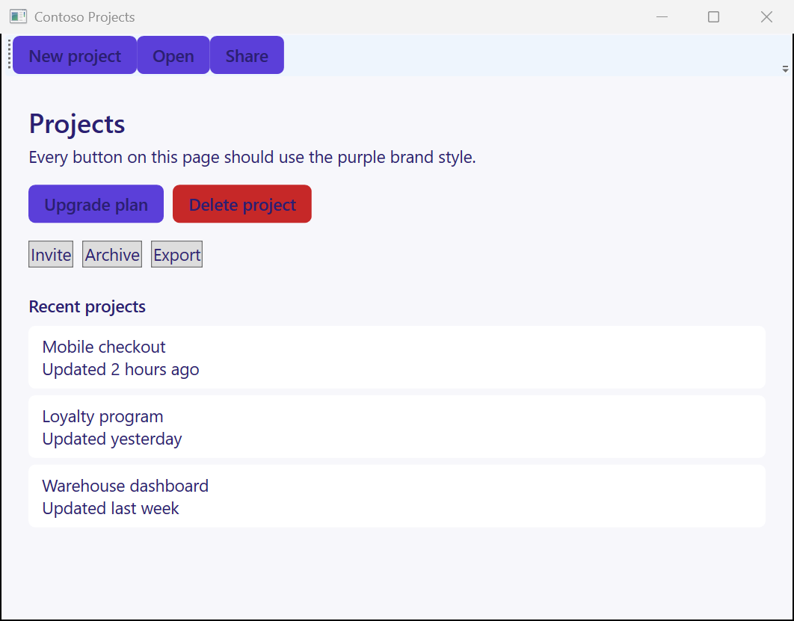
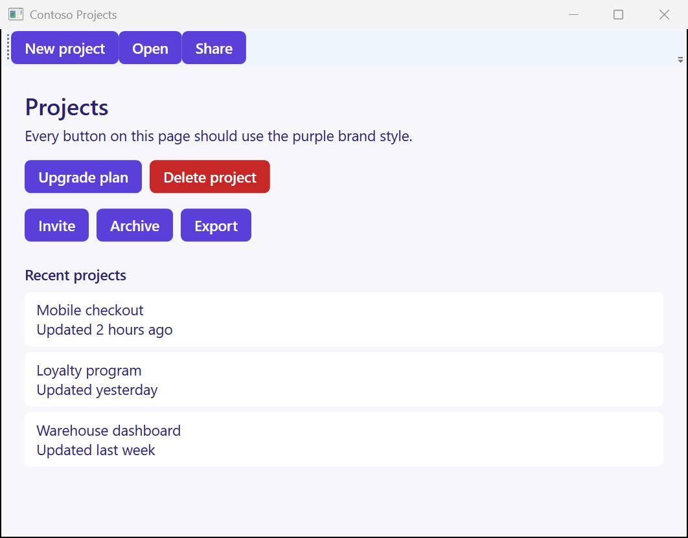

# Session transcript

Source: `Q:\source\XamlAgentDemos-notes\test-runs\StyleMaze\run-feedback\events.jsonl`

## Tool usage

- get_file: 11
- xaml_get_element_styles: 6
- xaml_get_element_properties: 4
- xaml_get_status: 3
- xaml_capture_image: 3
- xaml_get_hot_reload_log: 3
- xaml_find_resource: 2
- multi_replace_string_in_file: 2
- xaml_apply_hot_reload: 2
- task_complete: 2
- skill: 1
- get_projects_in_solution: 1
- xaml_get_visual_tree: 1
- xaml_get_resource_dictionaries: 1
- glob: 1
- rg: 1
- xaml_find_elements: 1
- xaml_explain_property_value: 1

Failed tool calls: 0, images: 3


_Model: gpt-6-luna_


## User (03:34:43)

We have a brand style in Themes/Brand.xaml, but a lot of my running app doesn't use it. Find every element that isn't branded, explain why, and fix it.


**Tool call (03:34:47):** `skill`
```json
{
 "skill": "xaml-diagnostics"
}
```

<details><summary>Result `skill` success=true</summary>

```
Skill "xaml-diagnostics" loaded successfully. Follow the instructions in the skill context.
```
</details>


_Skill invoked: xaml-diagnostics_


**Assistant (03:34:49):**

I’ll inspect the live app and its loaded theme/style resources, then trace unbranded elements to their XAML sources and fix them.


**Tool call (03:34:49):** `xaml_get_status`
```json
{
 "progressMessage": "Checking running XAML app and diagnostics",
 "app": null
}
```


**Tool call (03:34:49):** `get_projects_in_solution`
```json
{}
```

<details><summary>Result `xaml_get_status` success=true</summary>

```
{"isDebugging":true,"debuggerState":"running","diagnosticsActive":true,"apps":[{"app":"a2","name":"StyleMaze.exe [19356]","processId":19356,"platform":"WPF (.NET)","isRemote":false,"isDesignTimeOrNoDebug":false,"sourceInfoAvailable":true,"hotReloadSupported":true,"hotReloadEnabled":true,"supportsPropertyExplorer":true,"supportsInAppToolbar":true,"supportsHitTest":true,"windows":[{"windowId":"0x2A0808","title":"Contoso Projects","bounds":{"x":380,"y":380,"width":1080,"height":840},"dpiScale":1.5,"visible":true,"minimized":false}]}],"issues":[],"issuesSummary":"No problems detected.","hotReload":{"options":{"hotReloadEnabled":true,"hotReloadOnSave":false,"applyMode":"asYouType: XAML edits apply as you type, without saving (default)","wpfEnabled":true,"uwpEnabled":true,"winUIEnabled":true,"mauiEnabled":true,"justMyXaml":true,"previewSelectedElement":false,"inAppToolbar":true,"inAppSelection":false,"layoutAdorners":false,"trackFocusedElement":false,"bindingFailuresVisible":true,"compatibilityMode":false},"dotNetHotReloadEnabled":true,"isProcessingChanges":false,"lastHotReloadUpdate":{"secondsAgo":143,"updatesSinceToolsStarted":3},"errors":[]},"windowsNote":"Window bounds are physical screen pixels and include the window frame. A WPF/WinUI Window's Width and Height are device-independent units (DIPs) that also include the frame, so Width = bounds.width / dpiScale. A user's \"800 px wide\" is ambiguous: say which unit you tested. A minimized window reports x/y = -32000 and can't be captured."}
```
</details>

<details><summary>Result `get_projects_in_solution` success=true</summary>

```
src\GhostClicks\GhostClicks.csproj
src\GermanReady\GermanReady.csproj
src\ThemeBreaker\ThemeBreaker.csproj
src\DesignPolish\DesignPolish.csproj
src\HotReloadDoctor\HotReloadDoctor.csproj
src\VanishingSave\VanishingSave.csproj
src\CrispPixels\CrispPixels.csproj
src\PrecedenceWars\PrecedenceWars.csproj
src\LostWindows\LostWindows.csproj
src\TemplateDetective\TemplateDetective.csproj
src\SlowScroll\SlowScroll.csproj
src\PixelPerfect\PixelPerfect.csproj
src\BindingStorm\BindingStorm.csproj
src\BugRepro\BugRepro.csproj
src\A11ySweep\A11ySweep.csproj
src\StyleMaze\StyleMaze.csproj
src\ResponsiveDashboard\ResponsiveDashboard.csproj

```
</details>


**Tool call (03:34:53):** `xaml_capture_image`
```json
{
 "progressMessage": "Capturing the current app appearance",
 "app": "a2",
 "windowId": "0x2A0808",
 "maxSize": 1280
}
```


**Tool call (03:34:53):** `xaml_get_visual_tree`
```json
{
 "progressMessage": "Inspecting live element hierarchy",
 "app": "a2",
 "depth": 8,
 "maxNodes": 1500
}
```


**Tool call (03:34:53):** `xaml_get_resource_dictionaries`
```json
{
 "progressMessage": "Checking loaded theme dictionaries",
 "app": "a2",
 "includeKeys": true,
 "maxKeysPerDictionary": 500
}
```


**Tool call (03:34:53):** `glob`
```json
{
 "pattern": "**/*",
 "paths": [
  "Q:\\source\\XamlAgentDemos\\src\\StyleMaze"
 ]
}
```

<details><summary>Result `xaml_get_visual_tree` success=true</summary>

```
{"app":"a2","platform":"WPF (.NET)","sourceInfoAvailable":true,"nodeCount":81,"truncated":false,"nodes":[{"id":"a2:10","type":"StyleMaze.MainWindow","source":{"file":"Q:\\source\\XamlAgentDemos\\src\\StyleMaze\\MainWindow.xaml","line":4,"column":9},"childCount":1,"children":[{"id":"a2:11","type":"System.Windows.Controls.Border","childCount":1,"children":[{"id":"a2:12","type":"System.Windows.Documents.AdornerDecorator","childCount":2,"children":[{"id":"a2:13","type":"System.Windows.Controls.ContentPresenter","childCount":1,"children":[{"id":"a2:15","type":"System.Windows.Controls.DockPanel","source":{"file":"Q:\\source\\XamlAgentDemos\\src\\StyleMaze\\MainWindow.xaml","line":16,"column":6},"childCount":2,"children":[{"id":"a2:16","type":"System.Windows.Controls.ToolBar","name":"MainToolBar","source":{"file":"Q:\\source\\XamlAgentDemos\\src\\StyleMaze\\MainWindow.xaml","line":17,"column":10},"childCount":1,"children":[{"id":"a2:18","type":"System.Windows.Controls.Grid","name":"Grid","childCount":2,"children":[{"id":"a2:25","type":"System.Windows.Controls.Grid","name":"OverflowGrid","childCount":2,"children":[{"id":"a2:33","type":"System.Windows.Controls.Primitives.ToggleButton","name":"OverflowButton","childCount":1,"children":[{"id":"a2:42","type":"System.Windows.Controls.Border","name":"Bd","childCount":1,"children":[{"id":"a2:52","type":"System.Windows.Controls.Canvas","childCount":4,"children":[{"id":"a2:65","type":"System.Windows.Shapes.Path","childCount":0},{"id":"a2:66","type":"System.Windows.Shapes.Path","childCount":0},{"id":"a2:67","type":"System.Windows.Shapes.Path","childCount":0},{"id":"a2:68","type":"System.Windows.Shapes.Path","childCount":0}]}]}]},{"id":"a2:34","type":"System.Windows.Controls.Primitives.Popup","name":"OverflowPopup","childCount":0}]},{"id":"a2:26","type":"System.Windows.Controls.Border","name":"MainPanelBorder","childCount":1,"children":[{"id":"a2:35","type":"System.Windows.Controls.DockPanel","childCount":3,"children":[{"id":"a2:43","type":"System.Windows.Controls.Primitives.Thumb","name":"ToolBarThumb","childCount":1,"children":[{"id":"a2:53","type":"System.Windows.Controls.Border","childCount":1,"children":[{"id":"a2:69","type":"System.Windows.Shapes.Rectangle","childCount":0}]}]},{"id":"a2:44","type":"System.Windows.Controls.ContentPresenter","name":"ToolBarHeader","childCount":0},{"id":"a2:45","type":"System.Windows.Controls.Primitives.ToolBarPanel","name":"PART_ToolBarPanel","childCount":3,"children":[{"id":"a2:54","typ
... [truncated 8234 chars]
```
</details>

<details><summary>Result `glob` success=true</summary>

```
[glob: 92 path(s) under Q:/source/XamlAgentDemos/src/StyleMaze; grouped by directory]

Q:/source/XamlAgentDemos/src/StyleMaze/obj/ (78 path(s))
  Debug/net10.0-windows/.NETCoreApp,Version=v10.0.AssemblyAttributes.cs
  Debug/net10.0-windows/App.baml
  Debug/net10.0-windows/App.g.cs
  Debug/net10.0-windows/App.g.i.cs
  Debug/net10.0-windows/GeneratedInternalTypeHelper.g.cs
  Debug/net10.0-windows/GeneratedInternalTypeHelper.g.i.cs
  Debug/net10.0-windows/MainWindow.baml
  Debug/net10.0-windows/MainWindow.g.cs
  Debug/net10.0-windows/MainWindow.g.i.cs
  Debug/net10.0-windows/StyleMaze.AssemblyInfo.cs
  Debug/net10.0-windows/StyleMaze.AssemblyInfoInputs.cache
  Debug/net10.0-windows/StyleMaze.GeneratedMSBuildEditorConfig.editorconfig
  Debug/net10.0-windows/StyleMaze.GlobalUsings.g.cs
  Debug/net10.0-windows/StyleMaze.assets.cache
  Debug/net10.0-windows/StyleMaze.csproj.BuildWithSkipAnalyzers
  Debug/net10.0-windows/StyleMaze.csproj.CoreCompileInputs.cache
  Debug/net10.0-windows/StyleMaze.csproj.FileListAbsolute.txt
  Debug/net10.0-windows/StyleMaze.csproj.Up2Date
  Debug/net10.0-windows/StyleMaze.designer.deps.json
  Debug/net10.0-windows/StyleMaze.designer.runtimeconfig.json
  Debug/net10.0-windows/StyleMaze.dll
  Debug/net10.0-windows/StyleMaze.g.resources
  Debug/net10.0-windows/StyleMaze.genruntimeconfig.cache
  Debug/net10.0-windows/StyleMaze.pdb
  Debug/net10.0-windows/StyleMaze.sourcelink.json
  Debug/net10.0-windows/StyleMaze_MarkupCompile.cache
  Debug/net10.0-windows/StyleMaze_MarkupCompile.i.cache
  Debug/net10.0-windows/StyleMaze_MarkupCompile.i.lref
  Debug/net10.0-windows/StyleMaze_MarkupCompile.lref
  Debug/net10.0-windows/StyleMaze_avqg0vxf_wpftmp.AssemblyInfo.cs
  Debug/net10.0-windows/StyleMaze_avqg0vxf_wpftmp.AssemblyInfoInputs.cache
  Debug/net10.0-windows/StyleMaze_avqg0vxf_wpftmp.GeneratedMSBuildEditorConfig.editorconfig
  Debug/net10.0-windows/StyleMaze_avqg0vxf_wpftmp.GlobalUsings.g.cs
  Debug/net10.0-windows/StyleMaze_avqg0vxf_wpftmp.assets.cache
  Debug/net10.0-windows/StyleMaze_db0rnjrz_wpftmp.AssemblyInfo.cs
  Debug/net10.0-windows/StyleMaze_db0rnjrz_wpftmp.AssemblyInfoInputs.cache
  Debug/net10.0-windows/StyleMaze_db0rnjrz_wpftmp.GeneratedMSBuildEditorConfig.editorconfig
  Debug/net10.0-windows/StyleMaze_db0rnjrz_wpftmp.GlobalUsings.g.cs
  Debug/net10.0-windows/StyleMaze_db0rnjrz_wpftmp.assets.cache
  Debug/net10.0-windows/StyleMaze_db0rnjrz_wpftmp.sourcelink.json
  Debug/net10.0-windows/StyleMaze_lfsy2ved_wpftmp.AssemblyInfo.cs
... [truncated 3024 chars]
```
</details>


<details><summary>Result `xaml_capture_image` success=true</summary>

```
Screenshot of window 0x2A0808 "Contoso Projects" of app a2 (1062x831 image of the window's client area, so it's slightly smaller than the frame bounds from xaml_get_status).
```
</details>

<details><summary>Result `xaml_get_resource_dictionaries` success=true</summary>

```
{"app":"a2","scope":"application","note":"Only application-level resources are shown. Window, page and element resources (for example Window.Resources) are searched only when you pass an elementId; pass one from the window you're interested in to include its ancestors' resources.","scopes":[{"scope":"Application","ownerType":"StyleMaze.App","dictionary":{"path":"Application","type":"System.Windows.ResourceDictionary","keyCount":0,"keys":[],"location":{"file":"Q:\\source\\XamlAgentDemos\\src\\StyleMaze\\App.xaml","line":6,"column":10},"mergedDictionaries":[{"path":"Application/Merged[0]","source":"Themes/Brand.xaml","type":"System.Windows.ResourceDictionary","keyCount":3,"keys":["AccentBrush","AccentHoverBrush","{x:Type System.Windows.Controls.Button}"],"location":{"file":"Q:\\source\\XamlAgentDemos\\src\\StyleMaze\\App.xaml","line":8,"column":18}},{"path":"Application/Merged[1]","source":"Themes/LegacyReports.xaml","type":"System.Windows.ResourceDictionary","keyCount":3,"keys":["ReportGridLineBrush","AccentBrush","ReportHeaderBrush"],"location":{"file":"Q:\\source\\XamlAgentDemos\\src\\StyleMaze\\App.xaml","line":9,"column":18}}]}}]}
```
</details>


**Tool call (03:34:59):** `get_file`
```json
{
 "filename": "Q:\\source\\XamlAgentDemos\\src\\StyleMaze\\App.xaml",
 "startLine": 1,
 "endLine": 120,
 "includeLineNumbers": true
}
```


**Tool call (03:34:59):** `get_file`
```json
{
 "filename": "Q:\\source\\XamlAgentDemos\\src\\StyleMaze\\Themes\\Brand.xaml",
 "startLine": 1,
 "endLine": 240,
 "includeLineNumbers": true
}
```


**Tool call (03:34:59):** `get_file`
```json
{
 "filename": "Q:\\source\\XamlAgentDemos\\src\\StyleMaze\\Themes\\LegacyReports.xaml",
 "startLine": 1,
 "endLine": 200,
 "includeLineNumbers": true
}
```


**Tool call (03:34:59):** `get_file`
```json
{
 "filename": "Q:\\source\\XamlAgentDemos\\src\\StyleMaze\\MainWindow.xaml",
 "startLine": 1,
 "endLine": 180,
 "includeLineNumbers": true
}
```


**Tool call (03:34:59):** `get_file`
```json
{
 "filename": "Q:\\source\\XamlAgentDemos\\src\\StyleMaze\\DangerButton.cs",
 "startLine": 1,
 "endLine": 160,
 "includeLineNumbers": true
}
```


**Tool call (03:34:59):** `xaml_get_element_styles`
```json
{
 "progressMessage": "Finding which styles reach each button",
 "elementIds": [
  "a2:54",
  "a2:55",
  "a2:56",
  "a2:27",
  "a2:28",
  "a2:29",
  "a2:30",
  "a2:31"
 ]
}
```


**Tool call (03:34:59):** `xaml_get_element_properties`
```json
{
 "progressMessage": "Comparing live button properties",
 "elementIds": [
  "a2:54",
  "a2:55",
  "a2:56",
  "a2:27",
  "a2:28",
  "a2:29",
  "a2:30",
  "a2:31"
 ],
 "includeAll": true
}
```

<details><summary>Result `get_file` success=true</summary>

```
```xaml src\StyleMaze\Themes\LegacyReports.xaml (Lines 1-7 of 7 total. Call tools for more if needed.)
1: <ResourceDictionary xmlns="http://schemas.microsoft.com/winfx/2006/xaml/presentation"
2:                     xmlns:x="http://schemas.microsoft.com/winfx/2006/xaml">
3:     <!-- Colors kept for the old Reports screen. -->
4:     <SolidColorBrush x:Key="ReportHeaderBrush" Color="#2F3B52" />
5:     <SolidColorBrush x:Key="ReportGridLineBrush" Color="#D5D9E0" />
6:     <SolidColorBrush x:Key="AccentBrush" Color="#E8590C" />
7: </ResourceDictionary>

```


```
</details>

<details><summary>Result `get_file` success=true</summary>

```
```xaml src\StyleMaze\Themes\Brand.xaml (Lines 1-30 of 30 total. Call tools for more if needed.)
1: <ResourceDictionary xmlns="http://schemas.microsoft.com/winfx/2006/xaml/presentation"
2:                     xmlns:x="http://schemas.microsoft.com/winfx/2006/xaml">
3:     <SolidColorBrush x:Key="AccentBrush" Color="#5B3FD9" />
4:     <SolidColorBrush x:Key="AccentHoverBrush" Color="#4A31BD" />
5: 
6:     <Style TargetType="Button">
7:         <Setter Property="Background" Value="{DynamicResource AccentBrush}" />
8:         <Setter Property="Foreground" Value="White" />
9:         <Setter Property="FontWeight" Value="SemiBold" />
10:         <Setter Property="Padding" Value="14,7" />
11:         <Setter Property="Cursor" Value="Hand" />
12:         <Setter Property="Template">
13:             <Setter.Value>
14:                 <ControlTemplate TargetType="Button">
15:                     <Border x:Name="Chrome"
16:                             Padding="{TemplateBinding Padding}"
17:                             Background="{TemplateBinding Background}"
18:                             CornerRadius="6">
19:                         <ContentPresenter HorizontalAlignment="Center" VerticalAlignment="Center" />
20:                     </Border>
21:                     <ControlTemplate.Triggers>
22:                         <Trigger Property="IsMouseOver" Value="True">
23:                             <Setter TargetName="Chrome" Property="Background" Value="{DynamicResource AccentHoverBrush}" />
24:                         </Trigger>
25:                     </ControlTemplate.Triggers>
26:                 </ControlTemplate>
27:             </Setter.Value>
28:         </Setter>
29:     </Style>
30: </ResourceDictionary>

```


```
</details>

<details><summary>Result `get_file` success=true</summary>

```
```xaml src\StyleMaze\MainWindow.xaml (Lines 1-73 of 73 total. Call tools for more if needed.)
1: <Window x:Class="StyleMaze.MainWindow"
2:         xmlns="http://schemas.microsoft.com/winfx/2006/xaml/presentation"
3:         xmlns:x="http://schemas.microsoft.com/winfx/2006/xaml"
4:         xmlns:local="clr-namespace:StyleMaze"
5:         Title="Contoso Projects"
6:         Width="720"
7:         Height="560"
8:         Background="#F7F7FB">
9:     <Window.Resources>
10:         <Style TargetType="TextBlock">
11:             <Setter Property="Foreground" Value="#2B1F73" />
12:             <Setter Property="FontSize" Value="15" />
13:         </Style>
14:     </Window.Resources>
15: 
16:     <DockPanel>
17:         <ToolBar x:Name="MainToolBar" DockPanel.Dock="Top">
18:             <Button x:Name="NewButton" Content="New project" />
19:             <Button x:Name="OpenButton" Content="Open" />
20:             <Button x:Name="ShareButton" Content="Share" />
21:         </ToolBar>
22: 
23:         <StackPanel Margin="24">
24:             <TextBlock x:Name="PageTitle"
25:                        FontSize="24"
26:                        FontWeight="SemiBold"
27:                        Text="Projects" />
28:             <TextBlock Margin="0,4,0,16" Text="Every button on this page should use the purple brand style." />
29: 
30:             <StackPanel x:Name="PrimaryActions"
31:                         Margin="0,0,0,16"
32:                         Orientation="Horizontal">
33:                 <Button x:Name="UpgradeButton" Content="Upgrade plan" />
34:                 <local:DangerButton x:Name="DeleteButton"
35:                                     Margin="8,0,0,0"
36:                                     Background="#C62828"
37:                                     Content="Delete project" />
38:             </StackPanel>
39: 
40:             <StackPanel x:Name="SecondaryActions"
41:                         Margin="0,0,0,24"
42:                         Orientation="Horizontal">
43:                 <StackPanel.Resources>
44:                     <Style TargetType="Button">
45:                         <Setter Property="Margin" Value="0,0,8,0" />
46:                     </Style>
47:                 </StackPanel.Resources>
48:                 <Button x:Name="InviteButton" Content="Invite" />
49:                 <Button x:Name="ArchiveButton" Content="Archive" />
50:                 <Button x:Name="ExportButton" Content="E
... [truncated 1078 chars]
```
</details>

<details><summary>Result `get_file` success=true</summary>

```
```xaml src\StyleMaze\App.xaml (Lines 1-13 of 13 total. Call tools for more if needed.)
1: <Application x:Class="StyleMaze.App"
2:              xmlns="http://schemas.microsoft.com/winfx/2006/xaml/presentation"
3:              xmlns:x="http://schemas.microsoft.com/winfx/2006/xaml"
4:              StartupUri="MainWindow.xaml">
5:     <Application.Resources>
6:         <ResourceDictionary>
7:             <ResourceDictionary.MergedDictionaries>
8:                 <ResourceDictionary Source="Themes/Brand.xaml" />
9:                 <ResourceDictionary Source="Themes/LegacyReports.xaml" />
10:             </ResourceDictionary.MergedDictionaries>
11:         </ResourceDictionary>
12:     </Application.Resources>
13: </Application>

```


```
</details>

<details><summary>Result `get_file` success=true</summary>

```
```csharp src\StyleMaze\DangerButton.cs (Lines 1-8 of 8 total. Call tools for more if needed.)
1: using System.Windows.Controls;
2: 
3: namespace StyleMaze;
4: 
5: /// <summary>A button for destructive actions. It should look like every other button, plus a red background.</summary>
6: public class DangerButton : Button
7: {
8: }

```


```
</details>

<details><summary>Result `xaml_get_element_styles` success=true</summary>

```
{"count":8,"failed":0,"results":[{"id":"a2:54","type":"System.Windows.Controls.Button","name":"NewButton","source":{"file":"Q:\\source\\XamlAgentDemos\\src\\StyleMaze\\MainWindow.xaml","line":18,"column":14},"styleProperty":{"value":"System.Windows.Style","valueSource":"Local","location":{"file":"Q:\\source\\XamlAgentDemos\\src\\StyleMaze\\MainWindow.xaml","line":18,"column":14}},"templateProperty":{"value":"System.Windows.Controls.ControlTemplate","valueSource":"Style"},"styles":[{"kind":"Style","description":"Setter in an explicit (x:Key) or implicit (TargetType) Style.","targetType":"System.Windows.Controls.Button","setters":[{"property":"Background","value":"#00FFFFFF","effective":true},{"property":"BorderBrush","value":"#00FFFFFF","effective":true},{"property":"BorderThickness","value":"1,1,1,1","effective":true},{"property":"Foreground","effective":true},{"property":"HorizontalAlignment","value":"1","effective":true},{"property":"HorizontalContentAlignment","value":"1","effective":true},{"property":"Padding","value":"2,2,2,2","effective":true},{"property":"Template","value":"System.Windows.Controls.ControlTemplate","effective":true},{"property":"VerticalAlignment","value":"1","effective":true},{"property":"VerticalContentAlignment","value":"1","effective":true}]},{"kind":"BuiltInStyle","description":"Setter in the control's default theme style (generic.xaml or the platform theme).","targetType":"System.Windows.Controls.Button","setters":[{"property":"Background","value":"#00FFFFFF","effective":false,"overriddenBy":"Style (System.Windows.Controls.Button)"},{"property":"BorderBrush","value":"#00FFFFFF","effective":false,"overriddenBy":"Style (System.Windows.Controls.Button)"},{"property":"BorderThickness","value":"1,1,1,1","effective":false,"overriddenBy":"Style (System.Windows.Controls.Button)"},{"property":"Foreground","effective":false,"overriddenBy":"Style (System.Windows.Controls.Button)"},{"property":"HorizontalAlignment","value":"1","effective":false,"overriddenBy":"Style (System.Windows.Controls.Button)"},{"property":"HorizontalContentAlignment","value":"1","effective":false,"overriddenBy":"Style (System.Windows.Controls.Button)"},{"property":"Padding","value":"2,2,2,2","effective":false,"overriddenBy":"Style (System.Windows.Controls.Button)"},{"property":"Template","value":"System.Windows.Controls.ControlTemplate","effective":false,"overriddenBy":"Style (System.Windows.Controls.Button)"},{"property":"VerticalAlignment","value":"1","effective":
... [truncated 16470 chars]
```
</details>

<details><summary>Result `xaml_get_element_properties` success=true</summary>

```
{"error":"OUTPUT_TOO_LARGE","message":"The result is 182 KB, too large to use. Only the start of it is shown in preview.","hint":"Ask for less: pass nameFilter (for example \"Background|Foreground|Margin\") instead of includeAll=true, pass fewer elementIds per call (results scale with the count), or lower depth/maxNodes for trees. For styles across many similar elements, inspect one representative element first.","preview":"{\"count\":8,\"failed\":0,\"results\":[{\"id\":\"a2:54\",\"type\":\"System.Windows.Controls.Button\",\"name\":\"NewButton\",\"source\":{\"file\":\"Q:\\\\source\\\\XamlAgentDemos\\\\src\\\\StyleMaze\\\\MainWindow.xaml\",\"line\":18,\"column\":14},\"properties\":[{\"name\":\"Content\",\"value\":\"New project\",\"valueType\":\"System.String\",\"propertyType\":\"System.Object\",\"declaringType\":\"System.Windows.Controls.ContentControl\",\"valueSource\":\"Local\",\"valueSourceLocation\":{\"file\":\"Q:\\\\source\\\\XamlAgentDemos\\\\src\\\\StyleMaze\\\\MainWindow.xaml\",\"line\":18,\"column\":14}},{\"name\":\"Style\",\"value\":\"System.Windows.Style\",\"valueType\":\"System.Windows.Style\",\"propertyType\":\"System.Windows.Style\",\"declaringType\":\"System.Windows.FrameworkElement\",\"valueSource\":\"Local\",\"valueSourceLocation\":{\"file\":\"Q:\\\\source\\\\XamlAgentDemos\\\\src\\\\StyleMaze\\\\MainWindow.xaml\",\"line\":18,\"column\":14},\"readOnly\":true},{\"name\":\"Name\",\"value\":\"NewButton\",\"valueType\":\"System.String\",\"propertyType\":\"System.String\",\"declaringType\":\"System.Windows.FrameworkElement\",\"valueSource\":\"Local\",\"valueSourceLocation\":{\"file\":\"Q:\\\\source\\\\XamlAgentDemos\\\\src\\\\StyleMaze\\\\MainWindow.xaml\",\"line\":18,\"column\":14}},{\"name\":\"ActualWidth\",\"value\":\"70.26333333333334\",\"valueType\":\"System.Double\",\"propertyType\":\"System.Double\",\"declaringType\":\"System.Windows.FrameworkElement\",\"valueSource\":\"Local\",\"valueSourceLocation\":{\"file\":\"Q:\\\\source\\\\XamlAgentDemos\\\\src\\\\StyleMaze\\\\MainWindow.xaml\",\"line\":18,\"column\":14},\"readOnly\":true},{\"name\":\"ActualHeight\",\"value\":\"21.96\",\"valueType\":\"System.Double\",\"propertyType\":\"System.Double\",\"declaringType\":\"System.Windows.FrameworkElement\",\"valueSource\":\"Local\",\"valueSourceLocation\":{\"file\":\"Q:\\\\source\\\\XamlAgentDemos\\\\src\\\\StyleMaze\\\\MainWindow.xaml\",\"line\":18,\"column\":14},\"readOnly\":true},{\"name\":\"IsInitialized\",\"value\":\"True\",\"valueType\":\"System
... [truncated 2534 chars]
```
</details>


**Tool call (03:35:20):** `xaml_find_resource`
```json
{
 "progressMessage": "Tracing which accent brush currently wins",
 "key": "AccentBrush",
 "elementId": "a2:27",
 "app": "a2"
}
```


**Tool call (03:35:20):** `xaml_get_element_styles`
```json
{
 "progressMessage": "Checking page and card text styles",
 "elementIds": [
  "a2:19",
  "a2:20",
  "a2:23",
  "a2:85",
  "a2:86"
 ]
}
```


**Tool call (03:35:20):** `xaml_get_element_properties`
```json
{
 "progressMessage": "Inspecting text colors and style sources",
 "elementIds": [
  "a2:19",
  "a2:20",
  "a2:23",
  "a2:85",
  "a2:86"
 ],
 "nameFilter": "Foreground|FontSize|FontWeight|Style"
}
```


**Tool call (03:35:20):** `rg`
```json
{
 "pattern": "AccentBrush|LegacyReports|ToolBar\\.ButtonStyleKey|DangerButton|TargetType=\"TextBlock\"",
 "paths": [
  "Q:\\source\\XamlAgentDemos\\src\\StyleMaze"
 ],
 "output_mode": "content",
 "glob": "*.{xaml,cs}",
 "-n": true
}
```

<details><summary>Result `rg` success=true</summary>

```
Q:\source\XamlAgentDemos\src\StyleMaze\MainWindow.xaml:10:        <Style TargetType="TextBlock">
Q:\source\XamlAgentDemos\src\StyleMaze\MainWindow.xaml:34:                <local:DangerButton x:Name="DeleteButton"
Q:\source\XamlAgentDemos\src\StyleMaze\DangerButton.cs:6:public class DangerButton : Button
Q:\source\XamlAgentDemos\src\StyleMaze\App.xaml:9:                <ResourceDictionary Source="Themes/LegacyReports.xaml" />
Q:\source\XamlAgentDemos\src\StyleMaze\Themes\Brand.xaml:3:    <SolidColorBrush x:Key="AccentBrush" Color="#5B3FD9" />
Q:\source\XamlAgentDemos\src\StyleMaze\Themes\Brand.xaml:7:        <Setter Property="Background" Value="{DynamicResource AccentBrush}" />
Q:\source\XamlAgentDemos\src\StyleMaze\Themes\LegacyReports.xaml:6:    <SolidColorBrush x:Key="AccentBrush" Color="#E8590C" />
```
</details>

<details><summary>Result `xaml_find_resource` success=true</summary>

```
{"app":"a2","scope":"a2:27","key":"AccentBrush","found":true,"definitions":[{"effective":true,"key":"AccentBrush","scope":"Application","ownerType":"StyleMaze.App","dictionaryPath":"Application/Merged[1]","dictionarySource":"Themes/LegacyReports.xaml","valueType":"System.Windows.Media.SolidColorBrush","value":"SolidColorBrush #FFE8590C","location":{"file":"Q:\\source\\XamlAgentDemos\\src\\StyleMaze\\Themes\\LegacyReports.xaml","line":6,"column":6}},{"effective":false,"key":"AccentBrush","scope":"Application","ownerType":"StyleMaze.App","dictionaryPath":"Application/Merged[0]","dictionarySource":"Themes/Brand.xaml","valueType":"System.Windows.Media.SolidColorBrush","value":"SolidColorBrush #FF5B3FD9","location":{"file":"Q:\\source\\XamlAgentDemos\\src\\StyleMaze\\Themes\\Brand.xaml","line":3,"column":6}}],"hint":"Definitions are in lookup order; the 'effective' one wins and the rest are shadowed. Edit the effective definition, or remove the shadowing one."}
```
</details>

<details><summary>Result `xaml_get_element_styles` success=true</summary>

```
{"count":5,"failed":0,"results":[{"id":"a2:19","type":"System.Windows.Controls.TextBlock","name":"PageTitle","source":{"file":"Q:\\source\\XamlAgentDemos\\src\\StyleMaze\\MainWindow.xaml","line":24,"column":14},"styleProperty":{"valueSource":"Default"},"styles":[{"kind":"Style","description":"Setter in an explicit (x:Key) or implicit (TargetType) Style.","targetType":"System.Windows.Controls.TextBlock","location":{"file":"Q:\\source\\XamlAgentDemos\\src\\StyleMaze\\MainWindow.xaml","line":10,"column":10},"setters":[{"property":"FontSize","value":"15","effective":false,"overriddenBy":"Local"},{"property":"Foreground","value":"#FF2B1F73","effective":true}]},{"kind":"BuiltInStyle","description":"Setter in the control's default theme style (generic.xaml or the platform theme).","targetType":"System.Windows.Controls.TextBlock","setters":[{"property":"TextTrimming","value":"0","effective":true},{"property":"TextWrapping","value":"1","effective":true}]}],"hint":"Styles are listed in precedence order, highest first. 'effective=false' setters lose to 'overriddenBy'. Use xaml_find_resource to see where a style or resource key resolves. Only triggers whose condition is true right now are listed; inactive triggers (IsMouseOver, IsPressed, DataTriggers) aren't. Read the style's source at 'location' for its Triggers. A local value always beats a style trigger."},{"id":"a2:20","type":"System.Windows.Controls.TextBlock","source":{"file":"Q:\\source\\XamlAgentDemos\\src\\StyleMaze\\MainWindow.xaml","line":28,"column":14},"styleProperty":{"valueSource":"Default"},"styles":[{"kind":"Style","description":"Setter in an explicit (x:Key) or implicit (TargetType) Style.","targetType":"System.Windows.Controls.TextBlock","location":{"file":"Q:\\source\\XamlAgentDemos\\src\\StyleMaze\\MainWindow.xaml","line":10,"column":10},"setters":[{"property":"FontSize","value":"15","effective":true},{"property":"Foreground","value":"#FF2B1F73","effective":true}]},{"kind":"BuiltInStyle","description":"Setter in the control's default theme style (generic.xaml or the platform theme).","targetType":"System.Windows.Controls.TextBlock","setters":[{"property":"TextTrimming","value":"0","effective":true},{"property":"TextWrapping","value":"1","effective":true}]}],"hint":"Styles are listed in precedence order, highest first. 'effective=false' setters lose to 'overriddenBy'. Use xaml_find_resource to see where a style or resource key resolves. Only triggers whose condition is true right now are listed; i
... [truncated 3298 chars]
```
</details>

<details><summary>Result `xaml_get_element_properties` success=true</summary>

```
{"count":5,"failed":0,"results":[{"id":"a2:19","type":"System.Windows.Controls.TextBlock","name":"PageTitle","source":{"file":"Q:\\source\\XamlAgentDemos\\src\\StyleMaze\\MainWindow.xaml","line":24,"column":14},"properties":[{"name":"FontWeight","value":"SemiBold","valueType":"System.Windows.FontWeight","propertyType":"System.Windows.FontWeight","declaringType":"System.Windows.Controls.TextBlock","valueSource":"Local","valueSourceLocation":{"file":"Q:\\source\\XamlAgentDemos\\src\\StyleMaze\\MainWindow.xaml","line":24,"column":14}},{"name":"FontSize","value":"24","valueType":"System.Double","propertyType":"System.Double","declaringType":"System.Windows.Controls.TextBlock","valueSource":"Local","valueSourceLocation":{"file":"Q:\\source\\XamlAgentDemos\\src\\StyleMaze\\MainWindow.xaml","line":24,"column":14}},{"name":"Foreground","value":"#FF2B1F73","valueType":"System.Windows.Media.SolidColorBrush","propertyType":"System.Windows.Media.Brush","declaringType":"System.Windows.Controls.TextBlock","valueSource":"Style","valueSourceLocation":{"file":"Q:\\source\\XamlAgentDemos\\src\\StyleMaze\\MainWindow.xaml","line":10,"column":10}},{"name":"FontStyle","value":"Normal","valueType":"System.Windows.FontStyle","propertyType":"System.Windows.FontStyle","declaringType":"System.Windows.Controls.TextBlock","valueSource":"Default"},{"name":"Style","propertyType":"System.Windows.Style","declaringType":"System.Windows.FrameworkElement","valueSource":"Default"},{"name":"OverridesDefaultStyle","value":"False","valueType":"System.Boolean","propertyType":"System.Boolean","declaringType":"System.Windows.FrameworkElement","valueSource":"Default"},{"name":"FocusVisualStyle","value":"System.Windows.Style","valueType":"System.Windows.Style","propertyType":"System.Windows.Style","declaringType":"System.Windows.FrameworkElement","valueSource":"Default"}],"hiddenDefaultOrOverridden":4,"hint":"Default and overridden values were omitted. Pass includeAll=true to see them, or call xaml_explain_property_value for one property's full precedence chain."},{"id":"a2:20","type":"System.Windows.Controls.TextBlock","source":{"file":"Q:\\source\\XamlAgentDemos\\src\\StyleMaze\\MainWindow.xaml","line":28,"column":14},"properties":[{"name":"FontSize","value":"15","valueType":"System.Double","propertyType":"System.Double","declaringType":"System.Windows.Controls.TextBlock","valueSource":"Style","valueSourceLocation":{"file":"Q:\\source\\XamlAgentDemos\\src\\StyleMaze\\MainWindow.xaml","line":10,"col
... [truncated 6780 chars]
```
</details>


**Assistant (03:35:35):**

The runtime confirms five separate style-resolution failures: toolbar-specific styles, a derived button, a nested replacement style, a shadowed accent brush, and template-scoped text. I’m fixing those at their shared style/resource definitions while preserving Delete’s intentional red background.


**Tool call (03:35:35):** `multi_replace_string_in_file`
```json
{
 "explanation": "Make the app-wide brand styles reachable by toolbar buttons, subclasses, nested styles, and data templates, and prevent the legacy palette from shadowing the brand accent.",
 "replacements": [
  {
   "filePath": "src\\StyleMaze\\Themes\\Brand.xaml",
   "oldString": "<ResourceDictionary xmlns=\"http://schemas.microsoft.com/winfx/2006/xaml/presentation\"\n                    xmlns:x=\"http://schemas.microsoft.com/winfx/2006/xaml\">\n    <SolidColorBrush x:Key=\"AccentBrush\" Color=\"#5B3FD9\" />\n    <SolidColorBrush x:Key=\"AccentHoverBrush\" Color=\"#4A31BD\" />\n\n    <Style TargetType=\"Button\">\n        <Setter Property=\"Background\" Value=\"{DynamicResource AccentBrush}\" />\n        <Setter Property=\"Foreground\" Value=\"White\" />",
   "newString": "<ResourceDictionary xmlns=\"http://schemas.microsoft.com/winfx/2006/xaml/presentation\"\n                    xmlns:x=\"http://schemas.microsoft.com/winfx/2006/xaml\"\n                    xmlns:local=\"clr-namespace:StyleMaze\">\n    <SolidColorBrush x:Key=\"AccentBrush\" Color=\"#5B3FD9\" />\n    <SolidColorBrush x:Key=\"AccentHoverBrush\" Color=\"#4A31BD\" />\n    <SolidColorBrush x:Key=\"BrandTextBrush\" Color=\"#2B1F73\" />\n\n    <Style TargetType=\"TextBlock\">\n        <Setter Property=\"Foreground\" Value=\"{DynamicResource BrandTextBrush}\" />\n        <Setter Property=\"FontSize\" Value=\"15\" />\n    </Style>\n\n    <Style TargetType=\"Button\">\n        <Setter Property=\"Background\" Value=\
... [truncated 2040 chars]
```

<details><summary>Result `multi_replace_string_in_file` success=true</summary>

```
Successfully applied 5 of 5 replacement(s) across 3 file(s).
```
</details>


**Tool call (03:35:42):** `xaml_apply_hot_reload`
```json
{
 "progressMessage": "Applying shared brand styles to the live app",
 "includeCodeChanges": false
}
```


**Tool call (03:35:42):** `get_file`
```json
{
 "filename": "Q:\\source\\XamlAgentDemos\\src\\StyleMaze\\Themes\\Brand.xaml",
 "startLine": 1,
 "endLine": 100,
 "includeLineNumbers": true
}
```


**Tool call (03:35:42):** `get_file`
```json
{
 "filename": "Q:\\source\\XamlAgentDemos\\src\\StyleMaze\\Themes\\LegacyReports.xaml",
 "startLine": 1,
 "endLine": 40,
 "includeLineNumbers": true
}
```


**Tool call (03:35:42):** `get_file`
```json
{
 "filename": "Q:\\source\\XamlAgentDemos\\src\\StyleMaze\\MainWindow.xaml",
 "startLine": 1,
 "endLine": 90,
 "includeLineNumbers": true
}
```

<details><summary>Result `xaml_apply_hot_reload` success=true</summary>

```
{"status":"alreadyApplied","errors":[],"earlierErrors":[{"message":"After a 'Style' is in use (sealed), it cannot be modified.","errorType":"Runtime","errorCode":20,"severity":"Error","file":"Q:\\source\\XamlAgentDemos\\src\\StyleMaze\\MainWindow.xaml","line":37,"column":21,"project":"StyleMaze"}],"earlierErrorsNote":"earlierErrors were reported by an earlier update, not this call, and stay listed until that document is changed again. A later edit may already have fixed them, so check the live state (xaml_explain_property_value, xaml_find_resource, xaml_capture_image) before treating them as current.","log":[],"noNewActivity":true,"lastHotReloadUpdate":{"secondsAgo":4,"updatesSinceToolsStarted":5},"lastActivity":{"secondsAgo":81,"message":"Connected to StyleMaze.exe [19356] for WpfCore diagnostics. Incremental Hot Reload is enabled."},"note":"This call applied nothing new. status=alreadyApplied means XAML Hot Reload pushed changes into the app within the last minute, most likely your edits as you made them. lastHotReloadUpdate is when XAML Hot Reload last pushed changes into the app (it applies saved and in-editor edits as they happen, often without a log entry). If it's after your edit, the edit was already applied; if it's null or older than your edit, nothing reached the app (check the file is saved and part of the running project). It doesn't prove the app shows them: XAML that the app loads itself (XamlReader, files copied to the output folder, dictionaries swapped in code) is never hot reloaded, and code that sets the same property or picks another template/resource at runtime overrides the edit. Values that code already set (for example in a constructor or Loaded handler) stay in place, and startup code isn't re-run by hot reload, so a fix in that code needs the view reopened or a restart to take effect. Check the live value with xaml_explain_property_value (a Local value that isn't in your XAML was set by code) or xaml_find_resource.","hint":"Call xaml_capture_image to verify the change visually. Views that aren't loaded (other tabs, closed dialogs) are updated when they're next shown. Source line numbers reported for existing elements can still point to the pre-edit lines until the element is recreated, so find elements by x:Name or type rather than by an old line number. Structural edits (wrapping or replacing a parent, changing a root's content) recreate elements, which resets their runtime state such as selection, checked state, typed text and 
... [truncated 109 chars]
```
</details>

<details><summary>Result `get_file` success=true</summary>

```
```xaml src\StyleMaze\Themes\LegacyReports.xaml (Lines 1-7 of 7 total. Call tools for more if needed.)
1: <ResourceDictionary xmlns="http://schemas.microsoft.com/winfx/2006/xaml/presentation"
2:                     xmlns:x="http://schemas.microsoft.com/winfx/2006/xaml">
3:     <!-- Colors kept for the old Reports screen. -->
4:     <SolidColorBrush x:Key="ReportHeaderBrush" Color="#2F3B52" />
5:     <SolidColorBrush x:Key="ReportGridLineBrush" Color="#D5D9E0" />
6:     <SolidColorBrush x:Key="ReportAccentBrush" Color="#E8590C" />
7: </ResourceDictionary>

```


```
</details>

<details><summary>Result `get_file` success=true</summary>

```
```xaml src\StyleMaze\Themes\Brand.xaml (Lines 1-44 of 44 total. Call tools for more if needed.)
1: <ResourceDictionary xmlns="http://schemas.microsoft.com/winfx/2006/xaml/presentation"
2:                     xmlns:x="http://schemas.microsoft.com/winfx/2006/xaml"
3:                     xmlns:local="clr-namespace:StyleMaze">
4:     <SolidColorBrush x:Key="AccentBrush" Color="#5B3FD9" />
5:     <SolidColorBrush x:Key="AccentHoverBrush" Color="#4A31BD" />
6:     <SolidColorBrush x:Key="BrandTextBrush" Color="#2B1F73" />
7: 
8:     <Style TargetType="TextBlock">
9:         <Setter Property="Foreground" Value="{DynamicResource BrandTextBrush}" />
10:         <Setter Property="FontSize" Value="15" />
11:     </Style>
12: 
13:     <Style TargetType="Button">
14:         <Setter Property="Background" Value="{DynamicResource AccentBrush}" />
15:         <Setter Property="Foreground" Value="White" />
16:         <Setter Property="FontWeight" Value="SemiBold" />
17:         <Setter Property="Padding" Value="14,7" />
18:         <Setter Property="Cursor" Value="Hand" />
19:         <Setter Property="Template">
20:             <Setter.Value>
21:                 <ControlTemplate TargetType="Button">
22:                     <Border x:Name="Chrome"
23:                             Padding="{TemplateBinding Padding}"
24:                             Background="{TemplateBinding Background}"
25:                             CornerRadius="6">
26:                         <ContentPresenter HorizontalAlignment="Center" VerticalAlignment="Center" />
27:                     </Border>
28:                     <ControlTemplate.Triggers>
29:                         <Trigger Property="IsMouseOver" Value="True">
30:                             <Setter TargetName="Chrome" Property="Background" Value="{DynamicResource AccentHoverBrush}" />
31:                         </Trigger>
32:                     </ControlTemplate.Triggers>
33:                 </ControlTemplate>
34:             </Setter.Value>
35:         </Setter>
36:     </Style>
37: 
38:     <Style x:Key="{x:Static ToolBar.ButtonStyleKey}"
39:            TargetType="Button"
40:            BasedOn="{StaticResource {x:Type Button}}" />
41: 
42:     <Style TargetType="local:DangerButton"
43:            BasedOn="{StaticResource {x:Type Button}}" />
44: </ResourceDictionary>

```


```
</details>

<details><summary>Result `get_file` success=true</summary>

```
```xaml src\StyleMaze\MainWindow.xaml (Lines 1-66 of 66 total. Call tools for more if needed.)
1: <Window x:Class="StyleMaze.MainWindow"
2:         xmlns="http://schemas.microsoft.com/winfx/2006/xaml/presentation"
3:         xmlns:x="http://schemas.microsoft.com/winfx/2006/xaml"
4:         xmlns:local="clr-namespace:StyleMaze"
5:         Title="Contoso Projects"
6:         Width="720"
7:         Height="560"
8:         Background="#F7F7FB">
9:     <DockPanel>
10:         <ToolBar x:Name="MainToolBar" DockPanel.Dock="Top">
11:             <Button x:Name="NewButton" Content="New project" />
12:             <Button x:Name="OpenButton" Content="Open" />
13:             <Button x:Name="ShareButton" Content="Share" />
14:         </ToolBar>
15: 
16:         <StackPanel Margin="24">
17:             <TextBlock x:Name="PageTitle"
18:                        FontSize="24"
19:                        FontWeight="SemiBold"
20:                        Text="Projects" />
21:             <TextBlock Margin="0,4,0,16" Text="Every button on this page should use the purple brand style." />
22: 
23:             <StackPanel x:Name="PrimaryActions"
24:                         Margin="0,0,0,16"
25:                         Orientation="Horizontal">
26:                 <Button x:Name="UpgradeButton" Content="Upgrade plan" />
27:                 <local:DangerButton x:Name="DeleteButton"
28:                                     Margin="8,0,0,0"
29:                                     Background="#C62828"
30:                                     Content="Delete project" />
31:             </StackPanel>
32: 
33:             <StackPanel x:Name="SecondaryActions"
34:                         Margin="0,0,0,24"
35:                         Orientation="Horizontal">
36:                 <StackPanel.Resources>
37:                     <Style TargetType="Button" BasedOn="{StaticResource {x:Type Button}}">
38:                         <Setter Property="Margin" Value="0,0,8,0" />
39:                     </Style>
40:                 </StackPanel.Resources>
41:                 <Button x:Name="InviteButton" Content="Invite" />
42:                 <Button x:Name="ArchiveButton" Content="Archive" />
43:                 <Button x:Name="ExportButton" Content="Export" />
44:             </StackPanel>
45: 
46:             <TextBlock Margin="0,0,0,8"
47:                        FontWeight="SemiBold"
48:                        Text="Recent projects" />
49:           
... [truncated 867 chars]
```
</details>


**Tool call (03:35:47):** `xaml_capture_image`
```json
{
 "progressMessage": "Verifying branded appearance after hot reload",
 "app": "a2",
 "windowId": "0x2A0808",
 "maxSize": 1280
}
```


**Tool call (03:35:47):** `xaml_get_status`
```json
{
 "progressMessage": "Checking hot reload status and errors",
 "app": "a2"
}
```


**Tool call (03:35:47):** `xaml_find_elements`
```json
{
 "progressMessage": "Refreshing live button and text elements",
 "app": "a2",
 "type": "Button|*DangerButton",
 "maxResults": 80
}
```


**Tool call (03:35:47):** `xaml_find_resource`
```json
{
 "progressMessage": "Confirming the brand accent resource wins",
 "key": "AccentBrush",
 "elementId": "a2:27",
 "app": "a2"
}
```

<details><summary>Result `xaml_get_status` success=true</summary>

```
{"isDebugging":true,"debuggerState":"running","diagnosticsActive":true,"apps":[{"app":"a2","name":"StyleMaze.exe [19356]","processId":19356,"platform":"WPF (.NET)","isRemote":false,"isDesignTimeOrNoDebug":false,"sourceInfoAvailable":true,"hotReloadSupported":true,"hotReloadEnabled":true,"supportsPropertyExplorer":true,"supportsInAppToolbar":true,"supportsHitTest":true,"windows":[{"windowId":"0x2A0808","title":"Contoso Projects","bounds":{"x":380,"y":380,"width":1080,"height":840},"dpiScale":1.5,"visible":true,"minimized":false}]}],"issues":[],"issuesSummary":"No problems detected.","hotReload":{"options":{"hotReloadEnabled":true,"hotReloadOnSave":false,"applyMode":"asYouType: XAML edits apply as you type, without saving (default)","wpfEnabled":true,"uwpEnabled":true,"winUIEnabled":true,"mauiEnabled":true,"justMyXaml":true,"previewSelectedElement":false,"inAppToolbar":true,"inAppSelection":false,"layoutAdorners":false,"trackFocusedElement":false,"bindingFailuresVisible":true,"compatibilityMode":false},"dotNetHotReloadEnabled":true,"isProcessingChanges":false,"lastHotReloadUpdate":{"secondsAgo":8,"updatesSinceToolsStarted":5},"errors":[{"message":"After a 'Style' is in use (sealed), it cannot be modified.","errorType":"Runtime","errorCode":20,"severity":"Error","file":"Q:\\source\\XamlAgentDemos\\src\\StyleMaze\\MainWindow.xaml","line":37,"column":21,"project":"StyleMaze"}],"hint":"Fix the errors in the XAML source, save, then call xaml_apply_hot_reload. Some edits (rude edits) need an app restart."},"windowsNote":"Window bounds are physical screen pixels and include the window frame. A WPF/WinUI Window's Width and Height are device-independent units (DIPs) that also include the frame, so Width = bounds.width / dpiScale. A user's \"800 px wide\" is ambiguous: say which unit you tested. A minimized window reports x/y = -32000 and can't be captured."}
```
</details>

<details><summary>Result `xaml_find_elements` success=true</summary>

```
{"count":8,"totalMatches":8,"truncated":false,"results":[{"id":"a2:54","type":"System.Windows.Controls.Button","name":"NewButton","source":{"file":"Q:\\source\\XamlAgentDemos\\src\\StyleMaze\\MainWindow.xaml","line":18,"column":14},"path":"MainWindow/Border/AdornerDecorator/ContentPresenter/DockPanel/ToolBar/Grid/Border/DockPanel/ToolBarPanel/Button"},{"id":"a2:55","type":"System.Windows.Controls.Button","name":"OpenButton","source":{"file":"Q:\\source\\XamlAgentDemos\\src\\StyleMaze\\MainWindow.xaml","line":19,"column":14},"path":"MainWindow/Border/AdornerDecorator/ContentPresenter/DockPanel/ToolBar/Grid/Border/DockPanel/ToolBarPanel/Button"},{"id":"a2:56","type":"System.Windows.Controls.Button","name":"ShareButton","source":{"file":"Q:\\source\\XamlAgentDemos\\src\\StyleMaze\\MainWindow.xaml","line":20,"column":14},"path":"MainWindow/Border/AdornerDecorator/ContentPresenter/DockPanel/ToolBar/Grid/Border/DockPanel/ToolBarPanel/Button"},{"id":"a2:27","type":"System.Windows.Controls.Button","name":"UpgradeButton","source":{"file":"Q:\\source\\XamlAgentDemos\\src\\StyleMaze\\MainWindow.xaml","line":33,"column":18},"path":"MainWindow/Border/AdornerDecorator/ContentPresenter/DockPanel/StackPanel/StackPanel/Button"},{"id":"a2:28","type":"StyleMaze.DangerButton","name":"DeleteButton","source":{"file":"Q:\\source\\XamlAgentDemos\\src\\StyleMaze\\MainWindow.xaml","line":34,"column":18},"path":"MainWindow/Border/AdornerDecorator/ContentPresenter/DockPanel/StackPanel/StackPanel/DangerButton"},{"id":"a2:29","type":"System.Windows.Controls.Button","name":"InviteButton","source":{"file":"Q:\\source\\XamlAgentDemos\\src\\StyleMaze\\MainWindow.xaml","line":48,"column":18},"path":"MainWindow/Border/AdornerDecorator/ContentPresenter/DockPanel/StackPanel/StackPanel/Button"},{"id":"a2:30","type":"System.Windows.Controls.Button","name":"ArchiveButton","source":{"file":"Q:\\source\\XamlAgentDemos\\src\\StyleMaze\\MainWindow.xaml","line":49,"column":18},"path":"MainWindow/Border/AdornerDecorator/ContentPresenter/DockPanel/StackPanel/StackPanel/Button"},{"id":"a2:31","type":"System.Windows.Controls.Button","name":"ExportButton","source":{"file":"Q:\\source\\XamlAgentDemos\\src\\StyleMaze\\MainWindow.xaml","line":50,"column":18},"path":"MainWindow/Border/AdornerDecorator/ContentPresenter/DockPanel/StackPanel/StackPanel/Button"}]}
```
</details>

<details><summary>Result `xaml_find_resource` success=true</summary>

```
{"app":"a2","scope":"a2:27","key":"AccentBrush","found":true,"definitions":[{"effective":true,"key":"AccentBrush","scope":"Application","ownerType":"StyleMaze.App","dictionaryPath":"Application/Merged[0]","dictionarySource":"Themes/Brand.xaml","valueType":"System.Windows.Media.SolidColorBrush","value":"SolidColorBrush #FF5B3FD9","location":{"file":"Q:\\source\\XamlAgentDemos\\src\\StyleMaze\\Themes\\Brand.xaml","line":3,"column":6}}],"hint":"Edit the definition at 'location' (or in 'dictionarySource') to change this resource."}
```
</details>




<details><summary>Result `xaml_capture_image` success=true</summary>

```
Screenshot of window 0x2A0808 "Contoso Projects" of app a2 (1062x831 image of the window's client area, so it's slightly smaller than the frame bounds from xaml_get_status).
```
</details>


**Tool call (03:36:01):** `xaml_get_element_styles`
```json
{
 "progressMessage": "Diagnosing remaining buttons after hot reload",
 "elementIds": [
  "a2:54",
  "a2:27",
  "a2:28",
  "a2:29",
  "a2:30",
  "a2:31"
 ]
}
```


**Tool call (03:36:01):** `xaml_explain_property_value`
```json
{
 "progressMessage": "Tracing remaining button text colors",
 "elementIds": [
  "a2:54",
  "a2:27",
  "a2:28",
  "a2:29"
 ],
 "propertyNames": [
  "Foreground"
 ]
}
```


**Tool call (03:36:01):** `xaml_get_hot_reload_log`
```json
{
 "progressMessage": "Reviewing the XAML hot reload error",
 "errorsOnly": true,
 "maxEntries": 40
}
```

<details><summary>Result `xaml_get_hot_reload_log` success=true</summary>

```
{"total":0,"entries":[],"dotNetHotReloadPane":["22:28:19.68 [XAML] Connected to VanishingSave.exe [58248] for WpfCore diagnostics. Incremental Hot Reload is enabled.","22:29:55.85 🔣  ⚠ [Q:\\source\\XamlAgentDemos\\src\\VanishingSave\\VanishingSave.csproj ({4EB184D2-643F-45DC-A2E0-9645EA07CD15})]: Q:\\source\\XamlAgentDemos\\src\\VanishingSave\\FooterSettings.cs(9,5): warning ENC0118: Changing 'auto-property' might not have any effect until the application is restarted.","22:29:56.15  ⚠ Q:\\source\\XamlAgentDemos\\src\\VanishingSave\\FooterSettings.cs (line 9): warning ENC0118: Changing 'auto-property' might not have any effect until the application is restarted.","22:29:56.85  Code changes were successfully applied.","22:32:12.50  Code changes were successfully applied.","22:34:11.17 🔥 1> [VanishingSave] ❌ Exited with error code -1","22:34:11.55 [XAML] VanishingSave.exe [58248] WpfCore diagnostics stopped.","22:34:21.55 [XAML] Connected to StyleMaze.exe [19356] for WpfCore diagnostics. Incremental Hot Reload is enabled."],"dotNetHotReloadPaneNote":"Raw lines from the Hot Reload output pane: they cover every project and earlier debug sessions in this VS instance, and only textFilter applies to them. Use the project names in the lines to pick the ones for your app.","hint":"No XAML Hot Reload messages were logged in this VS session yet."}
```
</details>

<details><summary>Result `xaml_explain_property_value` success=true</summary>

```
{"count":4,"failed":0,"results":[{"id":"a2:54","type":"System.Windows.Controls.Button","property":"Foreground","propertyType":"System.Windows.Media.Brush","effectiveValue":"#FFFFFFFF","effectiveSource":"Style","chain":[{"kind":"Style","description":"Setter in an explicit (x:Key) or implicit (TargetType) Style.","targetType":"System.Windows.Controls.Button","value":"#FFFFFFFF","valueType":"System.Windows.Media.SolidColorBrush","effective":true,"sourceLocation":{"file":"Q:\\source\\XamlAgentDemos\\src\\StyleMaze\\Themes\\Brand.xaml","line":6,"column":6}},{"kind":"BuiltInStyle","description":"Setter in the control's default theme style (generic.xaml or the platform theme).","targetType":"System.Windows.Controls.Button","valueType":"System.Windows.DynamicResourceExtension","effective":false},{"kind":"Default","description":"The property's default value; nothing sets it.","value":"#FF000000","valueType":"System.Windows.Media.SolidColorBrush","effective":false}],"notes":["Edit the setter or trigger at the source location, or set a local value to override it for this element only."]},{"id":"a2:27","type":"System.Windows.Controls.Button","property":"Foreground","propertyType":"System.Windows.Media.Brush","effectiveValue":"#FFFFFFFF","effectiveSource":"Style","chain":[{"kind":"Style","description":"Setter in an explicit (x:Key) or implicit (TargetType) Style.","targetType":"System.Windows.Controls.Button","value":"#FFFFFFFF","valueType":"System.Windows.Media.SolidColorBrush","effective":true,"sourceLocation":{"file":"Q:\\source\\XamlAgentDemos\\src\\StyleMaze\\Themes\\Brand.xaml","line":6,"column":6}},{"kind":"BuiltInStyle","description":"Setter in the control's default theme style (generic.xaml or the platform theme).","targetType":"System.Windows.Controls.Primitives.ButtonBase","valueType":"System.Windows.DynamicResourceExtension","effective":false},{"kind":"Default","description":"The property's default value; nothing sets it.","value":"#FF000000","valueType":"System.Windows.Media.SolidColorBrush","effective":false}],"notes":["Edit the setter or trigger at the source location, or set a local value to override it for this element only."]},{"id":"a2:28","type":"StyleMaze.DangerButton","property":"Foreground","propertyType":"System.Windows.Media.Brush","effectiveValue":"#FFFFFFFF","effectiveSource":"Style","chain":[{"kind":"Style","description":"Setter in an explicit (x:Key) or implicit (TargetType) Style.","targetType":"System.Windows.Controls.Button","value":"#FF
... [truncated 1588 chars]
```
</details>

<details><summary>Result `xaml_get_element_styles` success=true</summary>

```
{"count":6,"failed":0,"results":[{"id":"a2:54","type":"System.Windows.Controls.Button","name":"NewButton","source":{"file":"Q:\\source\\XamlAgentDemos\\src\\StyleMaze\\MainWindow.xaml","line":18,"column":14},"styleProperty":{"value":"System.Windows.Style","valueSource":"Local","location":{"file":"Q:\\source\\XamlAgentDemos\\src\\StyleMaze\\MainWindow.xaml","line":18,"column":14}},"templateProperty":{"value":"System.Windows.Controls.ControlTemplate","valueSource":"Style","location":{"file":"Q:\\source\\XamlAgentDemos\\src\\StyleMaze\\Themes\\Brand.xaml","line":6,"column":6}},"styles":[{"kind":"Style","description":"Setter in an explicit (x:Key) or implicit (TargetType) Style.","targetType":"System.Windows.Controls.Button","setters":[]},{"kind":"Style","description":"Setter in an explicit (x:Key) or implicit (TargetType) Style.","targetType":"System.Windows.Controls.Button","location":{"file":"Q:\\source\\XamlAgentDemos\\src\\StyleMaze\\Themes\\Brand.xaml","line":6,"column":6},"setters":[{"property":"Background","effective":true},{"property":"Cursor","value":"Hand","effective":true},{"property":"FontWeight","value":"SemiBold","effective":true},{"property":"Foreground","value":"#FFFFFFFF","effective":true},{"property":"Padding","value":"14,7,14,7","effective":true},{"property":"Template","value":"System.Windows.Controls.ControlTemplate","effective":true,"valueLocation":{"file":"Q:\\source\\XamlAgentDemos\\src\\StyleMaze\\Themes\\Brand.xaml","line":14,"column":18}}]},{"kind":"BuiltInStyle","description":"Setter in the control's default theme style (generic.xaml or the platform theme).","targetType":"System.Windows.Controls.Button","setters":[{"property":"Background","value":"#00FFFFFF","effective":false,"overriddenBy":"Style (System.Windows.Controls.Button)"},{"property":"BorderBrush","value":"#00FFFFFF","effective":true},{"property":"BorderThickness","value":"1,1,1,1","effective":true},{"property":"Foreground","effective":false,"overriddenBy":"Style (System.Windows.Controls.Button)"},{"property":"HorizontalAlignment","value":"1","effective":true},{"property":"HorizontalContentAlignment","value":"1","effective":true},{"property":"Padding","value":"2,2,2,2","effective":false,"overriddenBy":"Style (System.Windows.Controls.Button)"},{"property":"Template","value":"System.Windows.Controls.ControlTemplate","effective":false,"overriddenBy":"Style (System.Windows.Controls.Button)"},{"property":"VerticalAlignment","value":"1","effective":true},{"property":"VerticalCon
... [truncated 12971 chars]
```
</details>


**Assistant (03:36:23):**

The live capture exposed two additional details: the global text color overrides button labels, and the old nested style stayed sealed in the running tree. I’m switching text to inherit the window’s brand color, explicitly assigning the shared button style to the secondary actions, and preserving their spacing.


**Tool call (03:36:23):** `multi_replace_string_in_file`
```json
{
 "explanation": "Let ordinary text inherit the window's brand color so button labels can inherit their button foreground; explicitly opt secondary actions into the brand style to avoid the sealed nested implicit style.",
 "replacements": [
  {
   "filePath": "src\\StyleMaze\\Themes\\Brand.xaml",
   "oldString": "    <Style TargetType=\"TextBlock\">\n        <Setter Property=\"Foreground\" Value=\"{DynamicResource BrandTextBrush}\" />\n        <Setter Property=\"FontSize\" Value=\"15\" />\n    </Style>",
   "newString": "    <Style TargetType=\"TextBlock\">\n        <Setter Property=\"FontSize\" Value=\"15\" />\n    </Style>"
  },
  {
   "filePath": "src\\StyleMaze\\MainWindow.xaml",
   "oldString": "        Title=\"Contoso Projects\"\n        Width=\"720\"\n        Height=\"560\"\n        Background=\"#F7F7FB\">\n    <DockPanel>",
   "newString": "        Title=\"Contoso Projects\"\n        Width=\"720\"\n        Height=\"560\"\n        Background=\"#F7F7FB\"\n        Foreground=\"{DynamicResource BrandTextBrush}\">\n    <DockPanel>"
  },
  {
   "filePath": "src\\StyleMaze\\MainWindow.xaml",
   "oldString": "            <StackPanel x:Name=\"SecondaryActions\"\n                        Margin=\"0,0,0,24\"\n                        Orientation=\"Horizontal\">\n                <StackPanel.Resources>\n                    <Style TargetType=\"Button\" BasedOn=\"{StaticResource {x:Type Button}}\">\n                        <Setter Property=\"Margin\" Value=\"0,0,8,0\" />\n           
... [truncated 1132 chars]
```

<details><summary>Result `multi_replace_string_in_file` success=true</summary>

```
Successfully applied 3 of 3 replacement(s) across 2 file(s).
```
</details>


**Tool call (03:36:25):** `xaml_apply_hot_reload`
```json
{
 "progressMessage": "Updating text inheritance and secondary buttons",
 "includeCodeChanges": false
}
```


**Tool call (03:36:25):** `xaml_get_hot_reload_log`
```json
{
 "progressMessage": "Checking previous sealed-style edit details",
 "errorsOnly": true,
 "maxEntries": 20
}
```

<details><summary>Result `xaml_get_hot_reload_log` success=true</summary>

```
{"total":0,"entries":[],"dotNetHotReloadPane":["22:28:19.68 [XAML] Connected to VanishingSave.exe [58248] for WpfCore diagnostics. Incremental Hot Reload is enabled.","22:29:55.85 🔣  ⚠ [Q:\\source\\XamlAgentDemos\\src\\VanishingSave\\VanishingSave.csproj ({4EB184D2-643F-45DC-A2E0-9645EA07CD15})]: Q:\\source\\XamlAgentDemos\\src\\VanishingSave\\FooterSettings.cs(9,5): warning ENC0118: Changing 'auto-property' might not have any effect until the application is restarted.","22:29:56.15  ⚠ Q:\\source\\XamlAgentDemos\\src\\VanishingSave\\FooterSettings.cs (line 9): warning ENC0118: Changing 'auto-property' might not have any effect until the application is restarted.","22:29:56.85  Code changes were successfully applied.","22:32:12.50  Code changes were successfully applied.","22:34:11.17 🔥 1> [VanishingSave] ❌ Exited with error code -1","22:34:11.55 [XAML] VanishingSave.exe [58248] WpfCore diagnostics stopped.","22:34:21.55 [XAML] Connected to StyleMaze.exe [19356] for WpfCore diagnostics. Incremental Hot Reload is enabled."],"dotNetHotReloadPaneNote":"Raw lines from the Hot Reload output pane: they cover every project and earlier debug sessions in this VS instance, and only textFilter applies to them. Use the project names in the lines to pick the ones for your app.","hint":"No XAML Hot Reload messages were logged in this VS session yet."}
```
</details>

<details><summary>Result `xaml_apply_hot_reload` success=true</summary>

```
{"status":"alreadyApplied","errors":[],"log":[],"noNewActivity":true,"lastHotReloadUpdate":{"secondsAgo":1,"updatesSinceToolsStarted":7},"lastActivity":{"secondsAgo":124,"message":"Connected to StyleMaze.exe [19356] for WpfCore diagnostics. Incremental Hot Reload is enabled."},"note":"This call applied nothing new. status=alreadyApplied means XAML Hot Reload pushed changes into the app within the last minute, most likely your edits as you made them. lastHotReloadUpdate is when XAML Hot Reload last pushed changes into the app (it applies saved and in-editor edits as they happen, often without a log entry). If it's after your edit, the edit was already applied; if it's null or older than your edit, nothing reached the app (check the file is saved and part of the running project). It doesn't prove the app shows them: XAML that the app loads itself (XamlReader, files copied to the output folder, dictionaries swapped in code) is never hot reloaded, and code that sets the same property or picks another template/resource at runtime overrides the edit. Values that code already set (for example in a constructor or Loaded handler) stay in place, and startup code isn't re-run by hot reload, so a fix in that code needs the view reopened or a restart to take effect. Check the live value with xaml_explain_property_value (a Local value that isn't in your XAML was set by code) or xaml_find_resource.","hint":"Call xaml_capture_image to verify the change visually. Views that aren't loaded (other tabs, closed dialogs) are updated when they're next shown. Source line numbers reported for existing elements can still point to the pre-edit lines until the element is recreated, so find elements by x:Name or type rather than by an old line number. Structural edits (wrapping or replacing a parent, changing a root's content) recreate elements, which resets their runtime state such as selection, checked state, typed text and scroll position, and invalidates their IDs. Re-establish the state you were testing before capturing again."}
```
</details>


**Tool call (03:36:29):** `xaml_capture_image`
```json
{
 "progressMessage": "Verifying the complete branded screen",
 "app": "a2",
 "windowId": "0x2A0808",
 "maxSize": 1280
}
```


**Tool call (03:36:29):** `xaml_get_hot_reload_log`
```json
{
 "progressMessage": "Checking for hot reload errors",
 "errorsOnly": true,
 "textFilter": "StyleMaze",
 "maxEntries": 20
}
```


**Tool call (03:36:29):** `xaml_get_status`
```json
{
 "progressMessage": "Checking live app state after updates",
 "app": "a2"
}
```


**Tool call (03:36:29):** `xaml_get_element_styles`
```json
{
 "progressMessage": "Confirming brand styles on all buttons",
 "elementIds": [
  "a2:54",
  "a2:55",
  "a2:56",
  "a2:27",
  "a2:28",
  "a2:29",
  "a2:30",
  "a2:31"
 ]
}
```


**Tool call (03:36:29):** `xaml_get_element_properties`
```json
{
 "progressMessage": "Verifying inherited text and button color values",
 "elementIds": [
  "a2:54",
  "a2:27",
  "a2:28",
  "a2:29",
  "a2:85",
  "a2:86"
 ],
 "nameFilter": "Foreground|Background|FontSize|Style"
}
```

<details><summary>Result `xaml_get_status` success=true</summary>

```
{"isDebugging":true,"debuggerState":"running","diagnosticsActive":true,"apps":[{"app":"a2","name":"StyleMaze.exe [19356]","processId":19356,"platform":"WPF (.NET)","isRemote":false,"isDesignTimeOrNoDebug":false,"sourceInfoAvailable":true,"hotReloadSupported":true,"hotReloadEnabled":true,"supportsPropertyExplorer":true,"supportsInAppToolbar":true,"supportsHitTest":true,"windows":[{"windowId":"0x2A0808","title":"Contoso Projects","bounds":{"x":380,"y":380,"width":1080,"height":840},"dpiScale":1.5,"visible":true,"minimized":false}]}],"issues":[],"issuesSummary":"No problems detected.","hotReload":{"options":{"hotReloadEnabled":true,"hotReloadOnSave":false,"applyMode":"asYouType: XAML edits apply as you type, without saving (default)","wpfEnabled":true,"uwpEnabled":true,"winUIEnabled":true,"mauiEnabled":true,"justMyXaml":true,"previewSelectedElement":false,"inAppToolbar":true,"inAppSelection":false,"layoutAdorners":false,"trackFocusedElement":false,"bindingFailuresVisible":true,"compatibilityMode":false},"dotNetHotReloadEnabled":true,"isProcessingChanges":false,"lastHotReloadUpdate":{"secondsAgo":5,"updatesSinceToolsStarted":7},"errors":[]},"windowsNote":"Window bounds are physical screen pixels and include the window frame. A WPF/WinUI Window's Width and Height are device-independent units (DIPs) that also include the frame, so Width = bounds.width / dpiScale. A user's \"800 px wide\" is ambiguous: say which unit you tested. A minimized window reports x/y = -32000 and can't be captured."}
```
</details>

<details><summary>Result `xaml_get_hot_reload_log` success=true</summary>

```
{"total":0,"entries":[],"dotNetHotReloadPane":["22:34:21.55 [XAML] Connected to StyleMaze.exe [19356] for WpfCore diagnostics. Incremental Hot Reload is enabled."],"dotNetHotReloadPaneNote":"Raw lines from the Hot Reload output pane: they cover every project and earlier debug sessions in this VS instance, and only textFilter applies to them. Use the project names in the lines to pick the ones for your app.","hint":"No XAML Hot Reload messages were logged in this VS session yet."}
```
</details>




<details><summary>Result `xaml_capture_image` success=true</summary>

```
Screenshot of window 0x2A0808 "Contoso Projects" of app a2 (1062x831 image of the window's client area, so it's slightly smaller than the frame bounds from xaml_get_status).
```
</details>

<details><summary>Result `xaml_get_element_properties` success=true</summary>

```
{"count":6,"failed":0,"results":[{"id":"a2:54","type":"System.Windows.Controls.Button","name":"NewButton","source":{"file":"Q:\\source\\XamlAgentDemos\\src\\StyleMaze\\MainWindow.xaml","line":18,"column":14},"properties":[{"name":"Style","value":"System.Windows.Style","valueType":"System.Windows.Style","propertyType":"System.Windows.Style","declaringType":"System.Windows.FrameworkElement","valueSource":"Local","valueSourceLocation":{"file":"Q:\\source\\XamlAgentDemos\\src\\StyleMaze\\MainWindow.xaml","line":18,"column":14},"readOnly":true},{"name":"Foreground","value":"#FFFFFFFF","valueType":"System.Windows.Media.SolidColorBrush","propertyType":"System.Windows.Media.Brush","declaringType":"System.Windows.Controls.Control","valueSource":"Style","valueSourceLocation":{"file":"Q:\\source\\XamlAgentDemos\\src\\StyleMaze\\Themes\\Brand.xaml","line":6,"column":6}},{"name":"Background","evaluatedValue":"#FF5B3FD9 (System.Windows.Media.SolidColorBrush)","valueType":"System.Windows.DynamicResourceExtension","propertyType":"System.Windows.Media.Brush","declaringType":"System.Windows.Controls.Control","valueSource":"Style","valueSourceLocation":{"file":"Q:\\source\\XamlAgentDemos\\src\\StyleMaze\\Themes\\Brand.xaml","line":6,"column":6}},{"name":"FontSize","value":"12","valueType":"System.Double","propertyType":"System.Double","declaringType":"System.Windows.Controls.Control","valueSource":"Default"},{"name":"FontStyle","value":"Normal","valueType":"System.Windows.FontStyle","propertyType":"System.Windows.FontStyle","declaringType":"System.Windows.Controls.Control","valueSource":"Default"},{"name":"OverridesDefaultStyle","value":"False","valueType":"System.Boolean","propertyType":"System.Boolean","declaringType":"System.Windows.FrameworkElement","valueSource":"Default"},{"name":"FocusVisualStyle","value":"System.Windows.Style","valueType":"System.Windows.Style","propertyType":"System.Windows.Style","declaringType":"System.Windows.FrameworkElement","valueSource":"Default"}],"hiddenDefaultOrOverridden":5,"hint":"Default and overridden values were omitted. Pass includeAll=true to see them, or call xaml_explain_property_value for one property's full precedence chain."},{"id":"a2:27","type":"System.Windows.Controls.Button","name":"UpgradeButton","source":{"file":"Q:\\source\\XamlAgentDemos\\src\\StyleMaze\\MainWindow.xaml","line":33,"column":18},"properties":[{"name":"Foreground","value":"#FFFFFFFF","valueType":"System.Windows.Media.SolidColorBrush","propertyType":"System
... [truncated 9073 chars]
```
</details>

<details><summary>Result `xaml_get_element_styles` success=true</summary>

```
Output too large to read at once (21.9 KB). Saved to: C:\Users\peterspa\AppData\Local\Microsoft\VisualStudio\CopilotCli\0db1f00b-6f8a-4682-8045-8173c1f92587\temp\1794713789845-copilot-tool-output-0fef3ef221b44474a71a20d2365e8ef7.txt
Consider using tools like rg (for searching), head/tail (for viewing start/end), view with view_range (for specific sections), or jq (for JSON) to examine portions of the output.

Preview (first 500 chars):
{"count":8,"failed":0,"results":[{"id":"a2:54","type":"System.Windows.Controls.Button","name":"NewButton","source":{"file":"Q:\\source\\XamlAgentDemos\\src\\StyleMaze\\MainWindow.xaml","line":18,"column":14},"styleProperty":{"value":"System.Windows.Style","valueSource":"Local","location":{"file":"Q:\\source\\XamlAgentDemos\\src\\StyleMaze\\MainWindow.xaml","line":18,"column":14}},"templateProperty":{"value":"System.Windows.Controls.ControlTemplate","valueSource":"Style","location":{"file":"Q:\\s
```
</details>


**Tool call (03:36:39):** `xaml_get_element_styles`
```json
{
 "progressMessage": "Verifying toolbar and secondary styles",
 "elementIds": [
  "a2:54",
  "a2:29",
  "a2:30",
  "a2:31"
 ]
}
```


**Tool call (03:36:39):** `xaml_get_element_properties`
```json
{
 "progressMessage": "Checking final brand colors across all buttons",
 "elementIds": [
  "a2:54",
  "a2:55",
  "a2:56",
  "a2:27",
  "a2:28",
  "a2:29",
  "a2:30",
  "a2:31"
 ],
 "nameFilter": "Background|Foreground|Style"
}
```


**Tool call (03:36:39):** `xaml_get_element_styles`
```json
{
 "progressMessage": "Verifying text style inside project cards",
 "elementIds": [
  "a2:85",
  "a2:86"
 ]
}
```


**Tool call (03:36:39):** `get_file`
```json
{
 "filename": "Q:\\source\\XamlAgentDemos\\src\\StyleMaze\\Themes\\Brand.xaml",
 "startLine": 1,
 "endLine": 70,
 "includeLineNumbers": true
}
```


**Tool call (03:36:39):** `get_file`
```json
{
 "filename": "Q:\\source\\XamlAgentDemos\\src\\StyleMaze\\MainWindow.xaml",
 "startLine": 1,
 "endLine": 70,
 "includeLineNumbers": true
}
```


**Tool call (03:36:39):** `get_file`
```json
{
 "filename": "Q:\\source\\XamlAgentDemos\\src\\StyleMaze\\Themes\\LegacyReports.xaml",
 "startLine": 1,
 "endLine": 20,
 "includeLineNumbers": true
}
```

<details><summary>Result `get_file` success=true</summary>

```
```xaml src\StyleMaze\MainWindow.xaml (Lines 1-70 of 71 total. Call tools for more if needed.)
1: <Window x:Class="StyleMaze.MainWindow"
2:         xmlns="http://schemas.microsoft.com/winfx/2006/xaml/presentation"
3:         xmlns:x="http://schemas.microsoft.com/winfx/2006/xaml"
4:         xmlns:local="clr-namespace:StyleMaze"
5:         Title="Contoso Projects"
6:         Width="720"
7:         Height="560"
8:         Background="#F7F7FB"
9:         Foreground="{DynamicResource BrandTextBrush}">
10:     <DockPanel>
11:         <ToolBar x:Name="MainToolBar" DockPanel.Dock="Top">
12:             <Button x:Name="NewButton" Content="New project" />
13:             <Button x:Name="OpenButton" Content="Open" />
14:             <Button x:Name="ShareButton" Content="Share" />
15:         </ToolBar>
16: 
17:         <StackPanel Margin="24">
18:             <TextBlock x:Name="PageTitle"
19:                        FontSize="24"
20:                        FontWeight="SemiBold"
21:                        Text="Projects" />
22:             <TextBlock Margin="0,4,0,16" Text="Every button on this page should use the purple brand style." />
23: 
24:             <StackPanel x:Name="PrimaryActions"
25:                         Margin="0,0,0,16"
26:                         Orientation="Horizontal">
27:                 <Button x:Name="UpgradeButton" Content="Upgrade plan" />
28:                 <local:DangerButton x:Name="DeleteButton"
29:                                     Margin="8,0,0,0"
30:                                     Background="#C62828"
31:                                     Content="Delete project" />
32:             </StackPanel>
33: 
34:             <StackPanel x:Name="SecondaryActions"
35:                         Margin="0,0,0,24"
36:                         Orientation="Horizontal">
37:                 <Button x:Name="InviteButton"
38:                         Style="{StaticResource {x:Type Button}}"
39:                         Margin="0,0,8,0"
40:                         Content="Invite" />
41:                 <Button x:Name="ArchiveButton"
42:                         Style="{StaticResource {x:Type Button}}"
43:                         Margin="0,0,8,0"
44:                         Content="Archive" />
45:                 <Button x:Name="ExportButton"
46:                         Style="{StaticResource {x:Type Button}}"
47:                         Margin="0,0,8,0"
48:                         Content="Export" />
... [truncated 1053 chars]
```
</details>

<details><summary>Result `get_file` success=true</summary>

```
```xaml src\StyleMaze\Themes\LegacyReports.xaml (Lines 1-7 of 7 total. Call tools for more if needed.)
1: <ResourceDictionary xmlns="http://schemas.microsoft.com/winfx/2006/xaml/presentation"
2:                     xmlns:x="http://schemas.microsoft.com/winfx/2006/xaml">
3:     <!-- Colors kept for the old Reports screen. -->
4:     <SolidColorBrush x:Key="ReportHeaderBrush" Color="#2F3B52" />
5:     <SolidColorBrush x:Key="ReportGridLineBrush" Color="#D5D9E0" />
6:     <SolidColorBrush x:Key="ReportAccentBrush" Color="#E8590C" />
7: </ResourceDictionary>

```


```
</details>

<details><summary>Result `get_file` success=true</summary>

```
```xaml src\StyleMaze\Themes\Brand.xaml (Lines 1-43 of 43 total. Call tools for more if needed.)
1: <ResourceDictionary xmlns="http://schemas.microsoft.com/winfx/2006/xaml/presentation"
2:                     xmlns:x="http://schemas.microsoft.com/winfx/2006/xaml"
3:                     xmlns:local="clr-namespace:StyleMaze">
4:     <SolidColorBrush x:Key="AccentBrush" Color="#5B3FD9" />
5:     <SolidColorBrush x:Key="AccentHoverBrush" Color="#4A31BD" />
6:     <SolidColorBrush x:Key="BrandTextBrush" Color="#2B1F73" />
7: 
8:     <Style TargetType="TextBlock">
9:         <Setter Property="FontSize" Value="15" />
10:     </Style>
11: 
12:     <Style TargetType="Button">
13:         <Setter Property="Background" Value="{DynamicResource AccentBrush}" />
14:         <Setter Property="Foreground" Value="White" />
15:         <Setter Property="FontWeight" Value="SemiBold" />
16:         <Setter Property="Padding" Value="14,7" />
17:         <Setter Property="Cursor" Value="Hand" />
18:         <Setter Property="Template">
19:             <Setter.Value>
20:                 <ControlTemplate TargetType="Button">
21:                     <Border x:Name="Chrome"
22:                             Padding="{TemplateBinding Padding}"
23:                             Background="{TemplateBinding Background}"
24:                             CornerRadius="6">
25:                         <ContentPresenter HorizontalAlignment="Center" VerticalAlignment="Center" />
26:                     </Border>
27:                     <ControlTemplate.Triggers>
28:                         <Trigger Property="IsMouseOver" Value="True">
29:                             <Setter TargetName="Chrome" Property="Background" Value="{DynamicResource AccentHoverBrush}" />
30:                         </Trigger>
31:                     </ControlTemplate.Triggers>
32:                 </ControlTemplate>
33:             </Setter.Value>
34:         </Setter>
35:     </Style>
36: 
37:     <Style x:Key="{x:Static ToolBar.ButtonStyleKey}"
38:            TargetType="Button"
39:            BasedOn="{StaticResource {x:Type Button}}" />
40: 
41:     <Style TargetType="local:DangerButton"
42:            BasedOn="{StaticResource {x:Type Button}}" />
43: </ResourceDictionary>

```


```
</details>

<details><summary>Result `xaml_get_element_styles` success=true</summary>

```
{"count":2,"failed":0,"results":[{"id":"a2:85","type":"System.Windows.Controls.TextBlock","source":{"file":"Q:\\source\\XamlAgentDemos\\src\\StyleMaze\\MainWindow.xaml","line":64,"column":34},"styleProperty":{"valueSource":"Default"},"styles":[{"kind":"Style","description":"Setter in an explicit (x:Key) or implicit (TargetType) Style.","targetType":"System.Windows.Controls.TextBlock","setters":[{"property":"FontSize","value":"15","effective":true}]},{"kind":"BuiltInStyle","description":"Setter in the control's default theme style (generic.xaml or the platform theme).","targetType":"System.Windows.Controls.TextBlock","setters":[{"property":"TextTrimming","value":"0","effective":true},{"property":"TextWrapping","value":"1","effective":true}]}],"hint":"Styles are listed in precedence order, highest first. 'effective=false' setters lose to 'overriddenBy'. Use xaml_find_resource to see where a style or resource key resolves. Only triggers whose condition is true right now are listed; inactive triggers (IsMouseOver, IsPressed, DataTriggers) aren't. Read the style's source at 'location' for its Triggers. A local value always beats a style trigger."},{"id":"a2:86","type":"System.Windows.Controls.TextBlock","source":{"file":"Q:\\source\\XamlAgentDemos\\src\\StyleMaze\\MainWindow.xaml","line":65,"column":34},"styleProperty":{"valueSource":"Default"},"styles":[{"kind":"Style","description":"Setter in an explicit (x:Key) or implicit (TargetType) Style.","targetType":"System.Windows.Controls.TextBlock","setters":[{"property":"FontSize","value":"15","effective":true}]},{"kind":"BuiltInStyle","description":"Setter in the control's default theme style (generic.xaml or the platform theme).","targetType":"System.Windows.Controls.TextBlock","setters":[{"property":"TextTrimming","value":"0","effective":true},{"property":"TextWrapping","value":"1","effective":true}]}],"hint":"Styles are listed in precedence order, highest first. 'effective=false' setters lose to 'overriddenBy'. Use xaml_find_resource to see where a style or resource key resolves. Only triggers whose condition is true right now are listed; inactive triggers (IsMouseOver, IsPressed, DataTriggers) aren't. Read the style's source at 'location' for its Triggers. A local value always beats a style trigger."}]}
```
</details>

<details><summary>Result `xaml_get_element_styles` success=true</summary>

```
{"count":4,"failed":0,"results":[{"id":"a2:54","type":"System.Windows.Controls.Button","name":"NewButton","source":{"file":"Q:\\source\\XamlAgentDemos\\src\\StyleMaze\\MainWindow.xaml","line":18,"column":14},"styleProperty":{"value":"System.Windows.Style","valueSource":"Local","location":{"file":"Q:\\source\\XamlAgentDemos\\src\\StyleMaze\\MainWindow.xaml","line":18,"column":14}},"templateProperty":{"value":"System.Windows.Controls.ControlTemplate","valueSource":"Style","location":{"file":"Q:\\source\\XamlAgentDemos\\src\\StyleMaze\\Themes\\Brand.xaml","line":6,"column":6}},"styles":[{"kind":"Style","description":"Setter in an explicit (x:Key) or implicit (TargetType) Style.","targetType":"System.Windows.Controls.Button","setters":[]},{"kind":"Style","description":"Setter in an explicit (x:Key) or implicit (TargetType) Style.","targetType":"System.Windows.Controls.Button","location":{"file":"Q:\\source\\XamlAgentDemos\\src\\StyleMaze\\Themes\\Brand.xaml","line":6,"column":6},"setters":[{"property":"Background","effective":true},{"property":"Cursor","value":"Hand","effective":true},{"property":"FontWeight","value":"SemiBold","effective":true},{"property":"Foreground","value":"#FFFFFFFF","effective":true},{"property":"Padding","value":"14,7,14,7","effective":true},{"property":"Template","value":"System.Windows.Controls.ControlTemplate","effective":true,"valueLocation":{"file":"Q:\\source\\XamlAgentDemos\\src\\StyleMaze\\Themes\\Brand.xaml","line":14,"column":18}}]},{"kind":"BuiltInStyle","description":"Setter in the control's default theme style (generic.xaml or the platform theme).","targetType":"System.Windows.Controls.Button","setters":[{"property":"Background","value":"#00FFFFFF","effective":false,"overriddenBy":"Style (System.Windows.Controls.Button)"},{"property":"BorderBrush","value":"#00FFFFFF","effective":true},{"property":"BorderThickness","value":"1,1,1,1","effective":true},{"property":"Foreground","effective":false,"overriddenBy":"Style (System.Windows.Controls.Button)"},{"property":"HorizontalAlignment","value":"1","effective":true},{"property":"HorizontalContentAlignment","value":"1","effective":true},{"property":"Padding","value":"2,2,2,2","effective":false,"overriddenBy":"Style (System.Windows.Controls.Button)"},{"property":"Template","value":"System.Windows.Controls.ControlTemplate","effective":false,"overriddenBy":"Style (System.Windows.Controls.Button)"},{"property":"VerticalAlignment","value":"1","effective":true},{"property":"VerticalCon
... [truncated 8685 chars]
```
</details>

<details><summary>Result `xaml_get_element_properties` success=true</summary>

```
{"count":8,"failed":0,"results":[{"id":"a2:54","type":"System.Windows.Controls.Button","name":"NewButton","source":{"file":"Q:\\source\\XamlAgentDemos\\src\\StyleMaze\\MainWindow.xaml","line":18,"column":14},"properties":[{"name":"Style","value":"System.Windows.Style","valueType":"System.Windows.Style","propertyType":"System.Windows.Style","declaringType":"System.Windows.FrameworkElement","valueSource":"Local","valueSourceLocation":{"file":"Q:\\source\\XamlAgentDemos\\src\\StyleMaze\\MainWindow.xaml","line":18,"column":14},"readOnly":true},{"name":"Foreground","value":"#FFFFFFFF","valueType":"System.Windows.Media.SolidColorBrush","propertyType":"System.Windows.Media.Brush","declaringType":"System.Windows.Controls.Control","valueSource":"Style","valueSourceLocation":{"file":"Q:\\source\\XamlAgentDemos\\src\\StyleMaze\\Themes\\Brand.xaml","line":6,"column":6}},{"name":"Background","evaluatedValue":"#FF5B3FD9 (System.Windows.Media.SolidColorBrush)","valueType":"System.Windows.DynamicResourceExtension","propertyType":"System.Windows.Media.Brush","declaringType":"System.Windows.Controls.Control","valueSource":"Style","valueSourceLocation":{"file":"Q:\\source\\XamlAgentDemos\\src\\StyleMaze\\Themes\\Brand.xaml","line":6,"column":6}},{"name":"FontStyle","value":"Normal","valueType":"System.Windows.FontStyle","propertyType":"System.Windows.FontStyle","declaringType":"System.Windows.Controls.Control","valueSource":"Default"},{"name":"OverridesDefaultStyle","value":"False","valueType":"System.Boolean","propertyType":"System.Boolean","declaringType":"System.Windows.FrameworkElement","valueSource":"Default"},{"name":"FocusVisualStyle","value":"System.Windows.Style","valueType":"System.Windows.Style","propertyType":"System.Windows.Style","declaringType":"System.Windows.FrameworkElement","valueSource":"Default"}],"hiddenDefaultOrOverridden":5,"hint":"Default and overridden values were omitted. Pass includeAll=true to see them, or call xaml_explain_property_value for one property's full precedence chain."},{"id":"a2:55","type":"System.Windows.Controls.Button","name":"OpenButton","source":{"file":"Q:\\source\\XamlAgentDemos\\src\\StyleMaze\\MainWindow.xaml","line":19,"column":14},"properties":[{"name":"Style","value":"System.Windows.Style","valueType":"System.Windows.Style","propertyType":"System.Windows.Style","declaringType":"System.Windows.FrameworkElement","valueSource":"Local","valueSourceLocation":{"file":"Q:\\source\\XamlAgentDemos\\src\\StyleMaze\\MainWindow.xaml"
... [truncated 13411 chars]
```
</details>


**Tool call (03:36:46):** `task_complete`
```json
{
 "summary": "Fixed and live-verified the StyleMaze branding. The three toolbar buttons had WPF’s special ToolBar style, so [Brand.xaml](vscopilot://file?path=Q%3A%5Csource%5CXamlAgentDemos%5Csrc%5CStyleMaze%5CThemes%5CBrand.xaml&line=37) now provides a BasedOn style for that key. DeleteButton is a derived type, so it now gets a derived brand style while preserving its intentional red background. Invite/Archive/Export had a nearer implicit style that replaced the app brand style; they now explicitly use the brand style and retain spacing. LegacyReports.xaml’s later AccentBrush shadowed the purple brand brush, so its orange color has a separate ReportAccentBrush key. TextBlock styles in Window resources did not reach the project-card DataTemplate; the shared text sizing is now in Brand.xaml, with the window providing inherited brand text color. All eight live buttons now show the purple brand treatment with white labels, card text uses the brand color, and Delete remains red. Hot Reload reports no current errors; verified via live style/property inspection and screenshot. Did not build because the project is running under the debugger and the XAML diagnostics workflow forbids building a debugged app."
}
```

<details><summary>Result `task_complete` success=true</summary>

```
Fixed and live-verified the StyleMaze branding. The three toolbar buttons had WPF’s special ToolBar style, so [Brand.xaml](vscopilot://file?path=Q%3A%5Csource%5CXamlAgentDemos%5Csrc%5CStyleMaze%5CThemes%5CBrand.xaml&line=37) now provides a BasedOn style for that key. DeleteButton is a derived type, so it now gets a derived brand style while preserving its intentional red background. Invite/Archive/Export had a nearer implicit style that replaced the app brand style; they now explicitly use the brand style and retain spacing. LegacyReports.xaml’s later AccentBrush shadowed the purple brand brush, so its orange color has a separate ReportAccentBrush key. TextBlock styles in Window resources did not reach the project-card DataTemplate; the shared text sizing is now in Brand.xaml, with the window providing inherited brand text color. All eight live buttons now show the purple brand treatment with white labels, card text uses the brand color, and Delete remains red. Hot Reload reports no current errors; verified via live style/property inspection and screenshot. Did not build because the project is running under the debugger and the XAML diagnostics workflow forbids building a debugged app.
```
</details>


**Task complete (03:36:46):** Fixed and live-verified the StyleMaze branding. The three toolbar buttons had WPF’s special ToolBar style, so [Brand.xaml](vscopilot://file?path=Q%3A%5Csource%5CXamlAgentDemos%5Csrc%5CStyleMaze%5CThemes%5CBrand.xaml&line=37) now provides a BasedOn style for that key. DeleteButton is a derived type, so it now gets a derived brand style while preserving its intentional red background. Invite/Archive/Export had a nearer implicit style that replaced the app brand style; they now explicitly use the brand style and retain spacing. LegacyReports.xaml’s later AccentBrush shadowed the purple brand brush, so its orange color has a separate ReportAccentBrush key. TextBlock styles in Window resources did not reach the project-card DataTemplate; the shared text sizing is now in Brand.xaml, with the window providing inherited brand text color. All eight live buttons now show the purple brand treatment with white labels, card text uses the brand color, and Delete remains red. Hot Reload reports no current errors; verified via live style/property inspection and screenshot. Did not build because the project is running under the debugger and the XAML diagnostics workflow forbids building a debugged app.


## User (03:37:17)

Thanks. Now some quick feedback for the tooling team. Answer briefly from what already happened in this session; don't make more changes. (1) Which xaml_* tools or skill guidance helped most? (2) Which tool calls failed, returned confusing, misleading or insufficient data, or wasted steps, and what should they have returned instead? (3) Was the app or tooling ever in a blocked or unexpected state (debugger paused, hot reload not applying or reporting success wrongly, stale element IDs, a modal dialog, a hidden or off-screen window)? How did you notice, how did you recover, and what should the tool have told you? (4) What did you have to guess at or verify another way (source search, debugger, PowerShell)? (5) Which fixes did you verify live in the running app, and which only in source, and why? (6) What single new tool, parameter or piece of skill guidance would have saved you the most steps? (7) Re-read my original request: did you meet every explicit requirement in it? If you skipped, merged or changed any of them, say which and why.


**Assistant (03:37:33):**

1. **Most useful:** The XAML Diagnostics skill’s guidance on WPF style precedence and `DataTemplate` boundaries, plus `xaml_get_element_styles`, `xaml_explain_property_value`, `xaml_find_resource`, and `xaml_capture_image`. Together they showed both the causes and the live result.

2. **Confusing or insufficient:** Requesting all properties for eight buttons with `includeAll=true` produced an oversized result; the all-button style report was also too large to read comfortably. A property filter and smaller batches worked better. `xaml_apply_hot_reload` returned `alreadyApplied` even though an earlier sealed-style error still needed attention; the status tool clarified that error, but a clearer distinction between *current* and *historical* errors would help.

3. **Unexpected state:** The debugger stayed running; there were no stale element IDs, dialogs, or hidden windows. The first hot reload exposed a real “Style is in use (sealed)” error, and the secondary buttons remained unstyled. I removed that nested implicit-style edit and explicitly assigned the shared brand style to those buttons. A later live capture confirmed the fix, and status showed no current errors.

4. **What I had to verify:** I used source reads/search and live style/property inspection to establish the causes: WPF’s special `ToolBar.ButtonStyleKey`, exact-type implicit styles for `DangerButton`, a nearer style replacing the app style, the later legacy `AccentBrush` shadowing the brand brush, and `Window.Resources` not styling text inside the card `DataTemplate`. I didn’t need the debugger or PowerShell.

5. **Verification:** All eight buttons and the project-card text were verified live through property/style inspection and a screenshot. Delete remained red as intended. I did not build: the app was being debugged, and the XAML workflow advises against building the running project.

6. **Most helpful addition:** A compact batch style-audit option that groups elements by effective style and reports only deviations, including template-generated text. That would have avoided oversized results and made the full audit quicker.

7. **Original request:** I found and fixed every live button that lacked the brand treatment, explained the causes above, and also fixed the card text that missed the brand text styling. I left the window and card surface colors unchanged: they were already explicit light surfaces, and `Brand.xaml` didn’t define replacement surface tokens.


## User (03:37:33)


**Tool call (03:37:37):** `task_complete`
```json
{
 "summary": "Provided brief tooling feedback from the session, including useful XAML diagnostics, oversized outputs and hot-reload status ambiguity, live verification, and the audit improvement that would save the most steps."
}
```

<details><summary>Result `task_complete` success=true</summary>

```
Provided brief tooling feedback from the session, including useful XAML diagnostics, oversized outputs and hot-reload status ambiguity, live verification, and the audit improvement that would save the most steps.
```
</details>


**Task complete (03:37:37):** Provided brief tooling feedback from the session, including useful XAML diagnostics, oversized outputs and hot-reload status ambiguity, live verification, and the audit improvement that would save the most steps.
