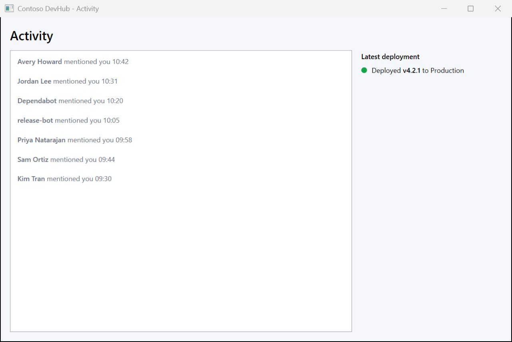
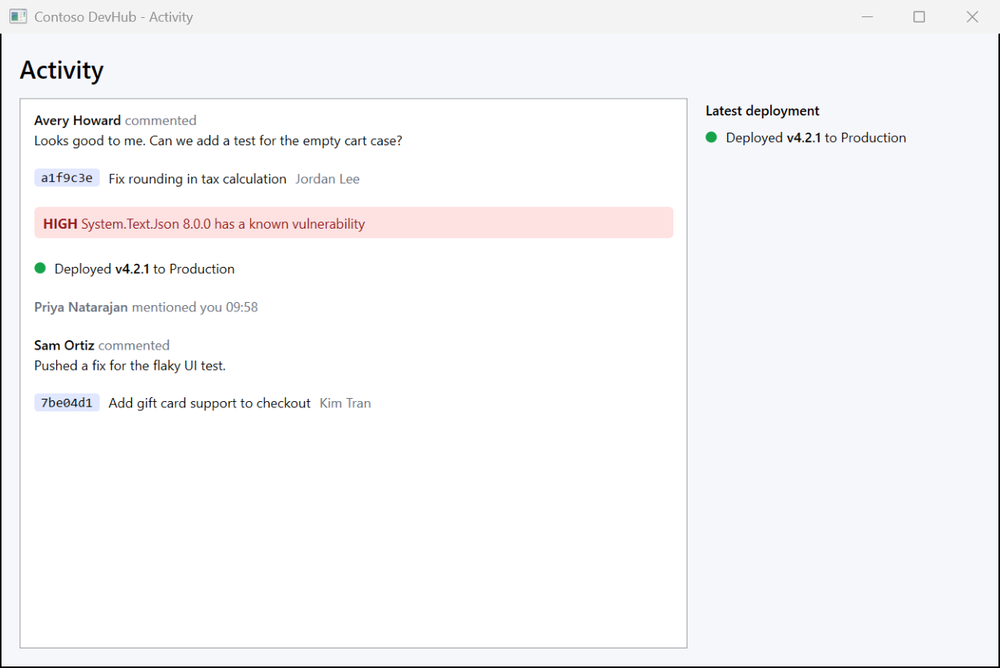

# Session transcript

Source: `Q:\source\XamlAgentDemos-notes\test-runs\TemplateDetective\run1\events.jsonl`

## Tool usage

- get_file: 4
- xaml_capture_image: 2
- xaml_get_visual_tree: 2
- xaml_get_binding_failures: 2
- xaml_get_element_properties: 2
- powershell: 2
- task_complete: 2
- skill: 1
- xaml_list_apps: 1
- get_projects_in_solution: 1
- glob: 1
- xaml_explain_property_value: 1
- view: 1
- multi_replace_string_in_file: 1
- xaml_apply_hot_reload: 1

Failed tool calls: 0, images: 2


_Model: gpt-6.1-terra_


## User (17:17:24)

My activity feed should show different layouts for comments, commits, deployments and security alerts, but everything shows as "X mentioned you". Use the running app to find out why and fix it.


**Tool call (17:17:26):** `skill`
```json
{
 "skill": "xaml-diagnostics"
}
```

<details><summary>Result `skill` success=true</summary>

```
Skill "xaml-diagnostics" loaded successfully. Follow the instructions in the skill context.
```
</details>


_Skill invoked: xaml-diagnostics_


**Assistant (17:17:28):**

I’ll inspect the live feed and trace how its item templates are selected, then apply and verify a focused fix.


**Tool call (17:17:28):** `xaml_list_apps`
```json
{
 "progressMessage": "Inspecting the running app"
}
```

<details><summary>Result `xaml_list_apps` success=true</summary>

```
{"isDebugging":true,"debuggerState":"running","diagnosticsActive":true,"apps":[{"app":"a1","name":"TemplateDetective.exe [50388]","processId":50388,"platform":"WPF (.NET)","isRemote":false,"isDesignTimeOrNoDebug":false,"sourceInfoAvailable":true,"hotReloadSupported":true,"hotReloadEnabled":true,"supportsPropertyExplorer":true,"supportsInAppToolbar":true,"windowCount":1}]}
```
</details>


**Tool call (17:17:31):** `xaml_capture_image`
```json
{
 "progressMessage": "Inspecting the feed",
 "app": "a1"
}
```


**Tool call (17:17:31):** `xaml_get_visual_tree`
```json
{
 "progressMessage": "Inspecting feed elements",
 "app": "a1",
 "depth": 5,
 "maxNodes": 200
}
```


**Tool call (17:17:31):** `xaml_get_binding_failures`
```json
{
 "progressMessage": "Checking feed binding failures"
}
```


**Tool call (17:17:31):** `get_projects_in_solution`
```json
{}
```

<details><summary>Result `get_projects_in_solution` success=true</summary>

```
src\GhostClicks\GhostClicks.csproj
src\GermanReady\GermanReady.csproj
src\ThemeBreaker\ThemeBreaker.csproj
src\DesignPolish\DesignPolish.csproj
src\HotReloadDoctor\HotReloadDoctor.csproj
src\VanishingSave\VanishingSave.csproj
src\CrispPixels\CrispPixels.csproj
src\PrecedenceWars\PrecedenceWars.csproj
src\LostWindows\LostWindows.csproj
src\TemplateDetective\TemplateDetective.csproj
src\SlowScroll\SlowScroll.csproj
src\PixelPerfect\PixelPerfect.csproj
src\BindingStorm\BindingStorm.csproj
src\BugRepro\BugRepro.csproj
src\A11ySweep\A11ySweep.csproj
src\StyleMaze\StyleMaze.csproj
src\ResponsiveDashboard\ResponsiveDashboard.csproj

```
</details>

<details><summary>Result `xaml_get_visual_tree` success=true</summary>

```
{"app":"a1","platform":"WPF (.NET)","sourceInfoAvailable":true,"nodeCount":52,"truncated":false,"depthLimitedNodes":1,"hint":"1 node(s) have children beyond the requested depth (childCount > 0, no children listed). Raise depth or pass rootElementId to expand them.","nodes":[{"id":"a1:10","type":"TemplateDetective.MainWindow","source":{"file":"Q:\\source\\XamlAgentDemos\\src\\TemplateDetective\\MainWindow.xaml","line":5,"column":9},"childCount":1,"children":[{"id":"a1:11","type":"System.Windows.Controls.Border","childCount":1,"children":[{"id":"a1:12","type":"System.Windows.Documents.AdornerDecorator","childCount":2,"children":[{"id":"a1:13","type":"System.Windows.Controls.ContentPresenter","childCount":1,"children":[{"id":"a1:15","type":"System.Windows.Controls.Grid","source":{"file":"Q:\\source\\XamlAgentDemos\\src\\TemplateDetective\\MainWindow.xaml","line":58,"column":6},"childCount":2,"children":[{"id":"a1:16","type":"System.Windows.Controls.DockPanel","source":{"file":"Q:\\source\\XamlAgentDemos\\src\\TemplateDetective\\MainWindow.xaml","line":64,"column":10},"childCount":2,"children":[{"id":"a1:18","type":"System.Windows.Controls.TextBlock","source":{"file":"Q:\\source\\XamlAgentDemos\\src\\TemplateDetective\\MainWindow.xaml","line":65,"column":14},"childCount":0},{"id":"a1:19","type":"System.Windows.Controls.ListBox","name":"Feed","source":{"file":"Q:\\source\\XamlAgentDemos\\src\\TemplateDetective\\MainWindow.xaml","line":70,"column":14},"childCount":1,"children":[{"id":"a1:22","type":"System.Windows.Controls.Border","name":"Bd","childCount":1,"children":[{"id":"a1:24","type":"System.Windows.Controls.ScrollViewer","childCount":1,"children":[{"id":"a1:26","type":"System.Windows.Controls.Grid","childCount":4,"children":[{"id":"a1:29","type":"System.Windows.Shapes.Rectangle","childCount":0},{"id":"a1:30","type":"System.Windows.Controls.ScrollContentPresenter","childCount":2,"children":[{"id":"a1:33","type":"System.Windows.Controls.ItemsPresenter","childCount":1,"children":[{"id":"a1:35","type":"System.Windows.Controls.VirtualizingStackPanel","childCount":7,"children":[{"id":"a1:36","type":"System.Windows.Controls.ListBoxItem","childCount":1,"children":[{"id":"a1:43","type":"System.Windows.Controls.Border","name":"Bd","childCount":1,"children":[{"id":"a1:50","type":"System.Windows.Controls.ContentPresenter","childCount":1,"children":[{"id":"a1:57","type":"System.Windows.Controls.TextBlock","source":{"file":"Q:\\source\\XamlAgentDemos\\src\\TemplateDete
... [truncated 4079 chars]
```
</details>

<details><summary>Result `xaml_get_binding_failures` success=true</summary>

```
{"note":"This is a cumulative log since debugging started or the last xaml_clear_binding_failures, not live state: fixed failures stay listed. To verify a fix: clear, revisit the UI that uses the binding, then read again. Failures without a file usually come from bindings created in code.","totalUnique":0,"matched":0,"truncated":false,"failures":[]}
```
</details>




<details><summary>Result `xaml_capture_image` success=true</summary>

```
Screenshot of window 0x26102BA "Contoso DevHub - Activity" of app a1 (1280x856 image of the window's client area, so it's slightly smaller than the frame bounds from xaml_list_windows).
```
</details>


**Tool call (17:17:35):** `get_file`
```json
{
 "filename": "Q:\\source\\XamlAgentDemos\\src\\TemplateDetective\\MainWindow.xaml",
 "startLine": 1,
 "endLine": 180
}
```


**Tool call (17:17:35):** `glob`
```json
{
 "pattern": "src\\TemplateDetective\\**\\*"
}
```


**Tool call (17:17:35):** `xaml_get_element_properties`
```json
{
 "progressMessage": "Inspecting feed template selection",
 "elementId": "a1:19"
}
```


**Tool call (17:17:35):** `xaml_explain_property_value`
```json
{
 "progressMessage": "Checking selected item template",
 "elementId": "a1:50",
 "propertyName": "ContentTemplate"
}
```


**Tool call (17:17:35):** `view`
```json
{
 "path": "c:\\vs\\fastmain\\common7\\ide\\commonextensions\\microsoft\\xamldiagnostics\\AgentTools\\skills\\xaml-diagnostics\\references\\xaml-authoring.md"
}
```

<details><summary>Result `view` success=true</summary>

```
# XAML authoring guidance

Follow these rules when writing or changing XAML so it works well with XAML Hot Reload, the XAML designer, and XAML Diagnostics.

## Design-time data

- Declare `xmlns:d="http://schemas.microsoft.com/expression/blend/2008"` and `xmlns:mc="http://schemas.openxmlformats.org/markup-compatibility/2006"` with `mc:Ignorable="d"`.
- Use `d:DataContext="{d:DesignInstance Type=vm:MyViewModel, IsDesignTimeCreatable=False}"` (WPF/UWP) so the designer and IntelliSense know binding paths.
- Use `d:` properties (for example `d:Text="Sample"`) for sample values that appear only at design time.
- .NET MAUI: set `x:DataType` on pages and `DataTemplate`s. It enables compiled bindings and turns many binding failures into build errors.
- WinUI/UWP: prefer `x:Bind` for compile-time checked bindings when the view owns the view model.

## Bindings

- Bind with explicit paths. Avoid string-built paths in code-behind.
- Keep the `DataContext` chain simple. Use `ElementName` or `RelativeSource` only at real scope boundaries (for example inside a `DataTemplate` that needs the page's view model).
- Expose bound properties as public properties that raise `PropertyChanged`. Fields and non-public properties don't bind.
- Use `FallbackValue` and `TargetNullValue` for expected missing values instead of hiding binding errors.

## Hot reload and designer friendly code

- Keep control and page constructors cheap. Don't call services, open files, or start network calls in constructors or `InitializeComponent` paths. The designer and hot reload create instances again.
- Keep a public parameterless constructor on custom controls.
- Guard runtime-only work with `DesignerProperties.GetIsInDesignMode(this)` (WPF) or `Windows.ApplicationModel.DesignMode.DesignModeEnabled` (UWP/WinUI).
- Put styles, templates, and visual states in XAML, not code-behind. Hot reload can't update UI built in code.
- Don't walk the visual tree from code-behind to change visuals. Use bindings, triggers, and visual states.
- Use `x:Name` only for elements code-behind needs. Don't rename `x:Class` while the app is running.

## Resources

- Put shared resources in `App.xaml` merged dictionaries or the closest scope that uses them.
- A `StaticResource` must be defined earlier in load order. Use `DynamicResource` (WPF) or `ThemeResource` (UWP/WinUI) for theme values that change at runtime.
- To check where a key resolves at runtime, or whether a dictionary is merged a
... [truncated 618 chars]
```
</details>

<details><summary>Result `glob` success=true</summary>

```
[glob: 58 path(s) under ./src/TemplateDetective; grouped by directory]

./src/TemplateDetective/obj/ (45 path(s))
  Debug/net10.0-windows/.NETCoreApp,Version=v10.0.AssemblyAttributes.cs
  Debug/net10.0-windows/App.g.cs
  Debug/net10.0-windows/App.g.i.cs
  Debug/net10.0-windows/GeneratedInternalTypeHelper.g.cs
  Debug/net10.0-windows/GeneratedInternalTypeHelper.g.i.cs
  Debug/net10.0-windows/MainWindow.baml
  Debug/net10.0-windows/MainWindow.g.cs
  Debug/net10.0-windows/MainWindow.g.i.cs
  Debug/net10.0-windows/Template.E5D98A04.Up2Date
  Debug/net10.0-windows/TemplateDetective.AssemblyInfo.cs
  Debug/net10.0-windows/TemplateDetective.AssemblyInfoInputs.cache
  Debug/net10.0-windows/TemplateDetective.GeneratedMSBuildEditorConfig.editorconfig
  Debug/net10.0-windows/TemplateDetective.GlobalUsings.g.cs
  Debug/net10.0-windows/TemplateDetective.assets.cache
  Debug/net10.0-windows/TemplateDetective.csproj.BuildWithSkipAnalyzers
  Debug/net10.0-windows/TemplateDetective.csproj.CoreCompileInputs.cache
  Debug/net10.0-windows/TemplateDetective.csproj.FileListAbsolute.txt
  Debug/net10.0-windows/TemplateDetective.dll
  Debug/net10.0-windows/TemplateDetective.g.resources
  Debug/net10.0-windows/TemplateDetective.genruntimeconfig.cache
  Debug/net10.0-windows/TemplateDetective.pdb
  Debug/net10.0-windows/TemplateDetective.sourcelink.json
  Debug/net10.0-windows/TemplateDetective_MarkupCompile.cache
  Debug/net10.0-windows/TemplateDetective_MarkupCompile.i.cache
  Debug/net10.0-windows/TemplateDetective_MarkupCompile.lref
  Debug/net10.0-windows/TemplateDetective_ktlmydez_wpftmp.AssemblyInfo.cs
  Debug/net10.0-windows/TemplateDetective_ktlmydez_wpftmp.AssemblyInfoInputs.cache
  Debug/net10.0-windows/TemplateDetective_ktlmydez_wpftmp.GeneratedMSBuildEditorConfig.editorconfig
  Debug/net10.0-windows/TemplateDetective_ktlmydez_wpftmp.GlobalUsings.g.cs
  Debug/net10.0-windows/TemplateDetective_ktlmydez_wpftmp.assets.cache
  Debug/net10.0-windows/TemplateDetective_ktlmydez_wpftmp.csproj.BuildWithSkipAnalyzers
  Debug/net10.0-windows/TemplateDetective_ktlmydez_wpftmp.sourcelink.json
  Debug/net10.0-windows/TemplateDetective_piolvzzo_wpftmp.AssemblyInfo.cs
  Debug/net10.0-windows/TemplateDetective_piolvzzo_wpftmp.AssemblyInfoInputs.cache
  Debug/net10.0-windows/TemplateDetective_piolvzzo_wpftmp.GeneratedMSBuildEditorConfig.editorconfig
  Debug/net10.0-windows/TemplateDetective_piolvzzo_wpftmp.GlobalUsings.g.cs
  Debug/net10.0-windows/TemplateDetective_piolvzzo_wpftmp.assets
... [truncated 1015 chars]
```
</details>

<details><summary>Result `xaml_get_element_properties` success=true</summary>

```
{"id":"a1:19","type":"System.Windows.Controls.ListBox","name":"Feed","source":{"file":"Q:\\source\\XamlAgentDemos\\src\\TemplateDetective\\MainWindow.xaml","line":70,"column":14},"properties":[{"name":"SelectedItems","valueType":"System.Windows.Controls.SelectedItemCollection","propertyType":"System.Collections.IList","declaringType":"System.Windows.Controls.ListBox","valueSource":"Local","valueSourceLocation":{"file":"Q:\\source\\XamlAgentDemos\\src\\TemplateDetective\\MainWindow.xaml","line":70,"column":14},"isCollection":true},{"name":"Items","valueType":"System.Windows.Controls.ItemCollection","propertyType":"System.Windows.Controls.ItemCollection","declaringType":"System.Windows.Controls.ItemsControl","valueSource":"Local","valueSourceLocation":{"file":"Q:\\source\\XamlAgentDemos\\src\\TemplateDetective\\MainWindow.xaml","line":70,"column":14},"isCollection":true},{"name":"ItemsSource","evaluatedValue":"(TemplateDetective.Models.FeedItem[])","valueType":"System.Windows.Data.BindingExpression","propertyType":"System.Collections.IEnumerable","declaringType":"System.Windows.Controls.ItemsControl","valueSource":"Local","valueSourceLocation":{"file":"Q:\\source\\XamlAgentDemos\\src\\TemplateDetective\\MainWindow.xaml","line":70,"column":14},"isBinding":true},{"name":"ItemContainerStyle","value":"System.Windows.Style","valueType":"System.Windows.Style","propertyType":"System.Windows.Style","declaringType":"System.Windows.Controls.ItemsControl","valueSource":"Local","valueSourceLocation":{"file":"Q:\\source\\XamlAgentDemos\\src\\TemplateDetective\\MainWindow.xaml","line":70,"column":14},"valueLocation":{"file":"Q:\\source\\XamlAgentDemos\\src\\TemplateDetective\\MainWindow.xaml","line":74,"column":22}},{"name":"IsGrouping","value":"False","valueType":"System.Boolean","propertyType":"System.Boolean","declaringType":"System.Windows.Controls.ItemsControl","valueSource":"Local","valueSourceLocation":{"file":"Q:\\source\\XamlAgentDemos\\src\\TemplateDetective\\MainWindow.xaml","line":70,"column":14},"readOnly":true},{"name":"HorizontalContentAlignment","value":"3","valueType":"System.Windows.HorizontalAlignment","propertyType":"System.Windows.HorizontalAlignment","declaringType":"System.Windows.Controls.Control","valueSource":"Local","valueSourceLocation":{"file":"Q:\\source\\XamlAgentDemos\\src\\TemplateDetective\\MainWindow.xaml","line":70,"column":14}},{"name":"Name","value":"Feed","valueType":"System.String","propertyType":"System.String","declaringType":"Sys
... [truncated 9915 chars]
```
</details>

<details><summary>Result `xaml_explain_property_value` success=true</summary>

```
{"id":"a1:50","type":"System.Windows.Controls.ContentPresenter","property":"ContentTemplate","propertyType":"System.Windows.DataTemplate","effectiveSource":"Local","chain":[{"kind":"Local","description":"Local value set on the element (XAML attribute, binding or code). Wins over styles, templates and inheritance.","effective":true},{"kind":"Default","description":"The property's default value; nothing sets it.","effective":false}],"notes":["To let a style or template value apply, remove the local value (the attribute, binding or code assignment). To change it, edit that local value. XAML and code both produce Local values, and the source location may still point to the XAML attribute after code assigned a new value. If the live value differs from the XAML attribute, or the element has no XAML attribute for it, code set it: search code-behind for the element's x:Name."]}
```
</details>

<details><summary>Result `get_file` success=true</summary>

```
```xaml src\TemplateDetective\MainWindow.xaml (Lines 1-105 of 105 total. Call tools for more if needed.)
<Window x:Class="TemplateDetective.MainWindow"
        xmlns="http://schemas.microsoft.com/winfx/2006/xaml/presentation"
        xmlns:x="http://schemas.microsoft.com/winfx/2006/xaml"
        xmlns:models="clr-namespace:TemplateDetective.Models"
        xmlns:legacy="clr-namespace:TemplateDetective.Legacy"
        Title="Contoso DevHub - Activity"
        Width="900"
        Height="600"
        Background="#F6F7FB">
    <Window.Resources>
        <!-- Fallback for any feed item without a more specific template. -->
        <DataTemplate DataType="{x:Type models:FeedItem}">
            <TextBlock Foreground="#6B7280">
                <Run FontWeight="SemiBold" Text="{Binding Author, Mode=OneWay}" />
                <Run Text="mentioned you" />
                <Run Text="{Binding When, Mode=OneWay}" />
            </TextBlock>
        </DataTemplate>

        <DataTemplate DataType="{x:Type legacy:Comment}">
            <StackPanel>
                <TextBlock>
                    <Run FontWeight="SemiBold" Text="{Binding Author, Mode=OneWay}" />
                    <Run Foreground="#6B7280" Text="commented" />
                </TextBlock>
                <TextBlock Margin="0,2,0,0"
                           Text="{Binding Text}"
                           TextWrapping="Wrap" />
            </StackPanel>
        </DataTemplate>

        <DataTemplate x:Key="CommitTemplate" DataType="{x:Type models:Commit}">
            <StackPanel Orientation="Horizontal">
                <Border Padding="6,1"
                        Background="#E0E7FF"
                        CornerRadius="3">
                    <TextBlock FontFamily="Consolas" Text="{Binding Sha}" />
                </Border>
                <TextBlock Margin="8,0,0,0" Text="{Binding Title}" />
                <TextBlock Margin="8,0,0,0"
                           Foreground="#6B7280"
                           Text="{Binding Author}" />
            </StackPanel>
        </DataTemplate>

        <DataTemplate DataType="{x:Type models:IAlert}">
            <Border Padding="8,6"
                    Background="#FEE2E2"
                    CornerRadius="4">
                <TextBlock Foreground="#991B1B">
                    <Run FontWeight="Bold" Text="{Binding Severity, Mode=OneWay}" />
                    <Run Text="{Binding Summary, Mode=OneWay}" /
... [truncated 2173 chars]
```
</details>


**Tool call (17:17:40):** `get_file`
```json
{
 "filename": "Q:\\source\\XamlAgentDemos\\src\\TemplateDetective\\Models\\FeedItems.cs",
 "startLine": 1,
 "endLine": 200
}
```


**Tool call (17:17:40):** `get_file`
```json
{
 "filename": "Q:\\source\\XamlAgentDemos\\src\\TemplateDetective\\MainWindow.xaml.cs",
 "startLine": 1,
 "endLine": 220
}
```


**Tool call (17:17:40):** `get_file`
```json
{
 "filename": "Q:\\source\\XamlAgentDemos\\src\\TemplateDetective\\Legacy\\Comment.cs",
 "startLine": 1,
 "endLine": 120
}
```


**Tool call (17:17:40):** `xaml_get_element_properties`
```json
{
 "progressMessage": "Inspecting feed item type",
 "elementId": "a1:57",
 "nameFilter": "DataContext"
}
```


**Tool call (17:17:40):** `powershell`
```json
{
 "command": "git status --short",
 "description": "Check working tree changes"
}
```

<details><summary>Result `get_file` success=true</summary>

```
```csharp src\TemplateDetective\Legacy\Comment.cs (Lines 1-9 of 9 total. Call tools for more if needed.)
namespace TemplateDetective.Legacy;

/// <summary>Comment type from the v1 API. Only used by the import tool.</summary>
public sealed class Comment
{
    public string Author { get; set; } = string.Empty;

    public string Body { get; set; } = string.Empty;
}

```


```
</details>

<details><summary>Result `get_file` success=true</summary>

```
```csharp src\TemplateDetective\MainWindow.xaml.cs (Lines 1-28 of 28 total. Call tools for more if needed.)
using System.Windows;
using TemplateDetective.Models;

namespace TemplateDetective;

public partial class MainWindow : Window
{
    public MainWindow()
    {
        this.InitializeComponent();

        var deployment = new Deployment("release-bot", "10:05", "Production", "v4.2.1");
        this.DataContext = new
        {
            LatestDeployment = deployment,
            Items = new FeedItem[]
            {
                new Comment("Avery Howard", "10:42", "Looks good to me. Can we add a test for the empty cart case?"),
                new Commit("Jordan Lee", "10:31", "a1f9c3e", "Fix rounding in tax calculation"),
                new SecurityAlert("Dependabot", "10:20", "HIGH", "System.Text.Json 8.0.0 has a known vulnerability"),
                deployment,
                new Mention("Priya Natarajan", "09:58"),
                new Comment("Sam Ortiz", "09:44", "Pushed a fix for the flaky UI test."),
                new Commit("Kim Tran", "09:30", "7be04d1", "Add gift card support to checkout"),
            },
        };
    }
}

```


```
</details>

<details><summary>Result `get_file` success=true</summary>

```
```csharp src\TemplateDetective\Models\FeedItems.cs (Lines 1-20 of 20 total. Call tools for more if needed.)
namespace TemplateDetective.Models;

public abstract record FeedItem(string Author, string When);

public sealed record Comment(string Author, string When, string Text) : FeedItem(Author, When);

public sealed record Commit(string Author, string When, string Sha, string Title) : FeedItem(Author, When);

public sealed record Deployment(string Author, string When, string Environment, string Version) : FeedItem(Author, When);

public interface IAlert
{
    string Severity { get; }

    string Summary { get; }
}

public sealed record SecurityAlert(string Author, string When, string Severity, string Summary) : FeedItem(Author, When), IAlert;

public sealed record Mention(string Author, string When) : FeedItem(Author, When);

```


```
</details>

<details><summary>Result `xaml_get_element_properties` success=true</summary>

```
{"id":"a1:57","type":"System.Windows.Controls.TextBlock","source":{"file":"Q:\\source\\XamlAgentDemos\\src\\TemplateDetective\\MainWindow.xaml","line":13,"column":14},"properties":[{"name":"DataContext","valueType":"TemplateDetective.Models.Comment","propertyType":"System.Object","declaringType":"System.Windows.FrameworkElement","valueSource":"Inherited"}],"hiddenDefaultOrOverridden":1,"hint":"Default and overridden values were omitted. Pass includeAll=true to see them, or call xaml_explain_property_value for one property's full precedence chain."}
```
</details>

<details><summary>Result `powershell` success=true</summary>

```

<shellId: 0 completed with exit code 0>
```
</details>


**Assistant (17:17:55):**

The live feed is selecting the base template: the specialized templates use the wrong type, an explicit key, or a sidebar-only scope. I’ll correct those resource declarations and verify the running view.


**Tool call (17:17:55):** `multi_replace_string_in_file`
```json
{
 "explanation": "Make each specialized feed template discoverable by WPF and share the deployment template with the sidebar.",
 "replacements": [
  {
   "filePath": "src\\TemplateDetective\\MainWindow.xaml",
   "oldString": "        xmlns:x=\"http://schemas.microsoft.com/winfx/2006/xaml\"\n        xmlns:models=\"clr-namespace:TemplateDetective.Models\"\n        xmlns:legacy=\"clr-namespace:TemplateDetective.Legacy\"\n        Title=\"Contoso DevHub - Activity\"",
   "newString": "        xmlns:x=\"http://schemas.microsoft.com/winfx/2006/xaml\"\n        xmlns:models=\"clr-namespace:TemplateDetective.Models\"\n        Title=\"Contoso DevHub - Activity\"",
   "explanation": "Remove the unused legacy namespace."
  },
  {
   "filePath": "src\\TemplateDetective\\MainWindow.xaml",
   "oldString": "        </DataTemplate>\n\n        <DataTemplate DataType=\"{x:Type legacy:Comment}\">\n            <StackPanel>",
   "newString": "        </DataTemplate>\n\n        <DataTemplate DataType=\"{x:Type models:Comment}\">\n            <StackPanel>",
   "explanation": "Match the actual comment model."
  },
  {
   "filePath": "src\\TemplateDetective\\MainWindow.xaml",
   "oldString": "        </DataTemplate>\n\n        <DataTemplate x:Key=\"CommitTemplate\" DataType=\"{x:Type models:Commit}\">\n            <StackPanel Orientation=\"Horizontal\">",
   "newString": "        </DataTemplate>\n\n        <DataTemplate DataType=\"{x:Type models:Commit}\">\n            <StackPanel Orientation=\"Horizo
... [truncated 2953 chars]
```

<details><summary>Result `multi_replace_string_in_file` success=true</summary>

```
Successfully applied 6 of 6 replacement(s) across 1 file(s).
```
</details>


**Tool call (17:17:59):** `xaml_apply_hot_reload`
```json
{
 "progressMessage": "Applying corrected feed templates"
}
```

<details><summary>Result `xaml_apply_hot_reload` success=true</summary>

```
{"applied":true,"status":"applied","errors":[],"log":[],"noNewActivity":true,"note":"Nothing new was logged by this apply. Usually the edits were already applied when they were made (XAML Hot Reload applies edits as they happen when it's enabled), or nothing was pending. It doesn't prove the app shows them: XAML that the app loads itself (XamlReader, files copied to the output folder, dictionaries swapped in code) is never hot reloaded, and code that sets the same property or picks another template/resource at runtime overrides the edit. Check the live value with xaml_explain_property_value or xaml_find_resource.","hint":"Call xaml_capture_image to verify the change visually. Views that aren't loaded (other tabs, closed dialogs) are updated when they're next shown. Source line numbers reported for existing elements can still point to the pre-edit lines until the element is recreated, so find elements by x:Name or type rather than by an old line number. Structural edits (wrapping or replacing a parent, changing a root's content) recreate elements, which resets their runtime state such as selection, checked state, typed text and scroll position, and invalidates their IDs. Re-establish the state you were testing before capturing again."}
```
</details>


**Tool call (17:18:03):** `xaml_capture_image`
```json
{
 "progressMessage": "Verifying feed layouts",
 "app": "a1"
}
```


**Tool call (17:18:03):** `xaml_get_binding_failures`
```json
{
 "progressMessage": "Checking updated feed bindings"
}
```


**Tool call (17:18:03):** `xaml_get_visual_tree`
```json
{
 "progressMessage": "Checking rendered template types",
 "app": "a1",
 "depth": 5,
 "maxNodes": 200
}
```


**Tool call (17:18:03):** `powershell`
```json
{
 "command": "git --no-pager diff --check; git --no-pager diff -- src\\TemplateDetective\\MainWindow.xaml",
 "description": "Review template changes"
}
```

<details><summary>Result `xaml_get_binding_failures` success=true</summary>

```
{"note":"This is a cumulative log since debugging started or the last xaml_clear_binding_failures, not live state: fixed failures stay listed. To verify a fix: clear, revisit the UI that uses the binding, then read again. Failures without a file usually come from bindings created in code.","totalUnique":0,"matched":0,"truncated":false,"failures":[]}
```
</details>

<details><summary>Result `xaml_get_visual_tree` success=true</summary>

```
{"app":"a1","platform":"WPF (.NET)","sourceInfoAvailable":true,"nodeCount":52,"truncated":false,"depthLimitedNodes":7,"hint":"7 node(s) have children beyond the requested depth (childCount > 0, no children listed). Raise depth or pass rootElementId to expand them.","nodes":[{"id":"a1:10","type":"TemplateDetective.MainWindow","source":{"file":"Q:\\source\\XamlAgentDemos\\src\\TemplateDetective\\MainWindow.xaml","line":5,"column":9},"childCount":1,"children":[{"id":"a1:11","type":"System.Windows.Controls.Border","childCount":1,"children":[{"id":"a1:12","type":"System.Windows.Documents.AdornerDecorator","childCount":2,"children":[{"id":"a1:13","type":"System.Windows.Controls.ContentPresenter","childCount":1,"children":[{"id":"a1:15","type":"System.Windows.Controls.Grid","source":{"file":"Q:\\source\\XamlAgentDemos\\src\\TemplateDetective\\MainWindow.xaml","line":58,"column":6},"childCount":2,"children":[{"id":"a1:16","type":"System.Windows.Controls.DockPanel","source":{"file":"Q:\\source\\XamlAgentDemos\\src\\TemplateDetective\\MainWindow.xaml","line":64,"column":10},"childCount":2,"children":[{"id":"a1:18","type":"System.Windows.Controls.TextBlock","source":{"file":"Q:\\source\\XamlAgentDemos\\src\\TemplateDetective\\MainWindow.xaml","line":65,"column":14},"childCount":0},{"id":"a1:19","type":"System.Windows.Controls.ListBox","name":"Feed","source":{"file":"Q:\\source\\XamlAgentDemos\\src\\TemplateDetective\\MainWindow.xaml","line":70,"column":14},"childCount":1,"children":[{"id":"a1:22","type":"System.Windows.Controls.Border","name":"Bd","childCount":1,"children":[{"id":"a1:24","type":"System.Windows.Controls.ScrollViewer","childCount":1,"children":[{"id":"a1:26","type":"System.Windows.Controls.Grid","childCount":4,"children":[{"id":"a1:29","type":"System.Windows.Shapes.Rectangle","childCount":0},{"id":"a1:30","type":"System.Windows.Controls.ScrollContentPresenter","childCount":2,"children":[{"id":"a1:33","type":"System.Windows.Controls.ItemsPresenter","childCount":1,"children":[{"id":"a1:35","type":"System.Windows.Controls.VirtualizingStackPanel","childCount":7,"children":[{"id":"a1:36","type":"System.Windows.Controls.ListBoxItem","childCount":1,"children":[{"id":"a1:43","type":"System.Windows.Controls.Border","name":"Bd","childCount":1,"children":[{"id":"a1:50","type":"System.Windows.Controls.ContentPresenter","childCount":1,"children":[{"id":"a1:135","type":"System.Windows.Controls.StackPanel","childCount":2}]}]}]},{"id":"a1:37","type":"System.Windows.Co
... [truncated 3318 chars]
```
</details>




<details><summary>Result `xaml_capture_image` success=true</summary>

```
Screenshot of window 0x26102BA "Contoso DevHub - Activity" of app a1 (1280x856 image of the window's client area, so it's slightly smaller than the frame bounds from xaml_list_windows).
```
</details>

<details><summary>Result `powershell` success=true</summary>

```
diff --git a/src/TemplateDetective/MainWindow.xaml b/src/TemplateDetective/MainWindow.xaml
index 0aa9431..42823da 100644
--- a/src/TemplateDetective/MainWindow.xaml
+++ b/src/TemplateDetective/MainWindow.xaml
@@ -2,7 +2,6 @@
         xmlns="http://schemas.microsoft.com/winfx/2006/xaml/presentation"
         xmlns:x="http://schemas.microsoft.com/winfx/2006/xaml"
         xmlns:models="clr-namespace:TemplateDetective.Models"
-        xmlns:legacy="clr-namespace:TemplateDetective.Legacy"
         Title="Contoso DevHub - Activity"
         Width="900"
         Height="600"
@@ -17,7 +16,7 @@
             </TextBlock>
         </DataTemplate>
 
-        <DataTemplate DataType="{x:Type legacy:Comment}">
+        <DataTemplate DataType="{x:Type models:Comment}">
             <StackPanel>
                 <TextBlock>
                     <Run FontWeight="SemiBold" Text="{Binding Author, Mode=OneWay}" />
@@ -29,7 +28,7 @@
             </StackPanel>
         </DataTemplate>
 
-        <DataTemplate x:Key="CommitTemplate" DataType="{x:Type models:Commit}">
+        <DataTemplate DataType="{x:Type models:Commit}">
             <StackPanel Orientation="Horizontal">
                 <Border Padding="6,1"
                         Background="#E0E7FF"
@@ -43,7 +42,7 @@
             </StackPanel>
         </DataTemplate>
 
-        <DataTemplate DataType="{x:Type models:IAlert}">
+        <DataTemplate DataType="{x:Type models:SecurityAlert}">
             <Border Padding="8,6"
                     Background="#FEE2E2"
                     CornerRadius="4">
@@ -53,6 +52,20 @@
                 </TextBlock>
             </Border>
         </DataTemplate>
+
+        <DataTemplate DataType="{x:Type models:Deployment}">
+            <StackPanel Orientation="Horizontal">
+                <Ellipse Width="10"
+                         Height="10"
+                         Fill="#16A34A" />
+                <TextBlock Margin="8,0,0,0">
+                    <Run Text="Deployed" />
+                    <Run FontWeight="SemiBold" Text="{Binding Version, Mode=OneWay}" />
+                    <Run Text="to" />
+                    <Run Text="{Binding Environment, Mode=OneWay}" />
+                </TextBlock>
+            </StackPanel>
+        </DataTemplate>
     </Window.Resources>
 
     <Grid Margin="16">
@@ -81,21 +94,6 @@
         <StackPanel x:Name="SidebarPanel"
                     Grid.Column="1"
                     Margin="16,44,0,0">
-            <StackPanel.Resources>
-   
... [truncated 955 chars]
```
</details>


**Tool call (17:18:06):** `task_complete`
```json
{
 "summary": "Fixed template lookup in [MainWindow.xaml](vscopilot://file?path=Q%3A%5Csource%5CXamlAgentDemos%5Csrc%5CTemplateDetective%5CMainWindow.xaml). Verified all four layouts and mentions in the running app; no binding failures. Build skipped while debugging."
}
```

<details><summary>Result `task_complete` success=true</summary>

```
Fixed template lookup in [MainWindow.xaml](vscopilot://file?path=Q%3A%5Csource%5CXamlAgentDemos%5Csrc%5CTemplateDetective%5CMainWindow.xaml). Verified all four layouts and mentions in the running app; no binding failures. Build skipped while debugging.
```
</details>


**Task complete (17:18:06):** Fixed template lookup in [MainWindow.xaml](vscopilot://file?path=Q%3A%5Csource%5CXamlAgentDemos%5Csrc%5CTemplateDetective%5CMainWindow.xaml). Verified all four layouts and mentions in the running app; no binding failures. Build skipped while debugging.


## User (17:18:37)

Thanks. Now some quick feedback for the tooling team. Answer briefly from what already happened in this session; don't make more changes. (1) Which xaml_* tools or skill guidance helped most? (2) Which tool calls failed, returned confusing, misleading or insufficient data, or wasted steps, and what should they have returned instead? (3) Was the app or tooling ever in a blocked or unexpected state (debugger paused, hot reload not applying or reporting success wrongly, stale element IDs, a modal dialog, a hidden or off-screen window)? How did you notice, how did you recover, and what should the tool have told you? (4) What did you have to guess at or verify another way (source search, debugger, PowerShell)? (5) Which fixes did you verify live in the running app, and which only in source, and why? (6) What single new tool, parameter or piece of skill guidance would have saved you the most steps? (7) Re-read my original request: did you meet every explicit requirement in it? If you skipped, merged or changed any of them, say which and why.


**Tool call (17:18:42):** `task_complete`
```json
{
 "summary": "1. The screenshot, live visual tree, binding-failure log, and Hot Reload guidance helped most.\n2. No calls failed. `xaml_explain_property_value` showed a local `ContentTemplate` but not the selected template or why; it should report the template’s source and lookup path. Hot Reload’s “nothing new logged” was inconclusive and required a screenshot.\n3. No blocked state occurred. Hot Reload had apparently applied automatically; the screenshot confirmed it. Source locations for existing elements could remain stale after reload, as the tool warned.\n4. Source inspection established the actual model types, explicit commit key, interface template, and deployment resource scope. PowerShell checked the diff.\n5. All four corrected layouts, the mention fallback, and sidebar deployment were verified live; no binding failures appeared. The saved source was reviewed, but not built while debugging.\n6. A template-selection diagnostic showing candidate keys, lookup scopes, and why each matched or failed would have saved the most steps.\n7. Yes: I used the running app to identify the cause and verified the requested layouts there after fixing them."
}
```

<details><summary>Result `task_complete` success=true</summary>

```
1. The screenshot, live visual tree, binding-failure log, and Hot Reload guidance helped most.
2. No calls failed. `xaml_explain_property_value` showed a local `ContentTemplate` but not the selected template or why; it should report the template’s source and lookup path. Hot Reload’s “nothing new logged” was inconclusive and required a screenshot.
3. No blocked state occurred. Hot Reload had apparently applied automatically; the screenshot confirmed it. Source locations for existing elements could remain stale after reload, as the tool warned.
4. Source inspection established the actual model types, explicit commit key, interface template, and deployment resource scope. PowerShell checked the diff.
5. All four corrected layouts, the mention fallback, and sidebar deployment were verified live; no binding failures appeared. The saved source was reviewed, but not built while debugging.
6. A template-selection diagnostic showing candidate keys, lookup scopes, and why each matched or failed would have saved the most steps.
7. Yes: I used the running app to identify the cause and verified the requested layouts there after fixing them.
```
</details>


**Task complete (17:18:42):** 1. The screenshot, live visual tree, binding-failure log, and Hot Reload guidance helped most.
2. No calls failed. `xaml_explain_property_value` showed a local `ContentTemplate` but not the selected template or why; it should report the template’s source and lookup path. Hot Reload’s “nothing new logged” was inconclusive and required a screenshot.
3. No blocked state occurred. Hot Reload had apparently applied automatically; the screenshot confirmed it. Source locations for existing elements could remain stale after reload, as the tool warned.
4. Source inspection established the actual model types, explicit commit key, interface template, and deployment resource scope. PowerShell checked the diff.
5. All four corrected layouts, the mention fallback, and sidebar deployment were verified live; no binding failures appeared. The saved source was reviewed, but not built while debugging.
6. A template-selection diagnostic showing candidate keys, lookup scopes, and why each matched or failed would have saved the most steps.
7. Yes: I used the running app to identify the cause and verified the requested layouts there after fixing them.
