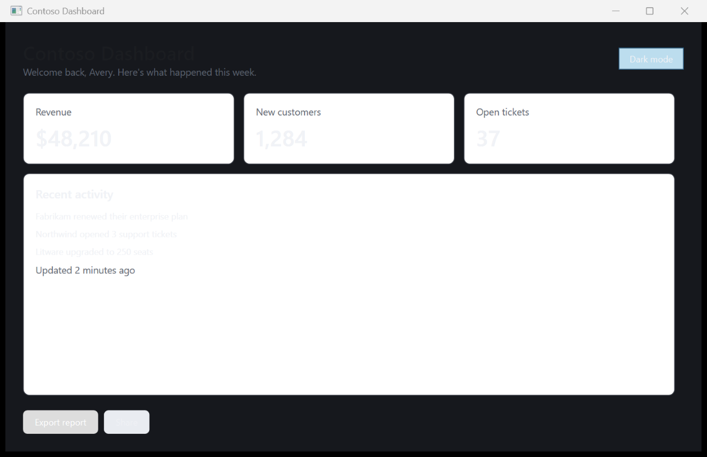
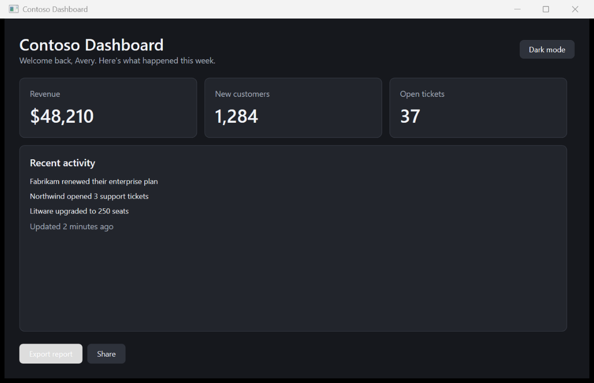
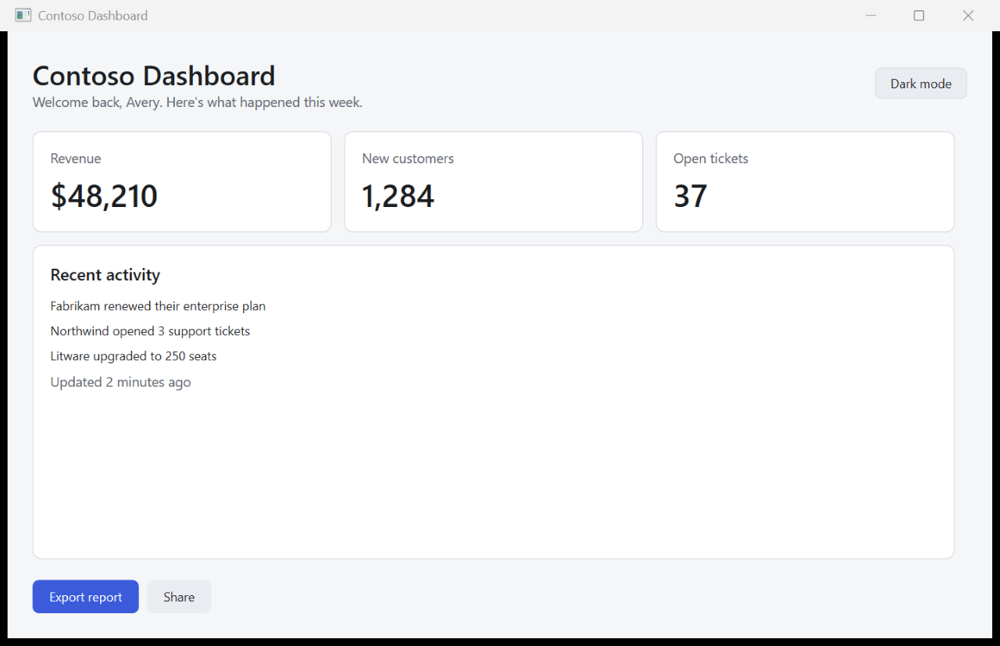
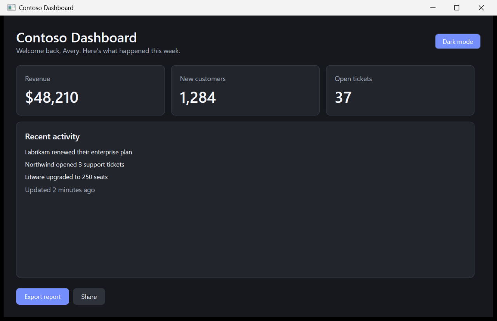

# Session transcript

Source: `Q:\source\XamlAgentDemos-notes\test-runs\ThemeBreaker\run1\events.jsonl`

## Tool usage

- xaml_explain_property_value: 13
- get_file: 10
- xaml_find_resource: 9
- powershell: 7
- xaml_capture_image: 6
- xaml_get_element_properties: 6
- xaml_list_apps: 4
- xaml_get_visual_tree: 4
- xaml_interact: 3
- skill: 2
- xaml_get_resource_dictionaries: 2
- view: 2
- glob: 2
- xaml_get_element_styles: 2
- task: 2
- debugger_enumerate_processes: 2
- task_complete: 2
- rg: 1
- multi_replace_string_in_file: 1
- xaml_apply_hot_reload: 1
- xaml_get_hot_reload_status: 1
- xaml_get_hot_reload_log: 1
- debugger_stop_debugging: 1
- run_build: 1
- list_agents: 1
- write_agent: 1
- debugger_launch: 1
- xaml_find_elements: 1
- xaml_get_binding_failures: 1

Failed tool calls: 2, images: 5


_Model: gpt-6.1-sol_


## User (01:34:00)

Dark mode in my running app looks broken. Use the live app to find every element that didn't switch theme, explain why each one didn't, and fix the source.


**Tool call (01:34:03):** `skill`
```json
{
 "skill": "xaml-diagnostics"
}
```

<details><summary>Result `skill` success=true</summary>

```
Skill "xaml-diagnostics" loaded successfully. Follow the instructions in the skill context.
```
</details>


_Skill invoked: xaml-diagnostics_


**Assistant (01:34:06):**

I’ll inspect the live theme values and resource lookup, fix the source, then verify both themes in the running app.


**Tool call (01:34:06):** `xaml_list_apps`
```json
{
 "progressMessage": "Identify running app for theme diagnostics"
}
```

<details><summary>Result `xaml_list_apps` success=true</summary>

```
{"isDebugging":true,"diagnosticsActive":true,"apps":[{"app":"a2","name":"ThemeBreaker.exe [67224]","processId":67224,"platform":"WPF (.NET)","isRemote":false,"isDesignTimeOrNoDebug":false,"sourceInfoAvailable":true,"hotReloadSupported":true,"hotReloadEnabled":true,"supportsPropertyExplorer":true,"supportsInAppToolbar":true,"windowCount":1}]}
```
</details>


**Tool call (01:34:10):** `xaml_capture_image`
```json
{
 "progressMessage": "Inspect broken dark theme",
 "app": "a2"
}
```


**Tool call (01:34:10):** `xaml_get_visual_tree`
```json
{
 "progressMessage": "Locate themed elements and controls",
 "app": "a2",
 "depth": 8,
 "maxNodes": 500
}
```


**Tool call (01:34:10):** `xaml_get_resource_dictionaries`
```json
{
 "progressMessage": "Inspect application theme dictionaries",
 "app": "a2",
 "includeKeys": true
}
```


**Tool call (01:34:10):** `powershell`
```json
{
 "command": "git --no-pager status --short",
 "description": "Check existing workspace changes"
}
```


**Tool call (01:34:10):** `view`
```json
{
 "path": "c:\\vs\\fastmain\\common7\\ide\\commonextensions\\microsoft\\xamldiagnostics\\AgentTools\\skills\\xaml-diagnostics\\references\\xaml-authoring.md"
}
```

<details><summary>Result `xaml_get_visual_tree` success=true</summary>

```
{"app":"a2","platform":"WPF (.NET)","sourceInfoAvailable":true,"nodeCount":31,"truncated":false,"nodes":[{"id":"a2:10","type":"ThemeBreaker.MainWindow","source":{"file":"Q:\\source\\XamlAgentDemos\\src\\ThemeBreaker\\MainWindow.xaml","line":3,"column":9},"childCount":1,"children":[{"id":"a2:11","type":"System.Windows.Controls.Border","childCount":1,"children":[{"id":"a2:12","type":"System.Windows.Documents.AdornerDecorator","childCount":2,"children":[{"id":"a2:13","type":"System.Windows.Controls.ContentPresenter","childCount":1,"children":[{"id":"a2:15","type":"System.Windows.Controls.DockPanel","source":{"file":"Q:\\source\\XamlAgentDemos\\src\\ThemeBreaker\\MainWindow.xaml","line":13,"column":6},"childCount":4,"children":[{"id":"a2:16","type":"System.Windows.Controls.DockPanel","source":{"file":"Q:\\source\\XamlAgentDemos\\src\\ThemeBreaker\\MainWindow.xaml","line":14,"column":10},"childCount":2,"children":[{"id":"a2:20","type":"System.Windows.Controls.Primitives.ToggleButton","name":"DarkModeToggle","source":{"file":"Q:\\source\\XamlAgentDemos\\src\\ThemeBreaker\\MainWindow.xaml","line":15,"column":14},"childCount":1,"children":[{"id":"a2:28","type":"System.Windows.Controls.Border","name":"border","childCount":1}]},{"id":"a2:21","type":"System.Windows.Controls.StackPanel","source":{"file":"Q:\\source\\XamlAgentDemos\\src\\ThemeBreaker\\MainWindow.xaml","line":22,"column":14},"childCount":2,"children":[{"id":"a2:29","type":"System.Windows.Controls.TextBlock","name":"HeaderTitle","source":{"file":"Q:\\source\\XamlAgentDemos\\src\\ThemeBreaker\\MainWindow.xaml","line":23,"column":18},"childCount":0},{"id":"a2:30","type":"System.Windows.Controls.TextBlock","name":"HeaderSubtitle","source":{"file":"Q:\\source\\XamlAgentDemos\\src\\ThemeBreaker\\MainWindow.xaml","line":28,"column":18},"childCount":0}]}]},{"id":"a2:17","type":"System.Windows.Controls.StackPanel","source":{"file":"Q:\\source\\XamlAgentDemos\\src\\ThemeBreaker\\MainWindow.xaml","line":34,"column":10},"childCount":2,"children":[{"id":"a2:22","type":"System.Windows.Controls.Button","name":"ExportButton","source":{"file":"Q:\\source\\XamlAgentDemos\\src\\ThemeBreaker\\MainWindow.xaml","line":37,"column":14},"childCount":1,"children":[{"id":"a2:31","type":"System.Windows.Controls.Border","source":{"file":"Q:\\source\\XamlAgentDemos\\src\\ThemeBreaker\\App.xaml","line":41,"column":30},"childCount":1}]},{"id":"a2:23","type":"System.Windows.Controls.Button","name":"ShareButton","source":{"file":"Q:\\so
... [truncated 3030 chars]
```
</details>

<details><summary>Result `view` success=true</summary>

```
# XAML authoring guidance

Follow these rules when writing or changing XAML so it works well with XAML Hot Reload, the XAML designer, and XAML Diagnostics.

## Design-time data

- Declare `xmlns:d="http://schemas.microsoft.com/expression/blend/2008"` and `xmlns:mc="http://schemas.openxmlformats.org/markup-compatibility/2006"` with `mc:Ignorable="d"`.
- Use `d:DataContext="{d:DesignInstance Type=vm:MyViewModel, IsDesignTimeCreatable=False}"` (WPF/UWP) so the designer and IntelliSense know binding paths.
- Use `d:` properties (for example `d:Text="Sample"`) for sample values that appear only at design time.
- .NET MAUI: set `x:DataType` on pages and `DataTemplate`s. It enables compiled bindings and turns many binding failures into build errors.
- WinUI/UWP: prefer `x:Bind` for compile-time checked bindings when the view owns the view model.

## Bindings

- Bind with explicit paths. Avoid string-built paths in code-behind.
- Keep the `DataContext` chain simple. Use `ElementName` or `RelativeSource` only at real scope boundaries (for example inside a `DataTemplate` that needs the page's view model).
- Expose bound properties as public properties that raise `PropertyChanged`. Fields and non-public properties don't bind.
- Use `FallbackValue` and `TargetNullValue` for expected missing values instead of hiding binding errors.

## Hot reload and designer friendly code

- Keep control and page constructors cheap. Don't call services, open files, or start network calls in constructors or `InitializeComponent` paths. The designer and hot reload create instances again.
- Keep a public parameterless constructor on custom controls.
- Guard runtime-only work with `DesignerProperties.GetIsInDesignMode(this)` (WPF) or `Windows.ApplicationModel.DesignMode.DesignModeEnabled` (UWP/WinUI).
- Put styles, templates, and visual states in XAML, not code-behind. Hot reload can't update UI built in code.
- Don't walk the visual tree from code-behind to change visuals. Use bindings, triggers, and visual states.
- Use `x:Name` only for elements code-behind needs. Don't rename `x:Class` while the app is running.

## Resources

- Put shared resources in `App.xaml` merged dictionaries or the closest scope that uses them.
- A `StaticResource` must be defined earlier in load order. Use `DynamicResource` (WPF) or `ThemeResource` (UWP/WinUI) for theme values that change at runtime.
- To check where a key resolves at runtime, or whether a dictionary is merged a
... [truncated 618 chars]
```
</details>




<details><summary>Result `xaml_capture_image` success=true</summary>

```
Screenshot of window 0x971006 "Contoso Dashboard" of app a2 (1280x827).
```
</details>

<details><summary>Result `xaml_get_resource_dictionaries` success=true</summary>

```
{"app":"a2","scope":"application","note":"Scopes are in lookup order (closest first). Within a dictionary, own keys win over theme dictionaries, then merged dictionaries from last to first.","scopes":[{"scope":"Application","ownerType":"ThemeBreaker.App","dictionary":{"path":"Application","type":"System.Windows.ResourceDictionary","keyCount":6,"keys":["SecondaryTextStyle","ThemeToggleStyle","SecondaryButtonStyle","CardStyle","MetricTextStyle","AccentButtonStyle"],"location":{"file":"Q:\\source\\XamlAgentDemos\\src\\ThemeBreaker\\App.xaml","line":6,"column":10},"mergedDictionaries":[{"path":"Application/Merged[0]","source":"pack://application:,,,/Themes/Dark.xaml","type":"System.Windows.ResourceDictionary","keyCount":8,"keys":["AccentBush","CardBorder","WindowBackground","CardBackground","ButtonBackground","PrimaryText","SecondaryText","AccentText"]}]}}]}
```
</details>

<details><summary>Result `powershell` success=true</summary>

```

<shellId: 3 completed with exit code 0>
```
</details>


**Tool call (01:34:15):** `get_file`
```json
{
 "filename": "Q:\\source\\XamlAgentDemos\\src\\ThemeBreaker\\MainWindow.xaml",
 "startLine": 1,
 "endLine": 180
}
```


**Tool call (01:34:15):** `get_file`
```json
{
 "filename": "Q:\\source\\XamlAgentDemos\\src\\ThemeBreaker\\App.xaml",
 "startLine": 1,
 "endLine": 180
}
```


**Tool call (01:34:15):** `get_file`
```json
{
 "filename": "Q:\\source\\XamlAgentDemos\\src\\ThemeBreaker\\MainWindow.xaml.cs",
 "startLine": 1,
 "endLine": 160
}
```


**Tool call (01:34:15):** `get_file`
```json
{
 "filename": "Q:\\source\\XamlAgentDemos\\src\\ThemeBreaker\\Themes\\Dark.xaml",
 "startLine": 1,
 "endLine": 100
}
```


**Tool call (01:34:15):** `get_file`
```json
{
 "filename": "Q:\\source\\XamlAgentDemos\\src\\ThemeBreaker\\Themes\\Light.xaml",
 "startLine": 1,
 "endLine": 100
}
```


**Tool call (01:34:15):** `glob`
```json
{
 "pattern": "**/*",
 "paths": "Q:\\source\\XamlAgentDemos\\src\\ThemeBreaker"
}
```

<details><summary>Result `get_file` success=true</summary>

```
```xaml src\ThemeBreaker\App.xaml (Lines 1-77 of 77 total. Call tools for more if needed.)
<Application x:Class="ThemeBreaker.App"
             xmlns="http://schemas.microsoft.com/winfx/2006/xaml/presentation"
             xmlns:x="http://schemas.microsoft.com/winfx/2006/xaml"
             StartupUri="MainWindow.xaml">
    <Application.Resources>
        <ResourceDictionary>
            <ResourceDictionary.MergedDictionaries>
                <!-- ThemeManager replaces this entry when the theme changes. -->
                <ResourceDictionary Source="Themes/Light.xaml" />
            </ResourceDictionary.MergedDictionaries>

            <Style x:Key="CardStyle" TargetType="Border">
                <Setter Property="Background" Value="{DynamicResource CardBackground}" />
                <Setter Property="BorderBrush" Value="{DynamicResource CardBorder}" />
                <Setter Property="BorderThickness" Value="1" />
                <Setter Property="CornerRadius" Value="8" />
                <Setter Property="Padding" Value="16" />
                <Setter Property="Margin" Value="0,0,12,12" />
            </Style>

            <Style x:Key="SecondaryTextStyle" TargetType="TextBlock">
                <Setter Property="Foreground" Value="{StaticResource SecondaryText}" />
                <Setter Property="FontSize" Value="13" />
            </Style>

            <Style x:Key="MetricTextStyle" TargetType="TextBlock">
                <Setter Property="Foreground" Value="{DynamicResource PrimaryText}" />
                <Setter Property="FontSize" Value="30" />
                <Setter Property="FontWeight" Value="SemiBold" />
                <Setter Property="Margin" Value="0,6,0,0" />
            </Style>

            <Style x:Key="AccentButtonStyle" TargetType="Button">
                <Setter Property="Background" Value="{DynamicResource AccentBrush}" />
                <Setter Property="Foreground" Value="{DynamicResource AccentText}" />
                <Setter Property="Padding" Value="16,8" />
                <Setter Property="Margin" Value="0,0,8,0" />
                <Setter Property="Template">
                    <Setter.Value>
                        <ControlTemplate TargetType="Button">
                            <Border Padding="{TemplateBinding Padding}"
                                    Background="{TemplateBinding Background}"
                                    CornerRadius="6">
                  
... [truncated 1715 chars]
```
</details>

<details><summary>Result `get_file` success=true</summary>

```
```xaml src\ThemeBreaker\MainWindow.xaml (Lines 1-82 of 82 total. Call tools for more if needed.)
<Window x:Class="ThemeBreaker.MainWindow"
        xmlns="http://schemas.microsoft.com/winfx/2006/xaml/presentation"
        xmlns:x="http://schemas.microsoft.com/winfx/2006/xaml"
        Title="Contoso Dashboard"
        Width="960"
        Height="620"
        Background="{DynamicResource WindowBackground}">
    <Window.Resources>
        <!-- Temporary override for the design review screenshots. -->
        <SolidColorBrush x:Key="CardBackground" Color="#FFFFFF" />
    </Window.Resources>

    <DockPanel Margin="24">
        <DockPanel Margin="0,0,0,20" DockPanel.Dock="Top">
            <ToggleButton x:Name="DarkModeToggle"
                          AutomationProperties.Name="Dark mode"
                          Checked="OnDarkModeChanged"
                          Content="Dark mode"
                          DockPanel.Dock="Right"
                          Style="{StaticResource ThemeToggleStyle}"
                          Unchecked="OnDarkModeChanged" />
            <StackPanel>
                <TextBlock x:Name="HeaderTitle"
                           FontSize="26"
                           FontWeight="SemiBold"
                           Foreground="{StaticResource PrimaryText}"
                           Text="Contoso Dashboard" />
                <TextBlock x:Name="HeaderSubtitle"
                           Style="{StaticResource SecondaryTextStyle}"
                           Text="Welcome back, Avery. Here's what happened this week." />
            </StackPanel>
        </DockPanel>

        <StackPanel Margin="0,8,0,0"
                    DockPanel.Dock="Bottom"
                    Orientation="Horizontal">
            <Button x:Name="ExportButton"
                    Content="Export report"
                    Style="{StaticResource AccentButtonStyle}" />
            <Button x:Name="ShareButton"
                    Content="Share"
                    Style="{StaticResource SecondaryButtonStyle}" />
        </StackPanel>

        <UniformGrid Columns="3" DockPanel.Dock="Top">
            <Border x:Name="RevenueCard" Style="{StaticResource CardStyle}">
                <StackPanel>
                    <TextBlock Style="{StaticResource SecondaryTextStyle}" Text="Revenue" />
                    <TextBlock Style="{StaticResource MetricTextStyle}" Text="$48,210" />
                </StackPanel>
        
... [truncated 1754 chars]
```
</details>

<details><summary>Result `get_file` success=true</summary>

```
```xaml src\ThemeBreaker\Themes\Dark.xaml (Lines 1-11 of 11 total. Call tools for more if needed.)
<ResourceDictionary xmlns="http://schemas.microsoft.com/winfx/2006/xaml/presentation"
                    xmlns:x="http://schemas.microsoft.com/winfx/2006/xaml">
    <SolidColorBrush x:Key="WindowBackground" Color="#16181D" />
    <SolidColorBrush x:Key="CardBackground" Color="#22252C" />
    <SolidColorBrush x:Key="CardBorder" Color="#353943" />
    <SolidColorBrush x:Key="PrimaryText" Color="#F1F3F7" />
    <SolidColorBrush x:Key="SecondaryText" Color="#A3AAB7" />
    <SolidColorBrush x:Key="AccentBush" Color="#748FFC" />
    <SolidColorBrush x:Key="AccentText" Color="#FFFFFF" />
    <SolidColorBrush x:Key="ButtonBackground" Color="#2E323B" />
</ResourceDictionary>

```


```
</details>

<details><summary>Result `get_file` success=true</summary>

```
```xaml src\ThemeBreaker\Themes\Light.xaml (Lines 1-11 of 11 total. Call tools for more if needed.)
<ResourceDictionary xmlns="http://schemas.microsoft.com/winfx/2006/xaml/presentation"
                    xmlns:x="http://schemas.microsoft.com/winfx/2006/xaml">
    <SolidColorBrush x:Key="WindowBackground" Color="#F5F6F8" />
    <SolidColorBrush x:Key="CardBackground" Color="#FFFFFF" />
    <SolidColorBrush x:Key="CardBorder" Color="#DADDE3" />
    <SolidColorBrush x:Key="PrimaryText" Color="#1B1D21" />
    <SolidColorBrush x:Key="SecondaryText" Color="#5D6470" />
    <SolidColorBrush x:Key="AccentBrush" Color="#3B5BDB" />
    <SolidColorBrush x:Key="AccentText" Color="#FFFFFF" />
    <SolidColorBrush x:Key="ButtonBackground" Color="#E9ECF1" />
</ResourceDictionary>

```


```
</details>

<details><summary>Result `get_file` success=true</summary>

```
```csharp src\ThemeBreaker\MainWindow.xaml.cs (Lines 1-15 of 15 total. Call tools for more if needed.)
using System.Windows;

namespace ThemeBreaker;

public partial class MainWindow : Window
{
    public MainWindow()
    {
        this.InitializeComponent();
        this.Loaded += (_, _) => this.DarkModeToggle.IsChecked = App.StartInDarkMode;
    }

    private void OnDarkModeChanged(object sender, RoutedEventArgs e)
        => ThemeManager.Apply(this.DarkModeToggle.IsChecked == true);
}

```


```
</details>

<details><summary>Result `glob` success=true</summary>

```
[glob: 46 path(s) under Q:/source/XamlAgentDemos/src/ThemeBreaker; grouped by directory]

Q:/source/XamlAgentDemos/src/ThemeBreaker/obj/ (32 path(s))
  Debug/net10.0-windows/.NETCoreApp,Version=v10.0.AssemblyAttributes.cs
  Debug/net10.0-windows/App.baml
  Debug/net10.0-windows/App.g.cs
  Debug/net10.0-windows/App.g.i.cs
  Debug/net10.0-windows/MainWindow.baml
  Debug/net10.0-windows/MainWindow.g.cs
  Debug/net10.0-windows/MainWindow.g.i.cs
  Debug/net10.0-windows/ThemeBre.18DA797F.Up2Date
  Debug/net10.0-windows/ThemeBreaker.AssemblyInfo.cs
  Debug/net10.0-windows/ThemeBreaker.AssemblyInfoInputs.cache
  Debug/net10.0-windows/ThemeBreaker.GeneratedMSBuildEditorConfig.editorconfig
  Debug/net10.0-windows/ThemeBreaker.GlobalUsings.g.cs
  Debug/net10.0-windows/ThemeBreaker.assets.cache
  Debug/net10.0-windows/ThemeBreaker.csproj.BuildWithSkipAnalyzers
  Debug/net10.0-windows/ThemeBreaker.csproj.CoreCompileInputs.cache
  Debug/net10.0-windows/ThemeBreaker.csproj.FileListAbsolute.txt
  Debug/net10.0-windows/ThemeBreaker.dll
  Debug/net10.0-windows/ThemeBreaker.g.resources
  Debug/net10.0-windows/ThemeBreaker.genruntimeconfig.cache
  Debug/net10.0-windows/ThemeBreaker.pdb
  Debug/net10.0-windows/ThemeBreaker.sourcelink.json
  Debug/net10.0-windows/ThemeBreaker_MarkupCompile.cache
  Debug/net10.0-windows/Themes/Dark.baml
  Debug/net10.0-windows/Themes/Light.baml
  Debug/net10.0-windows/apphost.exe
  Debug/net10.0-windows/ref/ThemeBreaker.dll
  Debug/net10.0-windows/refint/ThemeBreaker.dll
  ThemeBreaker.csproj.nuget.dgspec.json
  ThemeBreaker.csproj.nuget.g.props
  ThemeBreaker.csproj.nuget.g.targets
  project.assets.json
  project.nuget.cache

Q:/source/XamlAgentDemos/src/ThemeBreaker/ (6 path(s))
  App.xaml
  App.xaml.cs
  MainWindow.xaml
  MainWindow.xaml.cs
  ThemeBreaker.csproj
  ThemeManager.cs

Q:/source/XamlAgentDemos/src/ThemeBreaker/bin/ (6 path(s))
  Debug/net10.0-windows/ThemeBreaker.deps.json
  Debug/net10.0-windows/ThemeBreaker.dll
  Debug/net10.0-windows/ThemeBreaker.exe
  Debug/net10.0-windows/ThemeBreaker.pdb
  Debug/net10.0-windows/ThemeBreaker.runtimeconfig.dev.json
  Debug/net10.0-windows/ThemeBreaker.runtimeconfig.json

Q:/source/XamlAgentDemos/src/ThemeBreaker/Themes/ (2 path(s))
  Dark.xaml
  Light.xaml

[extensions: .cs=10, .json=6, .cache=6, .xaml=4, .baml=4, .dll=4, .exe=2, .pdb=2]
```
</details>


**Tool call (01:34:25):** `xaml_explain_property_value`
```json
{
 "progressMessage": "Trace frozen header foreground",
 "elementId": "a2:29",
 "propertyName": "Foreground"
}
```


**Tool call (01:34:25):** `xaml_explain_property_value`
```json
{
 "progressMessage": "Trace frozen secondary text",
 "elementId": "a2:30",
 "propertyName": "Foreground"
}
```


**Tool call (01:34:25):** `xaml_explain_property_value`
```json
{
 "progressMessage": "Trace revenue card background",
 "elementId": "a2:24",
 "propertyName": "Background"
}
```


**Tool call (01:34:25):** `xaml_explain_property_value`
```json
{
 "progressMessage": "Trace customers card background",
 "elementId": "a2:25",
 "propertyName": "Background"
}
```


**Tool call (01:34:25):** `xaml_explain_property_value`
```json
{
 "progressMessage": "Trace tickets card background override",
 "elementId": "a2:26",
 "propertyName": "Background"
}
```


**Tool call (01:34:25):** `xaml_explain_property_value`
```json
{
 "progressMessage": "Trace activity card background",
 "elementId": "a2:19",
 "propertyName": "Background"
}
```


**Tool call (01:34:25):** `xaml_find_resource`
```json
{
 "progressMessage": "Locate shadowing card brush",
 "elementId": "a2:24",
 "key": "CardBackground"
}
```


**Tool call (01:34:25):** `xaml_find_resource`
```json
{
 "progressMessage": "Check missing accent resource",
 "elementId": "a2:22",
 "key": "AccentBrush"
}
```


**Tool call (01:34:25):** `xaml_explain_property_value`
```json
{
 "progressMessage": "Trace Share template background",
 "elementId": "a2:32",
 "propertyName": "Background"
}
```


**Tool call (01:34:25):** `xaml_get_element_styles`
```json
{
 "progressMessage": "Inspect toggle checked theme trigger",
 "elementId": "a2:28"
}
```


**Tool call (01:34:25):** `xaml_get_visual_tree`
```json
{
 "progressMessage": "Enumerate all remaining text elements",
 "app": "a2",
 "rootElementId": "a2:15",
 "depth": 12,
 "maxNodes": 150
}
```


**Tool call (01:34:25):** `get_file`
```json
{
 "filename": "Q:\\source\\XamlAgentDemos\\src\\ThemeBreaker\\ThemeManager.cs",
 "startLine": 1,
 "endLine": 100
}
```


**Tool call (01:34:25):** `get_file`
```json
{
 "filename": "Q:\\source\\XamlAgentDemos\\src\\ThemeBreaker\\App.xaml.cs",
 "startLine": 1,
 "endLine": 100
}
```


**Tool call (01:34:25):** `glob`
```json
{
 "pattern": "**/*.md",
 "paths": "Q:\\source\\XamlAgentDemos"
}
```

<details><summary>Result `xaml_get_visual_tree` success=true</summary>

```
{"app":"a2","platform":"WPF (.NET)","sourceInfoAvailable":true,"nodeCount":38,"truncated":false,"nodes":[{"id":"a2:15","type":"System.Windows.Controls.DockPanel","source":{"file":"Q:\\source\\XamlAgentDemos\\src\\ThemeBreaker\\MainWindow.xaml","line":13,"column":6},"childCount":4,"children":[{"id":"a2:16","type":"System.Windows.Controls.DockPanel","source":{"file":"Q:\\source\\XamlAgentDemos\\src\\ThemeBreaker\\MainWindow.xaml","line":14,"column":10},"childCount":2,"children":[{"id":"a2:20","type":"System.Windows.Controls.Primitives.ToggleButton","name":"DarkModeToggle","source":{"file":"Q:\\source\\XamlAgentDemos\\src\\ThemeBreaker\\MainWindow.xaml","line":15,"column":14},"childCount":1,"children":[{"id":"a2:28","type":"System.Windows.Controls.Border","name":"border","childCount":1,"children":[{"id":"a2:41","type":"System.Windows.Controls.ContentPresenter","name":"contentPresenter","childCount":1,"children":[{"id":"a2:50","type":"System.Windows.Controls.TextBlock","childCount":0}]}]}]},{"id":"a2:21","type":"System.Windows.Controls.StackPanel","source":{"file":"Q:\\source\\XamlAgentDemos\\src\\ThemeBreaker\\MainWindow.xaml","line":22,"column":14},"childCount":2,"children":[{"id":"a2:29","type":"System.Windows.Controls.TextBlock","name":"HeaderTitle","source":{"file":"Q:\\source\\XamlAgentDemos\\src\\ThemeBreaker\\MainWindow.xaml","line":23,"column":18},"childCount":0},{"id":"a2:30","type":"System.Windows.Controls.TextBlock","name":"HeaderSubtitle","source":{"file":"Q:\\source\\XamlAgentDemos\\src\\ThemeBreaker\\MainWindow.xaml","line":28,"column":18},"childCount":0}]}]},{"id":"a2:17","type":"System.Windows.Controls.StackPanel","source":{"file":"Q:\\source\\XamlAgentDemos\\src\\ThemeBreaker\\MainWindow.xaml","line":34,"column":10},"childCount":2,"children":[{"id":"a2:22","type":"System.Windows.Controls.Button","name":"ExportButton","source":{"file":"Q:\\source\\XamlAgentDemos\\src\\ThemeBreaker\\MainWindow.xaml","line":37,"column":14},"childCount":1,"children":[{"id":"a2:31","type":"System.Windows.Controls.Border","source":{"file":"Q:\\source\\XamlAgentDemos\\src\\ThemeBreaker\\App.xaml","line":41,"column":30},"childCount":1,"children":[{"id":"a2:42","type":"System.Windows.Controls.ContentPresenter","source":{"file":"Q:\\source\\XamlAgentDemos\\src\\ThemeBreaker\\App.xaml","line":44,"column":34},"childCount":1,"children":[{"id":"a2:51","type":"System.Windows.Controls.TextBlock","childCount":0}]}]}]},{"id":"a2:23","type":"System.Windows.Controls.Button","nam
... [truncated 4370 chars]
```
</details>

<details><summary>Result `get_file` success=true</summary>

```
```csharp src\ThemeBreaker\App.xaml.cs (Lines 1-15 of 15 total. Call tools for more if needed.)
using System.Windows;

namespace ThemeBreaker;

public partial class App : Application
{
    internal static bool StartInDarkMode { get; private set; }

    protected override void OnStartup(StartupEventArgs e)
    {
        base.OnStartup(e);
        StartInDarkMode = e.Args.Contains("--dark", StringComparer.OrdinalIgnoreCase);
        DemoHost.Initialize(this, e.Args);
    }
}

```


```
</details>

<details><summary>Result `get_file` success=true</summary>

```
```csharp src\ThemeBreaker\ThemeManager.cs (Lines 1-19 of 19 total. Call tools for more if needed.)
using System.Windows;

namespace ThemeBreaker;

public static class ThemeManager
{
    public static bool IsDark { get; private set; }

    public static void Apply(bool dark)
    {
        IsDark = dark;
        var theme = new ResourceDictionary
        {
            Source = new Uri(dark ? "pack://application:,,,/Themes/Dark.xaml" : "pack://application:,,,/Themes/Light.xaml"),
        };

        Application.Current.Resources.MergedDictionaries[0] = theme;
    }
}

```


```
</details>

<details><summary>Result `glob` success=true</summary>

```
Q:\source\XamlAgentDemos\src\DesignPolish\design-tokens.md
Q:\source\XamlAgentDemos\src\BugRepro\bug-report.md
```
</details>

<details><summary>Result `xaml_explain_property_value` success=true</summary>

```
{"id":"a2:29","type":"System.Windows.Controls.TextBlock","property":"Foreground","propertyType":"System.Windows.Media.Brush","effectiveValue":"#FF1B1D21","effectiveSource":"Local","chain":[{"kind":"Local","description":"Local value set on the element (XAML attribute, binding or code). Wins over styles, templates and inheritance.","value":"#FF1B1D21","valueType":"System.Windows.Media.SolidColorBrush","effective":true,"sourceLocation":{"file":"Q:\\source\\XamlAgentDemos\\src\\ThemeBreaker\\MainWindow.xaml","line":23,"column":18},"valueLocation":{"file":"Q:\\source\\XamlAgentDemos\\src\\ThemeBreaker\\Themes\\Light.xaml","line":6,"column":6}},{"kind":"Default","description":"The property's default value; nothing sets it.","value":"#FF000000","valueType":"System.Windows.Media.SolidColorBrush","effective":false}],"notes":["To let a style or template value apply, remove the local value (the attribute, binding or code assignment). To change it, edit that local value."]}
```
</details>

<details><summary>Result `xaml_explain_property_value` success=true</summary>

```
{"id":"a2:30","type":"System.Windows.Controls.TextBlock","property":"Foreground","propertyType":"System.Windows.Media.Brush","effectiveValue":"#FF5D6470","effectiveSource":"Style","chain":[{"kind":"Style","description":"Setter in an explicit (x:Key) or implicit (TargetType) Style.","targetType":"System.Windows.Controls.TextBlock","value":"#FF5D6470","valueType":"System.Windows.Media.SolidColorBrush","effective":true,"sourceLocation":{"file":"Q:\\source\\XamlAgentDemos\\src\\ThemeBreaker\\App.xaml","line":21,"column":14},"valueLocation":{"file":"Q:\\source\\XamlAgentDemos\\src\\ThemeBreaker\\Themes\\Light.xaml","line":7,"column":6}},{"kind":"Default","description":"The property's default value; nothing sets it.","value":"#FF000000","valueType":"System.Windows.Media.SolidColorBrush","effective":false}],"notes":["Edit the setter or trigger at the source location, or set a local value to override it for this element only."]}
```
</details>

<details><summary>Result `xaml_explain_property_value` success=true</summary>

```
{"id":"a2:24","type":"System.Windows.Controls.Border","property":"Background","propertyType":"System.Windows.Media.Brush","effectiveSource":"Style","chain":[{"kind":"Style","description":"Setter in an explicit (x:Key) or implicit (TargetType) Style.","targetType":"System.Windows.Controls.Border","valueType":"System.Windows.DynamicResourceExtension","effective":true,"sourceLocation":{"file":"Q:\\source\\XamlAgentDemos\\src\\ThemeBreaker\\App.xaml","line":12,"column":14}},{"kind":"Default","description":"The property's default value; nothing sets it.","effective":false}],"notes":["Edit the setter or trigger at the source location, or set a local value to override it for this element only."]}
```
</details>

<details><summary>Result `xaml_explain_property_value` success=true</summary>

```
{"id":"a2:19","type":"System.Windows.Controls.Border","property":"Background","propertyType":"System.Windows.Media.Brush","effectiveSource":"Style","chain":[{"kind":"Style","description":"Setter in an explicit (x:Key) or implicit (TargetType) Style.","targetType":"System.Windows.Controls.Border","valueType":"System.Windows.DynamicResourceExtension","effective":true,"sourceLocation":{"file":"Q:\\source\\XamlAgentDemos\\src\\ThemeBreaker\\App.xaml","line":12,"column":14}},{"kind":"Default","description":"The property's default value; nothing sets it.","effective":false}],"notes":["Edit the setter or trigger at the source location, or set a local value to override it for this element only."]}
```
</details>

<details><summary>Result `xaml_explain_property_value` success=true</summary>

```
{"id":"a2:25","type":"System.Windows.Controls.Border","property":"Background","propertyType":"System.Windows.Media.Brush","effectiveSource":"Style","chain":[{"kind":"Style","description":"Setter in an explicit (x:Key) or implicit (TargetType) Style.","targetType":"System.Windows.Controls.Border","valueType":"System.Windows.DynamicResourceExtension","effective":true,"sourceLocation":{"file":"Q:\\source\\XamlAgentDemos\\src\\ThemeBreaker\\App.xaml","line":12,"column":14}},{"kind":"Default","description":"The property's default value; nothing sets it.","effective":false}],"notes":["Edit the setter or trigger at the source location, or set a local value to override it for this element only."]}
```
</details>

<details><summary>Result `xaml_find_resource` success=true</summary>

```
{"app":"a2","scope":"a2:22","key":"AccentBrush","found":false,"definitions":[],"hint":"The key isn't defined in this element's resource scope (element, ancestors, application). A StaticResource/ThemeResource reference to it fails at runtime; a DynamicResource silently falls back. Check the spelling, x:Key, and that the dictionary is merged into App.xaml or an ancestor."}
```
</details>

<details><summary>Result `xaml_find_resource` success=true</summary>

```
{"app":"a2","scope":"a2:24","key":"CardBackground","found":true,"definitions":[{"effective":true,"key":"CardBackground","scope":"Element","owner":{"id":"a2:10","source":{"file":"Q:\\source\\XamlAgentDemos\\src\\ThemeBreaker\\MainWindow.xaml","line":3,"column":9}},"ownerType":"ThemeBreaker.MainWindow","dictionaryPath":"Element","valueType":"System.Windows.Media.SolidColorBrush","value":"SolidColorBrush #FFFFFFFF","location":{"file":"Q:\\source\\XamlAgentDemos\\src\\ThemeBreaker\\MainWindow.xaml","line":10,"column":10}},{"effective":false,"key":"CardBackground","scope":"Application","ownerType":"ThemeBreaker.App","dictionaryPath":"Application/Merged[0]","dictionarySource":"pack://application:,,,/Themes/Dark.xaml","valueType":"System.Windows.Media.SolidColorBrush","value":"SolidColorBrush #FF22252C","location":{"file":"Q:\\source\\XamlAgentDemos\\src\\ThemeBreaker\\Themes\\Dark.xaml","line":4,"column":6}}],"hint":"Definitions are in lookup order; the 'effective' one wins and the rest are shadowed. Edit the effective definition, or remove the shadowing one."}
```
</details>

<details><summary>Result `xaml_explain_property_value` success=true</summary>

```
{"id":"a2:26","type":"System.Windows.Controls.Border","property":"Background","propertyType":"System.Windows.Media.Brush","effectiveValue":"#FFFFFFFF","effectiveSource":"Local","chain":[{"kind":"Local","description":"Local value set on the element (XAML attribute, binding or code). Wins over styles, templates and inheritance.","value":"#FFFFFFFF","valueType":"System.Windows.Media.SolidColorBrush","effective":true,"sourceLocation":{"file":"Q:\\source\\XamlAgentDemos\\src\\ThemeBreaker\\MainWindow.xaml","line":58,"column":14}},{"kind":"Style","description":"Setter in an explicit (x:Key) or implicit (TargetType) Style.","targetType":"System.Windows.Controls.Border","valueType":"System.Windows.DynamicResourceExtension","effective":false,"sourceLocation":{"file":"Q:\\source\\XamlAgentDemos\\src\\ThemeBreaker\\App.xaml","line":12,"column":14}},{"kind":"Default","description":"The property's default value; nothing sets it.","effective":false}],"notes":["To let a style or template value apply, remove the local value (the attribute, binding or code assignment). To change it, edit that local value."]}
```
</details>

<details><summary>Result `xaml_get_element_styles` success=true</summary>

```
{"id":"a2:28","type":"System.Windows.Controls.Border","name":"border","styleProperty":{"valueSource":"Default"},"styles":[{"kind":"ParentTemplateTrigger","description":"Trigger in the templated parent's template whose condition is currently true.","setters":[{"property":"Background","value":"#FFBCDDEE","effective":true},{"property":"BorderBrush","value":"#FF245A83","effective":true}]}],"hint":"Styles are listed in precedence order, highest first. 'effective=false' setters lose to 'overriddenBy'. Use xaml_find_resource to see where a style or resource key resolves."}
```
</details>

<details><summary>Result `xaml_explain_property_value` success=true</summary>

```
{"id":"a2:32","type":"System.Windows.Controls.Border","property":"Background","propertyType":"System.Windows.Media.Brush","effectiveValue":"#FFE9ECF1","effectiveSource":"Local","chain":[{"kind":"Local","description":"Local value set on the element (XAML attribute, binding or code). Wins over styles, templates and inheritance.","value":"#FFE9ECF1","valueType":"System.Windows.Media.SolidColorBrush","effective":true,"sourceLocation":{"file":"Q:\\source\\XamlAgentDemos\\src\\ThemeBreaker\\App.xaml","line":58,"column":30}},{"kind":"Default","description":"The property's default value; nothing sets it.","effective":false}],"notes":["To let a style or template value apply, remove the local value (the attribute, binding or code assignment). To change it, edit that local value."]}
```
</details>


**Tool call (01:34:32):** `xaml_explain_property_value`
```json
{
 "progressMessage": "Verify Revenue label retained light brush",
 "elementId": "a2:44",
 "propertyName": "Foreground"
}
```


**Tool call (01:34:32):** `xaml_explain_property_value`
```json
{
 "progressMessage": "Verify customer label retained light brush",
 "elementId": "a2:46",
 "propertyName": "Foreground"
}
```


**Tool call (01:34:32):** `xaml_explain_property_value`
```json
{
 "progressMessage": "Verify tickets label retained light brush",
 "elementId": "a2:48",
 "propertyName": "Foreground"
}
```


**Tool call (01:34:32):** `xaml_explain_property_value`
```json
{
 "progressMessage": "Verify timestamp retained light brush",
 "elementId": "a2:40",
 "propertyName": "Foreground"
}
```


**Tool call (01:34:32):** `xaml_explain_property_value`
```json
{
 "progressMessage": "Inspect Export missing brush fallback",
 "elementId": "a2:22",
 "propertyName": "Background"
}
```


**Tool call (01:34:32):** `xaml_get_element_properties`
```json
{
 "progressMessage": "Inspect actual toggle rendered colors",
 "elementId": "a2:28",
 "nameFilter": "Background"
}
```


**Tool call (01:34:32):** `rg`
```json
{
 "pattern": "TargetType=\"(\\{x:Type )?ToggleButton|IsChecked|IsMouseOver",
 "paths": "Q:\\source\\XamlAgentDemos\\src",
 "glob": "*.xaml",
 "output_mode": "content",
 "head_limit": 60
}
```

<details><summary>Result `xaml_explain_property_value` success=true</summary>

```
{"id":"a2:44","type":"System.Windows.Controls.TextBlock","property":"Foreground","propertyType":"System.Windows.Media.Brush","effectiveValue":"#FF5D6470","effectiveSource":"Style","chain":[{"kind":"Style","description":"Setter in an explicit (x:Key) or implicit (TargetType) Style.","targetType":"System.Windows.Controls.TextBlock","value":"#FF5D6470","valueType":"System.Windows.Media.SolidColorBrush","effective":true,"sourceLocation":{"file":"Q:\\source\\XamlAgentDemos\\src\\ThemeBreaker\\App.xaml","line":21,"column":14},"valueLocation":{"file":"Q:\\source\\XamlAgentDemos\\src\\ThemeBreaker\\Themes\\Light.xaml","line":7,"column":6}},{"kind":"Default","description":"The property's default value; nothing sets it.","value":"#FF000000","valueType":"System.Windows.Media.SolidColorBrush","effective":false}],"notes":["Edit the setter or trigger at the source location, or set a local value to override it for this element only."]}
```
</details>

<details><summary>Result `xaml_explain_property_value` success=true</summary>

```
{"id":"a2:48","type":"System.Windows.Controls.TextBlock","property":"Foreground","propertyType":"System.Windows.Media.Brush","effectiveValue":"#FF5D6470","effectiveSource":"Style","chain":[{"kind":"Style","description":"Setter in an explicit (x:Key) or implicit (TargetType) Style.","targetType":"System.Windows.Controls.TextBlock","value":"#FF5D6470","valueType":"System.Windows.Media.SolidColorBrush","effective":true,"sourceLocation":{"file":"Q:\\source\\XamlAgentDemos\\src\\ThemeBreaker\\App.xaml","line":21,"column":14},"valueLocation":{"file":"Q:\\source\\XamlAgentDemos\\src\\ThemeBreaker\\Themes\\Light.xaml","line":7,"column":6}},{"kind":"Default","description":"The property's default value; nothing sets it.","value":"#FF000000","valueType":"System.Windows.Media.SolidColorBrush","effective":false}],"notes":["Edit the setter or trigger at the source location, or set a local value to override it for this element only."]}
```
</details>

<details><summary>Result `xaml_explain_property_value` success=true</summary>

```
{"id":"a2:40","type":"System.Windows.Controls.TextBlock","property":"Foreground","propertyType":"System.Windows.Media.Brush","effectiveValue":"#FF5D6470","effectiveSource":"Style","chain":[{"kind":"Style","description":"Setter in an explicit (x:Key) or implicit (TargetType) Style.","targetType":"System.Windows.Controls.TextBlock","value":"#FF5D6470","valueType":"System.Windows.Media.SolidColorBrush","effective":true,"sourceLocation":{"file":"Q:\\source\\XamlAgentDemos\\src\\ThemeBreaker\\App.xaml","line":21,"column":14},"valueLocation":{"file":"Q:\\source\\XamlAgentDemos\\src\\ThemeBreaker\\Themes\\Light.xaml","line":7,"column":6}},{"kind":"Default","description":"The property's default value; nothing sets it.","value":"#FF000000","valueType":"System.Windows.Media.SolidColorBrush","effective":false}],"notes":["Edit the setter or trigger at the source location, or set a local value to override it for this element only."]}
```
</details>

<details><summary>Result `xaml_explain_property_value` success=true</summary>

```
{"id":"a2:46","type":"System.Windows.Controls.TextBlock","property":"Foreground","propertyType":"System.Windows.Media.Brush","effectiveValue":"#FF5D6470","effectiveSource":"Style","chain":[{"kind":"Style","description":"Setter in an explicit (x:Key) or implicit (TargetType) Style.","targetType":"System.Windows.Controls.TextBlock","value":"#FF5D6470","valueType":"System.Windows.Media.SolidColorBrush","effective":true,"sourceLocation":{"file":"Q:\\source\\XamlAgentDemos\\src\\ThemeBreaker\\App.xaml","line":21,"column":14},"valueLocation":{"file":"Q:\\source\\XamlAgentDemos\\src\\ThemeBreaker\\Themes\\Light.xaml","line":7,"column":6}},{"kind":"Default","description":"The property's default value; nothing sets it.","value":"#FF000000","valueType":"System.Windows.Media.SolidColorBrush","effective":false}],"notes":["Edit the setter or trigger at the source location, or set a local value to override it for this element only."]}
```
</details>

<details><summary>Result `rg` success=true</summary>

```
Q:\source\XamlAgentDemos\src\GermanReady\MainWindow.xaml:                         IsChecked="True"
Q:\source\XamlAgentDemos\src\BindingStorm\MainWindow.xaml:                          IsChecked="{Binding AutoRefresh}" />
Q:\source\XamlAgentDemos\src\StyleMaze\Themes\Brand.xaml:                        <Trigger Property="IsMouseOver" Value="True">
Q:\source\XamlAgentDemos\src\LostWindows\SettingsWindow.xaml:                  IsChecked="True" />
Q:\source\XamlAgentDemos\src\ThemeBreaker\App.xaml:            <Style x:Key="ThemeToggleStyle" TargetType="ToggleButton">
Q:\source\XamlAgentDemos\src\PrecedenceWars\MainWindow.xaml:                <Trigger Property="IsMouseOver" Value="True">
```
</details>

<details><summary>Result `xaml_get_element_properties` success=true</summary>

```
{"id":"a2:28","type":"System.Windows.Controls.Border","name":"border","properties":[{"name":"Background","value":"#FFBCDDEE","valueType":"System.Windows.Media.SolidColorBrush","propertyType":"System.Windows.Media.Brush","declaringType":"System.Windows.Controls.Border","valueSource":"ParentTemplateTrigger"}],"hiddenDefaultOrOverridden":1,"hint":"Default and overridden values were omitted. Pass includeAll=true to see them, or call xaml_explain_property_value for one property's full precedence chain."}
```
</details>

<details><summary>Result `xaml_explain_property_value` success=true</summary>

```
{"id":"a2:22","type":"System.Windows.Controls.Button","property":"Background","propertyType":"System.Windows.Media.Brush","effectiveSource":"Style","chain":[{"kind":"Style","description":"Setter in an explicit (x:Key) or implicit (TargetType) Style.","targetType":"System.Windows.Controls.Button","valueType":"System.Windows.DynamicResourceExtension","effective":true,"sourceLocation":{"file":"Q:\\source\\XamlAgentDemos\\src\\ThemeBreaker\\App.xaml","line":33,"column":14}},{"kind":"BuiltInStyle","description":"Setter in the control's default theme style (generic.xaml or the platform theme).","targetType":"System.Windows.Controls.Primitives.ButtonBase","value":"#FFDDDDDD","valueType":"System.Windows.Media.SolidColorBrush","effective":false},{"kind":"Default","description":"The property's default value; nothing sets it.","effective":false}],"notes":["Edit the setter or trigger at the source location, or set a local value to override it for this element only."]}
```
</details>


**Assistant (01:35:01):**

I found six causes: cached text brushes, a shadowing window brush, a hard-coded card background, a misspelled resource key, a hard-coded Share template, and the toggle’s built-in checked colors. I’ll fix all affected elements, including the toggle’s rendered template.


**Tool call (01:35:01):** `multi_replace_string_in_file`
```json
{
 "replacements": [
  {
   "filePath": "src\\ThemeBreaker\\MainWindow.xaml",
   "oldString": "        Width=\"960\"\n        Height=\"620\"\n        Background=\"{DynamicResource WindowBackground}\">\n    <Window.Resources>\n        <!-- Temporary override for the design review screenshots. -->\n        <SolidColorBrush x:Key=\"CardBackground\" Color=\"#FFFFFF\" />\n    </Window.Resources>\n\n    <DockPanel Margin=\"24\">\n        <DockPanel Margin=\"0,0,0,20\" DockPanel.Dock=\"Top\">\n            <ToggleButton x:Name=\"DarkModeToggle\"",
   "newString": "        Width=\"960\"\n        Height=\"620\"\n        Background=\"{DynamicResource WindowBackground}\">\n    <DockPanel Margin=\"24\">\n        <DockPanel Margin=\"0,0,0,20\" DockPanel.Dock=\"Top\">\n            <ToggleButton x:Name=\"DarkModeToggle\"",
   "explanation": "Remove window-scoped brush shadowing the active theme for all cards."
  },
  {
   "filePath": "src\\ThemeBreaker\\MainWindow.xaml",
   "oldString": "                <TextBlock x:Name=\"HeaderTitle\"\n                           FontSize=\"26\"\n                           FontWeight=\"SemiBold\"\n                           Foreground=\"{StaticResource PrimaryText}\"\n                           Text=\"Contoso Dashboard\" />\n                <TextBlock x:Name=\"HeaderSubtitle\"\n                           Style=\"{StaticResource SecondaryTextStyle}\"\n                           Text=\"Welcome back, Avery. Here's what happened this week.\" />",
   "newString"
... [truncated 7990 chars]
```

<details><summary>Result `multi_replace_string_in_file` success=true</summary>

```
Successfully applied 7 of 7 replacement(s) across 3 file(s).
```
</details>


**Tool call (01:35:05):** `xaml_apply_hot_reload`
```json
{
 "progressMessage": "Apply theme fixes to the live app"
}
```

<details><summary>Result `xaml_apply_hot_reload` success=true</summary>

```
{"applied":true,"errors":[],"log":[],"hint":"Call xaml_capture_image to verify the change visually. Views that aren't loaded (other tabs, closed dialogs) are updated when they're next shown."}
```
</details>


**Tool call (01:35:09):** `xaml_capture_image`
```json
{
 "progressMessage": "Verify dark theme after source fixes",
 "app": "a2"
}
```


**Tool call (01:35:09):** `xaml_get_visual_tree`
```json
{
 "progressMessage": "Refresh identifiers after hot reload",
 "app": "a2",
 "depth": 12,
 "maxNodes": 150
}
```


**Tool call (01:35:09):** `xaml_find_resource`
```json
{
 "progressMessage": "Verify corrected accent key resolves",
 "elementId": "a2:22",
 "key": "AccentBrush"
}
```


**Tool call (01:35:09):** `xaml_find_resource`
```json
{
 "progressMessage": "Verify cards resolve dark theme brush",
 "elementId": "a2:24",
 "key": "CardBackground"
}
```


**Tool call (01:35:09):** `powershell`
```json
{
 "command": "git --no-pager diff --check; git --no-pager diff --stat",
 "description": "Verify source diff whitespace and scope"
}
```

<details><summary>Result `xaml_get_visual_tree` success=true</summary>

```
{"app":"a2","platform":"WPF (.NET)","sourceInfoAvailable":true,"nodeCount":43,"truncated":false,"nodes":[{"id":"a2:10","type":"ThemeBreaker.MainWindow","source":{"file":"Q:\\source\\XamlAgentDemos\\src\\ThemeBreaker\\MainWindow.xaml","line":3,"column":9},"childCount":1,"children":[{"id":"a2:11","type":"System.Windows.Controls.Border","childCount":1,"children":[{"id":"a2:12","type":"System.Windows.Documents.AdornerDecorator","childCount":2,"children":[{"id":"a2:13","type":"System.Windows.Controls.ContentPresenter","childCount":1,"children":[{"id":"a2:15","type":"System.Windows.Controls.DockPanel","source":{"file":"Q:\\source\\XamlAgentDemos\\src\\ThemeBreaker\\MainWindow.xaml","line":13,"column":6},"childCount":4,"children":[{"id":"a2:16","type":"System.Windows.Controls.DockPanel","source":{"file":"Q:\\source\\XamlAgentDemos\\src\\ThemeBreaker\\MainWindow.xaml","line":14,"column":10},"childCount":2,"children":[{"id":"a2:20","type":"System.Windows.Controls.Primitives.ToggleButton","name":"DarkModeToggle","source":{"file":"Q:\\source\\XamlAgentDemos\\src\\ThemeBreaker\\MainWindow.xaml","line":15,"column":14},"childCount":1,"children":[{"id":"a2:174","type":"System.Windows.Controls.Border","name":"ToggleBorder","childCount":1,"children":[{"id":"a2:175","type":"System.Windows.Controls.ContentPresenter","childCount":1,"children":[{"id":"a2:176","type":"System.Windows.Controls.TextBlock","childCount":0}]}]}]},{"id":"a2:21","type":"System.Windows.Controls.StackPanel","source":{"file":"Q:\\source\\XamlAgentDemos\\src\\ThemeBreaker\\MainWindow.xaml","line":22,"column":14},"childCount":2,"children":[{"id":"a2:29","type":"System.Windows.Controls.TextBlock","name":"HeaderTitle","source":{"file":"Q:\\source\\XamlAgentDemos\\src\\ThemeBreaker\\MainWindow.xaml","line":23,"column":18},"childCount":0},{"id":"a2:30","type":"System.Windows.Controls.TextBlock","name":"HeaderSubtitle","source":{"file":"Q:\\source\\XamlAgentDemos\\src\\ThemeBreaker\\MainWindow.xaml","line":28,"column":18},"childCount":0}]}]},{"id":"a2:17","type":"System.Windows.Controls.StackPanel","source":{"file":"Q:\\source\\XamlAgentDemos\\src\\ThemeBreaker\\MainWindow.xaml","line":34,"column":10},"childCount":2,"children":[{"id":"a2:22","type":"System.Windows.Controls.Button","name":"ExportButton","source":{"file":"Q:\\source\\XamlAgentDemos\\src\\ThemeBreaker\\MainWindow.xaml","line":37,"column":14},"childCount":1,"children":[{"id":"a2:31","type":"System.Windows.Controls.Border","source":{"file":"Q:\\sourc
... [truncated 4879 chars]
```
</details>

<details><summary>Result `xaml_find_resource` success=true</summary>

```
{"app":"a2","scope":"a2:22","key":"AccentBrush","found":false,"definitions":[],"hint":"The key isn't defined in this element's resource scope (element, ancestors, application). A StaticResource/ThemeResource reference to it fails at runtime; a DynamicResource silently falls back. Check the spelling, x:Key, and that the dictionary is merged into App.xaml or an ancestor."}
```
</details>

<details><summary>Result `xaml_find_resource` success=true</summary>

```
{"app":"a2","scope":"a2:24","key":"CardBackground","found":true,"definitions":[{"effective":true,"key":"CardBackground","scope":"Application","ownerType":"ThemeBreaker.App","dictionaryPath":"Application/Merged[0]","dictionarySource":"pack://application:,,,/Themes/Dark.xaml","valueType":"System.Windows.Media.SolidColorBrush","value":"SolidColorBrush #FF22252C","location":{"file":"Q:\\source\\XamlAgentDemos\\src\\ThemeBreaker\\Themes\\Dark.xaml","line":4,"column":6}}],"hint":"Edit the definition at 'location' (or in 'dictionarySource') to change this resource."}
```
</details>




<details><summary>Result `xaml_capture_image` success=true</summary>

```
Screenshot of window 0x971006 "Contoso Dashboard" of app a2 (1280x827).
```
</details>

<details><summary>Result `powershell` success=true</summary>

```
src/ThemeBreaker/App.xaml         | 35 +++++++++++++++++++++++++++++++++--
 src/ThemeBreaker/MainWindow.xaml  | 11 ++---------
 src/ThemeBreaker/Themes/Dark.xaml |  2 +-
 3 files changed, 36 insertions(+), 12 deletions(-)
<shellId: 4 completed with exit code 0>
```
</details>


**Tool call (01:35:15):** `xaml_interact`
```json
{
 "progressMessage": "Switch theme to test resource replacement",
 "elementId": "a2:20",
 "action": "toggle"
}
```

<details><summary>Result `xaml_interact` success=true</summary>

```
{"id":"a2:20","action":"toggle","result":"Toggle state is now Off.","supportedPatterns":["Toggle","SynchronizedInput"],"note":"Call xaml_capture_image or xaml_get_element_properties to verify the effect."}
```
</details>


**Tool call (01:35:20):** `xaml_capture_image`
```json
{
 "progressMessage": "Verify light theme round trip",
 "app": "a2"
}
```


**Tool call (01:35:20):** `xaml_get_resource_dictionaries`
```json
{
 "progressMessage": "Check light dictionary actually loaded",
 "app": "a2",
 "includeKeys": true
}
```


**Tool call (01:35:20):** `xaml_get_element_properties`
```json
{
 "progressMessage": "Verify light header brush",
 "elementId": "a2:29",
 "nameFilter": "Foreground"
}
```


**Tool call (01:35:20):** `xaml_get_element_properties`
```json
{
 "progressMessage": "Verify light Share background",
 "elementId": "a2:32",
 "nameFilter": "Background"
}
```


**Tool call (01:35:20):** `xaml_get_element_properties`
```json
{
 "progressMessage": "Verify light card background",
 "elementId": "a2:26",
 "nameFilter": "Background"
}
```

<details><summary>Result `xaml_get_resource_dictionaries` success=true</summary>

```
{"app":"a2","scope":"application","note":"Scopes are in lookup order (closest first). Within a dictionary, own keys win over theme dictionaries, then merged dictionaries from last to first.","scopes":[{"scope":"Application","ownerType":"ThemeBreaker.App","dictionary":{"path":"Application","type":"System.Windows.ResourceDictionary","keyCount":6,"keys":["SecondaryTextStyle","ThemeToggleStyle","SecondaryButtonStyle","CardStyle","MetricTextStyle","AccentButtonStyle"],"location":{"file":"Q:\\source\\XamlAgentDemos\\src\\ThemeBreaker\\App.xaml","line":6,"column":10},"mergedDictionaries":[{"path":"Application/Merged[0]","source":"pack://application:,,,/Themes/Light.xaml","type":"System.Windows.ResourceDictionary","keyCount":8,"keys":["ButtonBackground","CardBorder","WindowBackground","CardBackground","AccentText","PrimaryText","SecondaryText","AccentBrush"]}]}}]}
```
</details>

<details><summary>Result `xaml_get_element_properties` success=true</summary>

```
{"id":"a2:29","type":"System.Windows.Controls.TextBlock","name":"HeaderTitle","source":{"file":"Q:\\source\\XamlAgentDemos\\src\\ThemeBreaker\\MainWindow.xaml","line":23,"column":18},"properties":[{"name":"Foreground","value":"#FF1B1D21","valueType":"System.Windows.Media.SolidColorBrush","propertyType":"System.Windows.Media.Brush","declaringType":"System.Windows.Controls.TextBlock","valueSource":"Local","valueSourceLocation":{"file":"Q:\\source\\XamlAgentDemos\\src\\ThemeBreaker\\MainWindow.xaml","line":23,"column":18},"valueLocation":{"file":"Q:\\source\\XamlAgentDemos\\src\\ThemeBreaker\\Themes\\Light.xaml","line":6,"column":6}}],"hiddenDefaultOrOverridden":1,"hint":"Default and overridden values were omitted. Pass includeAll=true to see them, or call xaml_explain_property_value for one property's full precedence chain."}
```
</details>

<details><summary>Result `xaml_get_element_properties` success=true</summary>

```
{"id":"a2:32","type":"System.Windows.Controls.Border","source":{"file":"Q:\\source\\XamlAgentDemos\\src\\ThemeBreaker\\App.xaml","line":58,"column":30},"properties":[{"name":"Background","valueType":"System.Windows.Data.BindingExpression","propertyType":"System.Windows.Media.Brush","declaringType":"System.Windows.Controls.Border","valueSource":"Local","valueSourceLocation":{"file":"Q:\\source\\XamlAgentDemos\\src\\ThemeBreaker\\App.xaml","line":58,"column":30},"isBinding":true}],"hiddenDefaultOrOverridden":1,"hint":"Default and overridden values were omitted. Pass includeAll=true to see them, or call xaml_explain_property_value for one property's full precedence chain."}
```
</details>

<details><summary>Result `xaml_get_element_properties` success=true</summary>

```
{"id":"a2:26","type":"System.Windows.Controls.Border","name":"TicketsCard","source":{"file":"Q:\\source\\XamlAgentDemos\\src\\ThemeBreaker\\MainWindow.xaml","line":58,"column":14},"properties":[{"name":"Background","valueType":"System.Windows.DynamicResourceExtension","propertyType":"System.Windows.Media.Brush","declaringType":"System.Windows.Controls.Border","valueSource":"Style","valueSourceLocation":{"file":"Q:\\source\\XamlAgentDemos\\src\\ThemeBreaker\\App.xaml","line":12,"column":14}}],"hiddenDefaultOrOverridden":1,"hint":"Default and overridden values were omitted. Pass includeAll=true to see them, or call xaml_explain_property_value for one property's full precedence chain."}
```
</details>




<details><summary>Result `xaml_capture_image` success=true</summary>

```
Screenshot of window 0x971006 "Contoso Dashboard" of app a2 (1280x827).
```
</details>


**Tool call (01:35:23):** `xaml_interact`
```json
{
 "progressMessage": "Return to dark theme and verify updates",
 "elementId": "a2:20",
 "action": "toggle"
}
```

<details><summary>Result `xaml_interact` success=true</summary>

```
{"id":"a2:20","action":"toggle","result":"Toggle state is now On.","supportedPatterns":["Toggle","SynchronizedInput"],"note":"Call xaml_capture_image or xaml_get_element_properties to verify the effect."}
```
</details>


**Tool call (01:35:27):** `xaml_capture_image`
```json
{
 "progressMessage": "Verify dark theme survives round trip",
 "app": "a2"
}
```


**Tool call (01:35:27):** `xaml_find_resource`
```json
{
 "progressMessage": "Confirm new dark accent resource is loaded",
 "elementId": "a2:22",
 "key": "AccentBrush"
}
```


**Tool call (01:35:27):** `xaml_get_hot_reload_status`
```json
{
 "progressMessage": "Check dictionary rename hot reload status"
}
```


**Tool call (01:35:27):** `xaml_get_element_properties`
```json
{
 "progressMessage": "Verify dark subtitle color",
 "elementId": "a2:30",
 "nameFilter": "Foreground"
}
```

<details><summary>Result `xaml_find_resource` success=true</summary>

```
{"app":"a2","scope":"a2:22","key":"AccentBrush","found":false,"definitions":[],"hint":"The key isn't defined in this element's resource scope (element, ancestors, application). A StaticResource/ThemeResource reference to it fails at runtime; a DynamicResource silently falls back. Check the spelling, x:Key, and that the dictionary is merged into App.xaml or an ancestor."}
```
</details>

<details><summary>Result `xaml_get_hot_reload_status` success=true</summary>

```
{"options":{"hotReloadEnabled":true,"hotReloadOnSave":false,"wpfEnabled":true,"uwpEnabled":true,"winUIEnabled":true,"mauiEnabled":true,"justMyXaml":true,"previewSelectedElement":false,"inAppToolbar":true,"inAppSelection":false,"layoutAdorners":false,"trackFocusedElement":false,"bindingFailuresVisible":true,"compatibilityMode":false},"dotNetHotReloadEnabled":true,"isProcessingChanges":false,"apps":[{"app":"a2","platform":"WPF (.NET)","hotReloadSupported":true,"hotReloadEnabled":true,"sourceInfoAvailable":true}],"errors":[]}
```
</details>

<details><summary>Result `xaml_get_element_properties` success=true</summary>

```
{"id":"a2:30","type":"System.Windows.Controls.TextBlock","name":"HeaderSubtitle","source":{"file":"Q:\\source\\XamlAgentDemos\\src\\ThemeBreaker\\MainWindow.xaml","line":28,"column":18},"properties":[{"name":"Foreground","valueType":"System.Windows.DynamicResourceExtension","propertyType":"System.Windows.Media.Brush","declaringType":"System.Windows.Controls.TextBlock","valueSource":"Style","valueSourceLocation":{"file":"Q:\\source\\XamlAgentDemos\\src\\ThemeBreaker\\App.xaml","line":21,"column":14}}],"hiddenDefaultOrOverridden":1,"hint":"Default and overridden values were omitted. Pass includeAll=true to see them, or call xaml_explain_property_value for one property's full precedence chain."}
```
</details>

<details><summary>Result `xaml_capture_image` success=true</summary>

```
Screenshot of window 0x971006 "Contoso Dashboard" of app a2 (1280x827).
```
</details>


**Tool call (01:35:35):** `xaml_get_hot_reload_log`
```json
{
 "progressMessage": "Investigate why renamed key was not applied",
 "maxEntries": 30
}
```


**Tool call (01:35:35):** `get_file`
```json
{
 "filename": "Q:\\source\\XamlAgentDemos\\src\\ThemeBreaker\\ThemeBreaker.csproj",
 "startLine": 1,
 "endLine": 100
}
```


**Tool call (01:35:35):** `view`
```json
{
 "path": "c:\\vs\\fastmain\\common7\\ide\\commonextensions\\microsoft\\xamldiagnostics\\AgentTools\\skills\\xaml-diagnostics\\references\\enablement-and-troubleshooting.md",
 "view_range": [
  1,
  200
 ]
}
```

<details><summary>Result `view` success=true</summary>

```
# Enablement and troubleshooting

## How XAML Diagnostics connects

- Visual Studio injects the XAML Diagnostics runtime ("TAP") when a supported XAML app is started with the debugger (F5).
- These platforms are supported: WPF (.NET Framework and .NET), UWP, WinUI 3 (Windows App SDK), and .NET MAUI (Windows, Android, iOS, Mac Catalyst).
- .NET MAUI also connects during design-time preview without the debugger.
- Each app shows up in `xaml_list_apps` after it creates its first window.
- If a debug session starts several XAML processes, each process is listed separately.

## Options

These are in Tools > Options > Debugging > XAML Hot Reload. Read them with `xaml_get_hot_reload_status`.

| Option | Effect |
|---|---|
| Enable XAML Hot Reload | The main switch. The Live Visual Tree, Live Property Explorer, and hot reload depend on it on most platforms. |
| WPF / UWP / WinUI / .NET MAUI | Per-platform switches. A disabled platform doesn't connect. |
| Apply XAML Hot Reload on document save | When it's off, edits apply as you type (with a short delay). When it's on, they apply only on save. |
| Just My XAML | Hides framework-generated elements in the Live Visual Tree. |
| Preview selected element / in-app toolbar / layout adorners / track focused element | Visual aids inside the running app. |

## Source info (XAML file and line)

Elements, binding failures, and accessibility issues map to XAML file and line only when source info is available. `xaml_list_apps` reports this as `sourceInfoAvailable`.

Requirements:
- A Debug build. Release builds strip XAML line info.
- WPF: `XamlDebuggingInformation` isn't set to `false` (it's on by default for Debug).
- UWP and WinUI: `DisableXbfLineInfo` isn't set to `true`.
- Launch with F5. When you attach to a running process, the app must already have been started with the environment variable `ENABLE_XAML_DIAGNOSTICS_SOURCE_INFO=1`.
- The app must not run elevated when Visual Studio isn't elevated.

## Common reasons nothing connects

1. You're not debugging, or you used Start Without Debugging (except .NET MAUI design-time preview).
2. XAML Hot Reload or the app's platform is disabled in options.
3. You attached to an already-running process. The Live Visual Tree may work, but source info and hot reload are limited.
4. The app hasn't created a window yet, or the process isn't a XAML app.
5. The app runs elevated, in a different session, or with a remote debugger configuration that d
... [truncated 1792 chars]
```
</details>

<details><summary>Result `xaml_get_hot_reload_log` success=true</summary>

```
{"total":13,"entries":[{"time":"19:38:50.663","level":"Info","project":"XAML","message":"Connected to BindingStorm.exe [78548] for WpfCore diagnostics. Incremental Hot Reload is enabled."},{"time":"19:39:21.713","level":"Info","project":"XAML","message":"BindingStorm.exe [78548] WpfCore diagnostics stopped."},{"time":"19:39:50.491","level":"Info","project":"XAML","message":"Connected to BindingStorm.exe [15824] for WpfCore diagnostics. Incremental Hot Reload is enabled."},{"time":"19:40:00.766","level":"Info","project":"XAML","message":"BindingStorm.exe [15824] WpfCore diagnostics stopped."},{"time":"19:47:22.030","level":"Info","project":"XAML","message":"Connected to VanishingSave.exe [58524] for WpfCore diagnostics. Incremental Hot Reload is enabled."},{"time":"20:29:02.339","level":"Info","project":"XAML","message":"VanishingSave.exe [58524] WpfCore diagnostics stopped."},{"time":"20:30:00.840","level":"Info","project":"XAML","message":"Connected to ThemeBreaker.exe [46868] for WpfCore diagnostics. Incremental Hot Reload is enabled."},{"time":"20:30:20.742","level":"Info","project":"XAML","message":"ThemeBreaker.exe [46868] WpfCore diagnostics stopped."},{"time":"20:30:26.001","level":"Info","project":"XAML","message":"Connected to BindingStorm.exe [4748] for WpfCore diagnostics. Incremental Hot Reload is enabled."},{"time":"20:30:44.073","level":"Info","project":"XAML","message":"BindingStorm.exe [4748] WpfCore diagnostics stopped."},{"time":"20:30:50.617","level":"Info","project":"XAML","message":"Connected to GhostClicks.exe [76380] for WpfCore diagnostics. Incremental Hot Reload is enabled."},{"time":"20:33:18.613","level":"Info","project":"XAML","message":"GhostClicks.exe [76380] WpfCore diagnostics stopped."},{"time":"20:33:23.907","level":"Info","project":"XAML","message":"Connected to ThemeBreaker.exe [67224] for WpfCore diagnostics. Incremental Hot Reload is enabled."}]}
```
</details>

<details><summary>Result `get_file` success=true</summary>

```
``` src\ThemeBreaker\ThemeBreaker.csproj (Lines 1-5 of 5 total. Call tools for more if needed.)
<Project Sdk="Microsoft.NET.Sdk">
  <PropertyGroup>
    <RootNamespace>ThemeBreaker</RootNamespace>
  </PropertyGroup>
</Project>

```


```
</details>


**Assistant (01:35:44):**

Hot Reload fixed the cards, text, and Share button, but the running dictionary still contains the old accent key after a theme round trip. I’ll rebuild and restart this demo to load the corrected key, then verify again.


**Tool call (01:35:44):** `task`
```json
{
 "description": "Stop demo for rebuild",
 "prompt": "The user requested diagnosing and fixing dark mode in their live ThemeBreaker WPF demo. XAML source fixes are saved under Q:\\source\\XamlAgentDemos\\src\\ThemeBreaker. XAML Hot Reload applied most fixes, but the rename AccentBush -> AccentBrush in Themes\\Dark.xaml is not loaded even after a light/dark toggle round trip. Current VS debug app is ThemeBreaker.exe PID 67224, the only app reported by XAML diagnostics, currently dark. Use your Visual Studio debugger tools to record original launch project/configuration and command line arguments, then stop ONLY this current debug session so primary agent can run_build safely. Do not edit any files, do not build or restart yet, do not kill unrelated processes or change persisted launch settings. Return original launch details and confirmation stopped. Wait for a same-task follow-up to restart after primary build.",
 "agent_type": "debugger",
 "name": "ThemeRestart",
 "mode": "sync"
}
```


## User (01:35:45)

The user requested diagnosing and fixing dark mode in their live ThemeBreaker WPF demo. XAML source fixes are saved under Q:\source\XamlAgentDemos\src\ThemeBreaker. XAML Hot Reload applied most fixes, but the rename AccentBush -> AccentBrush in Themes\Dark.xaml is not loaded even after a light/dark toggle round trip. Current VS debug app is ThemeBreaker.exe PID 67224, the only app reported by XAML diagnostics, currently dark. Use your Visual Studio debugger tools to record original launch project/configuration and command line arguments, then stop ONLY this current debug session so primary agent can run_build safely. Do not edit any files, do not build or restart yet, do not kill unrelated processes or change persisted launch settings. Return original launch details and confirmation stopped. Wait for a same-task follow-up to restart after primary build.


**Tool call (01:35:50):** `powershell`
```json
{
 "command": "Get-CimInstance Win32_Process -Filter \"ProcessId=67224\" | Select-Object ProcessId,ExecutablePath,CommandLine | Format-List; Get-ChildItem Q:\\source\\XamlAgentDemos\\src\\ThemeBreaker -Recurse -Include launchSettings.json,*.csproj,*.user | Select-Object FullName",
 "description": "Read debuggee command line and launch files"
}
```

<details><summary>Result `powershell` success=true</summary>

```
ProcessId      : 67224
ExecutablePath : Q:\source\XamlAgentDemos\src\ThemeBreaker\bin\Debug\net10.0-windows\ThemeBreaker.exe
CommandLine    : "Q:\source\XamlAgentDemos\src\ThemeBreaker\bin\Debug\net10.0-windows\ThemeBreaker.exe" 


FullName
--------
Q:\source\XamlAgentDemos\src\ThemeBreaker\ThemeBreaker.csproj
<shellId: 5 completed with exit code 0>
```
</details>


**Tool call (01:35:54):** `debugger_stop_debugging`
```json
{}
```

<details><summary>Result `debugger_stop_debugging` success=true</summary>

```
<Info> Visual Studio is currently debugging but the debugger is not stopped.


```
</details>


**Tool call (01:35:57):** `powershell`
```json
{
 "command": "Get-Process -Id 67224 -ErrorAction SilentlyContinue | Select-Object Id,ProcessName,HasExited",
 "description": "Verify debuggee process exited"
}
```

<details><summary>Result `powershell` success=true</summary>

```

<shellId: 6 completed with exit code 1>
```
</details>


**Assistant (01:36:04):**

I stopped the ThemeBreaker debug session. PID 67224 is gone, so you can run `run_build` now.

**Original launch details:**
- **Project:** `Q:\source\XamlAgentDemos\src\ThemeBreaker\ThemeBreaker.csproj`
- **Configuration and framework:** Debug, `net10.0-windows`. I inferred this from the output folder `bin\Debug\net10.0-windows\`; I didn't check the solution platform.
- **Executable:** `Q:\source\XamlAgentDemos\src\ThemeBreaker\bin\Debug\net10.0-windows\ThemeBreaker.exe`
- **Command line:** `"Q:\source\XamlAgentDemos\src\ThemeBreaker\bin\Debug\net10.0-windows\ThemeBreaker.exe"`, with no arguments.
- **Launch settings:** the project has no `launchSettings.json` or `.user` file, so it uses the default project launch.
- **App state when stopped:** dark theme.

**How I confirmed it stopped:**
- The stop command returned a message that still said "Visual Studio is currently debugging". That was probably a snapshot from before the stop.
- A check right afterwards found no process with PID 67224, so the app has exited.

**What I left alone:**
- I didn't edit any files, build, restart, change launch settings or touch any other process.

Once your build finishes, send me the follow-up and I'll relaunch ThemeBreaker the same way.

<details><summary>Result `task` success=true</summary>

```
I stopped the ThemeBreaker debug session. PID 67224 is gone, so you can run `run_build` now.

**Original launch details:**
- **Project:** `Q:\source\XamlAgentDemos\src\ThemeBreaker\ThemeBreaker.csproj`
- **Configuration and framework:** Debug, `net10.0-windows`. I inferred this from the output folder `bin\Debug\net10.0-windows\`; I didn't check the solution platform.
- **Executable:** `Q:\source\XamlAgentDemos\src\ThemeBreaker\bin\Debug\net10.0-windows\ThemeBreaker.exe`
- **Command line:** `"Q:\source\XamlAgentDemos\src\ThemeBreaker\bin\Debug\net10.0-windows\ThemeBreaker.exe"`, with no arguments.
- **Launch settings:** the project has no `launchSettings.json` or `.user` file, so it uses the default project launch.
- **App state when stopped:** dark theme.

**How I confirmed it stopped:**
- The stop command returned a message that still said "Visual Studio is currently debugging". That was probably a snapshot from before the stop.
- A check right afterwards found no process with PID 67224, so the app has exited.

**What I left alone:**
- I didn't edit any files, build, restart, change launch settings or touch any other process.

Once your build finishes, send me the follow-up and I'll relaunch ThemeBreaker the same way.
```
</details>


**Tool call (01:36:07):** `run_build`
```json
{
 "projectPath": "Q:\\source\\XamlAgentDemos\\src\\ThemeBreaker\\ThemeBreaker.csproj"
}
```

<details><summary>Result `run_build` success=true</summary>

```
Build successful
```
</details>


**Tool call (01:36:16):** `list_agents`
```json
{
 "include_completed": true,
 "scope": "children"
}
```

<details><summary>Result `list_agents` success=true</summary>

```
Background agents (scope: children):

Idle (1):
  💤 ThemeRestart (61e03161-ea7c-449d-9638-706fc4ec10dc): debugger - "Stop demo for rebuild" (32s, owner: 9c3e61eb-902c-48fb-b60c-e928fef1f8b9)
```
</details>


**Tool call (01:36:20):** `write_agent`
```json
{
 "agent_id": "61e03161-ea7c-449d-9638-706fc4ec10dc",
 "message": "run_build succeeded for Q:\\source\\XamlAgentDemos\\src\\ThemeBreaker\\ThemeBreaker.csproj. Please now restart just ThemeBreaker with the original no-argument launch using VS debugger, without editing files or launch settings. Confirm it runs and XAML Diagnostics connects. Do not perform theme verification; primary will toggle to dark and inspect. Report app/process identity."
}
```

<details><summary>Result `write_agent` success=false</summary>

```
write_agent only supports background agents. Agent 61e03161-ea7c-449d-9638-706fc4ec10dc is in sync mode. A new background task must be started for follow-up messages.
```
</details>


**Tool call (01:36:26):** `task`
```json
{
 "description": "Restart rebuilt theme demo",
 "prompt": "Restart the existing ThemeBreaker demo under the Visual Studio debugger after a successful build. Prior sync debugger task stopped only original PID 67224. Original launch: project Q:\\source\\XamlAgentDemos\\src\\ThemeBreaker\\ThemeBreaker.csproj, executable Q:\\source\\XamlAgentDemos\\src\\ThemeBreaker\\bin\\Debug\\net10.0-windows\\ThemeBreaker.exe, Debug net10.0-windows, no arguments. There are no project launchSettings.json or .user settings. Primary just ran run_build successfully. Use VS debugger to relaunch this same project/executable with no arguments; do not change persisted startup settings/files, do not edit code or build, and do not affect unrelated processes. Confirm it runs and XAML Diagnostics connects; return process/app identity. Do not inspect theme correctness, primary will do that directly.",
 "agent_type": "debugger",
 "name": "ThemeLaunch",
 "mode": "sync"
}
```


## User (01:36:27)

Restart the existing ThemeBreaker demo under the Visual Studio debugger after a successful build. Prior sync debugger task stopped only original PID 67224. Original launch: project Q:\source\XamlAgentDemos\src\ThemeBreaker\ThemeBreaker.csproj, executable Q:\source\XamlAgentDemos\src\ThemeBreaker\bin\Debug\net10.0-windows\ThemeBreaker.exe, Debug net10.0-windows, no arguments. There are no project launchSettings.json or .user settings. Primary just ran run_build successfully. Use VS debugger to relaunch this same project/executable with no arguments; do not change persisted startup settings/files, do not edit code or build, and do not affect unrelated processes. Confirm it runs and XAML Diagnostics connects; return process/app identity. Do not inspect theme correctness, primary will do that directly.


**Tool call (01:36:32):** `skill`
```json
{
 "skill": "xaml-diagnostics"
}
```

<details><summary>Result `skill` success=true</summary>

```
Skill "xaml-diagnostics" loaded successfully. Follow the instructions in the skill context.
```
</details>


**Tool call (01:36:37):** `xaml_list_apps`
```json
{
 "progressMessage": "Check connected XAML applications"
}
```


**Tool call (01:36:37):** `debugger_enumerate_processes`
```json
{
 "nameFilter": "ThemeBreaker",
 "includeSystemProcesses": false
}
```

<details><summary>Result `xaml_list_apps` success=true</summary>

```
{"isDebugging":false,"diagnosticsActive":false,"notAvailableReason":"XAML Hot Reload is either disabled, not supported by the current application or the application execution is paused.","apps":[],"hint":"No XAML apps are connected. Call xaml_get_diagnostics_status to find out why."}
```
</details>

<details><summary>Result `debugger_enumerate_processes` success=false</summary>

```
{
 "message": "<Error> No processes matched the filter 'ThemeBreaker'.\r\n\r\n\r\n",
 "code": "failure"
}
```
</details>


**Tool call (01:36:49):** `powershell`
```json
{
 "description": "Inspect Visual Studio startup project without changing settings",
 "command": "$code = @'\nusing System;\nusing System.Runtime.InteropServices;\nusing System.Runtime.InteropServices.ComTypes;\npublic static class VsRot {\n [DllImport(\"ole32.dll\")] public static extern int GetRunningObjectTable(int reserved, out IRunningObjectTable rot);\n [DllImport(\"ole32.dll\")] public static extern int CreateBindCtx(int reserved, out IBindCtx ctx);\n public static void List() {\n  IRunningObjectTable rot; GetRunningObjectTable(0, out rot); IEnumMoniker e; rot.EnumRunning(out e); e.Reset();\n  IMoniker[] m = new IMoniker[1]; IntPtr fetched = Marshal.AllocCoTaskMem(4);\n  try { while (e.Next(1, m, fetched) == 0) { try { IBindCtx ctx; CreateBindCtx(0, out ctx); string name; m[0].GetDisplayName(ctx, null, out name); if (name.StartsWith(\"!VisualStudio.DTE\", StringComparison.OrdinalIgnoreCase)) { object obj; rot.GetObject(m[0], out obj); dynamic dte = obj; try { Console.WriteLine(\"DTE: \" + name); Console.WriteLine(\"Solution: \" + dte.Solution.FullName); object startup = dte.Solution.SolutionBuild.StartupProjects; if (startup is Array) { foreach (object p in (Array)startup) Console.WriteLine(\"Startup: \" + p); } else Console.WriteLine(\"Startup: \" + startup); } catch (Exception ex) { Console.WriteLine(\"Inspection error: \" + ex.Message); } } } catch {} } } finally { Marshal.FreeCoTaskMem(fetched); }\n }\n}\n'@\nAdd-Type -TypeDefinition $code -ReferencedAssemblies 'Mi
... [truncated 56 chars]
```

<details><summary>Result `powershell` success=true</summary>

```
Add-Type: 
Line |
  16 |  Add-Type -TypeDefinition $code -ReferencedAssemblies 'Microsoft.CShar …
     |  ~~~~~~~~~~~~~~~~~~~~~~~~~~~~~~~~~~~~~~~~~~~~~~~~~~~~~~~~~~~~~~~~~~~~~
     | (10,295): error CS0103: The name 'Console' does not exist in the current context
  try { while (e.Next(1, m, fetched) == 0) { try { IBindCtx ctx; CreateBindCtx(0, out ctx); string name; m[0].GetDisplayName(ctx, null, out name); if (name.StartsWith("!VisualStudio.DTE", StringComparison.OrdinalIgnoreCase)) { object obj; rot.GetObject(m[0], out obj); dynamic dte = obj; try { Console.WriteLine("DTE: " + name); Console.WriteLine("Solution: " + dte.Solution.FullName); object startup = dte.Solution.SolutionBuild.StartupProjects; if (startup is Array) { foreach (object p in (Array)startup) Console.WriteLine("Startup: " + p); } else Console.WriteLine("Startup: " + startup); } catch (Exception ex) { Console.WriteLine("Inspection error: " + ex.Message); } } } catch {} } } finally { Marshal.FreeCoTaskMem(fetched); }
                                                                                                                                                                                                                                                                                                      ^
Add-Type: 
Line |
  16 |  Add-Type -TypeDefinition $code -ReferencedAssemblies 'Microsoft.CShar …
     |  ~~~~~~~~~~~~~~~~~~~~~~~~~~~~~~~~~~~~~~~~~~~~~~~~~~~~~~~~~~~~~~~~~~~~~
     | (10,330): error CS0103: The name 'Console' does not exist in the current context
  try { while (e.Next(1, m, fetched) == 0) { try { IBindCtx ctx; CreateBindCtx(0, out ctx); string name; m[0].GetDisplayName(ctx, null, out name); if (name.StartsWith("!VisualStudio.DTE", StringComparison.OrdinalIgnoreCase)) { object obj; rot.GetObject(m[0], out obj); dynamic dte = obj; try { Console.WriteLine("DTE: " + name); Console.WriteLine("Solution: " + dte.Solution.FullName); object startup = dte.Solution.SolutionBuild.StartupProjects; if (startup is Array) { foreach (object p in (Array)startup) Console.WriteLine("Startup: " + p); } else Console.WriteLine("Startup: " + startup); } catch (Exception ex) { Console.WriteLine("Inspection error: " + ex.Message); } } } catch {} } } finally { Marshal.FreeCoTaskMem(fetched); }
                                                                                                                                                                                                              
... [truncated 5073 chars]
```
</details>


**Tool call (01:36:57):** `powershell`
```json
{
 "description": "Read Visual Studio startup project selection",
 "command": "$code = @'\nusing System;\nusing System.Runtime.InteropServices;\nusing System.Runtime.InteropServices.ComTypes;\npublic static class VsRot {\n [DllImport(\"ole32.dll\")] public static extern int GetRunningObjectTable(int reserved, out IRunningObjectTable rot);\n [DllImport(\"ole32.dll\")] public static extern int CreateBindCtx(int reserved, out IBindCtx ctx);\n public static void List() {\n  IRunningObjectTable rot; GetRunningObjectTable(0, out rot); IEnumMoniker e; rot.EnumRunning(out e); e.Reset();\n  IMoniker[] m = new IMoniker[1]; IntPtr fetched = Marshal.AllocCoTaskMem(4);\n  try { while (e.Next(1, m, fetched) == 0) { try { IBindCtx ctx; CreateBindCtx(0, out ctx); string name; m[0].GetDisplayName(ctx, null, out name); if (name.StartsWith(\"!VisualStudio.DTE\", StringComparison.OrdinalIgnoreCase)) { object obj; rot.GetObject(m[0], out obj); dynamic dte = obj; try { Console.WriteLine(\"DTE: \" + name); Console.WriteLine(\"Solution: \" + dte.Solution.FullName); object startup = dte.Solution.SolutionBuild.StartupProjects; if (startup is Array) { foreach (object p in (Array)startup) Console.WriteLine(\"Startup: \" + p); } else Console.WriteLine(\"Startup: \" + startup); } catch (Exception ex) { Console.WriteLine(\"Inspection error: \" + ex.Message); } } } catch {} } } finally { Marshal.FreeCoTaskMem(fetched); }\n }\n}\n'@\nAdd-Type -TypeDefinition $code; [VsRot]::List()",
 "initial_wait": 30
}
```

<details><summary>Result `powershell` success=true</summary>

```
DTE: !VisualStudio.DTE.18.0:31064
Solution: Q:\source\XamlAgentDemos\XamlAgentDemos.sln
Startup: src\ThemeBreaker\ThemeBreaker.csproj
<shellId: 8 completed with exit code 0>
```
</details>


**Tool call (01:37:03):** `debugger_launch`
```json
{
 "temporaryBreakpoints": [],
 "waitConfiguration": {
  "WaitMode": "NoWaiting",
  "WaitReason": "None"
 }
}
```

<details><summary>Result `debugger_launch` success=true</summary>

```
Debuggee launched and running. To interact with its Window, use UI tools (`debugger_screenshot`, `debugger_ui_tree`, `debugger_ui_interact`). Call `debugger_wait` to wait for a break, logpoint, or exit.


```
</details>


**Tool call (01:37:08):** `xaml_list_apps`
```json
{
 "progressMessage": "Confirm XAML Diagnostics connection"
}
```


**Tool call (01:37:08):** `debugger_enumerate_processes`
```json
{
 "nameFilter": "ThemeBreaker",
 "includeSystemProcesses": false
}
```

<details><summary>Result `xaml_list_apps` success=true</summary>

```
{"isDebugging":true,"diagnosticsActive":true,"apps":[{"app":"a3","name":"ThemeBreaker.exe [26104]","processId":26104,"platform":"WPF (.NET)","isRemote":false,"isDesignTimeOrNoDebug":false,"sourceInfoAvailable":true,"hotReloadSupported":true,"hotReloadEnabled":true,"supportsPropertyExplorer":true,"supportsInAppToolbar":true,"windowCount":1}]}
```
</details>

<details><summary>Result `debugger_enumerate_processes` success=true</summary>

```
Found 1 matching process(es):

| PID | File | Title | Debug Engines |
|---:|---|---|---|
| 26104 | ThemeBreaker.exe *(currently debugged)* | Contoso Dashboard | NetCore |


```
</details>


**Assistant (01:37:12):**

ThemeBreaker is running under the debugger: **PID 26104**. XAML Diagnostics is connected as **app a3**.

<details><summary>Result `task` success=true</summary>

```
ThemeBreaker is running under the debugger: **PID 26104**. XAML Diagnostics is connected as **app a3**.
```
</details>


**Tool call (01:37:14):** `xaml_list_apps`
```json
{
 "progressMessage": "Reconnect to rebuilt demo"
}
```

<details><summary>Result `xaml_list_apps` success=true</summary>

```
{"isDebugging":true,"diagnosticsActive":true,"apps":[{"app":"a3","name":"ThemeBreaker.exe [26104]","processId":26104,"platform":"WPF (.NET)","isRemote":false,"isDesignTimeOrNoDebug":false,"sourceInfoAvailable":true,"hotReloadSupported":true,"hotReloadEnabled":true,"supportsPropertyExplorer":true,"supportsInAppToolbar":true,"windowCount":1}]}
```
</details>


**Tool call (01:37:18):** `xaml_find_elements`
```json
{
 "progressMessage": "Find live theme toggle",
 "app": "a3",
 "name": "DarkModeToggle"
}
```


**Tool call (01:37:18):** `xaml_capture_image`
```json
{
 "progressMessage": "Verify fresh launch light mode",
 "app": "a3"
}
```


**Tool call (01:37:18):** `get_file`
```json
{
 "filename": "Q:\\source\\XamlAgentDemos\\src\\ThemeBreaker\\MainWindow.xaml",
 "startLine": 1,
 "endLine": 80,
 "includeLineNumbers": true
}
```


**Tool call (01:37:18):** `get_file`
```json
{
 "filename": "Q:\\source\\XamlAgentDemos\\src\\ThemeBreaker\\App.xaml",
 "startLine": 1,
 "endLine": 120,
 "includeLineNumbers": true
}
```

<details><summary>Result `xaml_find_elements` success=true</summary>

```
{"count":1,"truncated":false,"results":[{"id":"a3:20","type":"System.Windows.Controls.Primitives.ToggleButton","name":"DarkModeToggle","source":{"file":"Q:\\source\\XamlAgentDemos\\src\\ThemeBreaker\\MainWindow.xaml","line":10,"column":14},"path":"MainWindow/Border/AdornerDecorator/ContentPresenter/DockPanel/DockPanel/ToggleButton"}]}
```
</details>

<details><summary>Result `get_file` success=true</summary>

```
```xaml src\ThemeBreaker\MainWindow.xaml (Lines 1-75 of 75 total. Call tools for more if needed.)
1: <Window x:Class="ThemeBreaker.MainWindow"
2:         xmlns="http://schemas.microsoft.com/winfx/2006/xaml/presentation"
3:         xmlns:x="http://schemas.microsoft.com/winfx/2006/xaml"
4:         Title="Contoso Dashboard"
5:         Width="960"
6:         Height="620"
7:         Background="{DynamicResource WindowBackground}">
8:     <DockPanel Margin="24">
9:         <DockPanel Margin="0,0,0,20" DockPanel.Dock="Top">
10:             <ToggleButton x:Name="DarkModeToggle"
11:                           AutomationProperties.Name="Dark mode"
12:                           Checked="OnDarkModeChanged"
13:                           Content="Dark mode"
14:                           DockPanel.Dock="Right"
15:                           Style="{StaticResource ThemeToggleStyle}"
16:                           Unchecked="OnDarkModeChanged" />
17:             <StackPanel>
18:                 <TextBlock x:Name="HeaderTitle"
19:                            FontSize="26"
20:                            FontWeight="SemiBold"
21:                            Foreground="{DynamicResource PrimaryText}"
22:                            Text="Contoso Dashboard" />
23:                 <TextBlock x:Name="HeaderSubtitle"
24:                            Style="{StaticResource SecondaryTextStyle}"
25:                            Text="Welcome back, Avery. Here's what happened this week." />
26:             </StackPanel>
27:         </DockPanel>
28: 
29:         <StackPanel Margin="0,8,0,0"
30:                     DockPanel.Dock="Bottom"
31:                     Orientation="Horizontal">
32:             <Button x:Name="ExportButton"
33:                     Content="Export report"
34:                     Style="{StaticResource AccentButtonStyle}" />
35:             <Button x:Name="ShareButton"
36:                     Content="Share"
37:                     Style="{StaticResource SecondaryButtonStyle}" />
38:         </StackPanel>
39: 
40:         <UniformGrid Columns="3" DockPanel.Dock="Top">
41:             <Border x:Name="RevenueCard" Style="{StaticResource CardStyle}">
42:                 <StackPanel>
43:                     <TextBlock Style="{StaticResource SecondaryTextStyle}" Text="Revenue" />
44:                     <TextBlock Style="{StaticResource MetricTextStyle}" Text="$48,210" />
45:                 </StackPanel>
46:             </Border>

... [truncated 1794 chars]
```
</details>

<details><summary>Result `get_file` success=true</summary>

```
```xaml src\ThemeBreaker\App.xaml (Lines 1-108 of 108 total. Call tools for more if needed.)
1: <Application x:Class="ThemeBreaker.App"
2:              xmlns="http://schemas.microsoft.com/winfx/2006/xaml/presentation"
3:              xmlns:x="http://schemas.microsoft.com/winfx/2006/xaml"
4:              StartupUri="MainWindow.xaml">
5:     <Application.Resources>
6:         <ResourceDictionary>
7:             <ResourceDictionary.MergedDictionaries>
8:                 <!-- ThemeManager replaces this entry when the theme changes. -->
9:                 <ResourceDictionary Source="Themes/Light.xaml" />
10:             </ResourceDictionary.MergedDictionaries>
11: 
12:             <Style x:Key="CardStyle" TargetType="Border">
13:                 <Setter Property="Background" Value="{DynamicResource CardBackground}" />
14:                 <Setter Property="BorderBrush" Value="{DynamicResource CardBorder}" />
15:                 <Setter Property="BorderThickness" Value="1" />
16:                 <Setter Property="CornerRadius" Value="8" />
17:                 <Setter Property="Padding" Value="16" />
18:                 <Setter Property="Margin" Value="0,0,12,12" />
19:             </Style>
20: 
21:             <Style x:Key="SecondaryTextStyle" TargetType="TextBlock">
22:                 <Setter Property="Foreground" Value="{DynamicResource SecondaryText}" />
23:                 <Setter Property="FontSize" Value="13" />
24:             </Style>
25: 
26:             <Style x:Key="MetricTextStyle" TargetType="TextBlock">
27:                 <Setter Property="Foreground" Value="{DynamicResource PrimaryText}" />
28:                 <Setter Property="FontSize" Value="30" />
29:                 <Setter Property="FontWeight" Value="SemiBold" />
30:                 <Setter Property="Margin" Value="0,6,0,0" />
31:             </Style>
32: 
33:             <Style x:Key="AccentButtonStyle" TargetType="Button">
34:                 <Setter Property="Background" Value="{DynamicResource AccentBrush}" />
35:                 <Setter Property="Foreground" Value="{DynamicResource AccentText}" />
36:                 <Setter Property="Padding" Value="16,8" />
37:                 <Setter Property="Margin" Value="0,0,8,0" />
38:                 <Setter Property="Template">
39:                     <Setter.Value>
40:                         <ControlTemplate TargetType="Button">
41:                             <Border Padding="{TemplateBinding Paddi
... [truncated 4331 chars]
```
</details>


<details><summary>Result `xaml_capture_image` success=true</summary>

```
Screenshot of window 0x7A0054 "Contoso Dashboard" of app a3 (1280x827).
```
</details>


**Tool call (01:37:21):** `xaml_interact`
```json
{
 "progressMessage": "Verify rebuilt app switches to dark mode",
 "elementId": "a3:20",
 "action": "toggle"
}
```

<details><summary>Result `xaml_interact` success=true</summary>

```
{"id":"a3:20","action":"toggle","result":"Toggle state is now On.","supportedPatterns":["Toggle","SynchronizedInput"],"note":"Call xaml_capture_image or xaml_get_element_properties to verify the effect."}
```
</details>


**Tool call (01:37:25):** `xaml_capture_image`
```json
{
 "progressMessage": "Verify every dark-theme surface visually",
 "app": "a3"
}
```


**Tool call (01:37:25):** `xaml_get_visual_tree`
```json
{
 "progressMessage": "Inspect complete rebuilt live element tree",
 "app": "a3",
 "depth": 12,
 "maxNodes": 150
}
```


**Tool call (01:37:25):** `xaml_find_resource`
```json
{
 "progressMessage": "Verify dark accent key resolution",
 "elementId": "a3:20",
 "key": "AccentBrush"
}
```


**Tool call (01:37:25):** `xaml_get_binding_failures`
```json
{
 "progressMessage": "Check theme templates for binding failures"
}
```


**Tool call (01:37:25):** `powershell`
```json
{
 "command": "git --no-pager diff --check; git --no-pager status --short",
 "description": "Verify final change scope and whitespace"
}
```

<details><summary>Result `xaml_get_visual_tree` success=true</summary>

```
{"app":"a3","platform":"WPF (.NET)","sourceInfoAvailable":true,"nodeCount":43,"truncated":false,"nodes":[{"id":"a3:10","type":"ThemeBreaker.MainWindow","source":{"file":"Q:\\source\\XamlAgentDemos\\src\\ThemeBreaker\\MainWindow.xaml","line":3,"column":9},"childCount":1,"children":[{"id":"a3:11","type":"System.Windows.Controls.Border","childCount":1,"children":[{"id":"a3:12","type":"System.Windows.Documents.AdornerDecorator","childCount":2,"children":[{"id":"a3:13","type":"System.Windows.Controls.ContentPresenter","childCount":1,"children":[{"id":"a3:15","type":"System.Windows.Controls.DockPanel","source":{"file":"Q:\\source\\XamlAgentDemos\\src\\ThemeBreaker\\MainWindow.xaml","line":8,"column":6},"childCount":4,"children":[{"id":"a3:16","type":"System.Windows.Controls.DockPanel","source":{"file":"Q:\\source\\XamlAgentDemos\\src\\ThemeBreaker\\MainWindow.xaml","line":9,"column":10},"childCount":2,"children":[{"id":"a3:20","type":"System.Windows.Controls.Primitives.ToggleButton","name":"DarkModeToggle","source":{"file":"Q:\\source\\XamlAgentDemos\\src\\ThemeBreaker\\MainWindow.xaml","line":10,"column":14},"childCount":1,"children":[{"id":"a3:28","type":"System.Windows.Controls.Border","name":"ToggleBorder","source":{"file":"Q:\\source\\XamlAgentDemos\\src\\ThemeBreaker\\App.xaml","line":77,"column":30},"childCount":1,"children":[{"id":"a3:41","type":"System.Windows.Controls.ContentPresenter","source":{"file":"Q:\\source\\XamlAgentDemos\\src\\ThemeBreaker\\App.xaml","line":83,"column":34},"childCount":1,"children":[{"id":"a3:50","type":"System.Windows.Controls.TextBlock","childCount":0}]}]}]},{"id":"a3:21","type":"System.Windows.Controls.StackPanel","source":{"file":"Q:\\source\\XamlAgentDemos\\src\\ThemeBreaker\\MainWindow.xaml","line":17,"column":14},"childCount":2,"children":[{"id":"a3:29","type":"System.Windows.Controls.TextBlock","name":"HeaderTitle","source":{"file":"Q:\\source\\XamlAgentDemos\\src\\ThemeBreaker\\MainWindow.xaml","line":18,"column":18},"childCount":0},{"id":"a3:30","type":"System.Windows.Controls.TextBlock","name":"HeaderSubtitle","source":{"file":"Q:\\source\\XamlAgentDemos\\src\\ThemeBreaker\\MainWindow.xaml","line":23,"column":18},"childCount":0}]}]},{"id":"a3:17","type":"System.Windows.Controls.StackPanel","source":{"file":"Q:\\source\\XamlAgentDemos\\src\\ThemeBreaker\\MainWindow.xaml","line":29,"column":10},"childCount":2,"children":[{"id":"a3:22","type":"System.Windows.Controls.Button","name":"ExportButton","source":{"file":"Q:\\
... [truncated 5070 chars]
```
</details>

<details><summary>Result `xaml_get_binding_failures` success=true</summary>

```
{"note":"This is a cumulative log since debugging started or the last xaml_clear_binding_failures, not live state: fixed failures stay listed. To verify a fix: clear, revisit the UI that uses the binding, then read again. Failures without a file usually come from bindings created in code.","totalUnique":0,"matched":0,"truncated":false,"failures":[]}
```
</details>

<details><summary>Result `xaml_find_resource` success=true</summary>

```
{"app":"a3","scope":"a3:20","key":"AccentBrush","found":true,"definitions":[{"effective":true,"key":"AccentBrush","scope":"Application","ownerType":"ThemeBreaker.App","dictionaryPath":"Application/Merged[0]","dictionarySource":"pack://application:,,,/Themes/Dark.xaml","valueType":"System.Windows.Media.SolidColorBrush","value":"SolidColorBrush #FF748FFC","location":{"file":"Q:\\source\\XamlAgentDemos\\src\\ThemeBreaker\\Themes\\Dark.xaml","line":8,"column":6}}],"hint":"Edit the definition at 'location' (or in 'dictionarySource') to change this resource."}
```
</details>




<details><summary>Result `xaml_capture_image` success=true</summary>

```
Screenshot of window 0x7A0054 "Contoso Dashboard" of app a3 (1280x827).
```
</details>

<details><summary>Result `powershell` success=true</summary>

```
M src/ThemeBreaker/App.xaml
 M src/ThemeBreaker/MainWindow.xaml
 M src/ThemeBreaker/Themes/Dark.xaml
<shellId: 9 completed with exit code 0>
```
</details>


**Tool call (01:37:42):** `xaml_get_element_properties`
```json
{
 "progressMessage": "Verify header now uses dark foreground",
 "elementId": "a3:29",
 "nameFilter": "Foreground"
}
```


**Tool call (01:37:42):** `xaml_find_resource`
```json
{
 "progressMessage": "Verify secondary text resolves dark palette",
 "elementId": "a3:40",
 "key": "SecondaryText"
}
```


**Tool call (01:37:42):** `xaml_find_resource`
```json
{
 "progressMessage": "Verify tickets has no shadowing card brush",
 "elementId": "a3:26",
 "key": "CardBackground"
}
```


**Tool call (01:37:42):** `xaml_get_element_styles`
```json
{
 "progressMessage": "Verify checked toggle uses themed template trigger",
 "elementId": "a3:28"
}
```


**Tool call (01:37:42):** `xaml_explain_property_value`
```json
{
 "progressMessage": "Verify Share displays control background",
 "elementId": "a3:32",
 "propertyName": "Background"
}
```


**Tool call (01:37:42):** `xaml_find_resource`
```json
{
 "progressMessage": "Verify Export resolves corrected dark accent",
 "elementId": "a3:22",
 "key": "AccentBrush"
}
```

<details><summary>Result `xaml_get_element_properties` success=true</summary>

```
{"id":"a3:29","type":"System.Windows.Controls.TextBlock","name":"HeaderTitle","source":{"file":"Q:\\source\\XamlAgentDemos\\src\\ThemeBreaker\\MainWindow.xaml","line":18,"column":18},"properties":[{"name":"Foreground","value":"#FFF1F3F7","valueType":"System.Windows.Media.SolidColorBrush","propertyType":"System.Windows.Media.Brush","declaringType":"System.Windows.Controls.TextBlock","valueSource":"Local","valueSourceLocation":{"file":"Q:\\source\\XamlAgentDemos\\src\\ThemeBreaker\\MainWindow.xaml","line":18,"column":18},"valueLocation":{"file":"Q:\\source\\XamlAgentDemos\\src\\ThemeBreaker\\Themes\\Dark.xaml","line":6,"column":6}}],"hiddenDefaultOrOverridden":1,"hint":"Default and overridden values were omitted. Pass includeAll=true to see them, or call xaml_explain_property_value for one property's full precedence chain."}
```
</details>

<details><summary>Result `xaml_get_element_styles` success=true</summary>

```
{"id":"a3:28","type":"System.Windows.Controls.Border","name":"ToggleBorder","source":{"file":"Q:\\source\\XamlAgentDemos\\src\\ThemeBreaker\\App.xaml","line":77,"column":30},"styleProperty":{"valueSource":"Default"},"styles":[{"kind":"ParentTemplateTrigger","description":"Trigger in the templated parent's template whose condition is currently true.","setters":[{"property":"Background","value":"#FF748FFC","effective":true,"valueLocation":{"file":"Q:\\source\\XamlAgentDemos\\src\\ThemeBreaker\\Themes\\Dark.xaml","line":8,"column":6}}]}],"hint":"Styles are listed in precedence order, highest first. 'effective=false' setters lose to 'overriddenBy'. Use xaml_find_resource to see where a style or resource key resolves."}
```
</details>

<details><summary>Result `xaml_explain_property_value` success=true</summary>

```
{"id":"a3:32","type":"System.Windows.Controls.Border","property":"Background","propertyType":"System.Windows.Media.Brush","effectiveValue":"#FF2E323B","effectiveSource":"Local","chain":[{"kind":"Local","description":"Local value set on the element (XAML attribute, binding or code). Wins over styles, templates and inheritance.","value":"#FF2E323B","valueType":"System.Windows.Media.SolidColorBrush","effective":true,"sourceLocation":{"file":"Q:\\source\\XamlAgentDemos\\src\\ThemeBreaker\\App.xaml","line":58,"column":30},"valueLocation":{"file":"Q:\\source\\XamlAgentDemos\\src\\ThemeBreaker\\Themes\\Dark.xaml","line":10,"column":6}},{"kind":"Default","description":"The property's default value; nothing sets it.","effective":false}],"notes":["To let a style or template value apply, remove the local value (the attribute, binding or code assignment). To change it, edit that local value."]}
```
</details>

<details><summary>Result `xaml_find_resource` success=true</summary>

```
{"app":"a3","scope":"a3:22","key":"AccentBrush","found":true,"definitions":[{"effective":true,"key":"AccentBrush","scope":"Application","ownerType":"ThemeBreaker.App","dictionaryPath":"Application/Merged[0]","dictionarySource":"pack://application:,,,/Themes/Dark.xaml","valueType":"System.Windows.Media.SolidColorBrush","value":"SolidColorBrush #FF748FFC","location":{"file":"Q:\\source\\XamlAgentDemos\\src\\ThemeBreaker\\Themes\\Dark.xaml","line":8,"column":6}}],"hint":"Edit the definition at 'location' (or in 'dictionarySource') to change this resource."}
```
</details>

<details><summary>Result `xaml_find_resource` success=true</summary>

```
{"app":"a3","scope":"a3:26","key":"CardBackground","found":true,"definitions":[{"effective":true,"key":"CardBackground","scope":"Application","ownerType":"ThemeBreaker.App","dictionaryPath":"Application/Merged[0]","dictionarySource":"pack://application:,,,/Themes/Dark.xaml","valueType":"System.Windows.Media.SolidColorBrush","value":"SolidColorBrush #FF22252C","location":{"file":"Q:\\source\\XamlAgentDemos\\src\\ThemeBreaker\\Themes\\Dark.xaml","line":4,"column":6}}],"hint":"Edit the definition at 'location' (or in 'dictionarySource') to change this resource."}
```
</details>

<details><summary>Result `xaml_find_resource` success=true</summary>

```
{"app":"a3","scope":"a3:40","key":"SecondaryText","found":true,"definitions":[{"effective":true,"key":"SecondaryText","scope":"Application","ownerType":"ThemeBreaker.App","dictionaryPath":"Application/Merged[0]","dictionarySource":"pack://application:,,,/Themes/Dark.xaml","valueType":"System.Windows.Media.SolidColorBrush","value":"SolidColorBrush #FFA3AAB7","location":{"file":"Q:\\source\\XamlAgentDemos\\src\\ThemeBreaker\\Themes\\Dark.xaml","line":7,"column":6}}],"hint":"Edit the definition at 'location' (or in 'dictionarySource') to change this resource."}
```
</details>


**Tool call (01:37:59):** `task_complete`
```json
{
 "summary": "Fixed **13 affected elements** found in the live dashboard:\n\n| Elements | Why they failed → fix |\n|---|---|\n| Dashboard title | `StaticResource` retained the light brush → changed to `DynamicResource`. |\n| Subtitle, Revenue/New customers/Open tickets labels, timestamp | Shared style cached the light text brush → made it dynamic. |\n| Revenue, Customers, Activity cards | Window-level white brush shadowed the dark dictionary → removed override. |\n| Tickets card | Also had a local `Background=\"White\"` overriding its style → removed it. |\n| Export report | Dark dictionary misspelled `AccentBrush` → corrected key. |\n| Share | Template painted a fixed light background → bound it to the control’s background. |\n| Dark mode toggle | Built-in checked trigger overrode themed colors → added theme-aware state visuals. |\n\nSources: [MainWindow.xaml](vscopilot://file?path=Q%3A%5Csource%5CXamlAgentDemos%5Csrc%5CThemeBreaker%5CMainWindow.xaml), [App.xaml](vscopilot://file?path=Q%3A%5Csource%5CXamlAgentDemos%5Csrc%5CThemeBreaker%5CApp.xaml), [Dark.xaml](vscopilot://file?path=Q%3A%5Csource%5CXamlAgentDemos%5Csrc%5CThemeBreaker%5CThemes%5CDark.xaml).\n\n**Verified:** build passed; light and dark screenshots and live resource values are correct; no binding failures. Restart was needed to load the renamed resource. The app is running in dark mode."
}
```

<details><summary>Result `task_complete` success=true</summary>

```
Fixed **13 affected elements** found in the live dashboard:

| Elements | Why they failed → fix |
|---|---|
| Dashboard title | `StaticResource` retained the light brush → changed to `DynamicResource`. |
| Subtitle, Revenue/New customers/Open tickets labels, timestamp | Shared style cached the light text brush → made it dynamic. |
| Revenue, Customers, Activity cards | Window-level white brush shadowed the dark dictionary → removed override. |
| Tickets card | Also had a local `Background="White"` overriding its style → removed it. |
| Export report | Dark dictionary misspelled `AccentBrush` → corrected key. |
| Share | Template painted a fixed light background → bound it to the control’s background. |
| Dark mode toggle | Built-in checked trigger overrode themed colors → added theme-aware state visuals. |

Sources: [MainWindow.xaml](vscopilot://file?path=Q%3A%5Csource%5CXamlAgentDemos%5Csrc%5CThemeBreaker%5CMainWindow.xaml), [App.xaml](vscopilot://file?path=Q%3A%5Csource%5CXamlAgentDemos%5Csrc%5CThemeBreaker%5CApp.xaml), [Dark.xaml](vscopilot://file?path=Q%3A%5Csource%5CXamlAgentDemos%5Csrc%5CThemeBreaker%5CThemes%5CDark.xaml).

**Verified:** build passed; light and dark screenshots and live resource values are correct; no binding failures. Restart was needed to load the renamed resource. The app is running in dark mode.
```
</details>


**Task complete (01:37:59):** Fixed **13 affected elements** found in the live dashboard:

| Elements | Why they failed → fix |
|---|---|
| Dashboard title | `StaticResource` retained the light brush → changed to `DynamicResource`. |
| Subtitle, Revenue/New customers/Open tickets labels, timestamp | Shared style cached the light text brush → made it dynamic. |
| Revenue, Customers, Activity cards | Window-level white brush shadowed the dark dictionary → removed override. |
| Tickets card | Also had a local `Background="White"` overriding its style → removed it. |
| Export report | Dark dictionary misspelled `AccentBrush` → corrected key. |
| Share | Template painted a fixed light background → bound it to the control’s background. |
| Dark mode toggle | Built-in checked trigger overrode themed colors → added theme-aware state visuals. |

Sources: [MainWindow.xaml](vscopilot://file?path=Q%3A%5Csource%5CXamlAgentDemos%5Csrc%5CThemeBreaker%5CMainWindow.xaml), [App.xaml](vscopilot://file?path=Q%3A%5Csource%5CXamlAgentDemos%5Csrc%5CThemeBreaker%5CApp.xaml), [Dark.xaml](vscopilot://file?path=Q%3A%5Csource%5CXamlAgentDemos%5Csrc%5CThemeBreaker%5CThemes%5CDark.xaml).

**Verified:** build passed; light and dark screenshots and live resource values are correct; no binding failures. Restart was needed to load the renamed resource. The app is running in dark mode.


## User (01:38:16)

Thanks. Now some quick feedback for the tooling team. Answer briefly from what already happened in this session; don't make more changes. (1) Which xaml_* tools or skill guidance helped most? (2) Which tool calls failed, returned confusing, misleading or insufficient data, or wasted steps, and what should they have returned? (3) What did you have to guess at or verify another way? (4) What, if anything, could you not verify in the running app, and why?


**Tool call (01:38:29):** `task_complete`
```json
{
 "summary": "1. **Most helpful:** `xaml_find_resource` exposed shadowing and the missing accent key; `xaml_explain_property_value` and `xaml_get_element_styles` exposed precedence and the toggle’s checked trigger. Screenshots verified the result. Skill guidance on dynamic resources and avoiding builds while debugging was useful.\n\n2. **Tool shortcomings:**\n   - `xaml_apply_hot_reload` reported `applied=true`, no errors, although the resource-key rename never reached runtime. It should report unapplied edits and restart requirements.\n   - Property tools sometimes returned `DynamicResourceExtension` or `BindingExpression` instead of the resolved brush color. They should return both the expression and effective value.\n   - Hot Reload logs contained connection history but no edit-level outcomes.\n   - A sync-agent follow-up failed; supported follow-up modes should be clearer.\n\n3. **Alternative verification:** I had to toggle themes, re-query resources, and ultimately rebuild/restart to establish that the rename persisted. Screenshots compensated for missing resolved property values.\n\n4. **Verification limits:** All reported theme defects were verified in the restarted live app. Hover, pressed, disabled, keyboard-focus states, and the `--dark` startup path were not exercised."
}
```

<details><summary>Result `task_complete` success=true</summary>

```
1. **Most helpful:** `xaml_find_resource` exposed shadowing and the missing accent key; `xaml_explain_property_value` and `xaml_get_element_styles` exposed precedence and the toggle’s checked trigger. Screenshots verified the result. Skill guidance on dynamic resources and avoiding builds while debugging was useful.

2. **Tool shortcomings:**
   - `xaml_apply_hot_reload` reported `applied=true`, no errors, although the resource-key rename never reached runtime. It should report unapplied edits and restart requirements.
   - Property tools sometimes returned `DynamicResourceExtension` or `BindingExpression` instead of the resolved brush color. They should return both the expression and effective value.
   - Hot Reload logs contained connection history but no edit-level outcomes.
   - A sync-agent follow-up failed; supported follow-up modes should be clearer.

3. **Alternative verification:** I had to toggle themes, re-query resources, and ultimately rebuild/restart to establish that the rename persisted. Screenshots compensated for missing resolved property values.

4. **Verification limits:** All reported theme defects were verified in the restarted live app. Hover, pressed, disabled, keyboard-focus states, and the `--dark` startup path were not exercised.
```
</details>


**Task complete (01:38:29):** 1. **Most helpful:** `xaml_find_resource` exposed shadowing and the missing accent key; `xaml_explain_property_value` and `xaml_get_element_styles` exposed precedence and the toggle’s checked trigger. Screenshots verified the result. Skill guidance on dynamic resources and avoiding builds while debugging was useful.

2. **Tool shortcomings:**
   - `xaml_apply_hot_reload` reported `applied=true`, no errors, although the resource-key rename never reached runtime. It should report unapplied edits and restart requirements.
   - Property tools sometimes returned `DynamicResourceExtension` or `BindingExpression` instead of the resolved brush color. They should return both the expression and effective value.
   - Hot Reload logs contained connection history but no edit-level outcomes.
   - A sync-agent follow-up failed; supported follow-up modes should be clearer.

3. **Alternative verification:** I had to toggle themes, re-query resources, and ultimately rebuild/restart to establish that the rename persisted. Screenshots compensated for missing resolved property values.

4. **Verification limits:** All reported theme defects were verified in the restarted live app. Hover, pressed, disabled, keyboard-focus states, and the `--dark` startup path were not exercised.
