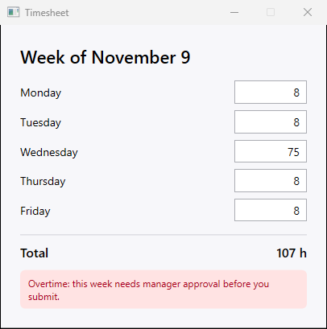
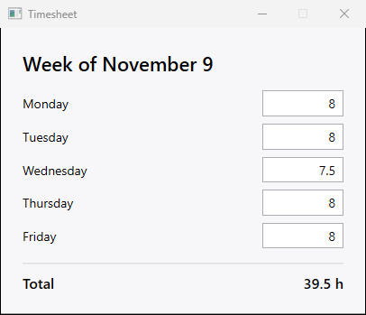

# Session transcript

Source: `Q:\source\XamlAgentDemos-notes\test-runs\Timesheet\run1\events.jsonl`

## Tool usage

- xaml_interact: 12
- get_file: 8
- powershell: 6
- xaml_capture_image: 4
- xaml_get_element_properties: 4
- glob: 3
- xaml_find_elements: 3
- replace_string_in_file: 3
- xaml_apply_hot_reload: 3
- xaml_get_status: 2
- xaml_get_visual_tree: 2
- rg: 2
- view: 2
- task: 2
- write_agent: 2
- xaml_get_binding_failures: 2
- skill: 1
- get_projects_in_solution: 1
- get_tests: 1
- create_file: 1
- debugger_stop_debugging: 1
- debugger_get_threads: 1
- run_build: 1
- list_agents: 1
- debugger_launch: 1
- xaml_clear_binding_failures: 1
- task_complete: 1

Failed tool calls: 2, images: 2


_Model: gpt-6.1-sol_


## User (22:14:57)

I corrected one day in my running Timesheet app and now the total is way too high and it says I need overtime approval. I did not work overtime. Find out why and fix it.


**Tool call (22:14:59):** `skill`
```json
{
 "skill": "xaml-diagnostics"
}
```

<details><summary>Result `skill` success=true</summary>

```
Skill "xaml-diagnostics" loaded successfully. Follow the instructions in the skill context.
```
</details>


_Skill invoked: xaml-diagnostics_


**Assistant (22:15:02):**

I’ll check the live totals and trace what happens when a day is corrected.


**Tool call (22:15:02):** `xaml_get_status`
```json
{
 "progressMessage": "Inspect running Timesheet app"
}
```


**Tool call (22:15:02):** `get_projects_in_solution`
```json
{}
```


**Tool call (22:15:02):** `powershell`
```json
{
 "command": "git --no-pager status --short",
 "description": "Check existing working-tree changes"
}
```

<details><summary>Result `get_projects_in_solution` success=true</summary>

```
src\GhostClicks\GhostClicks.csproj
src\NewCustomer\NewCustomer.csproj
src\DeadFollow\DeadFollow.csproj
src\GermanReady\GermanReady.csproj
src\ThemeBreaker\ThemeBreaker.csproj
src\DesignPolish\DesignPolish.csproj
src\HotReloadDoctor\HotReloadDoctor.csproj
src\Timesheet\Timesheet.csproj
src\VanishingSave\VanishingSave.csproj
src\TeamStrip\TeamStrip.csproj
src\CrispPixels\CrispPixels.csproj
src\PrecedenceWars\PrecedenceWars.csproj
src\LostWindows\LostWindows.csproj
src\TemplateDetective\TemplateDetective.csproj
src\KitToolbar\KitToolbar.csproj
src\SlowScroll\SlowScroll.csproj
src\PixelPerfect\PixelPerfect.csproj
src\BindingStorm\BindingStorm.csproj
src\BugRepro\BugRepro.csproj
src\A11ySweep\A11ySweep.csproj
src\StyleMaze\StyleMaze.csproj
src\ResponsiveDashboard\ResponsiveDashboard.csproj

```
</details>

<details><summary>Result `xaml_get_status` success=true</summary>

```
{"isDebugging":true,"debuggerState":"running","diagnosticsActive":true,"apps":[{"app":"a1","name":"Timesheet.exe [27236]","processId":27236,"platform":"WPF (.NET)","isRemote":false,"isDesignTimeOrNoDebug":false,"sourceInfoAvailable":true,"hotReloadSupported":true,"hotReloadEnabled":true,"supportsPropertyExplorer":true,"supportsInAppToolbar":true,"supportsHitTest":true,"windows":[{"windowId":"0x1FF0CD0","title":"Timesheet","bounds":{"x":78,"y":78,"width":420,"height":416},"dpiScale":1.0,"visible":true,"minimized":false}]}],"issues":[],"issuesSummary":"No problems detected.","hotReload":{"options":{"hotReloadEnabled":true,"hotReloadOnSave":false,"applyMode":"asYouType: XAML edits apply as you type, without saving (default)","wpfEnabled":true,"uwpEnabled":true,"winUIEnabled":true,"mauiEnabled":true,"justMyXaml":true,"previewSelectedElement":false,"inAppToolbar":true,"inAppSelection":false,"layoutAdorners":false,"trackFocusedElement":false,"bindingFailuresVisible":true,"compatibilityMode":false},"dotNetHotReloadEnabled":true,"isProcessingChanges":false,"errors":[]},"windowsNote":"Window bounds are physical pixels including the frame; Window.Width/Height are DIPs including the frame (= bounds.width / dpiScale), so say which unit you tested. Minimized windows report x/y = -32000 and can't be captured."}
```
</details>

<details><summary>Result `powershell` success=true</summary>

```

<shellId: 0 completed with exit code 0>
```
</details>


**Tool call (22:15:07):** `xaml_get_visual_tree`
```json
{
 "progressMessage": "Read Timesheet controls and displayed totals",
 "app": "a1"
}
```


**Tool call (22:15:07):** `glob`
```json
{
 "pattern": "src\\Timesheet\\**\\*"
}
```


**Tool call (22:15:07):** `xaml_capture_image`
```json
{
 "progressMessage": "Inspect incorrect total and approval warning",
 "app": "a1"
}
```

<details><summary>Result `xaml_get_visual_tree` success=true</summary>

```
{"defaultSourceFile":"Q:\\source\\XamlAgentDemos\\src\\Timesheet\\MainWindow.xaml","app":"a1","platform":"WPF (.NET)","sourceInfoAvailable":true,"nodeCount":25,"truncated":false,"depthLimitedNodes":6,"hint":"6 node(s) have children beyond the requested depth (childCount > 0, no children listed). Raise depth or pass rootElementId to expand them.","nodes":[{"id":"a1:10","type":"Timesheet.MainWindow","source":{"line":4,"column":9},"childCount":1,"children":[{"id":"a1:11","type":"Border","childCount":1,"children":[{"id":"a1:12","type":"AdornerDecorator","childCount":2,"children":[{"id":"a1:13","type":"ContentPresenter","childCount":1,"children":[{"id":"a1:15","type":"StackPanel","source":{"line":10,"column":4},"childCount":4,"children":[{"id":"a1:16","type":"TextBlock","source":{"line":11,"column":6},"childCount":0},{"id":"a1:17","type":"ItemsControl","source":{"line":12,"column":6},"childCount":1,"children":[{"id":"a1:20","type":"Border","childCount":1,"children":[{"id":"a1:23","type":"ItemsPresenter","childCount":1,"children":[{"id":"a1:26","type":"StackPanel","childCount":5,"children":[{"id":"a1:27","type":"ContentPresenter","childCount":1,"children":[{"id":"a1:32","type":"Grid","source":{"line":15,"column":12},"childCount":2}]},{"id":"a1:28","type":"ContentPresenter","childCount":1,"children":[{"id":"a1:33","type":"Grid","source":{"line":15,"column":12},"childCount":2}]},{"id":"a1:29","type":"ContentPresenter","childCount":1,"children":[{"id":"a1:34","type":"Grid","source":{"line":15,"column":12},"childCount":2}]},{"id":"a1:30","type":"ContentPresenter","childCount":1,"children":[{"id":"a1:35","type":"Grid","source":{"line":15,"column":12},"childCount":2}]},{"id":"a1:31","type":"ContentPresenter","childCount":1,"children":[{"id":"a1:36","type":"Grid","source":{"line":15,"column":12},"childCount":2}]}]}]}]}]},{"id":"a1:18","type":"Border","source":{"line":27,"column":6},"childCount":1,"children":[{"id":"a1:21","type":"Grid","source":{"line":28,"column":8},"childCount":2}]},{"id":"a1:19","type":"Border","source":{"line":33,"column":6},"childCount":1,"children":[{"id":"a1:22","type":"TextBlock","source":{"line":44,"column":8},"childCount":0}]}]}]},{"id":"a1:14","type":"AdornerLayer","childCount":0}]}]}]}]}
```
</details>




<details><summary>Result `xaml_capture_image` success=true</summary>

```
Screenshot of window 0x1FF0CD0 "Timesheet" of app a1 (406x409 image of the window's client area, so it's slightly smaller than the frame bounds from xaml_get_status).
```
</details>

<details><summary>Result `glob` success=true</summary>

```
[glob: 57 path(s) under ./src/Timesheet; grouped by directory]

./src/Timesheet/obj/ (45 path(s))
  Debug/net10.0-windows/.NETCoreApp,Version=v10.0.AssemblyAttributes.cs
  Debug/net10.0-windows/App.g.cs
  Debug/net10.0-windows/App.g.i.cs
  Debug/net10.0-windows/GeneratedInternalTypeHelper.g.cs
  Debug/net10.0-windows/GeneratedInternalTypeHelper.g.i.cs
  Debug/net10.0-windows/MainWindow.baml
  Debug/net10.0-windows/MainWindow.g.cs
  Debug/net10.0-windows/MainWindow.g.i.cs
  Debug/net10.0-windows/Timesheet.AssemblyInfo.cs
  Debug/net10.0-windows/Timesheet.AssemblyInfoInputs.cache
  Debug/net10.0-windows/Timesheet.GeneratedMSBuildEditorConfig.editorconfig
  Debug/net10.0-windows/Timesheet.GlobalUsings.g.cs
  Debug/net10.0-windows/Timesheet.assets.cache
  Debug/net10.0-windows/Timesheet.csproj.BuildWithSkipAnalyzers
  Debug/net10.0-windows/Timesheet.csproj.CoreCompileInputs.cache
  Debug/net10.0-windows/Timesheet.csproj.FileListAbsolute.txt
  Debug/net10.0-windows/Timesheet.csproj.Up2Date
  Debug/net10.0-windows/Timesheet.dll
  Debug/net10.0-windows/Timesheet.g.resources
  Debug/net10.0-windows/Timesheet.genruntimeconfig.cache
  Debug/net10.0-windows/Timesheet.pdb
  Debug/net10.0-windows/Timesheet.sourcelink.json
  Debug/net10.0-windows/Timesheet_4xkxyhnz_wpftmp.AssemblyInfo.cs
  Debug/net10.0-windows/Timesheet_4xkxyhnz_wpftmp.AssemblyInfoInputs.cache
  Debug/net10.0-windows/Timesheet_4xkxyhnz_wpftmp.GeneratedMSBuildEditorConfig.editorconfig
  Debug/net10.0-windows/Timesheet_4xkxyhnz_wpftmp.GlobalUsings.g.cs
  Debug/net10.0-windows/Timesheet_4xkxyhnz_wpftmp.assets.cache
  Debug/net10.0-windows/Timesheet_4xkxyhnz_wpftmp.csproj.BuildWithSkipAnalyzers
  Debug/net10.0-windows/Timesheet_4xkxyhnz_wpftmp.sourcelink.json
  Debug/net10.0-windows/Timesheet_MarkupCompile.cache
  Debug/net10.0-windows/Timesheet_MarkupCompile.lref
  Debug/net10.0-windows/Timesheet_segd1sym_wpftmp.AssemblyInfo.cs
  Debug/net10.0-windows/Timesheet_segd1sym_wpftmp.AssemblyInfoInputs.cache
  Debug/net10.0-windows/Timesheet_segd1sym_wpftmp.GeneratedMSBuildEditorConfig.editorconfig
  Debug/net10.0-windows/Timesheet_segd1sym_wpftmp.GlobalUsings.g.cs
  Debug/net10.0-windows/Timesheet_segd1sym_wpftmp.assets.cache
  Debug/net10.0-windows/Timesheet_segd1sym_wpftmp.sourcelink.json
  Debug/net10.0-windows/apphost.exe
  Debug/net10.0-windows/ref/Timesheet.dll
  Debug/net10.0-windows/refint/Timesheet.dll
  Timesheet.csproj.nuget.dgspec.json
  Timesheet.csproj.nuget.g.props
  Timesheet.csproj.nuget.g.targ
... [truncated 597 chars]
```
</details>


**Tool call (22:15:10):** `get_file`
```json
{
 "filename": "Q:\\source\\XamlAgentDemos\\src\\Timesheet\\TimesheetViewModel.cs",
 "startLine": 1,
 "endLine": 260
}
```


**Tool call (22:15:10):** `get_file`
```json
{
 "filename": "Q:\\source\\XamlAgentDemos\\src\\Timesheet\\MainWindow.xaml",
 "startLine": 1,
 "endLine": 160
}
```


**Tool call (22:15:10):** `get_file`
```json
{
 "filename": "Q:\\source\\XamlAgentDemos\\src\\Timesheet\\MainWindow.xaml.cs",
 "startLine": 1,
 "endLine": 120
}
```


**Tool call (22:15:10):** `get_file`
```json
{
 "filename": "Q:\\source\\XamlAgentDemos\\src\\Timesheet\\Timesheet.csproj",
 "startLine": 1,
 "endLine": 100
}
```


**Tool call (22:15:10):** `xaml_find_elements`
```json
{
 "progressMessage": "Read daily hour inputs",
 "app": "a1",
 "type": "TextBox"
}
```

<details><summary>Result `xaml_find_elements` success=true</summary>

```
{"defaultSourceFile":"Q:\\source\\XamlAgentDemos\\src\\Timesheet\\MainWindow.xaml","count":5,"totalMatches":5,"truncated":false,"results":[{"id":"a1:38","type":"TextBox","source":{"line":21,"column":14},"path":"MainWindow/Border/AdornerDecorator/ContentPresenter/StackPanel/ItemsControl/Border/ItemsPresenter/StackPanel/ContentPresenter/Grid/TextBox"},{"id":"a1:40","type":"TextBox","source":{"line":21,"column":14},"path":"MainWindow/Border/AdornerDecorator/ContentPresenter/StackPanel/ItemsControl/Border/ItemsPresenter/StackPanel/ContentPresenter/Grid/TextBox"},{"id":"a1:42","type":"TextBox","source":{"line":21,"column":14},"path":"MainWindow/Border/AdornerDecorator/ContentPresenter/StackPanel/ItemsControl/Border/ItemsPresenter/StackPanel/ContentPresenter/Grid/TextBox"},{"id":"a1:44","type":"TextBox","source":{"line":21,"column":14},"path":"MainWindow/Border/AdornerDecorator/ContentPresenter/StackPanel/ItemsControl/Border/ItemsPresenter/StackPanel/ContentPresenter/Grid/TextBox"},{"id":"a1:46","type":"TextBox","source":{"line":21,"column":14},"path":"MainWindow/Border/AdornerDecorator/ContentPresenter/StackPanel/ItemsControl/Border/ItemsPresenter/StackPanel/ContentPresenter/Grid/TextBox"}],"hint":"'type' matched the exact class name; subclasses with other names (for example a custom control deriving from it) aren't included. Use type=\"*TextBox\" to also match class names ending with it."}
```
</details>

<details><summary>Result `get_file` success=true</summary>

```
``` src\Timesheet\Timesheet.csproj (Lines 1-5 of 5 total. Call tools for more if needed.)
<Project Sdk="Microsoft.NET.Sdk">
  <PropertyGroup>
    <RootNamespace>Timesheet</RootNamespace>
  </PropertyGroup>
</Project>

```


```
</details>

<details><summary>Result `get_file` success=true</summary>

```
```csharp src\Timesheet\MainWindow.xaml.cs (Lines 1-9 of 9 total. Call tools for more if needed.)
using System.Windows;

namespace Timesheet;

public partial class MainWindow : Window
{
    public MainWindow() => this.InitializeComponent();
}


```


```
</details>

<details><summary>Result `get_file` success=true</summary>

```
```csharp src\Timesheet\TimesheetViewModel.cs (Lines 1-51 of 51 total. Call tools for more if needed.)
using System.Collections.ObjectModel;
using System.ComponentModel;

namespace Timesheet;

public sealed class DayEntry : ObservableObject
{
    private double hours;

    public DayEntry(string day, double hours)
    {
        this.Day = day;
        this.hours = hours;
    }

    public string Day { get; }

    public double Hours { get => this.hours; set => this.SetProperty(ref this.hours, value); }
}

public sealed class TimesheetViewModel : ObservableObject
{
    public TimesheetViewModel()
    {
        foreach (DayEntry entry in this.Days)
        {
            entry.PropertyChanged += this.OnEntryChanged;
        }
    }

    public string WeekOf => "Week of November 9";

    public ObservableCollection<DayEntry> Days { get; } =
    [
        new("Monday", 8),
        new("Tuesday", 8),
        new("Wednesday", 8),
        new("Thursday", 8),
        new("Friday", 8),
    ];

    public double Total => this.Days.Sum(d => d.Hours);

    public bool IsOvertime => this.Total > 40;

    private void OnEntryChanged(object? sender, PropertyChangedEventArgs e)
    {
        this.OnPropertyChanged(nameof(this.Total));
        this.OnPropertyChanged(nameof(this.IsOvertime));
    }
}

```


```
</details>

<details><summary>Result `get_file` success=true</summary>

```
```xaml src\Timesheet\MainWindow.xaml (Lines 1-47 of 47 total. Call tools for more if needed.)
<Window x:Class="Timesheet.MainWindow"
        xmlns="http://schemas.microsoft.com/winfx/2006/xaml/presentation"
        xmlns:x="http://schemas.microsoft.com/winfx/2006/xaml"
        xmlns:local="clr-namespace:Timesheet"
        Title="Timesheet" Width="420" SizeToContent="Height" ResizeMode="CanMinimize"
        Background="#FFF7F7FA">
  <Window.DataContext>
    <local:TimesheetViewModel />
  </Window.DataContext>
  <StackPanel Margin="24">
    <TextBlock Text="{Binding WeekOf}" FontSize="22" FontWeight="SemiBold" Margin="0,0,0,12" />
    <ItemsControl ItemsSource="{Binding Days}">
      <ItemsControl.ItemTemplate>
        <DataTemplate DataType="local:DayEntry">
          <Grid Margin="0,4">
            <Grid.ColumnDefinitions>
              <ColumnDefinition Width="*" />
              <ColumnDefinition Width="90" />
            </Grid.ColumnDefinitions>
            <TextBlock Text="{Binding Day}" VerticalAlignment="Center" FontSize="14" />
            <TextBox Grid.Column="1" Text="{Binding Hours, UpdateSourceTrigger=PropertyChanged}" TextAlignment="Right"
                     Padding="6,4" FontSize="14" AutomationProperties.Name="{Binding Day}" />
          </Grid>
        </DataTemplate>
      </ItemsControl.ItemTemplate>
    </ItemsControl>
    <Border Margin="0,12,0,0" Padding="0,10,0,0" BorderBrush="#FFD0D0D8" BorderThickness="0,1,0,0">
      <Grid>
        <TextBlock Text="Total" FontSize="16" FontWeight="SemiBold" />
        <TextBlock Text="{Binding Total, StringFormat={}{0:0.##} h}" FontSize="16" FontWeight="SemiBold" HorizontalAlignment="Right" />
      </Grid>
    </Border>
    <Border Margin="0,12,0,0" Padding="10,8" CornerRadius="6" Background="#FFFFE3E3">
      <Border.Style>
        <Style TargetType="Border">
          <Setter Property="Visibility" Value="Collapsed" />
          <Style.Triggers>
            <DataTrigger Binding="{Binding IsOvertime}" Value="True">
              <Setter Property="Visibility" Value="Visible" />
            </DataTrigger>
          </Style.Triggers>
        </Style>
      </Border.Style>
      <TextBlock Text="Overtime: this week needs manager approval before you submit." Foreground="#FFB00020" TextWrapping="Wrap" />
    </Border>
  </StackPanel>
</Window>

```


```
</details>


**Tool call (22:15:17):** `xaml_get_element_properties`
```json
{
 "progressMessage": "Inspect input text, culture, and stored hours",
 "elementIds": [
  "a1:38",
  "a1:40",
  "a1:42",
  "a1:44",
  "a1:46"
 ],
 "nameFilter": "Text|Language|DataContext.Day|DataContext.Hours",
 "includeAll": true
}
```


**Tool call (22:15:17):** `xaml_get_element_properties`
```json
{
 "progressMessage": "Inspect actual total and overtime state",
 "elementIds": [
  "a1:10"
 ],
 "nameFilter": "Language|DataContext.Total|DataContext.IsOvertime",
 "includeAll": true
}
```


**Tool call (22:15:17):** `rg`
```json
{
 "pattern": "Timesheet|ConverterCulture|NumberStyles|CultureInfo",
 "glob": "*.{cs,xaml,md,props}",
 "output_mode": "content",
 "head_limit": 100
}
```


**Tool call (22:15:17):** `view`
```json
{
 "path": "c:\\vs\\fastmain\\common7\\ide\\commonextensions\\microsoft\\xamldiagnostics\\AgentTools\\skills\\xaml-diagnostics\\references\\xaml-authoring.md"
}
```

<details><summary>Result `view` success=true</summary>

```
# XAML authoring guidance

Follow these rules when writing or changing XAML so it works well with XAML Hot Reload, the XAML designer, and XAML Diagnostics.

## Design-time data

- Declare `xmlns:d="http://schemas.microsoft.com/expression/blend/2008"` and `xmlns:mc="http://schemas.openxmlformats.org/markup-compatibility/2006"` with `mc:Ignorable="d"`.
- Use `d:DataContext="{d:DesignInstance Type=vm:MyViewModel, IsDesignTimeCreatable=False}"` (WPF/UWP) so the designer and IntelliSense know binding paths.
- Use `d:` properties (for example `d:Text="Sample"`) for sample values that appear only at design time.
- .NET MAUI: set `x:DataType` on pages and `DataTemplate`s. It enables compiled bindings and turns many binding failures into build errors.
- WinUI/UWP: prefer `x:Bind` for compile-time checked bindings when the view owns the view model.

## Bindings

- Bind with explicit paths. Avoid string-built paths in code-behind.
- Keep the `DataContext` chain simple. Use `ElementName` or `RelativeSource` only at real scope boundaries (for example inside a `DataTemplate` that needs the page's view model).
- Expose bound properties as public properties that raise `PropertyChanged`. Fields and non-public properties don't bind.
- Use `FallbackValue` and `TargetNullValue` for expected missing values instead of hiding binding errors.
- Before saving, check every binding path against the actual property names on the data context type (case, plurals, nested paths such as `Customer.Address.City`). Misspelled paths are the most common binding failure and they fail silently.
- Inside a `DataTemplate` or `ItemContainerStyle`, the data context is the item, not the page's view model. To reach a page command, use `RelativeSource={RelativeSource AncestorType=...}` with `DataContext.` in the path, or `ElementName`.
- A `TextBox.Text` binding updates its source on `LostFocus` by default (WPF). Use `UpdateSourceTrigger=PropertyChanged` when other UI (validation, enabled state, live search) must react while the user types.
- `Mode=TwoWay` (the default for `TextBox.Text`, `CheckBox.IsChecked`, `Selector.SelectedItem` and similar) needs a property with a public setter. In WPF, a two-way binding to a read-only property throws when the view loads.
- Bindings created in code have no XAML file and line in diagnostics. Prefer declaring bindings in XAML.

## Layout

- Don't put a list (`ListBox`, `ListView`, `DataGrid`, `ItemsControl` with a virtualizing panel) insid
... [truncated 4693 chars]
```
</details>

<details><summary>Result `rg` success=true</summary>

```
.\src\Timesheet\TimesheetViewModel.cs:namespace Timesheet;
.\src\Timesheet\TimesheetViewModel.cs:public sealed class TimesheetViewModel : ObservableObject
.\src\Timesheet\TimesheetViewModel.cs:    public TimesheetViewModel()
.\src\Timesheet\App.xaml.cs:namespace Timesheet;
.\src\Timesheet\MainWindow.xaml.cs:namespace Timesheet;
.\src\Timesheet\MainWindow.xaml:<Window x:Class="Timesheet.MainWindow"
.\src\Timesheet\MainWindow.xaml:        xmlns:local="clr-namespace:Timesheet"
.\src\Timesheet\MainWindow.xaml:        Title="Timesheet" Width="420" SizeToContent="Height" ResizeMode="CanMinimize"
.\src\Timesheet\MainWindow.xaml:    <local:TimesheetViewModel />
.\src\Timesheet\App.xaml:<Application x:Class="Timesheet.App"
```
</details>

<details><summary>Result `xaml_get_element_properties` success=true</summary>

```
{"id":"a1:10","type":"Timesheet.MainWindow","source":{"file":"Q:\\source\\XamlAgentDemos\\src\\Timesheet\\MainWindow.xaml","line":4,"column":9},"properties":[{"name":"Language","value":"en-us","valueType":"System.Windows.Markup.XmlLanguage","valueSource":"Default"}],"items":[{"path":"DataContext","type":"Timesheet.TimesheetViewModel","properties":[{"name":"Total","value":"107","valueSource":"Local","readOnly":true},{"name":"IsOvertime","value":"True","valueSource":"Local","readOnly":true}]}],"note":"Set an item property with xaml_set_element_property using its path (setters=['ColumnDefinitions[2].Width=Auto']) and edit the XAML to keep it. Without nameFilter only set values and Actual* sizes are listed."}
```
</details>

<details><summary>Result `xaml_get_element_properties` success=true</summary>

```
{"defaultSourceFile":"Q:\\source\\XamlAgentDemos\\src\\Timesheet\\MainWindow.xaml","count":5,"failed":0,"results":[{"id":"a1:38","type":"TextBox","source":{"line":21,"column":14},"properties":[{"name":"Text","evaluatedValue":"8 (System.String)","valueType":"System.Windows.Data.BindingExpression","propertyType":"System.String","valueSource":"Local","isBinding":true},{"name":"Language","value":"en-us","valueType":"System.Windows.Markup.XmlLanguage","valueSource":"Default"}],"hiddenDefaultOrOverridden":1,"hint":"Overridden values that lost to the listed ones are hidden; xaml_explain_property_value gives one property's full precedence chain.","items":[{"path":"DataContext","type":"Timesheet.DayEntry","properties":[{"name":"Day","value":"Monday","valueSource":"Local","readOnly":true},{"name":"Hours","value":"8","valueSource":"Local"}]}]},{"id":"a1:40","type":"TextBox","source":{"line":21,"column":14},"properties":[{"name":"Text","evaluatedValue":"8 (System.String)","valueType":"System.Windows.Data.BindingExpression","propertyType":"System.String","valueSource":"Local","isBinding":true},{"name":"Language","value":"en-us","valueType":"System.Windows.Markup.XmlLanguage","valueSource":"Default"}],"hiddenDefaultOrOverridden":1,"hint":"Overridden values that lost to the listed ones are hidden; xaml_explain_property_value gives one property's full precedence chain.","items":[{"path":"DataContext","type":"Timesheet.DayEntry","properties":[{"name":"Day","value":"Tuesday","valueSource":"Local","readOnly":true},{"name":"Hours","value":"8","valueSource":"Local"}]}]},{"id":"a1:42","type":"TextBox","source":{"line":21,"column":14},"properties":[{"name":"Text","evaluatedValue":"75 (System.String)","valueType":"System.Windows.Data.BindingExpression","propertyType":"System.String","valueSource":"Local","isBinding":true},{"name":"Language","value":"en-us","valueType":"System.Windows.Markup.XmlLanguage","valueSource":"Default"}],"hiddenDefaultOrOverridden":1,"hint":"Overridden values that lost to the listed ones are hidden; xaml_explain_property_value gives one property's full precedence chain.","items":[{"path":"DataContext","type":"Timesheet.DayEntry","properties":[{"name":"Day","value":"Wednesday","valueSource":"Local","readOnly":true},{"name":"Hours","value":"75","valueSource":"Local"}]}]},{"id":"a1:44","type":"TextBox","source":{"line":21,"column":14},"properties":[{"name":"Text","evaluatedValue":"8 (System.String)","valueType":"System.Windows.Data.BindingExpression","proper
... [truncated 1491 chars]
```
</details>


**Tool call (22:15:23):** `get_file`
```json
{
 "filename": "Q:\\source\\XamlAgentDemos\\src\\Timesheet\\App.xaml.cs",
 "startLine": 1,
 "endLine": 120
}
```


**Tool call (22:15:23):** `view`
```json
{
 "path": "Q:\\source\\XamlAgentDemos"
}
```


**Tool call (22:15:23):** `powershell`
```json
{
 "command": "Get-Culture | Select-Object Name, NumberFormat; Get-UICulture | Select-Object Name",
 "description": "Check current regional number format"
}
```


**Tool call (22:15:23):** `xaml_interact`
```json
{
 "progressMessage": "Test decimal-comma correction parsing",
 "elementId": "a1:42",
 "action": "setValue",
 "value": "7,5",
 "checkProperties": "Text|DataContext.Hours"
}
```

<details><summary>Result `view` success=true</summary>

```
.git
.gitignore
.vs
Directory.Build.props
New-DemoApp.ps1
XamlAgentDemos.sln
lib
src
```
</details>

<details><summary>Result `get_file` success=true</summary>

```
```csharp src\Timesheet\App.xaml.cs (Lines 1-12 of 12 total. Call tools for more if needed.)
using System.Windows;

namespace Timesheet;

public partial class App : Application
{
    protected override void OnStartup(StartupEventArgs e)
    {
        base.OnStartup(e);
        DemoHost.Initialize(this, e.Args);
    }
}

```


```
</details>

<details><summary>Result `xaml_interact` success=true</summary>

```
{"id":"a1:42","action":"setValue","result":"Value is now '75'.","supportedPatterns":["Value","Scroll","Text","SynchronizedInput"],"checks":[{"id":"a1:42","changed":false,"values":[{"name":"Text","evaluatedValue":"75 (System.String)","valueSource":"Local","isBinding":true},{"path":"DataContext","type":"Timesheet.DayEntry","properties":[{"name":"Hours","value":"75","valueSource":"Local"}]}]}],"checksNote":"changed=false: no checked property changed within 300 ms, so the handler, command or binding had no visible effect here (it may act elsewhere, or slow async work needs another read).","note":"Automation bypasses mouse hit testing; xaml_hit_test shows whether a real click reaches the element."}
```
</details>

<details><summary>Result `powershell` success=true</summary>

```
Name  NumberFormat
----  ------------
en-US System.Globalization.NumberFormatInfo
en-US
<shellId: 1 completed with exit code 0>
```
</details>


**Tool call (22:15:27):** `glob`
```json
{
 "pattern": "lib\\**\\*.cs"
}
```


**Tool call (22:15:27):** `get_file`
```json
{
 "filename": "Q:\\source\\XamlAgentDemos\\Directory.Build.props",
 "startLine": 1,
 "endLine": 200
}
```


**Tool call (22:15:27):** `xaml_interact`
```json
{
 "progressMessage": "Test decimal-point correction parsing",
 "elementId": "a1:42",
 "action": "setValue",
 "value": "7.5",
 "checkProperties": "Text|DataContext.Hours"
}
```

<details><summary>Result `get_file` success=true</summary>

```
``` Directory.Build.props (Lines 1-15 of 15 total. Call tools for more if needed.)
<Project>
  <PropertyGroup>
    <TargetFramework>net10.0-windows</TargetFramework>
    <OutputType>WinExe</OutputType>
    <UseWPF>true</UseWPF>
    <Nullable>enable</Nullable>
    <ImplicitUsings>enable</ImplicitUsings>
    <LangVersion>latest</LangVersion>
  </PropertyGroup>

  <ItemGroup>
    <Compile Include="$(MSBuildThisFileDirectory)src\Shared\*.cs" Link="Shared\%(Filename)%(Extension)" />
    <Using Include="XamlAgentDemos" />
  </ItemGroup>
</Project>

```


```
</details>

<details><summary>Result `glob` success=true</summary>

```
No files matched the pattern.
```
</details>

<details><summary>Result `xaml_interact` success=true</summary>

```
{"id":"a1:42","action":"setValue","result":"Value is now '7.5'.","supportedPatterns":["Value","Scroll","Text","SynchronizedInput"],"checks":[{"id":"a1:42","changed":true,"before":[{"name":"Text","evaluatedValue":"75 (System.String)","valueSource":"Local","isBinding":true},{"path":"DataContext","type":"Timesheet.DayEntry","properties":[{"name":"Hours","value":"75","valueSource":"Local"}]}],"after":[{"name":"Text","evaluatedValue":"7.5 (System.String)","valueSource":"Local","isBinding":true},{"path":"DataContext","type":"Timesheet.DayEntry","properties":[{"name":"Hours","value":"7.5","valueSource":"Local"}]}]}],"note":"Automation bypasses mouse hit testing; xaml_hit_test shows whether a real click reaches the element."}
```
</details>


**Assistant (22:15:41):**

I reproduced it: entering `7,5` is silently read as `75`, giving a total of 107 hours. Entering `7.5` correctly gives 39.5. I’ll add validation so ambiguous or impossible daily hours are flagged instead of inflating the total.


**Tool call (22:15:41):** `rg`
```json
{
 "pattern": "ValidationRule|Validation.ErrorTemplate|Validation.HasError|ValidatesOnExceptions",
 "paths": "Q:\\source\\XamlAgentDemos\\src",
 "glob": "*.{cs,xaml}",
 "output_mode": "content",
 "head_limit": 80
}
```


**Tool call (22:15:41):** `get_tests`
```json
{
 "filterTypes": [
  "Project"
 ],
 "filterValues": [
  "Timesheet"
 ],
 "maxResults": 20
}
```


**Tool call (22:15:41):** `glob`
```json
{
 "pattern": "src\\Shared\\*.cs"
}
```


**Tool call (22:15:41):** `xaml_get_element_properties`
```json
{
 "progressMessage": "Verify corrected week state",
 "elementIds": [
  "a1:10",
  "a1:19"
 ],
 "nameFilter": "Visibility|DataContext.Total|DataContext.IsOvertime",
 "includeAll": true
}
```

<details><summary>Result `rg` success=true</summary>

```
No matches found.
```
</details>

<details><summary>Result `glob` success=true</summary>

```
.\src\Shared\RelayCommand.cs
.\src\Shared\DemoHost.cs
.\src\Shared\ObservableObject.cs
```
</details>

<details><summary>Result `xaml_get_element_properties` success=true</summary>

```
{"defaultSourceFile":"Q:\\source\\XamlAgentDemos\\src\\Timesheet\\MainWindow.xaml","count":2,"failed":0,"results":[{"id":"a1:10","type":"Timesheet.MainWindow","source":{"line":4,"column":9},"properties":[{"name":"Visibility","value":"0","valueType":"System.Windows.Visibility","valueSource":"Local"}],"hiddenDefaultOrOverridden":1,"hint":"Overridden values that lost to the listed ones are hidden; xaml_explain_property_value gives one property's full precedence chain.","items":[{"path":"DataContext","type":"Timesheet.TimesheetViewModel","properties":[{"name":"Total","value":"39.5","valueSource":"Local","readOnly":true},{"name":"IsOvertime","value":"False","valueSource":"Default","readOnly":true}]}]},{"id":"a1:19","type":"Border","source":{"line":33,"column":6},"properties":[{"name":"Visibility","value":"2","valueType":"System.Windows.Visibility","valueSource":"Style","valueSourceLocation":{"line":35,"column":10}}],"hiddenDefaultOrOverridden":1,"hint":"Overridden values that lost to the listed ones are hidden; xaml_explain_property_value gives one property's full precedence chain.","items":[{"path":"DataContext","type":"Timesheet.TimesheetViewModel","properties":[{"name":"Total","value":"39.5","valueSource":"Local","readOnly":true},{"name":"IsOvertime","value":"False","valueSource":"Default","readOnly":true}]}]}],"note":"Set an item property with xaml_set_element_property using its path (setters=['ColumnDefinitions[2].Width=Auto']) and edit the XAML to keep it. Without nameFilter only set values and Actual* sizes are listed."}
```
</details>

<details><summary>Result `get_tests` success=true</summary>

```
No tests found matching filters: Project=Timesheet
```
</details>


**Tool call (22:15:51):** `create_file`
```json
{
 "filePath": "Q:\\source\\XamlAgentDemos\\src\\Timesheet\\HoursValidationRule.cs",
 "content": "using System.Globalization;\nusing System.Windows.Controls;\n\nnamespace Timesheet;\n\npublic sealed class HoursValidationRule : ValidationRule\n{\n    public override ValidationResult Validate(object value, CultureInfo cultureInfo)\n    {\n        if (value is string text &&\n            double.TryParse(text, NumberStyles.Float, cultureInfo, out double hours) &&\n            double.IsFinite(hours) && hours >= 0 && hours <= 24)\n        {\n            return ValidationResult.ValidResult;\n        }\n\n        return new ValidationResult(false,\n            $\"Enter hours from 0 to 24 using '{cultureInfo.NumberFormat.NumberDecimalSeparator}' as the decimal separator (no thousands separators).\");\n    }\n}\n"
}
```

<details><summary>Result `create_file` success=true</summary>

```
File created at Q:\source\XamlAgentDemos\src\Timesheet\HoursValidationRule.cs.
```
</details>


**Tool call (22:15:57):** `replace_string_in_file`
```json
{
 "filePath": "src\\Timesheet\\MainWindow.xaml",
 "oldString": "              <ColumnDefinition Width=\"*\" />\n              <ColumnDefinition Width=\"90\" />\n            </Grid.ColumnDefinitions>\n            <TextBlock Text=\"{Binding Day}\" VerticalAlignment=\"Center\" FontSize=\"14\" />\n            <TextBox Grid.Column=\"1\" Text=\"{Binding Hours, UpdateSourceTrigger=PropertyChanged}\" TextAlignment=\"Right\"\n                     Padding=\"6,4\" FontSize=\"14\" AutomationProperties.Name=\"{Binding Day}\" />\n          </Grid>\n        </DataTemplate>\n      </ItemsControl.ItemTemplate>\n    </ItemsControl>",
 "newString": "              <ColumnDefinition Width=\"*\" />\n              <ColumnDefinition Width=\"90\" />\n            </Grid.ColumnDefinitions>\n            <TextBlock Text=\"{Binding Day}\" VerticalAlignment=\"Center\" FontSize=\"14\" />\n            <TextBox Grid.Column=\"1\" TextAlignment=\"Right\"\n                     Padding=\"6,4\" FontSize=\"14\" AutomationProperties.Name=\"{Binding Day}\">\n              <TextBox.Text>\n                <Binding Path=\"Hours\" UpdateSourceTrigger=\"PropertyChanged\">\n                  <Binding.ValidationRules>\n                    <local:HoursValidationRule />\n                  </Binding.ValidationRules>\n                </Binding>\n              </TextBox.Text>\n              <TextBox.Style>\n                <Style TargetType=\"TextBox\">\n                  <Style.Triggers>\n                    <Trigger Property=
... [truncated 448 chars]
```

<details><summary>Result `replace_string_in_file` success=true</summary>

```
Successfully replaced text in src\Timesheet\MainWindow.xaml
```
</details>


**Tool call (22:16:01):** `xaml_apply_hot_reload`
```json
{
 "progressMessage": "Apply strict daily-hours validation",
 "includeCodeChanges": true
}
```

<details><summary>Result `xaml_apply_hot_reload` success=true</summary>

```
{"summary":"XAML: Applied with no new errors. 1 older error(s) in 'earlierErrors' came from an earlier update and may already be fixed; they aren't from this call. .NET code: applied (see 'codeHotReloadOutput'). New code runs the next time each method is called; code that already ran (constructors, startup, Loaded handlers, a failed operation that left a flag set) isn't re-run, so the state it produced stays until you trigger that code again, reopen the view, or restart the app.","applied":true,"xamlApplied":true,"status":"applied","errors":[],"earlierErrors":[{"message":"Could not resolve type 'Timesheet.HoursValidationRule' in assembly 'Timesheet, Version=1.0.0.0, Culture=neutral, PublicKeyToken=null'.","errorType":"Runtime","errorCode":3,"severity":"Error","file":"Q:\\source\\XamlAgentDemos\\src\\Timesheet\\MainWindow.xaml","line":26,"column":21,"project":"Timesheet"}],"earlierErrorsNote":"earlierErrors were reported by an earlier update, not this call, and stay listed until that document is changed again. A later edit may already have fixed them, so check the live state (xaml_explain_property_value, xaml_find_resource, xaml_capture_image) before treating them as current.","log":[],"lastHotReloadUpdate":{"secondsAgo":6,"updatesSinceToolsStarted":1},"codeChanges":".NET Hot Reload was started for saved code changes. Its results are in the Hot Reload output pane, not in 'log'; if an edit can't be hot reloaded, Visual Studio asks the user to rebuild and restart.","codeStatus":"applied","codeHotReloadOutput":["17:16:03.19  Code changes were successfully applied."],"hint":"Verify with xaml_capture_image. Structural edits recreate elements: new IDs and reset state (selection, text, scroll), so re-find by x:Name and restore the state you were testing. Unchanged elements may keep pre-edit line numbers."}
```
</details>


**Tool call (22:16:10):** `xaml_find_elements`
```json
{
 "progressMessage": "Locate updated hours fields",
 "app": "a1",
 "type": "TextBox"
}
```


**Tool call (22:16:10):** `xaml_capture_image`
```json
{
 "progressMessage": "Verify corrected Timesheet appearance",
 "app": "a1"
}
```


**Tool call (22:16:10):** `powershell`
```json
{
 "command": "git --no-pager diff --check; git --no-pager diff --stat; git --no-pager status --short",
 "description": "Check patch whitespace and changed files"
}
```

<details><summary>Result `xaml_find_elements` success=true</summary>

```
{"defaultSourceFile":"Q:\\source\\XamlAgentDemos\\src\\Timesheet\\MainWindow.xaml","count":5,"totalMatches":5,"truncated":false,"results":[{"id":"a1:38","type":"TextBox","source":{"line":21,"column":14},"path":"MainWindow/Border/AdornerDecorator/ContentPresenter/StackPanel/ItemsControl/Border/ItemsPresenter/StackPanel/ContentPresenter/Grid/TextBox"},{"id":"a1:40","type":"TextBox","source":{"line":21,"column":14},"path":"MainWindow/Border/AdornerDecorator/ContentPresenter/StackPanel/ItemsControl/Border/ItemsPresenter/StackPanel/ContentPresenter/Grid/TextBox"},{"id":"a1:42","type":"TextBox","source":{"line":21,"column":14},"path":"MainWindow/Border/AdornerDecorator/ContentPresenter/StackPanel/ItemsControl/Border/ItemsPresenter/StackPanel/ContentPresenter/Grid/TextBox"},{"id":"a1:44","type":"TextBox","source":{"line":21,"column":14},"path":"MainWindow/Border/AdornerDecorator/ContentPresenter/StackPanel/ItemsControl/Border/ItemsPresenter/StackPanel/ContentPresenter/Grid/TextBox"},{"id":"a1:46","type":"TextBox","source":{"line":21,"column":14},"path":"MainWindow/Border/AdornerDecorator/ContentPresenter/StackPanel/ItemsControl/Border/ItemsPresenter/StackPanel/ContentPresenter/Grid/TextBox"}],"hint":"'type' matched the exact class name; subclasses with other names (for example a custom control deriving from it) aren't included. Use type=\"*TextBox\" to also match class names ending with it."}
```
</details>




<details><summary>Result `xaml_capture_image` success=true</summary>

```
Screenshot of window 0x1FF0CD0 "Timesheet" of app a1 (406x349 image of the window's client area, so it's slightly smaller than the frame bounds from xaml_get_status).
```
</details>

<details><summary>Result `powershell` success=true</summary>

```
src/Timesheet/MainWindow.xaml | 21 +++++++++++++++++++--
 1 file changed, 19 insertions(+), 2 deletions(-)
 M src/Timesheet/MainWindow.xaml
?? src/Timesheet/HoursValidationRule.cs
<shellId: 2 completed with exit code 0>
```
</details>


**Tool call (22:16:15):** `xaml_interact`
```json
{
 "progressMessage": "Verify comma input cannot inflate total",
 "elementId": "a1:42",
 "action": "setValue",
 "value": "7,5",
 "checkProperties": "Text|ToolTip|Validation.HasError|DataContext.Hours"
}
```

<details><summary>Result `xaml_interact` success=true</summary>

```
{"id":"a1:42","action":"setValue","result":"Value is now '75'.","supportedPatterns":["Value","Scroll","Text","SynchronizedInput"],"checks":[{"id":"a1:42","changed":true,"before":[{"name":"Text","evaluatedValue":"7.5 (System.String)","valueSource":"Local","isBinding":true},{"name":"ToolTip","valueSource":"Default"},{"path":"DataContext","type":"Timesheet.DayEntry","properties":[{"name":"Hours","value":"7.5","valueSource":"Local"}]}],"after":[{"name":"Text","evaluatedValue":"75 (System.String)","valueSource":"Local","isBinding":true},{"name":"ToolTip","valueSource":"Default"},{"path":"DataContext","type":"Timesheet.DayEntry","properties":[{"name":"Hours","value":"75","valueSource":"Local"}]}]}],"note":"Automation bypasses mouse hit testing; xaml_hit_test shows whether a real click reaches the element."}
```
</details>


**Tool call (22:16:20):** `get_file`
```json
{
 "filename": "Q:\\source\\XamlAgentDemos\\src\\Timesheet\\MainWindow.xaml",
 "startLine": 19,
 "endLine": 47
}
```

<details><summary>Result `get_file` success=true</summary>

```
```xaml src\Timesheet\MainWindow.xaml (Lines 19-47 of 64 total. Call tools for more if needed.)
            </Grid.ColumnDefinitions>
            <TextBlock Text="{Binding Day}" VerticalAlignment="Center" FontSize="14" />
            <TextBox Grid.Column="1" TextAlignment="Right"
                     Padding="6,4" FontSize="14" AutomationProperties.Name="{Binding Day}">
              <TextBox.Text>
                <Binding Path="Hours" UpdateSourceTrigger="PropertyChanged">
                  <Binding.ValidationRules>
                    <local:HoursValidationRule />
                  </Binding.ValidationRules>
                </Binding>
              </TextBox.Text>
              <TextBox.Style>
                <Style TargetType="TextBox">
                  <Style.Triggers>
                    <Trigger Property="Validation.HasError" Value="True">
                      <Setter Property="ToolTip" Value="{Binding RelativeSource={RelativeSource Self}, Path=(Validation.Errors)[0].ErrorContent}" />
                    </Trigger>
                  </Style.Triggers>
                </Style>
              </TextBox.Style>
            </TextBox>
          </Grid>
        </DataTemplate>
      </ItemsControl.ItemTemplate>
    </ItemsControl>
    <Border Margin="0,12,0,0" Padding="0,10,0,0" BorderBrush="#FFD0D0D8" BorderThickness="0,1,0,0">
      <Grid>
        <TextBlock Text="Total" FontSize="16" FontWeight="SemiBold" />
        <TextBlock Text="{Binding Total, StringFormat={}{0:0.##} h}" FontSize="16" FontWeight="SemiBold" HorizontalAlignment="Right" />

```


```
</details>


**Tool call (22:16:24):** `replace_string_in_file`
```json
{
 "filePath": "src\\Timesheet\\MainWindow.xaml",
 "oldString": "              <TextBox.Text>\n                <Binding Path=\"Hours\" UpdateSourceTrigger=\"PropertyChanged\">\n                  <Binding.ValidationRules>\n                    <local:HoursValidationRule />\n                  </Binding.ValidationRules>\n                </Binding>\n              </TextBox.Text>",
 "newString": "              <TextBox.Text>\n                <Binding Path=\"Hours\" UpdateSourceTrigger=\"PropertyChanged\">\n                  <Binding.ValidationRules>\n                    <local:HoursValidationRule ValidationStep=\"RawProposedValue\" />\n                  </Binding.ValidationRules>\n                </Binding>\n              </TextBox.Text>"
}
```

<details><summary>Result `replace_string_in_file` success=true</summary>

```
Successfully replaced text in src\Timesheet\MainWindow.xaml
```
</details>


**Tool call (22:16:26):** `xaml_apply_hot_reload`
```json
{
 "progressMessage": "Refresh binding with loaded validation rule"
}
```

<details><summary>Result `xaml_apply_hot_reload` success=true</summary>

```
{"summary":"Already applied: XAML Hot Reload last pushed changes into the app 2 s ago, so your saved edits most likely reached the app before this call and there was nothing left to apply. 1 older error(s) in 'earlierErrors' came from an earlier update and may already be fixed; they aren't from this call.","status":"alreadyApplied","errors":[],"earlierErrors":[{"message":"Could not resolve type 'Timesheet.HoursValidationRule' in assembly 'Timesheet, Version=1.0.0.0, Culture=neutral, PublicKeyToken=null'.","errorType":"Runtime","errorCode":3,"severity":"Error","file":"Q:\\source\\XamlAgentDemos\\src\\Timesheet\\MainWindow.xaml","line":26,"column":21,"project":"Timesheet"}],"earlierErrorsNote":"earlierErrors were reported by an earlier update, not this call, and stay listed until that document is changed again. A later edit may already have fixed them, so check the live state (xaml_explain_property_value, xaml_find_resource, xaml_capture_image) before treating them as current.","log":[],"noNewActivity":true,"lastHotReloadUpdate":{"secondsAgo":2,"updatesSinceToolsStarted":2},"lastActivity":{"secondsAgo":112,"message":"Connected to Timesheet.exe [27236] for WpfCore diagnostics. Incremental Hot Reload is enabled."},"note":"Nothing new was applied. XAML Hot Reload applies edits as you make them; lastHotReloadUpdate after your edit means it was already applied, null or older means nothing reached the app (unsaved, or not in the running project). Hot reload never updates XAML the app loads itself (XamlReader, copied files, dictionaries swapped in code), and code that sets the same value (constructor, Loaded, startup) wins and isn't re-run: reopen the view or restart. Check live values with xaml_explain_property_value (Local but not in your XAML = set by code).","hint":"Verify with xaml_capture_image. Structural edits recreate elements: new IDs and reset state (selection, text, scroll), so re-find by x:Name and restore the state you were testing. Unchanged elements may keep pre-edit line numbers."}
```
</details>


**Tool call (22:16:28):** `xaml_interact`
```json
{
 "progressMessage": "Retest ambiguous hours after binding refresh",
 "elementId": "a1:42",
 "action": "setValue",
 "value": "7,5",
 "checkProperties": "Text|ToolTip|DataContext.Hours"
}
```

<details><summary>Result `xaml_interact` success=true</summary>

```
{"id":"a1:42","action":"setValue","result":"Value is now '75'.","supportedPatterns":["Value","Scroll","Text","SynchronizedInput"],"checks":[{"id":"a1:42","changed":false,"values":[{"name":"Text","evaluatedValue":"75 (System.String)","valueSource":"Local","isBinding":true},{"name":"ToolTip","valueSource":"Default"},{"path":"DataContext","type":"Timesheet.DayEntry","properties":[{"name":"Hours","value":"75","valueSource":"Local"}]}]}],"checksNote":"changed=false: no checked property changed within 300 ms, so the handler, command or binding had no visible effect here (it may act elsewhere, or slow async work needs another read).","note":"Automation bypasses mouse hit testing; xaml_hit_test shows whether a real click reaches the element."}
```
</details>


**Assistant (22:16:55):**

The corrected week is 39.5 hours with no overtime. The new validation isn’t taking effect through Hot Reload, so I’ll restart the app to test it, then restore the corrected hours.


**Tool call (22:16:55):** `task`
```json
{
 "description": "Stop Timesheet for validation",
 "prompt": "Timesheet WPF app Q:\\source\\XamlAgentDemos\\src\\Timesheet\\Timesheet.csproj currently debugging running PID27236. I added HoursValidationRule.cs and changed MainWindow.xaml to validate raw numeric input and show validation ToolTip. .NET Hot Reload reports applied but XAML new validation type/binding is not active (7,5 still parses75). Need controlled stop/build/relaunch. For this turn ONLY stop the current debugging session via Visual Studio debugger tools, preserving solution/startup configuration. Do not edit files or build/start yet. Return confirmation when stopped. I will build then follow up to relaunch. No breakpoints.",
 "agent_type": "debugger",
 "name": "TimesheetDebugger"
}
```


## User (22:16:56)

Timesheet WPF app Q:\source\XamlAgentDemos\src\Timesheet\Timesheet.csproj currently debugging running PID27236. I added HoursValidationRule.cs and changed MainWindow.xaml to validate raw numeric input and show validation ToolTip. .NET Hot Reload reports applied but XAML new validation type/binding is not active (7,5 still parses75). Need controlled stop/build/relaunch. For this turn ONLY stop the current debugging session via Visual Studio debugger tools, preserving solution/startup configuration. Do not edit files or build/start yet. Return confirmation when stopped. I will build then follow up to relaunch. No breakpoints.


**Tool call (22:17:00):** `debugger_stop_debugging`
```json
{}
```

<details><summary>Result `debugger_stop_debugging` success=true</summary>

```
<Info> Visual Studio is currently debugging but the debugger is not stopped.


```
</details>


**Tool call (22:17:04):** `debugger_get_threads`
```json
{
 "reason": "Verify that the requested stop operation ended the current debugging session."
}
```

<details><summary>Result `debugger_get_threads` success=true</summary>

```
<Error> The debugger is not currently running.


```
</details>


**Assistant (22:17:07):**

Debugging is stopped. Solution/startup configuration preserved; no files edited, builds, launches, or breakpoints added.

<details><summary>Result `task` success=true</summary>

```
Debugging is stopped. Solution/startup configuration preserved; no files edited, builds, launches, or breakpoints added.
```
</details>


**Tool call (22:17:10):** `run_build`
```json
{
 "projectPath": "Q:\\source\\XamlAgentDemos\\src\\Timesheet\\Timesheet.csproj"
}
```

<details><summary>Result `run_build` success=true</summary>

```
Build successful
```
</details>


**Tool call (22:17:14):** `write_agent`
```json
{
 "agent_id": "TimesheetDebugger",
 "message": "Build succeeded for Q:\\source\\XamlAgentDemos\\src\\Timesheet\\Timesheet.csproj using run_build. Now relaunch Timesheet under Visual Studio debugger using existing startup config, leave it running unpaused with no breakpoints. Do not edit/build files or inspect UI; I'll validate with XAML tools. Return once running."
}
```

<details><summary>Result `write_agent` success=false</summary>

```
No agent found with agent_id: TimesheetDebugger. The agent may have been cleared or never existed. Use list_agents to see the agents you can message, or start a new agent with the task tool.
```
</details>


**Tool call (22:17:16):** `list_agents`
```json
{
 "include_completed": true
}
```

<details><summary>Result `list_agents` success=true</summary>

```
Background agents:

Idle (1):
  💤 TimesheetDebugger (abb32b37-9a38-4bbc-8b56-6c4956f55c88): debugger - "Stop Timesheet for validation" (21s, owner: a3dbf4c7-e8d3-4df5-af3c-0a8e64e165fa, relation: child)
```
</details>


**Tool call (22:17:19):** `write_agent`
```json
{
 "agent_id": "abb32b37-9a38-4bbc-8b56-6c4956f55c88",
 "message": "Build succeeded for Q:\\source\\XamlAgentDemos\\src\\Timesheet\\Timesheet.csproj using run_build. Now relaunch Timesheet under Visual Studio debugger using existing startup config, leave it running unpaused with no breakpoints. Do not edit/build files or inspect UI; I'll validate with XAML tools. Return once running."
}
```

<details><summary>Result `write_agent` success=false</summary>

```
write_agent only supports background agents. Agent abb32b37-9a38-4bbc-8b56-6c4956f55c88 is in sync mode. A new background task must be started for follow-up messages.
```
</details>


**Tool call (22:17:22):** `task`
```json
{
 "description": "Relaunch Timesheet after build",
 "prompt": "Previous synchronous debugger agent stopped Timesheet so parent could build; parent run_build has now succeeded for Q:\\source\\XamlAgentDemos\\src\\Timesheet\\Timesheet.csproj. Need only relaunch Timesheet using Visual Studio debugger and existing startup configuration. Leave app running unpaused, no breakpoints. Do not edit/build files or inspect UI; parent will validate using XAML tools. Return once running.",
 "agent_type": "debugger",
 "name": "RelaunchTimesheet"
}
```


## User (22:17:23)

Previous synchronous debugger agent stopped Timesheet so parent could build; parent run_build has now succeeded for Q:\source\XamlAgentDemos\src\Timesheet\Timesheet.csproj. Need only relaunch Timesheet using Visual Studio debugger and existing startup configuration. Leave app running unpaused, no breakpoints. Do not edit/build files or inspect UI; parent will validate using XAML tools. Return once running.


**Tool call (22:17:27):** `debugger_launch`
```json
{
 "temporaryBreakpoints": [],
 "waitConfiguration": {
  "WaitMode": "NoWaiting",
  "WaitReason": "None"
 }
}
```

<details><summary>Result `debugger_launch` success=true</summary>

```
Debuggee launched and running. To interact with its Window, use UI tools (`debugger_screenshot`, `debugger_ui_tree`, `debugger_ui_interact`). Call `debugger_wait` to wait for a break, logpoint, or exit.


```
</details>


**Assistant (22:17:31):**

Timesheet launched under the debugger and is running.

<details><summary>Result `task` success=true</summary>

```
Timesheet launched under the debugger and is running.
```
</details>


**Tool call (22:17:33):** `xaml_get_status`
```json
{
 "progressMessage": "Verify rebuilt Timesheet is running"
}
```

<details><summary>Result `xaml_get_status` success=true</summary>

```
{"isDebugging":true,"debuggerState":"running","diagnosticsActive":true,"apps":[{"app":"a2","name":"Timesheet.exe [37544]","processId":37544,"platform":"WPF (.NET)","isRemote":false,"isDesignTimeOrNoDebug":false,"sourceInfoAvailable":true,"hotReloadSupported":true,"hotReloadEnabled":true,"supportsPropertyExplorer":true,"supportsInAppToolbar":true,"supportsHitTest":true,"windows":[{"windowId":"0x1A410BC","title":"Timesheet","bounds":{"x":52,"y":52,"width":420,"height":356},"dpiScale":1.0,"visible":true,"minimized":false}]}],"issues":[],"issuesSummary":"No problems detected.","hotReload":{"options":{"hotReloadEnabled":true,"hotReloadOnSave":false,"applyMode":"asYouType: XAML edits apply as you type, without saving (default)","wpfEnabled":true,"uwpEnabled":true,"winUIEnabled":true,"mauiEnabled":true,"justMyXaml":true,"previewSelectedElement":false,"inAppToolbar":true,"inAppSelection":false,"layoutAdorners":false,"trackFocusedElement":false,"bindingFailuresVisible":true,"compatibilityMode":false},"dotNetHotReloadEnabled":true,"isProcessingChanges":false,"lastHotReloadUpdate":{"secondsAgo":69,"updatesSinceToolsStarted":2},"errors":[]},"windowsNote":"Window bounds are physical pixels including the frame; Window.Width/Height are DIPs including the frame (= bounds.width / dpiScale), so say which unit you tested. Minimized windows report x/y = -32000 and can't be captured."}
```
</details>


**Tool call (22:17:37):** `xaml_find_elements`
```json
{
 "progressMessage": "Find rebuilt daily-hours controls",
 "app": "a2",
 "type": "TextBox"
}
```


**Tool call (22:17:37):** `xaml_get_visual_tree`
```json
{
 "progressMessage": "Locate total and warning after rebuild",
 "app": "a2",
 "depth": 2
}
```


**Tool call (22:17:37):** `powershell`
```json
{
 "command": "git --no-pager diff --check; git --no-pager diff -- src\\Timesheet\\MainWindow.xaml",
 "description": "Review final validation binding patch"
}
```

<details><summary>Result `xaml_find_elements` success=true</summary>

```
{"defaultSourceFile":"Q:\\source\\XamlAgentDemos\\src\\Timesheet\\MainWindow.xaml","count":5,"totalMatches":5,"truncated":false,"results":[{"id":"a2:38","type":"TextBox","source":{"line":21,"column":14},"path":"MainWindow/Border/AdornerDecorator/ContentPresenter/StackPanel/ItemsControl/Border/ItemsPresenter/StackPanel/ContentPresenter/Grid/TextBox"},{"id":"a2:40","type":"TextBox","source":{"line":21,"column":14},"path":"MainWindow/Border/AdornerDecorator/ContentPresenter/StackPanel/ItemsControl/Border/ItemsPresenter/StackPanel/ContentPresenter/Grid/TextBox"},{"id":"a2:42","type":"TextBox","source":{"line":21,"column":14},"path":"MainWindow/Border/AdornerDecorator/ContentPresenter/StackPanel/ItemsControl/Border/ItemsPresenter/StackPanel/ContentPresenter/Grid/TextBox"},{"id":"a2:44","type":"TextBox","source":{"line":21,"column":14},"path":"MainWindow/Border/AdornerDecorator/ContentPresenter/StackPanel/ItemsControl/Border/ItemsPresenter/StackPanel/ContentPresenter/Grid/TextBox"},{"id":"a2:46","type":"TextBox","source":{"line":21,"column":14},"path":"MainWindow/Border/AdornerDecorator/ContentPresenter/StackPanel/ItemsControl/Border/ItemsPresenter/StackPanel/ContentPresenter/Grid/TextBox"}],"hint":"'type' matched the exact class name; subclasses with other names (for example a custom control deriving from it) aren't included. Use type=\"*TextBox\" to also match class names ending with it."}
```
</details>

<details><summary>Result `xaml_get_visual_tree` success=true</summary>

```
{"app":"a2","platform":"WPF (.NET)","sourceInfoAvailable":true,"nodeCount":6,"truncated":false,"depthLimitedNodes":1,"hint":"1 node(s) have children beyond the requested depth (childCount > 0, no children listed). Raise depth or pass rootElementId to expand them.","nodes":[{"id":"a2:10","type":"Timesheet.MainWindow","source":{"file":"Q:\\source\\XamlAgentDemos\\src\\Timesheet\\MainWindow.xaml","line":4,"column":9},"childCount":1,"children":[{"id":"a2:11","type":"Border","childCount":1,"children":[{"id":"a2:12","type":"AdornerDecorator","childCount":2,"children":[{"id":"a2:13","type":"ContentPresenter","childCount":1,"children":[{"id":"a2:15","type":"StackPanel","source":{"file":"Q:\\source\\XamlAgentDemos\\src\\Timesheet\\MainWindow.xaml","line":10,"column":4},"childCount":4}]},{"id":"a2:14","type":"AdornerLayer","childCount":0}]}]}]}]}
```
</details>

<details><summary>Result `powershell` success=true</summary>

```
diff --git a/src/Timesheet/MainWindow.xaml b/src/Timesheet/MainWindow.xaml
index 9f26ade..786bc36 100644
--- a/src/Timesheet/MainWindow.xaml
+++ b/src/Timesheet/MainWindow.xaml
@@ -18,8 +18,25 @@
               <ColumnDefinition Width="90" />
             </Grid.ColumnDefinitions>
             <TextBlock Text="{Binding Day}" VerticalAlignment="Center" FontSize="14" />
-            <TextBox Grid.Column="1" Text="{Binding Hours, UpdateSourceTrigger=PropertyChanged}" TextAlignment="Right"
-                     Padding="6,4" FontSize="14" AutomationProperties.Name="{Binding Day}" />
+            <TextBox Grid.Column="1" TextAlignment="Right"
+                     Padding="6,4" FontSize="14" AutomationProperties.Name="{Binding Day}">
+              <TextBox.Text>
+                <Binding Path="Hours" UpdateSourceTrigger="PropertyChanged">
+                  <Binding.ValidationRules>
+                    <local:HoursValidationRule ValidationStep="RawProposedValue" />
+                  </Binding.ValidationRules>
+                </Binding>
+              </TextBox.Text>
+              <TextBox.Style>
+                <Style TargetType="TextBox">
+                  <Style.Triggers>
+                    <Trigger Property="Validation.HasError" Value="True">
+                      <Setter Property="ToolTip" Value="{Binding RelativeSource={RelativeSource Self}, Path=(Validation.Errors)[0].ErrorContent}" />
+                    </Trigger>
+                  </Style.Triggers>
+                </Style>
+              </TextBox.Style>
+            </TextBox>
           </Grid>
         </DataTemplate>
       </ItemsControl.ItemTemplate>
<shellId: 3 completed with exit code 0>
```
</details>


**Tool call (22:17:41):** `xaml_interact`
```json
{
 "progressMessage": "Verify ambiguous decimal is visibly rejected",
 "elementId": "a2:42",
 "action": "setValue",
 "value": "7,5",
 "checkProperties": "Text|ToolTip|DataContext.Hours"
}
```

<details><summary>Result `xaml_interact` success=true</summary>

```
{"id":"a2:42","action":"setValue","result":"Value is now '7,5'.","supportedPatterns":["Value","Scroll","Text","SynchronizedInput"],"checks":[{"id":"a2:42","changed":true,"before":[{"name":"Text","evaluatedValue":"8 (System.String)","valueSource":"Local","isBinding":true},{"name":"ToolTip","valueSource":"Default"},{"path":"DataContext","type":"Timesheet.DayEntry","properties":[{"name":"Hours","value":"8","valueSource":"Local"}]}],"after":[{"name":"Text","evaluatedValue":"7,5 (System.String)","valueSource":"Local","isBinding":true},{"name":"ToolTip","evaluatedValue":"Enter hours from 0 to 24 using '.' as the decimal separator (no thousands separators). (System.String)","valueSource":"StyleTrigger","isBinding":true},{"path":"DataContext","type":"Timesheet.DayEntry","properties":[{"name":"Hours","value":"8","valueSource":"Local"}]}]}],"note":"Automation bypasses mouse hit testing; xaml_hit_test shows whether a real click reaches the element."}
```
</details>


**Tool call (22:17:44):** `xaml_interact`
```json
{
 "progressMessage": "Verify impossible daily hours are rejected",
 "elementId": "a2:42",
 "action": "setValue",
 "value": "75",
 "checkProperties": "Text|ToolTip|DataContext.Hours"
}
```


**Tool call (22:17:44):** `xaml_get_element_properties`
```json
{
 "progressMessage": "Verify invalid entry leaves totals unchanged",
 "elementIds": [
  "a2:10"
 ],
 "nameFilter": "DataContext.Total|DataContext.IsOvertime",
 "includeAll": true
}
```

<details><summary>Result `xaml_get_element_properties` success=true</summary>

```
{"id":"a2:10","type":"Timesheet.MainWindow","source":{"file":"Q:\\source\\XamlAgentDemos\\src\\Timesheet\\MainWindow.xaml","line":4,"column":9},"items":[{"path":"DataContext","type":"Timesheet.TimesheetViewModel","properties":[{"name":"Total","value":"40","valueSource":"Local","readOnly":true},{"name":"IsOvertime","value":"False","valueSource":"Default","readOnly":true}]}],"note":"Set an item property with xaml_set_element_property using its path (setters=['ColumnDefinitions[2].Width=Auto']) and edit the XAML to keep it. Without nameFilter only set values and Actual* sizes are listed."}
```
</details>

<details><summary>Result `xaml_interact` success=true</summary>

```
{"id":"a2:42","action":"setValue","result":"Value is now '75'.","supportedPatterns":["Value","Scroll","Text","SynchronizedInput"],"checks":[{"id":"a2:42","changed":true,"before":[{"name":"Text","evaluatedValue":"7,5 (System.String)","valueSource":"Local","isBinding":true},{"name":"ToolTip","evaluatedValue":"Enter hours from 0 to 24 using '.' as the decimal separator (no thousands separators). (System.String)","valueSource":"StyleTrigger","isBinding":true},{"path":"DataContext","type":"Timesheet.DayEntry","properties":[{"name":"Hours","value":"8","valueSource":"Local"}]}],"after":[{"name":"Text","evaluatedValue":"75 (System.String)","valueSource":"Local","isBinding":true},{"name":"ToolTip","evaluatedValue":"Enter hours from 0 to 24 using '.' as the decimal separator (no thousands separators). (System.String)","valueSource":"StyleTrigger","isBinding":true},{"path":"DataContext","type":"Timesheet.DayEntry","properties":[{"name":"Hours","value":"8","valueSource":"Local"}]}]}],"note":"Automation bypasses mouse hit testing; xaml_hit_test shows whether a real click reaches the element."}
```
</details>


**Tool call (22:17:52):** `xaml_interact`
```json
{
 "progressMessage": "Verify nonfinite hours are rejected",
 "elementId": "a2:42",
 "action": "setValue",
 "value": "NaN",
 "checkProperties": "Text|ToolTip|DataContext.Hours"
}
```

<details><summary>Result `xaml_interact` success=true</summary>

```
{"id":"a2:42","action":"setValue","result":"Value is now 'NaN'.","supportedPatterns":["Value","Scroll","Text","SynchronizedInput"],"checks":[{"id":"a2:42","changed":true,"before":[{"name":"Text","evaluatedValue":"75 (System.String)","valueSource":"Local","isBinding":true},{"name":"ToolTip","evaluatedValue":"Enter hours from 0 to 24 using '.' as the decimal separator (no thousands separators). (System.String)","valueSource":"StyleTrigger","isBinding":true},{"path":"DataContext","type":"Timesheet.DayEntry","properties":[{"name":"Hours","value":"8","valueSource":"Local"}]}],"after":[{"name":"Text","evaluatedValue":"NaN (System.String)","valueSource":"Local","isBinding":true},{"name":"ToolTip","evaluatedValue":"Enter hours from 0 to 24 using '.' as the decimal separator (no thousands separators). (System.String)","valueSource":"StyleTrigger","isBinding":true},{"path":"DataContext","type":"Timesheet.DayEntry","properties":[{"name":"Hours","value":"8","valueSource":"Local"}]}]}],"note":"Automation bypasses mouse hit testing; xaml_hit_test shows whether a real click reaches the element."}
```
</details>


**Tool call (22:17:56):** `xaml_interact`
```json
{
 "progressMessage": "Verify negative hours are rejected",
 "elementId": "a2:42",
 "action": "setValue",
 "value": "-1",
 "checkProperties": "Text|ToolTip|DataContext.Hours"
}
```

<details><summary>Result `xaml_interact` success=true</summary>

```
{"id":"a2:42","action":"setValue","result":"Value is now '-1'.","supportedPatterns":["Value","Scroll","Text","SynchronizedInput"],"checks":[{"id":"a2:42","changed":true,"before":[{"name":"Text","evaluatedValue":"NaN (System.String)","valueSource":"Local","isBinding":true},{"name":"ToolTip","evaluatedValue":"Enter hours from 0 to 24 using '.' as the decimal separator (no thousands separators). (System.String)","valueSource":"StyleTrigger","isBinding":true},{"path":"DataContext","type":"Timesheet.DayEntry","properties":[{"name":"Hours","value":"8","valueSource":"Local"}]}],"after":[{"name":"Text","evaluatedValue":"-1 (System.String)","valueSource":"Local","isBinding":true},{"name":"ToolTip","evaluatedValue":"Enter hours from 0 to 24 using '.' as the decimal separator (no thousands separators). (System.String)","valueSource":"StyleTrigger","isBinding":true},{"path":"DataContext","type":"Timesheet.DayEntry","properties":[{"name":"Hours","value":"8","valueSource":"Local"}]}]}],"note":"Automation bypasses mouse hit testing; xaml_hit_test shows whether a real click reaches the element."}
```
</details>


**Tool call (22:18:01):** `xaml_interact`
```json
{
 "progressMessage": "Verify genuine overtime still works",
 "elementId": "a2:42",
 "action": "setValue",
 "value": "8.5",
 "checkProperties": "DataContext.Total|DataContext.IsOvertime",
 "checkElementIds": [
  "a2:10"
 ]
}
```

<details><summary>Result `xaml_interact` success=true</summary>

```
{"id":"a2:42","action":"setValue","result":"Value is now '8.5'.","supportedPatterns":["Value","Scroll","Text","SynchronizedInput"],"checks":[{"id":"a2:10","changed":true,"before":[{"path":"DataContext","type":"Timesheet.TimesheetViewModel","properties":[{"name":"Total","value":"40","valueSource":"Local","readOnly":true},{"name":"IsOvertime","value":"False","valueSource":"Default","readOnly":true}]}],"after":[{"path":"DataContext","type":"Timesheet.TimesheetViewModel","properties":[{"name":"Total","value":"40.5","valueSource":"Local","readOnly":true},{"name":"IsOvertime","value":"True","valueSource":"Local","readOnly":true}]}]}],"note":"Automation bypasses mouse hit testing; xaml_hit_test shows whether a real click reaches the element."}
```
</details>


**Tool call (22:18:04):** `xaml_interact`
```json
{
 "progressMessage": "Restore corrected seven-and-a-half-hour day",
 "elementId": "a2:42",
 "action": "setValue",
 "value": "7.5",
 "checkProperties": "DataContext.Total|DataContext.IsOvertime",
 "checkElementIds": [
  "a2:10"
 ]
}
```

<details><summary>Result `xaml_interact` success=true</summary>

```
{"id":"a2:42","action":"setValue","result":"Value is now '7.5'.","supportedPatterns":["Value","Scroll","Text","SynchronizedInput"],"checks":[{"id":"a2:10","changed":true,"before":[{"path":"DataContext","type":"Timesheet.TimesheetViewModel","properties":[{"name":"Total","value":"40.5","valueSource":"Local","readOnly":true},{"name":"IsOvertime","value":"True","valueSource":"Local","readOnly":true}]}],"after":[{"path":"DataContext","type":"Timesheet.TimesheetViewModel","properties":[{"name":"Total","value":"39.5","valueSource":"Local","readOnly":true},{"name":"IsOvertime","value":"False","valueSource":"Default","readOnly":true}]}]}],"note":"Automation bypasses mouse hit testing; xaml_hit_test shows whether a real click reaches the element."}
```
</details>


**Tool call (22:18:07):** `xaml_capture_image`
```json
{
 "progressMessage": "Confirm corrected total without overtime warning",
 "app": "a2"
}
```


**Tool call (22:18:07):** `xaml_get_binding_failures`
```json
{
 "progressMessage": "Check for new binding errors",
 "maxResults": 20
}
```


**Tool call (22:18:07):** `powershell`
```json
{
 "command": "git --no-pager diff --check; git --no-pager status --short",
 "description": "Verify final patch is clean"
}
```

<details><summary>Result `xaml_get_binding_failures` success=true</summary>

```
{"note":"Cumulative log, not live state: fixed failures stay listed. To verify a fix: clear, revisit the UI that uses the binding, then read again.","totalUnique":1,"matched":1,"truncated":false,"failures":[{"severity":"Error","count":1,"pathStillInSource":false,"errorCode":"17","description":"Failed to get value. ArgumentOutOfRangeException:'System.ArgumentOutOfRangeException: Specified argument was out of the range of valid values. (Parameter 'index')'","bindingPath":"(0)[0].ErrorContent","target":"TextBox.ToolTip","targetPropertyType":"Object","dataContextType":"TextBox","file":"Q:\\source\\XamlAgentDemos\\src\\Timesheet\\MainWindow.xaml","line":21,"column":14,"project":"Timesheet","details":"System.ArgumentOutOfRangeException: Specified argument was out of the range of valid values. (Parameter 'index')","originalError":"System.Windows.Data Error: 17 : Cannot get 'Item[]' value (type 'ValidationError') from '(Validation.Errors)' (type 'ReadOnlyObservableCollection`1'). BindingExpression:Path=(0)[0].ErrorContent; DataItem='TextBox' (Name=''); target element is 'TextBox' (Name=''); target property is 'ToolTip' (type 'Object') ArgumentOutOfRangeException:'System.ArgumentOutOfRangeException: Specified argument was out of the range of valid values. (Parameter 'index')'"}]}
```
</details>

<details><summary>Result `xaml_capture_image` success=true</summary>

```
Screenshot of window 0x1A410BC "Timesheet" of app a2 (406x349 image of the window's client area, so it's slightly smaller than the frame bounds from xaml_get_status).
```
</details>

<details><summary>Result `powershell` success=true</summary>

```
M src/Timesheet/MainWindow.xaml
?? src/Timesheet/HoursValidationRule.cs
<shellId: 4 completed with exit code 0>
```
</details>


**Tool call (22:18:14):** `get_file`
```json
{
 "filename": "Q:\\source\\XamlAgentDemos\\src\\Timesheet\\MainWindow.xaml",
 "startLine": 29,
 "endLine": 46
}
```

<details><summary>Result `get_file` success=true</summary>

```
```xaml src\Timesheet\MainWindow.xaml (Lines 29-46 of 64 total. Call tools for more if needed.)
              </TextBox.Text>
              <TextBox.Style>
                <Style TargetType="TextBox">
                  <Style.Triggers>
                    <Trigger Property="Validation.HasError" Value="True">
                      <Setter Property="ToolTip" Value="{Binding RelativeSource={RelativeSource Self}, Path=(Validation.Errors)[0].ErrorContent}" />
                    </Trigger>
                  </Style.Triggers>
                </Style>
              </TextBox.Style>
            </TextBox>
          </Grid>
        </DataTemplate>
      </ItemsControl.ItemTemplate>
    </ItemsControl>
    <Border Margin="0,12,0,0" Padding="0,10,0,0" BorderBrush="#FFD0D0D8" BorderThickness="0,1,0,0">
      <Grid>
        <TextBlock Text="Total" FontSize="16" FontWeight="SemiBold" />

```


```
</details>


**Tool call (22:18:17):** `replace_string_in_file`
```json
{
 "filePath": "src\\Timesheet\\MainWindow.xaml",
 "oldString": "              <TextBox.Style>\n                <Style TargetType=\"TextBox\">\n                  <Style.Triggers>\n                    <Trigger Property=\"Validation.HasError\" Value=\"True\">\n                      <Setter Property=\"ToolTip\" Value=\"{Binding RelativeSource={RelativeSource Self}, Path=(Validation.Errors)[0].ErrorContent}\" />\n                    </Trigger>\n                  </Style.Triggers>\n                </Style>\n              </TextBox.Style>",
 "newString": "              <TextBox.Style>\n                <Style TargetType=\"TextBox\">\n                  <Style.Triggers>\n                    <Trigger Property=\"Validation.HasError\" Value=\"True\">\n                      <Setter Property=\"ToolTip\" Value=\"{Binding RelativeSource={RelativeSource Self}, Path=(Validation.Errors)/ErrorContent}\" />\n                    </Trigger>\n                  </Style.Triggers>\n                </Style>\n              </TextBox.Style>"
}
```

<details><summary>Result `replace_string_in_file` success=true</summary>

```
Successfully replaced text in src\Timesheet\MainWindow.xaml
```
</details>


**Tool call (22:18:19):** `xaml_apply_hot_reload`
```json
{
 "progressMessage": "Apply safe validation-message binding"
}
```

<details><summary>Result `xaml_apply_hot_reload` success=true</summary>

```
{"summary":"Already applied: XAML Hot Reload last pushed changes into the app 2 s ago, so your saved edits most likely reached the app before this call and there was nothing left to apply.","status":"alreadyApplied","errors":[],"log":[],"noNewActivity":true,"lastHotReloadUpdate":{"secondsAgo":2,"updatesSinceToolsStarted":3},"lastActivity":{"secondsAgo":50,"message":"Connected to Timesheet.exe [37544] for WpfCore diagnostics. Incremental Hot Reload is enabled."},"note":"Nothing new was applied. XAML Hot Reload applies edits as you make them; lastHotReloadUpdate after your edit means it was already applied, null or older means nothing reached the app (unsaved, or not in the running project). Hot reload never updates XAML the app loads itself (XamlReader, copied files, dictionaries swapped in code), and code that sets the same value (constructor, Loaded, startup) wins and isn't re-run: reopen the view or restart. Check live values with xaml_explain_property_value (Local but not in your XAML = set by code).","hint":"Verify with xaml_capture_image. Structural edits recreate elements: new IDs and reset state (selection, text, scroll), so re-find by x:Name and restore the state you were testing. Unchanged elements may keep pre-edit line numbers."}
```
</details>


**Tool call (22:18:22):** `xaml_clear_binding_failures`
```json
{
 "progressMessage": "Clear log before validation recovery retest"
}
```

<details><summary>Result `xaml_clear_binding_failures` success=true</summary>

```
{"cleared":1}
```
</details>


**Tool call (22:18:24):** `xaml_interact`
```json
{
 "progressMessage": "Verify invalid input shows helpful message",
 "elementId": "a2:42",
 "action": "setValue",
 "value": "7,5",
 "checkProperties": "ToolTip|DataContext.Hours"
}
```

<details><summary>Result `xaml_interact` success=true</summary>

```
{"id":"a2:42","action":"setValue","result":"Value is now '7,5'.","supportedPatterns":["Value","Scroll","Text","SynchronizedInput"],"checks":[{"id":"a2:42","changed":true,"before":[{"name":"ToolTip","valueSource":"Default"},{"path":"DataContext","type":"Timesheet.DayEntry","properties":[{"name":"Hours","value":"7.5","valueSource":"Local"}]}],"after":[{"name":"ToolTip","evaluatedValue":"Enter hours from 0 to 24 using '.' as the decimal separator (no thousands separators). (System.String)","valueSource":"StyleTrigger","isBinding":true},{"path":"DataContext","type":"Timesheet.DayEntry","properties":[{"name":"Hours","value":"7.5","valueSource":"Local"}]}]}],"note":"Automation bypasses mouse hit testing; xaml_hit_test shows whether a real click reaches the element."}
```
</details>


**Tool call (22:18:27):** `xaml_interact`
```json
{
 "progressMessage": "Restore valid hours and clear validation error",
 "elementId": "a2:42",
 "action": "setValue",
 "value": "7.5",
 "checkProperties": "ToolTip|DataContext.Hours"
}
```

<details><summary>Result `xaml_interact` success=true</summary>

```
{"id":"a2:42","action":"setValue","result":"Value is now '7.5'.","supportedPatterns":["Value","Scroll","Text","SynchronizedInput"],"checks":[{"id":"a2:42","changed":true,"before":[{"name":"ToolTip","evaluatedValue":"Enter hours from 0 to 24 using '.' as the decimal separator (no thousands separators). (System.String)","valueSource":"StyleTrigger","isBinding":true},{"path":"DataContext","type":"Timesheet.DayEntry","properties":[{"name":"Hours","value":"7.5","valueSource":"Local"}]}],"after":[{"name":"ToolTip","valueSource":"Default"},{"path":"DataContext","type":"Timesheet.DayEntry","properties":[{"name":"Hours","value":"7.5","valueSource":"Local"}]}]}],"note":"Automation bypasses mouse hit testing; xaml_hit_test shows whether a real click reaches the element."}
```
</details>


**Tool call (22:18:30):** `xaml_get_binding_failures`
```json
{
 "progressMessage": "Verify validation recovery has no binding failures",
 "maxResults": 10
}
```


**Tool call (22:18:30):** `xaml_capture_image`
```json
{
 "progressMessage": "Confirm final corrected week and total",
 "app": "a2"
}
```


**Tool call (22:18:30):** `powershell`
```json
{
 "command": "git --no-pager diff --check",
 "description": "Verify final patch whitespace"
}
```

<details><summary>Result `xaml_get_binding_failures` success=true</summary>

```
{"note":"Cumulative log, not live state: fixed failures stay listed. To verify a fix: clear, revisit the UI that uses the binding, then read again.","totalUnique":0,"matched":0,"truncated":false,"failures":[]}
```
</details>

<details><summary>Result `xaml_capture_image` success=true</summary>

```
Screenshot of window 0x1A410BC "Timesheet" of app a2 (406x349 image of the window's client area, so it's slightly smaller than the frame bounds from xaml_get_status). Note: this image is pixel-identical to the previous capture of this window, so nothing visible changed since then (the chat may show it as a reference to the earlier image).
```
</details>

<details><summary>Result `powershell` success=true</summary>

```

<shellId: 5 completed with exit code 0>
```
</details>


**Tool call (22:18:37):** `task_complete`
```json
{
 "summary": "The app interpreted `7,5` as **75 hours**, inflating the week to 107.\n\nFixed input validation to reject ambiguous numbers and daily hours outside 0–24, with an explanatory error message. Restored Wednesday to **7.5 hours**: the total is **39.5 hours**, and the overtime warning is gone.\n\nBuild passed; verified invalid inputs are rejected and genuine overtime still triggers approval."
}
```

<details><summary>Result `task_complete` success=true</summary>

```
The app interpreted `7,5` as **75 hours**, inflating the week to 107.

Fixed input validation to reject ambiguous numbers and daily hours outside 0–24, with an explanatory error message. Restored Wednesday to **7.5 hours**: the total is **39.5 hours**, and the overtime warning is gone.

Build passed; verified invalid inputs are rejected and genuine overtime still triggers approval.
```
</details>


**Task complete (22:18:37):** The app interpreted `7,5` as **75 hours**, inflating the week to 107.

Fixed input validation to reject ambiguous numbers and daily hours outside 0–24, with an explanatory error message. Restored Wednesday to **7.5 hours**: the total is **39.5 hours**, and the overtime warning is gone.

Build passed; verified invalid inputs are rejected and genuine overtime still triggers approval.
