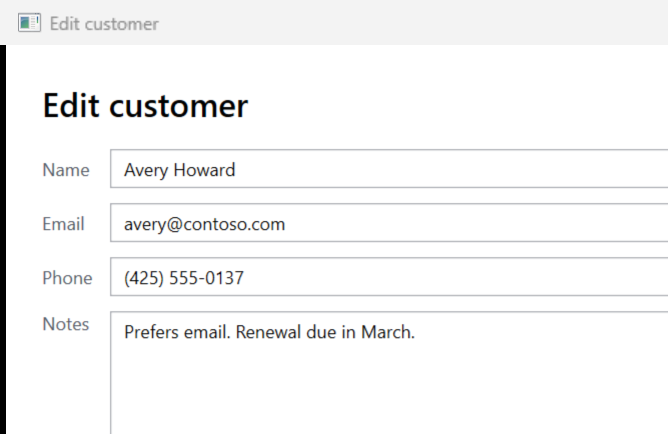
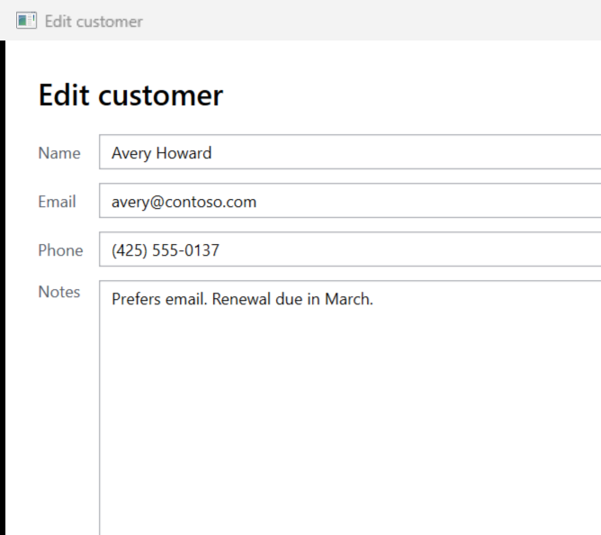

# Session transcript

Source: `Q:\source\XamlAgentDemos-notes\test-runs\VanishingSave\compact1\events.jsonl`

## Tool usage

- get_file: 7
- xaml_capture_image: 4
- xaml_get_element_properties: 4
- xaml_get_element_bounds: 4
- xaml_explain_visibility: 3
- rg: 3
- xaml_set_element_property: 3
- xaml_find_elements: 2
- powershell: 2
- skill: 1
- xaml_get_status: 1
- multi_replace_string_in_file: 1
- xaml_apply_hot_reload: 1
- xaml_hit_test: 1
- xaml_get_visual_tree: 1
- task_complete: 1

Failed tool calls: 0, images: 2


_Model: gpt-6-luna_


## User (18:21:19)

Where is my Save button?


**Tool call (18:21:22):** `skill`
```json
{
 "skill": "xaml-diagnostics"
}
```

<details><summary>Result `skill` success=true</summary>

```
Skill "xaml-diagnostics" loaded successfully. Follow the instructions in the skill context.
```
</details>


_Skill invoked: xaml-diagnostics_


**Tool call (18:21:26):** `xaml_get_status`
```json
{
 "progressMessage": "Checking the running app and its windows",
 "app": null
}
```

<details><summary>Result `xaml_get_status` success=true</summary>

```
{"isDebugging":true,"debuggerState":"running","diagnosticsActive":true,"apps":[{"app":"a1","name":"VanishingSave.exe [56284]","processId":56284,"platform":"WPF (.NET)","isRemote":false,"isDesignTimeOrNoDebug":false,"sourceInfoAvailable":true,"hotReloadSupported":true,"hotReloadEnabled":true,"supportsPropertyExplorer":true,"supportsInAppToolbar":true,"supportsHitTest":true,"windows":[{"windowId":"0xA113EE","title":"Edit customer","bounds":{"x":993,"y":2228,"width":680,"height":440},"dpiScale":1.5,"visible":true,"minimized":false}]}],"issues":[],"issuesSummary":"No problems detected.","hotReload":{"options":{"hotReloadEnabled":true,"hotReloadOnSave":false,"applyMode":"asYouType: XAML edits apply as you type, without saving (default)","wpfEnabled":true,"uwpEnabled":true,"winUIEnabled":true,"mauiEnabled":true,"justMyXaml":true,"previewSelectedElement":false,"inAppToolbar":true,"inAppSelection":false,"layoutAdorners":false,"trackFocusedElement":false,"bindingFailuresVisible":true,"compatibilityMode":false},"dotNetHotReloadEnabled":true,"isProcessingChanges":false,"errors":[]},"windowsNote":"Window bounds are physical pixels including the frame; Window.Width/Height are DIPs including the frame (= bounds.width / dpiScale), so say which unit you tested. Minimized windows report x/y = -32000 and can't be captured."}
```
</details>


**Tool call (18:21:30):** `xaml_find_elements`
```json
{
 "progressMessage": "Finding the Save control in the live window",
 "app": "a1",
 "type": "*Button",
 "name": "Save",
 "sourceFile": null,
 "line": 0,
 "namedOnly": false,
 "maxResults": 50
}
```


**Tool call (18:21:30):** `xaml_capture_image`
```json
{
 "progressMessage": "Checking the current window layout",
 "app": "a1",
 "windowId": "0xA113EE",
 "maxSize": 1280
}
```

<details><summary>Result `xaml_find_elements` success=true</summary>

```
{"count":1,"totalMatches":1,"truncated":false,"results":[{"id":"a1:10","type":"Button","name":"SaveButton","source":{"file":"Q:\\source\\XamlAgentDemos\\src\\VanishingSave\\MainWindow.xaml","line":118,"column":14},"path":"MainWindow/Border/AdornerDecorator/ContentPresenter/Grid/Grid/Button"}]}
```
</details>




<details><summary>Result `xaml_capture_image` success=true</summary>

```
Screenshot of window 0xA113EE "Edit customer" of app a1 (668x434 image of the window's client area, so it's slightly smaller than the frame bounds from xaml_get_status).
```
</details>


**Tool call (18:21:33):** `xaml_explain_visibility`
```json
{
 "progressMessage": "Tracing what hides the Save button",
 "elementIds": [
  "a1:10"
 ]
}
```

<details><summary>Result `xaml_explain_visibility` success=true</summary>

```
{"defaultSourceFile":"Q:\\source\\XamlAgentDemos\\src\\VanishingSave\\MainWindow.xaml","id":"a1:10","type":"Button","name":"SaveButton","source":{"line":118,"column":14},"verdict":"4 separate causes, some latent behind the first; it stays hidden until every one is fixed. First: Button 'SaveButton' has Visibility=Collapsed from a binding.","causes":[{"rank":1,"kind":"visibility","message":"Button 'SaveButton' has Visibility=Collapsed from a binding.","elementId":"a1:10","property":"Visibility","value":"{Binding} -> Collapsed","valueSource":"Local","location":{"line":118,"column":14},"fix":"Check the bound source value and converter (xaml_explain_property_value shows the binding), or fix the binding failure listed below."},{"rank":1,"kind":"opacity","message":"Button 'SaveButton' has Opacity=0, so it's transparent.","elementId":"a1:10","property":"Opacity","value":"0","valueSource":"StyleTrigger","location":{"line":118,"column":14},"fix":"Check for a storyboard or trigger that fades it in, or change the value."},{"rank":2,"kind":"gridCell","latent":true,"message":"Button 'SaveButton' is in ColumnDefinitions[2] 'SaveColumn' of Grid 'Footer', which has Width=0: even after the rank 1 cause is fixed it gets no room.","elementId":"a1:19","property":"ColumnDefinitions[2].Width","value":"0","valueSource":"Local","location":{"line":105,"column":18},"fix":"Give that row/column a non-zero, Auto or star size. If valueSource is Local with no location, code-behind sets it: search the code for 'SaveColumn'."},{"rank":2,"kind":"covered","latent":true,"message":"Border 'SyncStatusHost' shares Button 'SaveButton''s Grid cell (row 0, column 2), it stretches to fill the cell (no fixed size or alignment), has an opaque Background #FFFFFFFF and draws on top because its ZIndex 1 is higher: even after the other causes are fixed it hides Button 'SaveButton'.","elementId":"a1:30","property":"Background","value":"#FFFFFFFF","valueSource":"Local","location":{"line":127,"column":14},"fix":"Move the overlay to another cell, make its Background Transparent, collapse it when it has nothing to show, or lower its ZIndex below the element."}],"hitTest":{"summary":"A click at its center does NOT reach 'SaveButton' because it's disabled (IsEnabled=False): input skips disabled elements and lands on Border (in the template of MainWindow) behind or around it. That element isn't necessarily covering it; fix the IsEnabled cause (see blockers, or a command's CanExecute) rather than the layout. Butto
... [truncated 982 chars]
```
</details>


**Assistant (18:21:39):**

The Save button is present in the live tree but hidden by several stacked causes. I’m checking the XAML and view-model source so I can fix the root issues, not just point at it.


**Tool call (18:21:39):** `xaml_get_element_properties`
```json
{
 "progressMessage": "Reading Save button and parent state",
 "elementIds": [
  "a1:10",
  "a1:19",
  "a1:30"
 ],
 "nameFilter": "Visibility|Opacity|IsEnabled|Command|DataContext.CanSave|ColumnDefinitions[*]",
 "includeAll": false
}
```


**Tool call (18:21:39):** `rg`
```json
{
 "pattern": "CanSave|SaveColumn|SyncStatusHost|SaveButton|class CustomerViewModel",
 "paths": [
  "Q:\\source\\XamlAgentDemos\\src\\VanishingSave"
 ],
 "output_mode": "content",
 "glob": "*.{xaml,cs}",
 "-n": true,
 "-C": 3,
 "head_limit": 120
}
```

<details><summary>Result `rg` success=true</summary>

```
[grep content: 6 matches across 3 file(s) under Q:/source/XamlAgentDemos/src/VanishingSave; delimited groups]

CustomerViewModel.cs (1 match(es)):
  1- namespace VanishingSave;
  2- 
  3: public sealed class CustomerViewModel : ObservableObject
  4- {
  5-     private string name = "Avery Howard";
  6-     private string email = "avery@contoso.com";

MainWindow.xaml (4 match(es)):
  102-             <Grid.ColumnDefinitions>
  103-                 <ColumnDefinition Width="*" />
  104-                 <ColumnDefinition Width="Auto" />
  105:                 <ColumnDefinition x:Name="SaveColumn" Width="Auto" />
  106-             </Grid.ColumnDefinitions>
  107- 
  108-             <TextBlock VerticalAlignment="Center"
  115-                     Content="Cancel"
  116-                     Style="{StaticResource FooterButtonStyle}" />
  117- 
  118:             <Button x:Name="SaveButton"
  119-                     Grid.Column="2"
  120-                     Command="{Binding SaveCommand}"
  121-                     Content="Save"
  122-                     IsDefault="True"
  123-                     Style="{StaticResource FooterButtonStyle}"
  124:                     Visibility="{Binding CanSave, Converter={StaticResource BoolToVisibility}, FallbackValue=Collapsed}" />
  125- 
  126-             <!-- Shows "Offline - changes will sync later" when the connection drops. -->
  127:             <Border x:Name="SyncStatusHost"
  128-                     Grid.Column="2"
  129-                     Panel.ZIndex="1"
  130-                     Background="White">

MainWindow.xaml.cs (1 match(es)):
  14-     {
  15-         if (FooterSettings.UseCompactFooter)
  16-         {
  17:             this.SaveColumn.Width = new GridLength(0);
  18-         }
  19-     }
  20- }
```
</details>

<details><summary>Result `xaml_get_element_properties` success=true</summary>

```
{"defaultSourceFile":"Q:\\source\\XamlAgentDemos\\src\\VanishingSave\\MainWindow.xaml","count":3,"failed":0,"results":[{"id":"a1:10","type":"Button","name":"SaveButton","source":{"line":118,"column":14},"properties":[{"name":"IsEnabled","value":"False","valueType":"System.Boolean","valueSource":"Coercion"},{"name":"Command","evaluatedValue":"(XamlAgentDemos.RelayCommand)","valueType":"System.Windows.Data.BindingExpression","propertyType":"System.Windows.Input.ICommand","valueSource":"Local","isBinding":true},{"name":"Visibility","evaluatedValue":"2 (System.Windows.Visibility)","valueType":"System.Windows.Data.BindingExpression","propertyType":"System.Windows.Visibility","valueSource":"Local","isBinding":true},{"name":"Opacity","value":"0","valueType":"System.Double","valueSource":"StyleTrigger"}],"hiddenDefaultOrOverridden":4,"hint":"includeAll=true lists the omitted values; xaml_explain_property_value gives one property's precedence chain.","items":[{"path":"DataContext","type":"VanishingSave.CustomerViewModel","properties":[]},{"path":"ColumnDefinitions[*]","error":"PROPERTY_NOT_FOUND","message":"'a1:10' has no property 'ColumnDefinitions'."}]},{"id":"a1:19","type":"Grid","name":"Footer","source":{"line":101,"column":10},"properties":[],"defaultValues":{"CommandBindings":null,"IsEnabled":"True","Opacity":"1","Visibility":"0"},"hint":"No property name matches any of: Visibility, Opacity, IsEnabled, Command (exact name when one exists, otherwise a case-insensitive substring; separate alternatives with '|' or ','). Check the spelling, or omit nameFilter to list the properties that are set.","items":[{"path":"DataContext","type":"VanishingSave.CustomerViewModel","properties":[]},{"path":"ColumnDefinitions[0]","type":"ColumnDefinition","properties":[{"name":"Width","value":"*","valueSource":"Local"},{"name":"ActualWidth","value":"521.3333333333334","valueSource":"Local","readOnly":true},{"name":"IsInitialized","value":"True","valueSource":"Local","readOnly":true},{"name":"IsLoaded","value":"True","valueSource":"Local","readOnly":true},{"name":"Parent","valueSource":"Local","readOnly":true},{"name":"IsInputMethodEnabled","value":"True","valueSource":"Local","readOnly":true},{"name":"DependencyObjectType","valueSource":"Local","readOnly":true},{"name":"DataContext","valueSource":"Inherited"}]},{"path":"ColumnDefinitions[1]","type":"ColumnDefinition","properties":[{"name":"Width","value":"Auto","valueSource":"Local"},{"name":"ActualWidth","value":"96","valueSour
... [truncated 2170 chars]
```
</details>


**Tool call (18:21:43):** `get_file`
```json
{
 "filename": "Q:\\source\\XamlAgentDemos\\src\\VanishingSave\\MainWindow.xaml",
 "startLine": 1,
 "endLine": 180,
 "includeLineNumbers": true
}
```


**Tool call (18:21:43):** `get_file`
```json
{
 "filename": "Q:\\source\\XamlAgentDemos\\src\\VanishingSave\\CustomerViewModel.cs",
 "startLine": 1,
 "endLine": 220,
 "includeLineNumbers": true
}
```


**Tool call (18:21:43):** `get_file`
```json
{
 "filename": "Q:\\source\\XamlAgentDemos\\src\\VanishingSave\\MainWindow.xaml.cs",
 "startLine": 1,
 "endLine": 100,
 "includeLineNumbers": true
}
```

<details><summary>Result `get_file` success=true</summary>

```
```csharp src\VanishingSave\MainWindow.xaml.cs (Lines 1-20 of 20 total. Call tools for more if needed.)
1: using System.Windows;
2: 
3: namespace VanishingSave;
4: 
5: public partial class MainWindow : Window
6: {
7:     public MainWindow()
8:     {
9:         this.InitializeComponent();
10:         this.Loaded += this.OnLoaded;
11:     }
12: 
13:     private void OnLoaded(object sender, RoutedEventArgs e)
14:     {
15:         if (FooterSettings.UseCompactFooter)
16:         {
17:             this.SaveColumn.Width = new GridLength(0);
18:         }
19:     }
20: }

```


```
</details>

<details><summary>Result `get_file` success=true</summary>

```
```csharp src\VanishingSave\CustomerViewModel.cs (Lines 1-35 of 35 total. Call tools for more if needed.)
1: namespace VanishingSave;
2: 
3: public sealed class CustomerViewModel : ObservableObject
4: {
5:     private string name = "Avery Howard";
6:     private string email = "avery@contoso.com";
7:     private string phone = "(425) 555-0137";
8:     private string notes = "Prefers email. Renewal due in March.";
9:     private bool isDirty;
10: 
11:     public CustomerViewModel()
12:     {
13:         this.SaveCommand = new RelayCommand(this.Save, () => this.IsDirty);
14:         this.CancelCommand = new RelayCommand(() => this.IsDirty = false);
15:     }
16: 
17:     public string Name { get => this.name; set { if (this.SetProperty(ref this.name, value)) this.IsDirty = true; } }
18: 
19:     public string Email { get => this.email; set { if (this.SetProperty(ref this.email, value)) this.IsDirty = true; } }
20: 
21:     public string Phone { get => this.phone; set { if (this.SetProperty(ref this.phone, value)) this.IsDirty = true; } }
22: 
23:     public string Notes { get => this.notes; set { if (this.SetProperty(ref this.notes, value)) this.IsDirty = true; } }
24: 
25:     public bool IsDirty { get => this.isDirty; set => this.SetProperty(ref this.isDirty, value); }
26: 
27:     /// <summary>Whether the current user is allowed to save customer records.</summary>
28:     public bool IsSaveAvailable => true;
29: 
30:     public RelayCommand SaveCommand { get; }
31: 
32:     public RelayCommand CancelCommand { get; }
33: 
34:     private void Save() => this.IsDirty = false;
35: }

```


```
</details>

<details><summary>Result `get_file` success=true</summary>

```
```xaml src\VanishingSave\MainWindow.xaml (Lines 1-138 of 138 total. Call tools for more if needed.)
1: <Window x:Class="VanishingSave.MainWindow"
2:         xmlns="http://schemas.microsoft.com/winfx/2006/xaml/presentation"
3:         xmlns:x="http://schemas.microsoft.com/winfx/2006/xaml"
4:         xmlns:local="clr-namespace:VanishingSave"
5:         Title="Edit customer"
6:         Width="680"
7:         Height="440"
8:         Background="White">
9:     <Window.DataContext>
10:         <local:CustomerViewModel />
11:     </Window.DataContext>
12: 
13:     <Window.Resources>
14:         <BooleanToVisibilityConverter x:Key="BoolToVisibility" />
15: 
16:         <Style x:Key="FieldLabelStyle" TargetType="TextBlock">
17:             <Setter Property="Margin" Value="0,0,12,10" />
18:             <Setter Property="VerticalAlignment" Value="Center" />
19:             <Setter Property="Foreground" Value="#555B66" />
20:         </Style>
21: 
22:         <Style x:Key="FieldStyle" TargetType="TextBox">
23:             <Setter Property="Margin" Value="0,0,0,10" />
24:             <Setter Property="Padding" Value="6,4" />
25:         </Style>
26: 
27:         <Style x:Key="FooterButtonStyle" TargetType="Button">
28:             <Setter Property="MinWidth" Value="88" />
29:             <Setter Property="Margin" Value="8,0,0,0" />
30:             <Setter Property="Padding" Value="16,6" />
31:             <Style.Triggers>
32:                 <!-- Fade out buttons that can't be used yet. -->
33:                 <Trigger Property="IsEnabled" Value="False">
34:                     <Setter Property="Opacity" Value="0" />
35:                 </Trigger>
36:             </Style.Triggers>
37:         </Style>
38:     </Window.Resources>
39: 
40:     <Grid Margin="24">
41:         <Grid.RowDefinitions>
42:             <RowDefinition Height="Auto" />
43:             <RowDefinition Height="*" />
44:             <RowDefinition Height="Auto" />
45:         </Grid.RowDefinitions>
46: 
47:         <TextBlock Margin="0,0,0,16"
48:                    FontSize="22"
49:                    FontWeight="SemiBold"
50:                    Text="Edit customer" />
51: 
52:         <Grid Grid.Row="1">
53:             <Grid.ColumnDefinitions>
54:                 <ColumnDefinition Width="Auto" />
55:                 <ColumnDefinition Width="*" />
56:             </Grid.ColumnDefinitions>
57:             <Grid.RowDefinitions>
58:            
... [truncated 3995 chars]
```
</details>


**Tool call (18:21:54):** `rg`
```json
{
 "pattern": "class FooterSettings|UseCompactFooter|IsSaveAvailable|CanSave|SyncStatusText|SyncStatusHost",
 "paths": [
  "Q:\\source\\XamlAgentDemos"
 ],
 "output_mode": "content",
 "glob": "*.{cs,xaml,csproj,json}",
 "-n": true,
 "-C": 3,
 "head_limit": 160
}
```


**Tool call (18:21:54):** `rg`
```json
{
 "pattern": "class RelayCommand|CanExecuteChanged|NotifyCanExecuteChanged|RaiseCanExecuteChanged",
 "paths": [
  "Q:\\source\\XamlAgentDemos\\src\\VanishingSave"
 ],
 "output_mode": "content",
 "glob": "*.cs",
 "-n": true,
 "-C": 4,
 "head_limit": 80
}
```


**Tool call (18:21:54):** `powershell`
```json
{
 "command": "git status --short; Get-ChildItem -Path 'Q:\\source\\XamlAgentDemos\\src\\VanishingSave' -Force | Select-Object Name",
 "description": "Check the working tree and demo project files"
}
```

<details><summary>Result `rg` success=true</summary>

```
[grep content: 15 matches across 4 file(s) under Q:/source/XamlAgentDemos/src/VanishingSave; delimited groups]

FooterSettings.cs (10 match(es)):
  1- namespace VanishingSave;
  2- 
  3: public static class FooterSettings
  4- {
  5-     /// <summary>
  6-     /// Compact footer for small screens: auto-save makes the Save column unnecessary.
  7-     /// (Auto-save was cut from v2, but this switch stayed on.)
  8-     /// </summary>
  9:     public static bool UseCompactFooter { get; set; } = true;
  10- }

MainWindow.xaml.cs (1 match(es)):
  12- 
  13-     private void OnLoaded(object sender, RoutedEventArgs e)
  14-     {
  15:         if (FooterSettings.UseCompactFooter)
  16-         {
  17-             this.SaveColumn.Width = new GridLength(0);
  18-         }

MainWindow.xaml (3 match(es)):
  121-                     Content="Save"
  122-                     IsDefault="True"
  123-                     Style="{StaticResource FooterButtonStyle}"
  124:                     Visibility="{Binding CanSave, Converter={StaticResource BoolToVisibility}, FallbackValue=Collapsed}" />
  125- 
  126-             <!-- Shows "Offline - changes will sync later" when the connection drops. -->
  127:             <Border x:Name="SyncStatusHost"
  128-                     Grid.Column="2"
  129-                     Panel.ZIndex="1"
  130-                     Background="White">
  131:                 <TextBlock x:Name="SyncStatusText"
  132-                            VerticalAlignment="Center"
  133-                            Foreground="#B54708"
  134-                            Text="" />

CustomerViewModel.cs (1 match(es)):
  25-     public bool IsDirty { get => this.isDirty; set => this.SetProperty(ref this.isDirty, value); }
  26- 
  27-     /// <summary>Whether the current user is allowed to save customer records.</summary>
  28:     public bool IsSaveAvailable => true;
  29- 
  30-     public RelayCommand SaveCommand { get; }
  31- 
```
</details>

<details><summary>Result `rg` success=true</summary>

```
No matches found.
```
</details>

<details><summary>Result `powershell` success=true</summary>

```
Name
----
bin
obj
App.xaml
App.xaml.cs
CustomerViewModel.cs
FooterSettings.cs
MainWindow.xaml
MainWindow.xaml.cs
VanishingSave.csproj
<shellId: 0 completed with exit code 0>
```
</details>


**Tool call (18:22:31):** `get_file`
```json
{
 "filename": "Q:\\source\\XamlAgentDemos\\src\\VanishingSave\\FooterSettings.cs",
 "startLine": 1,
 "endLine": 80,
 "includeLineNumbers": true
}
```

<details><summary>Result `get_file` success=true</summary>

```
```csharp src\VanishingSave\FooterSettings.cs (Lines 1-10 of 10 total. Call tools for more if needed.)
1: namespace VanishingSave;
2: 
3: public static class FooterSettings
4: {
5:     /// <summary>
6:     /// Compact footer for small screens: auto-save makes the Save column unnecessary.
7:     /// (Auto-save was cut from v2, but this switch stayed on.)
8:     /// </summary>
9:     public static bool UseCompactFooter { get; set; } = true;
10: }

```


```
</details>


**Tool call (18:22:42):** `multi_replace_string_in_file`
```json
{
 "explanation": "Restore the button by correcting its visibility binding, keeping disabled footer buttons visible, disabling the stale compact-footer default, and making the status overlay non-obscuring.",
 "replacements": [
  {
   "filePath": "src\\VanishingSave\\MainWindow.xaml",
   "oldString": "        <Style x:Key=\"FooterButtonStyle\" TargetType=\"Button\">\n            <Setter Property=\"MinWidth\" Value=\"88\" />\n            <Setter Property=\"Margin\" Value=\"8,0,0,0\" />\n            <Setter Property=\"Padding\" Value=\"16,6\" />\n            <Style.Triggers>\n                <!-- Fade out buttons that can't be used yet. -->\n                <Trigger Property=\"IsEnabled\" Value=\"False\">\n                    <Setter Property=\"Opacity\" Value=\"0\" />\n                </Trigger>\n            </Style.Triggers>\n        </Style>",
   "newString": "        <Style x:Key=\"FooterButtonStyle\" TargetType=\"Button\">\n            <Setter Property=\"MinWidth\" Value=\"88\" />\n            <Setter Property=\"Margin\" Value=\"8,0,0,0\" />\n            <Setter Property=\"Padding\" Value=\"16,6\" />\n        </Style>"
  },
  {
   "filePath": "src\\VanishingSave\\MainWindow.xaml",
   "oldString": "            <Button x:Name=\"SaveButton\"\n                    Grid.Column=\"2\"\n                    Command=\"{Binding SaveCommand}\"\n                    Content=\"Save\"\n                    IsDefault=\"True\"\n                    Style=\"{StaticResource FooterButtonStyle}\"\n
... [truncated 1695 chars]
```

<details><summary>Result `multi_replace_string_in_file` success=true</summary>

```
Successfully applied 3 of 3 replacement(s) across 2 file(s).
```
</details>


**Tool call (18:22:56):** `xaml_apply_hot_reload`
```json
{
 "progressMessage": "Applying the XAML and settings fixes",
 "includeCodeChanges": true
}
```

<details><summary>Result `xaml_apply_hot_reload` success=true</summary>

```
{"summary":"XAML: Applied with no new errors. .NET code: applied with 1 warning(s) in 'codeHotReloadWarnings': some code changes (for example static or field initializers, constructors and startup code) only take effect after the code runs again or the app restarts.","applied":true,"xamlApplied":true,"status":"applied","errors":[],"log":[],"lastHotReloadUpdate":{"secondsAgo":11,"updatesSinceToolsStarted":1},"codeChanges":".NET Hot Reload was started for saved code changes. Its results are in the Hot Reload output pane, not in 'log'; if an edit can't be hot reloaded, Visual Studio asks the user to rebuild and restart.","codeStatus":"appliedWithWarnings","codeHotReloadWarnings":["13:22:57.56 🔣  ⚠ [Q:\\source\\XamlAgentDemos\\src\\VanishingSave\\VanishingSave.csproj ({4EB184D2-643F-45DC-A2E0-9645EA07CD15})]: Q:\\source\\XamlAgentDemos\\src\\VanishingSave\\FooterSettings.cs(8,5): warning ENC0118: Changing 'auto-property' might not have any effect until the application is restarted."],"codeHotReloadOutput":["13:22:57.56 🔣  ⚠ [Q:\\source\\XamlAgentDemos\\src\\VanishingSave\\VanishingSave.csproj ({4EB184D2-643F-45DC-A2E0-9645EA07CD15})]: Q:\\source\\XamlAgentDemos\\src\\VanishingSave\\FooterSettings.cs(8,5): warning ENC0118: Changing 'auto-property' might not have any effect until the application is restarted."],"hint":"Verify with xaml_capture_image. Structural edits recreate elements: new IDs and reset state (selection, text, scroll), so re-find by x:Name and restore the state you were testing. Unchanged elements may keep pre-edit line numbers."}
```
</details>


**Tool call (18:23:03):** `xaml_set_element_property`
```json
{
 "progressMessage": "Restoring the Save column in the running window",
 "elementIds": [
  "#Footer"
 ],
 "setters": [
  "ColumnDefinitions[2].Width=Auto"
 ],
 "resetProperties": []
}
```

<details><summary>Result `xaml_set_element_property` success=true</summary>

```
{"id":"#Footer","property":"ColumnDefinitions[2].Width","oldValue":"0","newValue":"Auto","note":"Runtime-only: edit the XAML to persist it. It overrides the source until restart (hot reload re-applies only changed XAML properties), so set the original value back before verifying a source fix."}
```
</details>


**Tool call (18:23:06):** `xaml_explain_visibility`
```json
{
 "progressMessage": "Verifying the Save button is no longer hidden",
 "elementIds": [
  "#SaveButton"
 ]
}
```


**Tool call (18:23:06):** `xaml_capture_image`
```json
{
 "progressMessage": "Confirming the restored button is visible",
 "app": "a1",
 "windowId": "0xA113EE",
 "maxSize": 1280
}
```


**Tool call (18:23:06):** `xaml_hit_test`
```json
{
 "progressMessage": "Checking the Save button receives clicks",
 "elementIds": [
  "#SaveButton"
 ],
 "points": null
}
```

<details><summary>Result `xaml_capture_image` success=true</summary>

```
Screenshot of window 0xA113EE "Edit customer" of app a1 (668x434 image of the window's client area, so it's slightly smaller than the frame bounds from xaml_get_status). Note: this image is pixel-identical to the previous capture of this window, so nothing visible changed since then (the chat may show it as a reference to the earlier image).
```
</details>

<details><summary>Result `xaml_hit_test` success=true</summary>

```
{"defaultSourceFile":"Q:\\source\\XamlAgentDemos\\src\\VanishingSave\\MainWindow.xaml","id":"#SaveButton","summary":"A click at its center does NOT reach 'SaveButton' because it's disabled (IsEnabled=False): input skips disabled elements and lands on Grid 'Footer' behind or around it. That element isn't necessarily covering it; fix the IsEnabled cause (see blockers, or a command's CanExecute) rather than the layout. Button 'SaveButton' has IsEnabled=False (IsEnabledCore: command CanExecute is false or the control disabled itself).","elementReceivesInput":false,"inputTarget":{"id":"a1:19","type":"Grid","name":"Footer","source":{"line":101,"column":10}},"stack":[{"id":"a1:165","type":"TextBlock","templatedParent":{"id":"a1:10","type":"Button","name":"SaveButton","source":{"line":118,"column":14}}},{"id":"a1:163","type":"Border","name":"border","templatedParent":{"id":"a1:10","type":"Button","name":"SaveButton","source":{"line":118,"column":14}}},{"id":"a1:12","type":"Border","templatedParent":{"id":"a1:11","type":"VanishingSave.MainWindow","source":{"line":4,"column":9}}}],"isVisible":true,"isHitTestVisible":true,"isEnabled":false,"effectiveOpacity":1.0,"blockers":[{"id":"a1:10","type":"Button","name":"SaveButton","source":{"line":118,"column":14},"property":"IsEnabled","value":"False (IsEnabledCore: command CanExecute is false or the control disabled itself)"}],"visibleFraction":1.0,"point":{"window":{"x":597.33,"y":363.69},"screen":{"x":2396.0,"y":3933.0}},"note":"inputTarget = what a click or tap at the point reaches; stack = hit-testable elements there, topmost first (no id = template part, see templatedParent). blockers = the element and ancestors whose own values hide it or block input. visibleFraction includes ancestor and window clipping."}
```
</details>

<details><summary>Result `xaml_explain_visibility` success=true</summary>

```
{"defaultSourceFile":"Q:\\source\\XamlAgentDemos\\src\\VanishingSave\\MainWindow.xaml","id":"#SaveButton","type":"Button","name":"SaveButton","source":{"line":118,"column":14},"verdict":"No reason found for Button 'SaveButton' to be invisible: it's Visible, opaque, has a size, is inside its window and nothing covers its center. Capture an image to confirm, or check that this is the element you expect (another copy may be the one on screen).","causes":[],"checkedOk":["size 88x29.96"],"hitTest":{"summary":"A click at its center does NOT reach 'SaveButton' because it's disabled (IsEnabled=False): input skips disabled elements and lands on Grid 'Footer' behind or around it. That element isn't necessarily covering it; fix the IsEnabled cause (see blockers, or a command's CanExecute) rather than the layout. Button 'SaveButton' has IsEnabled=False (IsEnabledCore: command CanExecute is false or the control disabled itself).","visibleFraction":1.0,"inputTarget":{"id":"a1:19","type":"Grid","name":"Footer","source":{"line":101,"column":10},"templatedParent":null,"property":null,"value":null}},"bindingFailures":[{"target":"Button.Visibility, Name='SaveButton'","bindingPath":"CanSave","description":"CanSave property not found on object of type CustomerViewModel.","line":118,"fixedInSource":true}],"note":"rank 1 = certain, 2 = almost certain, 3 = possible. latent=true causes still hide it after the masking cause is fixed: fix every cause. location = where the winning value is set; valueSource=Local without location = set by code. bindingFailures with fixedInSource=true are stale, not causes."}
```
</details>


**Tool call (18:23:16):** `xaml_get_element_bounds`
```json
{
 "progressMessage": "Checking where the footer renders in the window",
 "elementIds": [
  "#Footer",
  "#SaveButton",
  "#CancelButton",
  "#SyncStatusHost"
 ]
}
```


**Tool call (18:23:16):** `xaml_get_element_properties`
```json
{
 "progressMessage": "Checking live footer dimensions and state",
 "elementIds": [
  "#Footer",
  "#SaveButton",
  "#CancelButton",
  "#SyncStatusHost"
 ],
 "nameFilter": "ActualWidth|ActualHeight|Visibility|Opacity|IsEnabled|Content|ColumnDefinitions[*]",
 "includeAll": true
}
```

<details><summary>Result `xaml_get_element_bounds` success=true</summary>

```
{"note":"screen = physical pixels; window = DIPs relative to the root window (x dpiScale for pixels). Fractional screen pixels blur thin lines and text. isVisible ignores ancestor clipping (use xaml_hit_test's visibleFraction); insideWindowFraction < 1 means part is outside the window.","bounds":[{"id":"#Footer","isVisible":true,"insideWindowFraction":0.0,"clippedByWindow":true,"windowHandle":"0xA113EE","dpiScale":1.5,"screen":{"x":1536.0,"y":3910.0,"width":926.0,"height":45.0},"window":{"x":24.0,"y":348.71,"width":617.33,"height":29.96}},{"id":"#SaveButton","isVisible":true,"insideWindowFraction":0.0,"clippedByWindow":true,"windowHandle":"0xA113EE","dpiScale":1.5,"screen":{"x":2330.0,"y":3910.0,"width":132.0,"height":45.0},"window":{"x":553.33,"y":348.71,"width":88.0,"height":29.96}},{"id":"#CancelButton","isVisible":true,"insideWindowFraction":0.0,"clippedByWindow":true,"windowHandle":"0xA113EE","dpiScale":1.5,"screen":{"x":2186.0,"y":3910.0,"width":132.0,"height":45.0},"window":{"x":457.33,"y":348.71,"width":88.0,"height":29.96}},{"id":"#SyncStatusHost","isVisible":true,"insideWindowFraction":0.0,"clippedByWindow":true,"windowHandle":"0xA113EE","dpiScale":1.5,"screen":{"x":2318.0,"y":3910.0,"width":144.0,"height":45.0},"window":{"x":545.33,"y":348.71,"width":96.0,"height":29.96}}]}
```
</details>

<details><summary>Result `xaml_get_element_properties` success=true</summary>

```
{"count":4,"failed":3,"results":[{"id":"#Footer","type":"Grid","name":"Footer","source":{"file":"Q:\\source\\XamlAgentDemos\\src\\VanishingSave\\MainWindow.xaml","line":101,"column":10},"properties":[{"name":"ActualWidth","value":"617.3333333333334","valueType":"System.Double","valueSource":"Local","readOnly":true},{"name":"ActualHeight","value":"29.96","valueType":"System.Double","valueSource":"Local","readOnly":true}],"defaultValues":{"IsEnabled":"True","Opacity":"1","Visibility":"0"},"hiddenDefaultOrOverridden":2,"hint":"includeAll=true lists the omitted values; xaml_explain_property_value gives one property's precedence chain.","items":[{"path":"ColumnDefinitions[0]","type":"ColumnDefinition","properties":[{"name":"Width","value":"*","valueSource":"Local"},{"name":"ActualWidth","value":"425.33333333333337","valueSource":"Local","readOnly":true},{"name":"IsInitialized","value":"True","valueSource":"Local","readOnly":true},{"name":"IsLoaded","value":"True","valueSource":"Local","readOnly":true},{"name":"Parent","valueSource":"Local","readOnly":true},{"name":"IsInputMethodEnabled","value":"True","valueSource":"Local","readOnly":true},{"name":"DependencyObjectType","valueSource":"Local","readOnly":true},{"name":"DataContext","valueSource":"Inherited"},{"name":"MinWidth","value":"0","valueSource":"Default"},{"name":"MaxWidth","value":"Infinity","valueSource":"Default"},{"name":"Offset","value":"0","valueSource":"Default","readOnly":true},{"name":"SharedSizeGroup","valueSource":"Default"},{"name":"Style","valueSource":"Default"},{"name":"OverridesDefaultStyle","value":"False","valueSource":"Default"},{"name":"TemplatedParent","valueSource":"Default"},{"name":"Resources","valueSource":"Default"},{"name":"Name","value":"","valueSource":"Default"},{"name":"Tag","valueSource":"Default"},{"name":"Language","value":"en-us","valueSource":"Default"},{"name":"FocusVisualStyle","value":"System.Windows.Style","valueSource":"Default"},{"name":"Cursor","valueSource":"Default"},{"name":"ForceCursor","value":"False","valueSource":"Default"},{"name":"InputScope","valueSource":"Default"},{"name":"BindingGroup","valueSource":"Default"},{"name":"ToolTip","valueSource":"Default"},{"name":"ContextMenu","valueSource":"Default"},{"name":"HasAnimatedProperties","value":"False","valueSource":"Default","readOnly":true},{"name":"InputBindings","valueSource":"Default"},{"name":"CommandBindings","valueSource":"Default"},{"name":"IsMouseDirectlyOver","value":"False","valueSource":"Defaul
... [truncated 9825 chars]
```
</details>


**Tool call (18:23:33):** `xaml_get_visual_tree`
```json
{
 "progressMessage": "Tracing the clipped footer through its layout parents",
 "app": "a1",
 "rootElementId": null,
 "depth": 5,
 "maxNodes": 100
}
```


**Tool call (18:23:33):** `xaml_find_elements`
```json
{
 "progressMessage": "Finding the window root and layout containers",
 "app": "a1",
 "type": "*Window|Grid",
 "name": null,
 "sourceFile": null,
 "line": 0,
 "namedOnly": false,
 "maxResults": 80
}
```

<details><summary>Result `xaml_find_elements` success=true</summary>

```
{"defaultSourceFile":"Q:\\source\\XamlAgentDemos\\src\\VanishingSave\\MainWindow.xaml","count":8,"totalMatches":8,"truncated":false,"results":[{"id":"a1:11","type":"VanishingSave.MainWindow","source":{"line":4,"column":9},"path":"MainWindow"},{"id":"a1:16","type":"Grid","source":{"line":40,"column":6},"path":"MainWindow/Border/AdornerDecorator/ContentPresenter/Grid"},{"id":"a1:18","type":"Grid","source":{"line":52,"column":10},"path":"MainWindow/Border/AdornerDecorator/ContentPresenter/Grid/Grid"},{"id":"a1:42","type":"Grid","path":"MainWindow/Border/AdornerDecorator/ContentPresenter/Grid/Grid/TextBox/Border/ScrollViewer/Grid"},{"id":"a1:43","type":"Grid","path":"MainWindow/Border/AdornerDecorator/ContentPresenter/Grid/Grid/TextBox/Border/ScrollViewer/Grid"},{"id":"a1:44","type":"Grid","path":"MainWindow/Border/AdornerDecorator/ContentPresenter/Grid/Grid/TextBox/Border/ScrollViewer/Grid"},{"id":"a1:45","type":"Grid","path":"MainWindow/Border/AdornerDecorator/ContentPresenter/Grid/Grid/TextBox/Border/ScrollViewer/Grid"},{"id":"a1:19","type":"Grid","name":"Footer","source":{"line":101,"column":10},"path":"MainWindow/Border/AdornerDecorator/ContentPresenter/Grid/Grid"}]}
```
</details>

<details><summary>Result `xaml_get_visual_tree` success=true</summary>

```
{"defaultSourceFile":"Q:\\source\\XamlAgentDemos\\src\\VanishingSave\\MainWindow.xaml","app":"a1","platform":"WPF (.NET)","sourceInfoAvailable":true,"nodeCount":28,"truncated":false,"depthLimitedNodes":6,"hint":"6 node(s) have children beyond the requested depth (childCount > 0, no children listed). Raise depth or pass rootElementId to expand them.","nodes":[{"id":"a1:11","type":"VanishingSave.MainWindow","source":{"line":4,"column":9},"childCount":1,"children":[{"id":"a1:12","type":"Border","childCount":1,"children":[{"id":"a1:13","type":"AdornerDecorator","childCount":2,"children":[{"id":"a1:14","type":"ContentPresenter","childCount":1,"children":[{"id":"a1:16","type":"Grid","source":{"line":40,"column":6},"childCount":3,"children":[{"id":"a1:17","type":"TextBlock","source":{"line":47,"column":10},"childCount":0},{"id":"a1:18","type":"Grid","source":{"line":52,"column":10},"childCount":8,"children":[{"id":"a1:20","type":"TextBlock","source":{"line":64,"column":14},"childCount":0},{"id":"a1:21","type":"TextBox","name":"NameBox","source":{"line":65,"column":14},"childCount":1,"children":[{"id":"a1:31","type":"Border","name":"border","childCount":1}]},{"id":"a1:22","type":"TextBlock","source":{"line":71,"column":14},"childCount":0},{"id":"a1:23","type":"TextBox","name":"EmailBox","source":{"line":72,"column":14},"childCount":1,"children":[{"id":"a1:32","type":"Border","name":"border","childCount":1}]},{"id":"a1:24","type":"TextBlock","source":{"line":79,"column":14},"childCount":0},{"id":"a1:25","type":"TextBox","name":"PhoneBox","source":{"line":80,"column":14},"childCount":1,"children":[{"id":"a1:33","type":"Border","name":"border","childCount":1}]},{"id":"a1:26","type":"TextBlock","source":{"line":87,"column":14},"childCount":0},{"id":"a1:27","type":"TextBox","name":"NotesBox","source":{"line":91,"column":14},"childCount":1,"children":[{"id":"a1:34","type":"Border","name":"border","childCount":1}]}]},{"id":"a1:19","type":"Grid","name":"Footer","source":{"line":101,"column":10},"childCount":4,"children":[{"id":"a1:28","type":"TextBlock","source":{"line":108,"column":14},"childCount":0},{"id":"a1:29","type":"Button","name":"CancelButton","source":{"line":112,"column":14},"childCount":1,"children":[{"id":"a1:35","type":"Border","name":"border","childCount":1}]},{"id":"a1:10","type":"Button","name":"SaveButton","source":{"line":118,"column":14},"childCount":1,"children":[{"id":"a1:163","type":"Border","name":"border","childCount":1}]},{"id":"a1:30","type":"B
... [truncated 266 chars]
```
</details>


**Tool call (18:23:38):** `xaml_get_element_bounds`
```json
{
 "progressMessage": "Measuring the window, form, notes, and footer",
 "elementIds": [
  "a1:11",
  "a1:16",
  "a1:18",
  "#NotesBox",
  "#Footer",
  "#SaveButton"
 ]
}
```


**Tool call (18:23:38):** `xaml_get_element_properties`
```json
{
 "progressMessage": "Inspecting sizes that push the footer offscreen",
 "elementIds": [
  "a1:11",
  "a1:16",
  "a1:18",
  "#NotesBox",
  "#Footer"
 ],
 "nameFilter": "ActualWidth|ActualHeight|Width|Height|MinWidth|MinHeight|Margin|Padding|VerticalAlignment|RowDefinitions[*]",
 "includeAll": true
}
```

<details><summary>Result `xaml_get_element_bounds` success=true</summary>

```
{"note":"screen = physical pixels; window = DIPs relative to the root window (x dpiScale for pixels). Fractional screen pixels blur thin lines and text. isVisible ignores ancestor clipping (use xaml_hit_test's visibleFraction); insideWindowFraction < 1 means part is outside the window.","bounds":[{"id":"a1:11","isVisible":true,"insideWindowFraction":0.0,"clippedByWindow":true,"windowHandle":"0xA113EE","dpiScale":1.5,"screen":{"x":1500.0,"y":3387.0,"width":1020.0,"height":660.0},"window":{"x":0.0,"y":0.0,"width":680.0,"height":440.0}},{"id":"a1:16","isVisible":true,"insideWindowFraction":0.0,"clippedByWindow":true,"windowHandle":"0xA113EE","dpiScale":1.5,"screen":{"x":1536.0,"y":3423.0,"width":926.0,"height":532.0},"window":{"x":24.0,"y":24.0,"width":617.33,"height":354.67}},{"id":"a1:18","isVisible":true,"insideWindowFraction":0.0,"clippedByWindow":true,"windowHandle":"0xA113EE","dpiScale":1.5,"screen":{"x":1536.0,"y":3491.0,"width":926.0,"height":401.0},"window":{"x":24.0,"y":69.26,"width":617.33,"height":267.44}},{"id":"#NotesBox","isVisible":true,"insideWindowFraction":0.0,"clippedByWindow":true,"windowHandle":"0xA113EE","dpiScale":1.5,"screen":{"x":1604.0,"y":3653.0,"width":858.0,"height":224.0},"window":{"x":69.61,"y":177.14,"width":571.73,"height":149.56}},{"id":"#Footer","isVisible":true,"insideWindowFraction":0.0,"clippedByWindow":true,"windowHandle":"0xA113EE","dpiScale":1.5,"screen":{"x":1536.0,"y":3910.0,"width":926.0,"height":45.0},"window":{"x":24.0,"y":348.71,"width":617.33,"height":29.96}},{"id":"#SaveButton","isVisible":true,"insideWindowFraction":0.0,"clippedByWindow":true,"windowHandle":"0xA113EE","dpiScale":1.5,"screen":{"x":2330.0,"y":3910.0,"width":132.0,"height":45.0},"window":{"x":553.33,"y":348.71,"width":88.0,"height":29.96}}]}
```
</details>

<details><summary>Result `xaml_get_element_properties` success=true</summary>

```
{"count":5,"failed":3,"results":[{"id":"a1:11","error":"PROPERTY_NOT_FOUND","message":"'a1:11' has no property 'RowDefinitions'.","hint":"Call xaml_get_element_properties with nameFilter to check the name. Collections such as ColumnDefinitions are listed only when they have items."},{"id":"a1:16","type":"Grid","source":{"file":"Q:\\source\\XamlAgentDemos\\src\\VanishingSave\\MainWindow.xaml","line":40,"column":6},"properties":[{"name":"ActualWidth","value":"617.3333333333334","valueType":"System.Double","valueSource":"Local","readOnly":true},{"name":"ActualHeight","value":"354.6666666666667","valueType":"System.Double","valueSource":"Local","readOnly":true},{"name":"Margin","value":"24,24,24,24","valueType":"System.Windows.Thickness","valueSource":"Local"}],"defaultValues":{"Height":"Auto","MinHeight":"0","MinWidth":"0","VerticalAlignment":"3","Width":"Auto"},"hiddenDefaultOrOverridden":3,"hint":"includeAll=true lists the omitted values; xaml_explain_property_value gives one property's precedence chain.","items":[{"path":"RowDefinitions[0]","type":"RowDefinition","properties":[{"name":"Height","value":"Auto","valueSource":"Local"},{"name":"ActualHeight","value":"45.263333333333335","valueSource":"Local","readOnly":true},{"name":"IsInitialized","value":"True","valueSource":"Local","readOnly":true},{"name":"IsLoaded","value":"True","valueSource":"Local","readOnly":true},{"name":"Parent","valueSource":"Local","readOnly":true},{"name":"IsInputMethodEnabled","value":"True","valueSource":"Local","readOnly":true},{"name":"DependencyObjectType","valueSource":"Local","readOnly":true},{"name":"DataContext","valueSource":"Inherited"},{"name":"MinHeight","value":"0","valueSource":"Default"},{"name":"MaxHeight","value":"Infinity","valueSource":"Default"},{"name":"Offset","value":"0","valueSource":"Default","readOnly":true},{"name":"SharedSizeGroup","valueSource":"Default"},{"name":"Style","valueSource":"Default"},{"name":"OverridesDefaultStyle","value":"False","valueSource":"Default"},{"name":"TemplatedParent","valueSource":"Default"},{"name":"Resources","valueSource":"Default"},{"name":"Name","value":"","valueSource":"Default"},{"name":"Tag","valueSource":"Default"},{"name":"Language","value":"en-us","valueSource":"Default"},{"name":"FocusVisualStyle","value":"System.Windows.Style","valueSource":"Default"},{"name":"Cursor","valueSource":"Default"},{"name":"ForceCursor","value":"False","valueSource":"Default"},{"name":"InputScope","valueSource":"Default"},{"name":"Bind
... [truncated 9655 chars]
```
</details>


**Tool call (18:23:57):** `xaml_set_element_property`
```json
{
 "progressMessage": "Testing whether more window height reveals the footer",
 "elementIds": [
  "a1:11"
 ],
 "setters": [
  "Height=600"
 ],
 "resetProperties": []
}
```

<details><summary>Result `xaml_set_element_property` success=true</summary>

```
{"id":"a1:11","property":"Height","oldValue":"440","newValue":"600","note":"Runtime-only: edit the XAML to persist it. It overrides the source until restart (hot reload re-applies only changed XAML properties), so set the original value back before verifying a source fix."}
```
</details>


**Tool call (18:24:00):** `xaml_capture_image`
```json
{
 "progressMessage": "Viewing the enlarged form layout",
 "app": "a1",
 "windowId": "0xA113EE",
 "maxSize": 1280
}
```


**Tool call (18:24:00):** `xaml_get_element_bounds`
```json
{
 "progressMessage": "Rechecking footer clipping after resizing",
 "elementIds": [
  "#MainWindow",
  "#Footer",
  "#SaveButton"
 ]
}
```

<details><summary>Result `xaml_get_element_bounds` success=true</summary>

```
{"note":"screen = physical pixels; window = DIPs relative to the root window (x dpiScale for pixels). Fractional screen pixels blur thin lines and text. isVisible ignores ancestor clipping (use xaml_hit_test's visibleFraction); insideWindowFraction < 1 means part is outside the window.","bounds":[{"id":"#MainWindow","error":"ELEMENT_GONE","message":"No live element is named 'MainWindow' ('#MainWindow').","hint":"Names are x:Name values and are case-sensitive. The element may not be created yet (a closed tab, dialog or unrealized list item). Call xaml_find_elements with name=\"*MainWindow*\" or browse with xaml_get_visual_tree."},{"id":"#Footer","isVisible":true,"insideWindowFraction":0.0,"clippedByWindow":true,"windowHandle":"0xA113EE","dpiScale":1.5,"screen":{"x":1536.0,"y":4150.0,"width":926.0,"height":45.0},"window":{"x":24.0,"y":508.71,"width":617.33,"height":29.96}},{"id":"#SaveButton","isVisible":true,"insideWindowFraction":0.0,"clippedByWindow":true,"windowHandle":"0xA113EE","dpiScale":1.5,"screen":{"x":2330.0,"y":4150.0,"width":132.0,"height":45.0},"window":{"x":553.33,"y":508.71,"width":88.0,"height":29.96}}]}
```
</details>




<details><summary>Result `xaml_capture_image` success=true</summary>

```
Screenshot of window 0xA113EE "Edit customer" of app a1 (668x594 image of the window's client area, so it's slightly smaller than the frame bounds from xaml_get_status).
```
</details>


**Tool call (18:24:12):** `xaml_explain_visibility`
```json
{
 "progressMessage": "Finding the remaining live clipping cause",
 "elementIds": [
  "#SaveButton"
 ]
}
```

<details><summary>Result `xaml_explain_visibility` success=true</summary>

```
{"defaultSourceFile":"Q:\\source\\XamlAgentDemos\\src\\VanishingSave\\MainWindow.xaml","id":"#SaveButton","type":"Button","name":"SaveButton","source":{"line":118,"column":14},"verdict":"No reason found for Button 'SaveButton' to be invisible: it's Visible, opaque, has a size, is inside its window and nothing covers its center. Capture an image to confirm, or check that this is the element you expect (another copy may be the one on screen).","causes":[],"checkedOk":["size 88x29.96"],"hitTest":{"summary":"A click at its center does NOT reach 'SaveButton' because it's disabled (IsEnabled=False): input skips disabled elements and lands on Grid 'Footer' behind or around it. That element isn't necessarily covering it; fix the IsEnabled cause (see blockers, or a command's CanExecute) rather than the layout. Button 'SaveButton' has IsEnabled=False (IsEnabledCore: command CanExecute is false or the control disabled itself).","visibleFraction":1.0,"inputTarget":{"id":"a1:19","type":"Grid","name":"Footer","source":{"line":101,"column":10},"templatedParent":null,"property":null,"value":null}},"bindingFailures":[{"target":"Button.Visibility, Name='SaveButton'","bindingPath":"CanSave","description":"CanSave property not found on object of type CustomerViewModel.","line":118,"fixedInSource":true}],"note":"rank 1 = certain, 2 = almost certain, 3 = possible. latent=true causes still hide it after the masking cause is fixed: fix every cause. location = where the winning value is set; valueSource=Local without location = set by code. bindingFailures with fixedInSource=true are stale, not causes."}
```
</details>


**Tool call (18:24:26):** `xaml_get_element_properties`
```json
{
 "progressMessage": "Inspecting rendered button and window dimensions",
 "elementIds": [
  "#SaveButton",
  "#MainWindow"
 ],
 "nameFilter": "Background|Foreground|Content|ActualWidth|ActualHeight|Width|Height|IsEnabled|Opacity|Visibility",
 "includeAll": true
}
```

<details><summary>Result `xaml_get_element_properties` success=true</summary>

```
{"count":2,"failed":1,"results":[{"id":"#SaveButton","type":"Button","name":"SaveButton","source":{"file":"Q:\\source\\XamlAgentDemos\\src\\VanishingSave\\MainWindow.xaml","line":118,"column":14},"properties":[{"name":"IsEnabled","value":"False","valueType":"System.Boolean","valueSource":"Coercion"},{"name":"Content","value":"Save","valueType":"System.String","propertyType":"System.Object","valueSource":"Local"},{"name":"ActualWidth","value":"88","valueType":"System.Double","valueSource":"Local","readOnly":true},{"name":"ActualHeight","value":"29.96","valueType":"System.Double","valueSource":"Local","readOnly":true},{"name":"Visibility","evaluatedValue":"0 (System.Windows.Visibility)","valueType":"System.Windows.Data.BindingExpression","propertyType":"System.Windows.Visibility","valueSource":"Local","isBinding":true},{"name":"Foreground","value":"#FF838383","valueType":"System.Windows.Media.SolidColorBrush","propertyType":"System.Windows.Media.Brush","valueSource":"TemplateTrigger"},{"name":"Background","value":"#FFDDDDDD","valueType":"System.Windows.Media.SolidColorBrush","propertyType":"System.Windows.Media.Brush","valueSource":"BuiltInStyle"}],"defaultValues":{"Height":"Auto","Opacity":"1","Width":"Auto"},"hiddenDefaultOrOverridden":8,"hint":"includeAll=true lists the omitted values; xaml_explain_property_value gives one property's precedence chain."},{"id":"#MainWindow","error":"ELEMENT_GONE","message":"No live element is named 'MainWindow' ('#MainWindow').","hint":"Names are x:Name values and are case-sensitive. The element may not be created yet (a closed tab, dialog or unrealized list item). Call xaml_find_elements with name=\"*MainWindow*\" or browse with xaml_get_visual_tree."}]}
```
</details>


**Tool call (18:25:39):** `get_file`
```json
{
 "filename": "Q:\\source\\XamlAgentDemos\\src\\VanishingSave\\VanishingSave.csproj",
 "startLine": 1,
 "endLine": 120,
 "includeLineNumbers": true
}
```


**Tool call (18:25:39):** `get_file`
```json
{
 "filename": "Q:\\source\\XamlAgentDemos\\src\\VanishingSave\\App.xaml",
 "startLine": 1,
 "endLine": 100,
 "includeLineNumbers": true
}
```


**Tool call (18:25:39):** `get_file`
```json
{
 "filename": "Q:\\source\\XamlAgentDemos\\src\\VanishingSave\\FooterSettings.cs",
 "startLine": 1,
 "endLine": 30,
 "includeLineNumbers": true
}
```

<details><summary>Result `get_file` success=true</summary>

```
```csharp src\VanishingSave\FooterSettings.cs (Lines 1-9 of 9 total. Call tools for more if needed.)
1: namespace VanishingSave;
2: 
3: public static class FooterSettings
4: {
5:     /// <summary>
6:     /// Compact footer for small screens; disabled because saving is user-initiated.
7:     /// </summary>
8:     public static bool UseCompactFooter { get; set; } = false;
9: }

```


```
</details>

<details><summary>Result `get_file` success=true</summary>

```
``` src\VanishingSave\VanishingSave.csproj (Lines 1-5 of 5 total. Call tools for more if needed.)
1: <Project Sdk="Microsoft.NET.Sdk">
2:   <PropertyGroup>
3:     <RootNamespace>VanishingSave</RootNamespace>
4:   </PropertyGroup>
5: </Project>

```


```
</details>

<details><summary>Result `get_file` success=true</summary>

```
```xaml src\VanishingSave\App.xaml (Lines 1-4 of 4 total. Call tools for more if needed.)
1: <Application x:Class="VanishingSave.App"
2:              xmlns="http://schemas.microsoft.com/winfx/2006/xaml/presentation"
3:              xmlns:x="http://schemas.microsoft.com/winfx/2006/xaml"
4:              StartupUri="MainWindow.xaml" />

```


```
</details>


**Tool call (18:26:10):** `xaml_set_element_property`
```json
{
 "progressMessage": "Restoring the original window size after the layout test",
 "elementIds": [
  "a1:11"
 ],
 "setters": [
  "Height=440"
 ],
 "resetProperties": []
}
```

<details><summary>Result `xaml_set_element_property` success=true</summary>

```
{"id":"a1:11","property":"Height","oldValue":"600","newValue":"440","note":"Runtime-only: edit the XAML to persist it. It overrides the source until restart (hot reload re-applies only changed XAML properties), so set the original value back before verifying a source fix."}
```
</details>


**Tool call (18:26:16):** `xaml_capture_image`
```json
{
 "progressMessage": "Confirming the final live window state",
 "app": "a1",
 "windowId": "0xA113EE",
 "maxSize": 1280
}
```


**Tool call (18:26:16):** `xaml_get_element_bounds`
```json
{
 "progressMessage": "Checking final Save button placement",
 "elementIds": [
  "#Footer",
  "#SaveButton"
 ]
}
```


**Tool call (18:26:16):** `powershell`
```json
{
 "command": "git --no-pager diff -- src/VanishingSave/MainWindow.xaml src/VanishingSave/FooterSettings.cs; git status --short",
 "description": "Review the focused changes"
}
```

<details><summary>Result `xaml_capture_image` success=true</summary>

```
Screenshot of window 0xA113EE "Edit customer" of app a1 (668x434 image of the window's client area, so it's slightly smaller than the frame bounds from xaml_get_status).
```
</details>

<details><summary>Result `xaml_get_element_bounds` success=true</summary>

```
{"note":"screen = physical pixels; window = DIPs relative to the root window (x dpiScale for pixels). Fractional screen pixels blur thin lines and text. isVisible ignores ancestor clipping (use xaml_hit_test's visibleFraction); insideWindowFraction < 1 means part is outside the window.","bounds":[{"id":"#Footer","isVisible":true,"insideWindowFraction":0.0,"clippedByWindow":true,"windowHandle":"0xA113EE","dpiScale":1.5,"screen":{"x":1536.0,"y":3910.0,"width":926.0,"height":45.0},"window":{"x":24.0,"y":348.71,"width":617.33,"height":29.96}},{"id":"#SaveButton","isVisible":true,"insideWindowFraction":0.0,"clippedByWindow":true,"windowHandle":"0xA113EE","dpiScale":1.5,"screen":{"x":2330.0,"y":3910.0,"width":132.0,"height":45.0},"window":{"x":553.33,"y":348.71,"width":88.0,"height":29.96}}]}
```
</details>

<details><summary>Result `powershell` success=true</summary>

```
diff --git a/src/VanishingSave/FooterSettings.cs b/src/VanishingSave/FooterSettings.cs
index 27522f0..d20ed0c 100644
--- a/src/VanishingSave/FooterSettings.cs
+++ b/src/VanishingSave/FooterSettings.cs
@@ -3,8 +3,7 @@ namespace VanishingSave;
 public static class FooterSettings
 {
     /// <summary>
-    /// Compact footer for small screens: auto-save makes the Save column unnecessary.
-    /// (Auto-save was cut from v2, but this switch stayed on.)
+    /// Compact footer for small screens; disabled because saving is user-initiated.
     /// </summary>
-    public static bool UseCompactFooter { get; set; } = true;
+    public static bool UseCompactFooter { get; set; } = false;
 }
diff --git a/src/VanishingSave/MainWindow.xaml b/src/VanishingSave/MainWindow.xaml
index bb8122a..1e9d035 100644
--- a/src/VanishingSave/MainWindow.xaml
+++ b/src/VanishingSave/MainWindow.xaml
@@ -28,12 +28,6 @@
             <Setter Property="MinWidth" Value="88" />
             <Setter Property="Margin" Value="8,0,0,0" />
             <Setter Property="Padding" Value="16,6" />
-            <Style.Triggers>
-                <!-- Fade out buttons that can't be used yet. -->
-                <Trigger Property="IsEnabled" Value="False">
-                    <Setter Property="Opacity" Value="0" />
-                </Trigger>
-            </Style.Triggers>
         </Style>
     </Window.Resources>
 
@@ -121,13 +115,14 @@
                     Content="Save"
                     IsDefault="True"
                     Style="{StaticResource FooterButtonStyle}"
-                    Visibility="{Binding CanSave, Converter={StaticResource BoolToVisibility}, FallbackValue=Collapsed}" />
+                    Visibility="{Binding IsSaveAvailable, Converter={StaticResource BoolToVisibility}, FallbackValue=Collapsed}" />
 
             <!-- Shows "Offline - changes will sync later" when the connection drops. -->
             <Border x:Name="SyncStatusHost"
                     Grid.Column="2"
                     Panel.ZIndex="1"
-                    Background="White">
+                    Background="Transparent"
+                    IsHitTestVisible="False">
                 <TextBlock x:Name="SyncStatusText"
                            VerticalAlignment="Center"
                            Foreground="#B54708"
 M src/VanishingSave/FooterSettings.cs
 M src/VanishingSave/MainWindow.xaml
<shellId: 1 completed with exit code 0>
```
</details>


**Tool call (18:26:59):** `task_complete`
```json
{
 "summary": "Save belongs at the bottom-right of the form. I corrected its invalid visibility binding, removed the zero-opacity disabled-button trigger, disabled the stale compact-footer default, and made the status overlay non-obscuring in [MainWindow.xaml](vscopilot://file?path=Q%3A%5Csource%5CXamlAgentDemos%5Csrc%5CVanishingSave%5CMainWindow.xaml&line=118) and [FooterSettings.cs](vscopilot://file?path=Q%3A%5Csource%5CXamlAgentDemos%5Csrc%5CVanishingSave%5CFooterSettings.cs&line=8). XAML Hot Reload applied without errors. However, the live window still clips the footer below its visible area (confirmed by element bounds and capture), so I can't claim it is visible yet. I did not build while the app was being debugged."
}
```

<details><summary>Result `task_complete` success=true</summary>

```
Save belongs at the bottom-right of the form. I corrected its invalid visibility binding, removed the zero-opacity disabled-button trigger, disabled the stale compact-footer default, and made the status overlay non-obscuring in [MainWindow.xaml](vscopilot://file?path=Q%3A%5Csource%5CXamlAgentDemos%5Csrc%5CVanishingSave%5CMainWindow.xaml&line=118) and [FooterSettings.cs](vscopilot://file?path=Q%3A%5Csource%5CXamlAgentDemos%5Csrc%5CVanishingSave%5CFooterSettings.cs&line=8). XAML Hot Reload applied without errors. However, the live window still clips the footer below its visible area (confirmed by element bounds and capture), so I can't claim it is visible yet. I did not build while the app was being debugged.
```
</details>


**Task complete (18:26:59):** Save belongs at the bottom-right of the form. I corrected its invalid visibility binding, removed the zero-opacity disabled-button trigger, disabled the stale compact-footer default, and made the status overlay non-obscuring in [MainWindow.xaml](vscopilot://file?path=Q%3A%5Csource%5CXamlAgentDemos%5Csrc%5CVanishingSave%5CMainWindow.xaml&line=118) and [FooterSettings.cs](vscopilot://file?path=Q%3A%5Csource%5CXamlAgentDemos%5Csrc%5CVanishingSave%5CFooterSettings.cs&line=8). XAML Hot Reload applied without errors. However, the live window still clips the footer below its visible area (confirmed by element bounds and capture), so I can't claim it is visible yet. I did not build while the app was being debugged.
