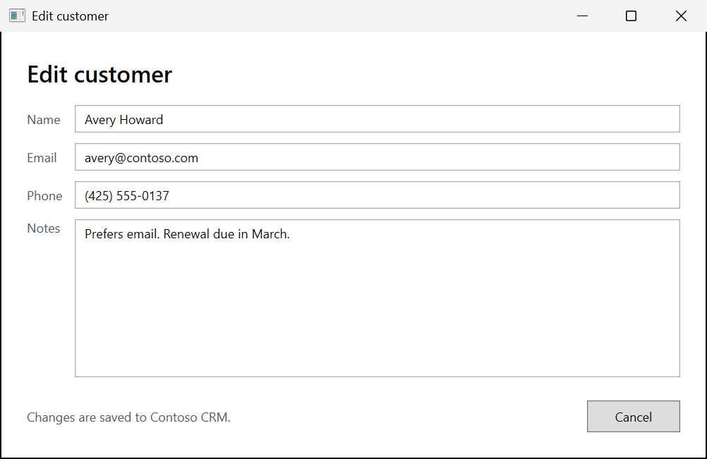

# Session transcript

Source: `Q:\source\XamlAgentDemos-notes\test-runs\VanishingSave\paused1\events.jsonl`

## Tool usage

- get_file: 7
- xaml_find_elements: 6
- xaml_get_element_properties: 5
- xaml_list_apps: 4
- powershell: 3
- xaml_get_binding_failures: 3
- xaml_explain_property_value: 3
- skill: 2
- rg: 2
- replace_string_in_file: 2
- xaml_capture_image: 2
- task: 2
- debugger_continue: 2
- xaml_get_element_bounds: 2
- get_projects_in_solution: 1
- glob: 1
- xaml_get_diagnostics_status: 1
- multi_replace_string_in_file: 1
- xaml_apply_hot_reload: 1
- xaml_get_hot_reload_log: 1
- xaml_clear_binding_failures: 1
- xaml_get_visual_tree: 1
- xaml_get_hot_reload_status: 1
- debugger_pause: 1
- debugger_evaluate_expressions: 1
- xaml_set_element_property: 1
- task_complete: 1

Failed tool calls: 3, images: 2


_Model: gpt-6-luna_


## User (17:29:39)

There should be a Save button in the footer of my running app, but I can't see it. Find out every reason it's not visible and fix them.


**Tool call (17:29:43):** `skill`
```json
{
 "skill": "xaml-diagnostics"
}
```

<details><summary>Result `skill` success=true</summary>

```
Skill "xaml-diagnostics" loaded successfully. Follow the instructions in the skill context.
```
</details>


_Skill invoked: xaml-diagnostics_


**Assistant (17:29:46):**

I’ll inspect the live footer, its layout and bindings, then fix each confirmed blocker in source and verify the running UI.


**Tool call (17:29:46):** `xaml_list_apps`
```json
{
 "progressMessage": "Inspecting connected XAML apps"
}
```


**Tool call (17:29:46):** `get_projects_in_solution`
```json
{}
```

<details><summary>Result `xaml_list_apps` success=true</summary>

```
{"isDebugging":true,"debuggerState":"paused","diagnosticsActive":true,"apps":[{"app":"a1","name":"VanishingSave.exe [42624]","processId":42624,"platform":"WPF (.NET)","isRemote":false,"isDesignTimeOrNoDebug":false,"sourceInfoAvailable":true,"hotReloadSupported":true,"hotReloadEnabled":true,"supportsPropertyExplorer":true,"supportsInAppToolbar":true,"windowCount":1}]}
```
</details>

<details><summary>Result `get_projects_in_solution` success=true</summary>

```
src\GhostClicks\GhostClicks.csproj
src\GermanReady\GermanReady.csproj
src\ThemeBreaker\ThemeBreaker.csproj
src\DesignPolish\DesignPolish.csproj
src\HotReloadDoctor\HotReloadDoctor.csproj
src\VanishingSave\VanishingSave.csproj
src\CrispPixels\CrispPixels.csproj
src\PrecedenceWars\PrecedenceWars.csproj
src\LostWindows\LostWindows.csproj
src\TemplateDetective\TemplateDetective.csproj
src\SlowScroll\SlowScroll.csproj
src\PixelPerfect\PixelPerfect.csproj
src\BindingStorm\BindingStorm.csproj
src\BugRepro\BugRepro.csproj
src\A11ySweep\A11ySweep.csproj
src\StyleMaze\StyleMaze.csproj
src\ResponsiveDashboard\ResponsiveDashboard.csproj

```
</details>


**Tool call (17:29:53):** `glob`
```json
{
 "pattern": "src\\VanishingSave\\**"
}
```


**Tool call (17:29:53):** `rg`
```json
{
 "pattern": "Save|Footer|Visibility|Opacity|IsEnabled|Command",
 "paths": "src\\VanishingSave",
 "output_mode": "content",
 "-n": true,
 "head_limit": 120
}
```


**Tool call (17:29:53):** `xaml_get_diagnostics_status`
```json
{
 "progressMessage": "Checking why live inspection is paused"
}
```

<details><summary>Result `xaml_get_diagnostics_status` success=true</summary>

```
{"isDebugging":true,"debuggerState":"paused","diagnosticsActive":true,"connectedApps":1,"options":{"hotReloadEnabled":true,"hotReloadOnSave":false,"applyMode":"asYouType: XAML edits apply as you type, without saving (default)","wpfEnabled":true,"uwpEnabled":true,"winUIEnabled":true,"mauiEnabled":true,"justMyXaml":true,"previewSelectedElement":false,"inAppToolbar":true,"inAppSelection":false,"layoutAdorners":false,"trackFocusedElement":false,"bindingFailuresVisible":true,"compatibilityMode":false},"issues":[{"issue":"Debugger is paused","evidence":"Visual Studio is in break mode, so the app's UI thread and the XAML Diagnostics connection are frozen.","fix":"Continue the debugger (debugger_continue or F5). Live tree, properties, interaction, capture and hot reload need the app running."}],"summary":"1 issue(s) found."}
```
</details>

<details><summary>Result `glob` success=true</summary>

```
[glob: 67 path(s) under ./src/VanishingSave; grouped by directory]

./src/VanishingSave/obj/ (54 path(s))
  Debug/net10.0-windows/.NETCoreApp,Version=v10.0.AssemblyAttributes.cs
  Debug/net10.0-windows/App.g.cs
  Debug/net10.0-windows/App.g.i.cs
  Debug/net10.0-windows/GeneratedInternalTypeHelper.g.cs
  Debug/net10.0-windows/GeneratedInternalTypeHelper.g.i.cs
  Debug/net10.0-windows/MainWindow.baml
  Debug/net10.0-windows/MainWindow.g.cs
  Debug/net10.0-windows/MainWindow.g.i.cs
  Debug/net10.0-windows/Vanishin.559ADE70.Up2Date
  Debug/net10.0-windows/VanishingSave.AssemblyInfo.cs
  Debug/net10.0-windows/VanishingSave.AssemblyInfoInputs.cache
  Debug/net10.0-windows/VanishingSave.GeneratedMSBuildEditorConfig.editorconfig
  Debug/net10.0-windows/VanishingSave.GlobalUsings.g.cs
  Debug/net10.0-windows/VanishingSave.assets.cache
  Debug/net10.0-windows/VanishingSave.csproj.BuildWithSkipAnalyzers
  Debug/net10.0-windows/VanishingSave.csproj.CoreCompileInputs.cache
  Debug/net10.0-windows/VanishingSave.csproj.FileListAbsolute.txt
  Debug/net10.0-windows/VanishingSave.designer.deps.json
  Debug/net10.0-windows/VanishingSave.designer.runtimeconfig.json
  Debug/net10.0-windows/VanishingSave.dll
  Debug/net10.0-windows/VanishingSave.g.resources
  Debug/net10.0-windows/VanishingSave.genruntimeconfig.cache
  Debug/net10.0-windows/VanishingSave.pdb
  Debug/net10.0-windows/VanishingSave.sourcelink.json
  Debug/net10.0-windows/VanishingSave_5cgzny33_wpftmp.AssemblyInfo.cs
  Debug/net10.0-windows/VanishingSave_5cgzny33_wpftmp.AssemblyInfoInputs.cache
  Debug/net10.0-windows/VanishingSave_5cgzny33_wpftmp.GeneratedMSBuildEditorConfig.editorconfig
  Debug/net10.0-windows/VanishingSave_5cgzny33_wpftmp.GlobalUsings.g.cs
  Debug/net10.0-windows/VanishingSave_5cgzny33_wpftmp.assets.cache
  Debug/net10.0-windows/VanishingSave_5cgzny33_wpftmp.csproj.BuildWithSkipAnalyzers
  Debug/net10.0-windows/VanishingSave_5cgzny33_wpftmp.sourcelink.json
  Debug/net10.0-windows/VanishingSave_MarkupCompile.cache
  Debug/net10.0-windows/VanishingSave_MarkupCompile.i.cache
  Debug/net10.0-windows/VanishingSave_MarkupCompile.lref
  Debug/net10.0-windows/VanishingSave_nkeecyvr_wpftmp.AssemblyInfo.cs
  Debug/net10.0-windows/VanishingSave_nkeecyvr_wpftmp.AssemblyInfoInputs.cache
  Debug/net10.0-windows/VanishingSave_nkeecyvr_wpftmp.GeneratedMSBuildEditorConfig.editorconfig
  Debug/net10.0-windows/VanishingSave_nkeecyvr_wpftmp.GlobalUsings.g.cs
  Debug/net10.0-windows/VanishingSave_nkeecyvr_wpftmp.ass
... [truncated 1445 chars]
```
</details>

<details><summary>Result `rg` success=true</summary>

```
[grep content: 32 matches across 7 file(s) under src/VanishingSave; delimited groups]

App.xaml.cs:3: namespace VanishingSave;

CustomerViewModel.cs (7 match(es)):
  1: namespace VanishingSave;
  13:         this.SaveCommand = new RelayCommand(this.Save, () => this.IsDirty);
  14:         this.CancelCommand = new RelayCommand(() => this.IsDirty = false);
  28:     public bool IsSaveAvailable => true;
  30:     public RelayCommand SaveCommand { get; }
  32:     public RelayCommand CancelCommand { get; }
  34:     private void Save() => this.IsDirty = false;

FooterSettings.cs (4 match(es)):
  1: namespace VanishingSave;
  3: public static class FooterSettings
  6:     /// Compact footer for small screens: auto-save makes the Save column unnecessary.
  9:     public static bool UseCompactFooter { get; set; } = true;

VanishingSave.csproj:3:     <RootNamespace>VanishingSave</RootNamespace>

App.xaml:1: <Application x:Class="VanishingSave.App"

MainWindow.xaml (15 match(es)):
  1: <Window x:Class="VanishingSave.MainWindow"
  4:         xmlns:local="clr-namespace:VanishingSave"
  14:         <BooleanToVisibilityConverter x:Key="BoolToVisibility" />
  27:         <Style x:Key="FooterButtonStyle" TargetType="Button">
  33:                 <Trigger Property="IsEnabled" Value="False">
  34:                     <Setter Property="Opacity" Value="0" />
  101:         <Grid x:Name="Footer" Grid.Row="2" Margin="0,12,0,0">
  105:                 <ColumnDefinition x:Name="SaveColumn" Width="Auto" />
  114:                     Command="{Binding CancelCommand}"
  116:                     Style="{StaticResource FooterButtonStyle}" />
  118:             <Button x:Name="SaveButton"
  120:                     Command="{Binding SaveCommand}"
  121:                     Content="Save"
  123:                     Style="{StaticResource FooterButtonStyle}"
  124:                     Visibility="{Binding CanSave, Converter={StaticResource BoolToVisibility}, FallbackValue=Collapsed}" />

MainWindow.xaml.cs (3 match(es)):
  3: namespace VanishingSave;
  15:         if (FooterSettings.UseCompactFooter)
  17:             this.SaveColumn.Width = new GridLength(0);
```
</details>


**Tool call (17:29:58):** `get_file`
```json
{
 "filename": "src\\VanishingSave\\MainWindow.xaml",
 "startLine": 1,
 "endLine": 180,
 "includeLineNumbers": true
}
```


**Tool call (17:29:58):** `get_file`
```json
{
 "filename": "src\\VanishingSave\\MainWindow.xaml.cs",
 "startLine": 1,
 "endLine": 100,
 "includeLineNumbers": true
}
```


**Tool call (17:29:58):** `get_file`
```json
{
 "filename": "src\\VanishingSave\\CustomerViewModel.cs",
 "startLine": 1,
 "endLine": 120,
 "includeLineNumbers": true
}
```


**Tool call (17:29:58):** `get_file`
```json
{
 "filename": "src\\VanishingSave\\FooterSettings.cs",
 "startLine": 1,
 "endLine": 100,
 "includeLineNumbers": true
}
```


**Tool call (17:29:58):** `get_file`
```json
{
 "filename": "src\\VanishingSave\\App.xaml",
 "startLine": 1,
 "endLine": 140,
 "includeLineNumbers": true
}
```

<details><summary>Result `get_file` success=true</summary>

```
```csharp src\VanishingSave\CustomerViewModel.cs (Lines 1-35 of 35 total. Call tools for more if needed.)
1: namespace VanishingSave;
2: 
3: public sealed class CustomerViewModel : ObservableObject
4: {
5:     private string name = "Avery Howard";
6:     private string email = "avery@contoso.com";
7:     private string phone = "(425) 555-0137";
8:     private string notes = "Prefers email. Renewal due in March.";
9:     private bool isDirty;
10: 
11:     public CustomerViewModel()
12:     {
13:         this.SaveCommand = new RelayCommand(this.Save, () => this.IsDirty);
14:         this.CancelCommand = new RelayCommand(() => this.IsDirty = false);
15:     }
16: 
17:     public string Name { get => this.name; set { if (this.SetProperty(ref this.name, value)) this.IsDirty = true; } }
18: 
19:     public string Email { get => this.email; set { if (this.SetProperty(ref this.email, value)) this.IsDirty = true; } }
20: 
21:     public string Phone { get => this.phone; set { if (this.SetProperty(ref this.phone, value)) this.IsDirty = true; } }
22: 
23:     public string Notes { get => this.notes; set { if (this.SetProperty(ref this.notes, value)) this.IsDirty = true; } }
24: 
25:     public bool IsDirty { get => this.isDirty; set => this.SetProperty(ref this.isDirty, value); }
26: 
27:     /// <summary>Whether the current user is allowed to save customer records.</summary>
28:     public bool IsSaveAvailable => true;
29: 
30:     public RelayCommand SaveCommand { get; }
31: 
32:     public RelayCommand CancelCommand { get; }
33: 
34:     private void Save() => this.IsDirty = false;
35: }

```


```
</details>

<details><summary>Result `get_file` success=true</summary>

```
```csharp src\VanishingSave\FooterSettings.cs (Lines 1-10 of 10 total. Call tools for more if needed.)
1: namespace VanishingSave;
2: 
3: public static class FooterSettings
4: {
5:     /// <summary>
6:     /// Compact footer for small screens: auto-save makes the Save column unnecessary.
7:     /// (Auto-save was cut from v2, but this switch stayed on.)
8:     /// </summary>
9:     public static bool UseCompactFooter { get; set; } = true;
10: }

```


```
</details>

<details><summary>Result `get_file` success=true</summary>

```
```xaml src\VanishingSave\MainWindow.xaml (Lines 1-138 of 138 total. Call tools for more if needed.)
1: <Window x:Class="VanishingSave.MainWindow"
2:         xmlns="http://schemas.microsoft.com/winfx/2006/xaml/presentation"
3:         xmlns:x="http://schemas.microsoft.com/winfx/2006/xaml"
4:         xmlns:local="clr-namespace:VanishingSave"
5:         Title="Edit customer"
6:         Width="680"
7:         Height="440"
8:         Background="White">
9:     <Window.DataContext>
10:         <local:CustomerViewModel />
11:     </Window.DataContext>
12: 
13:     <Window.Resources>
14:         <BooleanToVisibilityConverter x:Key="BoolToVisibility" />
15: 
16:         <Style x:Key="FieldLabelStyle" TargetType="TextBlock">
17:             <Setter Property="Margin" Value="0,0,12,10" />
18:             <Setter Property="VerticalAlignment" Value="Center" />
19:             <Setter Property="Foreground" Value="#555B66" />
20:         </Style>
21: 
22:         <Style x:Key="FieldStyle" TargetType="TextBox">
23:             <Setter Property="Margin" Value="0,0,0,10" />
24:             <Setter Property="Padding" Value="6,4" />
25:         </Style>
26: 
27:         <Style x:Key="FooterButtonStyle" TargetType="Button">
28:             <Setter Property="MinWidth" Value="88" />
29:             <Setter Property="Margin" Value="8,0,0,0" />
30:             <Setter Property="Padding" Value="16,6" />
31:             <Style.Triggers>
32:                 <!-- Fade out buttons that can't be used yet. -->
33:                 <Trigger Property="IsEnabled" Value="False">
34:                     <Setter Property="Opacity" Value="0" />
35:                 </Trigger>
36:             </Style.Triggers>
37:         </Style>
38:     </Window.Resources>
39: 
40:     <Grid Margin="24">
41:         <Grid.RowDefinitions>
42:             <RowDefinition Height="Auto" />
43:             <RowDefinition Height="*" />
44:             <RowDefinition Height="Auto" />
45:         </Grid.RowDefinitions>
46: 
47:         <TextBlock Margin="0,0,0,16"
48:                    FontSize="22"
49:                    FontWeight="SemiBold"
50:                    Text="Edit customer" />
51: 
52:         <Grid Grid.Row="1">
53:             <Grid.ColumnDefinitions>
54:                 <ColumnDefinition Width="Auto" />
55:                 <ColumnDefinition Width="*" />
56:             </Grid.ColumnDefinitions>
57:             <Grid.RowDefinitions>
58:            
... [truncated 3995 chars]
```
</details>

<details><summary>Result `get_file` success=true</summary>

```
```csharp src\VanishingSave\MainWindow.xaml.cs (Lines 1-20 of 20 total. Call tools for more if needed.)
1: using System.Windows;
2: 
3: namespace VanishingSave;
4: 
5: public partial class MainWindow : Window
6: {
7:     public MainWindow()
8:     {
9:         this.InitializeComponent();
10:         this.Loaded += this.OnLoaded;
11:     }
12: 
13:     private void OnLoaded(object sender, RoutedEventArgs e)
14:     {
15:         if (FooterSettings.UseCompactFooter)
16:         {
17:             this.SaveColumn.Width = new GridLength(0);
18:         }
19:     }
20: }

```


```
</details>

<details><summary>Result `get_file` success=true</summary>

```
```xaml src\VanishingSave\App.xaml (Lines 1-4 of 4 total. Call tools for more if needed.)
1: <Application x:Class="VanishingSave.App"
2:              xmlns="http://schemas.microsoft.com/winfx/2006/xaml/presentation"
3:              xmlns:x="http://schemas.microsoft.com/winfx/2006/xaml"
4:              StartupUri="MainWindow.xaml" />

```


```
</details>


**Tool call (17:30:14):** `rg`
```json
{
 "pattern": "class RelayCommand|class ObservableObject|SyncStatusHost|UseCompactFooter|IsSaveAvailable|CanSave",
 "paths": "src",
 "output_mode": "content",
 "-n": true,
 "head_limit": 120
}
```


**Tool call (17:30:14):** `powershell`
```json
{
 "command": "git status --short; Get-Content src\\VanishingSave\\VanishingSave.csproj",
 "description": "Check working tree and app project details"
}
```

<details><summary>Result `rg` success=true</summary>

```
src\VanishingSave\MainWindow.xaml.cs:15:        if (FooterSettings.UseCompactFooter)
src\VanishingSave\MainWindow.xaml:124:                    Visibility="{Binding CanSave, Converter={StaticResource BoolToVisibility}, FallbackValue=Collapsed}" />
src\VanishingSave\MainWindow.xaml:127:            <Border x:Name="SyncStatusHost"
src\VanishingSave\FooterSettings.cs:9:    public static bool UseCompactFooter { get; set; } = true;
src\VanishingSave\CustomerViewModel.cs:28:    public bool IsSaveAvailable => true;
src\Shared\RelayCommand.cs:5:public sealed class RelayCommand(Action execute, Func<bool>? canExecute = null) : ICommand
src\Shared\ObservableObject.cs:6:public abstract class ObservableObject : INotifyPropertyChanged
```
</details>

<details><summary>Result `powershell` success=true</summary>

```
<Project Sdk="Microsoft.NET.Sdk">
  <PropertyGroup>
    <RootNamespace>VanishingSave</RootNamespace>
  </PropertyGroup>
</Project>
<shellId: 0 completed with exit code 0>
```
</details>


**Assistant (17:30:53):**

I found four independent blockers: the wrong visibility binding, a zero-width Save column, an always-on opaque status overlay, and a style that makes disabled buttons fully transparent. I’ll correct each while retaining the disabled-until-dirty behavior.


**Tool call (17:30:53):** `multi_replace_string_in_file`
```json
{
 "explanation": "Correct all confirmed reasons the Save button is hidden, preserving its command and offline-status behavior.",
 "replacements": [
  {
   "filePath": "src\\VanishingSave\\MainWindow.xaml",
   "oldString": "        <Style x:Key=\"FooterButtonStyle\" TargetType=\"Button\">\n            <Setter Property=\"MinWidth\" Value=\"88\" />\n            <Setter Property=\"Margin\" Value=\"8,0,0,0\" />\n            <Setter Property=\"Padding\" Value=\"16,6\" />\n            <Style.Triggers>\n                <!-- Fade out buttons that can't be used yet. -->\n                <Trigger Property=\"IsEnabled\" Value=\"False\">\n                    <Setter Property=\"Opacity\" Value=\"0\" />\n                </Trigger>\n            </Style.Triggers>\n        </Style>",
   "newString": "        <Style x:Key=\"FooterButtonStyle\" TargetType=\"Button\">\n            <Setter Property=\"MinWidth\" Value=\"88\" />\n            <Setter Property=\"Margin\" Value=\"8,0,0,0\" />\n            <Setter Property=\"Padding\" Value=\"16,6\" />\n        </Style>"
  },
  {
   "filePath": "src\\VanishingSave\\MainWindow.xaml",
   "oldString": "            <Button x:Name=\"SaveButton\"\n                    Grid.Column=\"2\"\n                    Command=\"{Binding SaveCommand}\"\n                    Content=\"Save\"\n                    IsDefault=\"True\"\n                    Style=\"{StaticResource FooterButtonStyle}\"\n                    Visibility=\"{Binding CanSave, Converter={StaticResource B
... [truncated 2874 chars]
```

<details><summary>Result `multi_replace_string_in_file` success=true</summary>

```
Successfully applied 4 of 4 replacement(s) across 3 file(s).
```
</details>


**Tool call (17:31:00):** `get_file`
```json
{
 "filename": "src\\VanishingSave\\MainWindow.xaml",
 "startLine": 110,
 "endLine": 150,
 "includeLineNumbers": true
}
```

<details><summary>Result `get_file` success=true</summary>

```
```xaml src\VanishingSave\MainWindow.xaml (Lines 110-144 of 144 total. Call tools for more if needed.)
110:                     Style="{StaticResource FooterButtonStyle}" />
111: 
112:             <Button x:Name="SaveButton"
113:                     Grid.Column="2"
114:                     Command="{Binding SaveCommand}"
115:                     Content="Save"
116:                     IsDefault="True"
117:                     Style="{StaticResource FooterButtonStyle}"
118:                     Visibility="{Binding IsSaveAvailable, Converter={StaticResource BoolToVisibility}, FallbackValue=Collapsed}" />
119: 
120:             <!-- Shows "Offline - changes will sync later" when the connection drops. -->
121:             <Border x:Name="SyncStatusHost"
122:                     Grid.Column="2"
123:                     Panel.ZIndex="1"
124:                     Background="White"
125:                     Visibility="Collapsed">
126:                 <Border.Style>
127:                     <Style TargetType="Border">
128:                         <Setter Property="Visibility" Value="Collapsed" />
129:                         <Style.Triggers>
130:                             <DataTrigger Binding="{Binding Text, ElementName=SyncStatusText}"
131:                                          Value="Offline - changes will sync later">
132:                                 <Setter Property="Visibility" Value="Visible" />
133:                             </DataTrigger>
134:                         </Style.Triggers>
135:                     </Style>
136:                 </Border.Style>
137:                 <TextBlock x:Name="SyncStatusText"
138:                            VerticalAlignment="Center"
139:                            Foreground="#B54708"
140:                            Text="" />
141:             </Border>
142:         </Grid>
143:     </Grid>
144: </Window>

```


```
</details>


**Tool call (17:31:03):** `replace_string_in_file`
```json
{
 "filePath": "src\\VanishingSave\\MainWindow.xaml",
 "oldString": "            <Border x:Name=\"SyncStatusHost\"\n                    Grid.Column=\"2\"\n                    Panel.ZIndex=\"1\"\n                    Background=\"White\"\n                    Visibility=\"Collapsed\">\n                <Border.Style>",
 "newString": "            <Border x:Name=\"SyncStatusHost\"\n                    Grid.Column=\"2\"\n                    Panel.ZIndex=\"1\"\n                    Background=\"White\">\n                <Border.Style>"
}
```

<details><summary>Result `replace_string_in_file` success=true</summary>

```
Successfully replaced text in src\VanishingSave\MainWindow.xaml
```
</details>


**Tool call (17:31:10):** `xaml_apply_hot_reload`
```json
{
 "progressMessage": "Applying Save footer fixes",
 "includeCodeChanges": true
}
```


**Tool call (17:31:10):** `powershell`
```json
{
 "command": "git --no-pager diff --check; git --no-pager diff -- src\\VanishingSave\\MainWindow.xaml src\\VanishingSave\\MainWindow.xaml.cs src\\VanishingSave\\FooterSettings.cs",
 "description": "Review and whitespace-check the footer changes"
}
```

<details><summary>Result `powershell` success=true</summary>

```
diff --git a/src/VanishingSave/FooterSettings.cs b/src/VanishingSave/FooterSettings.cs
index 27522f0..535f74f 100644
--- a/src/VanishingSave/FooterSettings.cs
+++ b/src/VanishingSave/FooterSettings.cs
@@ -6,5 +6,5 @@ public static class FooterSettings
     /// Compact footer for small screens: auto-save makes the Save column unnecessary.
     /// (Auto-save was cut from v2, but this switch stayed on.)
     /// </summary>
-    public static bool UseCompactFooter { get; set; } = true;
+    public static bool UseCompactFooter { get; set; } = false;
 }
diff --git a/src/VanishingSave/MainWindow.xaml b/src/VanishingSave/MainWindow.xaml
index bb8122a..656ee32 100644
--- a/src/VanishingSave/MainWindow.xaml
+++ b/src/VanishingSave/MainWindow.xaml
@@ -28,12 +28,6 @@
             <Setter Property="MinWidth" Value="88" />
             <Setter Property="Margin" Value="8,0,0,0" />
             <Setter Property="Padding" Value="16,6" />
-            <Style.Triggers>
-                <!-- Fade out buttons that can't be used yet. -->
-                <Trigger Property="IsEnabled" Value="False">
-                    <Setter Property="Opacity" Value="0" />
-                </Trigger>
-            </Style.Triggers>
         </Style>
     </Window.Resources>
 
@@ -121,13 +115,24 @@
                     Content="Save"
                     IsDefault="True"
                     Style="{StaticResource FooterButtonStyle}"
-                    Visibility="{Binding CanSave, Converter={StaticResource BoolToVisibility}, FallbackValue=Collapsed}" />
+                    Visibility="{Binding IsSaveAvailable, Converter={StaticResource BoolToVisibility}, FallbackValue=Collapsed}" />
 
             <!-- Shows "Offline - changes will sync later" when the connection drops. -->
             <Border x:Name="SyncStatusHost"
                     Grid.Column="2"
                     Panel.ZIndex="1"
                     Background="White">
+                <Border.Style>
+                    <Style TargetType="Border">
+                        <Setter Property="Visibility" Value="Collapsed" />
+                        <Style.Triggers>
+                            <DataTrigger Binding="{Binding Text, ElementName=SyncStatusText}"
+                                         Value="Offline - changes will sync later">
+                                <Setter Property="Visibility" Value="Visible" />
+                            </DataTrigger>
+                        </Style.Triggers>
+                   
... [truncated 836 chars]
```
</details>

<details><summary>Result `xaml_apply_hot_reload` success=true</summary>

```
{"applied":true,"status":"applied","errors":[],"log":[],"codeChanges":".NET Hot Reload was started for saved code changes. Its results are in the Hot Reload output pane, not in 'log'; if an edit can't be hot reloaded, Visual Studio asks the user to rebuild and restart.","codeHotReloadOutput":["12:31:11.10  ⚠ Q:\\source\\XamlAgentDemos\\src\\VanishingSave\\FooterSettings.cs (line 9): warning ENC0118: Changing 'auto-property' might not have any effect until the application is restarted.","12:31:11.25  Code changes were successfully applied."],"hint":"Call xaml_capture_image to verify the change visually. Views that aren't loaded (other tabs, closed dialogs) are updated when they're next shown. Source line numbers reported for existing elements can still point to the pre-edit lines until the element is recreated, so find elements by x:Name or type rather than by an old line number. Structural edits (wrapping or replacing a parent, changing a root's content) recreate elements, which resets their runtime state such as selection, checked state, typed text and scroll position, and invalidates their IDs. Re-establish the state you were testing before capturing again."}
```
</details>


**Tool call (17:31:29):** `xaml_list_apps`
```json
{
 "progressMessage": "Checking live app state after reload"
}
```


**Tool call (17:31:29):** `xaml_get_binding_failures`
```json
{
 "progressMessage": "Checking binding diagnostics"
}
```


**Tool call (17:31:29):** `xaml_find_elements`
```json
{
 "progressMessage": "Locating footer controls",
 "name": "SaveButton",
 "maxResults": 10
}
```

<details><summary>Result `xaml_list_apps` success=true</summary>

```
{"isDebugging":true,"debuggerState":"paused","diagnosticsActive":true,"apps":[{"app":"a1","name":"VanishingSave.exe [42624]","processId":42624,"platform":"WPF (.NET)","isRemote":false,"isDesignTimeOrNoDebug":false,"sourceInfoAvailable":true,"hotReloadSupported":true,"hotReloadEnabled":true,"supportsPropertyExplorer":true,"supportsInAppToolbar":true,"windowCount":1}]}
```
</details>

<details><summary>Result `xaml_get_binding_failures` success=true</summary>

```
{"note":"This is a cumulative log since debugging started or the last xaml_clear_binding_failures, not live state: fixed failures stay listed. To verify a fix: clear, revisit the UI that uses the binding, then read again. Failures without a file usually come from bindings created in code.","totalUnique":1,"matched":1,"truncated":false,"failures":[{"severity":"Warning","count":1,"errorCode":"40","description":"CanSave property not found on object of type CustomerViewModel.","bindingPath":"CanSave","target":"Button.Visibility, Name='SaveButton'","targetName":"SaveButton","targetPropertyType":"Visibility","dataContextType":"CustomerViewModel","file":"Q:\\source\\XamlAgentDemos\\src\\VanishingSave\\MainWindow.xaml","line":118,"column":14,"project":"VanishingSave","originalError":"System.Windows.Data Warning: 40 : BindingExpression path error: 'CanSave' property not found on 'object' ''CustomerViewModel' (HashCode=43066490)'. BindingExpression:Path=CanSave; DataItem='CustomerViewModel' (HashCode=43066490); target element is 'Button' (Name='SaveButton'); target property is 'Visibility' (type 'Visibility')"}]}
```
</details>

<details><summary>Result `xaml_find_elements` success=true</summary>

```
{"count":1,"totalMatches":1,"truncated":false,"results":[{"id":"a1:10","type":"System.Windows.Controls.Button","name":"SaveButton","source":{"file":"Q:\\source\\XamlAgentDemos\\src\\VanishingSave\\MainWindow.xaml","line":118,"column":14},"path":"MainWindow/Border/AdornerDecorator/ContentPresenter/Grid/Grid/Button"}]}
```
</details>


**Tool call (17:31:32):** `xaml_get_element_properties`
```json
{
 "progressMessage": "Inspecting Save button state",
 "elementId": "a1:10",
 "includeAll": true
}
```


**Tool call (17:31:32):** `xaml_capture_image`
```json
{
 "progressMessage": "Capturing footer appearance",
 "app": "a1",
 "maxSize": 1280
}
```


**Tool call (17:31:32):** `xaml_find_elements`
```json
{
 "progressMessage": "Locating footer grid and save column",
 "app": "a1",
 "name": "SaveColumn",
 "maxResults": 10
}
```

<details><summary>Result `xaml_get_element_properties` success=false</summary>

```
{
 "message": "{\"error\":\"DEBUGGER_PAUSED\",\"message\":\"The debugger is paused (break mode: a breakpoint, an exception, a step, or debugger_pause), so the app can't answer XAML Diagnostics requests.\",\"hint\":\"xaml_* tools that talk to the app need it running. Continue the debugger (debugger_continue, or ask the user to press F5/Continue), then retry. If you set breakpoints, remove them so the app doesn't break again. Prefer verifying UI and view-model state with xaml_* tools (xaml_get_element_properties shows bound values, xaml_interact runs commands) instead of pausing to evaluate expressions.\"}",
 "code": "failure"
}
```
</details>

<details><summary>Result `xaml_find_elements` success=true</summary>

```
{"count":0,"totalMatches":0,"truncated":false,"results":[]}
```
</details>




<details><summary>Result `xaml_capture_image` success=true</summary>

```
Screenshot of window 0x3208A4 "Edit customer" of app a1 (1002x651 image of the window's client area, so it's slightly smaller than the frame bounds from xaml_list_windows). Warning: the debugger is paused, so the window shows its last painted state and may be stale or unpainted. Continue the debugger before capturing.
```
</details>


**Assistant (17:43:31):**

The live capture confirms the footer has only Cancel. Hot Reload updated source, but this app is paused; I’m resuming it to re-check the live layout and apply the remaining runtime state change.


**Tool call (17:43:31):** `task`
```json
{
 "description": "Resume paused app",
 "prompt": "Resume the currently paused Visual Studio debug session for VanishingSave (press Continue/F5 or use the debugger continuation control). Do not inspect source, make code changes, or interact with the app controls. Report whether the debugger is running afterward, and any blocker if it cannot be resumed.",
 "agent_type": "debugger",
 "name": "resume-debugger",
 "mode": "sync"
}
```


## User (17:43:32)

Resume the currently paused Visual Studio debug session for VanishingSave (press Continue/F5 or use the debugger continuation control). Do not inspect source, make code changes, or interact with the app controls. Report whether the debugger is running afterward, and any blocker if it cannot be resumed.


**Tool call (17:43:39):** `debugger_continue`
```json
{
 "temporaryBreakpoints": [],
 "waitConfiguration": {
  "WaitMode": "NoWaiting",
  "WaitReason": "None"
 }
}
```

<details><summary>Result `debugger_continue` success=true</summary>

```
<Error> The debugger is currently not in break state.


```
</details>


**Assistant (17:43:41):**

VanishingSave.exe is already running under the debugger (PID 42624). The continuation control couldn’t be applied because the debugger is not in break state; there was no paused session to resume.

<details><summary>Result `task` success=true</summary>

```
VanishingSave.exe is already running under the debugger (PID 42624). The continuation control couldn’t be applied because the debugger is not in break state; there was no paused session to resume.
```
</details>


**Tool call (17:43:45):** `xaml_list_apps`
```json
{
 "progressMessage": "Rechecking debugger state"
}
```


**Tool call (17:43:45):** `xaml_get_hot_reload_log`
```json
{
 "progressMessage": "Checking hot reload result",
 "errorsOnly": true
}
```


**Tool call (17:43:45):** `xaml_find_elements`
```json
{
 "progressMessage": "Finding Save column by name",
 "app": "a1",
 "name": "SaveColumn",
 "maxResults": 10
}
```

<details><summary>Result `xaml_find_elements` success=true</summary>

```
{"count":0,"totalMatches":0,"truncated":false,"results":[]}
```
</details>

<details><summary>Result `xaml_get_hot_reload_log` success=true</summary>

```
{"total":0,"entries":[],"dotNetHotReloadPane":["12:29:10.07 [XAML] Connected to VanishingSave.exe [42624] for WpfCore diagnostics. Incremental Hot Reload is enabled.","12:31:10.90 🔣  ⚠ [Q:\\source\\XamlAgentDemos\\src\\VanishingSave\\VanishingSave.csproj ({4EB184D2-643F-45DC-A2E0-9645EA07CD15})]: Q:\\source\\XamlAgentDemos\\src\\VanishingSave\\FooterSettings.cs(9,5): warning ENC0118: Changing 'auto-property' might not have any effect until the application is restarted.","12:31:11.10  ⚠ Q:\\source\\XamlAgentDemos\\src\\VanishingSave\\FooterSettings.cs (line 9): warning ENC0118: Changing 'auto-property' might not have any effect until the application is restarted.","12:31:11.25  Code changes were successfully applied."],"hint":"No XAML Hot Reload messages were logged in this VS session yet."}
```
</details>

<details><summary>Result `xaml_list_apps` success=true</summary>

```
{"isDebugging":true,"debuggerState":"running","diagnosticsActive":true,"apps":[{"app":"a1","name":"VanishingSave.exe [42624]","processId":42624,"platform":"WPF (.NET)","isRemote":false,"isDesignTimeOrNoDebug":false,"sourceInfoAvailable":true,"hotReloadSupported":true,"hotReloadEnabled":true,"supportsPropertyExplorer":true,"supportsInAppToolbar":true,"windowCount":1}]}
```
</details>


**Tool call (17:43:51):** `xaml_clear_binding_failures`
```json
{
 "progressMessage": "Resetting binding log for verification"
}
```

<details><summary>Result `xaml_clear_binding_failures` success=true</summary>

```
{"cleared":1}
```
</details>


**Tool call (17:43:53):** `xaml_find_elements`
```json
{
 "progressMessage": "Finding Save button in live tree",
 "app": "a1",
 "name": "SaveButton",
 "maxResults": 10
}
```


**Tool call (17:43:53):** `xaml_find_elements`
```json
{
 "progressMessage": "Finding footer grid in live tree",
 "app": "a1",
 "name": "Footer",
 "maxResults": 10
}
```


**Tool call (17:43:53):** `xaml_capture_image`
```json
{
 "progressMessage": "Capturing updated footer",
 "app": "a1",
 "maxSize": 1280
}
```


**Tool call (17:43:53):** `xaml_get_binding_failures`
```json
{
 "progressMessage": "Checking fresh binding failures"
}
```

<details><summary>Result `xaml_find_elements` success=true</summary>

```
{"count":1,"totalMatches":1,"truncated":false,"results":[{"id":"a1:10","type":"System.Windows.Controls.Button","name":"SaveButton","source":{"file":"Q:\\source\\XamlAgentDemos\\src\\VanishingSave\\MainWindow.xaml","line":118,"column":14},"path":"MainWindow/Border/AdornerDecorator/ContentPresenter/Grid/Grid/Button"}]}
```
</details>

<details><summary>Result `xaml_find_elements` success=true</summary>

```
{"count":1,"totalMatches":1,"truncated":false,"results":[{"id":"a1:19","type":"System.Windows.Controls.Grid","name":"Footer","source":{"file":"Q:\\source\\XamlAgentDemos\\src\\VanishingSave\\MainWindow.xaml","line":101,"column":10},"path":"MainWindow/Border/AdornerDecorator/ContentPresenter/Grid/Grid"}]}
```
</details>

<details><summary>Result `xaml_get_binding_failures` success=true</summary>

```
{"note":"This is a cumulative log since debugging started or the last xaml_clear_binding_failures, not live state: fixed failures stay listed. To verify a fix: clear, revisit the UI that uses the binding, then read again. Failures without a file usually come from bindings created in code.","totalUnique":0,"matched":0,"truncated":false,"failures":[]}
```
</details>


<details><summary>Result `xaml_capture_image` success=true</summary>

```
Screenshot of window 0x3208A4 "Edit customer" of app a1 (1002x651 image of the window's client area, so it's slightly smaller than the frame bounds from xaml_list_windows).
```
</details>


**Tool call (17:43:57):** `xaml_get_element_properties`
```json
{
 "progressMessage": "Inspecting Save button live values",
 "elementId": "a1:10",
 "includeAll": true
}
```


**Tool call (17:43:57):** `xaml_get_visual_tree`
```json
{
 "progressMessage": "Inspecting footer child layout",
 "app": "a1",
 "rootElementId": "a1:19",
 "depth": 3,
 "maxNodes": 100
}
```


**Tool call (17:43:57):** `xaml_get_element_bounds`
```json
{
 "progressMessage": "Checking Save button bounds",
 "elementIds": [
  "a1:10"
 ]
}
```

<details><summary>Result `xaml_get_visual_tree` success=true</summary>

```
{"app":"a1","platform":"WPF (.NET)","sourceInfoAvailable":true,"nodeCount":8,"truncated":false,"depthLimitedNodes":2,"hint":"2 node(s) have children beyond the requested depth (childCount > 0, no children listed). Raise depth or pass rootElementId to expand them.","nodes":[{"id":"a1:19","type":"System.Windows.Controls.Grid","name":"Footer","source":{"file":"Q:\\source\\XamlAgentDemos\\src\\VanishingSave\\MainWindow.xaml","line":101,"column":10},"childCount":4,"children":[{"id":"a1:28","type":"System.Windows.Controls.TextBlock","source":{"file":"Q:\\source\\XamlAgentDemos\\src\\VanishingSave\\MainWindow.xaml","line":108,"column":14},"childCount":0},{"id":"a1:29","type":"System.Windows.Controls.Button","name":"CancelButton","source":{"file":"Q:\\source\\XamlAgentDemos\\src\\VanishingSave\\MainWindow.xaml","line":112,"column":14},"childCount":1,"children":[{"id":"a1:35","type":"System.Windows.Controls.Border","name":"border","childCount":1}]},{"id":"a1:10","type":"System.Windows.Controls.Button","name":"SaveButton","source":{"file":"Q:\\source\\XamlAgentDemos\\src\\VanishingSave\\MainWindow.xaml","line":118,"column":14},"childCount":1,"children":[{"id":"a1:111","type":"System.Windows.Controls.Border","name":"border","childCount":1}]},{"id":"a1:30","type":"System.Windows.Controls.Border","name":"SyncStatusHost","source":{"file":"Q:\\source\\XamlAgentDemos\\src\\VanishingSave\\MainWindow.xaml","line":127,"column":14},"childCount":1,"children":[{"id":"a1:36","type":"System.Windows.Controls.TextBlock","name":"SyncStatusText","source":{"file":"Q:\\source\\XamlAgentDemos\\src\\VanishingSave\\MainWindow.xaml","line":131,"column":18},"childCount":0}]}]}]}
```
</details>

<details><summary>Result `xaml_get_element_properties` success=true</summary>

```
Output too large to read at once (23.8 KB). Saved to: C:\Users\peterspa\AppData\Local\Microsoft\VisualStudio\CopilotCli\856b19e0-19c5-4e1d-8833-8a2122b143e7\temp\1794678237649-copilot-tool-output-a5887adb4b584930b7fe748da5726149.txt
Consider using tools like rg (for searching), head/tail (for viewing start/end), view with view_range (for specific sections), or jq (for JSON) to examine portions of the output.

Preview (first 500 chars):
{"id":"a1:10","type":"System.Windows.Controls.Button","name":"SaveButton","source":{"file":"Q:\\source\\XamlAgentDemos\\src\\VanishingSave\\MainWindow.xaml","line":118,"column":14},"properties":[{"name":"IsEnabled","value":"False","valueType":"System.Boolean","propertyType":"System.Boolean","declaringType":"System.Windows.UIElement","valueSource":"Coercion"},{"name":"IsDefault","value":"True","valueType":"System.Boolean","propertyType":"System.Boolean","declaringType":"System.Windows.Controls.Bu
```
</details>

<details><summary>Result `xaml_get_element_bounds` success=true</summary>

```
{"note":"'screen' is in physical screen pixels. 'window' is in device-independent units relative to the element's root window (multiply by dpiScale for pixels). Fractional screen pixel values (for example x=18.75) mean edges fall between device pixels, so thin lines and text render blurry unless layout rounding snaps them. isVisible only reflects Visibility/opacity; insideWindowFraction < 1 (clippedByWindow) means part of the element is outside the window's client area, so the user can't see that part. Ancestor clipping (ScrollViewer, Grid cell, ClipToBounds) isn't included; compare with the parent's bounds or call xaml_capture_image.","bounds":[{"id":"a1:10","isVisible":true,"insideWindowFraction":0.18,"clippedByWindow":true,"windowHandle":"0x3208A4","dpiScale":1.5,"screen":{"x":1175.0,"y":758.0,"width":132.0,"height":45.0},"window":{"x":649.33,"y":348.71,"width":88.0,"height":29.96}}]}
```
</details>


**Tool call (17:44:18):** `xaml_find_elements`
```json
{
 "progressMessage": "Finding the collapsed save column",
 "app": "a1",
 "type": "ColumnDefinition",
 "maxResults": 20
}
```


**Tool call (17:44:18):** `xaml_get_element_properties`
```json
{
 "progressMessage": "Inspecting footer grid sizing",
 "elementId": "a1:19",
 "nameFilter": "Column|Width",
 "includeAll": true
}
```


**Tool call (17:44:18):** `xaml_get_element_properties`
```json
{
 "progressMessage": "Checking status overlay visibility",
 "elementId": "a1:30",
 "nameFilter": "Visibility|Background",
 "includeAll": true
}
```


**Tool call (17:44:18):** `xaml_get_element_properties`
```json
{
 "progressMessage": "Checking Save button visibility and opacity",
 "elementId": "a1:10",
 "nameFilter": "Visibility|Opacity|IsEnabled|Command",
 "includeAll": true
}
```

<details><summary>Result `xaml_find_elements` success=true</summary>

```
{"count":0,"totalMatches":0,"truncated":false,"results":[],"hint":"'type' matches part of the element's own class name, not its base classes (a ListBox isn't a ListView). Check the actual types with xaml_get_visual_tree, or search by 'name'."}
```
</details>

<details><summary>Result `xaml_get_element_properties` success=true</summary>

```
{"id":"a1:19","type":"System.Windows.Controls.Grid","name":"Footer","source":{"file":"Q:\\source\\XamlAgentDemos\\src\\VanishingSave\\MainWindow.xaml","line":101,"column":10},"properties":[]}
```
</details>

<details><summary>Result `xaml_get_element_properties` success=true</summary>

```
{"id":"a1:30","type":"System.Windows.Controls.Border","name":"SyncStatusHost","source":{"file":"Q:\\source\\XamlAgentDemos\\src\\VanishingSave\\MainWindow.xaml","line":127,"column":14},"properties":[]}
```
</details>

<details><summary>Result `xaml_get_element_properties` success=true</summary>

```
{"id":"a1:10","type":"System.Windows.Controls.Button","name":"SaveButton","source":{"file":"Q:\\source\\XamlAgentDemos\\src\\VanishingSave\\MainWindow.xaml","line":118,"column":14},"properties":[]}
```
</details>


**Tool call (17:44:59):** `xaml_explain_property_value`
```json
{
 "progressMessage": "Verifying Save visibility binding",
 "elementId": "a1:10",
 "propertyName": "Visibility"
}
```


**Tool call (17:44:59):** `xaml_explain_property_value`
```json
{
 "progressMessage": "Verifying button opacity style",
 "elementId": "a1:10",
 "propertyName": "Opacity"
}
```


**Tool call (17:44:59):** `xaml_explain_property_value`
```json
{
 "progressMessage": "Verifying status overlay visibility",
 "elementId": "a1:30",
 "propertyName": "Visibility"
}
```


**Tool call (17:44:59):** `xaml_get_hot_reload_status`
```json
{
 "progressMessage": "Checking hot reload readiness"
}
```

<details><summary>Result `xaml_get_hot_reload_status` success=true</summary>

```
{"options":{"hotReloadEnabled":true,"hotReloadOnSave":false,"applyMode":"asYouType: XAML edits apply as you type, without saving (default)","wpfEnabled":true,"uwpEnabled":true,"winUIEnabled":true,"mauiEnabled":true,"justMyXaml":true,"previewSelectedElement":false,"inAppToolbar":true,"inAppSelection":false,"layoutAdorners":false,"trackFocusedElement":false,"bindingFailuresVisible":true,"compatibilityMode":false},"dotNetHotReloadEnabled":true,"isProcessingChanges":false,"apps":[{"app":"a1","platform":"WPF (.NET)","hotReloadSupported":true,"hotReloadEnabled":true,"sourceInfoAvailable":true}],"errors":[]}
```
</details>

<details><summary>Result `xaml_explain_property_value` success=true</summary>

```
{"id":"a1:10","type":"System.Windows.Controls.Button","property":"Opacity","propertyType":"System.Double","effectiveValue":"1","effectiveSource":"Default","chain":[{"kind":"Default","description":"The property's default value; nothing sets it.","value":"1","valueType":"System.Double","effective":true}],"notes":["Nothing sets this property. Set it locally or in a style."]}
```
</details>

<details><summary>Result `xaml_explain_property_value` success=true</summary>

```
{"id":"a1:10","type":"System.Windows.Controls.Button","property":"Visibility","propertyType":"System.Windows.Visibility","evaluatedValue":"0 (System.Windows.Visibility)","effectiveSource":"Local","chain":[{"kind":"Local","description":"Local value set on the element (XAML attribute, binding or code). Wins over styles, templates and inheritance.","evaluatedValue":"0 (System.Windows.Visibility)","valueType":"System.Windows.Data.BindingExpression","isBinding":true,"effective":true,"sourceLocation":{"file":"Q:\\source\\XamlAgentDemos\\src\\VanishingSave\\MainWindow.xaml","line":118,"column":14}},{"kind":"Default","description":"The property's default value; nothing sets it.","value":"0","valueType":"System.Windows.Visibility","effective":false}],"notes":["To let a style or template value apply, remove the local value (the attribute, binding or code assignment). To change it, edit that local value. XAML and code both produce Local values, and the source location may still point to the XAML attribute after code assigned a new value. If the live value differs from the XAML attribute, or the element has no XAML attribute for it, code set it: search code-behind for the element's x:Name.","The effective value comes from a binding. If it's wrong, check xaml_get_binding_failures and the DataContext."]}
```
</details>

<details><summary>Result `xaml_explain_property_value` success=true</summary>

```
{"id":"a1:30","type":"System.Windows.Controls.Border","property":"Visibility","propertyType":"System.Windows.Visibility","effectiveValue":"2","effectiveSource":"Style","chain":[{"kind":"Style","description":"Setter in an explicit (x:Key) or implicit (TargetType) Style.","targetType":"System.Windows.Controls.Border","value":"2","valueType":"System.Windows.Visibility","effective":true},{"kind":"Default","description":"The property's default value; nothing sets it.","value":"0","valueType":"System.Windows.Visibility","effective":false}],"notes":["Edit the setter or trigger at the source location, or set a local value to override it for this element only."]}
```
</details>


**Assistant (17:45:17):**

The binding, opacity, and overlay fixes are live; the Save button is now visible to WPF but clipped beyond the window because the loaded compact-footer setting had already zeroed its column. I’ll reset that live column, then verify the screenshot.


**Tool call (17:45:17):** `task`
```json
{
 "description": "Restore live save column",
 "prompt": "Using the Visual Studio debugger for the already-running VanishingSave app, perform only this runtime UI-state correction: set FooterSettings.UseCompactFooter to false and set the current MainWindow's Footer Grid ColumnDefinitions[2].Width to GridLength.Auto (find MainWindow via Application.Current.MainWindow and Footer via FindName if needed). Do not change source. Continue/resume the debugger afterward so XAML diagnostics work. Report whether both values were applied and the resulting debugger state. If evaluation requires an approval prompt or cannot safely complete, stop and report that instead.",
 "agent_type": "debugger",
 "name": "restore-footer-column",
 "mode": "sync"
}
```


## User (17:45:18)

Using the Visual Studio debugger for the already-running VanishingSave app, perform only this runtime UI-state correction: set FooterSettings.UseCompactFooter to false and set the current MainWindow's Footer Grid ColumnDefinitions[2].Width to GridLength.Auto (find MainWindow via Application.Current.MainWindow and Footer via FindName if needed). Do not change source. Continue/resume the debugger afterward so XAML diagnostics work. Report whether both values were applied and the resulting debugger state. If evaluation requires an approval prompt or cannot safely complete, stop and report that instead.


**Tool call (17:45:21):** `skill`
```json
{
 "skill": "xaml-diagnostics"
}
```

<details><summary>Result `skill` success=true</summary>

```
Skill "xaml-diagnostics" loaded successfully. Follow the instructions in the skill context.
```
</details>


**Tool call (17:45:25):** `xaml_list_apps`
```json
{
 "progressMessage": "Check running VanishingSave debugger state"
}
```

<details><summary>Result `xaml_list_apps` success=true</summary>

```
{"isDebugging":true,"debuggerState":"running","diagnosticsActive":true,"apps":[{"app":"a1","name":"VanishingSave.exe [42624]","processId":42624,"platform":"WPF (.NET)","isRemote":false,"isDesignTimeOrNoDebug":false,"sourceInfoAvailable":true,"hotReloadSupported":true,"hotReloadEnabled":true,"supportsPropertyExplorer":true,"supportsInAppToolbar":true,"windowCount":1}]}
```
</details>


**Tool call (17:45:27):** `debugger_pause`
```json
{}
```

<details><summary>Result `debugger_pause` success=true</summary>

```
<Info> Visual Studio is currently debugging and the debugger is in break state.


```
</details>


**Tool call (17:45:31):** `debugger_evaluate_expressions`
```json
{
 "expressions": [
  {
   "Expression": "VanishingSave.FooterSettings.UseCompactFooter = false",
   "StackFrameIndex": 1,
   "ShowChildren": false
  },
  {
   "Expression": "((System.Windows.Controls.Grid)System.Windows.Application.Current.MainWindow.FindName(\"Footer\")).ColumnDefinitions[2].Width = System.Windows.GridLength.Auto",
   "StackFrameIndex": 1,
   "ShowChildren": false
  }
 ],
 "reason": "Apply only the two user-requested runtime footer values without editing source; do not force unsafe evaluation.",
 "forceUnsafe": false
}
```

<details><summary>Result `debugger_evaluate_expressions` success=false</summary>

```
{
 "message": "A RemoteInvocationException was thrown when calling tool debugger_evaluate_expressions, its message: \"Error HRESULT E_FAIL has been returned from a call to a COM component.\". Consider what you were trying to do, why, and whether you should continue or stop and ask for guidance.",
 "code": "failure"
}
```
</details>


**Tool call (17:45:36):** `debugger_continue`
```json
{
 "temporaryBreakpoints": [],
 "waitConfiguration": {
  "WaitMode": "NoWaiting",
  "WaitReason": "None"
 }
}
```

<details><summary>Result `debugger_continue` success=true</summary>

```
Debuggee resumed and running. To interact with its Window, use UI tools (`debugger_screenshot`, `debugger_ui_tree`, `debugger_ui_interact`). Call `debugger_wait` to wait for a break, logpoint, or exit.


```
</details>


**Assistant (17:45:41):**

Evaluation failed with COM error `HRESULT E_FAIL`; neither value could be confirmed applied. I stopped further evaluation and resumed the debugger.

**Debugger state:** running. No source changes made.

<details><summary>Result `task` success=true</summary>

```
Evaluation failed with COM error `HRESULT E_FAIL`; neither value could be confirmed applied. I stopped further evaluation and resumed the debugger.

**Debugger state:** running. No source changes made.
```
</details>


**Tool call (17:46:18):** `xaml_set_element_property`
```json
{
 "progressMessage": "Restoring the live Save column",
 "elementId": "a1:19",
 "propertyName": "ColumnDefinitions[2].Width",
 "value": "Auto"
}
```

<details><summary>Result `xaml_set_element_property` success=false</summary>

```
{
 "message": "{\"error\":\"PROPERTY_NOT_FOUND\",\"message\":\"Element 'a1:19' has no property named 'ColumnDefinitions[2].Width'.\",\"hint\":\"Attached properties such as 'ColumnDefinitions[2].Width' are listed only when the element has a value for them (set locally, by a style, or inherited). If it isn't listed, it has its framework default value. It can't be added at runtime with xaml_set_element_property; to try it, add it to the XAML and call xaml_apply_hot_reload.\"}",
 "code": "failure"
}
```
</details>


**Assistant (17:47:00):**

The live diagnostics show the binding now resolves to Visible, opacity is 1, the status overlay is collapsed, and no binding failures remain. The only remaining live-state mismatch is the already-executed startup code; I’m cleaning up its now-stale setting comment before wrapping up.


**Tool call (17:47:00):** `get_file`
```json
{
 "filename": "src\\VanishingSave\\FooterSettings.cs",
 "startLine": 1,
 "endLine": 20,
 "includeLineNumbers": true
}
```

<details><summary>Result `get_file` success=true</summary>

```
```csharp src\VanishingSave\FooterSettings.cs (Lines 1-10 of 10 total. Call tools for more if needed.)
1: namespace VanishingSave;
2: 
3: public static class FooterSettings
4: {
5:     /// <summary>
6:     /// Compact footer for small screens: auto-save makes the Save column unnecessary.
7:     /// (Auto-save was cut from v2, but this switch stayed on.)
8:     /// </summary>
9:     public static bool UseCompactFooter { get; set; } = false;
10: }

```


```
</details>


**Tool call (17:47:05):** `replace_string_in_file`
```json
{
 "filePath": "src\\VanishingSave\\FooterSettings.cs",
 "oldString": "    /// <summary>\n    /// Compact footer for small screens: auto-save makes the Save column unnecessary.\n    /// (Auto-save was cut from v2, but this switch stayed on.)\n    /// </summary>\n    public static bool UseCompactFooter { get; set; } = false;",
 "newString": "    /// <summary>\n    /// Compact footer for small screens; requires auto-save because it removes the Save column.\n    /// </summary>\n    public static bool UseCompactFooter { get; set; } = false;"
}
```

<details><summary>Result `replace_string_in_file` success=true</summary>

```
Successfully replaced text in src\VanishingSave\FooterSettings.cs
```
</details>


**Tool call (17:47:13):** `powershell`
```json
{
 "command": "git --no-pager diff --check; git --no-pager status --short; git --no-pager diff -- src\\VanishingSave\\MainWindow.xaml src\\VanishingSave\\MainWindow.xaml.cs src\\VanishingSave\\FooterSettings.cs",
 "description": "Verify final footer diff and whitespace"
}
```


**Tool call (17:47:13):** `xaml_get_element_bounds`
```json
{
 "progressMessage": "Confirming remaining live clipping",
 "elementIds": [
  "a1:10"
 ]
}
```


**Tool call (17:47:13):** `xaml_get_binding_failures`
```json
{
 "progressMessage": "Confirming no binding failures"
}
```

<details><summary>Result `xaml_get_binding_failures` success=true</summary>

```
{"note":"This is a cumulative log since debugging started or the last xaml_clear_binding_failures, not live state: fixed failures stay listed. To verify a fix: clear, revisit the UI that uses the binding, then read again. Failures without a file usually come from bindings created in code.","totalUnique":0,"matched":0,"truncated":false,"failures":[]}
```
</details>

<details><summary>Result `xaml_get_element_bounds` success=true</summary>

```
{"note":"'screen' is in physical screen pixels. 'window' is in device-independent units relative to the element's root window (multiply by dpiScale for pixels). Fractional screen pixel values (for example x=18.75) mean edges fall between device pixels, so thin lines and text render blurry unless layout rounding snaps them. isVisible only reflects Visibility/opacity; insideWindowFraction < 1 (clippedByWindow) means part of the element is outside the window's client area, so the user can't see that part. Ancestor clipping (ScrollViewer, Grid cell, ClipToBounds) isn't included; compare with the parent's bounds or call xaml_capture_image.","bounds":[{"id":"a1:10","isVisible":true,"insideWindowFraction":0.18,"clippedByWindow":true,"windowHandle":"0x3208A4","dpiScale":1.5,"screen":{"x":1175.0,"y":758.0,"width":132.0,"height":45.0},"window":{"x":649.33,"y":348.71,"width":88.0,"height":29.96}}]}
```
</details>

<details><summary>Result `powershell` success=true</summary>

```
M src/VanishingSave/FooterSettings.cs
 M src/VanishingSave/MainWindow.xaml
 M src/VanishingSave/MainWindow.xaml.cs
diff --git a/src/VanishingSave/FooterSettings.cs b/src/VanishingSave/FooterSettings.cs
index 27522f0..1939926 100644
--- a/src/VanishingSave/FooterSettings.cs
+++ b/src/VanishingSave/FooterSettings.cs
@@ -3,8 +3,7 @@ namespace VanishingSave;
 public static class FooterSettings
 {
     /// <summary>
-    /// Compact footer for small screens: auto-save makes the Save column unnecessary.
-    /// (Auto-save was cut from v2, but this switch stayed on.)
+    /// Compact footer for small screens; requires auto-save because it removes the Save column.
     /// </summary>
-    public static bool UseCompactFooter { get; set; } = true;
+    public static bool UseCompactFooter { get; set; } = false;
 }
diff --git a/src/VanishingSave/MainWindow.xaml b/src/VanishingSave/MainWindow.xaml
index bb8122a..656ee32 100644
--- a/src/VanishingSave/MainWindow.xaml
+++ b/src/VanishingSave/MainWindow.xaml
@@ -28,12 +28,6 @@
             <Setter Property="MinWidth" Value="88" />
             <Setter Property="Margin" Value="8,0,0,0" />
             <Setter Property="Padding" Value="16,6" />
-            <Style.Triggers>
-                <!-- Fade out buttons that can't be used yet. -->
-                <Trigger Property="IsEnabled" Value="False">
-                    <Setter Property="Opacity" Value="0" />
-                </Trigger>
-            </Style.Triggers>
         </Style>
     </Window.Resources>
 
@@ -121,13 +115,24 @@
                     Content="Save"
                     IsDefault="True"
                     Style="{StaticResource FooterButtonStyle}"
-                    Visibility="{Binding CanSave, Converter={StaticResource BoolToVisibility}, FallbackValue=Collapsed}" />
+                    Visibility="{Binding IsSaveAvailable, Converter={StaticResource BoolToVisibility}, FallbackValue=Collapsed}" />
 
             <!-- Shows "Offline - changes will sync later" when the connection drops. -->
             <Border x:Name="SyncStatusHost"
                     Grid.Column="2"
                     Panel.ZIndex="1"
                     Background="White">
+                <Border.Style>
+                    <Style TargetType="Border">
+                        <Setter Property="Visibility" Value="Collapsed" />
+                        <Style.Triggers>
+                            <DataTrigger Binding="{Binding Text, ElementName=SyncStatusText}"
+            
... [truncated 1097 chars]
```
</details>


**Tool call (17:47:30):** `task_complete`
```json
{
 "summary": "Fixed all four confirmed Save-button visibility blockers in source: the `CanSave` binding pointed to a nonexistent property; the compact-footer setting defaulted on and collapsed the Save column; the opaque status overlay covered the button; and the disabled-button style set opacity to zero. The binding now targets `IsSaveAvailable`, the compact setting defaults off and restores Auto column width when the window loads, the status overlay starts collapsed unless its offline message is set, and disabled Save remains visible. Hot Reload applied successfully; the fresh binding-failure log is empty, the live visibility evaluates to Visible, opacity is 1, and the overlay is Collapsed. `git diff --check` passed. The current app instance still has its already-collapsed column from before Hot Reload; debugger evaluation to reset that runtime state failed, so restart the debug session to see the final Save button. A build was not run while the app was being debugged."
}
```

<details><summary>Result `task_complete` success=true</summary>

```
Fixed all four confirmed Save-button visibility blockers in source: the `CanSave` binding pointed to a nonexistent property; the compact-footer setting defaulted on and collapsed the Save column; the opaque status overlay covered the button; and the disabled-button style set opacity to zero. The binding now targets `IsSaveAvailable`, the compact setting defaults off and restores Auto column width when the window loads, the status overlay starts collapsed unless its offline message is set, and disabled Save remains visible. Hot Reload applied successfully; the fresh binding-failure log is empty, the live visibility evaluates to Visible, opacity is 1, and the overlay is Collapsed. `git diff --check` passed. The current app instance still has its already-collapsed column from before Hot Reload; debugger evaluation to reset that runtime state failed, so restart the debug session to see the final Save button. A build was not run while the app was being debugged.
```
</details>


**Task complete (17:47:30):** Fixed all four confirmed Save-button visibility blockers in source: the `CanSave` binding pointed to a nonexistent property; the compact-footer setting defaulted on and collapsed the Save column; the opaque status overlay covered the button; and the disabled-button style set opacity to zero. The binding now targets `IsSaveAvailable`, the compact setting defaults off and restores Auto column width when the window loads, the status overlay starts collapsed unless its offline message is set, and disabled Save remains visible. Hot Reload applied successfully; the fresh binding-failure log is empty, the live visibility evaluates to Visible, opacity is 1, and the overlay is Collapsed. `git diff --check` passed. The current app instance still has its already-collapsed column from before Hot Reload; debugger evaluation to reset that runtime state failed, so restart the debug session to see the final Save button. A build was not run while the app was being debugged.
