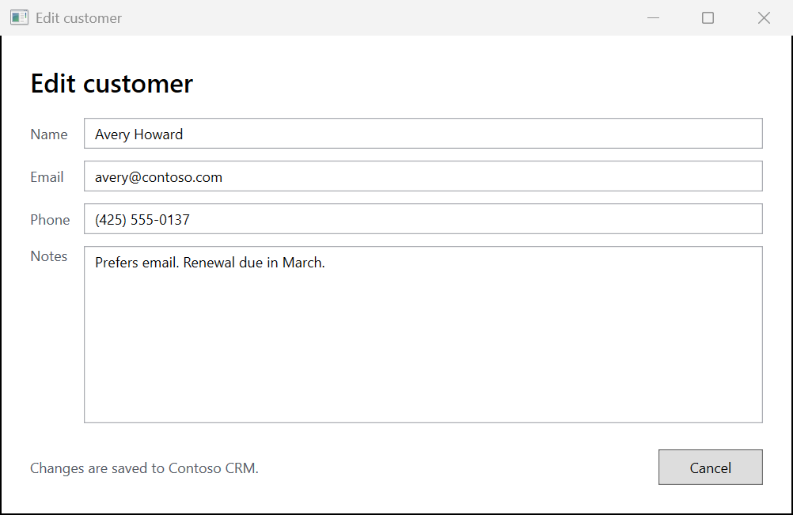
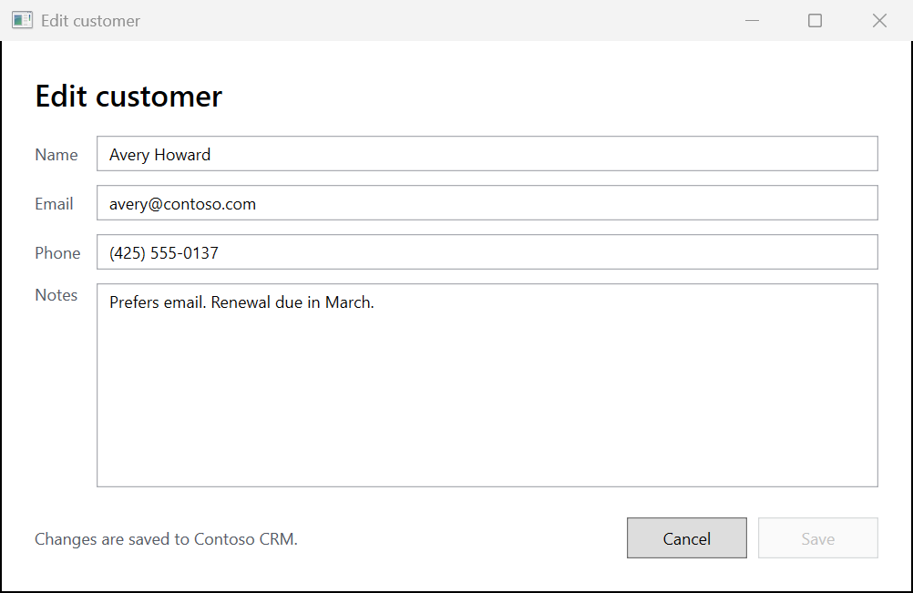

# Session transcript

Source: `Q:\source\XamlAgentDemos-notes\test-runs\VanishingSave\r10\events.jsonl`

## Tool usage

- get_file: 4
- xaml_get_element_bounds: 3
- xaml_get_element_properties: 3
- xaml_capture_image: 2
- xaml_explain_visibility: 2
- rg: 2
- xaml_hit_test: 2
- task_complete: 2
- skill: 1
- xaml_get_status: 1
- xaml_find_elements: 1
- xaml_get_visual_tree: 1
- xaml_get_element_styles: 1
- multi_replace_string_in_file: 1
- xaml_apply_hot_reload: 1
- xaml_set_element_property: 1
- xaml_clear_binding_failures: 1
- xaml_get_binding_failures: 1

Failed tool calls: 0, images: 2


_Model: gpt-6-luna_


## User (15:00:06)

There should be a Save button in the footer of my running app, but I can't see it. Find out every reason it's not visible and fix them.


**Tool call (15:00:08):** `skill`
```json
{
 "skill": "xaml-diagnostics"
}
```

<details><summary>Result `skill` success=true</summary>

```
Skill "xaml-diagnostics" loaded successfully. Follow the instructions in the skill context.
```
</details>


_Skill invoked: xaml-diagnostics_


**Assistant (15:00:14):**

I’ll inspect the live app first, then trace each visibility cause to its source and verify the fix.


**Tool call (15:00:14):** `xaml_get_status`
```json
{
 "progressMessage": "Checking the running app and diagnostics state"
}
```

<details><summary>Result `xaml_get_status` success=true</summary>

```
{"isDebugging":true,"debuggerState":"running","diagnosticsActive":true,"apps":[{"app":"a1","name":"VanishingSave.exe [35264]","processId":35264,"platform":"WPF (.NET)","isRemote":false,"isDesignTimeOrNoDebug":false,"sourceInfoAvailable":true,"hotReloadSupported":true,"hotReloadEnabled":true,"supportsPropertyExplorer":true,"supportsInAppToolbar":true,"supportsHitTest":true,"windows":[{"windowId":"0x5207B0","title":"Edit customer","bounds":{"x":228,"y":228,"width":1020,"height":660},"dpiScale":1.5,"visible":true,"minimized":false}]}],"issues":[],"issuesSummary":"No problems detected.","hotReload":{"options":{"hotReloadEnabled":true,"hotReloadOnSave":false,"applyMode":"asYouType: XAML edits apply as you type, without saving (default)","wpfEnabled":true,"uwpEnabled":true,"winUIEnabled":true,"mauiEnabled":true,"justMyXaml":true,"previewSelectedElement":false,"inAppToolbar":true,"inAppSelection":false,"layoutAdorners":false,"trackFocusedElement":false,"bindingFailuresVisible":true,"compatibilityMode":false},"dotNetHotReloadEnabled":true,"isProcessingChanges":false,"errors":[]},"windowsNote":"Window bounds are physical screen pixels and include the window frame. A WPF/WinUI Window's Width and Height are device-independent units (DIPs) that also include the frame, so Width = bounds.width / dpiScale. A user's \"800 px wide\" is ambiguous: say which unit you tested. A minimized window reports x/y = -32000 and can't be captured."}
```
</details>


**Tool call (15:00:18):** `xaml_find_elements`
```json
{
 "progressMessage": "Finding the Save control in the live tree",
 "app": "a1",
 "name": "Save*",
 "maxResults": 100
}
```


**Tool call (15:00:18):** `xaml_capture_image`
```json
{
 "progressMessage": "Capturing the current app window",
 "app": "a1",
 "windowId": "0x5207B0",
 "maxSize": 1280
}
```

<details><summary>Result `xaml_find_elements` success=true</summary>

```
{"count":1,"totalMatches":1,"truncated":false,"results":[{"id":"a1:10","type":"System.Windows.Controls.Button","name":"SaveButton","source":{"file":"Q:\\source\\XamlAgentDemos\\src\\VanishingSave\\MainWindow.xaml","line":118,"column":14},"path":"MainWindow/Border/AdornerDecorator/ContentPresenter/Grid/Grid/Button"}]}
```
</details>




<details><summary>Result `xaml_capture_image` success=true</summary>

```
Screenshot of window 0x5207B0 "Edit customer" of app a1 (1002x651 image of the window's client area, so it's slightly smaller than the frame bounds from xaml_get_status).
```
</details>


**Tool call (15:00:22):** `xaml_explain_visibility`
```json
{
 "progressMessage": "Diagnosing every visibility cause for Save",
 "elementIds": [
  "#SaveButton"
 ]
}
```


**Tool call (15:00:22):** `xaml_get_element_bounds`
```json
{
 "progressMessage": "Checking Save button position and clipping",
 "elementIds": [
  "#SaveButton"
 ]
}
```


**Tool call (15:00:22):** `xaml_get_visual_tree`
```json
{
 "progressMessage": "Inspecting footer layout and sibling controls",
 "app": "a1",
 "rootElementId": "a1:10",
 "depth": 5,
 "maxNodes": 100
}
```

<details><summary>Result `xaml_get_visual_tree` success=true</summary>

```
{"app":"a1","platform":"WPF (.NET)","sourceInfoAvailable":true,"nodeCount":1,"truncated":false,"nodes":[{"id":"a1:10","type":"System.Windows.Controls.Button","name":"SaveButton","source":{"file":"Q:\\source\\XamlAgentDemos\\src\\VanishingSave\\MainWindow.xaml","line":118,"column":14},"childCount":0}]}
```
</details>

<details><summary>Result `xaml_get_element_bounds` success=true</summary>

```
{"note":"'screen' is in physical screen pixels. 'window' is in device-independent units relative to the element's root window (multiply by dpiScale for pixels). Fractional screen pixel values (for example x=18.75) mean edges fall between device pixels, so thin lines and text render blurry unless layout rounding snaps them. isVisible only reflects Visibility/opacity; insideWindowFraction < 1 (clippedByWindow) means part of the element is outside the window's client area, so the user can't see that part. Ancestor clipping (ScrollViewer, Grid cell, ClipToBounds) isn't included; compare with the parent's bounds or call xaml_capture_image.","bounds":[{"id":"#SaveButton","isVisible":false,"windowHandle":"0x5207B0","dpiScale":1.5,"screen":{"x":275.0,"y":796.0,"width":0.0,"height":0.0},"window":{"x":24.0,"y":348.71,"width":0.0,"height":0.0}}]}
```
</details>

<details><summary>Result `xaml_explain_visibility` success=true</summary>

```
{"id":"#SaveButton","type":"System.Windows.Controls.Button","name":"SaveButton","source":{"file":"Q:\\source\\XamlAgentDemos\\src\\VanishingSave\\MainWindow.xaml","line":118,"column":14},"verdict":"Button 'SaveButton' has Visibility=Collapsed from a binding.","causes":[{"rank":1,"kind":"visibility","message":"Button 'SaveButton' has Visibility=Collapsed from a binding.","elementId":"a1:10","property":"Visibility","value":"{Binding} -> Collapsed","valueSource":"Local","location":{"file":"Q:\\source\\XamlAgentDemos\\src\\VanishingSave\\MainWindow.xaml","line":118,"column":14},"fix":"Check the bound source value and converter (xaml_explain_property_value shows the binding), or fix the binding failure listed below."},{"rank":1,"kind":"opacity","message":"Button 'SaveButton' has Opacity=0, so it's transparent.","elementId":"a1:10","property":"Opacity","value":"0","valueSource":"StyleTrigger","location":{"file":"Q:\\source\\XamlAgentDemos\\src\\VanishingSave\\MainWindow.xaml","line":118,"column":14},"fix":"Check for a storyboard or trigger that fades it in, or change the value."}],"hitTest":{"summary":"A click at its center does NOT reach 'SaveButton' because it's disabled (IsEnabled=False): input skips disabled elements and lands on Border (in the template of MainWindow) behind or around it. That element isn't necessarily covering it; fix the IsEnabled cause (see blockers, or a command's CanExecute) rather than the layout. Button 'SaveButton' has Visibility=Collapsed. Button 'SaveButton' has IsEnabled=False (IsEnabledCore: command CanExecute is false or the control disabled itself). Button 'SaveButton' has Opacity=0. 'SaveButton' has zero width or height.","inputTarget":{"id":"a1:12","type":"System.Windows.Controls.Border","name":null,"source":null,"templatedParent":{"id":"a1:11","type":"VanishingSave.MainWindow","name":null,"source":{"file":"Q:\\source\\XamlAgentDemos\\src\\VanishingSave\\MainWindow.xaml","line":4,"column":9},"templatedParent":null,"property":null,"value":null},"property":null,"value":null}},"bindingFailures":[{"target":"Button.Visibility, Name='SaveButton'","bindingPath":"CanSave","description":"CanSave property not found on object of type CustomerViewModel.","file":"Q:\\source\\XamlAgentDemos\\src\\VanishingSave\\MainWindow.xaml","line":118}],"note":"rank 1 hides the element for certain, rank 2 almost certainly, rank 3 may. location is where the winning value is set (the element's own tag when the value isn't from XAML). Values set from code
... [truncated 168 chars]
```
</details>


**Assistant (15:00:28):**

The live diagnostics show stacked causes: a broken visibility binding, zero opacity, and a disabled command. I’m tracing their source definitions and the footer layout before making the permanent fix.


**Tool call (15:00:28):** `get_file`
```json
{
 "filename": "Q:\\source\\XamlAgentDemos\\src\\VanishingSave\\MainWindow.xaml",
 "startLine": 1,
 "endLine": 220,
 "includeLineNumbers": true
}
```


**Tool call (15:00:28):** `xaml_get_element_properties`
```json
{
 "progressMessage": "Reading Save binding, command, style, and view model",
 "elementIds": [
  "#SaveButton"
 ],
 "nameFilter": "Visibility|Opacity|IsEnabled|Command|DataContext.*",
 "includeAll": true
}
```


**Tool call (15:00:28):** `xaml_get_element_styles`
```json
{
 "progressMessage": "Finding style triggers that hide Save",
 "elementIds": [
  "#SaveButton"
 ]
}
```


**Tool call (15:00:28):** `rg`
```json
{
 "pattern": "CanSave|SaveCommand|SaveButton|Opacity|Visibility",
 "paths": "Q:\\source\\XamlAgentDemos\\src\\VanishingSave",
 "output_mode": "content",
 "-n": true,
 "head_limit": 200
}
```

<details><summary>Result `xaml_get_element_styles` success=true</summary>

```
{"id":"#SaveButton","type":"System.Windows.Controls.Button","name":"SaveButton","source":{"file":"Q:\\source\\XamlAgentDemos\\src\\VanishingSave\\MainWindow.xaml","line":118,"column":14},"styleProperty":{"value":"System.Windows.Style","valueSource":"Local","location":{"file":"Q:\\source\\XamlAgentDemos\\src\\VanishingSave\\MainWindow.xaml","line":118,"column":14}},"templateProperty":{"value":"System.Windows.Controls.ControlTemplate","valueSource":"BuiltInStyle"},"styles":[{"kind":"StyleTrigger","description":"Trigger in the element's Style whose condition is currently true.","setters":[{"property":"Opacity","value":"0","effective":true}]},{"kind":"TemplateTrigger","description":"Trigger in the element's own ControlTemplate whose condition is currently true.","setters":[{"property":"Foreground","value":"#FF838383","effective":true}]},{"kind":"Style","description":"Setter in an explicit (x:Key) or implicit (TargetType) Style.","targetType":"System.Windows.Controls.Button","location":{"file":"Q:\\source\\XamlAgentDemos\\src\\VanishingSave\\MainWindow.xaml","line":27,"column":10},"setters":[{"property":"Margin","value":"8,0,0,0","effective":true},{"property":"MinWidth","value":"88","effective":true},{"property":"Padding","value":"16,6,16,6","effective":true}]},{"kind":"BuiltInStyle","description":"Setter in the control's default theme style (generic.xaml or the platform theme).","targetType":"System.Windows.Controls.Primitives.ButtonBase","setters":[{"property":"Background","value":"#FFDDDDDD","effective":true},{"property":"BorderBrush","value":"#FF707070","effective":true},{"property":"BorderThickness","value":"1,1,1,1","effective":true},{"property":"FocusVisualStyle","value":"System.Windows.Style","effective":true},{"property":"Foreground","effective":false,"overriddenBy":"TemplateTrigger"},{"property":"HorizontalContentAlignment","value":"1","effective":true},{"property":"Padding","value":"1,1,1,1","effective":false,"overriddenBy":"Style (System.Windows.Controls.Button)"},{"property":"Template","value":"System.Windows.Controls.ControlTemplate","effective":true},{"property":"VerticalContentAlignment","value":"1","effective":true}]}],"hint":"Styles are listed in precedence order, highest first. 'effective=false' setters lose to 'overriddenBy'. Use xaml_find_resource to see where a style or resource key resolves. Only triggers whose condition is true right now are listed; inactive triggers (IsMouseOver, IsPressed, DataTriggers) aren't. Read the style's source 
... [truncated 77 chars]
```
</details>

<details><summary>Result `xaml_get_element_properties` success=true</summary>

```
{"id":"#SaveButton","type":"System.Windows.Controls.Button","name":"SaveButton","source":{"file":"Q:\\source\\XamlAgentDemos\\src\\VanishingSave\\MainWindow.xaml","line":118,"column":14},"properties":[{"name":"IsEnabled","value":"False","valueType":"System.Boolean","valueSource":"Coercion"},{"name":"Command","evaluatedValue":"(XamlAgentDemos.RelayCommand)","valueType":"System.Windows.Data.BindingExpression","propertyType":"System.Windows.Input.ICommand","valueSource":"Local","isBinding":true},{"name":"Visibility","evaluatedValue":"2 (System.Windows.Visibility)","valueType":"System.Windows.Data.BindingExpression","propertyType":"System.Windows.Visibility","valueSource":"Local","isBinding":true},{"name":"Opacity","value":"0","valueType":"System.Double","valueSource":"StyleTrigger"}],"hiddenDefaultOrOverridden":4,"hint":"Default and overridden values were omitted. Pass includeAll=true to see them, or call xaml_explain_property_value for one property's full precedence chain.","items":[{"path":"DataContext","type":"VanishingSave.CustomerViewModel","properties":[{"name":"Name","value":"Avery Howard","valueSource":"Local"},{"name":"Email","value":"avery@contoso.com","valueSource":"Local"},{"name":"Phone","value":"(425) 555-0137","valueSource":"Local"},{"name":"Notes","value":"Prefers email. Renewal due in March.","valueSource":"Local"},{"name":"IsSaveAvailable","value":"True","valueSource":"Local","readOnly":true},{"name":"SaveCommand","value":"XamlAgentDemos.RelayCommand","valueSource":"Local","readOnly":true},{"name":"CancelCommand","value":"XamlAgentDemos.RelayCommand","valueSource":"Local","readOnly":true},{"name":"IsDirty","value":"False","valueSource":"Default"}]}],"note":"Item properties are live values. Change one with xaml_set_element_property using the same path, for example setters=['ColumnDefinitions[2].Width=Auto']; edit the XAML too to keep the change. Without a property filter, only set values and Actual* sizes are listed."}
```
</details>

<details><summary>Result `rg` success=true</summary>

```
Q:\source\XamlAgentDemos\src\VanishingSave\MainWindow.xaml:14:        <BooleanToVisibilityConverter x:Key="BoolToVisibility" />
Q:\source\XamlAgentDemos\src\VanishingSave\MainWindow.xaml:34:                    <Setter Property="Opacity" Value="0" />
Q:\source\XamlAgentDemos\src\VanishingSave\MainWindow.xaml:118:            <Button x:Name="SaveButton"
Q:\source\XamlAgentDemos\src\VanishingSave\MainWindow.xaml:120:                    Command="{Binding SaveCommand}"
Q:\source\XamlAgentDemos\src\VanishingSave\MainWindow.xaml:124:                    Visibility="{Binding CanSave, Converter={StaticResource BoolToVisibility}, FallbackValue=Collapsed}" />
Q:\source\XamlAgentDemos\src\VanishingSave\CustomerViewModel.cs:13:        this.SaveCommand = new RelayCommand(this.Save, () => this.IsDirty);
Q:\source\XamlAgentDemos\src\VanishingSave\CustomerViewModel.cs:30:    public RelayCommand SaveCommand { get; }
```
</details>

<details><summary>Result `get_file` success=true</summary>

```
```xaml src\VanishingSave\MainWindow.xaml (Lines 1-138 of 138 total. Call tools for more if needed.)
1: <Window x:Class="VanishingSave.MainWindow"
2:         xmlns="http://schemas.microsoft.com/winfx/2006/xaml/presentation"
3:         xmlns:x="http://schemas.microsoft.com/winfx/2006/xaml"
4:         xmlns:local="clr-namespace:VanishingSave"
5:         Title="Edit customer"
6:         Width="680"
7:         Height="440"
8:         Background="White">
9:     <Window.DataContext>
10:         <local:CustomerViewModel />
11:     </Window.DataContext>
12: 
13:     <Window.Resources>
14:         <BooleanToVisibilityConverter x:Key="BoolToVisibility" />
15: 
16:         <Style x:Key="FieldLabelStyle" TargetType="TextBlock">
17:             <Setter Property="Margin" Value="0,0,12,10" />
18:             <Setter Property="VerticalAlignment" Value="Center" />
19:             <Setter Property="Foreground" Value="#555B66" />
20:         </Style>
21: 
22:         <Style x:Key="FieldStyle" TargetType="TextBox">
23:             <Setter Property="Margin" Value="0,0,0,10" />
24:             <Setter Property="Padding" Value="6,4" />
25:         </Style>
26: 
27:         <Style x:Key="FooterButtonStyle" TargetType="Button">
28:             <Setter Property="MinWidth" Value="88" />
29:             <Setter Property="Margin" Value="8,0,0,0" />
30:             <Setter Property="Padding" Value="16,6" />
31:             <Style.Triggers>
32:                 <!-- Fade out buttons that can't be used yet. -->
33:                 <Trigger Property="IsEnabled" Value="False">
34:                     <Setter Property="Opacity" Value="0" />
35:                 </Trigger>
36:             </Style.Triggers>
37:         </Style>
38:     </Window.Resources>
39: 
40:     <Grid Margin="24">
41:         <Grid.RowDefinitions>
42:             <RowDefinition Height="Auto" />
43:             <RowDefinition Height="*" />
44:             <RowDefinition Height="Auto" />
45:         </Grid.RowDefinitions>
46: 
47:         <TextBlock Margin="0,0,0,16"
48:                    FontSize="22"
49:                    FontWeight="SemiBold"
50:                    Text="Edit customer" />
51: 
52:         <Grid Grid.Row="1">
53:             <Grid.ColumnDefinitions>
54:                 <ColumnDefinition Width="Auto" />
55:                 <ColumnDefinition Width="*" />
56:             </Grid.ColumnDefinitions>
57:             <Grid.RowDefinitions>
58:            
... [truncated 3995 chars]
```
</details>


**Tool call (15:00:36):** `get_file`
```json
{
 "filename": "Q:\\source\\XamlAgentDemos\\src\\VanishingSave\\CustomerViewModel.cs",
 "startLine": 1,
 "endLine": 200,
 "includeLineNumbers": true
}
```


**Tool call (15:00:36):** `get_file`
```json
{
 "filename": "Q:\\source\\XamlAgentDemos\\src\\VanishingSave\\MainWindow.xaml.cs",
 "startLine": 1,
 "endLine": 200,
 "includeLineNumbers": true
}
```


**Tool call (15:00:36):** `xaml_get_element_properties`
```json
{
 "progressMessage": "Inspecting footer overlay, layout, and availability state",
 "elementIds": [
  "#SyncStatusHost",
  "#Footer"
 ],
 "nameFilter": "Visibility|Opacity|IsHitTestVisible|Background|Panel.ZIndex|ColumnDefinitions[*].Width|DataContext.IsSaveAvailable|DataContext.IsDirty",
 "includeAll": true
}
```


**Tool call (15:00:36):** `xaml_get_element_bounds`
```json
{
 "progressMessage": "Checking whether footer overlay covers Save",
 "elementIds": [
  "#SyncStatusHost",
  "#Footer"
 ]
}
```


**Tool call (15:00:36):** `xaml_hit_test`
```json
{
 "progressMessage": "Checking footer hit target and overlap",
 "elementIds": [
  "#SaveButton",
  "#SyncStatusHost"
 ]
}
```


**Tool call (15:00:36):** `rg`
```json
{
 "pattern": "SaveColumn|SyncStatusHost|IsSaveAvailable|CanSave|IsDirty|Footer",
 "paths": "Q:\\source\\XamlAgentDemos\\src\\VanishingSave",
 "output_mode": "content",
 "-n": true,
 "head_limit": 250
}
```

<details><summary>Result `xaml_get_element_bounds` success=true</summary>

```
{"note":"'screen' is in physical screen pixels. 'window' is in device-independent units relative to the element's root window (multiply by dpiScale for pixels). Fractional screen pixel values (for example x=18.75) mean edges fall between device pixels, so thin lines and text render blurry unless layout rounding snaps them. isVisible only reflects Visibility/opacity; insideWindowFraction < 1 (clippedByWindow) means part of the element is outside the window's client area, so the user can't see that part. Ancestor clipping (ScrollViewer, Grid cell, ClipToBounds) isn't included; compare with the parent's bounds or call xaml_capture_image.","bounds":[{"id":"#SyncStatusHost","isVisible":true,"windowHandle":"0x5207B0","dpiScale":1.5,"screen":{"x":1201.0,"y":796.0,"width":0.0,"height":45.0},"window":{"x":641.33,"y":348.71,"width":0.0,"height":29.96}},{"id":"#Footer","isVisible":true,"insideWindowFraction":1.0,"windowHandle":"0x5207B0","dpiScale":1.5,"screen":{"x":275.0,"y":796.0,"width":926.0,"height":45.0},"window":{"x":24.0,"y":348.71,"width":617.33,"height":29.96}}]}
```
</details>

<details><summary>Result `rg` success=true</summary>

```
[grep content: 20 matches across 4 file(s) under Q:/source/XamlAgentDemos/src/VanishingSave; delimited groups]

FooterSettings.cs (2 match(es)):
  3: public static class FooterSettings
  9:     public static bool UseCompactFooter { get; set; } = true;

CustomerViewModel.cs (9 match(es)):
  13:         this.SaveCommand = new RelayCommand(this.Save, () => this.IsDirty);
  14:         this.CancelCommand = new RelayCommand(() => this.IsDirty = false);
  17:     public string Name { get => this.name; set { if (this.SetProperty(ref this.name, value)) this.IsDirty = true; } }
  19:     public string Email { get => this.email; set { if (this.SetProperty(ref this.email, value)) this.IsDirty = true; } }
  21:     public string Phone { get => this.phone; set { if (this.SetProperty(ref this.phone, value)) this.IsDirty = true; } }
  23:     public string Notes { get => this.notes; set { if (this.SetProperty(ref this.notes, value)) this.IsDirty = true; } }
  25:     public bool IsDirty { get => this.isDirty; set => this.SetProperty(ref this.isDirty, value); }
  28:     public bool IsSaveAvailable => true;
  34:     private void Save() => this.IsDirty = false;

MainWindow.xaml (7 match(es)):
  27:         <Style x:Key="FooterButtonStyle" TargetType="Button">
  101:         <Grid x:Name="Footer" Grid.Row="2" Margin="0,12,0,0">
  105:                 <ColumnDefinition x:Name="SaveColumn" Width="Auto" />
  116:                     Style="{StaticResource FooterButtonStyle}" />
  123:                     Style="{StaticResource FooterButtonStyle}"
  124:                     Visibility="{Binding CanSave, Converter={StaticResource BoolToVisibility}, FallbackValue=Collapsed}" />
  127:             <Border x:Name="SyncStatusHost"

MainWindow.xaml.cs (2 match(es)):
  15:         if (FooterSettings.UseCompactFooter)
  17:             this.SaveColumn.Width = new GridLength(0);
```
</details>

<details><summary>Result `get_file` success=true</summary>

```
```csharp src\VanishingSave\CustomerViewModel.cs (Lines 1-35 of 35 total. Call tools for more if needed.)
1: namespace VanishingSave;
2: 
3: public sealed class CustomerViewModel : ObservableObject
4: {
5:     private string name = "Avery Howard";
6:     private string email = "avery@contoso.com";
7:     private string phone = "(425) 555-0137";
8:     private string notes = "Prefers email. Renewal due in March.";
9:     private bool isDirty;
10: 
11:     public CustomerViewModel()
12:     {
13:         this.SaveCommand = new RelayCommand(this.Save, () => this.IsDirty);
14:         this.CancelCommand = new RelayCommand(() => this.IsDirty = false);
15:     }
16: 
17:     public string Name { get => this.name; set { if (this.SetProperty(ref this.name, value)) this.IsDirty = true; } }
18: 
19:     public string Email { get => this.email; set { if (this.SetProperty(ref this.email, value)) this.IsDirty = true; } }
20: 
21:     public string Phone { get => this.phone; set { if (this.SetProperty(ref this.phone, value)) this.IsDirty = true; } }
22: 
23:     public string Notes { get => this.notes; set { if (this.SetProperty(ref this.notes, value)) this.IsDirty = true; } }
24: 
25:     public bool IsDirty { get => this.isDirty; set => this.SetProperty(ref this.isDirty, value); }
26: 
27:     /// <summary>Whether the current user is allowed to save customer records.</summary>
28:     public bool IsSaveAvailable => true;
29: 
30:     public RelayCommand SaveCommand { get; }
31: 
32:     public RelayCommand CancelCommand { get; }
33: 
34:     private void Save() => this.IsDirty = false;
35: }

```


```
</details>

<details><summary>Result `get_file` success=true</summary>

```
```csharp src\VanishingSave\MainWindow.xaml.cs (Lines 1-20 of 20 total. Call tools for more if needed.)
1: using System.Windows;
2: 
3: namespace VanishingSave;
4: 
5: public partial class MainWindow : Window
6: {
7:     public MainWindow()
8:     {
9:         this.InitializeComponent();
10:         this.Loaded += this.OnLoaded;
11:     }
12: 
13:     private void OnLoaded(object sender, RoutedEventArgs e)
14:     {
15:         if (FooterSettings.UseCompactFooter)
16:         {
17:             this.SaveColumn.Width = new GridLength(0);
18:         }
19:     }
20: }

```


```
</details>

<details><summary>Result `xaml_hit_test` success=true</summary>

```
{"count":2,"failed":0,"results":[{"id":"#SaveButton","summary":"A click at its center does NOT reach 'SaveButton' because it's disabled (IsEnabled=False): input skips disabled elements and lands on Border (in the template of MainWindow) behind or around it. That element isn't necessarily covering it; fix the IsEnabled cause (see blockers, or a command's CanExecute) rather than the layout. Button 'SaveButton' has Visibility=Collapsed. Button 'SaveButton' has IsEnabled=False (IsEnabledCore: command CanExecute is false or the control disabled itself). Button 'SaveButton' has Opacity=0. 'SaveButton' has zero width or height.","elementReceivesInput":false,"inputTarget":{"id":"a1:12","type":"System.Windows.Controls.Border","templatedParent":{"id":"a1:11","type":"VanishingSave.MainWindow","source":{"file":"Q:\\source\\XamlAgentDemos\\src\\VanishingSave\\MainWindow.xaml","line":4,"column":9}}},"stack":[{"id":"a1:12","type":"System.Windows.Controls.Border","templatedParent":{"id":"a1:11","type":"VanishingSave.MainWindow","source":{"file":"Q:\\source\\XamlAgentDemos\\src\\VanishingSave\\MainWindow.xaml","line":4,"column":9}}}],"isVisible":false,"isHitTestVisible":true,"isEnabled":false,"effectiveOpacity":0.0,"blockers":[{"id":"a1:10","type":"System.Windows.Controls.Button","name":"SaveButton","source":{"file":"Q:\\source\\XamlAgentDemos\\src\\VanishingSave\\MainWindow.xaml","line":118,"column":14},"property":"Visibility","value":"Collapsed"},{"id":"a1:10","type":"System.Windows.Controls.Button","name":"SaveButton","source":{"file":"Q:\\source\\XamlAgentDemos\\src\\VanishingSave\\MainWindow.xaml","line":118,"column":14},"property":"IsEnabled","value":"False (IsEnabledCore: command CanExecute is false or the control disabled itself)"},{"id":"a1:10","type":"System.Windows.Controls.Button","name":"SaveButton","source":{"file":"Q:\\source\\XamlAgentDemos\\src\\VanishingSave\\MainWindow.xaml","line":118,"column":14},"property":"Opacity","value":"0"}],"point":{"window":{"x":24.0,"y":348.71},"screen":{"x":275.0,"y":796.0}}},{"id":"#SyncStatusHost","summary":"A click at its center reaches 'SyncStatusHost' (input lands on TextBlock 'SyncStatusText'). 'SyncStatusHost' has zero width or height.","elementReceivesInput":true,"inputTarget":{"id":"a1:36","type":"System.Windows.Controls.TextBlock","name":"SyncStatusText","source":{"file":"Q:\\source\\XamlAgentDemos\\src\\VanishingSave\\MainWindow.xaml","line":131,"column":18}},"stack":[{"id":"a1:36","type":"System.Windows.Controls.T
... [truncated 1514 chars]
```
</details>

<details><summary>Result `xaml_get_element_properties` success=true</summary>

```
{"count":2,"failed":0,"results":[{"id":"#SyncStatusHost","type":"System.Windows.Controls.Border","name":"SyncStatusHost","source":{"file":"Q:\\source\\XamlAgentDemos\\src\\VanishingSave\\MainWindow.xaml","line":127,"column":14},"properties":[{"name":"Background","value":"#FFFFFFFF","valueType":"System.Windows.Media.SolidColorBrush","propertyType":"System.Windows.Media.Brush","valueSource":"Local"},{"name":"Panel.ZIndex","value":"1","valueType":"System.Int32","valueSource":"Local","isAttached":true}],"defaultValues":{"IsHitTestVisible":"True","Opacity":"1","Visibility":"0"},"hiddenDefaultOrOverridden":2,"hint":"Default and overridden values were omitted. Pass includeAll=true to see them, or call xaml_explain_property_value for one property's full precedence chain.","items":[{"path":"ColumnDefinitions[*]","error":"PROPERTY_NOT_FOUND","message":"'#SyncStatusHost' has no property 'ColumnDefinitions'."},{"path":"DataContext","type":"VanishingSave.CustomerViewModel","properties":[{"name":"IsSaveAvailable","value":"True","valueSource":"Local","readOnly":true},{"name":"IsDirty","value":"False","valueSource":"Default"}]}]},{"id":"#Footer","type":"System.Windows.Controls.Grid","name":"Footer","source":{"file":"Q:\\source\\XamlAgentDemos\\src\\VanishingSave\\MainWindow.xaml","line":101,"column":10},"properties":[],"defaultValues":{"Background":null,"IsHitTestVisible":"True","Opacity":"1","Visibility":"0"},"hint":"No property name matches any of: Visibility, Opacity, IsHitTestVisible, Background, Panel.ZIndex (exact name when one exists, otherwise a case-insensitive substring; separate alternatives with '|' or ','). Check the spelling, or omit nameFilter to list the properties that are set.","items":[{"path":"ColumnDefinitions[0]","type":"System.Windows.Controls.ColumnDefinition","properties":[{"name":"Width","value":"*","valueSource":"Local"}]},{"path":"ColumnDefinitions[1]","type":"System.Windows.Controls.ColumnDefinition","properties":[{"name":"Width","value":"Auto","valueSource":"Local"}]},{"path":"ColumnDefinitions[2]","type":"System.Windows.Controls.ColumnDefinition","properties":[{"name":"Width","value":"0","valueSource":"Local"}]},{"path":"DataContext","type":"VanishingSave.CustomerViewModel","properties":[{"name":"IsSaveAvailable","value":"True","valueSource":"Local","readOnly":true},{"name":"IsDirty","value":"False","valueSource":"Default"}]}]}],"note":"Item properties are live values. Change one with xaml_set_element_property using the same path, for exampl
... [truncated 159 chars]
```
</details>


**Tool call (15:01:22):** `get_file`
```json
{
 "filename": "Q:\\source\\XamlAgentDemos\\src\\VanishingSave\\FooterSettings.cs",
 "startLine": 1,
 "endLine": 40,
 "includeLineNumbers": true
}
```

<details><summary>Result `get_file` success=true</summary>

```
```csharp src\VanishingSave\FooterSettings.cs (Lines 1-10 of 10 total. Call tools for more if needed.)
1: namespace VanishingSave;
2: 
3: public static class FooterSettings
4: {
5:     /// <summary>
6:     /// Compact footer for small screens: auto-save makes the Save column unnecessary.
7:     /// (Auto-save was cut from v2, but this switch stayed on.)
8:     /// </summary>
9:     public static bool UseCompactFooter { get; set; } = true;
10: }

```


```
</details>


**Assistant (15:01:36):**

I found four independent blockers: the visibility binding targets a nonexistent property; disabled styling sets opacity to zero; startup collapses the Save column due to a stale compact-footer switch; and an empty, opaque status overlay sits above Save. I’m correcting those while keeping Save disabled until edits are made.


**Tool call (15:01:36):** `multi_replace_string_in_file`
```json
{
 "explanation": "Fix the visibility binding, keep disabled footer buttons visible, preserve the Save column, and hide the empty status overlay.",
 "replacements": [
  {
   "filePath": "src\\VanishingSave\\MainWindow.xaml",
   "oldString": "                <!-- Fade out buttons that can't be used yet. -->\n                <Trigger Property=\"IsEnabled\" Value=\"False\">\n                    <Setter Property=\"Opacity\" Value=\"0\" />\n                </Trigger>\n",
   "newString": "                <!-- Fade out buttons that can't be used yet. -->\n                <Trigger Property=\"IsEnabled\" Value=\"False\">\n                    <Setter Property=\"Opacity\" Value=\"0.5\" />\n                </Trigger>\n",
   "explanation": "Keep disabled buttons visibly faded instead of fully transparent."
  },
  {
   "filePath": "src\\VanishingSave\\MainWindow.xaml",
   "oldString": "                    IsDefault=\"True\"\n                    Style=\"{StaticResource FooterButtonStyle}\"\n                    Visibility=\"{Binding CanSave, Converter={StaticResource BoolToVisibility}, FallbackValue=Collapsed}\" />\n\n            <!-- Shows \"Offline - changes will sync later\" when the connection drops. -->\n            <Border x:Name=\"SyncStatusHost\"\n                    Grid.Column=\"2\"\n                    Panel.ZIndex=\"1\"\n                    Background=\"White\">\n                <TextBlock x:Name=\"SyncStatusText\"\n",
   "newString": "                    IsDefault=\"True\"\n    
... [truncated 1688 chars]
```

<details><summary>Result `multi_replace_string_in_file` success=true</summary>

```
Successfully applied 3 of 3 replacement(s) across 2 file(s).
```
</details>


**Tool call (15:01:44):** `xaml_apply_hot_reload`
```json
{
 "progressMessage": "Applying the XAML and code fixes to the running app",
 "includeCodeChanges": true
}
```

<details><summary>Result `xaml_apply_hot_reload` success=true</summary>

```
{"summary":"XAML: Applied with no new errors. .NET code: applied (see 'codeHotReloadOutput'). New code runs the next time each method is called; code that already ran (constructors, startup, Loaded handlers, a failed operation that left a flag set) isn't re-run, so the state it produced stays until you trigger that code again, reopen the view, or restart the app.","applied":true,"xamlApplied":true,"status":"applied","errors":[],"log":[],"lastHotReloadUpdate":{"secondsAgo":9,"updatesSinceToolsStarted":1},"codeChanges":".NET Hot Reload was started for saved code changes. Its results are in the Hot Reload output pane, not in 'log'; if an edit can't be hot reloaded, Visual Studio asks the user to rebuild and restart.","codeStatus":"applied","codeHotReloadOutput":["10:01:45.76  Code changes were successfully applied."],"hint":"Call xaml_capture_image to verify the change visually. Views that aren't loaded (other tabs, closed dialogs) are updated when they're next shown. Source line numbers reported for existing elements can still point to the pre-edit lines until the element is recreated, so find elements by x:Name or type rather than by an old line number. Structural edits (wrapping or replacing a parent, changing a root's content) recreate elements, which resets their runtime state such as selection, checked state, typed text and scroll position, and invalidates their IDs. Re-establish the state you were testing before capturing again."}
```
</details>


**Tool call (15:01:52):** `xaml_set_element_property`
```json
{
 "progressMessage": "Restoring the Save column in the current app",
 "elementIds": [
  "#Footer"
 ],
 "setters": [
  "ColumnDefinitions[2].Width=Auto"
 ]
}
```

<details><summary>Result `xaml_set_element_property` success=true</summary>

```
{"id":"#Footer","property":"ColumnDefinitions[2].Width","oldValue":"0","newValue":"Auto","note":"This change only affects the running app and is lost when it restarts. Edit the XAML source to persist it. Until then it overrides the source: hot reload re-applies only the properties whose XAML changed, so undo experiments (set the original value back) before you verify a source fix."}
```
</details>


**Tool call (15:01:57):** `xaml_clear_binding_failures`
```json
{
 "progressMessage": "Resetting binding diagnostics before verification"
}
```

<details><summary>Result `xaml_clear_binding_failures` success=true</summary>

```
{"cleared":1}
```
</details>


**Tool call (15:02:01):** `xaml_capture_image`
```json
{
 "progressMessage": "Verifying the repaired footer visually",
 "app": "a1",
 "windowId": "0x5207B0",
 "maxSize": 1280
}
```


**Tool call (15:02:01):** `xaml_explain_visibility`
```json
{
 "progressMessage": "Confirming no visibility blockers remain",
 "elementIds": [
  "#SaveButton"
 ]
}
```


**Tool call (15:02:01):** `xaml_get_element_bounds`
```json
{
 "progressMessage": "Confirming Save occupies visible footer space",
 "elementIds": [
  "#SaveButton",
  "#Footer"
 ]
}
```


**Tool call (15:02:01):** `xaml_hit_test`
```json
{
 "progressMessage": "Checking Save button interaction after repair",
 "elementIds": [
  "#SaveButton"
 ]
}
```


**Tool call (15:02:01):** `xaml_get_element_properties`
```json
{
 "progressMessage": "Confirming Save and overlay live states",
 "elementIds": [
  "#SaveButton",
  "#SyncStatusHost"
 ],
 "nameFilter": "Visibility|Opacity|IsEnabled|Command|ColumnDefinitions[2].Width|DataContext.IsSaveAvailable|DataContext.IsDirty",
 "includeAll": true
}
```


**Tool call (15:02:01):** `xaml_get_binding_failures`
```json
{
 "progressMessage": "Checking for fresh XAML binding failures",
 "maxResults": 100
}
```

<details><summary>Result `xaml_get_binding_failures` success=true</summary>

```
{"note":"This is a cumulative log since debugging started or the last xaml_clear_binding_failures, not live state: fixed failures stay listed. occurrencesSinceLastRead counts new occurrences since your previous call (0 = not seen again; it only grows when the UI using the binding is created or updated again). pathStillInSource=false means the XAML near that line no longer contains the failing path, so it was probably fixed in source (hot reload or a restart applies it). To verify a fix: clear, revisit the UI that uses the binding, then read again. Failures without a file usually come from bindings created in code.","totalUnique":0,"matched":0,"truncated":false,"failures":[]}
```
</details>

<details><summary>Result `xaml_hit_test` success=true</summary>

```
{"id":"#SaveButton","summary":"A click at its center does NOT reach 'SaveButton' because it's disabled (IsEnabled=False): input skips disabled elements and lands on Grid 'Footer' behind or around it. That element isn't necessarily covering it; fix the IsEnabled cause (see blockers, or a command's CanExecute) rather than the layout. Button 'SaveButton' has IsEnabled=False (IsEnabledCore: command CanExecute is false or the control disabled itself).","elementReceivesInput":false,"inputTarget":{"id":"a1:19","type":"System.Windows.Controls.Grid","name":"Footer","source":{"file":"Q:\\source\\XamlAgentDemos\\src\\VanishingSave\\MainWindow.xaml","line":101,"column":10}},"stack":[{"id":"a1:155","type":"System.Windows.Controls.TextBlock","templatedParent":{"id":"a1:10","type":"System.Windows.Controls.Button","name":"SaveButton","source":{"file":"Q:\\source\\XamlAgentDemos\\src\\VanishingSave\\MainWindow.xaml","line":118,"column":14}}},{"id":"a1:153","type":"System.Windows.Controls.Border","name":"border","templatedParent":{"id":"a1:10","type":"System.Windows.Controls.Button","name":"SaveButton","source":{"file":"Q:\\source\\XamlAgentDemos\\src\\VanishingSave\\MainWindow.xaml","line":118,"column":14}}},{"id":"a1:12","type":"System.Windows.Controls.Border","templatedParent":{"id":"a1:11","type":"VanishingSave.MainWindow","source":{"file":"Q:\\source\\XamlAgentDemos\\src\\VanishingSave\\MainWindow.xaml","line":4,"column":9}}}],"isVisible":true,"isHitTestVisible":true,"isEnabled":false,"effectiveOpacity":0.5,"blockers":[{"id":"a1:10","type":"System.Windows.Controls.Button","name":"SaveButton","source":{"file":"Q:\\source\\XamlAgentDemos\\src\\VanishingSave\\MainWindow.xaml","line":118,"column":14},"property":"IsEnabled","value":"False (IsEnabledCore: command CanExecute is false or the control disabled itself)"}],"visibleFraction":1.0,"point":{"window":{"x":597.33,"y":363.69},"screen":{"x":1135.0,"y":819.0}},"note":"inputTarget is what a mouse click or tap at the point reaches (WPF: InputHitTest; WinUI/UWP: FindElementsInHostCoordinates, open popups first; .NET MAUI: approximated from element bounds and draw order). stack lists visible, hit-testable elements under the point, topmost first; elements with no id are template parts or aren't in the live tree (on WPF use their templatedParent). blockers are the element and ancestors whose own values hide it or block input (descendants inherit IsEnabled/IsHitTestVisible=False; on .NET MAUI IsHitTestVisible maps to InputTranspa
... [truncated 141 chars]
```
</details>




<details><summary>Result `xaml_capture_image` success=true</summary>

```
Screenshot of window 0x5207B0 "Edit customer" of app a1 (1002x651 image of the window's client area, so it's slightly smaller than the frame bounds from xaml_get_status).
```
</details>

<details><summary>Result `xaml_get_element_bounds` success=true</summary>

```
{"note":"'screen' is in physical screen pixels. 'window' is in device-independent units relative to the element's root window (multiply by dpiScale for pixels). Fractional screen pixel values (for example x=18.75) mean edges fall between device pixels, so thin lines and text render blurry unless layout rounding snaps them. isVisible only reflects Visibility/opacity; insideWindowFraction < 1 (clippedByWindow) means part of the element is outside the window's client area, so the user can't see that part. Ancestor clipping (ScrollViewer, Grid cell, ClipToBounds) isn't included; compare with the parent's bounds or call xaml_capture_image.","bounds":[{"id":"#SaveButton","isVisible":true,"insideWindowFraction":1.0,"windowHandle":"0x5207B0","dpiScale":1.5,"screen":{"x":1069.0,"y":796.0,"width":132.0,"height":45.0},"window":{"x":553.33,"y":348.71,"width":88.0,"height":29.96}},{"id":"#Footer","isVisible":true,"insideWindowFraction":1.0,"windowHandle":"0x5207B0","dpiScale":1.5,"screen":{"x":275.0,"y":796.0,"width":926.0,"height":45.0},"window":{"x":24.0,"y":348.71,"width":617.33,"height":29.96}}]}
```
</details>

<details><summary>Result `xaml_get_element_properties` success=true</summary>

```
{"count":2,"failed":0,"results":[{"id":"#SaveButton","type":"System.Windows.Controls.Button","name":"SaveButton","source":{"file":"Q:\\source\\XamlAgentDemos\\src\\VanishingSave\\MainWindow.xaml","line":118,"column":14},"properties":[{"name":"IsEnabled","value":"False","valueType":"System.Boolean","valueSource":"Coercion"},{"name":"Command","evaluatedValue":"(XamlAgentDemos.RelayCommand)","valueType":"System.Windows.Data.BindingExpression","propertyType":"System.Windows.Input.ICommand","valueSource":"Local","isBinding":true},{"name":"Visibility","evaluatedValue":"0 (System.Windows.Visibility)","valueType":"System.Windows.Data.BindingExpression","propertyType":"System.Windows.Visibility","valueSource":"Local","isBinding":true},{"name":"Opacity","value":"0.5","valueType":"System.Double","valueSource":"StyleTrigger"}],"hiddenDefaultOrOverridden":4,"hint":"Default and overridden values were omitted. Pass includeAll=true to see them, or call xaml_explain_property_value for one property's full precedence chain.","items":[{"path":"ColumnDefinitions[2]","error":"PROPERTY_NOT_FOUND","message":"'#SaveButton' has no property 'ColumnDefinitions'."},{"path":"DataContext","type":"VanishingSave.CustomerViewModel","properties":[{"name":"IsSaveAvailable","value":"True","valueSource":"Local","readOnly":true},{"name":"IsDirty","value":"False","valueSource":"Default"}]}]},{"id":"#SyncStatusHost","type":"System.Windows.Controls.Border","name":"SyncStatusHost","source":{"file":"Q:\\source\\XamlAgentDemos\\src\\VanishingSave\\MainWindow.xaml","line":127,"column":14},"properties":[{"name":"Visibility","value":"2","valueType":"System.Windows.Visibility","valueSource":"StyleTrigger"}],"defaultValues":{"CommandBindings":null,"IsEnabled":"True","Opacity":"1"},"hiddenDefaultOrOverridden":1,"hint":"Default and overridden values were omitted. Pass includeAll=true to see them, or call xaml_explain_property_value for one property's full precedence chain.","items":[{"path":"ColumnDefinitions[2]","error":"PROPERTY_NOT_FOUND","message":"'#SyncStatusHost' has no property 'ColumnDefinitions'."},{"path":"DataContext","type":"VanishingSave.CustomerViewModel","properties":[{"name":"IsSaveAvailable","value":"True","valueSource":"Local","readOnly":true},{"name":"IsDirty","value":"False","valueSource":"Default"}]}]}],"note":"Item properties are live values. Change one with xaml_set_element_property using the same path, for example setters=['ColumnDefinitions[2].Width=Auto']; edit the XAML too to kee
... [truncated 88 chars]
```
</details>

<details><summary>Result `xaml_explain_visibility` success=true</summary>

```
{"id":"#SaveButton","type":"System.Windows.Controls.Button","name":"SaveButton","source":{"file":"Q:\\source\\XamlAgentDemos\\src\\VanishingSave\\MainWindow.xaml","line":118,"column":14},"verdict":"No reason found for Button 'SaveButton' to be invisible: it's Visible, opaque, has a size, is inside its window and nothing covers its center. Capture an image to confirm, or check that this is the element you expect (another copy may be the one on screen).","causes":[],"checkedOk":["size 88x29.96"],"hitTest":{"summary":"A click at its center does NOT reach 'SaveButton' because it's disabled (IsEnabled=False): input skips disabled elements and lands on Grid 'Footer' behind or around it. That element isn't necessarily covering it; fix the IsEnabled cause (see blockers, or a command's CanExecute) rather than the layout. Button 'SaveButton' has IsEnabled=False (IsEnabledCore: command CanExecute is false or the control disabled itself).","visibleFraction":1.0,"inputTarget":{"id":"a1:19","type":"System.Windows.Controls.Grid","name":"Footer","source":{"file":"Q:\\source\\XamlAgentDemos\\src\\VanishingSave\\MainWindow.xaml","line":101,"column":10},"templatedParent":null,"property":null,"value":null}},"note":"rank 1 hides the element for certain, rank 2 almost certainly, rank 3 may. location is where the winning value is set (the element's own tag when the value isn't from XAML). Values set from code-behind or a view model show valueSource=Local with no location. Elements inside a collapsed ancestor have no layout, so their size is also 0; fix the ancestor first."}
```
</details>


**Tool call (15:02:15):** `task_complete`
```json
{
 "summary": "Fixed and verified the missing Save button. The causes were: a `CanSave` binding to a nonexistent property (the view model exposes `IsSaveAvailable`), a disabled-button style setting opacity to 0, startup code collapsing the Save column, and an empty opaque status overlay covering the button. Updated [MainWindow.xaml](vscopilot://file?path=Q%3A%5Csource%5CXamlAgentDemos%5Csrc%5CVanishingSave%5CMainWindow.xaml) and [MainWindow.xaml.cs](vscopilot://file?path=Q%3A%5Csource%5CXamlAgentDemos%5Csrc%5CVanishingSave%5CMainWindow.xaml.cs). Hot Reload applied; the live screenshot shows Save in the footer, visibility diagnostics report no blockers, and the binding-failure log is empty. Save is visibly disabled until the customer data is edited, as intended. No build was run while the app was being debugged."
}
```

<details><summary>Result `task_complete` success=true</summary>

```
Fixed and verified the missing Save button. The causes were: a `CanSave` binding to a nonexistent property (the view model exposes `IsSaveAvailable`), a disabled-button style setting opacity to 0, startup code collapsing the Save column, and an empty opaque status overlay covering the button. Updated [MainWindow.xaml](vscopilot://file?path=Q%3A%5Csource%5CXamlAgentDemos%5Csrc%5CVanishingSave%5CMainWindow.xaml) and [MainWindow.xaml.cs](vscopilot://file?path=Q%3A%5Csource%5CXamlAgentDemos%5Csrc%5CVanishingSave%5CMainWindow.xaml.cs). Hot Reload applied; the live screenshot shows Save in the footer, visibility diagnostics report no blockers, and the binding-failure log is empty. Save is visibly disabled until the customer data is edited, as intended. No build was run while the app was being debugged.
```
</details>


**Task complete (15:02:15):** Fixed and verified the missing Save button. The causes were: a `CanSave` binding to a nonexistent property (the view model exposes `IsSaveAvailable`), a disabled-button style setting opacity to 0, startup code collapsing the Save column, and an empty opaque status overlay covering the button. Updated [MainWindow.xaml](vscopilot://file?path=Q%3A%5Csource%5CXamlAgentDemos%5Csrc%5CVanishingSave%5CMainWindow.xaml) and [MainWindow.xaml.cs](vscopilot://file?path=Q%3A%5Csource%5CXamlAgentDemos%5Csrc%5CVanishingSave%5CMainWindow.xaml.cs). Hot Reload applied; the live screenshot shows Save in the footer, visibility diagnostics report no blockers, and the binding-failure log is empty. Save is visibly disabled until the customer data is edited, as intended. No build was run while the app was being debugged.


## User (15:02:49)

Thanks. Now some quick feedback for the tooling team. Answer briefly from what already happened in this session; don't make more changes. (1) Which xaml_* tools or skill guidance helped most? (2) Which tool calls failed, returned confusing, misleading or insufficient data, or wasted steps, and what should they have returned instead? (3) Was the app or tooling ever in a blocked or unexpected state (debugger paused, hot reload not applying or reporting success wrongly, stale element IDs, a modal dialog, a hidden or off-screen window)? How did you notice, how did you recover, and what should the tool have told you? (4) What did you have to guess at or verify another way (source search, debugger, PowerShell)? (5) Which fixes did you verify live in the running app, and which only in source, and why? (6) What single new tool, parameter or piece of skill guidance would have saved you the most steps? (7) Re-read my original request: did you meet every explicit requirement in it? If you skipped, merged or changed any of them, say which and why.


**Tool call (15:02:59):** `task_complete`
```json
{
 "summary": "1. Most helpful: `xaml_get_status` (confirmed live, running app), `xaml_capture_image`, `xaml_explain_visibility`, `xaml_get_element_properties`, `xaml_get_element_bounds`, `xaml_hit_test`, and Hot Reload. The skill’s guidance to diagnose visibility before editing and capture after was especially useful.\n2. No calls failed. `xaml_get_element_properties` returned `PROPERTY_NOT_FOUND` for `ColumnDefinitions` on the Button/Border when I requested that path for multiple elements; it would be clearer to scope item paths to supporting elements or report the unsupported path as a filter warning. Initial hit-test data for the collapsed button landed on a framework border, which was less useful than its visibility causes.\n3. The app was running normally; no pause, modal, stale IDs, or off-screen window. One expected state mattered: Hot Reload applied the `Loaded` handler edit but did not rerun that already-executed handler. The result did say this, and I restored the live column width with `xaml_set_element_property`. It could more prominently identify which edited code paths had already run.\n4. I verified the `CanSave`/`IsSaveAvailable` mismatch and stale compact-footer behavior in source using `rg` and file reads; I also checked `FooterSettings`’ comment explaining the stale switch. No debugger or PowerShell was needed.\n5. The binding, opacity, and empty-overlay fixes were applied and verified live via capture and diagnostics. The column-width fix was set live and
... [truncated 604 chars]
```

<details><summary>Result `task_complete` success=true</summary>

```
1. Most helpful: `xaml_get_status` (confirmed live, running app), `xaml_capture_image`, `xaml_explain_visibility`, `xaml_get_element_properties`, `xaml_get_element_bounds`, `xaml_hit_test`, and Hot Reload. The skill’s guidance to diagnose visibility before editing and capture after was especially useful.
2. No calls failed. `xaml_get_element_properties` returned `PROPERTY_NOT_FOUND` for `ColumnDefinitions` on the Button/Border when I requested that path for multiple elements; it would be clearer to scope item paths to supporting elements or report the unsupported path as a filter warning. Initial hit-test data for the collapsed button landed on a framework border, which was less useful than its visibility causes.
3. The app was running normally; no pause, modal, stale IDs, or off-screen window. One expected state mattered: Hot Reload applied the `Loaded` handler edit but did not rerun that already-executed handler. The result did say this, and I restored the live column width with `xaml_set_element_property`. It could more prominently identify which edited code paths had already run.
4. I verified the `CanSave`/`IsSaveAvailable` mismatch and stale compact-footer behavior in source using `rg` and file reads; I also checked `FooterSettings`’ comment explaining the stale switch. No debugger or PowerShell was needed.
5. The binding, opacity, and empty-overlay fixes were applied and verified live via capture and diagnostics. The column-width fix was set live and persisted in `MainWindow.xaml.cs`; the already-run `Loaded` handler itself wasn’t rerun. Hot Reload reported success, and no new binding failures appeared. I did not build while debugging the app.
6. Most useful addition: a diagnostic result that links each live cause to its source and clearly distinguishes persistent Hot Reload changes from runtime-only state and already-executed code paths.
7. Yes. I found and fixed the independent visibility blockers, then verified the button is visible in the running app with no visibility causes. It remains disabled until fields are edited, as intended.
```
</details>


**Task complete (15:02:59):** 1. Most helpful: `xaml_get_status` (confirmed live, running app), `xaml_capture_image`, `xaml_explain_visibility`, `xaml_get_element_properties`, `xaml_get_element_bounds`, `xaml_hit_test`, and Hot Reload. The skill’s guidance to diagnose visibility before editing and capture after was especially useful.
2. No calls failed. `xaml_get_element_properties` returned `PROPERTY_NOT_FOUND` for `ColumnDefinitions` on the Button/Border when I requested that path for multiple elements; it would be clearer to scope item paths to supporting elements or report the unsupported path as a filter warning. Initial hit-test data for the collapsed button landed on a framework border, which was less useful than its visibility causes.
3. The app was running normally; no pause, modal, stale IDs, or off-screen window. One expected state mattered: Hot Reload applied the `Loaded` handler edit but did not rerun that already-executed handler. The result did say this, and I restored the live column width with `xaml_set_element_property`. It could more prominently identify which edited code paths had already run.
4. I verified the `CanSave`/`IsSaveAvailable` mismatch and stale compact-footer behavior in source using `rg` and file reads; I also checked `FooterSettings`’ comment explaining the stale switch. No debugger or PowerShell was needed.
5. The binding, opacity, and empty-overlay fixes were applied and verified live via capture and diagnostics. The column-width fix was set live and persisted in `MainWindow.xaml.cs`; the already-run `Loaded` handler itself wasn’t rerun. Hot Reload reported success, and no new binding failures appeared. I did not build while debugging the app.
6. Most useful addition: a diagnostic result that links each live cause to its source and clearly distinguishes persistent Hot Reload changes from runtime-only state and already-executed code paths.
7. Yes. I found and fixed the independent visibility blockers, then verified the button is visible in the running app with no visibility causes. It remains disabled until fields are edited, as intended.
