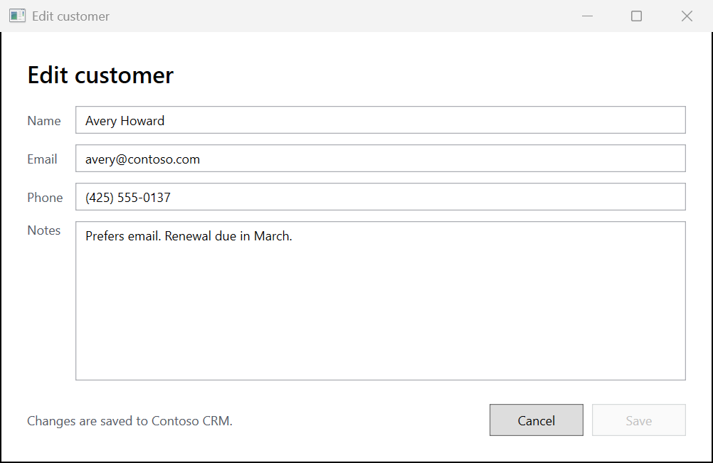

# Session transcript

Source: `Q:\source\XamlAgentDemos-notes\test-runs\VanishingSave\r11\events.jsonl`

## Tool usage

- get_file: 7
- rg: 3
- xaml_capture_image: 2
- xaml_explain_visibility: 2
- xaml_get_binding_failures: 2
- xaml_get_element_properties: 2
- powershell: 2
- task_complete: 2
- skill: 1
- xaml_get_status: 1
- xaml_find_elements: 1
- xaml_explain_property_value: 1
- multi_replace_string_in_file: 1
- xaml_apply_hot_reload: 1
- xaml_set_element_property: 1
- xaml_clear_binding_failures: 1

Failed tool calls: 0, images: 2


_Model: gpt-6-luna_


## User (17:36:59)

There should be a Save button in the footer of my running app, but I can't see it. Find out every reason it's not visible and fix them.


**Tool call (17:37:03):** `skill`
```json
{
 "skill": "xaml-diagnostics"
}
```

<details><summary>Result `skill` success=true</summary>

```
Skill "xaml-diagnostics" loaded successfully. Follow the instructions in the skill context.
```
</details>


_Skill invoked: xaml-diagnostics_


**Tool call (17:37:07):** `xaml_get_status`
```json
{
 "progressMessage": "Checking the running app and diagnostics state"
}
```

<details><summary>Result `xaml_get_status` success=true</summary>

```
{"isDebugging":true,"debuggerState":"running","diagnosticsActive":true,"apps":[{"app":"a2","name":"VanishingSave.exe [49816]","processId":49816,"platform":"WPF (.NET)","isRemote":false,"isDesignTimeOrNoDebug":false,"sourceInfoAvailable":true,"hotReloadSupported":true,"hotReloadEnabled":true,"supportsPropertyExplorer":true,"supportsInAppToolbar":true,"supportsHitTest":true,"windows":[{"windowId":"0x350764","title":"Edit customer","bounds":{"x":38,"y":38,"width":1020,"height":660},"dpiScale":1.5,"visible":true,"minimized":false}]}],"issues":[],"issuesSummary":"No problems detected.","hotReload":{"options":{"hotReloadEnabled":true,"hotReloadOnSave":false,"applyMode":"asYouType: XAML edits apply as you type, without saving (default)","wpfEnabled":true,"uwpEnabled":true,"winUIEnabled":true,"mauiEnabled":true,"justMyXaml":true,"previewSelectedElement":false,"inAppToolbar":true,"inAppSelection":false,"layoutAdorners":false,"trackFocusedElement":false,"bindingFailuresVisible":true,"compatibilityMode":false},"dotNetHotReloadEnabled":true,"isProcessingChanges":false,"lastHotReloadUpdate":{"secondsAgo":130,"updatesSinceToolsStarted":1},"errors":[]},"windowsNote":"Window bounds are physical screen pixels and include the window frame. A WPF/WinUI Window's Width and Height are device-independent units (DIPs) that also include the frame, so Width = bounds.width / dpiScale. A user's \"800 px wide\" is ambiguous: say which unit you tested. A minimized window reports x/y = -32000 and can't be captured."}
```
</details>


**Tool call (17:37:11):** `xaml_find_elements`
```json
{
 "progressMessage": "Locating the Save control",
 "app": "a2",
 "type": "*Button",
 "name": "Save",
 "maxResults": 100
}
```


**Tool call (17:37:11):** `xaml_capture_image`
```json
{
 "progressMessage": "Inspecting the current app window",
 "app": "a2",
 "windowId": "0x350764"
}
```

<details><summary>Result `xaml_find_elements` success=true</summary>

```
{"count":1,"totalMatches":1,"truncated":false,"results":[{"id":"a2:10","type":"System.Windows.Controls.Button","name":"SaveButton","source":{"file":"Q:\\source\\XamlAgentDemos\\src\\VanishingSave\\MainWindow.xaml","line":118,"column":14},"path":"MainWindow/Border/AdornerDecorator/ContentPresenter/Grid/Grid/Button"}]}
```
</details>


<details><summary>Result `xaml_capture_image` success=true</summary>

```
Screenshot of window 0x350764 "Edit customer" of app a2 (1002x651 image of the window's client area, so it's slightly smaller than the frame bounds from xaml_get_status).
```
</details>


**Tool call (17:37:15):** `xaml_explain_visibility`
```json
{
 "progressMessage": "Finding all reasons Save is hidden",
 "elementIds": [
  "a2:10"
 ]
}
```


**Tool call (17:37:15):** `xaml_get_binding_failures`
```json
{
 "progressMessage": "Checking for Save-related binding failures",
 "textFilter": "Save",
 "maxResults": 100
}
```

<details><summary>Result `xaml_get_binding_failures` success=true</summary>

```
{"note":"This is a cumulative log since debugging started or the last xaml_clear_binding_failures, not live state: fixed failures stay listed. occurrencesSinceLastRead counts new occurrences since your previous call (0 = not seen again; it only grows when the UI using the binding is created or updated again). pathStillInSource=false means the XAML near that line no longer contains the failing path, so it was probably fixed in source (hot reload or a restart applies it). To verify a fix: clear, revisit the UI that uses the binding, then read again. Failures without a file usually come from bindings created in code.","totalUnique":1,"matched":1,"truncated":false,"failures":[{"severity":"Warning","count":1,"pathStillInSource":false,"errorCode":"40","description":"CanSave property not found on object of type CustomerViewModel.","bindingPath":"CanSave","target":"Button.Visibility, Name='SaveButton'","targetName":"SaveButton","targetPropertyType":"Visibility","dataContextType":"CustomerViewModel","file":"Q:\\source\\XamlAgentDemos\\src\\VanishingSave\\MainWindow.xaml","line":118,"column":14,"project":"VanishingSave","originalError":"System.Windows.Data Warning: 40 : BindingExpression path error: 'CanSave' property not found on 'object' ''CustomerViewModel' (HashCode=30479632)'. BindingExpression:Path=CanSave; DataItem='CustomerViewModel' (HashCode=30479632); target element is 'Button' (Name='SaveButton'); target property is 'Visibility' (type 'Visibility')"}]}
```
</details>

<details><summary>Result `xaml_explain_visibility` success=true</summary>

```
{"id":"a2:10","type":"System.Windows.Controls.Button","name":"SaveButton","source":{"file":"Q:\\source\\XamlAgentDemos\\src\\VanishingSave\\MainWindow.xaml","line":118,"column":14},"verdict":"4 separate causes, some latent behind the first; it stays hidden until every one is fixed. First: Button 'SaveButton' has Visibility=Collapsed from a binding.","causes":[{"rank":1,"kind":"visibility","message":"Button 'SaveButton' has Visibility=Collapsed from a binding.","elementId":"a2:10","property":"Visibility","value":"{Binding} -> Collapsed","valueSource":"Local","location":{"file":"Q:\\source\\XamlAgentDemos\\src\\VanishingSave\\MainWindow.xaml","line":118,"column":14},"fix":"Check the bound source value and converter (xaml_explain_property_value shows the binding), or fix the binding failure listed below."},{"rank":1,"kind":"opacity","message":"Button 'SaveButton' has Opacity=0, so it's transparent.","elementId":"a2:10","property":"Opacity","value":"0","valueSource":"StyleTrigger","location":{"file":"Q:\\source\\XamlAgentDemos\\src\\VanishingSave\\MainWindow.xaml","line":118,"column":14},"fix":"Check for a storyboard or trigger that fades it in, or change the value."},{"rank":2,"kind":"gridCell","latent":true,"message":"Button 'SaveButton' is in ColumnDefinitions[2] 'SaveColumn' of Grid 'Footer', which has Width=0: even after the rank 1 cause is fixed it gets no room.","elementId":"a2:19","property":"ColumnDefinitions[2].Width","value":"0","valueSource":"Local","location":{"file":"Q:\\source\\XamlAgentDemos\\src\\VanishingSave\\MainWindow.xaml","line":105,"column":18},"fix":"Give that row/column a non-zero, Auto or star size. If valueSource is Local with no location, code-behind sets it: search the code for 'SaveColumn'."},{"rank":2,"kind":"covered","latent":true,"message":"Border 'SyncStatusHost' shares Button 'SaveButton''s Grid cell (row 0, column 2), has an opaque Background #FFFFFFFF and draws on top because its ZIndex 1 is higher: even after the other causes are fixed it hides Button 'SaveButton'.","elementId":"a2:30","property":"Background","value":"#FFFFFFFF","valueSource":"Local","location":{"file":"Q:\\source\\XamlAgentDemos\\src\\VanishingSave\\MainWindow.xaml","line":127,"column":14},"fix":"Move the overlay to another cell, make its Background Transparent, collapse it when it has nothing to show, or lower its ZIndex below the element."}],"hitTest":{"summary":"A click at its center does NOT reach 'SaveButton' because it's disabled (IsEnabled=False):
... [truncated 1629 chars]
```
</details>


**Tool call (17:37:21):** `get_file`
```json
{
 "filename": "Q:\\source\\XamlAgentDemos\\src\\VanishingSave\\MainWindow.xaml",
 "startLine": 85,
 "endLine": 145,
 "includeLineNumbers": true
}
```


**Tool call (17:37:21):** `rg`
```json
{
 "pattern": "CanSave|SaveCommand|SaveColumn|SyncStatusHost|Opacity|Visibility",
 "paths": "Q:\\source\\XamlAgentDemos\\src\\VanishingSave",
 "output_mode": "content",
 "-n": true,
 "head_limit": 120
}
```


**Tool call (17:37:21):** `xaml_get_element_properties`
```json
{
 "progressMessage": "Inspecting Save state and footer layout",
 "elementIds": [
  "a2:10",
  "a2:19",
  "a2:30"
 ],
 "nameFilter": "Visibility|Opacity|IsEnabled|Command|DataContext.CanSave|DataContext.SaveCommand|ColumnDefinitions[*]|Grid.Row|Grid.Column|Panel.ZIndex|Background",
 "includeAll": true
}
```


**Tool call (17:37:21):** `xaml_explain_property_value`
```json
{
 "progressMessage": "Tracing Save visibility and opacity sources",
 "elementIds": [
  "a2:10"
 ],
 "propertyNames": [
  "Visibility",
  "Opacity",
  "IsEnabled",
  "Command"
 ],
 "pairwise": false
}
```

<details><summary>Result `rg` success=true</summary>

```
Q:\source\XamlAgentDemos\src\VanishingSave\MainWindow.xaml:14:        <BooleanToVisibilityConverter x:Key="BoolToVisibility" />
Q:\source\XamlAgentDemos\src\VanishingSave\MainWindow.xaml:34:                    <Setter Property="Opacity" Value="0" />
Q:\source\XamlAgentDemos\src\VanishingSave\MainWindow.xaml:105:                <ColumnDefinition x:Name="SaveColumn" Width="Auto" />
Q:\source\XamlAgentDemos\src\VanishingSave\MainWindow.xaml:120:                    Command="{Binding SaveCommand}"
Q:\source\XamlAgentDemos\src\VanishingSave\MainWindow.xaml:124:                    Visibility="{Binding CanSave, Converter={StaticResource BoolToVisibility}, FallbackValue=Collapsed}" />
Q:\source\XamlAgentDemos\src\VanishingSave\MainWindow.xaml:127:            <Border x:Name="SyncStatusHost"
Q:\source\XamlAgentDemos\src\VanishingSave\CustomerViewModel.cs:13:        this.SaveCommand = new RelayCommand(this.Save, () => this.IsDirty);
Q:\source\XamlAgentDemos\src\VanishingSave\CustomerViewModel.cs:30:    public RelayCommand SaveCommand { get; }
Q:\source\XamlAgentDemos\src\VanishingSave\MainWindow.xaml.cs:17:            this.SaveColumn.Width = new GridLength(0);
```
</details>

<details><summary>Result `get_file` success=true</summary>

```
```xaml src\VanishingSave\MainWindow.xaml (Lines 85-138 of 138 total. Call tools for more if needed.)
85:                      Text="{Binding Phone, UpdateSourceTrigger=PropertyChanged}" />
86: 
87:             <TextBlock Grid.Row="3"
88:                        VerticalAlignment="Top"
89:                        Style="{StaticResource FieldLabelStyle}"
90:                        Text="Notes" />
91:             <TextBox x:Name="NotesBox"
92:                      Grid.Row="3"
93:                      Grid.Column="1"
94:                      AcceptsReturn="True"
95:                      AutomationProperties.Name="Notes"
96:                      Style="{StaticResource FieldStyle}"
97:                      Text="{Binding Notes, UpdateSourceTrigger=PropertyChanged}"
98:                      TextWrapping="Wrap" />
99:         </Grid>
100: 
101:         <Grid x:Name="Footer" Grid.Row="2" Margin="0,12,0,0">
102:             <Grid.ColumnDefinitions>
103:                 <ColumnDefinition Width="*" />
104:                 <ColumnDefinition Width="Auto" />
105:                 <ColumnDefinition x:Name="SaveColumn" Width="Auto" />
106:             </Grid.ColumnDefinitions>
107: 
108:             <TextBlock VerticalAlignment="Center"
109:                        Foreground="#555B66"
110:                        Text="Changes are saved to Contoso CRM." />
111: 
112:             <Button x:Name="CancelButton"
113:                     Grid.Column="1"
114:                     Command="{Binding CancelCommand}"
115:                     Content="Cancel"
116:                     Style="{StaticResource FooterButtonStyle}" />
117: 
118:             <Button x:Name="SaveButton"
119:                     Grid.Column="2"
120:                     Command="{Binding SaveCommand}"
121:                     Content="Save"
122:                     IsDefault="True"
123:                     Style="{StaticResource FooterButtonStyle}"
124:                     Visibility="{Binding CanSave, Converter={StaticResource BoolToVisibility}, FallbackValue=Collapsed}" />
125: 
126:             <!-- Shows "Offline - changes will sync later" when the connection drops. -->
127:             <Border x:Name="SyncStatusHost"
128:                     Grid.Column="2"
129:                     Panel.ZIndex="1"
130:                     Background="White">
131:                 <TextBlock x:Name="SyncStatusText"
132:                            VerticalAlignment="Center"
133:
... [truncated 189 chars]
```
</details>

<details><summary>Result `xaml_explain_property_value` success=true</summary>

```
{"count":4,"failed":0,"results":[{"id":"a2:10","type":"System.Windows.Controls.Button","property":"Visibility","propertyType":"System.Windows.Visibility","evaluatedValue":"2 (System.Windows.Visibility)","effectiveSource":"Local","chain":[{"kind":"Local","description":"Local value set on the element (XAML attribute, binding or code). Wins over styles, templates and inheritance.","evaluatedValue":"2 (System.Windows.Visibility)","valueType":"System.Windows.Data.BindingExpression","isBinding":true,"effective":true,"sourceLocation":{"file":"Q:\\source\\XamlAgentDemos\\src\\VanishingSave\\MainWindow.xaml","line":118,"column":14}},{"kind":"Default","description":"The property's default value; nothing sets it.","value":"0","valueType":"System.Windows.Visibility","effective":false}],"notes":["To let a style or template value apply, remove the local value (the attribute, binding or code assignment). To change it, edit that local value. XAML and code both produce Local values, and the source location may still point to the XAML attribute after code assigned a new value. If the live value differs from the XAML attribute, or the element has no XAML attribute for it, code set it: search code-behind for the element's x:Name.","The effective value comes from a binding. If it's wrong, check xaml_get_binding_failures and the DataContext."]},{"id":"a2:10","type":"System.Windows.Controls.Button","property":"Opacity","propertyType":"System.Double","effectiveValue":"0","effectiveSource":"StyleTrigger","chain":[{"kind":"StyleTrigger","description":"Trigger in the element's Style whose condition is currently true.","value":"0","valueType":"System.Double","effective":true},{"kind":"Default","description":"The property's default value; nothing sets it.","value":"1","valueType":"System.Double","effective":false}],"notes":["Edit the setter or trigger at the source location, or set a local value to override it for this element only."]},{"id":"a2:10","type":"System.Windows.Controls.Button","property":"IsEnabled","propertyType":"System.Boolean","effectiveValue":"False","effectiveSource":"Coercion","chain":[{"kind":"Coercion","description":"The control coerced the value (for example clamped to a minimum or maximum).","value":"False","valueType":"System.Boolean","effective":true},{"kind":"Default","description":"The property's default value; nothing sets it.","value":"True","valueType":"System.Boolean","effective":false}],"notes":["Check related properties that constrain this one (for exa
... [truncated 1558 chars]
```
</details>

<details><summary>Result `xaml_get_element_properties` success=true</summary>

```
{"count":3,"failed":0,"results":[{"id":"a2:10","type":"System.Windows.Controls.Button","name":"SaveButton","source":{"file":"Q:\\source\\XamlAgentDemos\\src\\VanishingSave\\MainWindow.xaml","line":118,"column":14},"properties":[{"name":"IsEnabled","value":"False","valueType":"System.Boolean","valueSource":"Coercion"},{"name":"Command","evaluatedValue":"(XamlAgentDemos.RelayCommand)","valueType":"System.Windows.Data.BindingExpression","propertyType":"System.Windows.Input.ICommand","valueSource":"Local","isBinding":true},{"name":"Visibility","evaluatedValue":"2 (System.Windows.Visibility)","valueType":"System.Windows.Data.BindingExpression","propertyType":"System.Windows.Visibility","valueSource":"Local","isBinding":true},{"name":"Opacity","value":"0","valueType":"System.Double","valueSource":"StyleTrigger"}],"hiddenDefaultOrOverridden":4,"hint":"Default and overridden values were omitted. Pass includeAll=true to see them, or call xaml_explain_property_value for one property's full precedence chain.","items":[{"path":"DataContext","type":"VanishingSave.CustomerViewModel","properties":[{"name":"SaveCommand","value":"XamlAgentDemos.RelayCommand","valueSource":"Local","readOnly":true}]},{"path":"ColumnDefinitions[*]","error":"PROPERTY_NOT_FOUND","message":"'a2:10' has no property 'ColumnDefinitions'."}]},{"id":"a2:19","type":"System.Windows.Controls.Grid","name":"Footer","source":{"file":"Q:\\source\\XamlAgentDemos\\src\\VanishingSave\\MainWindow.xaml","line":101,"column":10},"properties":[],"defaultValues":{"CommandBindings":null,"IsEnabled":"True","Opacity":"1","Visibility":"0"},"hint":"No property name matches any of: Visibility, Opacity, IsEnabled, Command (exact name when one exists, otherwise a case-insensitive substring; separate alternatives with '|' or ','). Check the spelling, or omit nameFilter to list the properties that are set.","items":[{"path":"DataContext","type":"VanishingSave.CustomerViewModel","properties":[{"name":"SaveCommand","value":"XamlAgentDemos.RelayCommand","valueSource":"Local","readOnly":true}]},{"path":"ColumnDefinitions[0]","type":"System.Windows.Controls.ColumnDefinition","properties":[{"name":"Width","value":"*","valueSource":"Local"},{"name":"ActualWidth","value":"521.3333333333334","valueSource":"Local","readOnly":true},{"name":"IsInitialized","value":"True","valueSource":"Local","readOnly":true},{"name":"IsLoaded","value":"True","valueSource":"Local","readOnly":true},{"name":"Parent","valueSource":"Local","readOnly":true},{
... [truncated 11413 chars]
```
</details>


**Assistant (17:37:26):**

The live diagnostics found four independent visibility blockers plus a disabled Save command. I’m checking the XAML and view-model intent before correcting them.


**Tool call (17:37:26):** `get_file`
```json
{
 "filename": "Q:\\source\\XamlAgentDemos\\src\\VanishingSave\\MainWindow.xaml",
 "startLine": 1,
 "endLine": 85,
 "includeLineNumbers": true
}
```


**Tool call (17:37:26):** `get_file`
```json
{
 "filename": "Q:\\source\\XamlAgentDemos\\src\\VanishingSave\\MainWindow.xaml.cs",
 "startLine": 1,
 "endLine": 100,
 "includeLineNumbers": true
}
```


**Tool call (17:37:26):** `get_file`
```json
{
 "filename": "Q:\\source\\XamlAgentDemos\\src\\VanishingSave\\CustomerViewModel.cs",
 "startLine": 1,
 "endLine": 200,
 "includeLineNumbers": true
}
```


**Tool call (17:37:26):** `rg`
```json
{
 "pattern": "class RelayCommand|CanExecuteChanged|CustomerViewModel|VanishingSave",
 "paths": "Q:\\source\\XamlAgentDemos\\src",
 "output_mode": "content",
 "-n": true,
 "head_limit": 160
}
```

<details><summary>Result `get_file` success=true</summary>

```
```xaml src\VanishingSave\MainWindow.xaml (Lines 1-85 of 138 total. Call tools for more if needed.)
1: <Window x:Class="VanishingSave.MainWindow"
2:         xmlns="http://schemas.microsoft.com/winfx/2006/xaml/presentation"
3:         xmlns:x="http://schemas.microsoft.com/winfx/2006/xaml"
4:         xmlns:local="clr-namespace:VanishingSave"
5:         Title="Edit customer"
6:         Width="680"
7:         Height="440"
8:         Background="White">
9:     <Window.DataContext>
10:         <local:CustomerViewModel />
11:     </Window.DataContext>
12: 
13:     <Window.Resources>
14:         <BooleanToVisibilityConverter x:Key="BoolToVisibility" />
15: 
16:         <Style x:Key="FieldLabelStyle" TargetType="TextBlock">
17:             <Setter Property="Margin" Value="0,0,12,10" />
18:             <Setter Property="VerticalAlignment" Value="Center" />
19:             <Setter Property="Foreground" Value="#555B66" />
20:         </Style>
21: 
22:         <Style x:Key="FieldStyle" TargetType="TextBox">
23:             <Setter Property="Margin" Value="0,0,0,10" />
24:             <Setter Property="Padding" Value="6,4" />
25:         </Style>
26: 
27:         <Style x:Key="FooterButtonStyle" TargetType="Button">
28:             <Setter Property="MinWidth" Value="88" />
29:             <Setter Property="Margin" Value="8,0,0,0" />
30:             <Setter Property="Padding" Value="16,6" />
31:             <Style.Triggers>
32:                 <!-- Fade out buttons that can't be used yet. -->
33:                 <Trigger Property="IsEnabled" Value="False">
34:                     <Setter Property="Opacity" Value="0" />
35:                 </Trigger>
36:             </Style.Triggers>
37:         </Style>
38:     </Window.Resources>
39: 
40:     <Grid Margin="24">
41:         <Grid.RowDefinitions>
42:             <RowDefinition Height="Auto" />
43:             <RowDefinition Height="*" />
44:             <RowDefinition Height="Auto" />
45:         </Grid.RowDefinitions>
46: 
47:         <TextBlock Margin="0,0,0,16"
48:                    FontSize="22"
49:                    FontWeight="SemiBold"
50:                    Text="Edit customer" />
51: 
52:         <Grid Grid.Row="1">
53:             <Grid.ColumnDefinitions>
54:                 <ColumnDefinition Width="Auto" />
55:                 <ColumnDefinition Width="*" />
56:             </Grid.ColumnDefinitions>
57:             <Grid.RowDefinitions>
58:             
... [truncated 1508 chars]
```
</details>

<details><summary>Result `get_file` success=true</summary>

```
```csharp src\VanishingSave\CustomerViewModel.cs (Lines 1-35 of 35 total. Call tools for more if needed.)
1: namespace VanishingSave;
2: 
3: public sealed class CustomerViewModel : ObservableObject
4: {
5:     private string name = "Avery Howard";
6:     private string email = "avery@contoso.com";
7:     private string phone = "(425) 555-0137";
8:     private string notes = "Prefers email. Renewal due in March.";
9:     private bool isDirty;
10: 
11:     public CustomerViewModel()
12:     {
13:         this.SaveCommand = new RelayCommand(this.Save, () => this.IsDirty);
14:         this.CancelCommand = new RelayCommand(() => this.IsDirty = false);
15:     }
16: 
17:     public string Name { get => this.name; set { if (this.SetProperty(ref this.name, value)) this.IsDirty = true; } }
18: 
19:     public string Email { get => this.email; set { if (this.SetProperty(ref this.email, value)) this.IsDirty = true; } }
20: 
21:     public string Phone { get => this.phone; set { if (this.SetProperty(ref this.phone, value)) this.IsDirty = true; } }
22: 
23:     public string Notes { get => this.notes; set { if (this.SetProperty(ref this.notes, value)) this.IsDirty = true; } }
24: 
25:     public bool IsDirty { get => this.isDirty; set => this.SetProperty(ref this.isDirty, value); }
26: 
27:     /// <summary>Whether the current user is allowed to save customer records.</summary>
28:     public bool IsSaveAvailable => true;
29: 
30:     public RelayCommand SaveCommand { get; }
31: 
32:     public RelayCommand CancelCommand { get; }
33: 
34:     private void Save() => this.IsDirty = false;
35: }

```


```
</details>

<details><summary>Result `get_file` success=true</summary>

```
```csharp src\VanishingSave\MainWindow.xaml.cs (Lines 1-20 of 20 total. Call tools for more if needed.)
1: using System.Windows;
2: 
3: namespace VanishingSave;
4: 
5: public partial class MainWindow : Window
6: {
7:     public MainWindow()
8:     {
9:         this.InitializeComponent();
10:         this.Loaded += this.OnLoaded;
11:     }
12: 
13:     private void OnLoaded(object sender, RoutedEventArgs e)
14:     {
15:         if (FooterSettings.UseCompactFooter)
16:         {
17:             this.SaveColumn.Width = new GridLength(0);
18:         }
19:     }
20: }

```


```
</details>

<details><summary>Result `rg` success=true</summary>

```
Q:\source\XamlAgentDemos\src\VanishingSave\VanishingSave.csproj:3:    <RootNamespace>VanishingSave</RootNamespace>
Q:\source\XamlAgentDemos\src\VanishingSave\App.xaml.cs:3:namespace VanishingSave;
Q:\source\XamlAgentDemos\src\VanishingSave\MainWindow.xaml.cs:3:namespace VanishingSave;
Q:\source\XamlAgentDemos\src\VanishingSave\App.xaml:1:<Application x:Class="VanishingSave.App"
Q:\source\XamlAgentDemos\src\VanishingSave\MainWindow.xaml:1:<Window x:Class="VanishingSave.MainWindow"
Q:\source\XamlAgentDemos\src\VanishingSave\MainWindow.xaml:4:        xmlns:local="clr-namespace:VanishingSave"
Q:\source\XamlAgentDemos\src\VanishingSave\MainWindow.xaml:10:        <local:CustomerViewModel />
Q:\source\XamlAgentDemos\src\Shared\RelayCommand.cs:5:public sealed class RelayCommand(Action execute, Func<bool>? canExecute = null) : ICommand
Q:\source\XamlAgentDemos\src\Shared\RelayCommand.cs:7:    public event EventHandler? CanExecuteChanged
Q:\source\XamlAgentDemos\src\VanishingSave\FooterSettings.cs:1:namespace VanishingSave;
Q:\source\XamlAgentDemos\src\VanishingSave\CustomerViewModel.cs:1:namespace VanishingSave;
Q:\source\XamlAgentDemos\src\VanishingSave\CustomerViewModel.cs:3:public sealed class CustomerViewModel : ObservableObject
Q:\source\XamlAgentDemos\src\VanishingSave\CustomerViewModel.cs:11:    public CustomerViewModel()
```
</details>


**Tool call (17:37:40):** `get_file`
```json
{
 "filename": "Q:\\source\\XamlAgentDemos\\src\\VanishingSave\\FooterSettings.cs",
 "startLine": 1,
 "endLine": 100,
 "includeLineNumbers": true
}
```


**Tool call (17:37:40):** `get_file`
```json
{
 "filename": "Q:\\source\\XamlAgentDemos\\src\\Shared\\RelayCommand.cs",
 "startLine": 1,
 "endLine": 120,
 "includeLineNumbers": true
}
```


**Tool call (17:37:40):** `rg`
```json
{
 "pattern": "class ObservableObject|IsDirty|IsSaveAvailable|UseCompactFooter|SyncStatus",
 "paths": "Q:\\source\\XamlAgentDemos",
 "output_mode": "content",
 "-n": true,
 "head_limit": 160
}
```


**Tool call (17:37:40):** `get_file`
```json
{
 "filename": "Q:\\source\\XamlAgentDemos\\src\\VanishingSave\\VanishingSave.csproj",
 "startLine": 1,
 "endLine": 100,
 "includeLineNumbers": true
}
```

<details><summary>Result `get_file` success=true</summary>

```
``` src\VanishingSave\VanishingSave.csproj (Lines 1-5 of 5 total. Call tools for more if needed.)
1: <Project Sdk="Microsoft.NET.Sdk">
2:   <PropertyGroup>
3:     <RootNamespace>VanishingSave</RootNamespace>
4:   </PropertyGroup>
5: </Project>

```


```
</details>

<details><summary>Result `get_file` success=true</summary>

```
```csharp src\VanishingSave\FooterSettings.cs (Lines 1-10 of 10 total. Call tools for more if needed.)
1: namespace VanishingSave;
2: 
3: public static class FooterSettings
4: {
5:     /// <summary>
6:     /// Compact footer for small screens: auto-save makes the Save column unnecessary.
7:     /// (Auto-save was cut from v2, but this switch stayed on.)
8:     /// </summary>
9:     public static bool UseCompactFooter { get; set; } = true;
10: }

```


```
</details>

<details><summary>Result `get_file` success=true</summary>

```
```csharp src\Shared\RelayCommand.cs (Lines 1-16 of 16 total. Call tools for more if needed.)
1: using System.Windows.Input;
2: 
3: namespace XamlAgentDemos;
4: 
5: public sealed class RelayCommand(Action execute, Func<bool>? canExecute = null) : ICommand
6: {
7:     public event EventHandler? CanExecuteChanged
8:     {
9:         add => CommandManager.RequerySuggested += value;
10:         remove => CommandManager.RequerySuggested -= value;
11:     }
12: 
13:     public bool CanExecute(object? parameter) => canExecute?.Invoke() ?? true;
14: 
15:     public void Execute(object? parameter) => execute();
16: }

```


```
</details>

<details><summary>Result `rg` success=true</summary>

```
[grep content: 21 matches across 7 file(s) under Q:/source/XamlAgentDemos/src; delimited groups]

BugRepro/ProfileViewModel.cs (6 match(es)):
  17:         this.SaveCommand = new RelayCommand(this.Save, () => this.IsDirty);
  18:         this.CancelCommand = new RelayCommand(this.Cancel, () => this.IsDirty);
  45:     public bool IsDirty { get => this.isDirty; private set => this.SetProperty(ref this.isDirty, value); }
  57:             this.IsDirty = true;
  65:         this.IsDirty = false;
  75:         this.IsDirty = false;

BugRepro/MainWindow.xaml:56:                            Visibility="{Binding IsDirty, Converter={StaticResource BoolToVisibility}}" />

Shared/ObservableObject.cs:6: public abstract class ObservableObject : INotifyPropertyChanged

VanishingSave/MainWindow.xaml.cs:15:         if (FooterSettings.UseCompactFooter)

VanishingSave/MainWindow.xaml (2 match(es)):
  127:             <Border x:Name="SyncStatusHost"
  131:                 <TextBlock x:Name="SyncStatusText"

VanishingSave/FooterSettings.cs:9:     public static bool UseCompactFooter { get; set; } = true;

VanishingSave/CustomerViewModel.cs (9 match(es)):
  13:         this.SaveCommand = new RelayCommand(this.Save, () => this.IsDirty);
  14:         this.CancelCommand = new RelayCommand(() => this.IsDirty = false);
  17:     public string Name { get => this.name; set { if (this.SetProperty(ref this.name, value)) this.IsDirty = true; } }
  19:     public string Email { get => this.email; set { if (this.SetProperty(ref this.email, value)) this.IsDirty = true; } }
  21:     public string Phone { get => this.phone; set { if (this.SetProperty(ref this.phone, value)) this.IsDirty = true; } }
  23:     public string Notes { get => this.notes; set { if (this.SetProperty(ref this.notes, value)) this.IsDirty = true; } }
  25:     public bool IsDirty { get => this.isDirty; set => this.SetProperty(ref this.isDirty, value); }
  28:     public bool IsSaveAvailable => true;
  34:     private void Save() => this.IsDirty = false;
```
</details>


**Tool call (17:38:08):** `powershell`
```json
{
 "command": "git status --short",
 "description": "Check for existing workspace changes"
}
```

<details><summary>Result `powershell` success=true</summary>

```

<shellId: 0 completed with exit code 0>
```
</details>


**Tool call (17:38:19):** `multi_replace_string_in_file`
```json
{
 "explanation": "Correct the binding and four visibility blockers while preserving the Save command's dirty-state behavior.",
 "replacements": [
  {
   "filePath": "src\\VanishingSave\\MainWindow.xaml",
   "oldString": "            <Style.Triggers>\n                <!-- Fade out buttons that can't be used yet. -->\n                <Trigger Property=\"IsEnabled\" Value=\"False\">\n                    <Setter Property=\"Opacity\" Value=\"0\" />\n                </Trigger>\n            </Style.Triggers>",
   "newString": "            <Style.Triggers>\n                <Trigger Property=\"IsEnabled\" Value=\"False\">\n                    <Setter Property=\"Opacity\" Value=\"0.5\" />\n                </Trigger>\n            </Style.Triggers>",
   "explanation": "Keep disabled footer buttons visibly distinguishable rather than fully transparent."
  },
  {
   "filePath": "src\\VanishingSave\\MainWindow.xaml",
   "oldString": "                    Style=\"{StaticResource FooterButtonStyle}\"\n                    Visibility=\"{Binding CanSave, Converter={StaticResource BoolToVisibility}, FallbackValue=Collapsed}\" />\n\n            <!-- Shows \"Offline - changes will sync later\" when the connection drops. -->\n            <Border x:Name=\"SyncStatusHost\"\n                    Grid.Column=\"2\"\n                    Panel.ZIndex=\"1\"",
   "newString": "                    Style=\"{StaticResource FooterButtonStyle}\"\n                    Visibility=\"{Binding IsSaveAvailable, Converter
... [truncated 1040 chars]
```

<details><summary>Result `multi_replace_string_in_file` success=true</summary>

```
Successfully applied 3 of 3 replacement(s) across 2 file(s).
```
</details>


**Tool call (17:38:22):** `xaml_apply_hot_reload`
```json
{
 "progressMessage": "Applying the footer fixes to the running app",
 "includeCodeChanges": true
}
```

<details><summary>Result `xaml_apply_hot_reload` success=true</summary>

```
{"summary":"XAML: Applied with no new errors. .NET code: applied with 2 warning(s) in 'codeHotReloadWarnings': some code changes (for example static or field initializers, constructors and startup code) only take effect after the code runs again or the app restarts.","applied":true,"xamlApplied":true,"status":"applied","errors":[],"log":[],"lastHotReloadUpdate":{"secondsAgo":4,"updatesSinceToolsStarted":2},"codeChanges":".NET Hot Reload was started for saved code changes. Its results are in the Hot Reload output pane, not in 'log'; if an edit can't be hot reloaded, Visual Studio asks the user to rebuild and restart.","codeStatus":"appliedWithWarnings","codeHotReloadWarnings":["12:38:23.06 🔣  ⚠ [Q:\\source\\XamlAgentDemos\\src\\VanishingSave\\VanishingSave.csproj ({4EB184D2-643F-45DC-A2E0-9645EA07CD15})]: Q:\\source\\XamlAgentDemos\\src\\VanishingSave\\FooterSettings.cs(8,5): warning ENC0118: Changing 'auto-property' might not have any effect until the application is restarted.","12:38:23.12  ⚠ Q:\\source\\XamlAgentDemos\\src\\VanishingSave\\FooterSettings.cs (line 8): warning ENC0118: Changing 'auto-property' might not have any effect until the application is restarted."],"codeHotReloadOutput":["12:38:23.06 🔣  ⚠ [Q:\\source\\XamlAgentDemos\\src\\VanishingSave\\VanishingSave.csproj ({4EB184D2-643F-45DC-A2E0-9645EA07CD15})]: Q:\\source\\XamlAgentDemos\\src\\VanishingSave\\FooterSettings.cs(8,5): warning ENC0118: Changing 'auto-property' might not have any effect until the application is restarted.","12:38:23.12  ⚠ Q:\\source\\XamlAgentDemos\\src\\VanishingSave\\FooterSettings.cs (line 8): warning ENC0118: Changing 'auto-property' might not have any effect until the application is restarted.","12:38:23.59  Code changes were successfully applied."],"hint":"Call xaml_capture_image to verify the change visually. Views that aren't loaded (other tabs, closed dialogs) are updated when they're next shown. Source line numbers reported for existing elements can still point to the pre-edit lines until the element is recreated, so find elements by x:Name or type rather than by an old line number. Structural edits (wrapping or replacing a parent, changing a root's content) recreate elements, which resets their runtime state such as selection, checked state, typed text and scroll position, and invalidates their IDs. Re-establish the state you were testing before capturing again."}
```
</details>


**Tool call (17:38:30):** `xaml_set_element_property`
```json
{
 "progressMessage": "Restoring the Save column in the current window",
 "elementIds": [
  "a2:19"
 ],
 "setters": [
  "ColumnDefinitions[2].Width=Auto"
 ]
}
```

<details><summary>Result `xaml_set_element_property` success=true</summary>

```
{"id":"a2:19","property":"ColumnDefinitions[2].Width","oldValue":"0","newValue":"Auto","note":"This change only affects the running app and is lost when it restarts. Edit the XAML source to persist it. Until then it overrides the source: hot reload re-applies only the properties whose XAML changed, so undo experiments (set the original value back) before you verify a source fix."}
```
</details>


**Tool call (17:38:36):** `xaml_clear_binding_failures`
```json
{
 "progressMessage": "Resetting binding diagnostics for verification"
}
```

<details><summary>Result `xaml_clear_binding_failures` success=true</summary>

```
{"cleared":1}
```
</details>


**Tool call (17:38:39):** `xaml_explain_visibility`
```json
{
 "progressMessage": "Verifying all Save visibility causes are gone",
 "elementIds": [
  "#SaveButton"
 ]
}
```


**Tool call (17:38:39):** `xaml_capture_image`
```json
{
 "progressMessage": "Confirming Save appears in the footer",
 "app": "a2",
 "windowId": "0x350764"
}
```


**Tool call (17:38:39):** `xaml_get_element_properties`
```json
{
 "progressMessage": "Checking Save binding and enabled state",
 "elementIds": [
  "#SaveButton"
 ],
 "nameFilter": "Visibility|Opacity|IsEnabled|Command|DataContext.IsSaveAvailable|DataContext.IsDirty",
 "includeAll": true
}
```




<details><summary>Result `xaml_capture_image` success=true</summary>

```
Screenshot of window 0x350764 "Edit customer" of app a2 (1002x651 image of the window's client area, so it's slightly smaller than the frame bounds from xaml_get_status).
```
</details>

<details><summary>Result `xaml_get_element_properties` success=true</summary>

```
{"id":"#SaveButton","type":"System.Windows.Controls.Button","name":"SaveButton","source":{"file":"Q:\\source\\XamlAgentDemos\\src\\VanishingSave\\MainWindow.xaml","line":118,"column":14},"properties":[{"name":"IsEnabled","value":"False","valueType":"System.Boolean","valueSource":"Coercion"},{"name":"Command","evaluatedValue":"(XamlAgentDemos.RelayCommand)","valueType":"System.Windows.Data.BindingExpression","propertyType":"System.Windows.Input.ICommand","valueSource":"Local","isBinding":true},{"name":"Visibility","evaluatedValue":"0 (System.Windows.Visibility)","valueType":"System.Windows.Data.BindingExpression","propertyType":"System.Windows.Visibility","valueSource":"Local","isBinding":true},{"name":"Opacity","value":"0.5","valueType":"System.Double","valueSource":"StyleTrigger"}],"hiddenDefaultOrOverridden":4,"hint":"Default and overridden values were omitted. Pass includeAll=true to see them, or call xaml_explain_property_value for one property's full precedence chain.","items":[{"path":"DataContext","type":"VanishingSave.CustomerViewModel","properties":[{"name":"IsSaveAvailable","value":"True","valueSource":"Local","readOnly":true},{"name":"IsDirty","value":"False","valueSource":"Default"}]}],"note":"Item properties are live values. Change one with xaml_set_element_property using the same path, for example setters=['ColumnDefinitions[2].Width=Auto']; edit the XAML too to keep the change. Without a property filter, only set values and Actual* sizes are listed."}
```
</details>

<details><summary>Result `xaml_explain_visibility` success=true</summary>

```
{"id":"#SaveButton","type":"System.Windows.Controls.Button","name":"SaveButton","source":{"file":"Q:\\source\\XamlAgentDemos\\src\\VanishingSave\\MainWindow.xaml","line":118,"column":14},"verdict":"No reason found for Button 'SaveButton' to be invisible: it's Visible, opaque, has a size, is inside its window and nothing covers its center. Capture an image to confirm, or check that this is the element you expect (another copy may be the one on screen).","causes":[],"checkedOk":["size 88x29.96"],"hitTest":{"summary":"A click at its center does NOT reach 'SaveButton' because it's disabled (IsEnabled=False): input skips disabled elements and lands on Grid 'Footer' behind or around it. That element isn't necessarily covering it; fix the IsEnabled cause (see blockers, or a command's CanExecute) rather than the layout. Button 'SaveButton' has IsEnabled=False (IsEnabledCore: command CanExecute is false or the control disabled itself).","visibleFraction":1.0,"inputTarget":{"id":"a2:19","type":"System.Windows.Controls.Grid","name":"Footer","source":{"file":"Q:\\source\\XamlAgentDemos\\src\\VanishingSave\\MainWindow.xaml","line":101,"column":10},"templatedParent":null,"property":null,"value":null}},"note":"rank 1 hides the element for certain, rank 2 almost certainly, rank 3 may. latent=true means another cause masks it now, but it will keep the element hidden after that one is fixed: fix every cause, not only the first. location is where the winning value is set (the element's own tag when the value isn't from XAML). Values set from code-behind or a view model show valueSource=Local with no location. Elements inside a collapsed ancestor have no layout, so their size is also 0; fix the ancestor first."}
```
</details>


**Tool call (17:38:56):** `xaml_get_binding_failures`
```json
{
 "progressMessage": "Confirming the Save binding no longer fails",
 "textFilter": "Save",
 "maxResults": 100
}
```


**Tool call (17:38:56):** `powershell`
```json
{
 "command": "git --no-pager diff --check; git --no-pager diff -- src/VanishingSave/MainWindow.xaml src/VanishingSave/FooterSettings.cs; git status --short",
 "description": "Review and validate the footer changes"
}
```

<details><summary>Result `xaml_get_binding_failures` success=true</summary>

```
{"note":"This is a cumulative log since debugging started or the last xaml_clear_binding_failures, not live state: fixed failures stay listed. occurrencesSinceLastRead counts new occurrences since your previous call (0 = not seen again; it only grows when the UI using the binding is created or updated again). pathStillInSource=false means the XAML near that line no longer contains the failing path, so it was probably fixed in source (hot reload or a restart applies it). To verify a fix: clear, revisit the UI that uses the binding, then read again. Failures without a file usually come from bindings created in code.","totalUnique":0,"matched":0,"truncated":false,"failures":[]}
```
</details>

<details><summary>Result `powershell` success=true</summary>

```
diff --git a/src/VanishingSave/FooterSettings.cs b/src/VanishingSave/FooterSettings.cs
index 27522f0..5141910 100644
--- a/src/VanishingSave/FooterSettings.cs
+++ b/src/VanishingSave/FooterSettings.cs
@@ -3,8 +3,7 @@ namespace VanishingSave;
 public static class FooterSettings
 {
     /// <summary>
-    /// Compact footer for small screens: auto-save makes the Save column unnecessary.
-    /// (Auto-save was cut from v2, but this switch stayed on.)
+    /// Compact footer for layouts that intentionally omit the Save action.
     /// </summary>
-    public static bool UseCompactFooter { get; set; } = true;
+    public static bool UseCompactFooter { get; set; } = false;
 }
diff --git a/src/VanishingSave/MainWindow.xaml b/src/VanishingSave/MainWindow.xaml
index bb8122a..2537205 100644
--- a/src/VanishingSave/MainWindow.xaml
+++ b/src/VanishingSave/MainWindow.xaml
@@ -29,9 +29,8 @@
             <Setter Property="Margin" Value="8,0,0,0" />
             <Setter Property="Padding" Value="16,6" />
             <Style.Triggers>
-                <!-- Fade out buttons that can't be used yet. -->
                 <Trigger Property="IsEnabled" Value="False">
-                    <Setter Property="Opacity" Value="0" />
+                    <Setter Property="Opacity" Value="0.5" />
                 </Trigger>
             </Style.Triggers>
         </Style>
@@ -121,12 +120,12 @@
                     Content="Save"
                     IsDefault="True"
                     Style="{StaticResource FooterButtonStyle}"
-                    Visibility="{Binding CanSave, Converter={StaticResource BoolToVisibility}, FallbackValue=Collapsed}" />
+                    Visibility="{Binding IsSaveAvailable, Converter={StaticResource BoolToVisibility}, FallbackValue=Collapsed}" />
 
             <!-- Shows "Offline - changes will sync later" when the connection drops. -->
             <Border x:Name="SyncStatusHost"
                     Grid.Column="2"
-                    Panel.ZIndex="1"
+                    Panel.ZIndex="-1"
                     Background="White">
                 <TextBlock x:Name="SyncStatusText"
                            VerticalAlignment="Center"
 M src/VanishingSave/FooterSettings.cs
 M src/VanishingSave/MainWindow.xaml
<shellId: 1 completed with exit code 0>
```
</details>


**Tool call (17:39:12):** `task_complete`
```json
{
 "summary": "Fixed all four live visibility blockers: corrected Save’s binding to `IsSaveAvailable`, made disabled buttons visible, disabled compact-footer mode by default, and moved the status overlay behind Save. Applied the XAML changes and restored the current window’s zero-width Save column. Runtime diagnostics now report no visibility causes, the cleared binding check shows no Save failures, and the screenshot confirms Save is visible. It remains disabled until the form is edited (`IsDirty` is false), as intended; the compact-footer default change takes effect after restart."
}
```

<details><summary>Result `task_complete` success=true</summary>

```
Fixed all four live visibility blockers: corrected Save’s binding to `IsSaveAvailable`, made disabled buttons visible, disabled compact-footer mode by default, and moved the status overlay behind Save. Applied the XAML changes and restored the current window’s zero-width Save column. Runtime diagnostics now report no visibility causes, the cleared binding check shows no Save failures, and the screenshot confirms Save is visible. It remains disabled until the form is edited (`IsDirty` is false), as intended; the compact-footer default change takes effect after restart.
```
</details>


**Task complete (17:39:12):** Fixed all four live visibility blockers: corrected Save’s binding to `IsSaveAvailable`, made disabled buttons visible, disabled compact-footer mode by default, and moved the status overlay behind Save. Applied the XAML changes and restored the current window’s zero-width Save column. Runtime diagnostics now report no visibility causes, the cleared binding check shows no Save failures, and the screenshot confirms Save is visible. It remains disabled until the form is edited (`IsDirty` is false), as intended; the compact-footer default change takes effect after restart.


## User (17:39:39)

Thanks. Now some quick feedback for the tooling team. Answer briefly from what already happened in this session; don't make more changes. (1) Which xaml_* tools or skill guidance helped most? (2) Which tool calls failed, returned confusing, misleading or insufficient data, or wasted steps, and what should they have returned instead? (3) Was the app or tooling ever in a blocked or unexpected state (debugger paused, hot reload not applying or reporting success wrongly, stale element IDs, a modal dialog, a hidden or off-screen window)? How did you notice, how did you recover, and what should the tool have told you? (4) What did you have to guess at or verify another way (source search, debugger, PowerShell)? (5) Which fixes did you verify live in the running app, and which only in source, and why? (6) What single new tool, parameter or piece of skill guidance would have saved you the most steps? (7) Re-read my original request: did you meet every explicit requirement in it? If you skipped, merged or changed any of them, say which and why.


**Tool call (17:39:55):** `task_complete`
```json
{
 "summary": "1. **Most helpful:** `xaml_get_status`, `xaml_find_elements`, and especially `xaml_explain_visibility` exposed the live window and all four stacked blockers. `xaml_explain_property_value` explained the disabled button’s opacity trigger; hot reload and capture confirmed the visible result.\n2. **Confusing/insufficient:** No calls failed. `xaml_get_element_properties` with one shared filter across three different element types returned a large result with irrelevant property-path errors. It could scope filters per element. `xaml_explain_visibility` also reported `IsEnabled=False` in its hit-test summary; it would help to distinguish interactivity from actual visibility causes more clearly.\n3. **Unexpected state:** None—debugger was running, the window was visible, and element IDs worked. Hot reload applied XAML; .NET reported success with an important warning that the changed static auto-property initializer takes effect only after restart. I set the current footer column to `Auto` live. The tool should emphasize when a reported code change has not changed existing static state.\n4. **Other verification:** Source search and file reads were needed to find the bad `CanSave` binding, the stale compact-footer default/code-behind assignment, and the empty opaque status overlay. No debugger investigation was needed; PowerShell was only used for git status/diff checks.\n5. **Verification split:** Binding, opacity, and overlay fixes were hot-reloaded and verified in the
... [truncated 805 chars]
```

<details><summary>Result `task_complete` success=true</summary>

```
1. **Most helpful:** `xaml_get_status`, `xaml_find_elements`, and especially `xaml_explain_visibility` exposed the live window and all four stacked blockers. `xaml_explain_property_value` explained the disabled button’s opacity trigger; hot reload and capture confirmed the visible result.
2. **Confusing/insufficient:** No calls failed. `xaml_get_element_properties` with one shared filter across three different element types returned a large result with irrelevant property-path errors. It could scope filters per element. `xaml_explain_visibility` also reported `IsEnabled=False` in its hit-test summary; it would help to distinguish interactivity from actual visibility causes more clearly.
3. **Unexpected state:** None—debugger was running, the window was visible, and element IDs worked. Hot reload applied XAML; .NET reported success with an important warning that the changed static auto-property initializer takes effect only after restart. I set the current footer column to `Auto` live. The tool should emphasize when a reported code change has not changed existing static state.
4. **Other verification:** Source search and file reads were needed to find the bad `CanSave` binding, the stale compact-footer default/code-behind assignment, and the empty opaque status overlay. No debugger investigation was needed; PowerShell was only used for git status/diff checks.
5. **Verification split:** Binding, opacity, and overlay fixes were hot-reloaded and verified in the running app; the current zero-width column was fixed at runtime. The changed compact-footer default is persistent in source but its initializer could not update the current process; that part is effective after restart. The screenshot showed Save visible but disabled while `IsDirty` is false. No build was run during debugging.
6. **Most useful addition:** Have `xaml_explain_visibility` optionally trace code-set layout values to the code-behind assignment and its source location; its guidance identified `SaveColumn` but not the actual assignment.
7. **Original request:** Yes—the live visibility report went from four causes to none, and the screenshot confirmed Save is visible. I left it disabled until the form changes because that is the existing command behavior, not a visibility blocker.
```
</details>


**Task complete (17:39:55):** 1. **Most helpful:** `xaml_get_status`, `xaml_find_elements`, and especially `xaml_explain_visibility` exposed the live window and all four stacked blockers. `xaml_explain_property_value` explained the disabled button’s opacity trigger; hot reload and capture confirmed the visible result.
2. **Confusing/insufficient:** No calls failed. `xaml_get_element_properties` with one shared filter across three different element types returned a large result with irrelevant property-path errors. It could scope filters per element. `xaml_explain_visibility` also reported `IsEnabled=False` in its hit-test summary; it would help to distinguish interactivity from actual visibility causes more clearly.
3. **Unexpected state:** None—debugger was running, the window was visible, and element IDs worked. Hot reload applied XAML; .NET reported success with an important warning that the changed static auto-property initializer takes effect only after restart. I set the current footer column to `Auto` live. The tool should emphasize when a reported code change has not changed existing static state.
4. **Other verification:** Source search and file reads were needed to find the bad `CanSave` binding, the stale compact-footer default/code-behind assignment, and the empty opaque status overlay. No debugger investigation was needed; PowerShell was only used for git status/diff checks.
5. **Verification split:** Binding, opacity, and overlay fixes were hot-reloaded and verified in the running app; the current zero-width column was fixed at runtime. The changed compact-footer default is persistent in source but its initializer could not update the current process; that part is effective after restart. The screenshot showed Save visible but disabled while `IsDirty` is false. No build was run during debugging.
6. **Most useful addition:** Have `xaml_explain_visibility` optionally trace code-set layout values to the code-behind assignment and its source location; its guidance identified `SaveColumn` but not the actual assignment.
7. **Original request:** Yes—the live visibility report went from four causes to none, and the screenshot confirmed Save is visible. I left it disabled until the form changes because that is the existing command behavior, not a visibility blocker.
