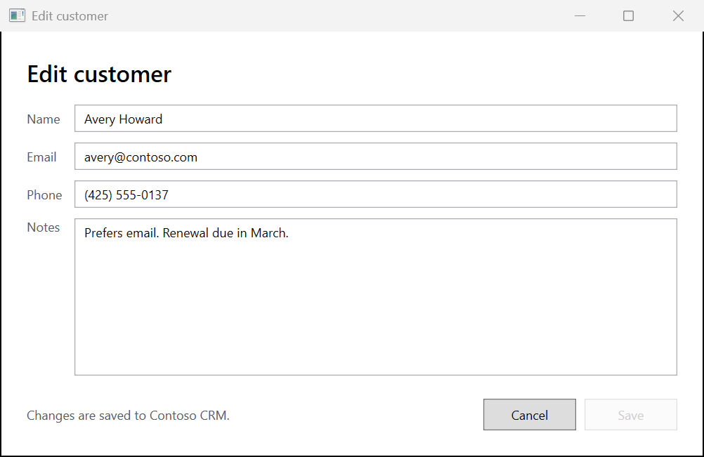

# Session transcript

Source: `Q:\source\XamlAgentDemos-notes\test-runs\VanishingSave\r9\events.jsonl`

## Tool usage

- get_file: 9
- xaml_get_element_properties: 8
- powershell: 3
- xaml_find_elements: 2
- xaml_capture_image: 2
- xaml_explain_visibility: 2
- xaml_get_binding_failures: 2
- rg: 2
- xaml_hit_test: 2
- task_complete: 2
- skill: 1
- xaml_get_status: 1
- xaml_get_visual_tree: 1
- xaml_explain_property_value: 1
- view: 1
- multi_replace_string_in_file: 1
- remove_file: 1
- xaml_apply_hot_reload: 1
- xaml_set_element_property: 1
- xaml_clear_binding_failures: 1
- xaml_get_element_bounds: 1
- xaml_get_hot_reload_log: 1
- replace_string_in_file: 1

Failed tool calls: 1, images: 2


_Model: gpt-6-luna_


## User (14:40:40)

There should be a Save button in the footer of my running app, but I can't see it. Find out every reason it's not visible and fix them.


**Tool call (14:40:43):** `skill`
```json
{
 "skill": "xaml-diagnostics"
}
```

<details><summary>Result `skill` success=true</summary>

```
Skill "xaml-diagnostics" loaded successfully. Follow the instructions in the skill context.
```
</details>


_Skill invoked: xaml-diagnostics_


**Tool call (14:40:46):** `xaml_get_status`
```json
{
 "progressMessage": "Checking the running app and debugger state"
}
```

<details><summary>Result `xaml_get_status` success=true</summary>

```
{"isDebugging":true,"debuggerState":"running","diagnosticsActive":true,"apps":[{"app":"a2","name":"VanishingSave.exe [78360]","processId":78360,"platform":"WPF (.NET)","isRemote":false,"isDesignTimeOrNoDebug":false,"sourceInfoAvailable":true,"hotReloadSupported":true,"hotReloadEnabled":true,"supportsPropertyExplorer":true,"supportsInAppToolbar":true,"supportsHitTest":true,"windows":[{"windowId":"0x960800","title":"Edit customer","bounds":{"x":114,"y":114,"width":1020,"height":660},"dpiScale":1.5,"visible":true,"minimized":false}]}],"issues":[],"issuesSummary":"No problems detected.","hotReload":{"options":{"hotReloadEnabled":true,"hotReloadOnSave":false,"applyMode":"asYouType: XAML edits apply as you type, without saving (default)","wpfEnabled":true,"uwpEnabled":true,"winUIEnabled":true,"mauiEnabled":true,"justMyXaml":true,"previewSelectedElement":false,"inAppToolbar":true,"inAppSelection":false,"layoutAdorners":false,"trackFocusedElement":false,"bindingFailuresVisible":true,"compatibilityMode":false},"dotNetHotReloadEnabled":true,"isProcessingChanges":false,"lastHotReloadUpdate":{"secondsAgo":182,"updatesSinceToolsStarted":2},"errors":[]},"windowsNote":"Window bounds are physical screen pixels and include the window frame. A WPF/WinUI Window's Width and Height are device-independent units (DIPs) that also include the frame, so Width = bounds.width / dpiScale. A user's \"800 px wide\" is ambiguous: say which unit you tested. A minimized window reports x/y = -32000 and can't be captured."}
```
</details>


**Assistant (14:40:49):**

I’ll inspect the live window, locate the Save control, and trace every visibility cause before editing its source.


**Tool call (14:40:49):** `xaml_find_elements`
```json
{
 "progressMessage": "Finding the Save control",
 "app": "a2",
 "type": "*Button",
 "name": "Save",
 "maxResults": 50
}
```


**Tool call (14:40:49):** `xaml_capture_image`
```json
{
 "progressMessage": "Capturing the current window",
 "app": "a2",
 "windowId": "0x960800",
 "maxSize": 1280
}
```

<details><summary>Result `xaml_find_elements` success=true</summary>

```
{"count":1,"totalMatches":1,"truncated":false,"results":[{"id":"a2:10","type":"System.Windows.Controls.Button","name":"SaveButton","source":{"file":"Q:\\source\\XamlAgentDemos\\src\\VanishingSave\\MainWindow.xaml","line":118,"column":14},"path":"MainWindow/Border/AdornerDecorator/ContentPresenter/Grid/Grid/Button"}]}
```
</details>


<details><summary>Result `xaml_capture_image` success=true</summary>

```
Screenshot of window 0x960800 "Edit customer" of app a2 (1002x651 image of the window's client area, so it's slightly smaller than the frame bounds from xaml_get_status).
```
</details>


**Tool call (14:40:53):** `xaml_explain_visibility`
```json
{
 "progressMessage": "Tracing why Save is hidden",
 "elementIds": [
  "a2:10"
 ]
}
```


**Tool call (14:40:53):** `xaml_get_visual_tree`
```json
{
 "progressMessage": "Inspecting footer layout",
 "app": "a2",
 "rootElementId": "a2:10",
 "depth": 5,
 "maxNodes": 200
}
```


**Tool call (14:40:53):** `xaml_get_binding_failures`
```json
{
 "progressMessage": "Checking live binding failures",
 "maxResults": 100
}
```

<details><summary>Result `xaml_get_visual_tree` success=true</summary>

```
{"app":"a2","platform":"WPF (.NET)","sourceInfoAvailable":true,"nodeCount":1,"truncated":false,"nodes":[{"id":"a2:10","type":"System.Windows.Controls.Button","name":"SaveButton","source":{"file":"Q:\\source\\XamlAgentDemos\\src\\VanishingSave\\MainWindow.xaml","line":118,"column":14},"childCount":0}]}
```
</details>

<details><summary>Result `xaml_get_binding_failures` success=true</summary>

```
{"note":"This is a cumulative log since debugging started or the last xaml_clear_binding_failures, not live state: fixed failures stay listed. occurrencesSinceLastRead counts new occurrences since your previous call (0 = not seen again; it only grows when the UI using the binding is created or updated again). pathStillInSource=false means the XAML near that line no longer contains the failing path, so it was probably fixed in source (hot reload or a restart applies it). To verify a fix: clear, revisit the UI that uses the binding, then read again. Failures without a file usually come from bindings created in code.","totalUnique":1,"matched":1,"truncated":false,"failures":[{"severity":"Warning","count":1,"occurrencesSinceLastRead":1,"isNew":true,"pathStillInSource":false,"errorCode":"40","description":"CanSave property not found on object of type CustomerViewModel.","bindingPath":"CanSave","target":"Button.Visibility, Name='SaveButton'","targetName":"SaveButton","targetPropertyType":"Visibility","dataContextType":"CustomerViewModel","file":"Q:\\source\\XamlAgentDemos\\src\\VanishingSave\\MainWindow.xaml","line":118,"column":14,"project":"VanishingSave","originalError":"System.Windows.Data Warning: 40 : BindingExpression path error: 'CanSave' property not found on 'object' ''CustomerViewModel' (HashCode=30479632)'. BindingExpression:Path=CanSave; DataItem='CustomerViewModel' (HashCode=30479632); target element is 'Button' (Name='SaveButton'); target property is 'Visibility' (type 'Visibility')"}]}
```
</details>

<details><summary>Result `xaml_explain_visibility` success=true</summary>

```
{"id":"a2:10","type":"System.Windows.Controls.Button","name":"SaveButton","source":{"file":"Q:\\source\\XamlAgentDemos\\src\\VanishingSave\\MainWindow.xaml","line":118,"column":14},"verdict":"Button 'SaveButton' has Visibility=2 from a binding.","causes":[{"rank":1,"kind":"visibility","message":"Button 'SaveButton' has Visibility=2 from a binding.","elementId":"a2:10","property":"Visibility","value":" -> 2","valueSource":"Local","location":{"file":"Q:\\source\\XamlAgentDemos\\src\\VanishingSave\\MainWindow.xaml","line":118,"column":14},"fix":"Check the bound source value and converter (xaml_explain_property_value shows the binding), or fix the binding failure listed below."},{"rank":1,"kind":"opacity","message":"Button 'SaveButton' has Opacity=0, so it's transparent.","elementId":"a2:10","property":"Opacity","value":"0","valueSource":"StyleTrigger","location":{"file":"Q:\\source\\XamlAgentDemos\\src\\VanishingSave\\MainWindow.xaml","line":118,"column":14},"fix":"Check for a storyboard or trigger that fades it in, or change the value."},{"rank":1,"kind":"visibility","message":"ancestor Grid 'Footer' (1 level(s) up) has Visibility=0, which hides everything inside it.","elementId":"a2:19","property":"Visibility","value":"0","valueSource":"Default","location":{"file":"Q:\\source\\XamlAgentDemos\\src\\VanishingSave\\MainWindow.xaml","line":101,"column":10},"fix":"Change or remove the value at the location shown (a style setter or trigger if valueSource says so)."},{"rank":1,"kind":"visibility","message":"ancestor Grid (2 level(s) up) has Visibility=0, which hides everything inside it.","elementId":"a2:16","property":"Visibility","value":"0","valueSource":"Default","location":{"file":"Q:\\source\\XamlAgentDemos\\src\\VanishingSave\\MainWindow.xaml","line":40,"column":6},"fix":"Change or remove the value at the location shown (a style setter or trigger if valueSource says so)."},{"rank":1,"kind":"visibility","message":"ancestor ContentPresenter (3 level(s) up) has Visibility=0, which hides everything inside it.","elementId":"a2:14","property":"Visibility","value":"0","valueSource":"Default","fix":"Change or remove the value at the location shown (a style setter or trigger if valueSource says so)."},{"rank":1,"kind":"visibility","message":"ancestor AdornerDecorator (4 level(s) up) has Visibility=0, which hides everything inside it.","elementId":"a2:13","property":"Visibility","value":"0","valueSource":"Default","fix":"Change or remove the value at the location sho
... [truncated 2399 chars]
```
</details>


**Tool call (14:41:00):** `get_file`
```json
{
 "filename": "Q:\\source\\XamlAgentDemos\\src\\VanishingSave\\MainWindow.xaml",
 "startLine": 1,
 "endLine": 180,
 "includeLineNumbers": true
}
```


**Tool call (14:41:00):** `rg`
```json
{
 "pattern": "class CustomerViewModel|CanSave|SaveCommand|SaveButton|Footer",
 "paths": "Q:\\source\\XamlAgentDemos\\src\\VanishingSave",
 "output_mode": "content",
 "glob": "*.cs",
 "-n": true,
 "head_limit": 100
}
```


**Tool call (14:41:00):** `xaml_explain_property_value`
```json
{
 "progressMessage": "Inspecting Save visibility and opacity",
 "elementIds": [
  "a2:10"
 ],
 "propertyNames": [
  "Visibility",
  "Opacity",
  "IsEnabled",
  "Command"
 ],
 "pairwise": false
}
```


**Tool call (14:41:00):** `xaml_get_element_properties`
```json
{
 "progressMessage": "Checking Save and footer state",
 "elementIds": [
  "a2:10",
  "a2:19"
 ],
 "nameFilter": "Visibility|Opacity|IsEnabled|Command|DataContext.CanSave|DataContext.IsDirty",
 "includeAll": true
}
```

<details><summary>Result `xaml_get_element_properties` success=true</summary>

```
{"count":2,"failed":2,"results":[{"id":"a2:10","error":"INVALID_ARGUMENT","message":"'Visibility' comes before any collection item path in nameFilter 'Visibility|Opacity|IsEnabled|Command|DataContext.CanSave|DataContext.IsDirty'.","hint":"Either filter the element's own properties (\"Width|Margin\") or items (\"ColumnDefinitions[*].Width|ActualWidth\") in one call, not both; make a second call for the other."},{"id":"a2:19","error":"INVALID_ARGUMENT","message":"'Visibility' comes before any collection item path in nameFilter 'Visibility|Opacity|IsEnabled|Command|DataContext.CanSave|DataContext.IsDirty'.","hint":"Either filter the element's own properties (\"Width|Margin\") or items (\"ColumnDefinitions[*].Width|ActualWidth\") in one call, not both; make a second call for the other."}]}
```
</details>

<details><summary>Result `get_file` success=true</summary>

```
```xaml src\VanishingSave\MainWindow.xaml (Lines 1-138 of 138 total. Call tools for more if needed.)
1: <Window x:Class="VanishingSave.MainWindow"
2:         xmlns="http://schemas.microsoft.com/winfx/2006/xaml/presentation"
3:         xmlns:x="http://schemas.microsoft.com/winfx/2006/xaml"
4:         xmlns:local="clr-namespace:VanishingSave"
5:         Title="Edit customer"
6:         Width="680"
7:         Height="440"
8:         Background="White">
9:     <Window.DataContext>
10:         <local:CustomerViewModel />
11:     </Window.DataContext>
12: 
13:     <Window.Resources>
14:         <BooleanToVisibilityConverter x:Key="BoolToVisibility" />
15: 
16:         <Style x:Key="FieldLabelStyle" TargetType="TextBlock">
17:             <Setter Property="Margin" Value="0,0,12,10" />
18:             <Setter Property="VerticalAlignment" Value="Center" />
19:             <Setter Property="Foreground" Value="#555B66" />
20:         </Style>
21: 
22:         <Style x:Key="FieldStyle" TargetType="TextBox">
23:             <Setter Property="Margin" Value="0,0,0,10" />
24:             <Setter Property="Padding" Value="6,4" />
25:         </Style>
26: 
27:         <Style x:Key="FooterButtonStyle" TargetType="Button">
28:             <Setter Property="MinWidth" Value="88" />
29:             <Setter Property="Margin" Value="8,0,0,0" />
30:             <Setter Property="Padding" Value="16,6" />
31:             <Style.Triggers>
32:                 <!-- Fade out buttons that can't be used yet. -->
33:                 <Trigger Property="IsEnabled" Value="False">
34:                     <Setter Property="Opacity" Value="0" />
35:                 </Trigger>
36:             </Style.Triggers>
37:         </Style>
38:     </Window.Resources>
39: 
40:     <Grid Margin="24">
41:         <Grid.RowDefinitions>
42:             <RowDefinition Height="Auto" />
43:             <RowDefinition Height="*" />
44:             <RowDefinition Height="Auto" />
45:         </Grid.RowDefinitions>
46: 
47:         <TextBlock Margin="0,0,0,16"
48:                    FontSize="22"
49:                    FontWeight="SemiBold"
50:                    Text="Edit customer" />
51: 
52:         <Grid Grid.Row="1">
53:             <Grid.ColumnDefinitions>
54:                 <ColumnDefinition Width="Auto" />
55:                 <ColumnDefinition Width="*" />
56:             </Grid.ColumnDefinitions>
57:             <Grid.RowDefinitions>
58:            
... [truncated 3995 chars]
```
</details>

<details><summary>Result `rg` success=true</summary>

```
Q:\source\XamlAgentDemos\src\VanishingSave\CustomerViewModel.cs:3:public sealed class CustomerViewModel : ObservableObject
Q:\source\XamlAgentDemos\src\VanishingSave\CustomerViewModel.cs:13:        this.SaveCommand = new RelayCommand(this.Save, () => this.IsDirty);
Q:\source\XamlAgentDemos\src\VanishingSave\CustomerViewModel.cs:30:    public RelayCommand SaveCommand { get; }
Q:\source\XamlAgentDemos\src\VanishingSave\MainWindow.xaml.cs:15:        if (FooterSettings.UseCompactFooter)
Q:\source\XamlAgentDemos\src\VanishingSave\FooterSettings.cs:3:public static class FooterSettings
Q:\source\XamlAgentDemos\src\VanishingSave\FooterSettings.cs:9:    public static bool UseCompactFooter { get; set; } = true;
```
</details>

<details><summary>Result `xaml_explain_property_value` success=true</summary>

```
{"count":4,"failed":0,"results":[{"id":"a2:10","type":"System.Windows.Controls.Button","property":"Visibility","propertyType":"System.Windows.Visibility","evaluatedValue":"2 (System.Windows.Visibility)","effectiveSource":"Local","chain":[{"kind":"Local","description":"Local value set on the element (XAML attribute, binding or code). Wins over styles, templates and inheritance.","evaluatedValue":"2 (System.Windows.Visibility)","valueType":"System.Windows.Data.BindingExpression","isBinding":true,"effective":true,"sourceLocation":{"file":"Q:\\source\\XamlAgentDemos\\src\\VanishingSave\\MainWindow.xaml","line":118,"column":14}},{"kind":"Default","description":"The property's default value; nothing sets it.","value":"0","valueType":"System.Windows.Visibility","effective":false}],"notes":["To let a style or template value apply, remove the local value (the attribute, binding or code assignment). To change it, edit that local value. XAML and code both produce Local values, and the source location may still point to the XAML attribute after code assigned a new value. If the live value differs from the XAML attribute, or the element has no XAML attribute for it, code set it: search code-behind for the element's x:Name.","The effective value comes from a binding. If it's wrong, check xaml_get_binding_failures and the DataContext."]},{"id":"a2:10","type":"System.Windows.Controls.Button","property":"Opacity","propertyType":"System.Double","effectiveValue":"0","effectiveSource":"StyleTrigger","chain":[{"kind":"StyleTrigger","description":"Trigger in the element's Style whose condition is currently true.","value":"0","valueType":"System.Double","effective":true},{"kind":"Default","description":"The property's default value; nothing sets it.","value":"1","valueType":"System.Double","effective":false}],"notes":["Edit the setter or trigger at the source location, or set a local value to override it for this element only."]},{"id":"a2:10","type":"System.Windows.Controls.Button","property":"IsEnabled","propertyType":"System.Boolean","effectiveValue":"False","effectiveSource":"Coercion","chain":[{"kind":"Coercion","description":"The control coerced the value (for example clamped to a minimum or maximum).","value":"False","valueType":"System.Boolean","effective":true},{"kind":"Default","description":"The property's default value; nothing sets it.","value":"True","valueType":"System.Boolean","effective":false}],"notes":["Check related properties that constrain this one (for exa
... [truncated 1558 chars]
```
</details>


**Tool call (14:41:07):** `get_file`
```json
{
 "filename": "Q:\\source\\XamlAgentDemos\\src\\VanishingSave\\CustomerViewModel.cs",
 "startLine": 1,
 "endLine": 240,
 "includeLineNumbers": true
}
```


**Tool call (14:41:07):** `get_file`
```json
{
 "filename": "Q:\\source\\XamlAgentDemos\\src\\VanishingSave\\MainWindow.xaml.cs",
 "startLine": 1,
 "endLine": 240,
 "includeLineNumbers": true
}
```


**Tool call (14:41:07):** `get_file`
```json
{
 "filename": "Q:\\source\\XamlAgentDemos\\src\\VanishingSave\\FooterSettings.cs",
 "startLine": 1,
 "endLine": 120,
 "includeLineNumbers": true
}
```


**Tool call (14:41:07):** `xaml_find_elements`
```json
{
 "progressMessage": "Inspecting footer overlay elements",
 "app": "a2",
 "name": "Footer|SaveColumn|SyncStatusHost|SyncStatusText",
 "maxResults": 50
}
```


**Tool call (14:41:07):** `xaml_get_element_properties`
```json
{
 "progressMessage": "Reading current footer geometry",
 "elementIds": [
  "a2:10",
  "a2:19"
 ],
 "nameFilter": "ActualWidth|ActualHeight|Visibility|Opacity|IsEnabled|DataContext.IsDirty|DataContext.CanSave",
 "includeAll": true
}
```


**Tool call (14:41:07):** `xaml_get_element_properties`
```json
{
 "progressMessage": "Inspecting footer grid columns",
 "elementIds": [
  "a2:19"
 ],
 "nameFilter": "ColumnDefinitions[*].Width|ActualWidth|RowDefinitions[*].Height|ActualHeight",
 "includeAll": true
}
```

<details><summary>Result `xaml_find_elements` success=true</summary>

```
{"count":3,"totalMatches":3,"truncated":false,"results":[{"id":"a2:19","type":"System.Windows.Controls.Grid","name":"Footer","source":{"file":"Q:\\source\\XamlAgentDemos\\src\\VanishingSave\\MainWindow.xaml","line":101,"column":10},"path":"MainWindow/Border/AdornerDecorator/ContentPresenter/Grid/Grid"},{"id":"a2:30","type":"System.Windows.Controls.Border","name":"SyncStatusHost","source":{"file":"Q:\\source\\XamlAgentDemos\\src\\VanishingSave\\MainWindow.xaml","line":127,"column":14},"path":"MainWindow/Border/AdornerDecorator/ContentPresenter/Grid/Grid/Border"},{"id":"a2:36","type":"System.Windows.Controls.TextBlock","name":"SyncStatusText","source":{"file":"Q:\\source\\XamlAgentDemos\\src\\VanishingSave\\MainWindow.xaml","line":131,"column":18},"path":"MainWindow/Border/AdornerDecorator/ContentPresenter/Grid/Grid/Border/TextBlock"}]}
```
</details>

<details><summary>Result `xaml_get_element_properties` success=true</summary>

```
{"count":2,"failed":2,"results":[{"id":"a2:10","error":"INVALID_ARGUMENT","message":"'ActualWidth' comes before any collection item path in nameFilter 'ActualWidth|ActualHeight|Visibility|Opacity|IsEnabled|DataContext.IsDirty|DataContext.CanSave'.","hint":"Either filter the element's own properties (\"Width|Margin\") or items (\"ColumnDefinitions[*].Width|ActualWidth\") in one call, not both; make a second call for the other."},{"id":"a2:19","error":"INVALID_ARGUMENT","message":"'ActualWidth' comes before any collection item path in nameFilter 'ActualWidth|ActualHeight|Visibility|Opacity|IsEnabled|DataContext.IsDirty|DataContext.CanSave'.","hint":"Either filter the element's own properties (\"Width|Margin\") or items (\"ColumnDefinitions[*].Width|ActualWidth\") in one call, not both; make a second call for the other."}]}
```
</details>

<details><summary>Result `get_file` success=true</summary>

```
```csharp src\VanishingSave\FooterSettings.cs (Lines 1-10 of 10 total. Call tools for more if needed.)
1: namespace VanishingSave;
2: 
3: public static class FooterSettings
4: {
5:     /// <summary>
6:     /// Compact footer for small screens: auto-save makes the Save column unnecessary.
7:     /// (Auto-save was cut from v2, but this switch stayed on.)
8:     /// </summary>
9:     public static bool UseCompactFooter { get; set; } = true;
10: }

```


```
</details>

<details><summary>Result `get_file` success=true</summary>

```
```csharp src\VanishingSave\MainWindow.xaml.cs (Lines 1-20 of 20 total. Call tools for more if needed.)
1: using System.Windows;
2: 
3: namespace VanishingSave;
4: 
5: public partial class MainWindow : Window
6: {
7:     public MainWindow()
8:     {
9:         this.InitializeComponent();
10:         this.Loaded += this.OnLoaded;
11:     }
12: 
13:     private void OnLoaded(object sender, RoutedEventArgs e)
14:     {
15:         if (FooterSettings.UseCompactFooter)
16:         {
17:             this.SaveColumn.Width = new GridLength(0);
18:         }
19:     }
20: }

```


```
</details>

<details><summary>Result `get_file` success=true</summary>

```
```csharp src\VanishingSave\CustomerViewModel.cs (Lines 1-35 of 35 total. Call tools for more if needed.)
1: namespace VanishingSave;
2: 
3: public sealed class CustomerViewModel : ObservableObject
4: {
5:     private string name = "Avery Howard";
6:     private string email = "avery@contoso.com";
7:     private string phone = "(425) 555-0137";
8:     private string notes = "Prefers email. Renewal due in March.";
9:     private bool isDirty;
10: 
11:     public CustomerViewModel()
12:     {
13:         this.SaveCommand = new RelayCommand(this.Save, () => this.IsDirty);
14:         this.CancelCommand = new RelayCommand(() => this.IsDirty = false);
15:     }
16: 
17:     public string Name { get => this.name; set { if (this.SetProperty(ref this.name, value)) this.IsDirty = true; } }
18: 
19:     public string Email { get => this.email; set { if (this.SetProperty(ref this.email, value)) this.IsDirty = true; } }
20: 
21:     public string Phone { get => this.phone; set { if (this.SetProperty(ref this.phone, value)) this.IsDirty = true; } }
22: 
23:     public string Notes { get => this.notes; set { if (this.SetProperty(ref this.notes, value)) this.IsDirty = true; } }
24: 
25:     public bool IsDirty { get => this.isDirty; set => this.SetProperty(ref this.isDirty, value); }
26: 
27:     /// <summary>Whether the current user is allowed to save customer records.</summary>
28:     public bool IsSaveAvailable => true;
29: 
30:     public RelayCommand SaveCommand { get; }
31: 
32:     public RelayCommand CancelCommand { get; }
33: 
34:     private void Save() => this.IsDirty = false;
35: }

```


```
</details>

<details><summary>Result `xaml_get_element_properties` success=false</summary>

```
{
 "message": "{\"error\":\"INVALID_ARGUMENT\",\"message\":\"'RowDefinitions' is null on 'a2:19', so it has no members to read.\",\"hint\":\"Set the object first, or read the property itself without a path.\"}",
 "code": "failure"
}
```
</details>


**Tool call (14:41:17):** `xaml_get_element_properties`
```json
{
 "progressMessage": "Measuring the footer and overlay",
 "elementIds": [
  "a2:10",
  "a2:19",
  "a2:30",
  "a2:36"
 ],
 "nameFilter": "Visibility|Opacity|IsEnabled|ActualWidth|ActualHeight|Width|Height|Margin|Panel.ZIndex|Background",
 "includeAll": true
}
```


**Tool call (14:41:17):** `xaml_get_element_properties`
```json
{
 "progressMessage": "Checking Save eligibility values",
 "elementIds": [
  "a2:10"
 ],
 "nameFilter": "DataContext.IsDirty|DataContext.IsSaveAvailable|DataContext.SaveCommand",
 "includeAll": true
}
```


**Tool call (14:41:17):** `xaml_get_element_properties`
```json
{
 "progressMessage": "Reading footer column widths",
 "elementIds": [
  "a2:19"
 ],
 "nameFilter": "ColumnDefinitions[*].Width|ActualWidth",
 "includeAll": true
}
```


**Tool call (14:41:17):** `xaml_hit_test`
```json
{
 "progressMessage": "Checking what covers the Save area",
 "elementIds": [
  "a2:10"
 ]
}
```

<details><summary>Result `xaml_hit_test` success=true</summary>

```
{"id":"a2:10","summary":"A click at its center does NOT reach 'SaveButton' because it's disabled (IsEnabled=False): input skips disabled elements and lands on Border (in the template of MainWindow) behind or around it. That element isn't necessarily covering it; fix the IsEnabled cause (see blockers, or a command's CanExecute) rather than the layout. Button 'SaveButton' has Visibility=Collapsed. Button 'SaveButton' has IsEnabled=False (IsEnabledCore: command CanExecute is false or the control disabled itself). Button 'SaveButton' has Opacity=0. 'SaveButton' has zero width or height.","elementReceivesInput":false,"inputTarget":{"id":"a2:12","type":"System.Windows.Controls.Border","templatedParent":{"id":"a2:11","type":"VanishingSave.MainWindow","source":{"file":"Q:\\source\\XamlAgentDemos\\src\\VanishingSave\\MainWindow.xaml","line":4,"column":9}}},"stack":[{"id":"a2:12","type":"System.Windows.Controls.Border","templatedParent":{"id":"a2:11","type":"VanishingSave.MainWindow","source":{"file":"Q:\\source\\XamlAgentDemos\\src\\VanishingSave\\MainWindow.xaml","line":4,"column":9}}}],"isVisible":false,"isHitTestVisible":true,"isEnabled":false,"effectiveOpacity":0.0,"blockers":[{"id":"a2:10","type":"System.Windows.Controls.Button","name":"SaveButton","source":{"file":"Q:\\source\\XamlAgentDemos\\src\\VanishingSave\\MainWindow.xaml","line":118,"column":14},"property":"Visibility","value":"Collapsed"},{"id":"a2:10","type":"System.Windows.Controls.Button","name":"SaveButton","source":{"file":"Q:\\source\\XamlAgentDemos\\src\\VanishingSave\\MainWindow.xaml","line":118,"column":14},"property":"IsEnabled","value":"False (IsEnabledCore: command CanExecute is false or the control disabled itself)"},{"id":"a2:10","type":"System.Windows.Controls.Button","name":"SaveButton","source":{"file":"Q:\\source\\XamlAgentDemos\\src\\VanishingSave\\MainWindow.xaml","line":118,"column":14},"property":"Opacity","value":"0"}],"point":{"window":{"x":24.0,"y":348.71},"screen":{"x":161.0,"y":682.0}},"note":"inputTarget is what a mouse click or tap at the point reaches (WPF: InputHitTest; WinUI/UWP: FindElementsInHostCoordinates, open popups first; .NET MAUI: approximated from element bounds and draw order). stack lists visible, hit-testable elements under the point, topmost first; elements with no id are template parts or aren't in the live tree (on WPF use their templatedParent). blockers are the element and ancestors whose own values hide it or block input (descendants inherit IsEnabled
... [truncated 216 chars]
```
</details>

<details><summary>Result `xaml_get_element_properties` success=true</summary>

```
{"id":"a2:10","type":"System.Windows.Controls.Button","name":"SaveButton","source":{"file":"Q:\\source\\XamlAgentDemos\\src\\VanishingSave\\MainWindow.xaml","line":118,"column":14},"items":[{"path":"DataContext","type":"VanishingSave.CustomerViewModel","properties":[{"name":"IsSaveAvailable","value":"True","valueSource":"Local","readOnly":true},{"name":"SaveCommand","value":"XamlAgentDemos.RelayCommand","valueSource":"Local","readOnly":true},{"name":"IsDirty","value":"False","valueSource":"Default"}]}],"note":"Item properties are live values. Change one with xaml_set_element_property using the same path, for example setters=['ColumnDefinitions[2].Width=Auto']; edit the XAML too to keep the change. Without a property filter, only set values and Actual* sizes are listed."}
```
</details>

<details><summary>Result `xaml_get_element_properties` success=true</summary>

```
{"count":4,"failed":0,"results":[{"id":"a2:10","type":"System.Windows.Controls.Button","name":"SaveButton","source":{"file":"Q:\\source\\XamlAgentDemos\\src\\VanishingSave\\MainWindow.xaml","line":118,"column":14},"properties":[{"name":"IsEnabled","value":"False","valueType":"System.Boolean","valueSource":"Coercion"},{"name":"Visibility","evaluatedValue":"2 (System.Windows.Visibility)","valueType":"System.Windows.Data.BindingExpression","propertyType":"System.Windows.Visibility","valueSource":"Local","isBinding":true},{"name":"Opacity","value":"0","valueType":"System.Double","valueSource":"StyleTrigger"},{"name":"Margin","value":"8,0,0,0","valueType":"System.Windows.Thickness","valueSource":"Style","valueSourceLocation":{"file":"Q:\\source\\XamlAgentDemos\\src\\VanishingSave\\MainWindow.xaml","line":27,"column":10}},{"name":"Background","value":"#FFDDDDDD","valueType":"System.Windows.Media.SolidColorBrush","propertyType":"System.Windows.Media.Brush","valueSource":"BuiltInStyle"}],"defaultValues":{"ActualHeight":"0","ActualWidth":"0","Height":"Auto","Width":"Auto"},"hiddenDefaultOrOverridden":5,"hint":"Default and overridden values were omitted. Pass includeAll=true to see them, or call xaml_explain_property_value for one property's full precedence chain."},{"id":"a2:19","type":"System.Windows.Controls.Grid","name":"Footer","source":{"file":"Q:\\source\\XamlAgentDemos\\src\\VanishingSave\\MainWindow.xaml","line":101,"column":10},"properties":[{"name":"ActualWidth","value":"617.3333333333334","valueType":"System.Double","valueSource":"Local","readOnly":true},{"name":"ActualHeight","value":"29.96","valueType":"System.Double","valueSource":"Local","readOnly":true},{"name":"Margin","value":"0,12,0,0","valueType":"System.Windows.Thickness","valueSource":"Local"}],"defaultValues":{"Background":null,"Height":"Auto","IsEnabled":"True","Opacity":"1","Visibility":"0","Width":"Auto"},"hiddenDefaultOrOverridden":3,"hint":"Default and overridden values were omitted. Pass includeAll=true to see them, or call xaml_explain_property_value for one property's full precedence chain."},{"id":"a2:30","type":"System.Windows.Controls.Border","name":"SyncStatusHost","source":{"file":"Q:\\source\\XamlAgentDemos\\src\\VanishingSave\\MainWindow.xaml","line":127,"column":14},"properties":[{"name":"Background","value":"#FFFFFFFF","valueType":"System.Windows.Media.SolidColorBrush","propertyType":"System.Windows.Media.Brush","valueSource":"Local"},{"name":"ActualHeight","value":"29.96","v
... [truncated 1161 chars]
```
</details>

<details><summary>Result `xaml_get_element_properties` success=true</summary>

```
{"id":"a2:19","type":"System.Windows.Controls.Grid","name":"Footer","source":{"file":"Q:\\source\\XamlAgentDemos\\src\\VanishingSave\\MainWindow.xaml","line":101,"column":10},"items":[{"path":"ColumnDefinitions[0]","type":"System.Windows.Controls.ColumnDefinition","properties":[{"name":"Width","value":"*","valueSource":"Local"},{"name":"ActualWidth","value":"521.3333333333334","valueSource":"Local","readOnly":true}]},{"path":"ColumnDefinitions[1]","type":"System.Windows.Controls.ColumnDefinition","properties":[{"name":"Width","value":"Auto","valueSource":"Local"},{"name":"ActualWidth","value":"96","valueSource":"Local","readOnly":true}]},{"path":"ColumnDefinitions[2]","type":"System.Windows.Controls.ColumnDefinition","properties":[{"name":"Width","value":"0","valueSource":"Local"},{"name":"ActualWidth","value":"0","valueSource":"Default","readOnly":true}]}],"note":"Item properties are live values. Change one with xaml_set_element_property using the same path, for example setters=['ColumnDefinitions[2].Width=Auto']; edit the XAML too to keep the change. Without a property filter, only set values and Actual* sizes are listed."}
```
</details>


**Assistant (14:41:43):**

I found four independent blockers: a nonexistent visibility property, zero-width footer column, zero-opacity disabled style, and a status overlay. I’m checking the XAML authoring notes and references before fixing all four.


**Tool call (14:41:43):** `view`
```json
{
 "path": "C:\\vs\\fastmain\\common7\\ide\\commonextensions\\microsoft\\xamldiagnostics\\AgentTools\\skills\\xaml-diagnostics\\references\\xaml-authoring.md"
}
```


**Tool call (14:41:43):** `rg`
```json
{
 "pattern": "FooterSettings|UseCompactFooter",
 "paths": "Q:\\source\\XamlAgentDemos",
 "output_mode": "content",
 "-n": true,
 "head_limit": 100
}
```


**Tool call (14:41:43):** `powershell`
```json
{
 "command": "git status --short",
 "description": "Check for existing workspace changes"
}
```

<details><summary>Result `view` success=true</summary>

```
# XAML authoring guidance

Follow these rules when writing or changing XAML so it works well with XAML Hot Reload, the XAML designer, and XAML Diagnostics.

## Design-time data

- Declare `xmlns:d="http://schemas.microsoft.com/expression/blend/2008"` and `xmlns:mc="http://schemas.openxmlformats.org/markup-compatibility/2006"` with `mc:Ignorable="d"`.
- Use `d:DataContext="{d:DesignInstance Type=vm:MyViewModel, IsDesignTimeCreatable=False}"` (WPF/UWP) so the designer and IntelliSense know binding paths.
- Use `d:` properties (for example `d:Text="Sample"`) for sample values that appear only at design time.
- .NET MAUI: set `x:DataType` on pages and `DataTemplate`s. It enables compiled bindings and turns many binding failures into build errors.
- WinUI/UWP: prefer `x:Bind` for compile-time checked bindings when the view owns the view model.

## Bindings

- Bind with explicit paths. Avoid string-built paths in code-behind.
- Keep the `DataContext` chain simple. Use `ElementName` or `RelativeSource` only at real scope boundaries (for example inside a `DataTemplate` that needs the page's view model).
- Expose bound properties as public properties that raise `PropertyChanged`. Fields and non-public properties don't bind.
- Use `FallbackValue` and `TargetNullValue` for expected missing values instead of hiding binding errors.
- Before saving, check every binding path against the actual property names on the data context type (case, plurals, nested paths such as `Customer.Address.City`). Misspelled paths are the most common binding failure and they fail silently.
- Inside a `DataTemplate` or `ItemContainerStyle`, the data context is the item, not the page's view model. To reach a page command, use `RelativeSource={RelativeSource AncestorType=...}` with `DataContext.` in the path, or `ElementName`.
- A `TextBox.Text` binding updates its source on `LostFocus` by default (WPF). Use `UpdateSourceTrigger=PropertyChanged` when other UI (validation, enabled state, live search) must react while the user types.
- `Mode=TwoWay` (the default for `TextBox.Text`, `CheckBox.IsChecked`, `Selector.SelectedItem` and similar) needs a property with a public setter. In WPF, a two-way binding to a read-only property throws when the view loads.
- Bindings created in code have no XAML file and line in diagnostics. Prefer declaring bindings in XAML.

## Layout

- Don't put a list (`ListBox`, `ListView`, `DataGrid`, `ItemsControl` with a virtualizing panel) insid
... [truncated 4693 chars]
```
</details>

<details><summary>Result `rg` success=true</summary>

```
Q:\source\XamlAgentDemos\src\VanishingSave\MainWindow.xaml.cs:15:        if (FooterSettings.UseCompactFooter)
Q:\source\XamlAgentDemos\src\VanishingSave\FooterSettings.cs:3:public static class FooterSettings
Q:\source\XamlAgentDemos\src\VanishingSave\FooterSettings.cs:9:    public static bool UseCompactFooter { get; set; } = true;
```
</details>

<details><summary>Result `powershell` success=true</summary>

```

<shellId: 3 completed with exit code 0>
```
</details>


**Tool call (14:41:58):** `multi_replace_string_in_file`
```json
{
 "explanation": "Correct the binding, restore footer layout, keep disabled Save visible, and suppress the empty status overlay.",
 "replacements": [
  {
   "filePath": "src\\VanishingSave\\MainWindow.xaml",
   "oldString": "            <Style.Triggers>\n                <!-- Fade out buttons that can't be used yet. -->\n                <Trigger Property=\"IsEnabled\" Value=\"False\">\n                    <Setter Property=\"Opacity\" Value=\"0\" />\n                </Trigger>\n            </Style.Triggers>",
   "newString": "            <Style.Triggers>\n                <!-- Fade out buttons that can't be used yet. -->\n                <Trigger Property=\"IsEnabled\" Value=\"False\">\n                    <Setter Property=\"Opacity\" Value=\"0.4\" />\n                </Trigger>\n            </Style.Triggers>",
   "explanation": "Keep disabled footer buttons visible but dimmed rather than completely transparent."
  },
  {
   "filePath": "src\\VanishingSave\\MainWindow.xaml",
   "oldString": "            <Button x:Name=\"SaveButton\"\n                    Grid.Column=\"2\"\n                    Command=\"{Binding SaveCommand}\"\n                    Content=\"Save\"\n                    IsDefault=\"True\"\n                    Style=\"{StaticResource FooterButtonStyle}\"\n                    Visibility=\"{Binding CanSave, Converter={StaticResource BoolToVisibility}, FallbackValue=Collapsed}\" />",
   "newString": "            <Button x:Name=\"SaveButton\"\n                    Grid.C
... [truncated 2336 chars]
```

<details><summary>Result `multi_replace_string_in_file` success=true</summary>

```
Successfully applied 4 of 4 replacement(s) across 2 file(s).
```
</details>


**Tool call (14:42:01):** `remove_file`
```json
{
 "filePath": "src\\VanishingSave\\FooterSettings.cs"
}
```

<details><summary>Result `remove_file` success=true</summary>

```
File removed at src\VanishingSave\FooterSettings.cs.
```
</details>


**Assistant (14:42:15):**

The source changes are in place. I’m applying them to the live app now and will verify the button’s visibility, size, overlay, and bindings afterward.


**Tool call (14:42:15):** `xaml_apply_hot_reload`
```json
{
 "progressMessage": "Applying the footer fixes to the running app",
 "includeCodeChanges": true
}
```

<details><summary>Result `xaml_apply_hot_reload` success=true</summary>

```
{"summary":"XAML: Applied with no new errors. .NET code: NOT applied. .NET Hot Reload reported 2 error(s) in 'codeHotReloadErrors', so the running app still has the old code (handlers, view models, converters). A common cause: x:Name fields keep their old type until the app is rebuilt, so after changing an element's type in XAML, code-behind can't use the new type's members; use a binding or command in XAML instead.","applied":true,"status":"applied","errors":[],"log":[],"lastHotReloadUpdate":{"secondsAgo":18,"updatesSinceToolsStarted":3},"codeChanges":".NET Hot Reload was started for saved code changes. Its results are in the Hot Reload output pane, not in 'log'; if an edit can't be hot reloaded, Visual Studio asks the user to rebuild and restart.","codeStatus":"failed","codeHotReloadErrors":["09:42:15.75 🔣  ❌ [Q:\\source\\XamlAgentDemos\\src\\VanishingSave\\VanishingSave.csproj ({4EB184D2-643F-45DC-A2E0-9645EA07CD15})]: error ENC0033: Deleting class 'VanishingSave.FooterSettings' requires restarting the application.","09:42:15.75  ❌ Q:\\source\\XamlAgentDemos\\src\\VanishingSave\\VanishingSave.csproj (line 1): error ENC0033: Deleting class 'VanishingSave.FooterSettings' requires restarting the application."],"codeHotReloadWarnings":["09:42:16.84  Code changes were not applied because the restart operation was blocked."],"codeHotReloadOutput":["09:42:15.75 🔣  ❌ [Q:\\source\\XamlAgentDemos\\src\\VanishingSave\\VanishingSave.csproj ({4EB184D2-643F-45DC-A2E0-9645EA07CD15})]: error ENC0033: Deleting class 'VanishingSave.FooterSettings' requires restarting the application.","09:42:15.75  ❌ Q:\\source\\XamlAgentDemos\\src\\VanishingSave\\VanishingSave.csproj (line 1): error ENC0033: Deleting class 'VanishingSave.FooterSettings' requires restarting the application.","09:42:16.84  Code changes were not applied because the restart operation was blocked.","09:42:16.84  Hot Reload has been disabled for the rest of the session."],"hint":"Call xaml_capture_image to verify the change visually. Views that aren't loaded (other tabs, closed dialogs) are updated when they're next shown. Source line numbers reported for existing elements can still point to the pre-edit lines until the element is recreated, so find elements by x:Name or type rather than by an old line number. Structural edits (wrapping or replacing a parent, changing a root's content) recreate elements, which resets their runtime state such as selection, checked state, typed text and scroll position, and i
... [truncated 87 chars]
```
</details>


**Assistant (14:42:32):**

XAML hot reload applied, but the code-behind change requires a restart because removing the obsolete settings type is unsupported live. I’ll verify the updated layout in the running window and check all remaining blockers.


**Tool call (14:42:32):** `xaml_set_element_property`
```json
{
 "progressMessage": "Restoring the live Save column width",
 "elementIds": [
  "#Footer"
 ],
 "setters": [
  "ColumnDefinitions[2].Width=Auto"
 ]
}
```

<details><summary>Result `xaml_set_element_property` success=true</summary>

```
{"id":"#Footer","property":"ColumnDefinitions[2].Width","oldValue":"0","newValue":"Auto","note":"This change only affects the running app and is lost when it restarts. Edit the XAML source to persist it. Until then it overrides the source: hot reload re-applies only the properties whose XAML changed, so undo experiments (set the original value back) before you verify a source fix."}
```
</details>


**Tool call (14:42:37):** `xaml_capture_image`
```json
{
 "progressMessage": "Verifying the updated footer",
 "app": "a2",
 "windowId": "0x960800",
 "maxSize": 1280
}
```


**Tool call (14:42:37):** `xaml_explain_visibility`
```json
{
 "progressMessage": "Rechecking all Save visibility causes",
 "elementIds": [
  "#SaveButton"
 ]
}
```


**Tool call (14:42:37):** `xaml_get_element_properties`
```json
{
 "progressMessage": "Verifying live Save and overlay values",
 "elementIds": [
  "#SaveButton",
  "#SyncStatusHost"
 ],
 "nameFilter": "Visibility|Opacity|IsEnabled|ActualWidth|ActualHeight|Panel.ZIndex|Background",
 "includeAll": true
}
```


**Tool call (14:42:37):** `xaml_hit_test`
```json
{
 "progressMessage": "Testing whether Save receives clicks",
 "elementIds": [
  "#SaveButton"
 ]
}
```


**Tool call (14:42:37):** `xaml_get_element_properties`
```json
{
 "progressMessage": "Confirming the footer column is open",
 "elementIds": [
  "#Footer"
 ],
 "nameFilter": "ColumnDefinitions[*].Width|ActualWidth",
 "includeAll": true
}
```




<details><summary>Result `xaml_capture_image` success=true</summary>

```
Screenshot of window 0x960800 "Edit customer" of app a2 (1002x651 image of the window's client area, so it's slightly smaller than the frame bounds from xaml_get_status).
```
</details>

<details><summary>Result `xaml_hit_test` success=true</summary>

```
{"id":"#SaveButton","summary":"A click at its center does NOT reach 'SaveButton' because it's disabled (IsEnabled=False): input skips disabled elements and lands on Grid 'Footer' behind or around it. That element isn't necessarily covering it; fix the IsEnabled cause (see blockers, or a command's CanExecute) rather than the layout. Button 'SaveButton' has IsEnabled=False (IsEnabledCore: command CanExecute is false or the control disabled itself).","elementReceivesInput":false,"inputTarget":{"id":"a2:19","type":"System.Windows.Controls.Grid","name":"Footer","source":{"file":"Q:\\source\\XamlAgentDemos\\src\\VanishingSave\\MainWindow.xaml","line":101,"column":10}},"stack":[{"id":"a2:164","type":"System.Windows.Controls.TextBlock","templatedParent":{"id":"a2:10","type":"System.Windows.Controls.Button","name":"SaveButton","source":{"file":"Q:\\source\\XamlAgentDemos\\src\\VanishingSave\\MainWindow.xaml","line":118,"column":14}}},{"id":"a2:162","type":"System.Windows.Controls.Border","name":"border","templatedParent":{"id":"a2:10","type":"System.Windows.Controls.Button","name":"SaveButton","source":{"file":"Q:\\source\\XamlAgentDemos\\src\\VanishingSave\\MainWindow.xaml","line":118,"column":14}}},{"id":"a2:12","type":"System.Windows.Controls.Border","templatedParent":{"id":"a2:11","type":"VanishingSave.MainWindow","source":{"file":"Q:\\source\\XamlAgentDemos\\src\\VanishingSave\\MainWindow.xaml","line":4,"column":9}}}],"isVisible":true,"isHitTestVisible":true,"isEnabled":false,"effectiveOpacity":0.4,"blockers":[{"id":"a2:10","type":"System.Windows.Controls.Button","name":"SaveButton","source":{"file":"Q:\\source\\XamlAgentDemos\\src\\VanishingSave\\MainWindow.xaml","line":118,"column":14},"property":"IsEnabled","value":"False (IsEnabledCore: command CanExecute is false or the control disabled itself)"}],"visibleFraction":1.0,"point":{"window":{"x":597.33,"y":363.69},"screen":{"x":1021.0,"y":705.0}},"note":"inputTarget is what a mouse click or tap at the point reaches (WPF: InputHitTest; WinUI/UWP: FindElementsInHostCoordinates, open popups first; .NET MAUI: approximated from element bounds and draw order). stack lists visible, hit-testable elements under the point, topmost first; elements with no id are template parts or aren't in the live tree (on WPF use their templatedParent). blockers are the element and ancestors whose own values hide it or block input (descendants inherit IsEnabled/IsHitTestVisible=False; on .NET MAUI IsHitTestVisible maps to InputTranspa
... [truncated 141 chars]
```
</details>

<details><summary>Result `xaml_get_element_properties` success=true</summary>

```
{"count":2,"failed":0,"results":[{"id":"#SaveButton","type":"System.Windows.Controls.Button","name":"SaveButton","source":{"file":"Q:\\source\\XamlAgentDemos\\src\\VanishingSave\\MainWindow.xaml","line":118,"column":14},"properties":[{"name":"IsEnabled","value":"False","valueType":"System.Boolean","valueSource":"Coercion"},{"name":"ActualWidth","value":"88","valueType":"System.Double","valueSource":"Local","readOnly":true},{"name":"ActualHeight","value":"29.96","valueType":"System.Double","valueSource":"Local","readOnly":true},{"name":"Visibility","evaluatedValue":"0 (System.Windows.Visibility)","valueType":"System.Windows.Data.BindingExpression","propertyType":"System.Windows.Visibility","valueSource":"Local","isBinding":true},{"name":"Opacity","value":"0.4","valueType":"System.Double","valueSource":"StyleTrigger"},{"name":"Background","value":"#FFDDDDDD","valueType":"System.Windows.Media.SolidColorBrush","propertyType":"System.Windows.Media.Brush","valueSource":"BuiltInStyle"}],"hiddenDefaultOrOverridden":6,"hint":"Default and overridden values were omitted. Pass includeAll=true to see them, or call xaml_explain_property_value for one property's full precedence chain."},{"id":"#SyncStatusHost","type":"System.Windows.Controls.Border","name":"SyncStatusHost","source":{"file":"Q:\\source\\XamlAgentDemos\\src\\VanishingSave\\MainWindow.xaml","line":127,"column":14},"properties":[{"name":"Background","value":"#FFFFFFFF","valueType":"System.Windows.Media.SolidColorBrush","propertyType":"System.Windows.Media.Brush","valueSource":"Local"},{"name":"ActualHeight","value":"0","valueType":"System.Double","valueSource":"Local","readOnly":true},{"name":"Panel.ZIndex","value":"1","valueType":"System.Int32","valueSource":"Local","isAttached":true},{"name":"Visibility","value":"2","valueType":"System.Windows.Visibility","valueSource":"StyleTrigger"}],"defaultValues":{"ActualWidth":"0","IsEnabled":"True","Opacity":"1"},"hiddenDefaultOrOverridden":4,"hint":"Default and overridden values were omitted. Pass includeAll=true to see them, or call xaml_explain_property_value for one property's full precedence chain."}]}
```
</details>

<details><summary>Result `xaml_get_element_properties` success=true</summary>

```
{"id":"#Footer","type":"System.Windows.Controls.Grid","name":"Footer","source":{"file":"Q:\\source\\XamlAgentDemos\\src\\VanishingSave\\MainWindow.xaml","line":101,"column":10},"items":[{"path":"ColumnDefinitions[0]","type":"System.Windows.Controls.ColumnDefinition","properties":[{"name":"Width","value":"*","valueSource":"Local"},{"name":"ActualWidth","value":"425.33333333333337","valueSource":"Local","readOnly":true}]},{"path":"ColumnDefinitions[1]","type":"System.Windows.Controls.ColumnDefinition","properties":[{"name":"Width","value":"Auto","valueSource":"Local"},{"name":"ActualWidth","value":"96","valueSource":"Local","readOnly":true}]},{"path":"ColumnDefinitions[2]","type":"System.Windows.Controls.ColumnDefinition","properties":[{"name":"Width","value":"Auto","valueSource":"Local"},{"name":"ActualWidth","value":"96","valueSource":"Local","readOnly":true}]}],"note":"Item properties are live values. Change one with xaml_set_element_property using the same path, for example setters=['ColumnDefinitions[2].Width=Auto']; edit the XAML too to keep the change. Without a property filter, only set values and Actual* sizes are listed."}
```
</details>

<details><summary>Result `xaml_explain_visibility` success=true</summary>

```
{"id":"#SaveButton","type":"System.Windows.Controls.Button","name":"SaveButton","source":{"file":"Q:\\source\\XamlAgentDemos\\src\\VanishingSave\\MainWindow.xaml","line":118,"column":14},"verdict":"Button 'SaveButton' has Visibility=0 from a binding.","causes":[{"rank":1,"kind":"visibility","message":"Button 'SaveButton' has Visibility=0 from a binding.","elementId":"a2:10","property":"Visibility","value":" -> 0","valueSource":"Local","location":{"file":"Q:\\source\\XamlAgentDemos\\src\\VanishingSave\\MainWindow.xaml","line":118,"column":14},"fix":"Check the bound source value and converter (xaml_explain_property_value shows the binding), or fix the binding failure listed below."},{"rank":1,"kind":"visibility","message":"ancestor Grid 'Footer' (1 level(s) up) has Visibility=0, which hides everything inside it.","elementId":"a2:19","property":"Visibility","value":"0","valueSource":"Default","location":{"file":"Q:\\source\\XamlAgentDemos\\src\\VanishingSave\\MainWindow.xaml","line":101,"column":10},"fix":"Change or remove the value at the location shown (a style setter or trigger if valueSource says so)."},{"rank":1,"kind":"visibility","message":"ancestor Grid (2 level(s) up) has Visibility=0, which hides everything inside it.","elementId":"a2:16","property":"Visibility","value":"0","valueSource":"Default","location":{"file":"Q:\\source\\XamlAgentDemos\\src\\VanishingSave\\MainWindow.xaml","line":40,"column":6},"fix":"Change or remove the value at the location shown (a style setter or trigger if valueSource says so)."},{"rank":1,"kind":"visibility","message":"ancestor ContentPresenter (3 level(s) up) has Visibility=0, which hides everything inside it.","elementId":"a2:14","property":"Visibility","value":"0","valueSource":"Default","fix":"Change or remove the value at the location shown (a style setter or trigger if valueSource says so)."},{"rank":1,"kind":"visibility","message":"ancestor AdornerDecorator (4 level(s) up) has Visibility=0, which hides everything inside it.","elementId":"a2:13","property":"Visibility","value":"0","valueSource":"Default","fix":"Change or remove the value at the location shown (a style setter or trigger if valueSource says so)."},{"rank":1,"kind":"visibility","message":"ancestor Border (5 level(s) up) has Visibility=0, which hides everything inside it.","elementId":"a2:12","property":"Visibility","value":"0","valueSource":"Default","fix":"Change or remove the value at the location shown (a style setter or trigger if valueSource s
... [truncated 1802 chars]
```
</details>


**Tool call (14:42:50):** `xaml_clear_binding_failures`
```json
{
 "progressMessage": "Resetting binding diagnostics for a clean check"
}
```

<details><summary>Result `xaml_clear_binding_failures` success=true</summary>

```
{"cleared":1}
```
</details>


**Tool call (14:42:53):** `xaml_get_binding_failures`
```json
{
 "progressMessage": "Confirming there are no active binding failures",
 "maxResults": 100
}
```


**Tool call (14:42:53):** `xaml_get_element_bounds`
```json
{
 "progressMessage": "Confirming Save is on screen",
 "elementIds": [
  "#SaveButton"
 ]
}
```


**Tool call (14:42:53):** `xaml_get_hot_reload_log`
```json
{
 "progressMessage": "Checking for remaining hot reload errors",
 "errorsOnly": true,
 "maxEntries": 30
}
```


**Tool call (14:42:53):** `powershell`
```json
{
 "command": "git --no-pager diff -- src/VanishingSave/MainWindow.xaml src/VanishingSave/MainWindow.xaml.cs src/VanishingSave/FooterSettings.cs; git status --short",
 "description": "Review the final source changes"
}
```

<details><summary>Result `xaml_get_hot_reload_log` success=true</summary>

```
{"total":0,"entries":[],"dotNetHotReloadPane":["09:33:38.55 [XAML] Connected to PrecedenceWars.exe [58468] for WpfCore diagnostics. Incremental Hot Reload is enabled.","09:35:07.09  Code changes were successfully applied.","09:39:11.07  No code changes were found.","09:40:07.58 🔥 1> [PrecedenceWars] ❌ Exited with error code -1","09:40:07.96 [XAML] PrecedenceWars.exe [58468] WpfCore diagnostics stopped.","09:40:17.97 [XAML] Connected to VanishingSave.exe [78360] for WpfCore diagnostics. Incremental Hot Reload is enabled.","09:42:15.75 🔣  ❌ [Q:\\source\\XamlAgentDemos\\src\\VanishingSave\\VanishingSave.csproj ({4EB184D2-643F-45DC-A2E0-9645EA07CD15})]: error ENC0033: Deleting class 'VanishingSave.FooterSettings' requires restarting the application.","09:42:15.75  ❌ Q:\\source\\XamlAgentDemos\\src\\VanishingSave\\VanishingSave.csproj (line 1): error ENC0033: Deleting class 'VanishingSave.FooterSettings' requires restarting the application.","09:42:16.84  Code changes were not applied because the restart operation was blocked.","09:42:16.84  Hot Reload has been disabled for the rest of the session."],"dotNetHotReloadPaneNote":"Raw lines from the Hot Reload output pane: they cover every project and earlier debug sessions in this VS instance, and only textFilter applies to them. Use the project names in the lines to pick the ones for your app.","hint":"No XAML Hot Reload messages were logged in this VS session yet."}
```
</details>

<details><summary>Result `xaml_get_binding_failures` success=true</summary>

```
{"note":"This is a cumulative log since debugging started or the last xaml_clear_binding_failures, not live state: fixed failures stay listed. occurrencesSinceLastRead counts new occurrences since your previous call (0 = not seen again; it only grows when the UI using the binding is created or updated again). pathStillInSource=false means the XAML near that line no longer contains the failing path, so it was probably fixed in source (hot reload or a restart applies it). To verify a fix: clear, revisit the UI that uses the binding, then read again. Failures without a file usually come from bindings created in code.","totalUnique":0,"matched":0,"truncated":false,"failures":[]}
```
</details>

<details><summary>Result `xaml_get_element_bounds` success=true</summary>

```
{"note":"'screen' is in physical screen pixels. 'window' is in device-independent units relative to the element's root window (multiply by dpiScale for pixels). Fractional screen pixel values (for example x=18.75) mean edges fall between device pixels, so thin lines and text render blurry unless layout rounding snaps them. isVisible only reflects Visibility/opacity; insideWindowFraction < 1 (clippedByWindow) means part of the element is outside the window's client area, so the user can't see that part. Ancestor clipping (ScrollViewer, Grid cell, ClipToBounds) isn't included; compare with the parent's bounds or call xaml_capture_image.","bounds":[{"id":"#SaveButton","isVisible":true,"insideWindowFraction":1.0,"windowHandle":"0x960800","dpiScale":1.5,"screen":{"x":955.0,"y":682.0,"width":132.0,"height":45.0},"window":{"x":553.33,"y":348.71,"width":88.0,"height":29.96}}]}
```
</details>

<details><summary>Result `powershell` success=true</summary>

```
diff --git a/src/VanishingSave/FooterSettings.cs b/src/VanishingSave/FooterSettings.cs
deleted file mode 100644
index 27522f0..0000000
--- a/src/VanishingSave/FooterSettings.cs
+++ /dev/null
@@ -1,10 +0,0 @@
-namespace VanishingSave;
-
-public static class FooterSettings
-{
-    /// <summary>
-    /// Compact footer for small screens: auto-save makes the Save column unnecessary.
-    /// (Auto-save was cut from v2, but this switch stayed on.)
-    /// </summary>
-    public static bool UseCompactFooter { get; set; } = true;
-}
diff --git a/src/VanishingSave/MainWindow.xaml b/src/VanishingSave/MainWindow.xaml
index bb8122a..303e5db 100644
--- a/src/VanishingSave/MainWindow.xaml
+++ b/src/VanishingSave/MainWindow.xaml
@@ -31,7 +31,7 @@
             <Style.Triggers>
                 <!-- Fade out buttons that can't be used yet. -->
                 <Trigger Property="IsEnabled" Value="False">
-                    <Setter Property="Opacity" Value="0" />
+                    <Setter Property="Opacity" Value="0.4" />
                 </Trigger>
             </Style.Triggers>
         </Style>
@@ -121,13 +121,22 @@
                     Content="Save"
                     IsDefault="True"
                     Style="{StaticResource FooterButtonStyle}"
-                    Visibility="{Binding CanSave, Converter={StaticResource BoolToVisibility}, FallbackValue=Collapsed}" />
+                    Visibility="{Binding IsSaveAvailable, Converter={StaticResource BoolToVisibility}, FallbackValue=Collapsed}" />
 
             <!-- Shows "Offline - changes will sync later" when the connection drops. -->
             <Border x:Name="SyncStatusHost"
                     Grid.Column="2"
                     Panel.ZIndex="1"
                     Background="White">
+                <Border.Style>
+                    <Style TargetType="Border">
+                        <Style.Triggers>
+                            <DataTrigger Binding="{Binding Text, ElementName=SyncStatusText}" Value="">
+                                <Setter Property="Visibility" Value="Collapsed" />
+                            </DataTrigger>
+                        </Style.Triggers>
+                    </Style>
+                </Border.Style>
                 <TextBlock x:Name="SyncStatusText"
                            VerticalAlignment="Center"
                            Foreground="#B54708"
diff --git a/src/VanishingSave/MainWindow.xaml.cs b/src/VanishingSave/MainWindow.xaml.cs
index 56bb50d..f2
... [truncated 742 chars]
```
</details>


**Assistant (14:43:01):**

The live footer now shows Save at full on-screen bounds, and the repaired binding produces no new failures. I spotted one compile-safety issue in the cleanup and am correcting it before final verification.


**Tool call (14:43:01):** `get_file`
```json
{
 "filename": "Q:\\source\\XamlAgentDemos\\src\\VanishingSave\\MainWindow.xaml.cs",
 "startLine": 1,
 "endLine": 40,
 "includeLineNumbers": true
}
```


**Tool call (14:43:01):** `get_file`
```json
{
 "filename": "Q:\\source\\XamlAgentDemos\\src\\VanishingSave\\VanishingSave.csproj",
 "startLine": 1,
 "endLine": 120,
 "includeLineNumbers": true
}
```

<details><summary>Result `get_file` success=true</summary>

```
``` src\VanishingSave\VanishingSave.csproj (Lines 1-5 of 5 total. Call tools for more if needed.)
1: <Project Sdk="Microsoft.NET.Sdk">
2:   <PropertyGroup>
3:     <RootNamespace>VanishingSave</RootNamespace>
4:   </PropertyGroup>
5: </Project>

```


```
</details>

<details><summary>Result `get_file` success=true</summary>

```
```csharp src\VanishingSave\MainWindow.xaml.cs (Lines 1-9 of 9 total. Call tools for more if needed.)
1: namespace VanishingSave;
2: 
3: public partial class MainWindow : Window
4: {
5:     public MainWindow()
6:     {
7:         this.InitializeComponent();
8:     }
9: }

```


```
</details>


**Tool call (14:43:04):** `replace_string_in_file`
```json
{
 "filePath": "src\\VanishingSave\\MainWindow.xaml.cs",
 "oldString": "namespace VanishingSave;\n\npublic partial class MainWindow : Window\n{\n    public MainWindow()\n    {\n        this.InitializeComponent();\n    }\n}",
 "newString": "using System.Windows;\n\nnamespace VanishingSave;\n\npublic partial class MainWindow : Window\n{\n    public MainWindow()\n    {\n        this.InitializeComponent();\n    }\n}"
}
```

<details><summary>Result `replace_string_in_file` success=true</summary>

```
Successfully replaced text in src\VanishingSave\MainWindow.xaml.cs
```
</details>


**Tool call (14:43:13):** `get_file`
```json
{
 "filename": "Q:\\source\\XamlAgentDemos\\src\\VanishingSave\\MainWindow.xaml",
 "startLine": 27,
 "endLine": 40,
 "includeLineNumbers": true
}
```


**Tool call (14:43:13):** `get_file`
```json
{
 "filename": "Q:\\source\\XamlAgentDemos\\src\\VanishingSave\\MainWindow.xaml",
 "startLine": 101,
 "endLine": 145,
 "includeLineNumbers": true
}
```


**Tool call (14:43:13):** `get_file`
```json
{
 "filename": "Q:\\source\\XamlAgentDemos\\src\\VanishingSave\\MainWindow.xaml.cs",
 "startLine": 1,
 "endLine": 30,
 "includeLineNumbers": true
}
```


**Tool call (14:43:13):** `powershell`
```json
{
 "command": "git diff --check; git status --short",
 "description": "Check final diff formatting and workspace status"
}
```

<details><summary>Result `get_file` success=true</summary>

```
```xaml src\VanishingSave\MainWindow.xaml (Lines 27-40 of 147 total. Call tools for more if needed.)
27:         <Style x:Key="FooterButtonStyle" TargetType="Button">
28:             <Setter Property="MinWidth" Value="88" />
29:             <Setter Property="Margin" Value="8,0,0,0" />
30:             <Setter Property="Padding" Value="16,6" />
31:             <Style.Triggers>
32:                 <!-- Fade out buttons that can't be used yet. -->
33:                 <Trigger Property="IsEnabled" Value="False">
34:                     <Setter Property="Opacity" Value="0.4" />
35:                 </Trigger>
36:             </Style.Triggers>
37:         </Style>
38:     </Window.Resources>
39: 
40:     <Grid Margin="24">

```


```
</details>

<details><summary>Result `get_file` success=true</summary>

```
```csharp src\VanishingSave\MainWindow.xaml.cs (Lines 1-11 of 11 total. Call tools for more if needed.)
1: using System.Windows;
2: 
3: namespace VanishingSave;
4: 
5: public partial class MainWindow : Window
6: {
7:     public MainWindow()
8:     {
9:         this.InitializeComponent();
10:     }
11: }

```


```
</details>

<details><summary>Result `get_file` success=true</summary>

```
```xaml src\VanishingSave\MainWindow.xaml (Lines 101-145 of 147 total. Call tools for more if needed.)
101:         <Grid x:Name="Footer" Grid.Row="2" Margin="0,12,0,0">
102:             <Grid.ColumnDefinitions>
103:                 <ColumnDefinition Width="*" />
104:                 <ColumnDefinition Width="Auto" />
105:                 <ColumnDefinition x:Name="SaveColumn" Width="Auto" />
106:             </Grid.ColumnDefinitions>
107: 
108:             <TextBlock VerticalAlignment="Center"
109:                        Foreground="#555B66"
110:                        Text="Changes are saved to Contoso CRM." />
111: 
112:             <Button x:Name="CancelButton"
113:                     Grid.Column="1"
114:                     Command="{Binding CancelCommand}"
115:                     Content="Cancel"
116:                     Style="{StaticResource FooterButtonStyle}" />
117: 
118:             <Button x:Name="SaveButton"
119:                     Grid.Column="2"
120:                     Command="{Binding SaveCommand}"
121:                     Content="Save"
122:                     IsDefault="True"
123:                     Style="{StaticResource FooterButtonStyle}"
124:                     Visibility="{Binding IsSaveAvailable, Converter={StaticResource BoolToVisibility}, FallbackValue=Collapsed}" />
125: 
126:             <!-- Shows "Offline - changes will sync later" when the connection drops. -->
127:             <Border x:Name="SyncStatusHost"
128:                     Grid.Column="2"
129:                     Panel.ZIndex="1"
130:                     Background="White">
131:                 <Border.Style>
132:                     <Style TargetType="Border">
133:                         <Style.Triggers>
134:                             <DataTrigger Binding="{Binding Text, ElementName=SyncStatusText}" Value="">
135:                                 <Setter Property="Visibility" Value="Collapsed" />
136:                             </DataTrigger>
137:                         </Style.Triggers>
138:                     </Style>
139:                 </Border.Style>
140:                 <TextBlock x:Name="SyncStatusText"
141:                            VerticalAlignment="Center"
142:                            Foreground="#B54708"
143:                            Text="" />
144:             </Border>
145:         </Grid>

```


```
</details>

<details><summary>Result `powershell` success=true</summary>

```
D src/VanishingSave/FooterSettings.cs
 M src/VanishingSave/MainWindow.xaml
 M src/VanishingSave/MainWindow.xaml.cs
<shellId: 5 completed with exit code 0>
```
</details>


**Tool call (14:43:23):** `task_complete`
```json
{
 "summary": "Fixed all four Save visibility blockers: corrected the IsSaveAvailable binding, removed the obsolete zero-width compact-footer behavior, dimmed disabled buttons instead of making them transparent, and collapsed the empty sync-status overlay. The running app now visibly shows Save at full on-screen bounds; binding diagnostics are clear. Save is correctly disabled until the form changes. XAML updates applied live; the code-behind cleanup requires an app restart to load, and the footer column was restored in the current session. `git diff --check` passed; a build was not run because the app is being debugged."
}
```

<details><summary>Result `task_complete` success=true</summary>

```
Fixed all four Save visibility blockers: corrected the IsSaveAvailable binding, removed the obsolete zero-width compact-footer behavior, dimmed disabled buttons instead of making them transparent, and collapsed the empty sync-status overlay. The running app now visibly shows Save at full on-screen bounds; binding diagnostics are clear. Save is correctly disabled until the form changes. XAML updates applied live; the code-behind cleanup requires an app restart to load, and the footer column was restored in the current session. `git diff --check` passed; a build was not run because the app is being debugged.
```
</details>


**Task complete (14:43:23):** Fixed all four Save visibility blockers: corrected the IsSaveAvailable binding, removed the obsolete zero-width compact-footer behavior, dimmed disabled buttons instead of making them transparent, and collapsed the empty sync-status overlay. The running app now visibly shows Save at full on-screen bounds; binding diagnostics are clear. Save is correctly disabled until the form changes. XAML updates applied live; the code-behind cleanup requires an app restart to load, and the footer column was restored in the current session. `git diff --check` passed; a build was not run because the app is being debugged.


## User (14:43:54)

Thanks. Now some quick feedback for the tooling team. Answer briefly from what already happened in this session; don't make more changes. (1) Which xaml_* tools or skill guidance helped most? (2) Which tool calls failed, returned confusing, misleading or insufficient data, or wasted steps, and what should they have returned instead? (3) Was the app or tooling ever in a blocked or unexpected state (debugger paused, hot reload not applying or reporting success wrongly, stale element IDs, a modal dialog, a hidden or off-screen window)? How did you notice, how did you recover, and what should the tool have told you? (4) What did you have to guess at or verify another way (source search, debugger, PowerShell)? (5) Which fixes did you verify live in the running app, and which only in source, and why? (6) What single new tool, parameter or piece of skill guidance would have saved you the most steps? (7) Re-read my original request: did you meet every explicit requirement in it? If you skipped, merged or changed any of them, say which and why.


**Assistant (14:44:08):**

1. **Most helpful:** `xaml_get_status`, `xaml_capture_image`, `xaml_explain_visibility`, `xaml_get_element_properties`, `xaml_hit_test`, and `xaml_get_element_bounds`; the XAML Diagnostics guidance also helped distinguish visibility from clickability and avoid building while debugging.

2. **Confusing or insufficient:** `xaml_explain_visibility` described ancestors with `Visibility=0` as hiding the button, though 0 means `Visible` in WPF. `xaml_get_element_properties` rejected mixed property and collection-path filters, and a query for nonexistent row definitions failed. The hot-reload result said `applied=true` even though code changes failed; its detailed `codeStatus` clarified that only XAML applied.

3. **Unexpected state:** The debugger was running, and the window was visible—not paused, off-screen, or modal. .NET Hot Reload couldn’t apply the code-behind cleanup because removing `FooterSettings` requires restarting; it then disabled code Hot Reload for the session. I noticed this in the result’s code errors and restored the footer column with a live property change. The summary could emphasize more prominently that `applied=true` referred to XAML only.

4. **What needed source verification:** Runtime diagnostics didn’t reveal the obsolete `Loaded` handler that set the Save column to zero, or the stale compact-footer setting. Source search and inspection also confirmed the correct view-model property name and exposed the empty status overlay sharing Save’s grid cell.

5. **Live vs. source verification:** I verified the corrected binding, dimmed-but-visible disabled style, collapsed empty overlay, and visible Save button in the running app. I restored the column width live, but the code-behind cleanup was verified only in source; it requires an app restart to load. I did not build while the app was being debugged.

6. **Most useful improvement:** Make `xaml_explain_visibility` decode WPF `Visibility` values correctly and identify the specific layout source of zero size—for example, a grid column set to width zero.

7. **Original request:** Yes—the four blockers were identified and fixed in source, and the button was made visible in the running app. Save remains disabled and dimmed until the form changes, as expected.


## User (14:44:08)


**Tool call (14:44:11):** `task_complete`
```json
{
 "summary": "Provided brief feedback on the XAML diagnostics tools, confusing results, hot-reload limitation, verification coverage, and the original request."
}
```

<details><summary>Result `task_complete` success=true</summary>

```
Provided brief feedback on the XAML diagnostics tools, confusing results, hot-reload limitation, verification coverage, and the original request.
```
</details>


**Task complete (14:44:11):** Provided brief feedback on the XAML diagnostics tools, confusing results, hot-reload limitation, verification coverage, and the original request.
