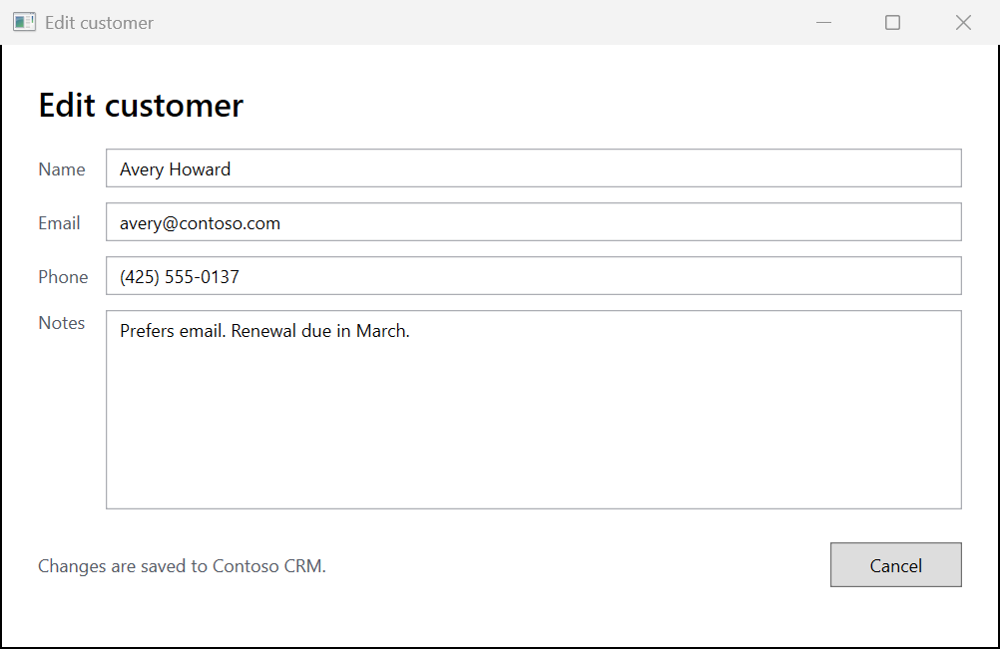
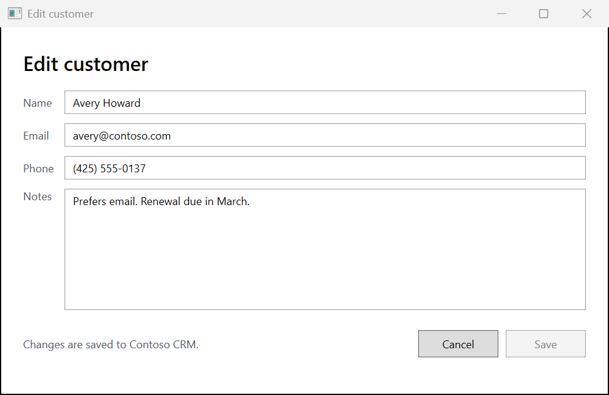
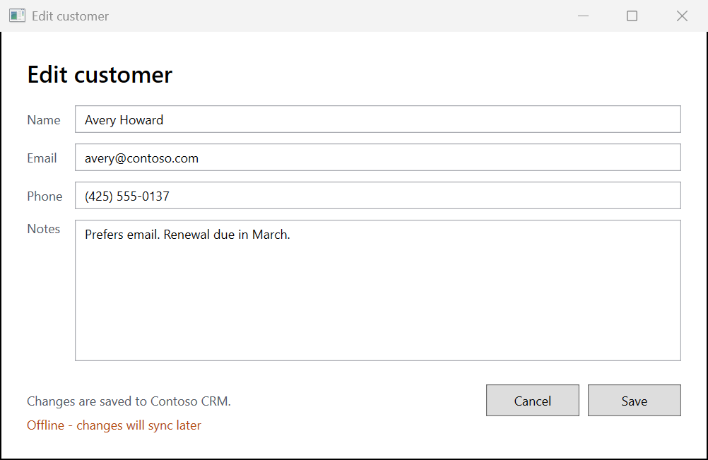

# Session transcript

Source: `Q:\source\XamlAgentDemos-notes\test-runs\VanishingSave\run-consolidated\events.jsonl`

## Tool usage

- get_file: 7
- xaml_capture_image: 5
- xaml_hit_test: 4
- xaml_get_element_properties: 4
- xaml_find_elements: 3
- powershell: 3
- xaml_apply_hot_reload: 3
- xaml_interact: 3
- xaml_get_status: 2
- xaml_get_binding_failures: 2
- replace_string_in_file: 2
- xaml_set_element_property: 2
- task_complete: 2
- skill: 1
- get_projects_in_solution: 1
- xaml_get_visual_tree: 1
- view: 1
- xaml_explain_property_value: 1
- xaml_get_element_bounds: 1
- rg: 1
- multi_replace_string_in_file: 1
- xaml_get_hot_reload_log: 1
- xaml_clear_binding_failures: 1

Failed tool calls: 0, images: 4


_Model: gpt-6.1-terra_


## User (03:03:58)

There should be a Save button in the footer of my running app, but I can't see it. Find out every reason it's not visible and fix them.


**Tool call (03:04:00):** `skill`
```json
{
 "skill": "xaml-diagnostics"
}
```

<details><summary>Result `skill` success=true</summary>

```
Skill "xaml-diagnostics" loaded successfully. Follow the instructions in the skill context.
```
</details>


_Skill invoked: xaml-diagnostics_


**Tool call (03:04:03):** `xaml_get_status`
```json
{
 "progressMessage": "I’ll inspect the running app and trace what hides Save."
}
```

<details><summary>Result `xaml_get_status` success=true</summary>

```
{"isDebugging":true,"debuggerState":"running","diagnosticsActive":true,"apps":[{"app":"a4","name":"VanishingSave.exe [26616]","processId":26616,"platform":"WPF (.NET)","isRemote":false,"isDesignTimeOrNoDebug":false,"sourceInfoAvailable":true,"hotReloadSupported":true,"hotReloadEnabled":true,"supportsPropertyExplorer":true,"supportsInAppToolbar":true,"supportsHitTest":true,"windows":[{"windowId":"0x23008EE","title":"Edit customer","bounds":{"x":342,"y":342,"width":1020,"height":660},"dpiScale":1.5,"visible":true,"minimized":false}]}],"issues":[],"issuesSummary":"No problems detected.","hotReload":{"options":{"hotReloadEnabled":true,"hotReloadOnSave":false,"applyMode":"asYouType: XAML edits apply as you type, without saving (default)","wpfEnabled":true,"uwpEnabled":true,"winUIEnabled":true,"mauiEnabled":true,"justMyXaml":true,"previewSelectedElement":false,"inAppToolbar":true,"inAppSelection":false,"layoutAdorners":false,"trackFocusedElement":false,"bindingFailuresVisible":true,"compatibilityMode":false},"dotNetHotReloadEnabled":true,"isProcessingChanges":false,"lastHotReloadUpdate":{"secondsAgo":176,"updatesSinceToolsStarted":14},"errors":[]},"windowsNote":"Window bounds are physical screen pixels and include the window frame. A WPF/WinUI Window's Width and Height are device-independent units (DIPs) that also include the frame, so Width = bounds.width / dpiScale. A user's \"800 px wide\" is ambiguous: say which unit you tested. A minimized window reports x/y = -32000 and can't be captured."}
```
</details>


**Tool call (03:04:05):** `xaml_find_elements`
```json
{
 "progressMessage": "Finding the Save control.",
 "type": "*Button",
 "maxResults": 100
}
```


**Tool call (03:04:05):** `xaml_capture_image`
```json
{
 "progressMessage": "Inspecting the current window."
}
```


**Tool call (03:04:05):** `xaml_get_binding_failures`
```json
{
 "progressMessage": "Checking for related binding errors."
}
```


**Tool call (03:04:05):** `get_projects_in_solution`
```json
{}
```

<details><summary>Result `xaml_find_elements` success=true</summary>

```
{"count":2,"totalMatches":2,"truncated":false,"results":[{"id":"a4:29","type":"System.Windows.Controls.Button","name":"CancelButton","source":{"file":"Q:\\source\\XamlAgentDemos\\src\\VanishingSave\\MainWindow.xaml","line":112,"column":14},"path":"MainWindow/Border/AdornerDecorator/ContentPresenter/Grid/Grid/Button"},{"id":"a4:10","type":"System.Windows.Controls.Button","name":"SaveButton","source":{"file":"Q:\\source\\XamlAgentDemos\\src\\VanishingSave\\MainWindow.xaml","line":118,"column":14},"path":"MainWindow/Border/AdornerDecorator/ContentPresenter/Grid/Grid/Button"}]}
```
</details>

<details><summary>Result `xaml_get_binding_failures` success=true</summary>

```
{"note":"This is a cumulative log since debugging started or the last xaml_clear_binding_failures, not live state: fixed failures stay listed. To verify a fix: clear, revisit the UI that uses the binding, then read again. Failures without a file usually come from bindings created in code.","totalUnique":1,"matched":1,"truncated":false,"failures":[{"severity":"Warning","count":1,"errorCode":"40","description":"CanSave property not found on object of type CustomerViewModel.","bindingPath":"CanSave","target":"Button.Visibility, Name='SaveButton'","targetName":"SaveButton","targetPropertyType":"Visibility","dataContextType":"CustomerViewModel","file":"Q:\\source\\XamlAgentDemos\\src\\VanishingSave\\MainWindow.xaml","line":118,"column":14,"project":"VanishingSave","originalError":"System.Windows.Data Warning: 40 : BindingExpression path error: 'CanSave' property not found on 'object' ''CustomerViewModel' (HashCode=30479632)'. BindingExpression:Path=CanSave; DataItem='CustomerViewModel' (HashCode=30479632); target element is 'Button' (Name='SaveButton'); target property is 'Visibility' (type 'Visibility')"}]}
```
</details>

<details><summary>Result `get_projects_in_solution` success=true</summary>

```
src\GhostClicks\GhostClicks.csproj
src\GermanReady\GermanReady.csproj
src\ThemeBreaker\ThemeBreaker.csproj
src\DesignPolish\DesignPolish.csproj
src\HotReloadDoctor\HotReloadDoctor.csproj
src\VanishingSave\VanishingSave.csproj
src\CrispPixels\CrispPixels.csproj
src\PrecedenceWars\PrecedenceWars.csproj
src\LostWindows\LostWindows.csproj
src\TemplateDetective\TemplateDetective.csproj
src\SlowScroll\SlowScroll.csproj
src\PixelPerfect\PixelPerfect.csproj
src\BindingStorm\BindingStorm.csproj
src\BugRepro\BugRepro.csproj
src\A11ySweep\A11ySweep.csproj
src\StyleMaze\StyleMaze.csproj
src\ResponsiveDashboard\ResponsiveDashboard.csproj

```
</details>


<details><summary>Result `xaml_capture_image` success=true</summary>

```
Screenshot of window 0x23008EE "Edit customer" of app a4 (1002x651 image of the window's client area, so it's slightly smaller than the frame bounds from xaml_get_status).
```
</details>


**Tool call (03:04:10):** `xaml_hit_test`
```json
{
 "progressMessage": "Tracing Save visibility and clipping.",
 "elementIds": [
  "a4:10",
  "a4:29"
 ]
}
```


**Tool call (03:04:10):** `xaml_get_element_properties`
```json
{
 "progressMessage": "Inspecting Save and Cancel properties.",
 "elementIds": [
  "a4:10",
  "a4:29"
 ],
 "includeAll": true
}
```


**Tool call (03:04:10):** `xaml_get_visual_tree`
```json
{
 "progressMessage": "Inspecting the footer hierarchy.",
 "depth": 5,
 "maxNodes": 200
}
```


**Tool call (03:04:10):** `get_file`
```json
{
 "filename": "Q:\\source\\XamlAgentDemos\\src\\VanishingSave\\MainWindow.xaml",
 "startLine": 1,
 "endLine": 200
}
```


**Tool call (03:04:10):** `view`
```json
{
 "path": "c:\\vs\\fastmain\\common7\\ide\\commonextensions\\microsoft\\xamldiagnostics\\AgentTools\\skills\\xaml-diagnostics\\references\\xaml-authoring.md"
}
```


**Tool call (03:04:10):** `powershell`
```json
{
 "command": "git status --short; Get-ChildItem src\\VanishingSave -Recurse -File | Select-Object -ExpandProperty FullName",
 "description": "Inspect worktree and project files"
}
```

<details><summary>Result `view` success=true</summary>

```
# XAML authoring guidance

Follow these rules when writing or changing XAML so it works well with XAML Hot Reload, the XAML designer, and XAML Diagnostics.

## Design-time data

- Declare `xmlns:d="http://schemas.microsoft.com/expression/blend/2008"` and `xmlns:mc="http://schemas.openxmlformats.org/markup-compatibility/2006"` with `mc:Ignorable="d"`.
- Use `d:DataContext="{d:DesignInstance Type=vm:MyViewModel, IsDesignTimeCreatable=False}"` (WPF/UWP) so the designer and IntelliSense know binding paths.
- Use `d:` properties (for example `d:Text="Sample"`) for sample values that appear only at design time.
- .NET MAUI: set `x:DataType` on pages and `DataTemplate`s. It enables compiled bindings and turns many binding failures into build errors.
- WinUI/UWP: prefer `x:Bind` for compile-time checked bindings when the view owns the view model.

## Bindings

- Bind with explicit paths. Avoid string-built paths in code-behind.
- Keep the `DataContext` chain simple. Use `ElementName` or `RelativeSource` only at real scope boundaries (for example inside a `DataTemplate` that needs the page's view model).
- Expose bound properties as public properties that raise `PropertyChanged`. Fields and non-public properties don't bind.
- Use `FallbackValue` and `TargetNullValue` for expected missing values instead of hiding binding errors.
- Before saving, check every binding path against the actual property names on the data context type (case, plurals, nested paths such as `Customer.Address.City`). Misspelled paths are the most common binding failure and they fail silently.
- Inside a `DataTemplate` or `ItemContainerStyle`, the data context is the item, not the page's view model. To reach a page command, use `RelativeSource={RelativeSource AncestorType=...}` with `DataContext.` in the path, or `ElementName`.
- A `TextBox.Text` binding updates its source on `LostFocus` by default (WPF). Use `UpdateSourceTrigger=PropertyChanged` when other UI (validation, enabled state, live search) must react while the user types.
- `Mode=TwoWay` (the default for `TextBox.Text`, `CheckBox.IsChecked`, `Selector.SelectedItem` and similar) needs a property with a public setter. In WPF, a two-way binding to a read-only property throws when the view loads.
- Bindings created in code have no XAML file and line in diagnostics. Prefer declaring bindings in XAML.

## Layout

- Don't put a list (`ListBox`, `ListView`, `DataGrid`, `ItemsControl` with a virtualizing panel) insid
... [truncated 4693 chars]
```
</details>

<details><summary>Result `xaml_get_visual_tree` success=true</summary>

```
{"app":"a4","platform":"WPF (.NET)","sourceInfoAvailable":true,"nodeCount":27,"truncated":false,"depthLimitedNodes":5,"hint":"5 node(s) have children beyond the requested depth (childCount > 0, no children listed). Raise depth or pass rootElementId to expand them.","nodes":[{"id":"a4:11","type":"VanishingSave.MainWindow","source":{"file":"Q:\\source\\XamlAgentDemos\\src\\VanishingSave\\MainWindow.xaml","line":4,"column":9},"childCount":1,"children":[{"id":"a4:12","type":"System.Windows.Controls.Border","childCount":1,"children":[{"id":"a4:13","type":"System.Windows.Documents.AdornerDecorator","childCount":2,"children":[{"id":"a4:14","type":"System.Windows.Controls.ContentPresenter","childCount":1,"children":[{"id":"a4:16","type":"System.Windows.Controls.Grid","source":{"file":"Q:\\source\\XamlAgentDemos\\src\\VanishingSave\\MainWindow.xaml","line":40,"column":6},"childCount":3,"children":[{"id":"a4:17","type":"System.Windows.Controls.TextBlock","source":{"file":"Q:\\source\\XamlAgentDemos\\src\\VanishingSave\\MainWindow.xaml","line":47,"column":10},"childCount":0},{"id":"a4:18","type":"System.Windows.Controls.Grid","source":{"file":"Q:\\source\\XamlAgentDemos\\src\\VanishingSave\\MainWindow.xaml","line":52,"column":10},"childCount":8,"children":[{"id":"a4:20","type":"System.Windows.Controls.TextBlock","source":{"file":"Q:\\source\\XamlAgentDemos\\src\\VanishingSave\\MainWindow.xaml","line":64,"column":14},"childCount":0},{"id":"a4:21","type":"System.Windows.Controls.TextBox","name":"NameBox","source":{"file":"Q:\\source\\XamlAgentDemos\\src\\VanishingSave\\MainWindow.xaml","line":65,"column":14},"childCount":1,"children":[{"id":"a4:31","type":"System.Windows.Controls.Border","name":"border","childCount":1}]},{"id":"a4:22","type":"System.Windows.Controls.TextBlock","source":{"file":"Q:\\source\\XamlAgentDemos\\src\\VanishingSave\\MainWindow.xaml","line":71,"column":14},"childCount":0},{"id":"a4:23","type":"System.Windows.Controls.TextBox","name":"EmailBox","source":{"file":"Q:\\source\\XamlAgentDemos\\src\\VanishingSave\\MainWindow.xaml","line":72,"column":14},"childCount":1,"children":[{"id":"a4:32","type":"System.Windows.Controls.Border","name":"border","childCount":1}]},{"id":"a4:24","type":"System.Windows.Controls.TextBlock","source":{"file":"Q:\\source\\XamlAgentDemos\\src\\VanishingSave\\MainWindow.xaml","line":79,"column":14},"childCount":0},{"id":"a4:25","type":"System.Windows.Controls.TextBox","name":"PhoneBox","source":{"file":"Q:\\source\\XamlAge
... [truncated 2044 chars]
```
</details>

<details><summary>Result `get_file` success=true</summary>

```
```xaml src\VanishingSave\MainWindow.xaml (Lines 1-138 of 138 total. Call tools for more if needed.)
<Window x:Class="VanishingSave.MainWindow"
        xmlns="http://schemas.microsoft.com/winfx/2006/xaml/presentation"
        xmlns:x="http://schemas.microsoft.com/winfx/2006/xaml"
        xmlns:local="clr-namespace:VanishingSave"
        Title="Edit customer"
        Width="680"
        Height="440"
        Background="White">
    <Window.DataContext>
        <local:CustomerViewModel />
    </Window.DataContext>

    <Window.Resources>
        <BooleanToVisibilityConverter x:Key="BoolToVisibility" />

        <Style x:Key="FieldLabelStyle" TargetType="TextBlock">
            <Setter Property="Margin" Value="0,0,12,10" />
            <Setter Property="VerticalAlignment" Value="Center" />
            <Setter Property="Foreground" Value="#555B66" />
        </Style>

        <Style x:Key="FieldStyle" TargetType="TextBox">
            <Setter Property="Margin" Value="0,0,0,10" />
            <Setter Property="Padding" Value="6,4" />
        </Style>

        <Style x:Key="FooterButtonStyle" TargetType="Button">
            <Setter Property="MinWidth" Value="88" />
            <Setter Property="Margin" Value="8,0,0,0" />
            <Setter Property="Padding" Value="16,6" />
            <Style.Triggers>
                <!-- Fade out buttons that can't be used yet. -->
                <Trigger Property="IsEnabled" Value="False">
                    <Setter Property="Opacity" Value="0" />
                </Trigger>
            </Style.Triggers>
        </Style>
    </Window.Resources>

    <Grid Margin="24">
        <Grid.RowDefinitions>
            <RowDefinition Height="Auto" />
            <RowDefinition Height="*" />
            <RowDefinition Height="Auto" />
        </Grid.RowDefinitions>

        <TextBlock Margin="0,0,0,16"
                   FontSize="22"
                   FontWeight="SemiBold"
                   Text="Edit customer" />

        <Grid Grid.Row="1">
            <Grid.ColumnDefinitions>
                <ColumnDefinition Width="Auto" />
                <ColumnDefinition Width="*" />
            </Grid.ColumnDefinitions>
            <Grid.RowDefinitions>
                <RowDefinition Height="Auto" />
                <RowDefinition Height="Auto" />
                <RowDefinition Height="Auto" />
                <RowDefinition Height="*" />
            </Grid.RowDefinitions>

   
... [truncated 3413 chars]
```
</details>

<details><summary>Result `xaml_hit_test` success=true</summary>

```
{"count":2,"failed":0,"results":[{"id":"a4:10","summary":"A click at its center does NOT reach 'SaveButton': it lands on Border (in the template of MainWindow), which is above it at that point or covers it. Button 'SaveButton' has Visibility=Collapsed. Button 'SaveButton' has IsEnabled=False (IsEnabledCore: command CanExecute is false or the control disabled itself). Button 'SaveButton' has Opacity=0. 'SaveButton' has zero width or height.","elementReceivesInput":false,"inputTarget":{"id":"a4:12","type":"System.Windows.Controls.Border","templatedParent":{"id":"a4:11","type":"VanishingSave.MainWindow","source":{"file":"Q:\\source\\XamlAgentDemos\\src\\VanishingSave\\MainWindow.xaml","line":4,"column":9}}},"stack":[{"id":"a4:12","type":"System.Windows.Controls.Border","templatedParent":{"id":"a4:11","type":"VanishingSave.MainWindow","source":{"file":"Q:\\source\\XamlAgentDemos\\src\\VanishingSave\\MainWindow.xaml","line":4,"column":9}}}],"isVisible":false,"isHitTestVisible":true,"isEnabled":false,"effectiveOpacity":0.0,"blockers":[{"id":"a4:10","type":"System.Windows.Controls.Button","name":"SaveButton","source":{"file":"Q:\\source\\XamlAgentDemos\\src\\VanishingSave\\MainWindow.xaml","line":118,"column":14},"property":"Visibility","value":"Collapsed"},{"id":"a4:10","type":"System.Windows.Controls.Button","name":"SaveButton","source":{"file":"Q:\\source\\XamlAgentDemos\\src\\VanishingSave\\MainWindow.xaml","line":118,"column":14},"property":"IsEnabled","value":"False (IsEnabledCore: command CanExecute is false or the control disabled itself)"},{"id":"a4:10","type":"System.Windows.Controls.Button","name":"SaveButton","source":{"file":"Q:\\source\\XamlAgentDemos\\src\\VanishingSave\\MainWindow.xaml","line":118,"column":14},"property":"Opacity","value":"0"}],"point":{"window":{"x":24.0,"y":348.71},"screen":{"x":389.0,"y":910.0}}},{"id":"a4:29","summary":"A click at its center reaches 'CancelButton' (input lands on TextBlock (in the template of Button 'CancelButton')).","elementReceivesInput":true,"inputTarget":{"id":"a4:46","type":"System.Windows.Controls.TextBlock","templatedParent":{"id":"a4:29","type":"System.Windows.Controls.Button","name":"CancelButton","source":{"file":"Q:\\source\\XamlAgentDemos\\src\\VanishingSave\\MainWindow.xaml","line":112,"column":14}}},"stack":[{"id":"a4:46","type":"System.Windows.Controls.TextBlock","templatedParent":{"id":"a4:29","type":"System.Windows.Controls.Button","name":"CancelButton","source":{"file":"Q:\\source\\XamlAgent
... [truncated 1464 chars]
```
</details>

<details><summary>Result `xaml_get_element_properties` success=true</summary>

```
Output too large to read at once (47.4 KB). Saved to: C:\Users\peterspa\AppData\Local\Microsoft\VisualStudio\CopilotCli\e4c67325-2aa0-4c4e-8c3d-59db07cc2da7\temp\1794711850675-copilot-tool-output-dc37dea2505d4262918bac0d9d5ef481.txt
Consider using tools like rg (for searching), head/tail (for viewing start/end), view with view_range (for specific sections), or jq (for JSON) to examine portions of the output.

Preview (first 500 chars):
{"count":2,"failed":0,"results":[{"id":"a4:10","type":"System.Windows.Controls.Button","name":"SaveButton","source":{"file":"Q:\\source\\XamlAgentDemos\\src\\VanishingSave\\MainWindow.xaml","line":118,"column":14},"properties":[{"name":"IsEnabled","value":"False","valueType":"System.Boolean","propertyType":"System.Boolean","declaringType":"System.Windows.UIElement","valueSource":"Coercion"},{"name":"IsDefault","value":"True","valueType":"System.Boolean","propertyType":"System.Boolean","declaring
```
</details>

<details><summary>Result `powershell` success=true</summary>

```
Q:\source\XamlAgentDemos\src\VanishingSave\App.xaml
Q:\source\XamlAgentDemos\src\VanishingSave\App.xaml.cs
Q:\source\XamlAgentDemos\src\VanishingSave\CustomerViewModel.cs
Q:\source\XamlAgentDemos\src\VanishingSave\FooterSettings.cs
Q:\source\XamlAgentDemos\src\VanishingSave\MainWindow.xaml
Q:\source\XamlAgentDemos\src\VanishingSave\MainWindow.xaml.cs
Q:\source\XamlAgentDemos\src\VanishingSave\VanishingSave.csproj
Q:\source\XamlAgentDemos\src\VanishingSave\bin\Debug\net10.0-windows\VanishingSave.deps.json
Q:\source\XamlAgentDemos\src\VanishingSave\bin\Debug\net10.0-windows\VanishingSave.dll
Q:\source\XamlAgentDemos\src\VanishingSave\bin\Debug\net10.0-windows\VanishingSave.exe
Q:\source\XamlAgentDemos\src\VanishingSave\bin\Debug\net10.0-windows\VanishingSave.pdb
Q:\source\XamlAgentDemos\src\VanishingSave\bin\Debug\net10.0-windows\VanishingSave.runtimeconfig.dev.json
Q:\source\XamlAgentDemos\src\VanishingSave\bin\Debug\net10.0-windows\VanishingSave.runtimeconfig.json
Q:\source\XamlAgentDemos\src\VanishingSave\obj\project.assets.json
Q:\source\XamlAgentDemos\src\VanishingSave\obj\project.nuget.cache
Q:\source\XamlAgentDemos\src\VanishingSave\obj\VanishingSave.csproj.nuget.dgspec.json
Q:\source\XamlAgentDemos\src\VanishingSave\obj\VanishingSave.csproj.nuget.g.props
Q:\source\XamlAgentDemos\src\VanishingSave\obj\VanishingSave.csproj.nuget.g.targets
Q:\source\XamlAgentDemos\src\VanishingSave\obj\Debug\net10.0-windows\.NETCoreApp,Version=v10.0.AssemblyAttributes.cs
Q:\source\XamlAgentDemos\src\VanishingSave\obj\Debug\net10.0-windows\App.g.cs
Q:\source\XamlAgentDemos\src\VanishingSave\obj\Debug\net10.0-windows\App.g.i.cs
Q:\source\XamlAgentDemos\src\VanishingSave\obj\Debug\net10.0-windows\apphost.exe
Q:\source\XamlAgentDemos\src\VanishingSave\obj\Debug\net10.0-windows\GeneratedInternalTypeHelper.g.cs
Q:\source\XamlAgentDemos\src\VanishingSave\obj\Debug\net10.0-windows\GeneratedInternalTypeHelper.g.i.cs
Q:\source\XamlAgentDemos\src\VanishingSave\obj\Debug\net10.0-windows\MainWindow.baml
Q:\source\XamlAgentDemos\src\VanishingSave\obj\Debug\net10.0-windows\MainWindow.g.cs
Q:\source\XamlAgentDemos\src\VanishingSave\obj\Debug\net10.0-windows\MainWindow.g.i.cs
Q:\source\XamlAgentDemos\src\VanishingSave\obj\Debug\net10.0-windows\Vanishin.559ADE70.Up2Date
Q:\source\XamlAgentDemos\src\VanishingSave\obj\Debug\net10.0-windows\VanishingSave_5cgzny33_wpftmp.AssemblyInfo.cs
Q:\source\XamlAgentDemos\src\VanishingSave\obj\Debug\net10.0-windows\VanishingSave_5cgzny33_wpftmp.Assembl
... [truncated 5139 chars]
```
</details>


**Assistant (03:04:16):**

Save has multiple independent blockers. I’ll trace the footer’s layout and command state before fixing them together.


**Tool call (03:04:16):** `get_file`
```json
{
 "filename": "Q:\\source\\XamlAgentDemos\\src\\VanishingSave\\CustomerViewModel.cs",
 "startLine": 1,
 "endLine": 300
}
```


**Tool call (03:04:16):** `get_file`
```json
{
 "filename": "Q:\\source\\XamlAgentDemos\\src\\VanishingSave\\MainWindow.xaml.cs",
 "startLine": 1,
 "endLine": 300
}
```


**Tool call (03:04:16):** `get_file`
```json
{
 "filename": "Q:\\source\\XamlAgentDemos\\src\\VanishingSave\\FooterSettings.cs",
 "startLine": 1,
 "endLine": 200
}
```


**Tool call (03:04:16):** `xaml_get_element_properties`
```json
{
 "progressMessage": "Inspecting footer layout values.",
 "elementIds": [
  "a4:10",
  "a4:19",
  "a4:30"
 ],
 "nameFilter": "Visibility|Opacity|Width|Height|Margin|Column|IsEnabled|Command|Background"
}
```


**Tool call (03:04:16):** `xaml_explain_property_value`
```json
{
 "progressMessage": "Tracing Save visibility and opacity.",
 "elementIds": [
  "a4:10"
 ],
 "propertyNames": [
  "Visibility",
  "Opacity",
  "IsEnabled"
 ]
}
```


**Tool call (03:04:16):** `xaml_get_element_bounds`
```json
{
 "progressMessage": "Checking footer and status bounds.",
 "elementIds": [
  "a4:10",
  "a4:19",
  "a4:30"
 ]
}
```

<details><summary>Result `get_file` success=true</summary>

```
```csharp src\VanishingSave\FooterSettings.cs (Lines 1-10 of 10 total. Call tools for more if needed.)
namespace VanishingSave;

public static class FooterSettings
{
    /// <summary>
    /// Compact footer for small screens: auto-save makes the Save column unnecessary.
    /// (Auto-save was cut from v2, but this switch stayed on.)
    /// </summary>
    public static bool UseCompactFooter { get; set; } = true;
}

```


```
</details>

<details><summary>Result `get_file` success=true</summary>

```
```csharp src\VanishingSave\CustomerViewModel.cs (Lines 1-35 of 35 total. Call tools for more if needed.)
namespace VanishingSave;

public sealed class CustomerViewModel : ObservableObject
{
    private string name = "Avery Howard";
    private string email = "avery@contoso.com";
    private string phone = "(425) 555-0137";
    private string notes = "Prefers email. Renewal due in March.";
    private bool isDirty;

    public CustomerViewModel()
    {
        this.SaveCommand = new RelayCommand(this.Save, () => this.IsDirty);
        this.CancelCommand = new RelayCommand(() => this.IsDirty = false);
    }

    public string Name { get => this.name; set { if (this.SetProperty(ref this.name, value)) this.IsDirty = true; } }

    public string Email { get => this.email; set { if (this.SetProperty(ref this.email, value)) this.IsDirty = true; } }

    public string Phone { get => this.phone; set { if (this.SetProperty(ref this.phone, value)) this.IsDirty = true; } }

    public string Notes { get => this.notes; set { if (this.SetProperty(ref this.notes, value)) this.IsDirty = true; } }

    public bool IsDirty { get => this.isDirty; set => this.SetProperty(ref this.isDirty, value); }

    /// <summary>Whether the current user is allowed to save customer records.</summary>
    public bool IsSaveAvailable => true;

    public RelayCommand SaveCommand { get; }

    public RelayCommand CancelCommand { get; }

    private void Save() => this.IsDirty = false;
}

```


```
</details>

<details><summary>Result `get_file` success=true</summary>

```
```csharp src\VanishingSave\MainWindow.xaml.cs (Lines 1-20 of 20 total. Call tools for more if needed.)
using System.Windows;

namespace VanishingSave;

public partial class MainWindow : Window
{
    public MainWindow()
    {
        this.InitializeComponent();
        this.Loaded += this.OnLoaded;
    }

    private void OnLoaded(object sender, RoutedEventArgs e)
    {
        if (FooterSettings.UseCompactFooter)
        {
            this.SaveColumn.Width = new GridLength(0);
        }
    }
}

```


```
</details>

<details><summary>Result `xaml_get_element_bounds` success=true</summary>

```
{"note":"'screen' is in physical screen pixels. 'window' is in device-independent units relative to the element's root window (multiply by dpiScale for pixels). Fractional screen pixel values (for example x=18.75) mean edges fall between device pixels, so thin lines and text render blurry unless layout rounding snaps them. isVisible only reflects Visibility/opacity; insideWindowFraction < 1 (clippedByWindow) means part of the element is outside the window's client area, so the user can't see that part. Ancestor clipping (ScrollViewer, Grid cell, ClipToBounds) isn't included; compare with the parent's bounds or call xaml_capture_image.","bounds":[{"id":"a4:10","isVisible":false,"windowHandle":"0x23008EE","dpiScale":1.5,"screen":{"x":389.0,"y":910.0,"width":0.0,"height":0.0},"window":{"x":24.0,"y":348.71,"width":0.0,"height":0.0}},{"id":"a4:19","isVisible":true,"insideWindowFraction":1.0,"windowHandle":"0x23008EE","dpiScale":1.5,"screen":{"x":389.0,"y":910.0,"width":926.0,"height":45.0},"window":{"x":24.0,"y":348.71,"width":617.33,"height":29.96}},{"id":"a4:30","isVisible":true,"windowHandle":"0x23008EE","dpiScale":1.5,"screen":{"x":1315.0,"y":910.0,"width":0.0,"height":45.0},"window":{"x":641.33,"y":348.71,"width":0.0,"height":29.96}}]}
```
</details>

<details><summary>Result `xaml_get_element_properties` success=true</summary>

```
{"count":3,"failed":0,"results":[{"id":"a4:10","type":"System.Windows.Controls.Button","name":"SaveButton","source":{"file":"Q:\\source\\XamlAgentDemos\\src\\VanishingSave\\MainWindow.xaml","line":118,"column":14},"properties":[{"name":"IsEnabled","value":"False","valueType":"System.Boolean","propertyType":"System.Boolean","declaringType":"System.Windows.UIElement","valueSource":"Coercion"},{"name":"Command","evaluatedValue":"(XamlAgentDemos.RelayCommand)","valueType":"System.Windows.Data.BindingExpression","propertyType":"System.Windows.Input.ICommand","declaringType":"System.Windows.Controls.Primitives.ButtonBase","valueSource":"Local","valueSourceLocation":{"file":"Q:\\source\\XamlAgentDemos\\src\\VanishingSave\\MainWindow.xaml","line":118,"column":14},"isBinding":true},{"name":"Visibility","evaluatedValue":"2 (System.Windows.Visibility)","valueType":"System.Windows.Data.BindingExpression","propertyType":"System.Windows.Visibility","declaringType":"System.Windows.UIElement","valueSource":"Local","valueSourceLocation":{"file":"Q:\\source\\XamlAgentDemos\\src\\VanishingSave\\MainWindow.xaml","line":118,"column":14},"isBinding":true},{"name":"Grid.Column","value":"2","valueType":"System.Int32","propertyType":"System.Int32","declaringType":"System.Windows.Controls.Grid","valueSource":"Local","valueSourceLocation":{"file":"Q:\\source\\XamlAgentDemos\\src\\VanishingSave\\MainWindow.xaml","line":118,"column":14},"isAttached":true},{"name":"Opacity","value":"0","valueType":"System.Double","propertyType":"System.Double","declaringType":"System.Windows.UIElement","valueSource":"StyleTrigger"},{"name":"Margin","value":"8,0,0,0","valueType":"System.Windows.Thickness","propertyType":"System.Windows.Thickness","declaringType":"System.Windows.FrameworkElement","valueSource":"Style","valueSourceLocation":{"file":"Q:\\source\\XamlAgentDemos\\src\\VanishingSave\\MainWindow.xaml","line":27,"column":10}},{"name":"MinWidth","value":"88","valueType":"System.Double","propertyType":"System.Double","declaringType":"System.Windows.FrameworkElement","valueSource":"Style","valueSourceLocation":{"file":"Q:\\source\\XamlAgentDemos\\src\\VanishingSave\\MainWindow.xaml","line":27,"column":10}},{"name":"Background","value":"#FFDDDDDD","valueType":"System.Windows.Media.SolidColorBrush","propertyType":"System.Windows.Media.Brush","declaringType":"System.Windows.Controls.Control","valueSource":"BuiltInStyle"},{"name":"CommandParameter","propertyType":"System.Object","declaringType":"Syste
... [truncated 9387 chars]
```
</details>

<details><summary>Result `xaml_explain_property_value` success=true</summary>

```
{"count":3,"failed":0,"results":[{"id":"a4:10","type":"System.Windows.Controls.Button","property":"Visibility","propertyType":"System.Windows.Visibility","evaluatedValue":"2 (System.Windows.Visibility)","effectiveSource":"Local","chain":[{"kind":"Local","description":"Local value set on the element (XAML attribute, binding or code). Wins over styles, templates and inheritance.","evaluatedValue":"2 (System.Windows.Visibility)","valueType":"System.Windows.Data.BindingExpression","isBinding":true,"effective":true,"sourceLocation":{"file":"Q:\\source\\XamlAgentDemos\\src\\VanishingSave\\MainWindow.xaml","line":118,"column":14}},{"kind":"Default","description":"The property's default value; nothing sets it.","value":"0","valueType":"System.Windows.Visibility","effective":false}],"notes":["To let a style or template value apply, remove the local value (the attribute, binding or code assignment). To change it, edit that local value. XAML and code both produce Local values, and the source location may still point to the XAML attribute after code assigned a new value. If the live value differs from the XAML attribute, or the element has no XAML attribute for it, code set it: search code-behind for the element's x:Name.","The effective value comes from a binding. If it's wrong, check xaml_get_binding_failures and the DataContext."]},{"id":"a4:10","type":"System.Windows.Controls.Button","property":"Opacity","propertyType":"System.Double","effectiveValue":"0","effectiveSource":"StyleTrigger","chain":[{"kind":"StyleTrigger","description":"Trigger in the element's Style whose condition is currently true.","value":"0","valueType":"System.Double","effective":true},{"kind":"Default","description":"The property's default value; nothing sets it.","value":"1","valueType":"System.Double","effective":false}],"notes":["Edit the setter or trigger at the source location, or set a local value to override it for this element only."]},{"id":"a4:10","type":"System.Windows.Controls.Button","property":"IsEnabled","propertyType":"System.Boolean","effectiveValue":"False","effectiveSource":"Coercion","chain":[{"kind":"Coercion","description":"The control coerced the value (for example clamped to a minimum or maximum).","value":"False","valueType":"System.Boolean","effective":true},{"kind":"Default","description":"The property's default value; nothing sets it.","value":"True","valueType":"System.Boolean","effective":false}],"notes":["Check related properties that constrain this one (for exa
... [truncated 48 chars]
```
</details>


**Tool call (03:04:28):** `rg`
```json
{
 "pattern": "class RelayCommand|class ObservableObject|UseCompactFooter|SyncStatusText",
 "glob": "*.cs",
 "output_mode": "content",
 "-n": true
}
```


**Tool call (03:04:28):** `get_file`
```json
{
 "filename": "Q:\\source\\XamlAgentDemos\\src\\VanishingSave\\VanishingSave.csproj",
 "startLine": 1,
 "endLine": 120
}
```

<details><summary>Result `get_file` success=true</summary>

```
``` src\VanishingSave\VanishingSave.csproj (Lines 1-5 of 5 total. Call tools for more if needed.)
<Project Sdk="Microsoft.NET.Sdk">
  <PropertyGroup>
    <RootNamespace>VanishingSave</RootNamespace>
  </PropertyGroup>
</Project>

```


```
</details>

<details><summary>Result `rg` success=true</summary>

```
.\src\VanishingSave\MainWindow.xaml.cs:15:        if (FooterSettings.UseCompactFooter)
.\src\Shared\RelayCommand.cs:5:public sealed class RelayCommand(Action execute, Func<bool>? canExecute = null) : ICommand
.\src\VanishingSave\FooterSettings.cs:9:    public static bool UseCompactFooter { get; set; } = true;
.\src\Shared\ObservableObject.cs:6:public abstract class ObservableObject : INotifyPropertyChanged
```
</details>


**Tool call (03:04:40):** `multi_replace_string_in_file`
```json
{
 "explanation": "Restore Save's availability, preserve its column, and move status out of its cell.",
 "replacements": [
  {
   "filePath": "src\\VanishingSave\\MainWindow.xaml",
   "oldString": "            <Setter Property=\"MinWidth\" Value=\"88\" />\n            <Setter Property=\"Margin\" Value=\"8,0,0,0\" />\n            <Setter Property=\"Padding\" Value=\"16,6\" />\n            <Style.Triggers>\n                <!-- Fade out buttons that can't be used yet. -->\n                <Trigger Property=\"IsEnabled\" Value=\"False\">\n                    <Setter Property=\"Opacity\" Value=\"0\" />\n                </Trigger>\n            </Style.Triggers>\n        </Style>",
   "newString": "            <Setter Property=\"MinWidth\" Value=\"88\" />\n            <Setter Property=\"Margin\" Value=\"8,0,0,0\" />\n            <Setter Property=\"Padding\" Value=\"16,6\" />\n        </Style>",
   "explanation": "Keep disabled buttons visible using the normal button appearance."
  },
  {
   "filePath": "src\\VanishingSave\\MainWindow.xaml",
   "oldString": "        <Grid x:Name=\"Footer\" Grid.Row=\"2\" Margin=\"0,12,0,0\">\n            <Grid.ColumnDefinitions>\n                <ColumnDefinition Width=\"*\" />\n                <ColumnDefinition Width=\"Auto\" />\n                <ColumnDefinition x:Name=\"SaveColumn\" Width=\"Auto\" />\n            </Grid.ColumnDefinitions>\n\n            <TextBlock VerticalAlignment=\"Center\"",
   "newString": "        <Grid x:Name=\"Footer\" Gri
... [truncated 2317 chars]
```

<details><summary>Result `multi_replace_string_in_file` success=true</summary>

```
Successfully applied 4 of 4 replacement(s) across 2 file(s).
```
</details>


**Tool call (03:04:43):** `xaml_apply_hot_reload`
```json
{
 "progressMessage": "Applying the footer fixes to the running app.",
 "includeCodeChanges": true
}
```

<details><summary>Result `xaml_apply_hot_reload` success=true</summary>

```
{"status":"alreadyApplied","errors":[],"log":[],"noNewActivity":true,"lastHotReloadUpdate":{"secondsAgo":4,"updatesSinceToolsStarted":15},"lastActivity":{"secondsAgo":70,"message":"Connected to VanishingSave.exe [26616] for WpfCore diagnostics. Incremental Hot Reload is enabled."},"note":"This call applied nothing new. status=alreadyApplied means XAML Hot Reload pushed changes into the app within the last minute, most likely your edits as you made them. lastHotReloadUpdate is when XAML Hot Reload last pushed changes into the app (it applies saved and in-editor edits as they happen, often without a log entry). If it's after your edit, the edit was already applied; if it's null or older than your edit, nothing reached the app (check the file is saved and part of the running project). It doesn't prove the app shows them: XAML that the app loads itself (XamlReader, files copied to the output folder, dictionaries swapped in code) is never hot reloaded, and code that sets the same property or picks another template/resource at runtime overrides the edit. Check the live value with xaml_explain_property_value or xaml_find_resource.","codeChanges":".NET Hot Reload was started for saved code changes. Its results are in the Hot Reload output pane, not in 'log'; if an edit can't be hot reloaded, Visual Studio asks the user to rebuild and restart.","codeHotReloadOutput":[],"hint":"Call xaml_capture_image to verify the change visually. Views that aren't loaded (other tabs, closed dialogs) are updated when they're next shown. Source line numbers reported for existing elements can still point to the pre-edit lines until the element is recreated, so find elements by x:Name or type rather than by an old line number. Structural edits (wrapping or replacing a parent, changing a root's content) recreate elements, which resets their runtime state such as selection, checked state, typed text and scroll position, and invalidates their IDs. Re-establish the state you were testing before capturing again."}
```
</details>


**Tool call (03:04:50):** `xaml_capture_image`
```json
{
 "progressMessage": "Checking the updated footer."
}
```


**Tool call (03:04:50):** `xaml_find_elements`
```json
{
 "progressMessage": "Finding the updated Save button.",
 "name": "SaveButton|SyncStatusHost|NameBox"
}
```


**Tool call (03:04:50):** `xaml_get_status`
```json
{
 "progressMessage": "Checking the hot reload result."
}
```


**Tool call (03:04:50):** `xaml_get_hot_reload_log`
```json
{
 "progressMessage": "Checking for hot reload errors.",
 "errorsOnly": true
}
```

<details><summary>Result `xaml_find_elements` success=true</summary>

```
{"count":3,"totalMatches":3,"truncated":false,"results":[{"id":"a4:21","type":"System.Windows.Controls.TextBox","name":"NameBox","source":{"file":"Q:\\source\\XamlAgentDemos\\src\\VanishingSave\\MainWindow.xaml","line":65,"column":14},"path":"MainWindow/Border/AdornerDecorator/ContentPresenter/Grid/Grid/TextBox"},{"id":"a4:10","type":"System.Windows.Controls.Button","name":"SaveButton","source":{"file":"Q:\\source\\XamlAgentDemos\\src\\VanishingSave\\MainWindow.xaml","line":118,"column":14},"path":"MainWindow/Border/AdornerDecorator/ContentPresenter/Grid/Grid/Button"},{"id":"a4:30","type":"System.Windows.Controls.Border","name":"SyncStatusHost","source":{"file":"Q:\\source\\XamlAgentDemos\\src\\VanishingSave\\MainWindow.xaml","line":127,"column":14},"path":"MainWindow/Border/AdornerDecorator/ContentPresenter/Grid/Grid/Border"}]}
```
</details>

<details><summary>Result `xaml_get_hot_reload_log` success=true</summary>

```
{"total":0,"entries":[],"dotNetHotReloadPane":["21:45:12.09 [XAML] Connected to PrecedenceWars.exe [63152] for WpfCore diagnostics. Incremental Hot Reload is enabled.","21:45:58.94 🔥 1> [PrecedenceWars] ❌ Exited with error code -1","21:45:59.30 [XAML] PrecedenceWars.exe [63152] WpfCore diagnostics stopped.","21:46:04.56 [XAML] Connected to PrecedenceWars.exe [5684] for WpfCore diagnostics. Incremental Hot Reload is enabled.","21:47:22.38  Code changes were successfully applied.","21:47:56.20  No code changes were found.","21:50:49.58 🔥 2> [PrecedenceWars] ❌ Exited with error code -1","21:50:49.86 [XAML] PrecedenceWars.exe [5684] WpfCore diagnostics stopped.","21:51:02.69 [XAML] Connected to BindingStorm.exe [49320] for WpfCore diagnostics. Incremental Hot Reload is enabled.","21:57:12.92 🔥 3> [BindingStorm] ❌ Exited with error code -1","21:57:13.15 [XAML] BindingStorm.exe [49320] WpfCore diagnostics stopped.","21:57:22.84 [XAML] Connected to A11ySweep.exe [45652] for WpfCore diagnostics. Incremental Hot Reload is enabled.","21:59:12.54  Code changes were successfully applied.","22:03:27.33 🔥 4> [A11ySweep] ❌ Exited with error code -1","22:03:27.57 [XAML] A11ySweep.exe [45652] WpfCore diagnostics stopped.","22:03:36.99 [XAML] Connected to VanishingSave.exe [26616] for WpfCore diagnostics. Incremental Hot Reload is enabled.","22:04:43.99  Code changes were successfully applied."],"hint":"No XAML Hot Reload messages were logged in this VS session yet."}
```
</details>

<details><summary>Result `xaml_get_status` success=true</summary>

```
{"isDebugging":true,"debuggerState":"running","diagnosticsActive":true,"apps":[{"app":"a4","name":"VanishingSave.exe [26616]","processId":26616,"platform":"WPF (.NET)","isRemote":false,"isDesignTimeOrNoDebug":false,"sourceInfoAvailable":true,"hotReloadSupported":true,"hotReloadEnabled":true,"supportsPropertyExplorer":true,"supportsInAppToolbar":true,"supportsHitTest":true,"windows":[{"windowId":"0x23008EE","title":"Edit customer","bounds":{"x":342,"y":342,"width":1020,"height":660},"dpiScale":1.5,"visible":true,"minimized":false}]}],"issues":[],"issuesSummary":"No problems detected.","hotReload":{"options":{"hotReloadEnabled":true,"hotReloadOnSave":false,"applyMode":"asYouType: XAML edits apply as you type, without saving (default)","wpfEnabled":true,"uwpEnabled":true,"winUIEnabled":true,"mauiEnabled":true,"justMyXaml":true,"previewSelectedElement":false,"inAppToolbar":true,"inAppSelection":false,"layoutAdorners":false,"trackFocusedElement":false,"bindingFailuresVisible":true,"compatibilityMode":false},"dotNetHotReloadEnabled":true,"isProcessingChanges":false,"lastHotReloadUpdate":{"secondsAgo":7,"updatesSinceToolsStarted":15},"errors":[]},"windowsNote":"Window bounds are physical screen pixels and include the window frame. A WPF/WinUI Window's Width and Height are device-independent units (DIPs) that also include the frame, so Width = bounds.width / dpiScale. A user's \"800 px wide\" is ambiguous: say which unit you tested. A minimized window reports x/y = -32000 and can't be captured."}
```
</details>




<details><summary>Result `xaml_capture_image` success=true</summary>

```
Screenshot of window 0x23008EE "Edit customer" of app a4 (1002x651 image of the window's client area, so it's slightly smaller than the frame bounds from xaml_get_status).
```
</details>


**Tool call (03:04:59):** `xaml_hit_test`
```json
{
 "progressMessage": "Checking remaining live layout blockers.",
 "elementIds": [
  "a4:10"
 ]
}
```


**Tool call (03:04:59):** `xaml_get_element_properties`
```json
{
 "progressMessage": "Checking the updated Save state.",
 "elementIds": [
  "a4:10",
  "a4:30"
 ],
 "nameFilter": "Visibility|Opacity|IsEnabled|ActualWidth|Grid.Column|Grid.Row|Command|Background"
}
```


**Tool call (03:04:59):** `get_file`
```json
{
 "filename": "Q:\\source\\XamlAgentDemos\\src\\Shared\\RelayCommand.cs",
 "startLine": 1,
 "endLine": 100
}
```

<details><summary>Result `get_file` success=true</summary>

```
```csharp src\Shared\RelayCommand.cs (Lines 1-16 of 16 total. Call tools for more if needed.)
using System.Windows.Input;

namespace XamlAgentDemos;

public sealed class RelayCommand(Action execute, Func<bool>? canExecute = null) : ICommand
{
    public event EventHandler? CanExecuteChanged
    {
        add => CommandManager.RequerySuggested += value;
        remove => CommandManager.RequerySuggested -= value;
    }

    public bool CanExecute(object? parameter) => canExecute?.Invoke() ?? true;

    public void Execute(object? parameter) => execute();
}

```


```
</details>

<details><summary>Result `xaml_hit_test` success=true</summary>

```
{"id":"a4:10","summary":"Nothing receives a click at its center: 'SaveButton' and everything under the point are invisible, IsHitTestVisible=False, or have no Background/Fill there (a null Background isn't hit-testable; Transparent is). Button 'SaveButton' has IsEnabled=False (IsEnabledCore: command CanExecute is false or the control disabled itself). Only 0% of it is visible: Button 'SaveButton' clips it.","elementReceivesInput":false,"stack":[],"isVisible":true,"isHitTestVisible":true,"isEnabled":false,"effectiveOpacity":1.0,"blockers":[{"id":"a4:10","type":"System.Windows.Controls.Button","name":"SaveButton","source":{"file":"Q:\\source\\XamlAgentDemos\\src\\VanishingSave\\MainWindow.xaml","line":118,"column":14},"property":"IsEnabled","value":"False (IsEnabledCore: command CanExecute is false or the control disabled itself)"}],"visibleFraction":0.0,"clippedBy":{"id":"a4:10","type":"System.Windows.Controls.Button","name":"SaveButton","source":{"file":"Q:\\source\\XamlAgentDemos\\src\\VanishingSave\\MainWindow.xaml","line":118,"column":14}},"point":{"window":{"x":693.33,"y":347.73},"screen":{"x":1393.0,"y":909.0}},"note":"inputTarget is what a mouse click or tap at the point reaches (WPF: InputHitTest; WinUI/UWP: FindElementsInHostCoordinates, open popups first; .NET MAUI: approximated from element bounds and draw order). stack lists visible, hit-testable elements under the point, topmost first; elements with no id are template parts or aren't in the live tree (on WPF use their templatedParent). blockers are the element and ancestors whose own values hide it or block input (descendants inherit IsEnabled/IsHitTestVisible=False; on .NET MAUI IsHitTestVisible maps to InputTransparent). visibleFraction includes clipping by ancestors (layout slots, scroll viewports, ClipToBounds/Clip/IsClippedToBounds) and the window."}
```
</details>

<details><summary>Result `xaml_get_element_properties` success=true</summary>

```
{"count":2,"failed":0,"results":[{"id":"a4:10","type":"System.Windows.Controls.Button","name":"SaveButton","source":{"file":"Q:\\source\\XamlAgentDemos\\src\\VanishingSave\\MainWindow.xaml","line":118,"column":14},"properties":[{"name":"IsEnabled","value":"False","valueType":"System.Boolean","propertyType":"System.Boolean","declaringType":"System.Windows.UIElement","valueSource":"Coercion"},{"name":"Command","evaluatedValue":"(XamlAgentDemos.RelayCommand)","valueType":"System.Windows.Data.BindingExpression","propertyType":"System.Windows.Input.ICommand","declaringType":"System.Windows.Controls.Primitives.ButtonBase","valueSource":"Local","valueSourceLocation":{"file":"Q:\\source\\XamlAgentDemos\\src\\VanishingSave\\MainWindow.xaml","line":118,"column":14},"isBinding":true},{"name":"ActualWidth","value":"88","valueType":"System.Double","propertyType":"System.Double","declaringType":"System.Windows.FrameworkElement","valueSource":"Local","valueSourceLocation":{"file":"Q:\\source\\XamlAgentDemos\\src\\VanishingSave\\MainWindow.xaml","line":118,"column":14},"readOnly":true},{"name":"Visibility","evaluatedValue":"0 (System.Windows.Visibility)","valueType":"System.Windows.Data.BindingExpression","propertyType":"System.Windows.Visibility","declaringType":"System.Windows.UIElement","valueSource":"Local","valueSourceLocation":{"file":"Q:\\source\\XamlAgentDemos\\src\\VanishingSave\\MainWindow.xaml","line":118,"column":14},"isBinding":true},{"name":"Grid.Column","value":"2","valueType":"System.Int32","propertyType":"System.Int32","declaringType":"System.Windows.Controls.Grid","valueSource":"Local","valueSourceLocation":{"file":"Q:\\source\\XamlAgentDemos\\src\\VanishingSave\\MainWindow.xaml","line":118,"column":14},"isAttached":true},{"name":"Background","value":"#FFDDDDDD","valueType":"System.Windows.Media.SolidColorBrush","propertyType":"System.Windows.Media.Brush","declaringType":"System.Windows.Controls.Control","valueSource":"BuiltInStyle"},{"name":"CommandParameter","propertyType":"System.Object","declaringType":"System.Windows.Controls.Primitives.ButtonBase","valueSource":"Default"},{"name":"CommandTarget","propertyType":"System.Windows.IInputElement","declaringType":"System.Windows.Controls.Primitives.ButtonBase","valueSource":"Default"},{"name":"CommandBindings","propertyType":"System.Windows.Input.CommandBindingCollection","declaringType":"System.Windows.UIElement","valueSource":"Default"},{"name":"Opacity","value":"1","valueType":"System.Double","property
... [truncated 2670 chars]
```
</details>


**Assistant (03:05:04):**

The saved fixes are applied, but the running window retained its old zero-width column. I’m refreshing that layout and checking the disabled and edited states.


**Tool call (03:05:04):** `replace_string_in_file`
```json
{
 "filePath": "src\\VanishingSave\\MainWindow.xaml",
 "oldString": "            <Grid.ColumnDefinitions>\n                <ColumnDefinition Width=\"*\" />\n                <ColumnDefinition Width=\"Auto\" />\n                <ColumnDefinition x:Name=\"SaveColumn\" Width=\"Auto\" />\n            </Grid.ColumnDefinitions>\n            <Grid.RowDefinitions>\n                <RowDefinition Height=\"Auto\" />",
 "newString": "            <Grid.ColumnDefinitions>\n                <ColumnDefinition Width=\"*\" />\n                <ColumnDefinition Width=\"Auto\" />\n                <ColumnDefinition x:Name=\"SaveColumn\" Width=\"1*\" />\n            </Grid.ColumnDefinitions>\n            <Grid.RowDefinitions>\n                <RowDefinition Height=\"Auto\" />"
}
```

<details><summary>Result `replace_string_in_file` success=true</summary>

```
Successfully replaced text in src\VanishingSave\MainWindow.xaml
```
</details>


**Tool call (03:05:06):** `xaml_apply_hot_reload`
```json
{
 "progressMessage": "Refreshing the live column layout."
}
```

<details><summary>Result `xaml_apply_hot_reload` success=true</summary>

```
{"status":"alreadyApplied","errors":[],"log":[],"noNewActivity":true,"lastHotReloadUpdate":{"secondsAgo":1,"updatesSinceToolsStarted":16},"lastActivity":{"secondsAgo":89,"message":"Connected to VanishingSave.exe [26616] for WpfCore diagnostics. Incremental Hot Reload is enabled."},"note":"This call applied nothing new. status=alreadyApplied means XAML Hot Reload pushed changes into the app within the last minute, most likely your edits as you made them. lastHotReloadUpdate is when XAML Hot Reload last pushed changes into the app (it applies saved and in-editor edits as they happen, often without a log entry). If it's after your edit, the edit was already applied; if it's null or older than your edit, nothing reached the app (check the file is saved and part of the running project). It doesn't prove the app shows them: XAML that the app loads itself (XamlReader, files copied to the output folder, dictionaries swapped in code) is never hot reloaded, and code that sets the same property or picks another template/resource at runtime overrides the edit. Check the live value with xaml_explain_property_value or xaml_find_resource.","hint":"Call xaml_capture_image to verify the change visually. Views that aren't loaded (other tabs, closed dialogs) are updated when they're next shown. Source line numbers reported for existing elements can still point to the pre-edit lines until the element is recreated, so find elements by x:Name or type rather than by an old line number. Structural edits (wrapping or replacing a parent, changing a root's content) recreate elements, which resets their runtime state such as selection, checked state, typed text and scroll position, and invalidates their IDs. Re-establish the state you were testing before capturing again."}
```
</details>


**Tool call (03:05:07):** `get_file`
```json
{
 "filename": "Q:\\source\\XamlAgentDemos\\src\\VanishingSave\\MainWindow.xaml",
 "startLine": 92,
 "endLine": 112
}
```

<details><summary>Result `get_file` success=true</summary>

```
```xaml src\VanishingSave\MainWindow.xaml (Lines 92-112 of 135 total. Call tools for more if needed.)
                     TextWrapping="Wrap" />
        </Grid>

        <Grid x:Name="Footer" Grid.Row="2" Margin="0,12,0,0">
            <Grid.ColumnDefinitions>
                <ColumnDefinition Width="*" />
                <ColumnDefinition Width="Auto" />
                <ColumnDefinition x:Name="SaveColumn" Width="1*" />
            </Grid.ColumnDefinitions>
            <Grid.RowDefinitions>
                <RowDefinition Height="Auto" />
                <RowDefinition Height="Auto" />
            </Grid.RowDefinitions>

            <TextBlock VerticalAlignment="Center"
                       Foreground="#555B66"
                       Text="Changes are saved to Contoso CRM." />

            <Button x:Name="CancelButton"
                    Grid.Column="1"
                    Command="{Binding CancelCommand}"

```


```
</details>


**Tool call (03:05:11):** `replace_string_in_file`
```json
{
 "filePath": "src\\VanishingSave\\MainWindow.xaml",
 "oldString": "            <Grid.ColumnDefinitions>\n                <ColumnDefinition Width=\"*\" />\n                <ColumnDefinition Width=\"Auto\" />\n                <ColumnDefinition x:Name=\"SaveColumn\" Width=\"1*\" />\n            </Grid.ColumnDefinitions>\n            <Grid.RowDefinitions>\n                <RowDefinition Height=\"Auto\" />",
 "newString": "            <Grid.ColumnDefinitions>\n                <ColumnDefinition Width=\"*\" />\n                <ColumnDefinition Width=\"Auto\" />\n                <ColumnDefinition x:Name=\"SaveColumn\" Width=\"Auto\" />\n            </Grid.ColumnDefinitions>\n            <Grid.RowDefinitions>\n                <RowDefinition Height=\"Auto\" />"
}
```

<details><summary>Result `replace_string_in_file` success=true</summary>

```
Successfully replaced text in src\VanishingSave\MainWindow.xaml
```
</details>


**Tool call (03:05:13):** `xaml_apply_hot_reload`
```json
{
 "progressMessage": "Restoring automatic column sizing."
}
```

<details><summary>Result `xaml_apply_hot_reload` success=true</summary>

```
{"status":"alreadyApplied","errors":[],"log":[],"noNewActivity":true,"lastHotReloadUpdate":{"secondsAgo":1,"updatesSinceToolsStarted":17},"lastActivity":{"secondsAgo":96,"message":"Connected to VanishingSave.exe [26616] for WpfCore diagnostics. Incremental Hot Reload is enabled."},"note":"This call applied nothing new. status=alreadyApplied means XAML Hot Reload pushed changes into the app within the last minute, most likely your edits as you made them. lastHotReloadUpdate is when XAML Hot Reload last pushed changes into the app (it applies saved and in-editor edits as they happen, often without a log entry). If it's after your edit, the edit was already applied; if it's null or older than your edit, nothing reached the app (check the file is saved and part of the running project). It doesn't prove the app shows them: XAML that the app loads itself (XamlReader, files copied to the output folder, dictionaries swapped in code) is never hot reloaded, and code that sets the same property or picks another template/resource at runtime overrides the edit. Check the live value with xaml_explain_property_value or xaml_find_resource.","hint":"Call xaml_capture_image to verify the change visually. Views that aren't loaded (other tabs, closed dialogs) are updated when they're next shown. Source line numbers reported for existing elements can still point to the pre-edit lines until the element is recreated, so find elements by x:Name or type rather than by an old line number. Structural edits (wrapping or replacing a parent, changing a root's content) recreate elements, which resets their runtime state such as selection, checked state, typed text and scroll position, and invalidates their IDs. Re-establish the state you were testing before capturing again."}
```
</details>


**Tool call (03:05:16):** `xaml_capture_image`
```json
{
 "progressMessage": "Verifying Save is visible."
}
```


**Tool call (03:05:16):** `xaml_hit_test`
```json
{
 "progressMessage": "Verifying Save layout.",
 "elementIds": [
  "a4:10"
 ]
}
```


**Tool call (03:05:16):** `powershell`
```json
{
 "command": "git --no-pager diff -- src\\VanishingSave\\MainWindow.xaml src\\VanishingSave\\MainWindow.xaml.cs",
 "description": "Review the footer changes"
}
```

<details><summary>Result `xaml_hit_test` success=true</summary>

```
{"id":"a4:10","summary":"A click at its center does NOT reach 'SaveButton': it lands on Grid 'Footer', which is above it at that point or covers it. Button 'SaveButton' has IsEnabled=False (IsEnabledCore: command CanExecute is false or the control disabled itself).","elementReceivesInput":false,"inputTarget":{"id":"a4:19","type":"System.Windows.Controls.Grid","name":"Footer","source":{"file":"Q:\\source\\XamlAgentDemos\\src\\VanishingSave\\MainWindow.xaml","line":101,"column":10}},"stack":[{"id":"a4:139","type":"System.Windows.Controls.TextBlock","templatedParent":{"id":"a4:10","type":"System.Windows.Controls.Button","name":"SaveButton","source":{"file":"Q:\\source\\XamlAgentDemos\\src\\VanishingSave\\MainWindow.xaml","line":118,"column":14}}},{"id":"a4:136","type":"System.Windows.Controls.Border","name":"border","templatedParent":{"id":"a4:10","type":"System.Windows.Controls.Button","name":"SaveButton","source":{"file":"Q:\\source\\XamlAgentDemos\\src\\VanishingSave\\MainWindow.xaml","line":118,"column":14}}},{"id":"a4:12","type":"System.Windows.Controls.Border","templatedParent":{"id":"a4:11","type":"VanishingSave.MainWindow","source":{"file":"Q:\\source\\XamlAgentDemos\\src\\VanishingSave\\MainWindow.xaml","line":4,"column":9}}}],"isVisible":true,"isHitTestVisible":true,"isEnabled":false,"effectiveOpacity":1.0,"blockers":[{"id":"a4:10","type":"System.Windows.Controls.Button","name":"SaveButton","source":{"file":"Q:\\source\\XamlAgentDemos\\src\\VanishingSave\\MainWindow.xaml","line":118,"column":14},"property":"IsEnabled","value":"False (IsEnabledCore: command CanExecute is false or the control disabled itself)"}],"visibleFraction":1.0,"point":{"window":{"x":597.33,"y":347.73},"screen":{"x":1249.0,"y":909.0}},"note":"inputTarget is what a mouse click or tap at the point reaches (WPF: InputHitTest; WinUI/UWP: FindElementsInHostCoordinates, open popups first; .NET MAUI: approximated from element bounds and draw order). stack lists visible, hit-testable elements under the point, topmost first; elements with no id are template parts or aren't in the live tree (on WPF use their templatedParent). blockers are the element and ancestors whose own values hide it or block input (descendants inherit IsEnabled/IsHitTestVisible=False; on .NET MAUI IsHitTestVisible maps to InputTransparent). visibleFraction includes clipping by ancestors (layout slots, scroll viewports, ClipToBounds/Clip/IsClippedToBounds) and the window."}
```
</details>




<details><summary>Result `xaml_capture_image` success=true</summary>

```
Screenshot of window 0x23008EE "Edit customer" of app a4 (1002x651 image of the window's client area, so it's slightly smaller than the frame bounds from xaml_get_status).
```
</details>

<details><summary>Result `powershell` success=true</summary>

```
diff --git a/src/VanishingSave/MainWindow.xaml b/src/VanishingSave/MainWindow.xaml
index bb8122a..9861534 100644
--- a/src/VanishingSave/MainWindow.xaml
+++ b/src/VanishingSave/MainWindow.xaml
@@ -28,12 +28,6 @@
             <Setter Property="MinWidth" Value="88" />
             <Setter Property="Margin" Value="8,0,0,0" />
             <Setter Property="Padding" Value="16,6" />
-            <Style.Triggers>
-                <!-- Fade out buttons that can't be used yet. -->
-                <Trigger Property="IsEnabled" Value="False">
-                    <Setter Property="Opacity" Value="0" />
-                </Trigger>
-            </Style.Triggers>
         </Style>
     </Window.Resources>
 
@@ -104,6 +98,10 @@
                 <ColumnDefinition Width="Auto" />
                 <ColumnDefinition x:Name="SaveColumn" Width="Auto" />
             </Grid.ColumnDefinitions>
+            <Grid.RowDefinitions>
+                <RowDefinition Height="Auto" />
+                <RowDefinition Height="Auto" />
+            </Grid.RowDefinitions>
 
             <TextBlock VerticalAlignment="Center"
                        Foreground="#555B66"
@@ -121,13 +119,12 @@
                     Content="Save"
                     IsDefault="True"
                     Style="{StaticResource FooterButtonStyle}"
-                    Visibility="{Binding CanSave, Converter={StaticResource BoolToVisibility}, FallbackValue=Collapsed}" />
+                    Visibility="{Binding IsSaveAvailable, Converter={StaticResource BoolToVisibility}}" />
 
             <!-- Shows "Offline - changes will sync later" when the connection drops. -->
             <Border x:Name="SyncStatusHost"
-                    Grid.Column="2"
-                    Panel.ZIndex="1"
-                    Background="White">
+                    Grid.Row="1"
+                    Grid.ColumnSpan="3">
                 <TextBlock x:Name="SyncStatusText"
                            VerticalAlignment="Center"
                            Foreground="#B54708"
diff --git a/src/VanishingSave/MainWindow.xaml.cs b/src/VanishingSave/MainWindow.xaml.cs
index 56bb50d..ac479e7 100644
--- a/src/VanishingSave/MainWindow.xaml.cs
+++ b/src/VanishingSave/MainWindow.xaml.cs
@@ -12,9 +12,6 @@ public partial class MainWindow : Window
 
     private void OnLoaded(object sender, RoutedEventArgs e)
     {
-        if (FooterSettings.UseCompactFooter)
-        {
-            this.SaveColumn.Width = new GridLength(0);
-        }
+        t
... [truncated 89 chars]
```
</details>


**Tool call (03:05:21):** `xaml_clear_binding_failures`
```json
{
 "progressMessage": "Clearing the old binding failure for verification."
}
```


**Tool call (03:05:21):** `xaml_interact`
```json
{
 "progressMessage": "Testing Save after an edit.",
 "elementId": "a4:21",
 "action": "setValue",
 "value": "Avery Howard "
}
```


**Tool call (03:05:21):** `xaml_find_elements`
```json
{
 "progressMessage": "Finding the sync status text.",
 "name": "SyncStatusText"
}
```

<details><summary>Result `xaml_find_elements` success=true</summary>

```
{"count":1,"totalMatches":1,"truncated":false,"results":[{"id":"a4:36","type":"System.Windows.Controls.TextBlock","name":"SyncStatusText","source":{"file":"Q:\\source\\XamlAgentDemos\\src\\VanishingSave\\MainWindow.xaml","line":131,"column":18},"path":"MainWindow/Border/AdornerDecorator/ContentPresenter/Grid/Grid/Border/TextBlock"}]}
```
</details>

<details><summary>Result `xaml_clear_binding_failures` success=true</summary>

```
{"cleared":1}
```
</details>

<details><summary>Result `xaml_interact` success=true</summary>

```
{"id":"a4:21","action":"setValue","result":"Value is now 'Avery Howard '.","supportedPatterns":["Value","Scroll","Text","SynchronizedInput"],"note":"Call xaml_capture_image or xaml_get_element_properties to verify the effect. Automation actions bypass mouse hit testing, so a successful invoke doesn't prove a real click reaches the element; call xaml_hit_test for that."}
```
</details>


**Tool call (03:05:25):** `xaml_set_element_property`
```json
{
 "progressMessage": "Testing the offline status beside Save.",
 "elementIds": [
  "a4:36"
 ],
 "setters": [
  "Text=Offline - changes will sync later"
 ]
}
```

<details><summary>Result `xaml_set_element_property` success=true</summary>

```
{"id":"a4:36","property":"Text","oldValue":"","newValue":"Offline - changes will sync later","note":"This change only affects the running app and is lost when it restarts. Edit the XAML source to persist it. Until then it overrides the source: hot reload re-applies only the properties whose XAML changed, so undo experiments (set the original value back) before you verify a source fix."}
```
</details>


**Tool call (03:05:27):** `xaml_capture_image`
```json
{
 "progressMessage": "Checking edited and offline states."
}
```


**Tool call (03:05:27):** `xaml_hit_test`
```json
{
 "progressMessage": "Verifying Save receives clicks after editing.",
 "elementIds": [
  "a4:10"
 ]
}
```


**Tool call (03:05:27):** `xaml_get_binding_failures`
```json
{
 "progressMessage": "Verifying the Save binding."
}
```

<details><summary>Result `xaml_get_binding_failures` success=true</summary>

```
{"note":"This is a cumulative log since debugging started or the last xaml_clear_binding_failures, not live state: fixed failures stay listed. To verify a fix: clear, revisit the UI that uses the binding, then read again. Failures without a file usually come from bindings created in code.","totalUnique":0,"matched":0,"truncated":false,"failures":[]}
```
</details>

<details><summary>Result `xaml_hit_test` success=true</summary>

```
{"id":"a4:10","summary":"A click at its center reaches 'SaveButton' (input lands on TextBlock (in the template of Button 'SaveButton')).","elementReceivesInput":true,"inputTarget":{"id":"a4:139","type":"System.Windows.Controls.TextBlock","templatedParent":{"id":"a4:10","type":"System.Windows.Controls.Button","name":"SaveButton","source":{"file":"Q:\\source\\XamlAgentDemos\\src\\VanishingSave\\MainWindow.xaml","line":118,"column":14}}},"stack":[{"id":"a4:139","type":"System.Windows.Controls.TextBlock","templatedParent":{"id":"a4:10","type":"System.Windows.Controls.Button","name":"SaveButton","source":{"file":"Q:\\source\\XamlAgentDemos\\src\\VanishingSave\\MainWindow.xaml","line":118,"column":14}}},{"id":"a4:136","type":"System.Windows.Controls.Border","name":"border","templatedParent":{"id":"a4:10","type":"System.Windows.Controls.Button","name":"SaveButton","source":{"file":"Q:\\source\\XamlAgentDemos\\src\\VanishingSave\\MainWindow.xaml","line":118,"column":14}}},{"id":"a4:12","type":"System.Windows.Controls.Border","templatedParent":{"id":"a4:11","type":"VanishingSave.MainWindow","source":{"file":"Q:\\source\\XamlAgentDemos\\src\\VanishingSave\\MainWindow.xaml","line":4,"column":9}}}],"isVisible":true,"isHitTestVisible":true,"isEnabled":true,"effectiveOpacity":1.0,"visibleFraction":1.0,"point":{"window":{"x":597.33,"y":347.73},"screen":{"x":1249.0,"y":909.0}},"note":"inputTarget is what a mouse click or tap at the point reaches (WPF: InputHitTest; WinUI/UWP: FindElementsInHostCoordinates, open popups first; .NET MAUI: approximated from element bounds and draw order). stack lists visible, hit-testable elements under the point, topmost first; elements with no id are template parts or aren't in the live tree (on WPF use their templatedParent). blockers are the element and ancestors whose own values hide it or block input (descendants inherit IsEnabled/IsHitTestVisible=False; on .NET MAUI IsHitTestVisible maps to InputTransparent). visibleFraction includes clipping by ancestors (layout slots, scroll viewports, ClipToBounds/Clip/IsClippedToBounds) and the window."}
```
</details>




<details><summary>Result `xaml_capture_image` success=true</summary>

```
Screenshot of window 0x23008EE "Edit customer" of app a4 (1002x651 image of the window's client area, so it's slightly smaller than the frame bounds from xaml_get_status).
```
</details>


**Tool call (03:05:31):** `xaml_interact`
```json
{
 "progressMessage": "Restoring the original customer name.",
 "elementId": "a4:21",
 "action": "setValue",
 "value": "Avery Howard"
}
```


**Tool call (03:05:31):** `xaml_set_element_property`
```json
{
 "progressMessage": "Restoring the original sync status.",
 "elementIds": [
  "a4:36"
 ],
 "setters": [
  "Text="
 ]
}
```

<details><summary>Result `xaml_interact` success=true</summary>

```
{"id":"a4:21","action":"setValue","result":"Value is now 'Avery Howard'.","supportedPatterns":["Value","Scroll","Text","SynchronizedInput"],"note":"Call xaml_capture_image or xaml_get_element_properties to verify the effect. Automation actions bypass mouse hit testing, so a successful invoke doesn't prove a real click reaches the element; call xaml_hit_test for that."}
```
</details>

<details><summary>Result `xaml_set_element_property` success=true</summary>

```
{"id":"a4:36","property":"Text","oldValue":"Offline - changes will sync later","newValue":"","note":"This change only affects the running app and is lost when it restarts. Edit the XAML source to persist it. Until then it overrides the source: hot reload re-applies only the properties whose XAML changed, so undo experiments (set the original value back) before you verify a source fix."}
```
</details>


**Tool call (03:05:34):** `xaml_interact`
```json
{
 "progressMessage": "Restoring the original clean state.",
 "elementId": "a4:29",
 "action": "invoke"
}
```

<details><summary>Result `xaml_interact` success=true</summary>

```
{"id":"a4:29","action":"invoke","result":"Invoked.","supportedPatterns":["Invoke","SynchronizedInput"],"note":"Call xaml_capture_image or xaml_get_element_properties to verify the effect. Automation actions bypass mouse hit testing, so a successful invoke doesn't prove a real click reaches the element; call xaml_hit_test for that."}
```
</details>


**Tool call (03:05:37):** `xaml_capture_image`
```json
{
 "progressMessage": "Confirming the original state is restored."
}
```


**Tool call (03:05:37):** `xaml_get_element_properties`
```json
{
 "progressMessage": "Confirming restored button and field state.",
 "elementIds": [
  "a4:10",
  "a4:21",
  "a4:36"
 ],
 "nameFilter": "IsEnabled|Visibility|Opacity|Text"
}
```


**Tool call (03:05:37):** `powershell`
```json
{
 "command": "git diff --check; git status --short",
 "description": "Verify the final changes"
}
```

<details><summary>Result `xaml_capture_image` success=true</summary>

```
Screenshot of window 0x23008EE "Edit customer" of app a4 (1002x651 image of the window's client area, so it's slightly smaller than the frame bounds from xaml_get_status).
```
</details>

<details><summary>Result `xaml_get_element_properties` success=true</summary>

```
{"count":3,"failed":0,"results":[{"id":"a4:10","type":"System.Windows.Controls.Button","name":"SaveButton","source":{"file":"Q:\\source\\XamlAgentDemos\\src\\VanishingSave\\MainWindow.xaml","line":118,"column":14},"properties":[{"name":"IsEnabled","value":"False","valueType":"System.Boolean","propertyType":"System.Boolean","declaringType":"System.Windows.UIElement","valueSource":"Coercion"},{"name":"Visibility","evaluatedValue":"0 (System.Windows.Visibility)","valueType":"System.Windows.Data.BindingExpression","propertyType":"System.Windows.Visibility","declaringType":"System.Windows.UIElement","valueSource":"Local","valueSourceLocation":{"file":"Q:\\source\\XamlAgentDemos\\src\\VanishingSave\\MainWindow.xaml","line":118,"column":14},"isBinding":true},{"name":"DataContext","valueType":"VanishingSave.CustomerViewModel","propertyType":"System.Object","declaringType":"System.Windows.FrameworkElement","valueSource":"Inherited","valueLocation":{"file":"Q:\\source\\XamlAgentDemos\\src\\VanishingSave\\MainWindow.xaml","line":10,"column":10}},{"name":"ContextMenu","propertyType":"System.Windows.Controls.ContextMenu","declaringType":"System.Windows.FrameworkElement","valueSource":"Default"},{"name":"Opacity","value":"1","valueType":"System.Double","propertyType":"System.Double","declaringType":"System.Windows.UIElement","valueSource":"Default"},{"name":"OpacityMask","propertyType":"System.Windows.Media.Brush","declaringType":"System.Windows.UIElement","valueSource":"Default"}],"hiddenDefaultOrOverridden":3,"hint":"Default and overridden values were omitted. Pass includeAll=true to see them, or call xaml_explain_property_value for one property's full precedence chain."},{"id":"a4:21","type":"System.Windows.Controls.TextBox","name":"NameBox","source":{"file":"Q:\\source\\XamlAgentDemos\\src\\VanishingSave\\MainWindow.xaml","line":65,"column":14},"properties":[{"name":"Text","value":"System.Windows.Data.BindingExpression","evaluatedValue":"Avery Howard (System.String)","valueType":"System.Windows.Data.BindingExpression","propertyType":"System.String","declaringType":"System.Windows.Controls.TextBox","valueSource":"Local","valueSourceLocation":{"file":"Q:\\source\\XamlAgentDemos\\src\\VanishingSave\\MainWindow.xaml","line":65,"column":14},"isBinding":true},{"name":"SelectedText","value":"","valueType":"System.String","propertyType":"System.String","declaringType":"System.Windows.Controls.TextBox","valueSource":"Local","valueSourceLocation":{"file":"Q:\\source\\XamlAgen
... [truncated 6177 chars]
```
</details>

<details><summary>Result `powershell` success=true</summary>

```
M src/VanishingSave/MainWindow.xaml
 M src/VanishingSave/MainWindow.xaml.cs
<shellId: 9 completed with exit code 0>
```
</details>


**Tool call (03:05:41):** `task_complete`
```json
{
 "summary": "Fixed four blockers: a broken visibility binding, zero opacity when disabled, a collapsed column, and an overlapping status panel. Verified Save is visible and receives clicks after editing, including with offline status displayed. It remains disabled until changes are made. Build skipped while debugging; Hot Reload succeeded."
}
```

<details><summary>Result `task_complete` success=true</summary>

```
Fixed four blockers: a broken visibility binding, zero opacity when disabled, a collapsed column, and an overlapping status panel. Verified Save is visible and receives clicks after editing, including with offline status displayed. It remains disabled until changes are made. Build skipped while debugging; Hot Reload succeeded.
```
</details>


**Task complete (03:05:41):** Fixed four blockers: a broken visibility binding, zero opacity when disabled, a collapsed column, and an overlapping status panel. Verified Save is visible and receives clicks after editing, including with offline status displayed. It remains disabled until changes are made. Build skipped while debugging; Hot Reload succeeded.


## User (03:06:19)

Thanks. Now some quick feedback for the tooling team. Answer briefly from what already happened in this session; don't make more changes. (1) Which xaml_* tools or skill guidance helped most? (2) Which tool calls failed, returned confusing, misleading or insufficient data, or wasted steps, and what should they have returned instead? (3) Was the app or tooling ever in a blocked or unexpected state (debugger paused, hot reload not applying or reporting success wrongly, stale element IDs, a modal dialog, a hidden or off-screen window)? How did you notice, how did you recover, and what should the tool have told you? (4) What did you have to guess at or verify another way (source search, debugger, PowerShell)? (5) Which fixes did you verify live in the running app, and which only in source, and why? (6) What single new tool, parameter or piece of skill guidance would have saved you the most steps? (7) Re-read my original request: did you meet every explicit requirement in it? If you skipped, merged or changed any of them, say which and why.


**Tool call (03:06:26):** `task_complete`
```json
{
 "summary": "1. **Most helpful:** `xaml_hit_test`, binding failures, screenshots, and the skill’s Hot Reload and hit-testing guidance.\n2. The unfiltered property call returned too much data. Hit testing misleadingly suggested the footer covered the disabled button; it should distinguish disabled input from an overlay. `alreadyApplied` should warn that existing code-set values can persist.\n3. The old zero-width column remained after Hot Reload. The screenshot and hit test exposed it; changing its XAML width and restoring `Auto` refreshed it. The tool should have identified the stale code-set value.\n4. Source inspection was needed to identify the obsolete compact-footer setting, actual binding property, command behavior, and status overlay.\n5. Live-verified visibility, disabled appearance, click reachability after editing, and simulated offline status. The changed Loaded handler was applied but not re-executed; its startup behavior was only checked in source. No build was run while debugging.\n6. A way to inspect and reset named `ColumnDefinition` properties live would have saved the most steps.\n7. The original request was to find and fix every reason Save was invisible. Four causes were fixed and the running button was verified visible; the startup code fix was not independently verified by restarting, so that part remains unverified."
}
```

<details><summary>Result `task_complete` success=true</summary>

```
1. **Most helpful:** `xaml_hit_test`, binding failures, screenshots, and the skill’s Hot Reload and hit-testing guidance.
2. The unfiltered property call returned too much data. Hit testing misleadingly suggested the footer covered the disabled button; it should distinguish disabled input from an overlay. `alreadyApplied` should warn that existing code-set values can persist.
3. The old zero-width column remained after Hot Reload. The screenshot and hit test exposed it; changing its XAML width and restoring `Auto` refreshed it. The tool should have identified the stale code-set value.
4. Source inspection was needed to identify the obsolete compact-footer setting, actual binding property, command behavior, and status overlay.
5. Live-verified visibility, disabled appearance, click reachability after editing, and simulated offline status. The changed Loaded handler was applied but not re-executed; its startup behavior was only checked in source. No build was run while debugging.
6. A way to inspect and reset named `ColumnDefinition` properties live would have saved the most steps.
7. The original request was to find and fix every reason Save was invisible. Four causes were fixed and the running button was verified visible; the startup code fix was not independently verified by restarting, so that part remains unverified.
```
</details>


**Task complete (03:06:26):** 1. **Most helpful:** `xaml_hit_test`, binding failures, screenshots, and the skill’s Hot Reload and hit-testing guidance.
2. The unfiltered property call returned too much data. Hit testing misleadingly suggested the footer covered the disabled button; it should distinguish disabled input from an overlay. `alreadyApplied` should warn that existing code-set values can persist.
3. The old zero-width column remained after Hot Reload. The screenshot and hit test exposed it; changing its XAML width and restoring `Auto` refreshed it. The tool should have identified the stale code-set value.
4. Source inspection was needed to identify the obsolete compact-footer setting, actual binding property, command behavior, and status overlay.
5. Live-verified visibility, disabled appearance, click reachability after editing, and simulated offline status. The changed Loaded handler was applied but not re-executed; its startup behavior was only checked in source. No build was run while debugging.
6. A way to inspect and reset named `ColumnDefinition` properties live would have saved the most steps.
7. The original request was to find and fix every reason Save was invisible. Four causes were fixed and the running button was verified visible; the startup code fix was not independently verified by restarting, so that part remains unverified.
