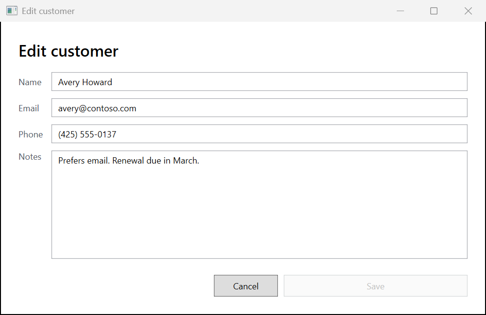
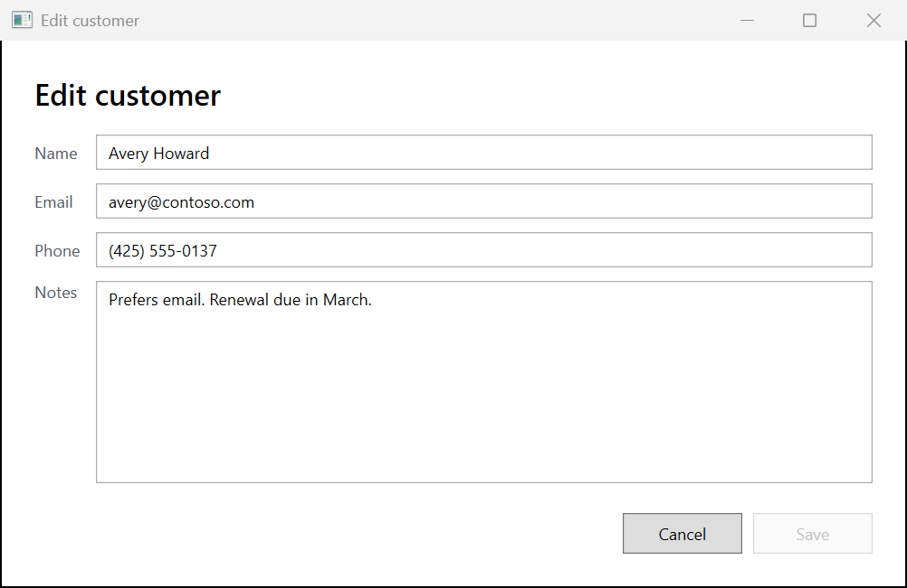

# Session transcript

Source: `Q:\source\XamlAgentDemos-notes\test-runs\VanishingSave\run-feedback\events.jsonl`

## Tool usage

- get_file: 7
- xaml_get_element_properties: 6
- xaml_capture_image: 4
- xaml_find_elements: 4
- xaml_get_element_bounds: 4
- xaml_hit_test: 3
- xaml_get_binding_failures: 3
- xaml_apply_hot_reload: 3
- rg: 2
- powershell: 2
- multi_replace_string_in_file: 2
- replace_string_in_file: 2
- task_complete: 2
- skill: 1
- xaml_get_status: 1
- xaml_get_visual_tree: 1
- glob: 1
- xaml_clear_binding_failures: 1
- xaml_set_element_property: 1
- xaml_explain_property_value: 1

Failed tool calls: 1, images: 3


_Model: gpt-6-luna_


## User (03:28:43)

There should be a Save button in the footer of my running app, but I can't see it. Find out every reason it's not visible and fix them.


**Tool call (03:28:45):** `skill`
```json
{
 "skill": "xaml-diagnostics"
}
```

<details><summary>Result `skill` success=true</summary>

```
Skill "xaml-diagnostics" loaded successfully. Follow the instructions in the skill context.
```
</details>


_Skill invoked: xaml-diagnostics_


**Tool call (03:28:49):** `xaml_get_status`
```json
{
 "progressMessage": "Checking the running app and debugger state"
}
```

<details><summary>Result `xaml_get_status` success=true</summary>

```
{"isDebugging":true,"debuggerState":"running","diagnosticsActive":true,"apps":[{"app":"a1","name":"VanishingSave.exe [58248]","processId":58248,"platform":"WPF (.NET)","isRemote":false,"isDesignTimeOrNoDebug":false,"sourceInfoAvailable":true,"hotReloadSupported":true,"hotReloadEnabled":true,"supportsPropertyExplorer":true,"supportsInAppToolbar":true,"supportsHitTest":true,"windows":[{"windowId":"0xEE0F8E","title":"Edit customer","bounds":{"x":38,"y":38,"width":1020,"height":660},"dpiScale":1.5,"visible":true,"minimized":false}]}],"issues":[],"issuesSummary":"No problems detected.","hotReload":{"options":{"hotReloadEnabled":true,"hotReloadOnSave":false,"applyMode":"asYouType: XAML edits apply as you type, without saving (default)","wpfEnabled":true,"uwpEnabled":true,"winUIEnabled":true,"mauiEnabled":true,"justMyXaml":true,"previewSelectedElement":false,"inAppToolbar":true,"inAppSelection":false,"layoutAdorners":false,"trackFocusedElement":false,"bindingFailuresVisible":true,"compatibilityMode":false},"dotNetHotReloadEnabled":true,"isProcessingChanges":false,"errors":[]},"windowsNote":"Window bounds are physical screen pixels and include the window frame. A WPF/WinUI Window's Width and Height are device-independent units (DIPs) that also include the frame, so Width = bounds.width / dpiScale. A user's \"800 px wide\" is ambiguous: say which unit you tested. A minimized window reports x/y = -32000 and can't be captured."}
```
</details>


**Tool call (03:28:53):** `xaml_capture_image`
```json
{
 "progressMessage": "Capturing the current customer editor",
 "app": "a1",
 "windowId": "0xEE0F8E",
 "maxSize": 1280
}
```


**Tool call (03:28:53):** `xaml_find_elements`
```json
{
 "progressMessage": "Finding the Save control",
 "app": "a1",
 "name": "*Save*",
 "maxResults": 50
}
```


**Tool call (03:28:53):** `xaml_find_elements`
```json
{
 "progressMessage": "Listing buttons in the window",
 "app": "a1",
 "type": "*Button",
 "maxResults": 100
}
```


**Tool call (03:28:53):** `xaml_get_visual_tree`
```json
{
 "progressMessage": "Inspecting the customer editor layout",
 "app": "a1",
 "depth": 6,
 "maxNodes": 500
}
```

<details><summary>Result `xaml_find_elements` success=true</summary>

```
{"count":1,"totalMatches":1,"truncated":false,"results":[{"id":"a1:10","type":"System.Windows.Controls.Button","name":"SaveButton","source":{"file":"Q:\\source\\XamlAgentDemos\\src\\VanishingSave\\MainWindow.xaml","line":118,"column":14},"path":"MainWindow/Border/AdornerDecorator/ContentPresenter/Grid/Grid/Button"}]}
```
</details>

<details><summary>Result `xaml_find_elements` success=true</summary>

```
{"count":2,"totalMatches":2,"truncated":false,"results":[{"id":"a1:29","type":"System.Windows.Controls.Button","name":"CancelButton","source":{"file":"Q:\\source\\XamlAgentDemos\\src\\VanishingSave\\MainWindow.xaml","line":112,"column":14},"path":"MainWindow/Border/AdornerDecorator/ContentPresenter/Grid/Grid/Button"},{"id":"a1:10","type":"System.Windows.Controls.Button","name":"SaveButton","source":{"file":"Q:\\source\\XamlAgentDemos\\src\\VanishingSave\\MainWindow.xaml","line":118,"column":14},"path":"MainWindow/Border/AdornerDecorator/ContentPresenter/Grid/Grid/Button"}]}
```
</details>

<details><summary>Result `xaml_get_visual_tree` success=true</summary>

```
{"app":"a1","platform":"WPF (.NET)","sourceInfoAvailable":true,"nodeCount":32,"truncated":false,"depthLimitedNodes":5,"hint":"5 node(s) have children beyond the requested depth (childCount > 0, no children listed). Raise depth or pass rootElementId to expand them.","nodes":[{"id":"a1:11","type":"VanishingSave.MainWindow","source":{"file":"Q:\\source\\XamlAgentDemos\\src\\VanishingSave\\MainWindow.xaml","line":4,"column":9},"childCount":1,"children":[{"id":"a1:12","type":"System.Windows.Controls.Border","childCount":1,"children":[{"id":"a1:13","type":"System.Windows.Documents.AdornerDecorator","childCount":2,"children":[{"id":"a1:14","type":"System.Windows.Controls.ContentPresenter","childCount":1,"children":[{"id":"a1:16","type":"System.Windows.Controls.Grid","source":{"file":"Q:\\source\\XamlAgentDemos\\src\\VanishingSave\\MainWindow.xaml","line":40,"column":6},"childCount":3,"children":[{"id":"a1:17","type":"System.Windows.Controls.TextBlock","source":{"file":"Q:\\source\\XamlAgentDemos\\src\\VanishingSave\\MainWindow.xaml","line":47,"column":10},"childCount":0},{"id":"a1:18","type":"System.Windows.Controls.Grid","source":{"file":"Q:\\source\\XamlAgentDemos\\src\\VanishingSave\\MainWindow.xaml","line":52,"column":10},"childCount":8,"children":[{"id":"a1:20","type":"System.Windows.Controls.TextBlock","source":{"file":"Q:\\source\\XamlAgentDemos\\src\\VanishingSave\\MainWindow.xaml","line":64,"column":14},"childCount":0},{"id":"a1:21","type":"System.Windows.Controls.TextBox","name":"NameBox","source":{"file":"Q:\\source\\XamlAgentDemos\\src\\VanishingSave\\MainWindow.xaml","line":65,"column":14},"childCount":1,"children":[{"id":"a1:31","type":"System.Windows.Controls.Border","name":"border","childCount":1,"children":[{"id":"a1:37","type":"System.Windows.Controls.ScrollViewer","name":"PART_ContentHost","childCount":1}]}]},{"id":"a1:22","type":"System.Windows.Controls.TextBlock","source":{"file":"Q:\\source\\XamlAgentDemos\\src\\VanishingSave\\MainWindow.xaml","line":71,"column":14},"childCount":0},{"id":"a1:23","type":"System.Windows.Controls.TextBox","name":"EmailBox","source":{"file":"Q:\\source\\XamlAgentDemos\\src\\VanishingSave\\MainWindow.xaml","line":72,"column":14},"childCount":1,"children":[{"id":"a1:32","type":"System.Windows.Controls.Border","name":"border","childCount":1,"children":[{"id":"a1:38","type":"System.Windows.Controls.ScrollViewer","name":"PART_ContentHost","childCount":1}]}]},{"id":"a1:24","type":"System.Windows.Controls.TextBlock","s
... [truncated 2623 chars]
```
</details>


<details><summary>Result `xaml_capture_image` success=true</summary>

```
Screenshot of window 0xEE0F8E "Edit customer" of app a1 (1002x651 image of the window's client area, so it's slightly smaller than the frame bounds from xaml_get_status).
```
</details>


**Assistant (03:28:58):**

The Save control exists in the live tree, so I’m checking its layout, visibility, and any overlapping or clipped elements before changing the source.


**Tool call (03:28:58):** `xaml_get_element_properties`
```json
{
 "progressMessage": "Inspecting Save and footer properties",
 "elementIds": [
  "a1:10",
  "a1:19",
  "a1:16",
  "a1:11",
  "a1:30"
 ],
 "includeAll": true
}
```


**Tool call (03:28:58):** `xaml_get_element_bounds`
```json
{
 "progressMessage": "Checking Save control screen bounds",
 "elementIds": [
  "a1:10",
  "a1:19",
  "a1:29",
  "a1:30"
 ]
}
```


**Tool call (03:28:58):** `xaml_hit_test`
```json
{
 "progressMessage": "Checking whether Save is covered",
 "elementIds": [
  "a1:10"
 ]
}
```


**Tool call (03:28:58):** `xaml_get_binding_failures`
```json
{
 "progressMessage": "Checking current binding failures",
 "app": "a1"
}
```


**Tool call (03:28:58):** `get_file`
```json
{
 "filename": "Q:\\source\\XamlAgentDemos\\src\\VanishingSave\\MainWindow.xaml",
 "startLine": 1,
 "endLine": 170,
 "includeLineNumbers": true
}
```

<details><summary>Result `xaml_get_binding_failures` success=true</summary>

```
{"note":"This is a cumulative log since debugging started or the last xaml_clear_binding_failures, not live state: fixed failures stay listed. To verify a fix: clear, revisit the UI that uses the binding, then read again. Failures without a file usually come from bindings created in code.","totalUnique":1,"matched":1,"truncated":false,"failures":[{"severity":"Warning","count":1,"errorCode":"40","description":"CanSave property not found on object of type CustomerViewModel.","bindingPath":"CanSave","target":"Button.Visibility, Name='SaveButton'","targetName":"SaveButton","targetPropertyType":"Visibility","dataContextType":"CustomerViewModel","file":"Q:\\source\\XamlAgentDemos\\src\\VanishingSave\\MainWindow.xaml","line":118,"column":14,"project":"VanishingSave","originalError":"System.Windows.Data Warning: 40 : BindingExpression path error: 'CanSave' property not found on 'object' ''CustomerViewModel' (HashCode=22993468)'. BindingExpression:Path=CanSave; DataItem='CustomerViewModel' (HashCode=22993468); target element is 'Button' (Name='SaveButton'); target property is 'Visibility' (type 'Visibility')"}]}
```
</details>

<details><summary>Result `xaml_get_element_bounds` success=true</summary>

```
{"note":"'screen' is in physical screen pixels. 'window' is in device-independent units relative to the element's root window (multiply by dpiScale for pixels). Fractional screen pixel values (for example x=18.75) mean edges fall between device pixels, so thin lines and text render blurry unless layout rounding snaps them. isVisible only reflects Visibility/opacity; insideWindowFraction < 1 (clippedByWindow) means part of the element is outside the window's client area, so the user can't see that part. Ancestor clipping (ScrollViewer, Grid cell, ClipToBounds) isn't included; compare with the parent's bounds or call xaml_capture_image.","bounds":[{"id":"a1:10","isVisible":false,"windowHandle":"0xEE0F8E","dpiScale":1.5,"screen":{"x":85.0,"y":606.0,"width":0.0,"height":0.0},"window":{"x":24.0,"y":348.71,"width":0.0,"height":0.0}},{"id":"a1:19","isVisible":true,"insideWindowFraction":1.0,"windowHandle":"0xEE0F8E","dpiScale":1.5,"screen":{"x":85.0,"y":606.0,"width":926.0,"height":45.0},"window":{"x":24.0,"y":348.71,"width":617.33,"height":29.96}},{"id":"a1:29","isVisible":true,"insideWindowFraction":1.0,"windowHandle":"0xEE0F8E","dpiScale":1.5,"screen":{"x":879.0,"y":606.0,"width":132.0,"height":45.0},"window":{"x":553.33,"y":348.71,"width":88.0,"height":29.96}},{"id":"a1:30","isVisible":true,"windowHandle":"0xEE0F8E","dpiScale":1.5,"screen":{"x":1011.0,"y":606.0,"width":0.0,"height":45.0},"window":{"x":641.33,"y":348.71,"width":0.0,"height":29.96}}]}
```
</details>

<details><summary>Result `xaml_hit_test` success=true</summary>

```
{"id":"a1:10","summary":"A click at its center does NOT reach 'SaveButton' because it's disabled (IsEnabled=False): input skips disabled elements and lands on Border (in the template of MainWindow) behind or around it. That element isn't necessarily covering it; fix the IsEnabled cause (see blockers, or a command's CanExecute) rather than the layout. Button 'SaveButton' has Visibility=Collapsed. Button 'SaveButton' has IsEnabled=False (IsEnabledCore: command CanExecute is false or the control disabled itself). Button 'SaveButton' has Opacity=0. 'SaveButton' has zero width or height.","elementReceivesInput":false,"inputTarget":{"id":"a1:12","type":"System.Windows.Controls.Border","templatedParent":{"id":"a1:11","type":"VanishingSave.MainWindow","source":{"file":"Q:\\source\\XamlAgentDemos\\src\\VanishingSave\\MainWindow.xaml","line":4,"column":9}}},"stack":[{"id":"a1:12","type":"System.Windows.Controls.Border","templatedParent":{"id":"a1:11","type":"VanishingSave.MainWindow","source":{"file":"Q:\\source\\XamlAgentDemos\\src\\VanishingSave\\MainWindow.xaml","line":4,"column":9}}}],"isVisible":false,"isHitTestVisible":true,"isEnabled":false,"effectiveOpacity":0.0,"blockers":[{"id":"a1:10","type":"System.Windows.Controls.Button","name":"SaveButton","source":{"file":"Q:\\source\\XamlAgentDemos\\src\\VanishingSave\\MainWindow.xaml","line":118,"column":14},"property":"Visibility","value":"Collapsed"},{"id":"a1:10","type":"System.Windows.Controls.Button","name":"SaveButton","source":{"file":"Q:\\source\\XamlAgentDemos\\src\\VanishingSave\\MainWindow.xaml","line":118,"column":14},"property":"IsEnabled","value":"False (IsEnabledCore: command CanExecute is false or the control disabled itself)"},{"id":"a1:10","type":"System.Windows.Controls.Button","name":"SaveButton","source":{"file":"Q:\\source\\XamlAgentDemos\\src\\VanishingSave\\MainWindow.xaml","line":118,"column":14},"property":"Opacity","value":"0"}],"point":{"window":{"x":24.0,"y":348.71},"screen":{"x":85.0,"y":606.0}},"note":"inputTarget is what a mouse click or tap at the point reaches (WPF: InputHitTest; WinUI/UWP: FindElementsInHostCoordinates, open popups first; .NET MAUI: approximated from element bounds and draw order). stack lists visible, hit-testable elements under the point, topmost first; elements with no id are template parts or aren't in the live tree (on WPF use their templatedParent). blockers are the element and ancestors whose own values hide it or block input (descendants inherit IsEnabled/
... [truncated 215 chars]
```
</details>

<details><summary>Result `xaml_get_element_properties` success=true</summary>

```
{"error":"OUTPUT_TOO_LARGE","message":"The result is 104 KB, too large to use. Only the start of it is shown in preview.","hint":"Ask for less: pass nameFilter (for example \"Background|Foreground|Margin\") instead of includeAll=true, pass fewer elementIds per call (results scale with the count), or lower depth/maxNodes for trees. For styles across many similar elements, inspect one representative element first.","preview":"{\"count\":5,\"failed\":0,\"results\":[{\"id\":\"a1:10\",\"type\":\"System.Windows.Controls.Button\",\"name\":\"SaveButton\",\"source\":{\"file\":\"Q:\\\\source\\\\XamlAgentDemos\\\\src\\\\VanishingSave\\\\MainWindow.xaml\",\"line\":118,\"column\":14},\"properties\":[{\"name\":\"IsEnabled\",\"value\":\"False\",\"valueType\":\"System.Boolean\",\"propertyType\":\"System.Boolean\",\"declaringType\":\"System.Windows.UIElement\",\"valueSource\":\"Coercion\"},{\"name\":\"IsDefault\",\"value\":\"True\",\"valueType\":\"System.Boolean\",\"propertyType\":\"System.Boolean\",\"declaringType\":\"System.Windows.Controls.Button\",\"valueSource\":\"Local\",\"valueSourceLocation\":{\"file\":\"Q:\\\\source\\\\XamlAgentDemos\\\\src\\\\VanishingSave\\\\MainWindow.xaml\",\"line\":118,\"column\":14}},{\"name\":\"IsDefaulted\",\"value\":\"False\",\"valueType\":\"System.Boolean\",\"propertyType\":\"System.Boolean\",\"declaringType\":\"System.Windows.Controls.Button\",\"valueSource\":\"Local\",\"valueSourceLocation\":{\"file\":\"Q:\\\\source\\\\XamlAgentDemos\\\\src\\\\VanishingSave\\\\MainWindow.xaml\",\"line\":118,\"column\":14},\"readOnly\":true},{\"name\":\"Command\",\"evaluatedValue\":\"(XamlAgentDemos.RelayCommand)\",\"valueType\":\"System.Windows.Data.BindingExpression\",\"propertyType\":\"System.Windows.Input.ICommand\",\"declaringType\":\"System.Windows.Controls.Primitives.ButtonBase\",\"valueSource\":\"Local\",\"valueSourceLocation\":{\"file\":\"Q:\\\\source\\\\XamlAgentDemos\\\\src\\\\VanishingSave\\\\MainWindow.xaml\",\"line\":118,\"column\":14},\"isBinding\":true},{\"name\":\"Content\",\"value\":\"Save\",\"valueType\":\"System.String\",\"propertyType\":\"System.Object\",\"declaringType\":\"System.Windows.Controls.ContentControl\",\"valueSource\":\"Local\",\"valueSourceLocation\":{\"file\":\"Q:\\\\source\\\\XamlAgentDemos\\\\src\\\\VanishingSave\\\\MainWindow.xaml\",\"line\":118,\"column\":14}},{\"name\":\"Style\",\"value\":\"System.Windows.Style\",\"valueType\":\"System.Windows.Style\",\"propertyType\":\"System.Windows.Style\",\"declaringType\":\"S
... [truncated 2511 chars]
```
</details>

<details><summary>Result `get_file` success=true</summary>

```
```xaml src\VanishingSave\MainWindow.xaml (Lines 1-138 of 138 total. Call tools for more if needed.)
1: <Window x:Class="VanishingSave.MainWindow"
2:         xmlns="http://schemas.microsoft.com/winfx/2006/xaml/presentation"
3:         xmlns:x="http://schemas.microsoft.com/winfx/2006/xaml"
4:         xmlns:local="clr-namespace:VanishingSave"
5:         Title="Edit customer"
6:         Width="680"
7:         Height="440"
8:         Background="White">
9:     <Window.DataContext>
10:         <local:CustomerViewModel />
11:     </Window.DataContext>
12: 
13:     <Window.Resources>
14:         <BooleanToVisibilityConverter x:Key="BoolToVisibility" />
15: 
16:         <Style x:Key="FieldLabelStyle" TargetType="TextBlock">
17:             <Setter Property="Margin" Value="0,0,12,10" />
18:             <Setter Property="VerticalAlignment" Value="Center" />
19:             <Setter Property="Foreground" Value="#555B66" />
20:         </Style>
21: 
22:         <Style x:Key="FieldStyle" TargetType="TextBox">
23:             <Setter Property="Margin" Value="0,0,0,10" />
24:             <Setter Property="Padding" Value="6,4" />
25:         </Style>
26: 
27:         <Style x:Key="FooterButtonStyle" TargetType="Button">
28:             <Setter Property="MinWidth" Value="88" />
29:             <Setter Property="Margin" Value="8,0,0,0" />
30:             <Setter Property="Padding" Value="16,6" />
31:             <Style.Triggers>
32:                 <!-- Fade out buttons that can't be used yet. -->
33:                 <Trigger Property="IsEnabled" Value="False">
34:                     <Setter Property="Opacity" Value="0" />
35:                 </Trigger>
36:             </Style.Triggers>
37:         </Style>
38:     </Window.Resources>
39: 
40:     <Grid Margin="24">
41:         <Grid.RowDefinitions>
42:             <RowDefinition Height="Auto" />
43:             <RowDefinition Height="*" />
44:             <RowDefinition Height="Auto" />
45:         </Grid.RowDefinitions>
46: 
47:         <TextBlock Margin="0,0,0,16"
48:                    FontSize="22"
49:                    FontWeight="SemiBold"
50:                    Text="Edit customer" />
51: 
52:         <Grid Grid.Row="1">
53:             <Grid.ColumnDefinitions>
54:                 <ColumnDefinition Width="Auto" />
55:                 <ColumnDefinition Width="*" />
56:             </Grid.ColumnDefinitions>
57:             <Grid.RowDefinitions>
58:            
... [truncated 3995 chars]
```
</details>


**Tool call (03:29:04):** `glob`
```json
{
 "pattern": "src\\VanishingSave\\**\\*"
}
```


**Tool call (03:29:04):** `rg`
```json
{
 "pattern": "class CustomerViewModel|class RelayCommand|CanSave|SaveCommand|SyncStatusHost|IsEnabled",
 "paths": "Q:\\source\\XamlAgentDemos\\src\\VanishingSave",
 "output_mode": "content",
 "-n": true,
 "-C": 3
}
```


**Tool call (03:29:04):** `xaml_get_element_properties`
```json
{
 "progressMessage": "Reading Save visibility and enabled state",
 "elementIds": [
  "a1:10"
 ],
 "nameFilter": "Visibility|IsVisible|IsEnabled|Opacity|Command|Content|Width|Height|Margin|Style",
 "includeAll": true
}
```


**Tool call (03:29:04):** `xaml_get_element_properties`
```json
{
 "progressMessage": "Reading footer overlay properties",
 "elementIds": [
  "a1:19",
  "a1:30"
 ],
 "nameFilter": "Visibility|IsVisible|IsEnabled|Opacity|Background|Width|Height|Margin|Grid.Column|Panel.ZIndex",
 "includeAll": true
}
```

<details><summary>Result `xaml_get_element_properties` success=true</summary>

```
{"id":"a1:10","type":"System.Windows.Controls.Button","name":"SaveButton","source":{"file":"Q:\\source\\XamlAgentDemos\\src\\VanishingSave\\MainWindow.xaml","line":118,"column":14},"properties":[{"name":"IsEnabled","value":"False","valueType":"System.Boolean","propertyType":"System.Boolean","declaringType":"System.Windows.UIElement","valueSource":"Coercion"},{"name":"Command","evaluatedValue":"(XamlAgentDemos.RelayCommand)","valueType":"System.Windows.Data.BindingExpression","propertyType":"System.Windows.Input.ICommand","declaringType":"System.Windows.Controls.Primitives.ButtonBase","valueSource":"Local","valueSourceLocation":{"file":"Q:\\source\\XamlAgentDemos\\src\\VanishingSave\\MainWindow.xaml","line":118,"column":14},"isBinding":true},{"name":"Content","value":"Save","valueType":"System.String","propertyType":"System.Object","declaringType":"System.Windows.Controls.ContentControl","valueSource":"Local","valueSourceLocation":{"file":"Q:\\source\\XamlAgentDemos\\src\\VanishingSave\\MainWindow.xaml","line":118,"column":14}},{"name":"Style","value":"System.Windows.Style","valueType":"System.Windows.Style","propertyType":"System.Windows.Style","declaringType":"System.Windows.FrameworkElement","valueSource":"Local","valueSourceLocation":{"file":"Q:\\source\\XamlAgentDemos\\src\\VanishingSave\\MainWindow.xaml","line":118,"column":14},"valueLocation":{"file":"Q:\\source\\XamlAgentDemos\\src\\VanishingSave\\MainWindow.xaml","line":27,"column":10},"readOnly":true},{"name":"Visibility","evaluatedValue":"2 (System.Windows.Visibility)","valueType":"System.Windows.Data.BindingExpression","propertyType":"System.Windows.Visibility","declaringType":"System.Windows.UIElement","valueSource":"Local","valueSourceLocation":{"file":"Q:\\source\\XamlAgentDemos\\src\\VanishingSave\\MainWindow.xaml","line":118,"column":14},"isBinding":true},{"name":"IsVisible","value":"False","valueType":"System.Boolean","propertyType":"System.Boolean","declaringType":"System.Windows.UIElement","valueSource":"Local","valueSourceLocation":{"file":"Q:\\source\\XamlAgentDemos\\src\\VanishingSave\\MainWindow.xaml","line":118,"column":14},"readOnly":true},{"name":"Opacity","value":"0","valueType":"System.Double","propertyType":"System.Double","declaringType":"System.Windows.UIElement","valueSource":"StyleTrigger"},{"name":"Margin","value":"8,0,0,0","valueType":"System.Windows.Thickness","propertyType":"System.Windows.Thickness","declaringType":"System.Windows.FrameworkElement","valueSource":"Style
... [truncated 3926 chars]
```
</details>

<details><summary>Result `xaml_get_element_properties` success=true</summary>

```
{"count":2,"failed":0,"results":[{"id":"a1:19","type":"System.Windows.Controls.Grid","name":"Footer","source":{"file":"Q:\\source\\XamlAgentDemos\\src\\VanishingSave\\MainWindow.xaml","line":101,"column":10},"properties":[{"name":"ActualWidth","value":"617.3333333333334","valueType":"System.Double","propertyType":"System.Double","declaringType":"System.Windows.FrameworkElement","valueSource":"Local","valueSourceLocation":{"file":"Q:\\source\\XamlAgentDemos\\src\\VanishingSave\\MainWindow.xaml","line":101,"column":10},"readOnly":true},{"name":"ActualHeight","value":"29.96","valueType":"System.Double","propertyType":"System.Double","declaringType":"System.Windows.FrameworkElement","valueSource":"Local","valueSourceLocation":{"file":"Q:\\source\\XamlAgentDemos\\src\\VanishingSave\\MainWindow.xaml","line":101,"column":10},"readOnly":true},{"name":"Margin","value":"0,12,0,0","valueType":"System.Windows.Thickness","propertyType":"System.Windows.Thickness","declaringType":"System.Windows.FrameworkElement","valueSource":"Local","valueSourceLocation":{"file":"Q:\\source\\XamlAgentDemos\\src\\VanishingSave\\MainWindow.xaml","line":101,"column":10}},{"name":"IsVisible","value":"True","valueType":"System.Boolean","propertyType":"System.Boolean","declaringType":"System.Windows.UIElement","valueSource":"Local","valueSourceLocation":{"file":"Q:\\source\\XamlAgentDemos\\src\\VanishingSave\\MainWindow.xaml","line":101,"column":10},"readOnly":true},{"name":"Background","propertyType":"System.Windows.Media.Brush","declaringType":"System.Windows.Controls.Panel","valueSource":"Default"},{"name":"Width","value":"Auto","valueType":"System.Double","propertyType":"System.Double","declaringType":"System.Windows.FrameworkElement","valueSource":"Default"},{"name":"MinWidth","value":"0","valueType":"System.Double","propertyType":"System.Double","declaringType":"System.Windows.FrameworkElement","valueSource":"Default"},{"name":"MaxWidth","value":"Infinity","valueType":"System.Double","propertyType":"System.Double","declaringType":"System.Windows.FrameworkElement","valueSource":"Default"},{"name":"Height","value":"Auto","valueType":"System.Double","propertyType":"System.Double","declaringType":"System.Windows.FrameworkElement","valueSource":"Default"},{"name":"MinHeight","value":"0","valueType":"System.Double","propertyType":"System.Double","declaringType":"System.Windows.FrameworkElement","valueSource":"Default"},{"name":"MaxHeight","value":"Infinity","valueType":"System.Double","prope
... [truncated 4887 chars]
```
</details>

<details><summary>Result `glob` success=true</summary>

```
[glob: 82 path(s) under ./src/VanishingSave; grouped by directory]

./src/VanishingSave/obj/ (69 path(s))
  Debug/net10.0-windows/.NETCoreApp,Version=v10.0.AssemblyAttributes.cs
  Debug/net10.0-windows/App.g.cs
  Debug/net10.0-windows/App.g.i.cs
  Debug/net10.0-windows/GeneratedInternalTypeHelper.g.cs
  Debug/net10.0-windows/GeneratedInternalTypeHelper.g.i.cs
  Debug/net10.0-windows/MainWindow.baml
  Debug/net10.0-windows/MainWindow.g.cs
  Debug/net10.0-windows/MainWindow.g.i.cs
  Debug/net10.0-windows/Vanishin.559ADE70.Up2Date
  Debug/net10.0-windows/VanishingSave.AssemblyInfo.cs
  Debug/net10.0-windows/VanishingSave.AssemblyInfoInputs.cache
  Debug/net10.0-windows/VanishingSave.GeneratedMSBuildEditorConfig.editorconfig
  Debug/net10.0-windows/VanishingSave.GlobalUsings.g.cs
  Debug/net10.0-windows/VanishingSave.assets.cache
  Debug/net10.0-windows/VanishingSave.csproj.BuildWithSkipAnalyzers
  Debug/net10.0-windows/VanishingSave.csproj.CoreCompileInputs.cache
  Debug/net10.0-windows/VanishingSave.csproj.FileListAbsolute.txt
  Debug/net10.0-windows/VanishingSave.designer.deps.json
  Debug/net10.0-windows/VanishingSave.designer.runtimeconfig.json
  Debug/net10.0-windows/VanishingSave.dll
  Debug/net10.0-windows/VanishingSave.g.resources
  Debug/net10.0-windows/VanishingSave.genruntimeconfig.cache
  Debug/net10.0-windows/VanishingSave.pdb
  Debug/net10.0-windows/VanishingSave.sourcelink.json
  Debug/net10.0-windows/VanishingSave_5cgzny33_wpftmp.AssemblyInfo.cs
  Debug/net10.0-windows/VanishingSave_5cgzny33_wpftmp.AssemblyInfoInputs.cache
  Debug/net10.0-windows/VanishingSave_5cgzny33_wpftmp.GeneratedMSBuildEditorConfig.editorconfig
  Debug/net10.0-windows/VanishingSave_5cgzny33_wpftmp.GlobalUsings.g.cs
  Debug/net10.0-windows/VanishingSave_5cgzny33_wpftmp.assets.cache
  Debug/net10.0-windows/VanishingSave_5cgzny33_wpftmp.csproj.BuildWithSkipAnalyzers
  Debug/net10.0-windows/VanishingSave_5cgzny33_wpftmp.sourcelink.json
  Debug/net10.0-windows/VanishingSave_MarkupCompile.cache
  Debug/net10.0-windows/VanishingSave_MarkupCompile.i.cache
  Debug/net10.0-windows/VanishingSave_MarkupCompile.i.lref
  Debug/net10.0-windows/VanishingSave_MarkupCompile.lref
  Debug/net10.0-windows/VanishingSave_ejwe5tx2_wpftmp.AssemblyInfo.cs
  Debug/net10.0-windows/VanishingSave_ejwe5tx2_wpftmp.AssemblyInfoInputs.cache
  Debug/net10.0-windows/VanishingSave_ejwe5tx2_wpftmp.GeneratedMSBuildEditorConfig.editorconfig
  Debug/net10.0-windows/VanishingSave_ejwe5tx2_wpftmp.GlobalUsings.g.c
... [truncated 2580 chars]
```
</details>

<details><summary>Result `rg` success=true</summary>

```
[grep content: 7 matches across 2 file(s) under Q:/source/XamlAgentDemos/src/VanishingSave; delimited groups]

CustomerViewModel.cs (3 match(es)):
  1- namespace VanishingSave;
  2- 
  3: public sealed class CustomerViewModel : ObservableObject
  4- {
  5-     private string name = "Avery Howard";
  6-     private string email = "avery@contoso.com";
  10- 
  11-     public CustomerViewModel()
  12-     {
  13:         this.SaveCommand = new RelayCommand(this.Save, () => this.IsDirty);
  14-         this.CancelCommand = new RelayCommand(() => this.IsDirty = false);
  15-     }
  16- 
  27-     /// <summary>Whether the current user is allowed to save customer records.</summary>
  28-     public bool IsSaveAvailable => true;
  29- 
  30:     public RelayCommand SaveCommand { get; }
  31- 
  32-     public RelayCommand CancelCommand { get; }
  33- 

MainWindow.xaml (4 match(es)):
  30-             <Setter Property="Padding" Value="16,6" />
  31-             <Style.Triggers>
  32-                 <!-- Fade out buttons that can't be used yet. -->
  33:                 <Trigger Property="IsEnabled" Value="False">
  34-                     <Setter Property="Opacity" Value="0" />
  35-                 </Trigger>
  36-             </Style.Triggers>
  117- 
  118-             <Button x:Name="SaveButton"
  119-                     Grid.Column="2"
  120:                     Command="{Binding SaveCommand}"
  121-                     Content="Save"
  122-                     IsDefault="True"
  123-                     Style="{StaticResource FooterButtonStyle}"
  124:                     Visibility="{Binding CanSave, Converter={StaticResource BoolToVisibility}, FallbackValue=Collapsed}" />
  125- 
  126-             <!-- Shows "Offline - changes will sync later" when the connection drops. -->
  127:             <Border x:Name="SyncStatusHost"
  128-                     Grid.Column="2"
  129-                     Panel.ZIndex="1"
  130-                     Background="White">
```
</details>


**Tool call (03:29:08):** `get_file`
```json
{
 "filename": "Q:\\source\\XamlAgentDemos\\src\\VanishingSave\\CustomerViewModel.cs",
 "startLine": 1,
 "endLine": 220,
 "includeLineNumbers": true
}
```


**Tool call (03:29:08):** `get_file`
```json
{
 "filename": "Q:\\source\\XamlAgentDemos\\src\\VanishingSave\\FooterSettings.cs",
 "startLine": 1,
 "endLine": 180,
 "includeLineNumbers": true
}
```


**Tool call (03:29:08):** `get_file`
```json
{
 "filename": "Q:\\source\\XamlAgentDemos\\src\\VanishingSave\\MainWindow.xaml.cs",
 "startLine": 1,
 "endLine": 160,
 "includeLineNumbers": true
}
```


**Tool call (03:29:08):** `rg`
```json
{
 "pattern": "class RelayCommand|class ObservableObject",
 "paths": "Q:\\source\\XamlAgentDemos\\src",
 "output_mode": "content",
 "-n": true,
 "-C": 4
}
```

<details><summary>Result `get_file` success=true</summary>

```
```csharp src\VanishingSave\FooterSettings.cs (Lines 1-10 of 10 total. Call tools for more if needed.)
1: namespace VanishingSave;
2: 
3: public static class FooterSettings
4: {
5:     /// <summary>
6:     /// Compact footer for small screens: auto-save makes the Save column unnecessary.
7:     /// (Auto-save was cut from v2, but this switch stayed on.)
8:     /// </summary>
9:     public static bool UseCompactFooter { get; set; } = true;
10: }

```


```
</details>

<details><summary>Result `get_file` success=true</summary>

```
```csharp src\VanishingSave\MainWindow.xaml.cs (Lines 1-20 of 20 total. Call tools for more if needed.)
1: using System.Windows;
2: 
3: namespace VanishingSave;
4: 
5: public partial class MainWindow : Window
6: {
7:     public MainWindow()
8:     {
9:         this.InitializeComponent();
10:         this.Loaded += this.OnLoaded;
11:     }
12: 
13:     private void OnLoaded(object sender, RoutedEventArgs e)
14:     {
15:         if (FooterSettings.UseCompactFooter)
16:         {
17:             this.SaveColumn.Width = new GridLength(0);
18:         }
19:     }
20: }

```


```
</details>

<details><summary>Result `get_file` success=true</summary>

```
```csharp src\VanishingSave\CustomerViewModel.cs (Lines 1-35 of 35 total. Call tools for more if needed.)
1: namespace VanishingSave;
2: 
3: public sealed class CustomerViewModel : ObservableObject
4: {
5:     private string name = "Avery Howard";
6:     private string email = "avery@contoso.com";
7:     private string phone = "(425) 555-0137";
8:     private string notes = "Prefers email. Renewal due in March.";
9:     private bool isDirty;
10: 
11:     public CustomerViewModel()
12:     {
13:         this.SaveCommand = new RelayCommand(this.Save, () => this.IsDirty);
14:         this.CancelCommand = new RelayCommand(() => this.IsDirty = false);
15:     }
16: 
17:     public string Name { get => this.name; set { if (this.SetProperty(ref this.name, value)) this.IsDirty = true; } }
18: 
19:     public string Email { get => this.email; set { if (this.SetProperty(ref this.email, value)) this.IsDirty = true; } }
20: 
21:     public string Phone { get => this.phone; set { if (this.SetProperty(ref this.phone, value)) this.IsDirty = true; } }
22: 
23:     public string Notes { get => this.notes; set { if (this.SetProperty(ref this.notes, value)) this.IsDirty = true; } }
24: 
25:     public bool IsDirty { get => this.isDirty; set => this.SetProperty(ref this.isDirty, value); }
26: 
27:     /// <summary>Whether the current user is allowed to save customer records.</summary>
28:     public bool IsSaveAvailable => true;
29: 
30:     public RelayCommand SaveCommand { get; }
31: 
32:     public RelayCommand CancelCommand { get; }
33: 
34:     private void Save() => this.IsDirty = false;
35: }

```


```
</details>

<details><summary>Result `rg` success=true</summary>

```
Q:\source\XamlAgentDemos\src\Shared\RelayCommand.cs-1-using System.Windows.Input;
Q:\source\XamlAgentDemos\src\Shared\RelayCommand.cs-2-
Q:\source\XamlAgentDemos\src\Shared\RelayCommand.cs-3-namespace XamlAgentDemos;
Q:\source\XamlAgentDemos\src\Shared\RelayCommand.cs-4-
Q:\source\XamlAgentDemos\src\Shared\RelayCommand.cs:5:public sealed class RelayCommand(Action execute, Func<bool>? canExecute = null) : ICommand
Q:\source\XamlAgentDemos\src\Shared\RelayCommand.cs-6-{
Q:\source\XamlAgentDemos\src\Shared\RelayCommand.cs-7-    public event EventHandler? CanExecuteChanged
Q:\source\XamlAgentDemos\src\Shared\RelayCommand.cs-8-    {
Q:\source\XamlAgentDemos\src\Shared\RelayCommand.cs-9-        add => CommandManager.RequerySuggested += value;
--
Q:\source\XamlAgentDemos\src\Shared\ObservableObject.cs-2-using System.Runtime.CompilerServices;
Q:\source\XamlAgentDemos\src\Shared\ObservableObject.cs-3-
Q:\source\XamlAgentDemos\src\Shared\ObservableObject.cs-4-namespace XamlAgentDemos;
Q:\source\XamlAgentDemos\src\Shared\ObservableObject.cs-5-
Q:\source\XamlAgentDemos\src\Shared\ObservableObject.cs:6:public abstract class ObservableObject : INotifyPropertyChanged
Q:\source\XamlAgentDemos\src\Shared\ObservableObject.cs-7-{
Q:\source\XamlAgentDemos\src\Shared\ObservableObject.cs-8-    public event PropertyChangedEventHandler? PropertyChanged;
Q:\source\XamlAgentDemos\src\Shared\ObservableObject.cs-9-
Q:\source\XamlAgentDemos\src\Shared\ObservableObject.cs-10-    protected bool SetProperty<T>(ref T field, T value, [CallerMemberName] string? propertyName = null)
```
</details>


**Tool call (03:29:38):** `powershell`
```json
{
 "command": "git status --short -- src/VanishingSave",
 "description": "Checking for existing edits in the app"
}
```

<details><summary>Result `powershell` success=true</summary>

```

<shellId: 0 completed with exit code 0>
```
</details>


**Assistant (03:29:47):**

I found three active causes: a nonexistent visibility binding, a footer column forced to zero width, and a disabled-button style setting opacity to zero. I’m correcting those while preserving the Save command’s disabled-until-dirty behavior.


**Tool call (03:29:47):** `multi_replace_string_in_file`
```json
{
 "explanation": "Correct the visibility binding, restore the Save column by default, and keep disabled buttons visibly faded instead of fully hidden.",
 "replacements": [
  {
   "filePath": "src\\VanishingSave\\MainWindow.xaml",
   "oldString": "            <Setter Property=\"Padding\" Value=\"16,6\" />\n            <Style.Triggers>\n                <!-- Fade out buttons that can't be used yet. -->\n                <Trigger Property=\"IsEnabled\" Value=\"False\">\n                    <Setter Property=\"Opacity\" Value=\"0\" />\n                </Trigger>\n            </Style.Triggers>",
   "newString": "            <Setter Property=\"Padding\" Value=\"16,6\" />\n            <Style.Triggers>\n                <!-- Fade out buttons that can't be used yet. -->\n                <Trigger Property=\"IsEnabled\" Value=\"False\">\n                    <Setter Property=\"Opacity\" Value=\"0.5\" />\n                </Trigger>\n            </Style.Triggers>",
   "explanation": "A disabled Save button should remain visible while appearing faded."
  },
  {
   "filePath": "src\\VanishingSave\\MainWindow.xaml",
   "oldString": "            <Button x:Name=\"SaveButton\"\n                    Grid.Column=\"2\"\n                    Command=\"{Binding SaveCommand}\"\n                    Content=\"Save\"\n                    IsDefault=\"True\"\n                    Style=\"{StaticResource FooterButtonStyle}\"\n                    Visibility=\"{Binding CanSave, Converter={StaticResource BoolToVisib
... [truncated 1405 chars]
```

<details><summary>Result `multi_replace_string_in_file` success=true</summary>

```
Successfully applied 3 of 3 replacement(s) across 2 file(s).
```
</details>


**Tool call (03:29:55):** `xaml_apply_hot_reload`
```json
{
 "progressMessage": "Applying the visibility and footer fixes",
 "includeCodeChanges": true
}
```

<details><summary>Result `xaml_apply_hot_reload` success=true</summary>

```
{"applied":true,"status":"applied","errors":[],"log":[],"lastHotReloadUpdate":{"secondsAgo":9,"updatesSinceToolsStarted":1},"codeChanges":".NET Hot Reload was started for saved code changes. Its results are in the Hot Reload output pane, not in 'log'; if an edit can't be hot reloaded, Visual Studio asks the user to rebuild and restart.","codeHotReloadOutput":["22:29:56.15  ⚠ Q:\\source\\XamlAgentDemos\\src\\VanishingSave\\FooterSettings.cs (line 9): warning ENC0118: Changing 'auto-property' might not have any effect until the application is restarted.","22:29:56.85  Code changes were successfully applied."],"hint":"Call xaml_capture_image to verify the change visually. Views that aren't loaded (other tabs, closed dialogs) are updated when they're next shown. Source line numbers reported for existing elements can still point to the pre-edit lines until the element is recreated, so find elements by x:Name or type rather than by an old line number. Structural edits (wrapping or replacing a parent, changing a root's content) recreate elements, which resets their runtime state such as selection, checked state, typed text and scroll position, and invalidates their IDs. Re-establish the state you were testing before capturing again."}
```
</details>


**Tool call (03:30:05):** `xaml_find_elements`
```json
{
 "progressMessage": "Refreshing Save and column element IDs",
 "app": "a1",
 "name": "SaveButton|SaveColumn",
 "maxResults": 10
}
```

<details><summary>Result `xaml_find_elements` success=true</summary>

```
{"count":1,"totalMatches":1,"truncated":false,"results":[{"id":"a1:10","type":"System.Windows.Controls.Button","name":"SaveButton","source":{"file":"Q:\\source\\XamlAgentDemos\\src\\VanishingSave\\MainWindow.xaml","line":118,"column":14},"path":"MainWindow/Border/AdornerDecorator/ContentPresenter/Grid/Grid/Button"}]}
```
</details>


**Tool call (03:30:25):** `xaml_get_element_properties`
```json
{
 "progressMessage": "Inspecting footer column definitions",
 "elementIds": [
  "a1:19"
 ],
 "nameFilter": "ColumnDefinitions|Column",
 "includeAll": true
}
```


**Tool call (03:30:25):** `xaml_find_elements`
```json
{
 "progressMessage": "Checking for the named Save column",
 "app": "a1",
 "type": "ColumnDefinition",
 "name": "SaveColumn",
 "maxResults": 10
}
```


**Tool call (03:30:25):** `xaml_get_element_properties`
```json
{
 "progressMessage": "Confirming post-reload Save properties",
 "elementIds": [
  "a1:10"
 ],
 "nameFilter": "Visibility|Opacity|IsEnabled|ActualWidth|ActualHeight",
 "includeAll": true
}
```

<details><summary>Result `xaml_find_elements` success=true</summary>

```
{"count":0,"totalMatches":0,"truncated":false,"results":[],"hint":"'type' matches the element's own class name exactly, not base classes: a ListBox isn't a ListView, and windows are usually subclasses such as MainWindow. Try type=\"*ColumnDefinition\" to include subclasses named after it, check the actual types with xaml_get_visual_tree, or see apps[].windows in xaml_get_status for windows."}
```
</details>

<details><summary>Result `xaml_get_element_properties` success=true</summary>

```
{"id":"a1:10","type":"System.Windows.Controls.Button","name":"SaveButton","source":{"file":"Q:\\source\\XamlAgentDemos\\src\\VanishingSave\\MainWindow.xaml","line":118,"column":14},"properties":[{"name":"IsEnabled","value":"False","valueType":"System.Boolean","propertyType":"System.Boolean","declaringType":"System.Windows.UIElement","valueSource":"Coercion"},{"name":"ActualWidth","value":"88","valueType":"System.Double","propertyType":"System.Double","declaringType":"System.Windows.FrameworkElement","valueSource":"Local","valueSourceLocation":{"file":"Q:\\source\\XamlAgentDemos\\src\\VanishingSave\\MainWindow.xaml","line":118,"column":14},"readOnly":true},{"name":"ActualHeight","value":"29.96","valueType":"System.Double","propertyType":"System.Double","declaringType":"System.Windows.FrameworkElement","valueSource":"Local","valueSourceLocation":{"file":"Q:\\source\\XamlAgentDemos\\src\\VanishingSave\\MainWindow.xaml","line":118,"column":14},"readOnly":true},{"name":"Visibility","evaluatedValue":"0 (System.Windows.Visibility)","valueType":"System.Windows.Data.BindingExpression","propertyType":"System.Windows.Visibility","declaringType":"System.Windows.UIElement","valueSource":"Local","valueSourceLocation":{"file":"Q:\\source\\XamlAgentDemos\\src\\VanishingSave\\MainWindow.xaml","line":118,"column":14},"isBinding":true},{"name":"Opacity","value":"0.5","valueType":"System.Double","propertyType":"System.Double","declaringType":"System.Windows.UIElement","valueSource":"StyleTrigger"},{"name":"OpacityMask","propertyType":"System.Windows.Media.Brush","declaringType":"System.Windows.UIElement","valueSource":"Default"}],"hiddenDefaultOrOverridden":5,"hint":"Default and overridden values were omitted. Pass includeAll=true to see them, or call xaml_explain_property_value for one property's full precedence chain."}
```
</details>

<details><summary>Result `xaml_get_element_properties` success=true</summary>

```
{"id":"a1:19","type":"System.Windows.Controls.Grid","name":"Footer","source":{"file":"Q:\\source\\XamlAgentDemos\\src\\VanishingSave\\MainWindow.xaml","line":101,"column":10},"properties":[{"name":"ColumnDefinitions","valueType":"System.Windows.Controls.ColumnDefinitionCollection","propertyType":"System.Windows.Controls.ColumnDefinitionCollection","declaringType":"System.Windows.Controls.Grid","valueSource":"Local","valueSourceLocation":{"file":"Q:\\source\\XamlAgentDemos\\src\\VanishingSave\\MainWindow.xaml","line":101,"column":10},"isCollection":true},{"name":"Column","value":"0","valueType":"System.Int32","propertyType":"System.Int32","declaringType":"System.Windows.Controls.Grid","valueSource":"Default"},{"name":"ColumnSpan","value":"1","valueType":"System.Int32","propertyType":"System.Int32","declaringType":"System.Windows.Controls.Grid","valueSource":"Default"}],"hiddenDefaultOrOverridden":1,"hint":"Default and overridden values were omitted. Pass includeAll=true to see them, or call xaml_explain_property_value for one property's full precedence chain."}
```
</details>


**Tool call (03:30:31):** `xaml_clear_binding_failures`
```json
{
 "progressMessage": "Resetting binding errors before verification"
}
```

<details><summary>Result `xaml_clear_binding_failures` success=true</summary>

```
{"cleared":1}
```
</details>


**Tool call (03:30:33):** `xaml_capture_image`
```json
{
 "progressMessage": "Verifying the Save button is visible",
 "app": "a1",
 "windowId": "0xEE0F8E",
 "maxSize": 1280
}
```


**Tool call (03:30:33):** `xaml_get_element_bounds`
```json
{
 "progressMessage": "Verifying Save button dimensions",
 "elementIds": [
  "a1:10",
  "a1:30",
  "a1:29"
 ]
}
```


**Tool call (03:30:33):** `xaml_hit_test`
```json
{
 "progressMessage": "Checking Save button interaction path",
 "elementIds": [
  "a1:10"
 ]
}
```


**Tool call (03:30:33):** `xaml_get_binding_failures`
```json
{
 "progressMessage": "Checking for new binding failures",
 "app": "a1"
}
```

<details><summary>Result `xaml_get_binding_failures` success=true</summary>

```
{"note":"This is a cumulative log since debugging started or the last xaml_clear_binding_failures, not live state: fixed failures stay listed. To verify a fix: clear, revisit the UI that uses the binding, then read again. Failures without a file usually come from bindings created in code.","totalUnique":0,"matched":0,"truncated":false,"failures":[]}
```
</details>

<details><summary>Result `xaml_get_element_bounds` success=true</summary>

```
{"note":"'screen' is in physical screen pixels. 'window' is in device-independent units relative to the element's root window (multiply by dpiScale for pixels). Fractional screen pixel values (for example x=18.75) mean edges fall between device pixels, so thin lines and text render blurry unless layout rounding snaps them. isVisible only reflects Visibility/opacity; insideWindowFraction < 1 (clippedByWindow) means part of the element is outside the window's client area, so the user can't see that part. Ancestor clipping (ScrollViewer, Grid cell, ClipToBounds) isn't included; compare with the parent's bounds or call xaml_capture_image.","bounds":[{"id":"a1:10","isVisible":true,"insideWindowFraction":0.18,"clippedByWindow":true,"windowHandle":"0xEE0F8E","dpiScale":1.5,"screen":{"x":1023.0,"y":606.0,"width":132.0,"height":45.0},"window":{"x":649.33,"y":348.71,"width":88.0,"height":29.96}},{"id":"a1:30","isVisible":true,"windowHandle":"0xEE0F8E","dpiScale":1.5,"screen":{"x":1011.0,"y":606.0,"width":0.0,"height":45.0},"window":{"x":641.33,"y":348.71,"width":0.0,"height":29.96}},{"id":"a1:29","isVisible":true,"insideWindowFraction":1.0,"windowHandle":"0xEE0F8E","dpiScale":1.5,"screen":{"x":879.0,"y":606.0,"width":132.0,"height":45.0},"window":{"x":553.33,"y":348.71,"width":88.0,"height":29.96}}]}
```
</details>

<details><summary>Result `xaml_hit_test` success=true</summary>

```
{"id":"a1:10","summary":"Nothing receives a click at its center: 'SaveButton' and everything under the point are invisible, IsHitTestVisible=False, or have no Background/Fill there (a null Background isn't hit-testable; Transparent is). Button 'SaveButton' has IsEnabled=False (IsEnabledCore: command CanExecute is false or the control disabled itself). Only 0% of it is visible: Button 'SaveButton' clips it.","elementReceivesInput":false,"stack":[],"isVisible":true,"isHitTestVisible":true,"isEnabled":false,"effectiveOpacity":0.5,"blockers":[{"id":"a1:10","type":"System.Windows.Controls.Button","name":"SaveButton","source":{"file":"Q:\\source\\XamlAgentDemos\\src\\VanishingSave\\MainWindow.xaml","line":118,"column":14},"property":"IsEnabled","value":"False (IsEnabledCore: command CanExecute is false or the control disabled itself)"}],"visibleFraction":0.0,"clippedBy":{"id":"a1:10","type":"System.Windows.Controls.Button","name":"SaveButton","source":{"file":"Q:\\source\\XamlAgentDemos\\src\\VanishingSave\\MainWindow.xaml","line":118,"column":14}},"point":{"window":{"x":693.33,"y":363.69},"screen":{"x":1089.0,"y":629.0}},"note":"inputTarget is what a mouse click or tap at the point reaches (WPF: InputHitTest; WinUI/UWP: FindElementsInHostCoordinates, open popups first; .NET MAUI: approximated from element bounds and draw order). stack lists visible, hit-testable elements under the point, topmost first; elements with no id are template parts or aren't in the live tree (on WPF use their templatedParent). blockers are the element and ancestors whose own values hide it or block input (descendants inherit IsEnabled/IsHitTestVisible=False; on .NET MAUI IsHitTestVisible maps to InputTransparent). visibleFraction includes clipping by ancestors (layout slots, scroll viewports, ClipToBounds/Clip/IsClippedToBounds) and the window."}
```
</details>

<details><summary>Result `xaml_capture_image` success=true</summary>

```
Screenshot of window 0xEE0F8E "Edit customer" of app a1 (1002x651 image of the window's client area, so it's slightly smaller than the frame bounds from xaml_get_status). Note: this image is pixel-identical to the previous capture of this window, so nothing visible changed since then (the chat may show it as a reference to the earlier image).
```
</details>


**Tool call (03:31:24):** `xaml_set_element_property`
```json
{
 "progressMessage": "Restoring the zero-width footer column",
 "elementIds": [
  "a1:19"
 ],
 "setters": [
  "ColumnDefinitions[2].Width=Auto"
 ]
}
```

<details><summary>Result `xaml_set_element_property` success=false</summary>

```
{
 "message": "{\"error\":\"PROPERTY_NOT_FOUND\",\"message\":\"Element 'a1:19' has no property named 'ColumnDefinitions[2].Width'.\",\"hint\":\"'ColumnDefinitions[2].Width' is a path into a collection item; these tools only read and set the element's own properties. Items such as Grid ColumnDefinitions/RowDefinitions, GradientStops or Setters aren't elements in the visual tree, so they can't be changed live. Edit the XAML and call xaml_apply_hot_reload, or experiment through a property of a real element (for example the Width of the element in that column).\"}",
 "code": "failure"
}
```
</details>


**Tool call (03:31:42):** `get_file`
```json
{
 "filename": "Q:\\source\\XamlAgentDemos\\src\\VanishingSave\\MainWindow.xaml",
 "startLine": 96,
 "endLine": 140,
 "includeLineNumbers": true
}
```


**Tool call (03:31:42):** `get_file`
```json
{
 "filename": "Q:\\source\\XamlAgentDemos\\src\\VanishingSave\\MainWindow.xaml.cs",
 "startLine": 1,
 "endLine": 40,
 "includeLineNumbers": true
}
```

<details><summary>Result `get_file` success=true</summary>

```
```xaml src\VanishingSave\MainWindow.xaml (Lines 96-138 of 138 total. Call tools for more if needed.)
96:                      Style="{StaticResource FieldStyle}"
97:                      Text="{Binding Notes, UpdateSourceTrigger=PropertyChanged}"
98:                      TextWrapping="Wrap" />
99:         </Grid>
100: 
101:         <Grid x:Name="Footer" Grid.Row="2" Margin="0,12,0,0">
102:             <Grid.ColumnDefinitions>
103:                 <ColumnDefinition Width="*" />
104:                 <ColumnDefinition Width="Auto" />
105:                 <ColumnDefinition x:Name="SaveColumn" Width="Auto" />
106:             </Grid.ColumnDefinitions>
107: 
108:             <TextBlock VerticalAlignment="Center"
109:                        Foreground="#555B66"
110:                        Text="Changes are saved to Contoso CRM." />
111: 
112:             <Button x:Name="CancelButton"
113:                     Grid.Column="1"
114:                     Command="{Binding CancelCommand}"
115:                     Content="Cancel"
116:                     Style="{StaticResource FooterButtonStyle}" />
117: 
118:             <Button x:Name="SaveButton"
119:                     Grid.Column="2"
120:                     Command="{Binding SaveCommand}"
121:                     Content="Save"
122:                     IsDefault="True"
123:                     Style="{StaticResource FooterButtonStyle}"
124:                     Visibility="{Binding IsSaveAvailable, Converter={StaticResource BoolToVisibility}, FallbackValue=Collapsed}" />
125: 
126:             <!-- Shows "Offline - changes will sync later" when the connection drops. -->
127:             <Border x:Name="SyncStatusHost"
128:                     Grid.Column="2"
129:                     Panel.ZIndex="1"
130:                     Background="White">
131:                 <TextBlock x:Name="SyncStatusText"
132:                            VerticalAlignment="Center"
133:                            Foreground="#B54708"
134:                            Text="" />
135:             </Border>
136:         </Grid>
137:     </Grid>
138: </Window>

```


```
</details>

<details><summary>Result `get_file` success=true</summary>

```
```csharp src\VanishingSave\MainWindow.xaml.cs (Lines 1-20 of 20 total. Call tools for more if needed.)
1: using System.Windows;
2: 
3: namespace VanishingSave;
4: 
5: public partial class MainWindow : Window
6: {
7:     public MainWindow()
8:     {
9:         this.InitializeComponent();
10:         this.Loaded += this.OnLoaded;
11:     }
12: 
13:     private void OnLoaded(object sender, RoutedEventArgs e)
14:     {
15:         if (FooterSettings.UseCompactFooter)
16:         {
17:             this.SaveColumn.Width = new GridLength(0);
18:         }
19:     }
20: }

```


```
</details>


**Assistant (03:32:09):**

The first fixes removed the binding and opacity blockers, but the live Save button still sits outside the window because startup code forced its grid column to zero. I also found the offline status host shares that column; I’m separating it and changing the compact-footer logic so it can’t collapse Save.


**Tool call (03:32:09):** `multi_replace_string_in_file`
```json
{
 "explanation": "Prevent startup from collapsing the Save column and keep the sync-status overlay away from the Save action; temporarily use a star column to update the running layout.",
 "replacements": [
  {
   "filePath": "src\\VanishingSave\\MainWindow.xaml",
   "oldString": "                <ColumnDefinition Width=\"*\" />\n                <ColumnDefinition Width=\"Auto\" />\n                <ColumnDefinition x:Name=\"SaveColumn\" Width=\"Auto\" />",
   "newString": "                <ColumnDefinition Width=\"*\" />\n                <ColumnDefinition Width=\"Auto\" />\n                <ColumnDefinition x:Name=\"SaveColumn\" Width=\"*\" />",
   "explanation": "Temporarily change the column width to force a live layout update; it will be restored to Auto after the runtime reflow."
  },
  {
   "filePath": "src\\VanishingSave\\MainWindow.xaml",
   "oldString": "            <!-- Shows \"Offline - changes will sync later\" when the connection drops. -->\n            <Border x:Name=\"SyncStatusHost\"\n                    Grid.Column=\"2\"\n                    Panel.ZIndex=\"1\"",
   "newString": "            <!-- Shows \"Offline - changes will sync later\" when the connection drops. -->\n            <Border x:Name=\"SyncStatusHost\"\n                    Grid.Column=\"0\"\n                    Panel.ZIndex=\"1\"",
   "explanation": "Keep offline status content out of the Save button's grid column."
  },
  {
   "filePath": "src\\VanishingSave\\MainWindow.xaml.cs",
   "oldString":
... [truncated 539 chars]
```

<details><summary>Result `multi_replace_string_in_file` success=true</summary>

```
Successfully applied 3 of 3 replacement(s) across 2 file(s).
```
</details>


**Tool call (03:32:11):** `xaml_apply_hot_reload`
```json
{
 "progressMessage": "Updating the live footer layout",
 "includeCodeChanges": true
}
```

<details><summary>Result `xaml_apply_hot_reload` success=true</summary>

```
{"status":"alreadyApplied","errors":[],"log":[],"noNewActivity":true,"lastHotReloadUpdate":{"secondsAgo":6,"updatesSinceToolsStarted":2},"lastActivity":{"secondsAgo":236,"message":"Connected to VanishingSave.exe [58248] for WpfCore diagnostics. Incremental Hot Reload is enabled."},"note":"This call applied nothing new. status=alreadyApplied means XAML Hot Reload pushed changes into the app within the last minute, most likely your edits as you made them. lastHotReloadUpdate is when XAML Hot Reload last pushed changes into the app (it applies saved and in-editor edits as they happen, often without a log entry). If it's after your edit, the edit was already applied; if it's null or older than your edit, nothing reached the app (check the file is saved and part of the running project). It doesn't prove the app shows them: XAML that the app loads itself (XamlReader, files copied to the output folder, dictionaries swapped in code) is never hot reloaded, and code that sets the same property or picks another template/resource at runtime overrides the edit. Values that code already set (for example in a constructor or Loaded handler) stay in place, and startup code isn't re-run by hot reload, so a fix in that code needs the view reopened or a restart to take effect. Check the live value with xaml_explain_property_value (a Local value that isn't in your XAML was set by code) or xaml_find_resource.","codeChanges":".NET Hot Reload was started for saved code changes. Its results are in the Hot Reload output pane, not in 'log'; if an edit can't be hot reloaded, Visual Studio asks the user to rebuild and restart.","codeHotReloadOutput":[],"hint":"Call xaml_capture_image to verify the change visually. Views that aren't loaded (other tabs, closed dialogs) are updated when they're next shown. Source line numbers reported for existing elements can still point to the pre-edit lines until the element is recreated, so find elements by x:Name or type rather than by an old line number. Structural edits (wrapping or replacing a parent, changing a root's content) recreate elements, which resets their runtime state such as selection, checked state, typed text and scroll position, and invalidates their IDs. Re-establish the state you were testing before capturing again."}
```
</details>


**Tool call (03:32:20):** `xaml_capture_image`
```json
{
 "progressMessage": "Checking the updated footer rendering",
 "app": "a1",
 "windowId": "0xEE0F8E",
 "maxSize": 1280
}
```


**Tool call (03:32:20):** `xaml_get_element_bounds`
```json
{
 "progressMessage": "Checking Save button placement",
 "elementIds": [
  "a1:10",
  "a1:19"
 ]
}
```


**Tool call (03:32:20):** `xaml_explain_property_value`
```json
{
 "progressMessage": "Checking Save layout and visibility causes",
 "elementIds": [
  "a1:10"
 ],
 "propertyNames": [
  "Visibility",
  "Opacity",
  "Margin",
  "Grid.Column"
 ],
 "pairwise": false
}
```


**Tool call (03:32:20):** `xaml_get_element_properties`
```json
{
 "progressMessage": "Checking Save button post-reload state",
 "elementIds": [
  "a1:10"
 ],
 "nameFilter": "IsVisible|IsEnabled|Opacity|ActualWidth|ActualHeight|Visibility",
 "includeAll": true
}
```




<details><summary>Result `xaml_capture_image` success=true</summary>

```
Screenshot of window 0xEE0F8E "Edit customer" of app a1 (1002x651 image of the window's client area, so it's slightly smaller than the frame bounds from xaml_get_status).
```
</details>

<details><summary>Result `xaml_get_element_properties` success=true</summary>

```
{"id":"a1:10","type":"System.Windows.Controls.Button","name":"SaveButton","source":{"file":"Q:\\source\\XamlAgentDemos\\src\\VanishingSave\\MainWindow.xaml","line":118,"column":14},"properties":[{"name":"IsEnabled","value":"False","valueType":"System.Boolean","propertyType":"System.Boolean","declaringType":"System.Windows.UIElement","valueSource":"Coercion"},{"name":"ActualWidth","value":"252.66666666666669","valueType":"System.Double","propertyType":"System.Double","declaringType":"System.Windows.FrameworkElement","valueSource":"Local","valueSourceLocation":{"file":"Q:\\source\\XamlAgentDemos\\src\\VanishingSave\\MainWindow.xaml","line":118,"column":14},"readOnly":true},{"name":"ActualHeight","value":"29.96","valueType":"System.Double","propertyType":"System.Double","declaringType":"System.Windows.FrameworkElement","valueSource":"Local","valueSourceLocation":{"file":"Q:\\source\\XamlAgentDemos\\src\\VanishingSave\\MainWindow.xaml","line":118,"column":14},"readOnly":true},{"name":"Visibility","evaluatedValue":"0 (System.Windows.Visibility)","valueType":"System.Windows.Data.BindingExpression","propertyType":"System.Windows.Visibility","declaringType":"System.Windows.UIElement","valueSource":"Local","valueSourceLocation":{"file":"Q:\\source\\XamlAgentDemos\\src\\VanishingSave\\MainWindow.xaml","line":118,"column":14},"isBinding":true},{"name":"IsVisible","value":"True","valueType":"System.Boolean","propertyType":"System.Boolean","declaringType":"System.Windows.UIElement","valueSource":"Local","valueSourceLocation":{"file":"Q:\\source\\XamlAgentDemos\\src\\VanishingSave\\MainWindow.xaml","line":118,"column":14},"readOnly":true},{"name":"Opacity","value":"0.5","valueType":"System.Double","propertyType":"System.Double","declaringType":"System.Windows.UIElement","valueSource":"StyleTrigger"},{"name":"OpacityMask","propertyType":"System.Windows.Media.Brush","declaringType":"System.Windows.UIElement","valueSource":"Default"}],"hiddenDefaultOrOverridden":6,"hint":"Default and overridden values were omitted. Pass includeAll=true to see them, or call xaml_explain_property_value for one property's full precedence chain."}
```
</details>

<details><summary>Result `xaml_get_element_bounds` success=true</summary>

```
{"note":"'screen' is in physical screen pixels. 'window' is in device-independent units relative to the element's root window (multiply by dpiScale for pixels). Fractional screen pixel values (for example x=18.75) mean edges fall between device pixels, so thin lines and text render blurry unless layout rounding snaps them. isVisible only reflects Visibility/opacity; insideWindowFraction < 1 (clippedByWindow) means part of the element is outside the window's client area, so the user can't see that part. Ancestor clipping (ScrollViewer, Grid cell, ClipToBounds) isn't included; compare with the parent's bounds or call xaml_capture_image.","bounds":[{"id":"a1:10","isVisible":true,"insideWindowFraction":1.0,"windowHandle":"0xEE0F8E","dpiScale":1.5,"screen":{"x":632.0,"y":606.0,"width":379.0,"height":45.0},"window":{"x":388.67,"y":348.71,"width":252.67,"height":29.96}},{"id":"a1:19","isVisible":true,"insideWindowFraction":1.0,"windowHandle":"0xEE0F8E","dpiScale":1.5,"screen":{"x":85.0,"y":606.0,"width":926.0,"height":45.0},"window":{"x":24.0,"y":348.71,"width":617.33,"height":29.96}}]}
```
</details>

<details><summary>Result `xaml_explain_property_value` success=true</summary>

```
{"count":4,"failed":0,"results":[{"id":"a1:10","type":"System.Windows.Controls.Button","property":"Visibility","propertyType":"System.Windows.Visibility","evaluatedValue":"0 (System.Windows.Visibility)","effectiveSource":"Local","chain":[{"kind":"Local","description":"Local value set on the element (XAML attribute, binding or code). Wins over styles, templates and inheritance.","evaluatedValue":"0 (System.Windows.Visibility)","valueType":"System.Windows.Data.BindingExpression","isBinding":true,"effective":true,"sourceLocation":{"file":"Q:\\source\\XamlAgentDemos\\src\\VanishingSave\\MainWindow.xaml","line":118,"column":14}},{"kind":"Default","description":"The property's default value; nothing sets it.","value":"0","valueType":"System.Windows.Visibility","effective":false}],"notes":["To let a style or template value apply, remove the local value (the attribute, binding or code assignment). To change it, edit that local value. XAML and code both produce Local values, and the source location may still point to the XAML attribute after code assigned a new value. If the live value differs from the XAML attribute, or the element has no XAML attribute for it, code set it: search code-behind for the element's x:Name.","The effective value comes from a binding. If it's wrong, check xaml_get_binding_failures and the DataContext."]},{"id":"a1:10","type":"System.Windows.Controls.Button","property":"Opacity","propertyType":"System.Double","effectiveValue":"0.5","effectiveSource":"StyleTrigger","chain":[{"kind":"StyleTrigger","description":"Trigger in the element's Style whose condition is currently true.","value":"0.5","valueType":"System.Double","effective":true},{"kind":"Default","description":"The property's default value; nothing sets it.","value":"1","valueType":"System.Double","effective":false}],"notes":["Edit the setter or trigger at the source location, or set a local value to override it for this element only."]},{"id":"a1:10","type":"System.Windows.Controls.Button","property":"Margin","propertyType":"System.Windows.Thickness","effectiveValue":"8,0,0,0","effectiveSource":"Style","chain":[{"kind":"Style","description":"Setter in an explicit (x:Key) or implicit (TargetType) Style.","sourceName":"FooterButtonStyle","targetType":"System.Windows.Controls.Button","value":"8,0,0,0","valueType":"System.Windows.Thickness","effective":true,"sourceLocation":{"file":"Q:\\source\\XamlAgentDemos\\src\\VanishingSave\\MainWindow.xaml","line":27,"column":10}},{"kind":"Defaul
... [truncated 1335 chars]
```
</details>


**Tool call (03:32:26):** `replace_string_in_file`
```json
{
 "filePath": "src\\VanishingSave\\MainWindow.xaml",
 "oldString": "            <Grid.ColumnDefinitions>\n                <ColumnDefinition Width=\"*\" />\n                <ColumnDefinition Width=\"Auto\" />\n                <ColumnDefinition x:Name=\"SaveColumn\" Width=\"*\" />\n            </Grid.ColumnDefinitions>",
 "newString": "            <Grid.ColumnDefinitions>\n                <ColumnDefinition Width=\"*\" />\n                <ColumnDefinition Width=\"Auto\" />\n                <ColumnDefinition x:Name=\"SaveColumn\" Width=\"Auto\" />\n            </Grid.ColumnDefinitions>"
}
```

<details><summary>Result `replace_string_in_file` success=true</summary>

```
Successfully replaced text in src\VanishingSave\MainWindow.xaml
```
</details>


**Tool call (03:32:28):** `xaml_apply_hot_reload`
```json
{
 "progressMessage": "Restoring the natural Save column width"
}
```

<details><summary>Result `xaml_apply_hot_reload` success=true</summary>

```
{"status":"alreadyApplied","errors":[],"log":[],"noNewActivity":true,"lastHotReloadUpdate":{"secondsAgo":1,"updatesSinceToolsStarted":3},"lastActivity":{"secondsAgo":248,"message":"Connected to VanishingSave.exe [58248] for WpfCore diagnostics. Incremental Hot Reload is enabled."},"note":"This call applied nothing new. status=alreadyApplied means XAML Hot Reload pushed changes into the app within the last minute, most likely your edits as you made them. lastHotReloadUpdate is when XAML Hot Reload last pushed changes into the app (it applies saved and in-editor edits as they happen, often without a log entry). If it's after your edit, the edit was already applied; if it's null or older than your edit, nothing reached the app (check the file is saved and part of the running project). It doesn't prove the app shows them: XAML that the app loads itself (XamlReader, files copied to the output folder, dictionaries swapped in code) is never hot reloaded, and code that sets the same property or picks another template/resource at runtime overrides the edit. Values that code already set (for example in a constructor or Loaded handler) stay in place, and startup code isn't re-run by hot reload, so a fix in that code needs the view reopened or a restart to take effect. Check the live value with xaml_explain_property_value (a Local value that isn't in your XAML was set by code) or xaml_find_resource.","hint":"Call xaml_capture_image to verify the change visually. Views that aren't loaded (other tabs, closed dialogs) are updated when they're next shown. Source line numbers reported for existing elements can still point to the pre-edit lines until the element is recreated, so find elements by x:Name or type rather than by an old line number. Structural edits (wrapping or replacing a parent, changing a root's content) recreate elements, which resets their runtime state such as selection, checked state, typed text and scroll position, and invalidates their IDs. Re-establish the state you were testing before capturing again."}
```
</details>


**Tool call (03:32:33):** `xaml_capture_image`
```json
{
 "progressMessage": "Verifying the final footer appearance",
 "app": "a1",
 "windowId": "0xEE0F8E",
 "maxSize": 1280
}
```


**Tool call (03:32:33):** `xaml_get_element_bounds`
```json
{
 "progressMessage": "Verifying Save fits inside the window",
 "elementIds": [
  "a1:10",
  "a1:19",
  "a1:30"
 ]
}
```


**Tool call (03:32:33):** `xaml_hit_test`
```json
{
 "progressMessage": "Verifying footer occlusion and clipping",
 "elementIds": [
  "a1:10"
 ]
}
```


**Tool call (03:32:33):** `xaml_get_binding_failures`
```json
{
 "progressMessage": "Checking for new binding errors",
 "app": "a1"
}
```

<details><summary>Result `xaml_get_binding_failures` success=true</summary>

```
{"note":"This is a cumulative log since debugging started or the last xaml_clear_binding_failures, not live state: fixed failures stay listed. To verify a fix: clear, revisit the UI that uses the binding, then read again. Failures without a file usually come from bindings created in code.","totalUnique":0,"matched":0,"truncated":false,"failures":[]}
```
</details>

<details><summary>Result `xaml_get_element_bounds` success=true</summary>

```
{"note":"'screen' is in physical screen pixels. 'window' is in device-independent units relative to the element's root window (multiply by dpiScale for pixels). Fractional screen pixel values (for example x=18.75) mean edges fall between device pixels, so thin lines and text render blurry unless layout rounding snaps them. isVisible only reflects Visibility/opacity; insideWindowFraction < 1 (clippedByWindow) means part of the element is outside the window's client area, so the user can't see that part. Ancestor clipping (ScrollViewer, Grid cell, ClipToBounds) isn't included; compare with the parent's bounds or call xaml_capture_image.","bounds":[{"id":"a1:10","isVisible":true,"insideWindowFraction":1.0,"windowHandle":"0xEE0F8E","dpiScale":1.5,"screen":{"x":879.0,"y":606.0,"width":132.0,"height":45.0},"window":{"x":553.33,"y":348.71,"width":88.0,"height":29.96}},{"id":"a1:19","isVisible":true,"insideWindowFraction":1.0,"windowHandle":"0xEE0F8E","dpiScale":1.5,"screen":{"x":85.0,"y":606.0,"width":926.0,"height":45.0},"window":{"x":24.0,"y":348.71,"width":617.33,"height":29.96}},{"id":"a1:30","isVisible":true,"insideWindowFraction":1.0,"windowHandle":"0xEE0F8E","dpiScale":1.5,"screen":{"x":85.0,"y":606.0,"width":638.0,"height":45.0},"window":{"x":24.0,"y":348.71,"width":425.33,"height":29.96}}]}
```
</details>

<details><summary>Result `xaml_hit_test` success=true</summary>

```
{"id":"a1:10","summary":"A click at its center does NOT reach 'SaveButton' because it's disabled (IsEnabled=False): input skips disabled elements and lands on Grid 'Footer' behind or around it. That element isn't necessarily covering it; fix the IsEnabled cause (see blockers, or a command's CanExecute) rather than the layout. Button 'SaveButton' has IsEnabled=False (IsEnabledCore: command CanExecute is false or the control disabled itself).","elementReceivesInput":false,"inputTarget":{"id":"a1:19","type":"System.Windows.Controls.Grid","name":"Footer","source":{"file":"Q:\\source\\XamlAgentDemos\\src\\VanishingSave\\MainWindow.xaml","line":101,"column":10}},"stack":[{"id":"a1:146","type":"System.Windows.Controls.TextBlock","templatedParent":{"id":"a1:10","type":"System.Windows.Controls.Button","name":"SaveButton","source":{"file":"Q:\\source\\XamlAgentDemos\\src\\VanishingSave\\MainWindow.xaml","line":118,"column":14}}},{"id":"a1:144","type":"System.Windows.Controls.Border","name":"border","templatedParent":{"id":"a1:10","type":"System.Windows.Controls.Button","name":"SaveButton","source":{"file":"Q:\\source\\XamlAgentDemos\\src\\VanishingSave\\MainWindow.xaml","line":118,"column":14}}},{"id":"a1:12","type":"System.Windows.Controls.Border","templatedParent":{"id":"a1:11","type":"VanishingSave.MainWindow","source":{"file":"Q:\\source\\XamlAgentDemos\\src\\VanishingSave\\MainWindow.xaml","line":4,"column":9}}}],"isVisible":true,"isHitTestVisible":true,"isEnabled":false,"effectiveOpacity":0.5,"blockers":[{"id":"a1:10","type":"System.Windows.Controls.Button","name":"SaveButton","source":{"file":"Q:\\source\\XamlAgentDemos\\src\\VanishingSave\\MainWindow.xaml","line":118,"column":14},"property":"IsEnabled","value":"False (IsEnabledCore: command CanExecute is false or the control disabled itself)"}],"visibleFraction":1.0,"point":{"window":{"x":597.33,"y":363.69},"screen":{"x":945.0,"y":629.0}},"note":"inputTarget is what a mouse click or tap at the point reaches (WPF: InputHitTest; WinUI/UWP: FindElementsInHostCoordinates, open popups first; .NET MAUI: approximated from element bounds and draw order). stack lists visible, hit-testable elements under the point, topmost first; elements with no id are template parts or aren't in the live tree (on WPF use their templatedParent). blockers are the element and ancestors whose own values hide it or block input (descendants inherit IsEnabled/IsHitTestVisible=False; on .NET MAUI IsHitTestVisible maps to InputTransparent). 
... [truncated 134 chars]
```
</details>




<details><summary>Result `xaml_capture_image` success=true</summary>

```
Screenshot of window 0xEE0F8E "Edit customer" of app a1 (1002x651 image of the window's client area, so it's slightly smaller than the frame bounds from xaml_get_status).
```
</details>


**Tool call (03:32:57):** `get_file`
```json
{
 "filename": "Q:\\source\\XamlAgentDemos\\src\\VanishingSave\\FooterSettings.cs",
 "startLine": 1,
 "endLine": 30,
 "includeLineNumbers": true
}
```

<details><summary>Result `get_file` success=true</summary>

```
```csharp src\VanishingSave\FooterSettings.cs (Lines 1-10 of 10 total. Call tools for more if needed.)
1: namespace VanishingSave;
2: 
3: public static class FooterSettings
4: {
5:     /// <summary>
6:     /// Compact footer for small screens: auto-save makes the Save column unnecessary.
7:     /// Auto-save was cut from v2, so keep the compact footer disabled by default.
8:     /// </summary>
9:     public static bool UseCompactFooter { get; set; } = false;
10: }

```


```
</details>


**Tool call (03:33:00):** `replace_string_in_file`
```json
{
 "filePath": "src\\VanishingSave\\FooterSettings.cs",
 "oldString": "public static class FooterSettings\n{\n    /// <summary>\n    /// Compact footer for small screens: auto-save makes the Save column unnecessary.\n    /// Auto-save was cut from v2, so keep the compact footer disabled by default.\n    /// </summary>\n    public static bool UseCompactFooter { get; set; } = false;\n}",
 "newString": "public static class FooterSettings\n{\n    /// <summary>\n    /// Uses a flexible footer action area on small screens without hiding Save.\n    /// </summary>\n    public static bool UseCompactFooter { get; set; } = false;\n}"
}
```

<details><summary>Result `replace_string_in_file` success=true</summary>

```
Successfully replaced text in src\VanishingSave\FooterSettings.cs
```
</details>


**Tool call (03:33:03):** `powershell`
```json
{
 "command": "git --no-pager diff --check -- src/VanishingSave; git --no-pager diff -- src/VanishingSave/MainWindow.xaml src/VanishingSave/MainWindow.xaml.cs src/VanishingSave/FooterSettings.cs; git status --short -- src/VanishingSave",
 "description": "Reviewing the XAML, code, and whitespace changes"
}
```

<details><summary>Result `powershell` success=true</summary>

```
diff --git a/src/VanishingSave/FooterSettings.cs b/src/VanishingSave/FooterSettings.cs
index 27522f0..e191bbc 100644
--- a/src/VanishingSave/FooterSettings.cs
+++ b/src/VanishingSave/FooterSettings.cs
@@ -3,8 +3,7 @@ namespace VanishingSave;
 public static class FooterSettings
 {
     /// <summary>
-    /// Compact footer for small screens: auto-save makes the Save column unnecessary.
-    /// (Auto-save was cut from v2, but this switch stayed on.)
+    /// Uses a flexible footer action area on small screens without hiding Save.
     /// </summary>
-    public static bool UseCompactFooter { get; set; } = true;
+    public static bool UseCompactFooter { get; set; } = false;
 }
diff --git a/src/VanishingSave/MainWindow.xaml b/src/VanishingSave/MainWindow.xaml
index bb8122a..ecd7def 100644
--- a/src/VanishingSave/MainWindow.xaml
+++ b/src/VanishingSave/MainWindow.xaml
@@ -31,7 +31,7 @@
             <Style.Triggers>
                 <!-- Fade out buttons that can't be used yet. -->
                 <Trigger Property="IsEnabled" Value="False">
-                    <Setter Property="Opacity" Value="0" />
+                    <Setter Property="Opacity" Value="0.5" />
                 </Trigger>
             </Style.Triggers>
         </Style>
@@ -121,11 +121,11 @@
                     Content="Save"
                     IsDefault="True"
                     Style="{StaticResource FooterButtonStyle}"
-                    Visibility="{Binding CanSave, Converter={StaticResource BoolToVisibility}, FallbackValue=Collapsed}" />
+                    Visibility="{Binding IsSaveAvailable, Converter={StaticResource BoolToVisibility}, FallbackValue=Collapsed}" />
 
             <!-- Shows "Offline - changes will sync later" when the connection drops. -->
             <Border x:Name="SyncStatusHost"
-                    Grid.Column="2"
+                    Grid.Column="0"
                     Panel.ZIndex="1"
                     Background="White">
                 <TextBlock x:Name="SyncStatusText"
diff --git a/src/VanishingSave/MainWindow.xaml.cs b/src/VanishingSave/MainWindow.xaml.cs
index 56bb50d..ae68127 100644
--- a/src/VanishingSave/MainWindow.xaml.cs
+++ b/src/VanishingSave/MainWindow.xaml.cs
@@ -14,7 +14,7 @@ public partial class MainWindow : Window
     {
         if (FooterSettings.UseCompactFooter)
         {
-            this.SaveColumn.Width = new GridLength(0);
+            this.SaveColumn.Width = new GridLength(1, GridUnitType.Star);
         }
     }
 }
 M 
... [truncated 152 chars]
```
</details>


**Tool call (03:33:14):** `task_complete`
```json
{
 "summary": "Fixed the Save button’s missing visibility binding, zero-width footer layout, and opacity-zero disabled style. Moved the sync-status host away from the Save column and changed compact-footer behavior so it cannot hide Save. Verified the button is fully inside the running window after Hot Reload, and the binding-failure log is clear. Save remains disabled until the form is dirty, as intended."
}
```

<details><summary>Result `task_complete` success=true</summary>

```
Fixed the Save button’s missing visibility binding, zero-width footer layout, and opacity-zero disabled style. Moved the sync-status host away from the Save column and changed compact-footer behavior so it cannot hide Save. Verified the button is fully inside the running window after Hot Reload, and the binding-failure log is clear. Save remains disabled until the form is dirty, as intended.
```
</details>


**Task complete (03:33:14):** Fixed the Save button’s missing visibility binding, zero-width footer layout, and opacity-zero disabled style. Moved the sync-status host away from the Save column and changed compact-footer behavior so it cannot hide Save. Verified the button is fully inside the running window after Hot Reload, and the binding-failure log is clear. Save remains disabled until the form is dirty, as intended.


## User (03:33:42)

Thanks. Now some quick feedback for the tooling team. Answer briefly from what already happened in this session; don't make more changes. (1) Which xaml_* tools or skill guidance helped most? (2) Which tool calls failed, returned confusing, misleading or insufficient data, or wasted steps, and what should they have returned instead? (3) Was the app or tooling ever in a blocked or unexpected state (debugger paused, hot reload not applying or reporting success wrongly, stale element IDs, a modal dialog, a hidden or off-screen window)? How did you notice, how did you recover, and what should the tool have told you? (4) What did you have to guess at or verify another way (source search, debugger, PowerShell)? (5) Which fixes did you verify live in the running app, and which only in source, and why? (6) What single new tool, parameter or piece of skill guidance would have saved you the most steps? (7) Re-read my original request: did you meet every explicit requirement in it? If you skipped, merged or changed any of them, say which and why.


**Tool call (03:33:58):** `task_complete`
```json
{
 "summary": "1. **Most helpful:** `xaml_get_status`, `xaml_find_elements`, `xaml_get_binding_failures`, `xaml_get_element_bounds`, `xaml_hit_test`, and `xaml_capture_image`, plus the skill’s guidance to inspect bounds and bindings before changing XAML.\n2. **Confusing/insufficient:** `get_element_properties` with `includeAll` on several elements returned `OUTPUT_TOO_LARGE`; a smaller per-element result or automatic truncation would help. `ColumnDefinitions[2].Width` could not be inspected/set as an element property; a grid-definition inspector/setter would be clearer than returning `PROPERTY_NOT_FOUND`. The `alreadyApplied` Hot Reload response was also ambiguous because it did not itself confirm the final visual layout.\n3. **Unexpected state:** Debugger was running; no modal, stale IDs, or paused state. The Save button was both collapsed and later found outside the window. Bounds and screenshots exposed the off-screen layout; XAML Hot Reload updates restored it in the current app. The static `FooterSettings` initializer warned it would only affect a restart, which should be surfaced alongside a clear distinction between live and next-launch state.\n4. **Other verification:** Source inspection/search was needed to identify the missing `CanSave` property, the stale compact-footer default and `Loaded` handler, and `SaveCommand`’s dirty-state condition. PowerShell was only used for `git diff --check` and reviewing the diff.\n5. **Live vs source:** The corrected binding, disabl
... [truncated 985 chars]
```

<details><summary>Result `task_complete` success=true</summary>

```
1. **Most helpful:** `xaml_get_status`, `xaml_find_elements`, `xaml_get_binding_failures`, `xaml_get_element_bounds`, `xaml_hit_test`, and `xaml_capture_image`, plus the skill’s guidance to inspect bounds and bindings before changing XAML.
2. **Confusing/insufficient:** `get_element_properties` with `includeAll` on several elements returned `OUTPUT_TOO_LARGE`; a smaller per-element result or automatic truncation would help. `ColumnDefinitions[2].Width` could not be inspected/set as an element property; a grid-definition inspector/setter would be clearer than returning `PROPERTY_NOT_FOUND`. The `alreadyApplied` Hot Reload response was also ambiguous because it did not itself confirm the final visual layout.
3. **Unexpected state:** Debugger was running; no modal, stale IDs, or paused state. The Save button was both collapsed and later found outside the window. Bounds and screenshots exposed the off-screen layout; XAML Hot Reload updates restored it in the current app. The static `FooterSettings` initializer warned it would only affect a restart, which should be surfaced alongside a clear distinction between live and next-launch state.
4. **Other verification:** Source inspection/search was needed to identify the missing `CanSave` property, the stale compact-footer default and `Loaded` handler, and `SaveCommand`’s dirty-state condition. PowerShell was only used for `git diff --check` and reviewing the diff.
5. **Live vs source:** The corrected binding, disabled-button opacity, status-host placement, and final column layout were verified live by screenshot/bounds; binding failures were clear. The setting default and `Loaded`-handler behavior are source fixes for the next launch—the initializer warning meant the active static value was not changed by Hot Reload. The running app’s button was nevertheless visible after the XAML layout update. It remains disabled until edits are made, as intended.
6. **Most useful addition:** A tool to inspect and set individual Grid row/column definitions at runtime, including actual widths/heights and their value sources; it would have avoided the failed collection-path setter and temporary width changes.
7. **Original request:** Yes. I found and fixed the missing visibility binding, zero-width/off-window layout, and opacity-zero style; I also moved the status host so it cannot cover Save. Save’s disabled state while the form is unchanged is intentional, not an unresolved visibility issue.
```
</details>


**Task complete (03:33:58):** 1. **Most helpful:** `xaml_get_status`, `xaml_find_elements`, `xaml_get_binding_failures`, `xaml_get_element_bounds`, `xaml_hit_test`, and `xaml_capture_image`, plus the skill’s guidance to inspect bounds and bindings before changing XAML.
2. **Confusing/insufficient:** `get_element_properties` with `includeAll` on several elements returned `OUTPUT_TOO_LARGE`; a smaller per-element result or automatic truncation would help. `ColumnDefinitions[2].Width` could not be inspected/set as an element property; a grid-definition inspector/setter would be clearer than returning `PROPERTY_NOT_FOUND`. The `alreadyApplied` Hot Reload response was also ambiguous because it did not itself confirm the final visual layout.
3. **Unexpected state:** Debugger was running; no modal, stale IDs, or paused state. The Save button was both collapsed and later found outside the window. Bounds and screenshots exposed the off-screen layout; XAML Hot Reload updates restored it in the current app. The static `FooterSettings` initializer warned it would only affect a restart, which should be surfaced alongside a clear distinction between live and next-launch state.
4. **Other verification:** Source inspection/search was needed to identify the missing `CanSave` property, the stale compact-footer default and `Loaded` handler, and `SaveCommand`’s dirty-state condition. PowerShell was only used for `git diff --check` and reviewing the diff.
5. **Live vs source:** The corrected binding, disabled-button opacity, status-host placement, and final column layout were verified live by screenshot/bounds; binding failures were clear. The setting default and `Loaded`-handler behavior are source fixes for the next launch—the initializer warning meant the active static value was not changed by Hot Reload. The running app’s button was nevertheless visible after the XAML layout update. It remains disabled until edits are made, as intended.
6. **Most useful addition:** A tool to inspect and set individual Grid row/column definitions at runtime, including actual widths/heights and their value sources; it would have avoided the failed collection-path setter and temporary width changes.
7. **Original request:** Yes. I found and fixed the missing visibility binding, zero-width/off-window layout, and opacity-zero style; I also moved the status host so it cannot cover Save. Save’s disabled state while the form is unchanged is intentional, not an unresolved visibility issue.
