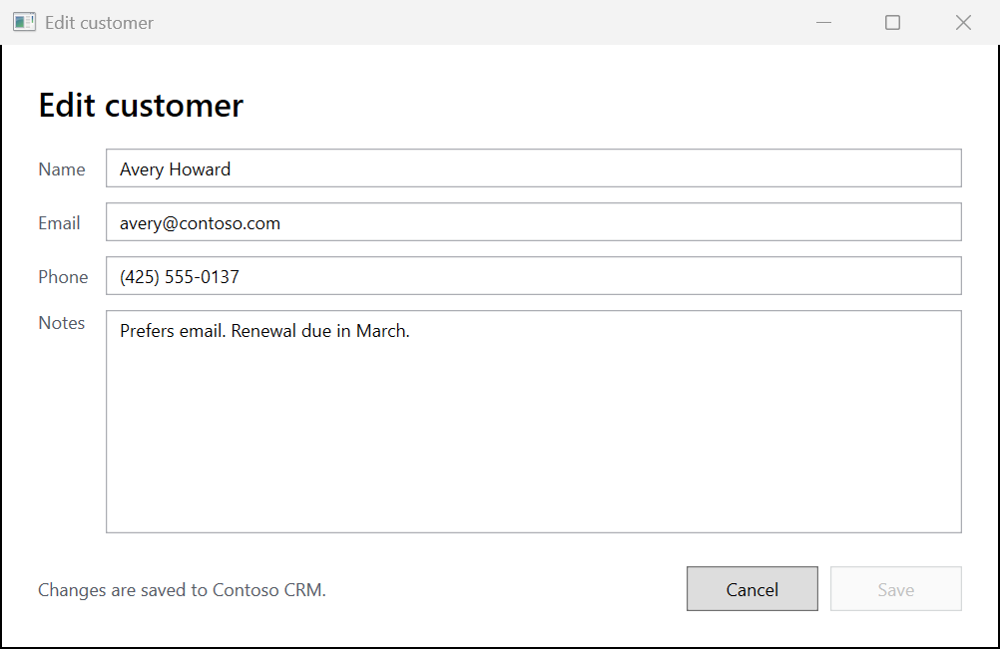

# Session transcript

Source: `Q:\source\XamlAgentDemos-notes\test-runs\VanishingSave\run-final\events.jsonl`

## Tool usage

- get_file: 8
- xaml_get_element_properties: 6
- xaml_find_elements: 4
- xaml_get_element_bounds: 3
- rg: 3
- xaml_capture_image: 2
- xaml_hit_test: 2
- xaml_get_binding_failures: 2
- task_complete: 2
- skill: 1
- xaml_get_status: 1
- xaml_get_visual_tree: 1
- xaml_get_element_styles: 1
- glob: 1
- xaml_explain_property_value: 1
- multi_replace_string_in_file: 1
- xaml_apply_hot_reload: 1
- xaml_clear_binding_failures: 1
- xaml_set_element_property: 1
- replace_string_in_file: 1
- powershell: 1

Failed tool calls: 1, images: 2


_Model: gpt-6-luna_


## User (04:01:42)

There should be a Save button in the footer of my running app, but I can't see it. Find out every reason it's not visible and fix them.


**Tool call (04:01:47):** `skill`
```json
{
 "skill": "xaml-diagnostics"
}
```

<details><summary>Result `skill` success=true</summary>

```
Skill "xaml-diagnostics" loaded successfully. Follow the instructions in the skill context.
```
</details>


_Skill invoked: xaml-diagnostics_


**Tool call (04:01:50):** `xaml_get_status`
```json
{
 "progressMessage": "Checking the running app and diagnostics state"
}
```

<details><summary>Result `xaml_get_status` success=true</summary>

```
{"isDebugging":true,"debuggerState":"running","diagnosticsActive":true,"apps":[{"app":"a1","name":"VanishingSave.exe [50556]","processId":50556,"platform":"WPF (.NET)","isRemote":false,"isDesignTimeOrNoDebug":false,"sourceInfoAvailable":true,"hotReloadSupported":true,"hotReloadEnabled":true,"supportsPropertyExplorer":true,"supportsInAppToolbar":true,"supportsHitTest":true,"windows":[{"windowId":"0xD80D24","title":"Edit customer","bounds":{"x":152,"y":152,"width":1020,"height":660},"dpiScale":1.5,"visible":true,"minimized":false}]}],"issues":[],"issuesSummary":"No problems detected.","hotReload":{"options":{"hotReloadEnabled":true,"hotReloadOnSave":false,"applyMode":"asYouType: XAML edits apply as you type, without saving (default)","wpfEnabled":true,"uwpEnabled":true,"winUIEnabled":true,"mauiEnabled":true,"justMyXaml":true,"previewSelectedElement":false,"inAppToolbar":true,"inAppSelection":false,"layoutAdorners":false,"trackFocusedElement":false,"bindingFailuresVisible":true,"compatibilityMode":false},"dotNetHotReloadEnabled":true,"isProcessingChanges":false,"errors":[]},"windowsNote":"Window bounds are physical screen pixels and include the window frame. A WPF/WinUI Window's Width and Height are device-independent units (DIPs) that also include the frame, so Width = bounds.width / dpiScale. A user's \"800 px wide\" is ambiguous: say which unit you tested. A minimized window reports x/y = -32000 and can't be captured."}
```
</details>


**Tool call (04:01:54):** `xaml_capture_image`
```json
{
 "progressMessage": "Capturing the current window"
}
```


**Tool call (04:01:54):** `xaml_find_elements`
```json
{
 "progressMessage": "Finding the Save control",
 "app": "a1",
 "name": "*Save*",
 "maxResults": 50
}
```


**Tool call (04:01:54):** `xaml_find_elements`
```json
{
 "progressMessage": "Listing buttons in the app",
 "app": "a1",
 "type": "*Button",
 "maxResults": 100
}
```

<details><summary>Result `xaml_find_elements` success=true</summary>

```
{"count":2,"totalMatches":2,"truncated":false,"results":[{"id":"a1:29","type":"System.Windows.Controls.Button","name":"CancelButton","source":{"file":"Q:\\source\\XamlAgentDemos\\src\\VanishingSave\\MainWindow.xaml","line":112,"column":14},"path":"MainWindow/Border/AdornerDecorator/ContentPresenter/Grid/Grid/Button"},{"id":"a1:10","type":"System.Windows.Controls.Button","name":"SaveButton","source":{"file":"Q:\\source\\XamlAgentDemos\\src\\VanishingSave\\MainWindow.xaml","line":118,"column":14},"path":"MainWindow/Border/AdornerDecorator/ContentPresenter/Grid/Grid/Button"}]}
```
</details>

<details><summary>Result `xaml_find_elements` success=true</summary>

```
{"count":1,"totalMatches":1,"truncated":false,"results":[{"id":"a1:10","type":"System.Windows.Controls.Button","name":"SaveButton","source":{"file":"Q:\\source\\XamlAgentDemos\\src\\VanishingSave\\MainWindow.xaml","line":118,"column":14},"path":"MainWindow/Border/AdornerDecorator/ContentPresenter/Grid/Grid/Button"}]}
```
</details>


<details><summary>Result `xaml_capture_image` success=true</summary>

```
Screenshot of window 0xD80D24 "Edit customer" of app a1 (1002x651 image of the window's client area, so it's slightly smaller than the frame bounds from xaml_get_status).
```
</details>


**Tool call (04:01:59):** `xaml_get_visual_tree`
```json
{
 "progressMessage": "Inspecting footer layout ancestry",
 "app": "a1",
 "depth": 8,
 "maxNodes": 500
}
```


**Tool call (04:01:59):** `xaml_get_element_properties`
```json
{
 "progressMessage": "Checking Save visibility and layout",
 "elementIds": [
  "a1:10"
 ],
 "includeAll": true
}
```


**Tool call (04:01:59):** `xaml_get_element_bounds`
```json
{
 "progressMessage": "Checking Save screen bounds",
 "elementIds": [
  "a1:10"
 ]
}
```


**Tool call (04:01:59):** `xaml_hit_test`
```json
{
 "progressMessage": "Checking Save visibility and blockers",
 "elementIds": [
  "a1:10"
 ]
}
```


**Tool call (04:01:59):** `xaml_get_binding_failures`
```json
{
 "progressMessage": "Checking runtime binding failures",
 "maxResults": 100
}
```

<details><summary>Result `xaml_get_visual_tree` success=true</summary>

```
{"app":"a1","platform":"WPF (.NET)","sourceInfoAvailable":true,"nodeCount":53,"truncated":false,"depthLimitedNodes":4,"hint":"4 node(s) have children beyond the requested depth (childCount > 0, no children listed). Raise depth or pass rootElementId to expand them.","nodes":[{"id":"a1:11","type":"VanishingSave.MainWindow","source":{"file":"Q:\\source\\XamlAgentDemos\\src\\VanishingSave\\MainWindow.xaml","line":4,"column":9},"childCount":1,"children":[{"id":"a1:12","type":"System.Windows.Controls.Border","childCount":1,"children":[{"id":"a1:13","type":"System.Windows.Documents.AdornerDecorator","childCount":2,"children":[{"id":"a1:14","type":"System.Windows.Controls.ContentPresenter","childCount":1,"children":[{"id":"a1:16","type":"System.Windows.Controls.Grid","source":{"file":"Q:\\source\\XamlAgentDemos\\src\\VanishingSave\\MainWindow.xaml","line":40,"column":6},"childCount":3,"children":[{"id":"a1:17","type":"System.Windows.Controls.TextBlock","source":{"file":"Q:\\source\\XamlAgentDemos\\src\\VanishingSave\\MainWindow.xaml","line":47,"column":10},"childCount":0},{"id":"a1:18","type":"System.Windows.Controls.Grid","source":{"file":"Q:\\source\\XamlAgentDemos\\src\\VanishingSave\\MainWindow.xaml","line":52,"column":10},"childCount":8,"children":[{"id":"a1:20","type":"System.Windows.Controls.TextBlock","source":{"file":"Q:\\source\\XamlAgentDemos\\src\\VanishingSave\\MainWindow.xaml","line":64,"column":14},"childCount":0},{"id":"a1:21","type":"System.Windows.Controls.TextBox","name":"NameBox","source":{"file":"Q:\\source\\XamlAgentDemos\\src\\VanishingSave\\MainWindow.xaml","line":65,"column":14},"childCount":1,"children":[{"id":"a1:31","type":"System.Windows.Controls.Border","name":"border","childCount":1,"children":[{"id":"a1:37","type":"System.Windows.Controls.ScrollViewer","name":"PART_ContentHost","childCount":1,"children":[{"id":"a1:42","type":"System.Windows.Controls.Grid","childCount":4,"children":[{"id":"a1:47","type":"System.Windows.Shapes.Rectangle","childCount":0},{"id":"a1:48","type":"System.Windows.Controls.ScrollContentPresenter","childCount":2},{"id":"a1:49","type":"System.Windows.Controls.Primitives.ScrollBar","childCount":0},{"id":"a1:50","type":"System.Windows.Controls.Primitives.ScrollBar","childCount":0}]}]}]}]},{"id":"a1:22","type":"System.Windows.Controls.TextBlock","source":{"file":"Q:\\source\\XamlAgentDemos\\src\\VanishingSave\\MainWindow.xaml","line":71,"column":14},"childCount":0},{"id":"a1:23","type":"System.Windows.Controls.Tex
... [truncated 4385 chars]
```
</details>

<details><summary>Result `xaml_get_binding_failures` success=true</summary>

```
{"note":"This is a cumulative log since debugging started or the last xaml_clear_binding_failures, not live state: fixed failures stay listed. To verify a fix: clear, revisit the UI that uses the binding, then read again. Failures without a file usually come from bindings created in code.","totalUnique":1,"matched":1,"truncated":false,"failures":[{"severity":"Warning","count":1,"errorCode":"40","description":"CanSave property not found on object of type CustomerViewModel.","bindingPath":"CanSave","target":"Button.Visibility, Name='SaveButton'","targetName":"SaveButton","targetPropertyType":"Visibility","dataContextType":"CustomerViewModel","file":"Q:\\source\\XamlAgentDemos\\src\\VanishingSave\\MainWindow.xaml","line":118,"column":14,"project":"VanishingSave","originalError":"System.Windows.Data Warning: 40 : BindingExpression path error: 'CanSave' property not found on 'object' ''CustomerViewModel' (HashCode=30479632)'. BindingExpression:Path=CanSave; DataItem='CustomerViewModel' (HashCode=30479632); target element is 'Button' (Name='SaveButton'); target property is 'Visibility' (type 'Visibility')"}]}
```
</details>

<details><summary>Result `xaml_get_element_bounds` success=true</summary>

```
{"note":"'screen' is in physical screen pixels. 'window' is in device-independent units relative to the element's root window (multiply by dpiScale for pixels). Fractional screen pixel values (for example x=18.75) mean edges fall between device pixels, so thin lines and text render blurry unless layout rounding snaps them. isVisible only reflects Visibility/opacity; insideWindowFraction < 1 (clippedByWindow) means part of the element is outside the window's client area, so the user can't see that part. Ancestor clipping (ScrollViewer, Grid cell, ClipToBounds) isn't included; compare with the parent's bounds or call xaml_capture_image.","bounds":[{"id":"a1:10","isVisible":false,"windowHandle":"0xD80D24","dpiScale":1.5,"screen":{"x":199.0,"y":720.0,"width":0.0,"height":0.0},"window":{"x":24.0,"y":348.71,"width":0.0,"height":0.0}}]}
```
</details>

<details><summary>Result `xaml_hit_test` success=true</summary>

```
{"id":"a1:10","summary":"A click at its center does NOT reach 'SaveButton' because it's disabled (IsEnabled=False): input skips disabled elements and lands on Border (in the template of MainWindow) behind or around it. That element isn't necessarily covering it; fix the IsEnabled cause (see blockers, or a command's CanExecute) rather than the layout. Button 'SaveButton' has Visibility=Collapsed. Button 'SaveButton' has IsEnabled=False (IsEnabledCore: command CanExecute is false or the control disabled itself). Button 'SaveButton' has Opacity=0. 'SaveButton' has zero width or height.","elementReceivesInput":false,"inputTarget":{"id":"a1:12","type":"System.Windows.Controls.Border","templatedParent":{"id":"a1:11","type":"VanishingSave.MainWindow","source":{"file":"Q:\\source\\XamlAgentDemos\\src\\VanishingSave\\MainWindow.xaml","line":4,"column":9}}},"stack":[{"id":"a1:12","type":"System.Windows.Controls.Border","templatedParent":{"id":"a1:11","type":"VanishingSave.MainWindow","source":{"file":"Q:\\source\\XamlAgentDemos\\src\\VanishingSave\\MainWindow.xaml","line":4,"column":9}}}],"isVisible":false,"isHitTestVisible":true,"isEnabled":false,"effectiveOpacity":0.0,"blockers":[{"id":"a1:10","type":"System.Windows.Controls.Button","name":"SaveButton","source":{"file":"Q:\\source\\XamlAgentDemos\\src\\VanishingSave\\MainWindow.xaml","line":118,"column":14},"property":"Visibility","value":"Collapsed"},{"id":"a1:10","type":"System.Windows.Controls.Button","name":"SaveButton","source":{"file":"Q:\\source\\XamlAgentDemos\\src\\VanishingSave\\MainWindow.xaml","line":118,"column":14},"property":"IsEnabled","value":"False (IsEnabledCore: command CanExecute is false or the control disabled itself)"},{"id":"a1:10","type":"System.Windows.Controls.Button","name":"SaveButton","source":{"file":"Q:\\source\\XamlAgentDemos\\src\\VanishingSave\\MainWindow.xaml","line":118,"column":14},"property":"Opacity","value":"0"}],"point":{"window":{"x":24.0,"y":348.71},"screen":{"x":199.0,"y":720.0}},"note":"inputTarget is what a mouse click or tap at the point reaches (WPF: InputHitTest; WinUI/UWP: FindElementsInHostCoordinates, open popups first; .NET MAUI: approximated from element bounds and draw order). stack lists visible, hit-testable elements under the point, topmost first; elements with no id are template parts or aren't in the live tree (on WPF use their templatedParent). blockers are the element and ancestors whose own values hide it or block input (descendants inherit IsEnabled
... [truncated 216 chars]
```
</details>

<details><summary>Result `xaml_get_element_properties` success=true</summary>

```
Output too large to read at once (23.5 KB). Saved to: C:\Users\peterspa\AppData\Local\Microsoft\VisualStudio\CopilotCli\45ca7f75-0141-4680-a052-c088fda8212b\temp\1794715319361-copilot-tool-output-15f291c1cb014e42b7fcc6bce32279e0.txt
Consider using tools like rg (for searching), head/tail (for viewing start/end), view with view_range (for specific sections), or jq (for JSON) to examine portions of the output.

Preview (first 500 chars):
{"id":"a1:10","type":"System.Windows.Controls.Button","name":"SaveButton","source":{"file":"Q:\\source\\XamlAgentDemos\\src\\VanishingSave\\MainWindow.xaml","line":118,"column":14},"properties":[{"name":"IsEnabled","value":"False","valueType":"System.Boolean","propertyType":"System.Boolean","declaringType":"System.Windows.UIElement","valueSource":"Coercion"},{"name":"IsDefault","value":"True","valueType":"System.Boolean","propertyType":"System.Boolean","declaringType":"System.Windows.Controls.Bu
```
</details>


**Assistant (04:02:06):**

The Save control has multiple live blockers, including a failed visibility binding. I’m tracing each to its source before changing the running app.


**Tool call (04:02:06):** `get_file`
```json
{
 "filename": "Q:\\source\\XamlAgentDemos\\src\\VanishingSave\\MainWindow.xaml",
 "startLine": 1,
 "endLine": 180,
 "includeLineNumbers": true
}
```


**Tool call (04:02:06):** `rg`
```json
{
 "pattern": "class CustomerViewModel|CanSave|SaveCommand|Opacity=\"0\"|Visibility=\"Collapsed\"",
 "paths": "Q:\\source\\XamlAgentDemos\\src\\VanishingSave",
 "output_mode": "content",
 "-n": true,
 "head_limit": 100
}
```


**Tool call (04:02:06):** `xaml_get_element_properties`
```json
{
 "progressMessage": "Reading Save blocker value sources",
 "elementIds": [
  "a1:10"
 ],
 "nameFilter": "Visibility|Opacity|IsEnabled|Command|CommandParameter|Content|Width|Height",
 "includeAll": true
}
```

<details><summary>Result `xaml_get_element_properties` success=true</summary>

```
{"id":"a1:10","type":"System.Windows.Controls.Button","name":"SaveButton","source":{"file":"Q:\\source\\XamlAgentDemos\\src\\VanishingSave\\MainWindow.xaml","line":118,"column":14},"properties":[{"name":"IsEnabled","value":"False","valueType":"System.Boolean","propertyType":"System.Boolean","declaringType":"System.Windows.UIElement","valueSource":"Coercion"},{"name":"Command","evaluatedValue":"(XamlAgentDemos.RelayCommand)","valueType":"System.Windows.Data.BindingExpression","propertyType":"System.Windows.Input.ICommand","declaringType":"System.Windows.Controls.Primitives.ButtonBase","valueSource":"Local","valueSourceLocation":{"file":"Q:\\source\\XamlAgentDemos\\src\\VanishingSave\\MainWindow.xaml","line":118,"column":14},"isBinding":true},{"name":"Content","value":"Save","valueType":"System.String","propertyType":"System.Object","declaringType":"System.Windows.Controls.ContentControl","valueSource":"Local","valueSourceLocation":{"file":"Q:\\source\\XamlAgentDemos\\src\\VanishingSave\\MainWindow.xaml","line":118,"column":14}},{"name":"Visibility","evaluatedValue":"2 (System.Windows.Visibility)","valueType":"System.Windows.Data.BindingExpression","propertyType":"System.Windows.Visibility","declaringType":"System.Windows.UIElement","valueSource":"Local","valueSourceLocation":{"file":"Q:\\source\\XamlAgentDemos\\src\\VanishingSave\\MainWindow.xaml","line":118,"column":14},"isBinding":true},{"name":"Opacity","value":"0","valueType":"System.Double","propertyType":"System.Double","declaringType":"System.Windows.UIElement","valueSource":"StyleTrigger"},{"name":"MinWidth","value":"88","valueType":"System.Double","propertyType":"System.Double","declaringType":"System.Windows.FrameworkElement","valueSource":"Style","valueSourceLocation":{"file":"Q:\\source\\XamlAgentDemos\\src\\VanishingSave\\MainWindow.xaml","line":27,"column":10}},{"name":"VerticalContentAlignment","value":"1","valueType":"System.Windows.VerticalAlignment","propertyType":"System.Windows.VerticalAlignment","declaringType":"System.Windows.Controls.Control","valueSource":"BuiltInStyle"},{"name":"HorizontalContentAlignment","value":"1","valueType":"System.Windows.HorizontalAlignment","propertyType":"System.Windows.HorizontalAlignment","declaringType":"System.Windows.Controls.Control","valueSource":"BuiltInStyle"},{"name":"CommandParameter","propertyType":"System.Object","declaringType":"System.Windows.Controls.Primitives.ButtonBase","valueSource":"Default"},{"name":"CommandTarget","propertyType":"Sys
... [truncated 2288 chars]
```
</details>

<details><summary>Result `rg` success=true</summary>

```
Q:\source\XamlAgentDemos\src\VanishingSave\CustomerViewModel.cs:3:public sealed class CustomerViewModel : ObservableObject
Q:\source\XamlAgentDemos\src\VanishingSave\CustomerViewModel.cs:13:        this.SaveCommand = new RelayCommand(this.Save, () => this.IsDirty);
Q:\source\XamlAgentDemos\src\VanishingSave\CustomerViewModel.cs:30:    public RelayCommand SaveCommand { get; }
Q:\source\XamlAgentDemos\src\VanishingSave\MainWindow.xaml:120:                    Command="{Binding SaveCommand}"
Q:\source\XamlAgentDemos\src\VanishingSave\MainWindow.xaml:124:                    Visibility="{Binding CanSave, Converter={StaticResource BoolToVisibility}, FallbackValue=Collapsed}" />
```
</details>

<details><summary>Result `get_file` success=true</summary>

```
```xaml src\VanishingSave\MainWindow.xaml (Lines 1-138 of 138 total. Call tools for more if needed.)
1: <Window x:Class="VanishingSave.MainWindow"
2:         xmlns="http://schemas.microsoft.com/winfx/2006/xaml/presentation"
3:         xmlns:x="http://schemas.microsoft.com/winfx/2006/xaml"
4:         xmlns:local="clr-namespace:VanishingSave"
5:         Title="Edit customer"
6:         Width="680"
7:         Height="440"
8:         Background="White">
9:     <Window.DataContext>
10:         <local:CustomerViewModel />
11:     </Window.DataContext>
12: 
13:     <Window.Resources>
14:         <BooleanToVisibilityConverter x:Key="BoolToVisibility" />
15: 
16:         <Style x:Key="FieldLabelStyle" TargetType="TextBlock">
17:             <Setter Property="Margin" Value="0,0,12,10" />
18:             <Setter Property="VerticalAlignment" Value="Center" />
19:             <Setter Property="Foreground" Value="#555B66" />
20:         </Style>
21: 
22:         <Style x:Key="FieldStyle" TargetType="TextBox">
23:             <Setter Property="Margin" Value="0,0,0,10" />
24:             <Setter Property="Padding" Value="6,4" />
25:         </Style>
26: 
27:         <Style x:Key="FooterButtonStyle" TargetType="Button">
28:             <Setter Property="MinWidth" Value="88" />
29:             <Setter Property="Margin" Value="8,0,0,0" />
30:             <Setter Property="Padding" Value="16,6" />
31:             <Style.Triggers>
32:                 <!-- Fade out buttons that can't be used yet. -->
33:                 <Trigger Property="IsEnabled" Value="False">
34:                     <Setter Property="Opacity" Value="0" />
35:                 </Trigger>
36:             </Style.Triggers>
37:         </Style>
38:     </Window.Resources>
39: 
40:     <Grid Margin="24">
41:         <Grid.RowDefinitions>
42:             <RowDefinition Height="Auto" />
43:             <RowDefinition Height="*" />
44:             <RowDefinition Height="Auto" />
45:         </Grid.RowDefinitions>
46: 
47:         <TextBlock Margin="0,0,0,16"
48:                    FontSize="22"
49:                    FontWeight="SemiBold"
50:                    Text="Edit customer" />
51: 
52:         <Grid Grid.Row="1">
53:             <Grid.ColumnDefinitions>
54:                 <ColumnDefinition Width="Auto" />
55:                 <ColumnDefinition Width="*" />
56:             </Grid.ColumnDefinitions>
57:             <Grid.RowDefinitions>
58:            
... [truncated 3995 chars]
```
</details>


**Tool call (04:02:17):** `get_file`
```json
{
 "filename": "Q:\\source\\XamlAgentDemos\\src\\VanishingSave\\CustomerViewModel.cs",
 "startLine": 1,
 "endLine": 220,
 "includeLineNumbers": true
}
```


**Tool call (04:02:17):** `xaml_get_element_properties`
```json
{
 "progressMessage": "Inspecting footer overlay layout",
 "elementIds": [
  "a1:19",
  "a1:29",
  "a1:30"
 ],
 "nameFilter": "Visibility|Opacity|IsEnabled|Panel.ZIndex|Background|Width|Height|ActualWidth|ActualHeight|Grid.Column",
 "includeAll": true
}
```


**Tool call (04:02:17):** `xaml_get_element_bounds`
```json
{
 "progressMessage": "Comparing footer and overlay bounds",
 "elementIds": [
  "a1:19",
  "a1:29",
  "a1:30"
 ]
}
```


**Tool call (04:02:17):** `xaml_get_element_styles`
```json
{
 "progressMessage": "Checking Save button style trigger",
 "elementIds": [
  "a1:10"
 ]
}
```

<details><summary>Result `xaml_get_element_bounds` success=true</summary>

```
{"note":"'screen' is in physical screen pixels. 'window' is in device-independent units relative to the element's root window (multiply by dpiScale for pixels). Fractional screen pixel values (for example x=18.75) mean edges fall between device pixels, so thin lines and text render blurry unless layout rounding snaps them. isVisible only reflects Visibility/opacity; insideWindowFraction < 1 (clippedByWindow) means part of the element is outside the window's client area, so the user can't see that part. Ancestor clipping (ScrollViewer, Grid cell, ClipToBounds) isn't included; compare with the parent's bounds or call xaml_capture_image.","bounds":[{"id":"a1:19","isVisible":true,"insideWindowFraction":1.0,"windowHandle":"0xD80D24","dpiScale":1.5,"screen":{"x":199.0,"y":720.0,"width":926.0,"height":45.0},"window":{"x":24.0,"y":348.71,"width":617.33,"height":29.96}},{"id":"a1:29","isVisible":true,"insideWindowFraction":1.0,"windowHandle":"0xD80D24","dpiScale":1.5,"screen":{"x":993.0,"y":720.0,"width":132.0,"height":45.0},"window":{"x":553.33,"y":348.71,"width":88.0,"height":29.96}},{"id":"a1:30","isVisible":true,"windowHandle":"0xD80D24","dpiScale":1.5,"screen":{"x":1125.0,"y":720.0,"width":0.0,"height":45.0},"window":{"x":641.33,"y":348.71,"width":0.0,"height":29.96}}]}
```
</details>

<details><summary>Result `get_file` success=true</summary>

```
```csharp src\VanishingSave\CustomerViewModel.cs (Lines 1-35 of 35 total. Call tools for more if needed.)
1: namespace VanishingSave;
2: 
3: public sealed class CustomerViewModel : ObservableObject
4: {
5:     private string name = "Avery Howard";
6:     private string email = "avery@contoso.com";
7:     private string phone = "(425) 555-0137";
8:     private string notes = "Prefers email. Renewal due in March.";
9:     private bool isDirty;
10: 
11:     public CustomerViewModel()
12:     {
13:         this.SaveCommand = new RelayCommand(this.Save, () => this.IsDirty);
14:         this.CancelCommand = new RelayCommand(() => this.IsDirty = false);
15:     }
16: 
17:     public string Name { get => this.name; set { if (this.SetProperty(ref this.name, value)) this.IsDirty = true; } }
18: 
19:     public string Email { get => this.email; set { if (this.SetProperty(ref this.email, value)) this.IsDirty = true; } }
20: 
21:     public string Phone { get => this.phone; set { if (this.SetProperty(ref this.phone, value)) this.IsDirty = true; } }
22: 
23:     public string Notes { get => this.notes; set { if (this.SetProperty(ref this.notes, value)) this.IsDirty = true; } }
24: 
25:     public bool IsDirty { get => this.isDirty; set => this.SetProperty(ref this.isDirty, value); }
26: 
27:     /// <summary>Whether the current user is allowed to save customer records.</summary>
28:     public bool IsSaveAvailable => true;
29: 
30:     public RelayCommand SaveCommand { get; }
31: 
32:     public RelayCommand CancelCommand { get; }
33: 
34:     private void Save() => this.IsDirty = false;
35: }

```


```
</details>

<details><summary>Result `xaml_get_element_styles` success=true</summary>

```
{"id":"a1:10","type":"System.Windows.Controls.Button","name":"SaveButton","source":{"file":"Q:\\source\\XamlAgentDemos\\src\\VanishingSave\\MainWindow.xaml","line":118,"column":14},"styleProperty":{"value":"System.Windows.Style","valueSource":"Local","location":{"file":"Q:\\source\\XamlAgentDemos\\src\\VanishingSave\\MainWindow.xaml","line":118,"column":14}},"templateProperty":{"value":"System.Windows.Controls.ControlTemplate","valueSource":"BuiltInStyle"},"styles":[{"kind":"StyleTrigger","description":"Trigger in the element's Style whose condition is currently true.","setters":[{"property":"Opacity","value":"0","effective":true}]},{"kind":"TemplateTrigger","description":"Trigger in the element's own ControlTemplate whose condition is currently true.","setters":[{"property":"Foreground","value":"#FF838383","effective":true}]},{"kind":"Style","description":"Setter in an explicit (x:Key) or implicit (TargetType) Style.","targetType":"System.Windows.Controls.Button","location":{"file":"Q:\\source\\XamlAgentDemos\\src\\VanishingSave\\MainWindow.xaml","line":27,"column":10},"setters":[{"property":"Margin","value":"8,0,0,0","effective":true},{"property":"MinWidth","value":"88","effective":true},{"property":"Padding","value":"16,6,16,6","effective":true}]},{"kind":"BuiltInStyle","description":"Setter in the control's default theme style (generic.xaml or the platform theme).","targetType":"System.Windows.Controls.Primitives.ButtonBase","setters":[{"property":"Background","value":"#FFDDDDDD","effective":true},{"property":"BorderBrush","value":"#FF707070","effective":true},{"property":"BorderThickness","value":"1,1,1,1","effective":true},{"property":"FocusVisualStyle","value":"System.Windows.Style","effective":true},{"property":"Foreground","effective":false,"overriddenBy":"TemplateTrigger"},{"property":"HorizontalContentAlignment","value":"1","effective":true},{"property":"Padding","value":"1,1,1,1","effective":false,"overriddenBy":"Style (System.Windows.Controls.Button)"},{"property":"Template","value":"System.Windows.Controls.ControlTemplate","effective":true},{"property":"VerticalContentAlignment","value":"1","effective":true}]}],"hint":"Styles are listed in precedence order, highest first. 'effective=false' setters lose to 'overriddenBy'. Use xaml_find_resource to see where a style or resource key resolves. Only triggers whose condition is true right now are listed; inactive triggers (IsMouseOver, IsPressed, DataTriggers) aren't. Read the style's source at 'lo
... [truncated 71 chars]
```
</details>

<details><summary>Result `xaml_get_element_properties` success=true</summary>

```
{"count":3,"failed":0,"results":[{"id":"a1:19","type":"System.Windows.Controls.Grid","name":"Footer","source":{"file":"Q:\\source\\XamlAgentDemos\\src\\VanishingSave\\MainWindow.xaml","line":101,"column":10},"properties":[{"name":"ActualWidth","value":"617.3333333333334","valueType":"System.Double","propertyType":"System.Double","declaringType":"System.Windows.FrameworkElement","valueSource":"Local","valueSourceLocation":{"file":"Q:\\source\\XamlAgentDemos\\src\\VanishingSave\\MainWindow.xaml","line":101,"column":10},"readOnly":true},{"name":"ActualHeight","value":"29.96","valueType":"System.Double","propertyType":"System.Double","declaringType":"System.Windows.FrameworkElement","valueSource":"Local","valueSourceLocation":{"file":"Q:\\source\\XamlAgentDemos\\src\\VanishingSave\\MainWindow.xaml","line":101,"column":10},"readOnly":true},{"name":"Background","propertyType":"System.Windows.Media.Brush","declaringType":"System.Windows.Controls.Panel","valueSource":"Default"},{"name":"Width","value":"Auto","valueType":"System.Double","propertyType":"System.Double","declaringType":"System.Windows.FrameworkElement","valueSource":"Default"},{"name":"MinWidth","value":"0","valueType":"System.Double","propertyType":"System.Double","declaringType":"System.Windows.FrameworkElement","valueSource":"Default"},{"name":"MaxWidth","value":"Infinity","valueType":"System.Double","propertyType":"System.Double","declaringType":"System.Windows.FrameworkElement","valueSource":"Default"},{"name":"Height","value":"Auto","valueType":"System.Double","propertyType":"System.Double","declaringType":"System.Windows.FrameworkElement","valueSource":"Default"},{"name":"MinHeight","value":"0","valueType":"System.Double","propertyType":"System.Double","declaringType":"System.Windows.FrameworkElement","valueSource":"Default"},{"name":"MaxHeight","value":"Infinity","valueType":"System.Double","propertyType":"System.Double","declaringType":"System.Windows.FrameworkElement","valueSource":"Default"},{"name":"Opacity","value":"1","valueType":"System.Double","propertyType":"System.Double","declaringType":"System.Windows.UIElement","valueSource":"Default"},{"name":"OpacityMask","propertyType":"System.Windows.Media.Brush","declaringType":"System.Windows.UIElement","valueSource":"Default"},{"name":"Visibility","value":"0","valueType":"System.Windows.Visibility","propertyType":"System.Windows.Visibility","declaringType":"System.Windows.UIElement","valueSource":"Default"},{"name":"IsEnabled","value":"True
... [truncated 7073 chars]
```
</details>


**Tool call (04:02:47):** `rg`
```json
{
 "pattern": "SyncStatus|offline|IsSaveAvailable|CanSave|class MainWindow",
 "paths": "Q:\\source\\XamlAgentDemos\\src\\VanishingSave",
 "output_mode": "content",
 "-n": true,
 "head_limit": 100
}
```


**Tool call (04:02:47):** `glob`
```json
{
 "pattern": "src\\VanishingSave\\**\\*",
 "paths": "Q:\\source\\XamlAgentDemos"
}
```


**Tool call (04:02:47):** `xaml_explain_property_value`
```json
{
 "progressMessage": "Tracing what hides and obscures Save",
 "elementIds": [
  "a1:10",
  "a1:30"
 ],
 "propertyNames": [
  "Visibility",
  "Opacity",
  "IsEnabled",
  "Panel.ZIndex",
  "Background"
 ]
}
```

<details><summary>Result `rg` success=true</summary>

```
Q:\source\XamlAgentDemos\src\VanishingSave\MainWindow.xaml:124:                    Visibility="{Binding CanSave, Converter={StaticResource BoolToVisibility}, FallbackValue=Collapsed}" />
Q:\source\XamlAgentDemos\src\VanishingSave\MainWindow.xaml:127:            <Border x:Name="SyncStatusHost"
Q:\source\XamlAgentDemos\src\VanishingSave\MainWindow.xaml:131:                <TextBlock x:Name="SyncStatusText"
Q:\source\XamlAgentDemos\src\VanishingSave\MainWindow.xaml.cs:5:public partial class MainWindow : Window
Q:\source\XamlAgentDemos\src\VanishingSave\CustomerViewModel.cs:28:    public bool IsSaveAvailable => true;
```
</details>

<details><summary>Result `glob` success=true</summary>

```
[glob: 89 path(s) under Q:/source/XamlAgentDemos/src/VanishingSave; grouped by directory]

Q:/source/XamlAgentDemos/src/VanishingSave/obj/ (76 path(s))
  Debug/net10.0-windows/.NETCoreApp,Version=v10.0.AssemblyAttributes.cs
  Debug/net10.0-windows/App.g.cs
  Debug/net10.0-windows/App.g.i.cs
  Debug/net10.0-windows/GeneratedInternalTypeHelper.g.cs
  Debug/net10.0-windows/GeneratedInternalTypeHelper.g.i.cs
  Debug/net10.0-windows/MainWindow.baml
  Debug/net10.0-windows/MainWindow.g.cs
  Debug/net10.0-windows/MainWindow.g.i.cs
  Debug/net10.0-windows/Vanishin.559ADE70.Up2Date
  Debug/net10.0-windows/VanishingSave.AssemblyInfo.cs
  Debug/net10.0-windows/VanishingSave.AssemblyInfoInputs.cache
  Debug/net10.0-windows/VanishingSave.GeneratedMSBuildEditorConfig.editorconfig
  Debug/net10.0-windows/VanishingSave.GlobalUsings.g.cs
  Debug/net10.0-windows/VanishingSave.assets.cache
  Debug/net10.0-windows/VanishingSave.csproj.BuildWithSkipAnalyzers
  Debug/net10.0-windows/VanishingSave.csproj.CoreCompileInputs.cache
  Debug/net10.0-windows/VanishingSave.csproj.FileListAbsolute.txt
  Debug/net10.0-windows/VanishingSave.designer.deps.json
  Debug/net10.0-windows/VanishingSave.designer.runtimeconfig.json
  Debug/net10.0-windows/VanishingSave.dll
  Debug/net10.0-windows/VanishingSave.g.resources
  Debug/net10.0-windows/VanishingSave.genruntimeconfig.cache
  Debug/net10.0-windows/VanishingSave.pdb
  Debug/net10.0-windows/VanishingSave.sourcelink.json
  Debug/net10.0-windows/VanishingSave_5cgzny33_wpftmp.AssemblyInfo.cs
  Debug/net10.0-windows/VanishingSave_5cgzny33_wpftmp.AssemblyInfoInputs.cache
  Debug/net10.0-windows/VanishingSave_5cgzny33_wpftmp.GeneratedMSBuildEditorConfig.editorconfig
  Debug/net10.0-windows/VanishingSave_5cgzny33_wpftmp.GlobalUsings.g.cs
  Debug/net10.0-windows/VanishingSave_5cgzny33_wpftmp.assets.cache
  Debug/net10.0-windows/VanishingSave_5cgzny33_wpftmp.csproj.BuildWithSkipAnalyzers
  Debug/net10.0-windows/VanishingSave_5cgzny33_wpftmp.sourcelink.json
  Debug/net10.0-windows/VanishingSave_MarkupCompile.cache
  Debug/net10.0-windows/VanishingSave_MarkupCompile.i.cache
  Debug/net10.0-windows/VanishingSave_MarkupCompile.i.lref
  Debug/net10.0-windows/VanishingSave_MarkupCompile.lref
  Debug/net10.0-windows/VanishingSave_ejwe5tx2_wpftmp.AssemblyInfo.cs
  Debug/net10.0-windows/VanishingSave_ejwe5tx2_wpftmp.AssemblyInfoInputs.cache
  Debug/net10.0-windows/VanishingSave_ejwe5tx2_wpftmp.GeneratedMSBuildEditorConfig.editorconfig
  Debug/net10.0-windows/
... [truncated 3210 chars]
```
</details>

<details><summary>Result `xaml_explain_property_value` success=true</summary>

```
{"count":10,"failed":0,"results":[{"id":"a1:10","type":"System.Windows.Controls.Button","property":"Visibility","propertyType":"System.Windows.Visibility","evaluatedValue":"2 (System.Windows.Visibility)","effectiveSource":"Local","chain":[{"kind":"Local","description":"Local value set on the element (XAML attribute, binding or code). Wins over styles, templates and inheritance.","evaluatedValue":"2 (System.Windows.Visibility)","valueType":"System.Windows.Data.BindingExpression","isBinding":true,"effective":true,"sourceLocation":{"file":"Q:\\source\\XamlAgentDemos\\src\\VanishingSave\\MainWindow.xaml","line":118,"column":14}},{"kind":"Default","description":"The property's default value; nothing sets it.","value":"0","valueType":"System.Windows.Visibility","effective":false}],"notes":["To let a style or template value apply, remove the local value (the attribute, binding or code assignment). To change it, edit that local value. XAML and code both produce Local values, and the source location may still point to the XAML attribute after code assigned a new value. If the live value differs from the XAML attribute, or the element has no XAML attribute for it, code set it: search code-behind for the element's x:Name.","The effective value comes from a binding. If it's wrong, check xaml_get_binding_failures and the DataContext."]},{"id":"a1:10","type":"System.Windows.Controls.Button","property":"Opacity","propertyType":"System.Double","effectiveValue":"0","effectiveSource":"StyleTrigger","chain":[{"kind":"StyleTrigger","description":"Trigger in the element's Style whose condition is currently true.","value":"0","valueType":"System.Double","effective":true},{"kind":"Default","description":"The property's default value; nothing sets it.","value":"1","valueType":"System.Double","effective":false}],"notes":["Edit the setter or trigger at the source location, or set a local value to override it for this element only."]},{"id":"a1:10","type":"System.Windows.Controls.Button","property":"IsEnabled","propertyType":"System.Boolean","effectiveValue":"False","effectiveSource":"Coercion","chain":[{"kind":"Coercion","description":"The control coerced the value (for example clamped to a minimum or maximum).","value":"False","valueType":"System.Boolean","effective":true},{"kind":"Default","description":"The property's default value; nothing sets it.","value":"True","valueType":"System.Boolean","effective":false}],"notes":["Check related properties that constrain this one (for ex
... [truncated 4589 chars]
```
</details>


**Tool call (04:03:09):** `get_file`
```json
{
 "filename": "Q:\\source\\XamlAgentDemos\\src\\VanishingSave\\MainWindow.xaml.cs",
 "startLine": 1,
 "endLine": 120,
 "includeLineNumbers": true
}
```

<details><summary>Result `get_file` success=true</summary>

```
```csharp src\VanishingSave\MainWindow.xaml.cs (Lines 1-20 of 20 total. Call tools for more if needed.)
1: using System.Windows;
2: 
3: namespace VanishingSave;
4: 
5: public partial class MainWindow : Window
6: {
7:     public MainWindow()
8:     {
9:         this.InitializeComponent();
10:         this.Loaded += this.OnLoaded;
11:     }
12: 
13:     private void OnLoaded(object sender, RoutedEventArgs e)
14:     {
15:         if (FooterSettings.UseCompactFooter)
16:         {
17:             this.SaveColumn.Width = new GridLength(0);
18:         }
19:     }
20: }

```


```
</details>


**Tool call (04:03:15):** `get_file`
```json
{
 "filename": "Q:\\source\\XamlAgentDemos\\src\\VanishingSave\\FooterSettings.cs",
 "startLine": 1,
 "endLine": 120,
 "includeLineNumbers": true
}
```

<details><summary>Result `get_file` success=true</summary>

```
```csharp src\VanishingSave\FooterSettings.cs (Lines 1-10 of 10 total. Call tools for more if needed.)
1: namespace VanishingSave;
2: 
3: public static class FooterSettings
4: {
5:     /// <summary>
6:     /// Compact footer for small screens: auto-save makes the Save column unnecessary.
7:     /// (Auto-save was cut from v2, but this switch stayed on.)
8:     /// </summary>
9:     public static bool UseCompactFooter { get; set; } = true;
10: }

```


```
</details>


**Tool call (04:03:34):** `rg`
```json
{
 "pattern": "class RelayCommand|sealed class RelayCommand|UseCompactFooter|CanExecuteChanged|class ObservableObject",
 "paths": "Q:\\source\\XamlAgentDemos",
 "output_mode": "content",
 "-n": true,
 "head_limit": 120
}
```


**Tool call (04:03:34):** `xaml_get_element_properties`
```json
{
 "progressMessage": "Checking footer column width source",
 "elementIds": [
  "a1:19"
 ],
 "nameFilter": "ColumnDefinitions[2].Width|ColumnDefinitions[2].ActualWidth|ColumnDefinitions[1].Width",
 "includeAll": true
}
```

<details><summary>Result `rg` success=true</summary>

```
Q:\source\XamlAgentDemos\src\VanishingSave\MainWindow.xaml.cs:15:        if (FooterSettings.UseCompactFooter)
Q:\source\XamlAgentDemos\src\Shared\RelayCommand.cs:5:public sealed class RelayCommand(Action execute, Func<bool>? canExecute = null) : ICommand
Q:\source\XamlAgentDemos\src\Shared\RelayCommand.cs:7:    public event EventHandler? CanExecuteChanged
Q:\source\XamlAgentDemos\src\VanishingSave\FooterSettings.cs:9:    public static bool UseCompactFooter { get; set; } = true;
Q:\source\XamlAgentDemos\src\Shared\ObservableObject.cs:6:public abstract class ObservableObject : INotifyPropertyChanged
```
</details>

<details><summary>Result `xaml_get_element_properties` success=false</summary>

```
{
 "message": "{\"error\":\"PROPERTY_NOT_FOUND\",\"message\":\"'a1:19' has no property 'ColumnDefinitions[2].Width|ColumnDefinitions'.\",\"hint\":\"Call xaml_get_element_properties with nameFilter to check the name. Collections such as ColumnDefinitions are listed only when they have items.\"}",
 "code": "failure"
}
```
</details>


**Tool call (04:03:39):** `get_file`
```json
{
 "filename": "Q:\\source\\XamlAgentDemos\\src\\Shared\\RelayCommand.cs",
 "startLine": 1,
 "endLine": 120,
 "includeLineNumbers": true
}
```

<details><summary>Result `get_file` success=true</summary>

```
```csharp src\Shared\RelayCommand.cs (Lines 1-16 of 16 total. Call tools for more if needed.)
1: using System.Windows.Input;
2: 
3: namespace XamlAgentDemos;
4: 
5: public sealed class RelayCommand(Action execute, Func<bool>? canExecute = null) : ICommand
6: {
7:     public event EventHandler? CanExecuteChanged
8:     {
9:         add => CommandManager.RequerySuggested += value;
10:         remove => CommandManager.RequerySuggested -= value;
11:     }
12: 
13:     public bool CanExecute(object? parameter) => canExecute?.Invoke() ?? true;
14: 
15:     public void Execute(object? parameter) => execute();
16: }

```


```
</details>


**Assistant (04:04:01):**

I found four independent blockers: the footer setting collapses the Save column, its visibility binding targets a nonexistent property, disabled state makes it fully transparent, and the empty status overlay would cover it once laid out. I’m fixing each at its source while keeping the Save command disabled until there are edits.


**Tool call (04:04:01):** `multi_replace_string_in_file`
```json
{
 "explanation": "Restore the Save column, bind visibility to the existing permission property, keep disabled buttons visible, and collapse the empty overlay.",
 "replacements": [
  {
   "filePath": "src\\VanishingSave\\MainWindow.xaml",
   "oldString": "            <Style.Triggers>\n                <!-- Fade out buttons that can't be used yet. -->\n                <Trigger Property=\"IsEnabled\" Value=\"False\">\n                    <Setter Property=\"Opacity\" Value=\"0\" />\n                </Trigger>\n            </Style.Triggers>",
   "newString": "            <Style.Triggers>\n                <!-- Fade out buttons that can't be used yet. -->\n                <Trigger Property=\"IsEnabled\" Value=\"False\">\n                    <Setter Property=\"Opacity\" Value=\"0.5\" />\n                </Trigger>\n            </Style.Triggers>",
   "explanation": "Keep disabled buttons visibly faded instead of fully transparent."
  },
  {
   "filePath": "src\\VanishingSave\\MainWindow.xaml",
   "oldString": "                    Content=\"Save\"\n                    IsDefault=\"True\"\n                    Style=\"{StaticResource FooterButtonStyle}\"\n                    Visibility=\"{Binding CanSave, Converter={StaticResource BoolToVisibility}, FallbackValue=Collapsed}\" />\n\n            <!-- Shows \"Offline - changes will sync later\" when the connection drops. -->\n            <Border x:Name=\"SyncStatusHost\"\n                    Grid.Column=\"2\"\n                    Panel.ZInde
... [truncated 2402 chars]
```

<details><summary>Result `multi_replace_string_in_file` success=true</summary>

```
Successfully applied 3 of 3 replacement(s) across 2 file(s).
```
</details>


**Tool call (04:04:08):** `xaml_apply_hot_reload`
```json
{
 "progressMessage": "Applying the footer fixes to the running app",
 "includeCodeChanges": true
}
```

<details><summary>Result `xaml_apply_hot_reload` success=true</summary>

```
{"summary":"Applied with no new errors.","applied":true,"status":"applied","errors":[],"log":[],"lastHotReloadUpdate":{"secondsAgo":8,"updatesSinceToolsStarted":1},"codeChanges":".NET Hot Reload was started for saved code changes. Its results are in the Hot Reload output pane, not in 'log'; if an edit can't be hot reloaded, Visual Studio asks the user to rebuild and restart.","codeHotReloadOutput":["23:04:09.45  ⚠ Q:\\source\\XamlAgentDemos\\src\\VanishingSave\\FooterSettings.cs (line 9): warning ENC0118: Changing 'auto-property' might not have any effect until the application is restarted.","23:04:10.12  Code changes were successfully applied."],"hint":"Call xaml_capture_image to verify the change visually. Views that aren't loaded (other tabs, closed dialogs) are updated when they're next shown. Source line numbers reported for existing elements can still point to the pre-edit lines until the element is recreated, so find elements by x:Name or type rather than by an old line number. Structural edits (wrapping or replacing a parent, changing a root's content) recreate elements, which resets their runtime state such as selection, checked state, typed text and scroll position, and invalidates their IDs. Re-establish the state you were testing before capturing again."}
```
</details>


**Tool call (04:04:19):** `xaml_find_elements`
```json
{
 "progressMessage": "Refreshing Save control after hot reload",
 "app": "a1",
 "name": "SaveButton",
 "maxResults": 10
}
```


**Tool call (04:04:19):** `xaml_find_elements`
```json
{
 "progressMessage": "Refreshing footer after hot reload",
 "app": "a1",
 "name": "Footer",
 "maxResults": 10
}
```


**Tool call (04:04:19):** `xaml_clear_binding_failures`
```json
{
 "progressMessage": "Clearing old binding failures"
}
```

<details><summary>Result `xaml_find_elements` success=true</summary>

```
{"count":1,"totalMatches":1,"truncated":false,"results":[{"id":"a1:19","type":"System.Windows.Controls.Grid","name":"Footer","source":{"file":"Q:\\source\\XamlAgentDemos\\src\\VanishingSave\\MainWindow.xaml","line":101,"column":10},"path":"MainWindow/Border/AdornerDecorator/ContentPresenter/Grid/Grid"}]}
```
</details>

<details><summary>Result `xaml_find_elements` success=true</summary>

```
{"count":1,"totalMatches":1,"truncated":false,"results":[{"id":"a1:10","type":"System.Windows.Controls.Button","name":"SaveButton","source":{"file":"Q:\\source\\XamlAgentDemos\\src\\VanishingSave\\MainWindow.xaml","line":118,"column":14},"path":"MainWindow/Border/AdornerDecorator/ContentPresenter/Grid/Grid/Button"}]}
```
</details>

<details><summary>Result `xaml_clear_binding_failures` success=true</summary>

```
{"cleared":1}
```
</details>


**Tool call (04:04:23):** `xaml_set_element_property`
```json
{
 "progressMessage": "Restoring the live Save column width",
 "elementIds": [
  "a1:19"
 ],
 "setters": [
  "ColumnDefinitions[2].Width=Auto"
 ]
}
```

<details><summary>Result `xaml_set_element_property` success=true</summary>

```
{"id":"a1:19","property":"ColumnDefinitions[2].Width","oldValue":"0","newValue":"Auto","note":"This change only affects the running app and is lost when it restarts. Edit the XAML source to persist it. Until then it overrides the source: hot reload re-applies only the properties whose XAML changed, so undo experiments (set the original value back) before you verify a source fix."}
```
</details>


**Tool call (04:04:29):** `xaml_capture_image`
```json
{
 "progressMessage": "Verifying the visible footer"
}
```


**Tool call (04:04:29):** `xaml_get_element_properties`
```json
{
 "progressMessage": "Verifying Save state and visibility",
 "elementIds": [
  "a1:10"
 ],
 "nameFilter": "Visibility|Opacity|IsEnabled|Command|Content|ActualWidth|ActualHeight"
}
```


**Tool call (04:04:29):** `xaml_get_element_bounds`
```json
{
 "progressMessage": "Verifying Save bounds in the window",
 "elementIds": [
  "a1:10",
  "a1:30"
 ]
}
```


**Tool call (04:04:29):** `xaml_hit_test`
```json
{
 "progressMessage": "Verifying Save is no longer covered",
 "elementIds": [
  "a1:10"
 ]
}
```


**Tool call (04:04:29):** `xaml_get_binding_failures`
```json
{
 "progressMessage": "Checking for remaining binding failures",
 "maxResults": 100
}
```

<details><summary>Result `xaml_get_binding_failures` success=true</summary>

```
{"note":"This is a cumulative log since debugging started or the last xaml_clear_binding_failures, not live state: fixed failures stay listed. To verify a fix: clear, revisit the UI that uses the binding, then read again. Failures without a file usually come from bindings created in code.","totalUnique":0,"matched":0,"truncated":false,"failures":[]}
```
</details>

<details><summary>Result `xaml_get_element_properties` success=true</summary>

```
{"id":"a1:10","type":"System.Windows.Controls.Button","name":"SaveButton","source":{"file":"Q:\\source\\XamlAgentDemos\\src\\VanishingSave\\MainWindow.xaml","line":118,"column":14},"properties":[{"name":"IsEnabled","value":"False","valueType":"System.Boolean","propertyType":"System.Boolean","declaringType":"System.Windows.UIElement","valueSource":"Coercion"},{"name":"Command","evaluatedValue":"(XamlAgentDemos.RelayCommand)","valueType":"System.Windows.Data.BindingExpression","propertyType":"System.Windows.Input.ICommand","declaringType":"System.Windows.Controls.Primitives.ButtonBase","valueSource":"Local","valueSourceLocation":{"file":"Q:\\source\\XamlAgentDemos\\src\\VanishingSave\\MainWindow.xaml","line":118,"column":14},"isBinding":true},{"name":"Content","value":"Save","valueType":"System.String","propertyType":"System.Object","declaringType":"System.Windows.Controls.ContentControl","valueSource":"Local","valueSourceLocation":{"file":"Q:\\source\\XamlAgentDemos\\src\\VanishingSave\\MainWindow.xaml","line":118,"column":14}},{"name":"ActualWidth","value":"88","valueType":"System.Double","propertyType":"System.Double","declaringType":"System.Windows.FrameworkElement","valueSource":"Local","valueSourceLocation":{"file":"Q:\\source\\XamlAgentDemos\\src\\VanishingSave\\MainWindow.xaml","line":118,"column":14},"readOnly":true},{"name":"ActualHeight","value":"29.96","valueType":"System.Double","propertyType":"System.Double","declaringType":"System.Windows.FrameworkElement","valueSource":"Local","valueSourceLocation":{"file":"Q:\\source\\XamlAgentDemos\\src\\VanishingSave\\MainWindow.xaml","line":118,"column":14},"readOnly":true},{"name":"Visibility","evaluatedValue":"0 (System.Windows.Visibility)","valueType":"System.Windows.Data.BindingExpression","propertyType":"System.Windows.Visibility","declaringType":"System.Windows.UIElement","valueSource":"Local","valueSourceLocation":{"file":"Q:\\source\\XamlAgentDemos\\src\\VanishingSave\\MainWindow.xaml","line":118,"column":14},"isBinding":true},{"name":"Opacity","value":"0.5","valueType":"System.Double","propertyType":"System.Double","declaringType":"System.Windows.UIElement","valueSource":"StyleTrigger"},{"name":"VerticalContentAlignment","value":"1","valueType":"System.Windows.VerticalAlignment","propertyType":"System.Windows.VerticalAlignment","declaringType":"System.Windows.Controls.Control","valueSource":"BuiltInStyle"},{"name":"HorizontalContentAlignment","value":"1","valueType":"System.Windows.HorizontalAlig
... [truncated 1406 chars]
```
</details>

<details><summary>Result `xaml_get_element_bounds` success=true</summary>

```
{"note":"'screen' is in physical screen pixels. 'window' is in device-independent units relative to the element's root window (multiply by dpiScale for pixels). Fractional screen pixel values (for example x=18.75) mean edges fall between device pixels, so thin lines and text render blurry unless layout rounding snaps them. isVisible only reflects Visibility/opacity; insideWindowFraction < 1 (clippedByWindow) means part of the element is outside the window's client area, so the user can't see that part. Ancestor clipping (ScrollViewer, Grid cell, ClipToBounds) isn't included; compare with the parent's bounds or call xaml_capture_image.","bounds":[{"id":"a1:10","isVisible":true,"insideWindowFraction":1.0,"windowHandle":"0xD80D24","dpiScale":1.5,"screen":{"x":993.0,"y":720.0,"width":132.0,"height":45.0},"window":{"x":553.33,"y":348.71,"width":88.0,"height":29.96}},{"id":"a1:30","isVisible":false,"windowHandle":"0xD80D24","dpiScale":1.5,"screen":{"x":1125.0,"y":720.0,"width":0.0,"height":0.0},"window":{"x":641.33,"y":348.71,"width":0.0,"height":0.0}}]}
```
</details>

<details><summary>Result `xaml_hit_test` success=true</summary>

```
{"id":"a1:10","summary":"A click at its center does NOT reach 'SaveButton' because it's disabled (IsEnabled=False): input skips disabled elements and lands on Grid 'Footer' behind or around it. That element isn't necessarily covering it; fix the IsEnabled cause (see blockers, or a command's CanExecute) rather than the layout. Button 'SaveButton' has IsEnabled=False (IsEnabledCore: command CanExecute is false or the control disabled itself).","elementReceivesInput":false,"inputTarget":{"id":"a1:19","type":"System.Windows.Controls.Grid","name":"Footer","source":{"file":"Q:\\source\\XamlAgentDemos\\src\\VanishingSave\\MainWindow.xaml","line":101,"column":10}},"stack":[{"id":"a1:142","type":"System.Windows.Controls.TextBlock","templatedParent":{"id":"a1:10","type":"System.Windows.Controls.Button","name":"SaveButton","source":{"file":"Q:\\source\\XamlAgentDemos\\src\\VanishingSave\\MainWindow.xaml","line":118,"column":14}}},{"id":"a1:140","type":"System.Windows.Controls.Border","name":"border","templatedParent":{"id":"a1:10","type":"System.Windows.Controls.Button","name":"SaveButton","source":{"file":"Q:\\source\\XamlAgentDemos\\src\\VanishingSave\\MainWindow.xaml","line":118,"column":14}}},{"id":"a1:12","type":"System.Windows.Controls.Border","templatedParent":{"id":"a1:11","type":"VanishingSave.MainWindow","source":{"file":"Q:\\source\\XamlAgentDemos\\src\\VanishingSave\\MainWindow.xaml","line":4,"column":9}}}],"isVisible":true,"isHitTestVisible":true,"isEnabled":false,"effectiveOpacity":0.5,"blockers":[{"id":"a1:10","type":"System.Windows.Controls.Button","name":"SaveButton","source":{"file":"Q:\\source\\XamlAgentDemos\\src\\VanishingSave\\MainWindow.xaml","line":118,"column":14},"property":"IsEnabled","value":"False (IsEnabledCore: command CanExecute is false or the control disabled itself)"}],"visibleFraction":1.0,"point":{"window":{"x":597.33,"y":363.69},"screen":{"x":1059.0,"y":743.0}},"note":"inputTarget is what a mouse click or tap at the point reaches (WPF: InputHitTest; WinUI/UWP: FindElementsInHostCoordinates, open popups first; .NET MAUI: approximated from element bounds and draw order). stack lists visible, hit-testable elements under the point, topmost first; elements with no id are template parts or aren't in the live tree (on WPF use their templatedParent). blockers are the element and ancestors whose own values hide it or block input (descendants inherit IsEnabled/IsHitTestVisible=False; on .NET MAUI IsHitTestVisible maps to InputTransparent).
... [truncated 135 chars]
```
</details>




<details><summary>Result `xaml_capture_image` success=true</summary>

```
Screenshot of window 0xD80D24 "Edit customer" of app a1 (1002x651 image of the window's client area, so it's slightly smaller than the frame bounds from xaml_get_status).
```
</details>


**Tool call (04:04:49):** `replace_string_in_file`
```json
{
 "filePath": "src\\VanishingSave\\FooterSettings.cs",
 "oldString": "namespace VanishingSave;\n\npublic static class FooterSettings\n{\n    /// <summary>\n    /// Compact footer for small screens: auto-save makes the Save column unnecessary.\n    /// (Auto-save was cut from v2, but this switch stayed on.)\n    /// </summary>\n    public static bool UseCompactFooter { get; set; } = false;\n}",
 "newString": "namespace VanishingSave;\n\npublic static class FooterSettings\n{\n    /// <summary>\n    /// Compact footer for small screens when auto-save is available.\n    /// Keep this disabled while manual Save is required.\n    /// </summary>\n    public static bool UseCompactFooter { get; set; } = false;\n}"
}
```

<details><summary>Result `replace_string_in_file` success=true</summary>

```
Successfully replaced text in src\VanishingSave\FooterSettings.cs
```
</details>


**Tool call (04:05:03):** `powershell`
```json
{
 "command": "git --no-pager diff --check; git --no-pager diff -- src\\VanishingSave\\MainWindow.xaml src\\VanishingSave\\FooterSettings.cs; git --no-pager status --short",
 "description": "Review and validate the footer changes"
}
```


**Tool call (04:05:03):** `xaml_get_element_properties`
```json
{
 "progressMessage": "Confirming the footer columns are restored",
 "elementIds": [
  "a1:19"
 ],
 "nameFilter": "ColumnDefinitions[*]",
 "includeAll": true
}
```


**Tool call (04:05:03):** `get_file`
```json
{
 "filename": "Q:\\source\\XamlAgentDemos\\src\\VanishingSave\\MainWindow.xaml",
 "startLine": 27,
 "endLine": 40,
 "includeLineNumbers": true
}
```


**Tool call (04:05:03):** `get_file`
```json
{
 "filename": "Q:\\source\\XamlAgentDemos\\src\\VanishingSave\\MainWindow.xaml",
 "startLine": 101,
 "endLine": 150,
 "includeLineNumbers": true
}
```


**Tool call (04:05:03):** `get_file`
```json
{
 "filename": "Q:\\source\\XamlAgentDemos\\src\\VanishingSave\\FooterSettings.cs",
 "startLine": 1,
 "endLine": 20,
 "includeLineNumbers": true
}
```

<details><summary>Result `get_file` success=true</summary>

```
```csharp src\VanishingSave\FooterSettings.cs (Lines 1-10 of 10 total. Call tools for more if needed.)
1: namespace VanishingSave;
2: 
3: public static class FooterSettings
4: {
5:     /// <summary>
6:     /// Compact footer for small screens when auto-save is available.
7:     /// Keep this disabled while manual Save is required.
8:     /// </summary>
9:     public static bool UseCompactFooter { get; set; } = false;
10: }

```


```
</details>

<details><summary>Result `get_file` success=true</summary>

```
```xaml src\VanishingSave\MainWindow.xaml (Lines 101-148 of 148 total. Call tools for more if needed.)
101:         <Grid x:Name="Footer" Grid.Row="2" Margin="0,12,0,0">
102:             <Grid.ColumnDefinitions>
103:                 <ColumnDefinition Width="*" />
104:                 <ColumnDefinition Width="Auto" />
105:                 <ColumnDefinition x:Name="SaveColumn" Width="Auto" />
106:             </Grid.ColumnDefinitions>
107: 
108:             <TextBlock VerticalAlignment="Center"
109:                        Foreground="#555B66"
110:                        Text="Changes are saved to Contoso CRM." />
111: 
112:             <Button x:Name="CancelButton"
113:                     Grid.Column="1"
114:                     Command="{Binding CancelCommand}"
115:                     Content="Cancel"
116:                     Style="{StaticResource FooterButtonStyle}" />
117: 
118:             <Button x:Name="SaveButton"
119:                     Grid.Column="2"
120:                     Command="{Binding SaveCommand}"
121:                     Content="Save"
122:                     IsDefault="True"
123:                     Style="{StaticResource FooterButtonStyle}"
124:                     Visibility="{Binding IsSaveAvailable, Converter={StaticResource BoolToVisibility}, FallbackValue=Collapsed}" />
125: 
126:             <!-- Shows "Offline - changes will sync later" when the connection drops. -->
127:             <Border x:Name="SyncStatusHost"
128:                     Grid.Column="2"
129:                     Panel.ZIndex="1"
130:                     Background="White">
131:                 <Border.Style>
132:                     <Style TargetType="Border">
133:                         <Setter Property="Visibility" Value="Visible" />
134:                         <Style.Triggers>
135:                             <DataTrigger Binding="{Binding Text, ElementName=SyncStatusText}" Value="">
136:                                 <Setter Property="Visibility" Value="Collapsed" />
137:                             </DataTrigger>
138:                         </Style.Triggers>
139:                     </Style>
140:                 </Border.Style>
141:                 <TextBlock x:Name="SyncStatusText"
142:                            VerticalAlignment="Center"
143:                            Foreground="#B54708"
144:                            Text="" />
145:             </Border>
146:         </Grid>
147:     </Grid>
1
... [truncated 26 chars]
```
</details>

<details><summary>Result `get_file` success=true</summary>

```
```xaml src\VanishingSave\MainWindow.xaml (Lines 27-40 of 148 total. Call tools for more if needed.)
27:         <Style x:Key="FooterButtonStyle" TargetType="Button">
28:             <Setter Property="MinWidth" Value="88" />
29:             <Setter Property="Margin" Value="8,0,0,0" />
30:             <Setter Property="Padding" Value="16,6" />
31:             <Style.Triggers>
32:                 <!-- Fade out buttons that can't be used yet. -->
33:                 <Trigger Property="IsEnabled" Value="False">
34:                     <Setter Property="Opacity" Value="0.5" />
35:                 </Trigger>
36:             </Style.Triggers>
37:         </Style>
38:     </Window.Resources>
39: 
40:     <Grid Margin="24">

```


```
</details>

<details><summary>Result `xaml_get_element_properties` success=true</summary>

```
{"id":"a1:19","type":"System.Windows.Controls.Grid","name":"Footer","source":{"file":"Q:\\source\\XamlAgentDemos\\src\\VanishingSave\\MainWindow.xaml","line":101,"column":10},"items":[{"path":"ColumnDefinitions[0]","type":"System.Windows.Controls.ColumnDefinition","properties":[{"name":"Width","value":"*","valueSource":"Local"},{"name":"ActualWidth","value":"425.33333333333337","valueSource":"Local","readOnly":true},{"name":"IsInitialized","value":"True","valueSource":"Local","readOnly":true},{"name":"IsLoaded","value":"True","valueSource":"Local","readOnly":true},{"name":"Parent","valueSource":"Local","readOnly":true},{"name":"IsInputMethodEnabled","value":"True","valueSource":"Local","readOnly":true},{"name":"DependencyObjectType","valueSource":"Local","readOnly":true},{"name":"DataContext","valueSource":"Inherited"},{"name":"MinWidth","value":"0","valueSource":"Default"},{"name":"MaxWidth","value":"Infinity","valueSource":"Default"},{"name":"Offset","value":"0","valueSource":"Default","readOnly":true},{"name":"SharedSizeGroup","valueSource":"Default"},{"name":"Style","valueSource":"Default"},{"name":"OverridesDefaultStyle","value":"False","valueSource":"Default"},{"name":"TemplatedParent","valueSource":"Default"},{"name":"Resources","valueSource":"Default"},{"name":"Name","value":"","valueSource":"Default"},{"name":"Tag","valueSource":"Default"},{"name":"Language","value":"en-us","valueSource":"Default"},{"name":"FocusVisualStyle","value":"System.Windows.Style","valueSource":"Default"},{"name":"Cursor","valueSource":"Default"},{"name":"ForceCursor","value":"False","valueSource":"Default"},{"name":"InputScope","valueSource":"Default"},{"name":"BindingGroup","valueSource":"Default"},{"name":"ToolTip","valueSource":"Default"},{"name":"ContextMenu","valueSource":"Default"},{"name":"HasAnimatedProperties","value":"False","valueSource":"Default","readOnly":true},{"name":"InputBindings","valueSource":"Default"},{"name":"CommandBindings","valueSource":"Default"},{"name":"IsMouseDirectlyOver","value":"False","valueSource":"Default","readOnly":true},{"name":"IsMouseOver","value":"False","valueSource":"Default","readOnly":true},{"name":"IsStylusOver","value":"False","valueSource":"Default","readOnly":true},{"name":"IsKeyboardFocusWithin","value":"False","valueSource":"Default","readOnly":true},{"name":"IsMouseCaptured","value":"False","valueSource":"Default","readOnly":true},{"name":"IsMouseCaptureWithin","value":"False","valueSource":"Default","readOnly":true},{"
... [truncated 8676 chars]
```
</details>

<details><summary>Result `powershell` success=true</summary>

```
diff --git a/src/VanishingSave/FooterSettings.cs b/src/VanishingSave/FooterSettings.cs
index 27522f0..1e900dc 100644
--- a/src/VanishingSave/FooterSettings.cs
+++ b/src/VanishingSave/FooterSettings.cs
@@ -3,8 +3,8 @@ namespace VanishingSave;
 public static class FooterSettings
 {
     /// <summary>
-    /// Compact footer for small screens: auto-save makes the Save column unnecessary.
-    /// (Auto-save was cut from v2, but this switch stayed on.)
+    /// Compact footer for small screens when auto-save is available.
+    /// Keep this disabled while manual Save is required.
     /// </summary>
-    public static bool UseCompactFooter { get; set; } = true;
+    public static bool UseCompactFooter { get; set; } = false;
 }
diff --git a/src/VanishingSave/MainWindow.xaml b/src/VanishingSave/MainWindow.xaml
index bb8122a..c621a7f 100644
--- a/src/VanishingSave/MainWindow.xaml
+++ b/src/VanishingSave/MainWindow.xaml
@@ -31,7 +31,7 @@
             <Style.Triggers>
                 <!-- Fade out buttons that can't be used yet. -->
                 <Trigger Property="IsEnabled" Value="False">
-                    <Setter Property="Opacity" Value="0" />
+                    <Setter Property="Opacity" Value="0.5" />
                 </Trigger>
             </Style.Triggers>
         </Style>
@@ -121,13 +121,23 @@
                     Content="Save"
                     IsDefault="True"
                     Style="{StaticResource FooterButtonStyle}"
-                    Visibility="{Binding CanSave, Converter={StaticResource BoolToVisibility}, FallbackValue=Collapsed}" />
+                    Visibility="{Binding IsSaveAvailable, Converter={StaticResource BoolToVisibility}, FallbackValue=Collapsed}" />
 
             <!-- Shows "Offline - changes will sync later" when the connection drops. -->
             <Border x:Name="SyncStatusHost"
                     Grid.Column="2"
                     Panel.ZIndex="1"
                     Background="White">
+                <Border.Style>
+                    <Style TargetType="Border">
+                        <Setter Property="Visibility" Value="Visible" />
+                        <Style.Triggers>
+                            <DataTrigger Binding="{Binding Text, ElementName=SyncStatusText}" Value="">
+                                <Setter Property="Visibility" Value="Collapsed" />
+                            </DataTrigger>
+                        </Style.Triggers>
+                    </Style>
+                </Bo
... [truncated 283 chars]
```
</details>


**Tool call (04:05:24):** `task_complete`
```json
{
 "summary": "Fixed all four causes of the missing Save button: the compact-footer setting collapsed its column, the Visibility binding referenced nonexistent `CanSave`, disabled styling set opacity to zero, and the empty high-Z status host would cover the button. The running app now shows Save in the footer; the binding-failure log is clear and hit testing confirms the empty overlay is collapsed. Save remains disabled until edits are made. .NET Hot Reload warned the static setting initializer only takes effect after restart, so the live column was also restored to Auto for this session; the saved default fixes future launches. `git diff --check` passed."
}
```

<details><summary>Result `task_complete` success=true</summary>

```
Fixed all four causes of the missing Save button: the compact-footer setting collapsed its column, the Visibility binding referenced nonexistent `CanSave`, disabled styling set opacity to zero, and the empty high-Z status host would cover the button. The running app now shows Save in the footer; the binding-failure log is clear and hit testing confirms the empty overlay is collapsed. Save remains disabled until edits are made. .NET Hot Reload warned the static setting initializer only takes effect after restart, so the live column was also restored to Auto for this session; the saved default fixes future launches. `git diff --check` passed.
```
</details>


**Task complete (04:05:24):** Fixed all four causes of the missing Save button: the compact-footer setting collapsed its column, the Visibility binding referenced nonexistent `CanSave`, disabled styling set opacity to zero, and the empty high-Z status host would cover the button. The running app now shows Save in the footer; the binding-failure log is clear and hit testing confirms the empty overlay is collapsed. Save remains disabled until edits are made. .NET Hot Reload warned the static setting initializer only takes effect after restart, so the live column was also restored to Auto for this session; the saved default fixes future launches. `git diff --check` passed.


## User (04:05:54)

Thanks. Now some quick feedback for the tooling team. Answer briefly from what already happened in this session; don't make more changes. (1) Which xaml_* tools or skill guidance helped most? (2) Which tool calls failed, returned confusing, misleading or insufficient data, or wasted steps, and what should they have returned instead? (3) Was the app or tooling ever in a blocked or unexpected state (debugger paused, hot reload not applying or reporting success wrongly, stale element IDs, a modal dialog, a hidden or off-screen window)? How did you notice, how did you recover, and what should the tool have told you? (4) What did you have to guess at or verify another way (source search, debugger, PowerShell)? (5) Which fixes did you verify live in the running app, and which only in source, and why? (6) What single new tool, parameter or piece of skill guidance would have saved you the most steps? (7) Re-read my original request: did you meet every explicit requirement in it? If you skipped, merged or changed any of them, say which and why.


**Tool call (04:06:20):** `task_complete`
```json
{
 "summary": "1. **Most helpful:** The `xaml-diagnostics` skill, especially `xaml_get_status`, `xaml_hit_test`, `xaml_get_element_properties`, `xaml_get_element_bounds`, binding-failure reporting, and `xaml_capture_image`. Hit testing surfaced the collapsed visibility, zero opacity, and disabled command; the screenshot confirmed the final result.\n\n2. **Confusing/insufficient:** An unfiltered `includeAll` property query exceeded the output limit; filtered properties were much more useful. A filter combining collection paths like `ColumnDefinitions[2].Width|...` returned `PROPERTY_NOT_FOUND`; it would be clearer if collection paths accepted multiple selectors or returned the valid syntax. Hit testing identified the target under the zero-sized Save button, but did not call out the sibling status host as a future overlay once the column expanded.\n\n3. **Runtime state:** The app was debugging and running; no pause, stale-ID failure, modal, or off-screen window. XAML hot reload applied. .NET Hot Reload reported success but also warned that the static auto-property initializer only takes effect after restart. I noticed the warning in `codeHotReloadOutput` and restored the column width live. The top-level hot-reload result could surface that warning more prominently as a partial runtime limitation.\n\n4. **Other verification:** Source search and file reads were needed to find the incorrect binding, the `OnLoaded` code that zeroed the Save column, and the empty high-Z status host.
... [truncated 1108 chars]
```

<details><summary>Result `task_complete` success=true</summary>

```
1. **Most helpful:** The `xaml-diagnostics` skill, especially `xaml_get_status`, `xaml_hit_test`, `xaml_get_element_properties`, `xaml_get_element_bounds`, binding-failure reporting, and `xaml_capture_image`. Hit testing surfaced the collapsed visibility, zero opacity, and disabled command; the screenshot confirmed the final result.

2. **Confusing/insufficient:** An unfiltered `includeAll` property query exceeded the output limit; filtered properties were much more useful. A filter combining collection paths like `ColumnDefinitions[2].Width|...` returned `PROPERTY_NOT_FOUND`; it would be clearer if collection paths accepted multiple selectors or returned the valid syntax. Hit testing identified the target under the zero-sized Save button, but did not call out the sibling status host as a future overlay once the column expanded.

3. **Runtime state:** The app was debugging and running; no pause, stale-ID failure, modal, or off-screen window. XAML hot reload applied. .NET Hot Reload reported success but also warned that the static auto-property initializer only takes effect after restart. I noticed the warning in `codeHotReloadOutput` and restored the column width live. The top-level hot-reload result could surface that warning more prominently as a partial runtime limitation.

4. **Other verification:** Source search and file reads were needed to find the incorrect binding, the `OnLoaded` code that zeroed the Save column, and the empty high-Z status host. No debugger or PowerShell investigation was needed (apart from `git diff --check`).

5. **Verification split:** Live: the corrected binding resolved with no remaining binding failures; Save had nonzero bounds and appeared in the capture; the empty status host was collapsed. The live column was restored to Auto. Source-only for the compact-footer default: the initializer change cannot update the already-loaded static property, so it takes effect on a future launch.

6. **Most valuable addition:** A `why_not_visible` diagnostic that combines binding state, visibility/opacity, size and grid allocation, clipping, and overlapping siblings—with source locations and ranked causes—would have saved the most steps.

7. **Original request:** I found and addressed all four visibility causes: compact-footer column collapse, a binding to nonexistent `CanSave`, disabled styling with opacity zero, and the empty status overlay. Save is now visible in the running app. I left its command disabled while the record is unchang
... [truncated 78 chars]
```
</details>


**Task complete (04:06:20):** 1. **Most helpful:** The `xaml-diagnostics` skill, especially `xaml_get_status`, `xaml_hit_test`, `xaml_get_element_properties`, `xaml_get_element_bounds`, binding-failure reporting, and `xaml_capture_image`. Hit testing surfaced the collapsed visibility, zero opacity, and disabled command; the screenshot confirmed the final result.

2. **Confusing/insufficient:** An unfiltered `includeAll` property query exceeded the output limit; filtered properties were much more useful. A filter combining collection paths like `ColumnDefinitions[2].Width|...` returned `PROPERTY_NOT_FOUND`; it would be clearer if collection paths accepted multiple selectors or returned the valid syntax. Hit testing identified the target under the zero-sized Save button, but did not call out the sibling status host as a future overlay once the column expanded.

3. **Runtime state:** The app was debugging and running; no pause, stale-ID failure, modal, or off-screen window. XAML hot reload applied. .NET Hot Reload reported success but also warned that the static auto-property initializer only takes effect after restart. I noticed the warning in `codeHotReloadOutput` and restored the column width live. The top-level hot-reload result could surface that warning more prominently as a partial runtime limitation.

4. **Other verification:** Source search and file reads were needed to find the incorrect binding, the `OnLoaded` code that zeroed the Save column, and the empty high-Z status host. No debugger or PowerShell investigation was needed (apart from `git diff --check`).

5. **Verification split:** Live: the corrected binding resolved with no remaining binding failures; Save had nonzero bounds and appeared in the capture; the empty status host was collapsed. The live column was restored to Auto. Source-only for the compact-footer default: the initializer change cannot update the already-loaded static property, so it takes effect on a future launch.

6. **Most valuable addition:** A `why_not_visible` diagnostic that combines binding state, visibility/opacity, size and grid allocation, clipping, and overlapping siblings—with source locations and ranked causes—would have saved the most steps.

7. **Original request:** I found and addressed all four visibility causes: compact-footer column collapse, a binding to nonexistent `CanSave`, disabled styling with opacity zero, and the empty status overlay. Save is now visible in the running app. I left its command disabled while the record is unchanged, as the existing `CanExecute` logic intends; it becomes usable after edits.
