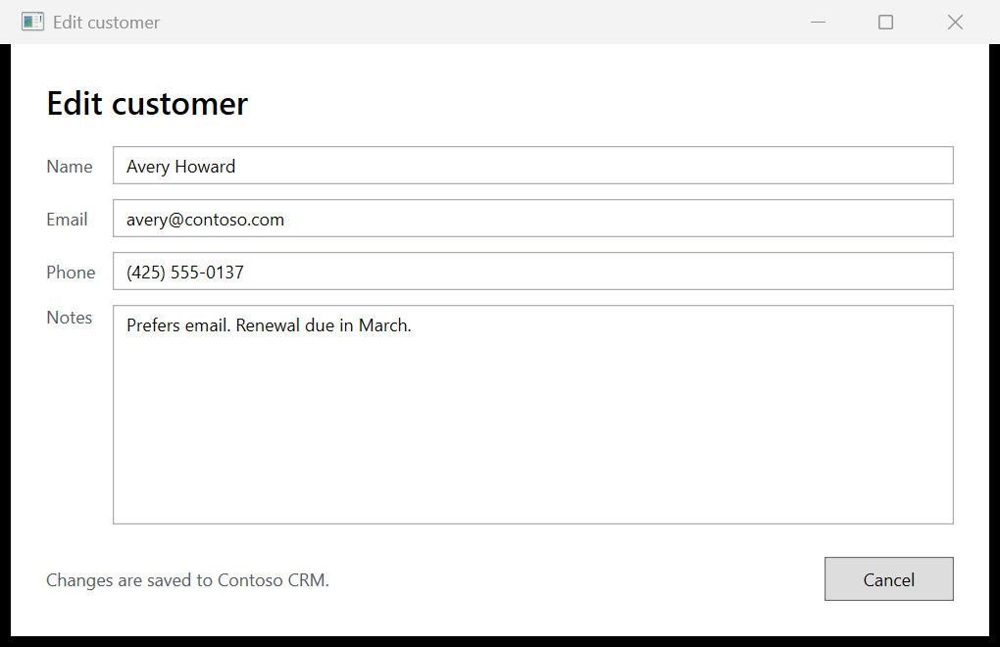
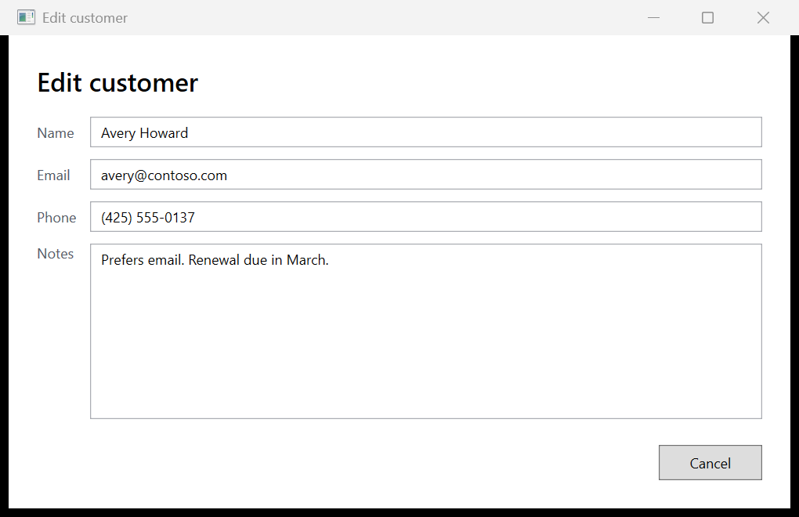
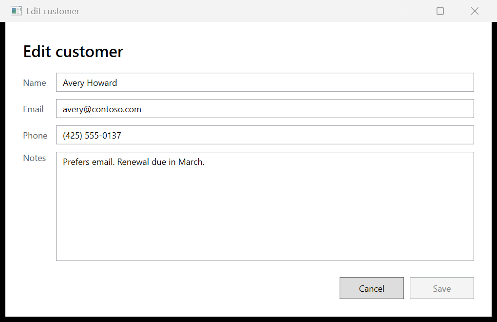
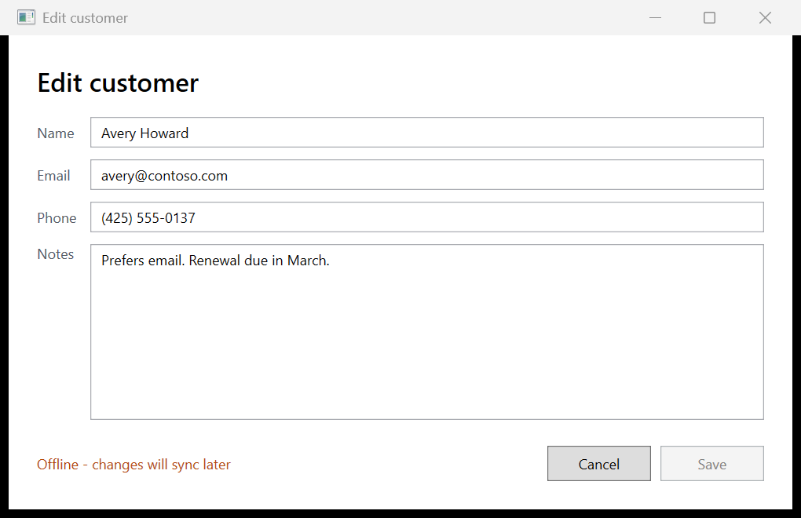
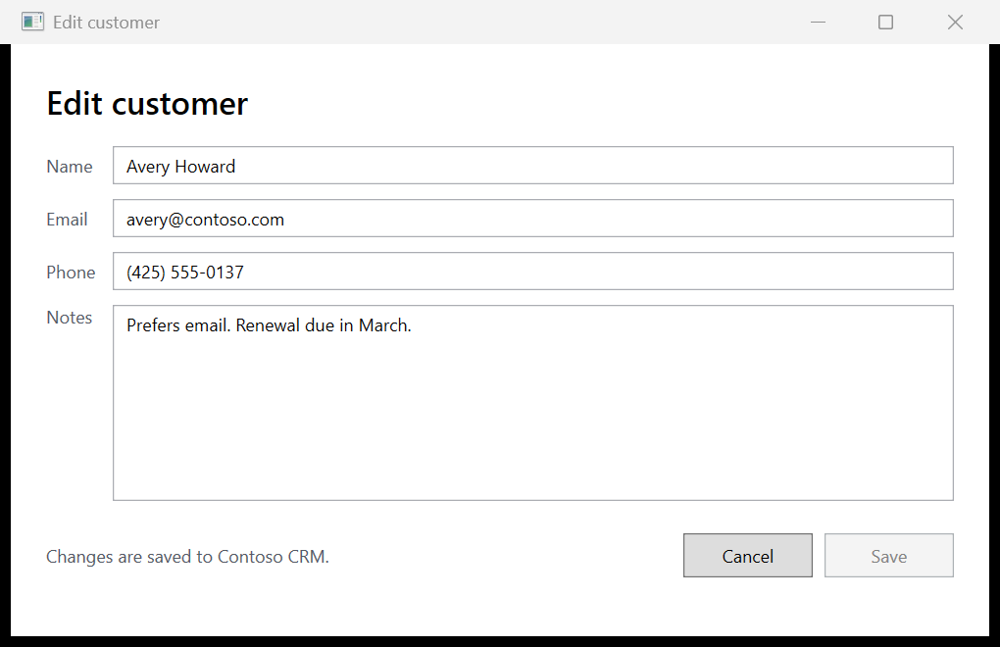
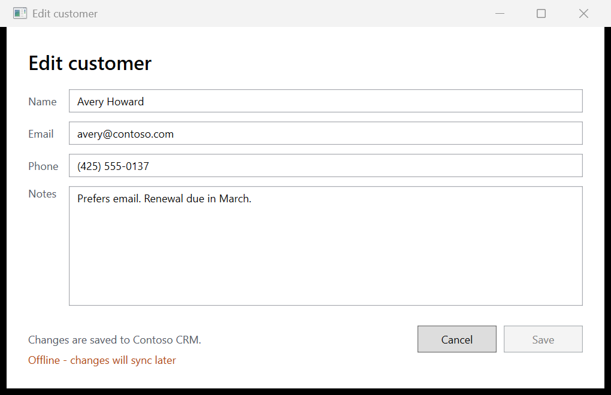

# Session transcript

Source: `Q:\source\XamlAgentDemos-notes\test-runs\VanishingSave\run1\events.jsonl`

## Tool usage

- xaml_capture_image: 8
- xaml_find_elements: 7
- xaml_get_element_properties: 7
- xaml_get_element_bounds: 6
- get_file: 6
- xaml_get_binding_failures: 5
- rg: 5
- multi_replace_string_in_file: 4
- xaml_apply_hot_reload: 4
- xaml_set_element_property: 4
- powershell: 3
- view: 3
- xaml_get_visual_tree: 2
- xaml_explain_property_value: 2
- xaml_clear_binding_failures: 2
- xaml_get_hot_reload_log: 2
- skill: 1
- xaml_list_apps: 1
- xaml_get_element_styles: 1
- remove_file: 1
- xaml_get_hot_reload_status: 1
- task_complete: 1

Failed tool calls: 0, images: 6


_Model: gpt-6-luna_


## User (00:47:42)

There should be a Save button in the footer of my running app, but I can't see it. Find out every reason it's not visible and fix them.


**Tool call (00:47:45):** `skill`
```json
{
 "skill": "xaml-diagnostics"
}
```

<details><summary>Result `skill` success=true</summary>

```
Skill "xaml-diagnostics" loaded successfully. Follow the instructions in the skill context.
```
</details>


_Skill invoked: xaml-diagnostics_


**Tool call (00:47:48):** `xaml_list_apps`
```json
{
 "progressMessage": "Inspecting connected XAML apps"
}
```

<details><summary>Result `xaml_list_apps` success=true</summary>

```
{"isDebugging":true,"diagnosticsActive":true,"apps":[{"app":"a1","name":"VanishingSave.exe [58524]","processId":58524,"platform":"WPF (.NET)","isRemote":false,"isDesignTimeOrNoDebug":false,"sourceInfoAvailable":true,"hotReloadSupported":true,"hotReloadEnabled":true,"supportsPropertyExplorer":true,"supportsInAppToolbar":true,"windowCount":1}]}
```
</details>


**Tool call (00:47:54):** `xaml_find_elements`
```json
{
 "progressMessage": "Finding the Save control",
 "app": "a1",
 "type": "Button",
 "name": "Save",
 "maxResults": 50
}
```


**Tool call (00:47:54):** `xaml_capture_image`
```json
{
 "progressMessage": "Capturing the running window",
 "app": "a1",
 "maxSize": 1280
}
```


**Tool call (00:47:54):** `xaml_get_visual_tree`
```json
{
 "progressMessage": "Inspecting footer layout tree",
 "app": "a1",
 "depth": 7,
 "maxNodes": 500
}
```

<details><summary>Result `xaml_find_elements` success=true</summary>

```
{"count":1,"truncated":false,"results":[{"id":"a1:10","type":"System.Windows.Controls.Button","name":"SaveButton","source":{"file":"Q:\\source\\XamlAgentDemos\\src\\VanishingSave\\MainWindow.xaml","line":118,"column":14},"path":"MainWindow/Border/AdornerDecorator/ContentPresenter/Grid/Grid/Button"}]}
```
</details>

<details><summary>Result `xaml_get_visual_tree` success=true</summary>

```
{"app":"a1","platform":"WPF (.NET)","sourceInfoAvailable":true,"nodeCount":21,"truncated":false,"nodes":[{"id":"a1:11","type":"VanishingSave.MainWindow","source":{"file":"Q:\\source\\XamlAgentDemos\\src\\VanishingSave\\MainWindow.xaml","line":4,"column":9},"childCount":1,"children":[{"id":"a1:12","type":"System.Windows.Controls.Border","childCount":1,"children":[{"id":"a1:13","type":"System.Windows.Documents.AdornerDecorator","childCount":2,"children":[{"id":"a1:14","type":"System.Windows.Controls.ContentPresenter","childCount":1,"children":[{"id":"a1:16","type":"System.Windows.Controls.Grid","source":{"file":"Q:\\source\\XamlAgentDemos\\src\\VanishingSave\\MainWindow.xaml","line":40,"column":6},"childCount":3,"children":[{"id":"a1:17","type":"System.Windows.Controls.TextBlock","source":{"file":"Q:\\source\\XamlAgentDemos\\src\\VanishingSave\\MainWindow.xaml","line":47,"column":10},"childCount":0},{"id":"a1:18","type":"System.Windows.Controls.Grid","source":{"file":"Q:\\source\\XamlAgentDemos\\src\\VanishingSave\\MainWindow.xaml","line":52,"column":10},"childCount":8,"children":[{"id":"a1:20","type":"System.Windows.Controls.TextBlock","source":{"file":"Q:\\source\\XamlAgentDemos\\src\\VanishingSave\\MainWindow.xaml","line":64,"column":14},"childCount":0},{"id":"a1:21","type":"System.Windows.Controls.TextBox","name":"NameBox","source":{"file":"Q:\\source\\XamlAgentDemos\\src\\VanishingSave\\MainWindow.xaml","line":65,"column":14},"childCount":1},{"id":"a1:22","type":"System.Windows.Controls.TextBlock","source":{"file":"Q:\\source\\XamlAgentDemos\\src\\VanishingSave\\MainWindow.xaml","line":71,"column":14},"childCount":0},{"id":"a1:23","type":"System.Windows.Controls.TextBox","name":"EmailBox","source":{"file":"Q:\\source\\XamlAgentDemos\\src\\VanishingSave\\MainWindow.xaml","line":72,"column":14},"childCount":1},{"id":"a1:24","type":"System.Windows.Controls.TextBlock","source":{"file":"Q:\\source\\XamlAgentDemos\\src\\VanishingSave\\MainWindow.xaml","line":79,"column":14},"childCount":0},{"id":"a1:25","type":"System.Windows.Controls.TextBox","name":"PhoneBox","source":{"file":"Q:\\source\\XamlAgentDemos\\src\\VanishingSave\\MainWindow.xaml","line":80,"column":14},"childCount":1},{"id":"a1:26","type":"System.Windows.Controls.TextBlock","source":{"file":"Q:\\source\\XamlAgentDemos\\src\\VanishingSave\\MainWindow.xaml","line":87,"column":14},"childCount":0},{"id":"a1:27","type":"System.Windows.Controls.TextBox","name":"NotesBox","source":{"file":"Q:\\source\\X
... [truncated 1162 chars]
```
</details>




<details><summary>Result `xaml_capture_image` success=true</summary>

```
Screenshot of window 0xA30F8E "Edit customer" of app a1 (1020x660).
```
</details>


**Assistant (00:47:59):**

The Save control exists in the live tree; I’m tracing its layout, visibility, and footer interactions to identify each cause.


**Tool call (00:47:59):** `xaml_get_element_properties`
```json
{
 "progressMessage": "Inspecting Save button state",
 "elementId": "a1:10",
 "includeAll": true
}
```


**Tool call (00:47:59):** `xaml_get_element_properties`
```json
{
 "progressMessage": "Inspecting footer layout values",
 "elementId": "a1:19",
 "includeAll": true
}
```


**Tool call (00:47:59):** `xaml_get_element_bounds`
```json
{
 "progressMessage": "Checking footer element bounds",
 "elementIds": [
  "a1:10",
  "a1:19",
  "a1:29",
  "a1:30"
 ]
}
```


**Tool call (00:47:59):** `get_file`
```json
{
 "filename": "Q:\\source\\XamlAgentDemos\\src\\VanishingSave\\MainWindow.xaml",
 "startLine": 1,
 "endLine": 160,
 "includeLineNumbers": true
}
```

<details><summary>Result `xaml_get_element_bounds` success=true</summary>

```
{"note":"'screen' is in physical screen pixels. 'window' is in device-independent units relative to the element's root window (multiply by dpiScale for pixels).","bounds":[{"id":"a1:10","isVisible":false,"windowHandle":"0xA30F8E","dpiScale":1.5,"screen":{"x":503.0,"y":1024.0,"width":0.0,"height":0.0},"window":{"x":24.0,"y":348.7,"width":0.0,"height":0.0}},{"id":"a1:19","isVisible":true,"windowHandle":"0xA30F8E","dpiScale":1.5,"screen":{"x":503.0,"y":1024.0,"width":926.0,"height":45.0},"window":{"x":24.0,"y":348.7,"width":617.3,"height":30.0}},{"id":"a1:29","isVisible":true,"windowHandle":"0xA30F8E","dpiScale":1.5,"screen":{"x":1297.0,"y":1024.0,"width":132.0,"height":45.0},"window":{"x":553.3,"y":348.7,"width":88.0,"height":30.0}},{"id":"a1:30","isVisible":true,"windowHandle":"0xA30F8E","dpiScale":1.5,"screen":{"x":1429.0,"y":1024.0,"width":0.0,"height":45.0},"window":{"x":641.3,"y":348.7,"width":0.0,"height":30.0}}]}
```
</details>

<details><summary>Result `xaml_get_element_properties` success=true</summary>

```
Output too large to read at once (22.7 KB). Saved to: C:\Users\peterspa\AppData\Local\Microsoft\VisualStudio\CopilotCli\cbfd1710-c98a-474a-aa79-af9a9f9a28a7\temp\1794617279880-copilot-tool-output-f7c543c01f924c5da146ad356fe4af70.txt
Consider using tools like rg (for searching), head/tail (for viewing start/end), view with view_range (for specific sections), or jq (for JSON) to examine portions of the output.

Preview (first 500 chars):
{"id":"a1:19","type":"System.Windows.Controls.Grid","name":"Footer","source":{"file":"Q:\\source\\XamlAgentDemos\\src\\VanishingSave\\MainWindow.xaml","line":101,"column":10},"properties":[{"name":"Row","value":"2","valueType":"System.Int32","propertyType":"System.Int32","declaringType":"System.Windows.Controls.Grid","valueSource":"Local","valueSourceLocation":{"file":"Q:\\source\\XamlAgentDemos\\src\\VanishingSave\\MainWindow.xaml","line":101,"column":10}},{"name":"ColumnDefinitions","valueType
```
</details>

<details><summary>Result `xaml_get_element_properties` success=true</summary>

```
Output too large to read at once (28.9 KB). Saved to: C:\Users\peterspa\AppData\Local\Microsoft\VisualStudio\CopilotCli\cbfd1710-c98a-474a-aa79-af9a9f9a28a7\temp\1794617279941-copilot-tool-output-2dbbe60a678346398c7eee908bd18adc.txt
Consider using tools like rg (for searching), head/tail (for viewing start/end), view with view_range (for specific sections), or jq (for JSON) to examine portions of the output.

Preview (first 500 chars):
{"id":"a1:10","type":"System.Windows.Controls.Button","name":"SaveButton","source":{"file":"Q:\\source\\XamlAgentDemos\\src\\VanishingSave\\MainWindow.xaml","line":118,"column":14},"properties":[{"name":"IsEnabled","value":"False","valueType":"System.Boolean","propertyType":"System.Boolean","declaringType":"System.Windows.UIElement","valueSource":"Coercion"},{"name":"IsDefault","value":"True","valueType":"System.Boolean","propertyType":"System.Boolean","declaringType":"System.Windows.Controls.Bu
```
</details>

<details><summary>Result `get_file` success=true</summary>

```
```xaml src\VanishingSave\MainWindow.xaml (Lines 1-138 of 138 total. Call tools for more if needed.)
1: <Window x:Class="VanishingSave.MainWindow"
2:         xmlns="http://schemas.microsoft.com/winfx/2006/xaml/presentation"
3:         xmlns:x="http://schemas.microsoft.com/winfx/2006/xaml"
4:         xmlns:local="clr-namespace:VanishingSave"
5:         Title="Edit customer"
6:         Width="680"
7:         Height="440"
8:         Background="White">
9:     <Window.DataContext>
10:         <local:CustomerViewModel />
11:     </Window.DataContext>
12: 
13:     <Window.Resources>
14:         <BooleanToVisibilityConverter x:Key="BoolToVisibility" />
15: 
16:         <Style x:Key="FieldLabelStyle" TargetType="TextBlock">
17:             <Setter Property="Margin" Value="0,0,12,10" />
18:             <Setter Property="VerticalAlignment" Value="Center" />
19:             <Setter Property="Foreground" Value="#555B66" />
20:         </Style>
21: 
22:         <Style x:Key="FieldStyle" TargetType="TextBox">
23:             <Setter Property="Margin" Value="0,0,0,10" />
24:             <Setter Property="Padding" Value="6,4" />
25:         </Style>
26: 
27:         <Style x:Key="FooterButtonStyle" TargetType="Button">
28:             <Setter Property="MinWidth" Value="88" />
29:             <Setter Property="Margin" Value="8,0,0,0" />
30:             <Setter Property="Padding" Value="16,6" />
31:             <Style.Triggers>
32:                 <!-- Fade out buttons that can't be used yet. -->
33:                 <Trigger Property="IsEnabled" Value="False">
34:                     <Setter Property="Opacity" Value="0" />
35:                 </Trigger>
36:             </Style.Triggers>
37:         </Style>
38:     </Window.Resources>
39: 
40:     <Grid Margin="24">
41:         <Grid.RowDefinitions>
42:             <RowDefinition Height="Auto" />
43:             <RowDefinition Height="*" />
44:             <RowDefinition Height="Auto" />
45:         </Grid.RowDefinitions>
46: 
47:         <TextBlock Margin="0,0,0,16"
48:                    FontSize="22"
49:                    FontWeight="SemiBold"
50:                    Text="Edit customer" />
51: 
52:         <Grid Grid.Row="1">
53:             <Grid.ColumnDefinitions>
54:                 <ColumnDefinition Width="Auto" />
55:                 <ColumnDefinition Width="*" />
56:             </Grid.ColumnDefinitions>
57:             <Grid.RowDefinitions>
58:            
... [truncated 3995 chars]
```
</details>


**Tool call (00:48:07):** `xaml_explain_property_value`
```json
{
 "progressMessage": "Tracing Save visibility binding",
 "elementId": "a1:10",
 "propertyName": "Visibility"
}
```


**Tool call (00:48:07):** `xaml_explain_property_value`
```json
{
 "progressMessage": "Tracing Save opacity source",
 "elementId": "a1:10",
 "propertyName": "Opacity"
}
```


**Tool call (00:48:07):** `xaml_get_element_styles`
```json
{
 "progressMessage": "Inspecting applied button style",
 "elementId": "a1:10"
}
```


**Tool call (00:48:07):** `xaml_get_binding_failures`
```json
{
 "progressMessage": "Checking runtime binding failures",
 "textFilter": "Save",
 "maxResults": 50
}
```


**Tool call (00:48:07):** `rg`
```json
{
 "pattern": "CanSave|class CustomerViewModel|SaveCommand",
 "paths": "Q:\\source\\XamlAgentDemos\\src\\VanishingSave",
 "output_mode": "content",
 "-n": true,
 "head_limit": 100
}
```

<details><summary>Result `xaml_get_binding_failures` success=true</summary>

```
{"note":"This is a cumulative log since debugging started or the last xaml_clear_binding_failures, not live state: fixed failures stay listed. To verify a fix: clear, revisit the UI that uses the binding, then read again. Failures without a file usually come from bindings created in code.","totalUnique":1,"matched":1,"truncated":false,"failures":[{"severity":"Warning","count":1,"errorCode":"40","description":"CanSave property not found on object of type CustomerViewModel.","bindingPath":"CanSave","target":"Button.Visibility, Name='SaveButton'","targetName":"SaveButton","targetPropertyType":"Visibility","dataContextType":"CustomerViewModel","file":"Q:\\source\\XamlAgentDemos\\src\\VanishingSave\\MainWindow.xaml","line":118,"column":14,"project":"VanishingSave","originalError":"System.Windows.Data Warning: 40 : BindingExpression path error: 'CanSave' property not found on 'object' ''CustomerViewModel' (HashCode=30479632)'. BindingExpression:Path=CanSave; DataItem='CustomerViewModel' (HashCode=30479632); target element is 'Button' (Name='SaveButton'); target property is 'Visibility' (type 'Visibility')"}]}
```
</details>

<details><summary>Result `xaml_explain_property_value` success=true</summary>

```
{"id":"a1:10","type":"System.Windows.Controls.Button","property":"Opacity","propertyType":"System.Double","effectiveValue":"0","effectiveSource":"StyleTrigger","chain":[{"kind":"StyleTrigger","description":"Trigger in the element's Style whose condition is currently true.","value":"0","valueType":"System.Double","effective":true},{"kind":"Default","description":"The property's default value; nothing sets it.","value":"1","valueType":"System.Double","effective":false}],"notes":["Edit the setter or trigger at the source location, or set a local value to override it for this element only."]}
```
</details>

<details><summary>Result `xaml_explain_property_value` success=true</summary>

```
{"id":"a1:10","type":"System.Windows.Controls.Button","property":"Visibility","propertyType":"System.Windows.Visibility","effectiveSource":"Local","chain":[{"kind":"Local","description":"Local value set on the element (XAML attribute, binding or code). Wins over styles, templates and inheritance.","valueType":"System.Windows.Data.BindingExpression","isBinding":true,"effective":true,"sourceLocation":{"file":"Q:\\source\\XamlAgentDemos\\src\\VanishingSave\\MainWindow.xaml","line":118,"column":14}},{"kind":"Default","description":"The property's default value; nothing sets it.","value":"0","valueType":"System.Windows.Visibility","effective":false}],"notes":["To let a style or template value apply, remove the local value (the attribute, binding or code assignment). To change it, edit that local value.","The effective value comes from a binding. If it's wrong, check xaml_get_binding_failures and the DataContext."]}
```
</details>

<details><summary>Result `xaml_get_element_styles` success=true</summary>

```
{"id":"a1:10","type":"System.Windows.Controls.Button","name":"SaveButton","source":{"file":"Q:\\source\\XamlAgentDemos\\src\\VanishingSave\\MainWindow.xaml","line":118,"column":14},"styleProperty":{"value":"System.Windows.Style","valueSource":"Local","location":{"file":"Q:\\source\\XamlAgentDemos\\src\\VanishingSave\\MainWindow.xaml","line":118,"column":14}},"templateProperty":{"value":"System.Windows.Controls.ControlTemplate","valueSource":"BuiltInStyle"},"styles":[{"kind":"StyleTrigger","description":"Trigger in the element's Style whose condition is currently true.","setters":[{"property":"Opacity","value":"0","effective":true}]},{"kind":"TemplateTrigger","description":"Trigger in the element's own ControlTemplate whose condition is currently true.","setters":[{"property":"Foreground","value":"#FF838383","effective":true}]},{"kind":"Style","description":"Setter in an explicit (x:Key) or implicit (TargetType) Style.","targetType":"System.Windows.Controls.Button","location":{"file":"Q:\\source\\XamlAgentDemos\\src\\VanishingSave\\MainWindow.xaml","line":27,"column":10},"setters":[{"property":"Margin","value":"8,0,0,0","effective":true},{"property":"MinWidth","value":"88","effective":true},{"property":"Padding","value":"16,6,16,6","effective":true}]},{"kind":"BuiltInStyle","description":"Setter in the control's default theme style (generic.xaml or the platform theme).","targetType":"System.Windows.Controls.Primitives.ButtonBase","setters":[{"property":"Background","value":"#FFDDDDDD","effective":true},{"property":"BorderBrush","value":"#FF707070","effective":true},{"property":"BorderThickness","value":"1,1,1,1","effective":true},{"property":"FocusVisualStyle","value":"System.Windows.Style","effective":true},{"property":"Foreground","effective":false,"overriddenBy":"TemplateTrigger"},{"property":"HorizontalContentAlignment","value":"1","effective":true},{"property":"Padding","value":"1,1,1,1","effective":false,"overriddenBy":"Style (System.Windows.Controls.Button)"},{"property":"Template","value":"System.Windows.Controls.ControlTemplate","effective":true},{"property":"VerticalContentAlignment","value":"1","effective":true}]}],"hint":"Styles are listed in precedence order, highest first. 'effective=false' setters lose to 'overriddenBy'. Use xaml_find_resource to see where a style or resource key resolves."}
```
</details>

<details><summary>Result `rg` success=true</summary>

```
Q:\source\XamlAgentDemos\src\VanishingSave\CustomerViewModel.cs:3:public sealed class CustomerViewModel : ObservableObject
Q:\source\XamlAgentDemos\src\VanishingSave\CustomerViewModel.cs:13:        this.SaveCommand = new RelayCommand(this.Save, () => this.IsDirty);
Q:\source\XamlAgentDemos\src\VanishingSave\CustomerViewModel.cs:30:    public RelayCommand SaveCommand { get; }
Q:\source\XamlAgentDemos\src\VanishingSave\MainWindow.xaml:120:                    Command="{Binding SaveCommand}"
Q:\source\XamlAgentDemos\src\VanishingSave\MainWindow.xaml:124:                    Visibility="{Binding CanSave, Converter={StaticResource BoolToVisibility}, FallbackValue=Collapsed}" />
```
</details>


**Tool call (00:48:11):** `get_file`
```json
{
 "filename": "Q:\\source\\XamlAgentDemos\\src\\VanishingSave\\CustomerViewModel.cs",
 "startLine": 1,
 "endLine": 240,
 "includeLineNumbers": true
}
```

<details><summary>Result `get_file` success=true</summary>

```
```csharp src\VanishingSave\CustomerViewModel.cs (Lines 1-35 of 35 total. Call tools for more if needed.)
1: namespace VanishingSave;
2: 
3: public sealed class CustomerViewModel : ObservableObject
4: {
5:     private string name = "Avery Howard";
6:     private string email = "avery@contoso.com";
7:     private string phone = "(425) 555-0137";
8:     private string notes = "Prefers email. Renewal due in March.";
9:     private bool isDirty;
10: 
11:     public CustomerViewModel()
12:     {
13:         this.SaveCommand = new RelayCommand(this.Save, () => this.IsDirty);
14:         this.CancelCommand = new RelayCommand(() => this.IsDirty = false);
15:     }
16: 
17:     public string Name { get => this.name; set { if (this.SetProperty(ref this.name, value)) this.IsDirty = true; } }
18: 
19:     public string Email { get => this.email; set { if (this.SetProperty(ref this.email, value)) this.IsDirty = true; } }
20: 
21:     public string Phone { get => this.phone; set { if (this.SetProperty(ref this.phone, value)) this.IsDirty = true; } }
22: 
23:     public string Notes { get => this.notes; set { if (this.SetProperty(ref this.notes, value)) this.IsDirty = true; } }
24: 
25:     public bool IsDirty { get => this.isDirty; set => this.SetProperty(ref this.isDirty, value); }
26: 
27:     /// <summary>Whether the current user is allowed to save customer records.</summary>
28:     public bool IsSaveAvailable => true;
29: 
30:     public RelayCommand SaveCommand { get; }
31: 
32:     public RelayCommand CancelCommand { get; }
33: 
34:     private void Save() => this.IsDirty = false;
35: }

```


```
</details>


**Tool call (00:48:29):** `rg`
```json
{
 "pattern": "SyncStatusHost|SyncStatusText|IsSaveAvailable|CanSave|Offline - changes",
 "paths": "Q:\\source\\XamlAgentDemos\\src\\VanishingSave",
 "output_mode": "content",
 "-n": true,
 "head_limit": 100
}
```


**Tool call (00:48:29):** `rg`
```json
{
 "pattern": "class RelayCommand|class ObservableObject|IsEnabled|CanExecute",
 "paths": "Q:\\source\\XamlAgentDemos\\src\\VanishingSave",
 "output_mode": "content",
 "-n": true,
 "head_limit": 100
}
```


**Tool call (00:48:29):** `powershell`
```json
{
 "command": "git status --short",
 "description": "Check for existing workspace changes"
}
```

<details><summary>Result `rg` success=true</summary>

```
Q:\source\XamlAgentDemos\src\VanishingSave\MainWindow.xaml:33:                <Trigger Property="IsEnabled" Value="False">
```
</details>

<details><summary>Result `rg` success=true</summary>

```
Q:\source\XamlAgentDemos\src\VanishingSave\CustomerViewModel.cs:28:    public bool IsSaveAvailable => true;
Q:\source\XamlAgentDemos\src\VanishingSave\MainWindow.xaml:124:                    Visibility="{Binding CanSave, Converter={StaticResource BoolToVisibility}, FallbackValue=Collapsed}" />
Q:\source\XamlAgentDemos\src\VanishingSave\MainWindow.xaml:126:            <!-- Shows "Offline - changes will sync later" when the connection drops. -->
Q:\source\XamlAgentDemos\src\VanishingSave\MainWindow.xaml:127:            <Border x:Name="SyncStatusHost"
Q:\source\XamlAgentDemos\src\VanishingSave\MainWindow.xaml:131:                <TextBlock x:Name="SyncStatusText"
```
</details>

<details><summary>Result `powershell` success=true</summary>

```

<shellId: 0 completed with exit code 0>
```
</details>


**Assistant (00:48:50):**

I found three independent blockers: a missing visibility-binding property, a style that makes disabled buttons fully transparent, and an overlay sharing Save’s grid cell. I’m correcting all three in the source.


**Tool call (00:48:50):** `multi_replace_string_in_file`
```json
{
 "explanation": "Restore the visibility binding, retain a visible disabled state, and keep the sync-status overlay out of the Save cell.",
 "replacements": [
  {
   "filePath": "src\\VanishingSave\\MainWindow.xaml",
   "oldString": "            <Setter Property=\"MinWidth\" Value=\"88\" />\n            <Setter Property=\"Margin\" Value=\"8,0,0,0\" />\n            <Setter Property=\"Padding\" Value=\"16,6\" />\n            <Style.Triggers>\n                <!-- Fade out buttons that can't be used yet. -->\n                <Trigger Property=\"IsEnabled\" Value=\"False\">\n                    <Setter Property=\"Opacity\" Value=\"0\" />\n                </Trigger>\n            </Style.Triggers>\n        </Style>\n    </Window.Resources>",
   "newString": "            <Setter Property=\"MinWidth\" Value=\"88\" />\n            <Setter Property=\"Margin\" Value=\"8,0,0,0\" />\n            <Setter Property=\"Padding\" Value=\"16,6\" />\n        </Style>\n    </Window.Resources>",
   "explanation": "Remove the style trigger that made all disabled footer buttons fully transparent."
  },
  {
   "filePath": "src\\VanishingSave\\MainWindow.xaml",
   "oldString": "            <Button x:Name=\"SaveButton\"\n                    Grid.Column=\"2\"\n                    Command=\"{Binding SaveCommand}\"\n                    Content=\"Save\"\n                    IsDefault=\"True\"\n                    Style=\"{StaticResource FooterButtonStyle}\"\n                    Visibility=\"{Binding CanSav
... [truncated 1179 chars]
```

<details><summary>Result `multi_replace_string_in_file` success=true</summary>

```
Successfully applied 2 of 2 replacement(s) across 1 file(s).
```
</details>


**Tool call (00:48:59):** `xaml_clear_binding_failures`
```json
{
 "progressMessage": "Resetting old binding diagnostics"
}
```

<details><summary>Result `xaml_clear_binding_failures` success=true</summary>

```
{"cleared":1}
```
</details>


**Tool call (00:53:34):** `xaml_apply_hot_reload`
```json
{
 "progressMessage": "Applying the footer XAML fixes",
 "includeCodeChanges": false
}
```

<details><summary>Result `xaml_apply_hot_reload` success=true</summary>

```
{"applied":true,"errors":[],"log":[],"hint":"Call xaml_capture_image to verify the change visually. Views that aren't loaded (other tabs, closed dialogs) are updated when they're next shown."}
```
</details>


**Tool call (00:54:05):** `xaml_capture_image`
```json
{
 "progressMessage": "Verifying the updated footer",
 "app": "a1",
 "maxSize": 1280
}
```


**Tool call (00:54:05):** `xaml_get_element_properties`
```json
{
 "progressMessage": "Verifying Save button visibility",
 "elementId": "a1:10",
 "nameFilter": "Visibility"
}
```


**Tool call (00:54:05):** `xaml_get_element_bounds`
```json
{
 "progressMessage": "Confirming Save button bounds",
 "elementIds": [
  "a1:10",
  "a1:19",
  "a1:29",
  "a1:30"
 ]
}
```


**Tool call (00:54:05):** `xaml_get_binding_failures`
```json
{
 "progressMessage": "Verifying footer bindings",
 "maxResults": 50
}
```

<details><summary>Result `xaml_get_binding_failures` success=true</summary>

```
{"note":"This is a cumulative log since debugging started or the last xaml_clear_binding_failures, not live state: fixed failures stay listed. To verify a fix: clear, revisit the UI that uses the binding, then read again. Failures without a file usually come from bindings created in code.","totalUnique":0,"matched":0,"truncated":false,"failures":[]}
```
</details>

<details><summary>Result `xaml_get_element_properties` success=true</summary>

```
{"id":"a1:10","type":"System.Windows.Controls.Button","name":"SaveButton","source":{"file":"Q:\\source\\XamlAgentDemos\\src\\VanishingSave\\MainWindow.xaml","line":118,"column":14},"properties":[{"name":"Visibility","valueType":"System.Windows.Data.BindingExpression","propertyType":"System.Windows.Visibility","declaringType":"System.Windows.UIElement","valueSource":"Local","valueSourceLocation":{"file":"Q:\\source\\XamlAgentDemos\\src\\VanishingSave\\MainWindow.xaml","line":118,"column":14},"isBinding":true}],"hiddenDefaultOrOverridden":1,"hint":"Default and overridden values were omitted. Pass includeAll=true to see them, or call xaml_explain_property_value for one property's full precedence chain."}
```
</details>

<details><summary>Result `xaml_get_element_bounds` success=true</summary>

```
{"note":"'screen' is in physical screen pixels. 'window' is in device-independent units relative to the element's root window (multiply by dpiScale for pixels).","bounds":[{"id":"a1:10","isVisible":true,"windowHandle":"0xA30F8E","dpiScale":1.5,"screen":{"x":1441.0,"y":1024.0,"width":132.0,"height":45.0},"window":{"x":649.3,"y":348.7,"width":88.0,"height":30.0}},{"id":"a1:19","isVisible":true,"windowHandle":"0xA30F8E","dpiScale":1.5,"screen":{"x":503.0,"y":1024.0,"width":926.0,"height":45.0},"window":{"x":24.0,"y":348.7,"width":617.3,"height":30.0}},{"id":"a1:29","isVisible":true,"windowHandle":"0xA30F8E","dpiScale":1.5,"screen":{"x":1297.0,"y":1024.0,"width":132.0,"height":45.0},"window":{"x":553.3,"y":348.7,"width":88.0,"height":30.0}},{"id":"a1:30","isVisible":true,"windowHandle":"0xA30F8E","dpiScale":1.5,"screen":{"x":503.0,"y":1024.0,"width":782.0,"height":45.0},"window":{"x":24.0,"y":348.7,"width":521.3,"height":30.0}}]}
```
</details>




<details><summary>Result `xaml_capture_image` success=true</summary>

```
Screenshot of window 0xA30F8E "Edit customer" of app a1 (1020x660).
```
</details>


**Tool call (00:54:36):** `xaml_get_element_properties`
```json
{
 "progressMessage": "Inspecting footer column sizing",
 "elementId": "a1:19",
 "nameFilter": "ColumnDefinitions",
 "includeAll": true
}
```


**Tool call (00:54:36):** `xaml_get_element_properties`
```json
{
 "progressMessage": "Checking Save size and enabled state",
 "elementId": "a1:10",
 "nameFilter": "Width",
 "includeAll": true
}
```


**Tool call (00:54:36):** `xaml_get_element_properties`
```json
{
 "progressMessage": "Inspecting window content dimensions",
 "elementId": "a1:11",
 "nameFilter": "Width",
 "includeAll": true
}
```


**Tool call (00:54:36):** `rg`
```json
{
 "pattern": "SaveColumn|ColumnDefinitions|ActualWidth|Width\\s*=",
 "paths": "Q:\\source\\XamlAgentDemos\\src\\VanishingSave",
 "output_mode": "content",
 "-n": true,
 "head_limit": 100
}
```

<details><summary>Result `xaml_get_element_properties` success=true</summary>

```
{"id":"a1:10","type":"System.Windows.Controls.Button","name":"SaveButton","source":{"file":"Q:\\source\\XamlAgentDemos\\src\\VanishingSave\\MainWindow.xaml","line":118,"column":14},"properties":[{"name":"ActualWidth","value":"88","valueType":"System.Double","propertyType":"System.Double","declaringType":"System.Windows.FrameworkElement","valueSource":"Local","valueSourceLocation":{"file":"Q:\\source\\XamlAgentDemos\\src\\VanishingSave\\MainWindow.xaml","line":118,"column":14},"readOnly":true},{"name":"MinWidth","value":"88","valueType":"System.Double","propertyType":"System.Double","declaringType":"System.Windows.FrameworkElement","valueSource":"Style"},{"name":"ActualWidth","value":"0","valueType":"System.Double","propertyType":"System.Double","declaringType":"System.Windows.FrameworkElement","valueSource":"Default","readOnly":true,"overridden":true},{"name":"Width","value":"Auto","valueType":"System.Double","propertyType":"System.Double","declaringType":"System.Windows.FrameworkElement","valueSource":"Default"},{"name":"MinWidth","value":"0","valueType":"System.Double","propertyType":"System.Double","declaringType":"System.Windows.FrameworkElement","valueSource":"Default","overridden":true},{"name":"MaxWidth","value":"Infinity","valueType":"System.Double","propertyType":"System.Double","declaringType":"System.Windows.FrameworkElement","valueSource":"Default"}]}
```
</details>

<details><summary>Result `xaml_get_element_properties` success=true</summary>

```
{"id":"a1:11","type":"VanishingSave.MainWindow","source":{"file":"Q:\\source\\XamlAgentDemos\\src\\VanishingSave\\MainWindow.xaml","line":4,"column":9},"properties":[{"name":"ActualWidth","value":"680","valueType":"System.Double","propertyType":"System.Double","declaringType":"System.Windows.FrameworkElement","valueSource":"Local","valueSourceLocation":{"file":"Q:\\source\\XamlAgentDemos\\src\\VanishingSave\\MainWindow.xaml","line":4,"column":9},"readOnly":true},{"name":"Width","value":"680","valueType":"System.Double","propertyType":"System.Double","declaringType":"System.Windows.FrameworkElement","valueSource":"Local","valueSourceLocation":{"file":"Q:\\source\\XamlAgentDemos\\src\\VanishingSave\\MainWindow.xaml","line":4,"column":9}},{"name":"ActualWidth","value":"0","valueType":"System.Double","propertyType":"System.Double","declaringType":"System.Windows.FrameworkElement","valueSource":"Default","readOnly":true,"overridden":true},{"name":"Width","value":"Auto","valueType":"System.Double","propertyType":"System.Double","declaringType":"System.Windows.FrameworkElement","valueSource":"Default","overridden":true},{"name":"MinWidth","value":"0","valueType":"System.Double","propertyType":"System.Double","declaringType":"System.Windows.FrameworkElement","valueSource":"Default"},{"name":"MaxWidth","value":"Infinity","valueType":"System.Double","propertyType":"System.Double","declaringType":"System.Windows.FrameworkElement","valueSource":"Default"}]}
```
</details>

<details><summary>Result `xaml_get_element_properties` success=true</summary>

```
{"id":"a1:19","type":"System.Windows.Controls.Grid","name":"Footer","source":{"file":"Q:\\source\\XamlAgentDemos\\src\\VanishingSave\\MainWindow.xaml","line":101,"column":10},"properties":[{"name":"ColumnDefinitions","valueType":"System.Windows.Controls.ColumnDefinitionCollection","propertyType":"System.Windows.Controls.ColumnDefinitionCollection","declaringType":"System.Windows.Controls.Grid","valueSource":"Local","valueSourceLocation":{"file":"Q:\\source\\XamlAgentDemos\\src\\VanishingSave\\MainWindow.xaml","line":101,"column":10},"isCollection":true},{"name":"ColumnDefinitions","propertyType":"System.Windows.Controls.ColumnDefinitionCollection","declaringType":"System.Windows.Controls.Grid","valueSource":"Default","overridden":true}]}
```
</details>

<details><summary>Result `rg` success=true</summary>

```
Q:\source\XamlAgentDemos\src\VanishingSave\MainWindow.xaml:6:        Width="680"
Q:\source\XamlAgentDemos\src\VanishingSave\MainWindow.xaml:47:            <Grid.ColumnDefinitions>
Q:\source\XamlAgentDemos\src\VanishingSave\MainWindow.xaml:48:                <ColumnDefinition Width="Auto" />
Q:\source\XamlAgentDemos\src\VanishingSave\MainWindow.xaml:49:                <ColumnDefinition Width="*" />
Q:\source\XamlAgentDemos\src\VanishingSave\MainWindow.xaml:50:            </Grid.ColumnDefinitions>
Q:\source\XamlAgentDemos\src\VanishingSave\MainWindow.xaml:96:            <Grid.ColumnDefinitions>
Q:\source\XamlAgentDemos\src\VanishingSave\MainWindow.xaml:97:                <ColumnDefinition Width="*" />
Q:\source\XamlAgentDemos\src\VanishingSave\MainWindow.xaml:98:                <ColumnDefinition Width="Auto" />
Q:\source\XamlAgentDemos\src\VanishingSave\MainWindow.xaml:99:                <ColumnDefinition x:Name="SaveColumn" Width="Auto" />
Q:\source\XamlAgentDemos\src\VanishingSave\MainWindow.xaml:100:            </Grid.ColumnDefinitions>
Q:\source\XamlAgentDemos\src\VanishingSave\MainWindow.xaml.cs:17:            this.SaveColumn.Width = new GridLength(0);
```
</details>


**Tool call (00:54:39):** `get_file`
```json
{
 "filename": "Q:\\source\\XamlAgentDemos\\src\\VanishingSave\\MainWindow.xaml.cs",
 "startLine": 1,
 "endLine": 100,
 "includeLineNumbers": true
}
```

<details><summary>Result `get_file` success=true</summary>

```
```csharp src\VanishingSave\MainWindow.xaml.cs (Lines 1-20 of 20 total. Call tools for more if needed.)
1: using System.Windows;
2: 
3: namespace VanishingSave;
4: 
5: public partial class MainWindow : Window
6: {
7:     public MainWindow()
8:     {
9:         this.InitializeComponent();
10:         this.Loaded += this.OnLoaded;
11:     }
12: 
13:     private void OnLoaded(object sender, RoutedEventArgs e)
14:     {
15:         if (FooterSettings.UseCompactFooter)
16:         {
17:             this.SaveColumn.Width = new GridLength(0);
18:         }
19:     }
20: }

```


```
</details>


**Tool call (00:54:44):** `rg`
```json
{
 "pattern": "class FooterSettings|UseCompactFooter|FooterSettings",
 "paths": "Q:\\source\\XamlAgentDemos\\src\\VanishingSave",
 "output_mode": "content",
 "-n": true,
 "head_limit": 100
}
```

<details><summary>Result `rg` success=true</summary>

```
Q:\source\XamlAgentDemos\src\VanishingSave\FooterSettings.cs:3:public static class FooterSettings
Q:\source\XamlAgentDemos\src\VanishingSave\FooterSettings.cs:9:    public static bool UseCompactFooter { get; set; } = true;
Q:\source\XamlAgentDemos\src\VanishingSave\MainWindow.xaml.cs:15:        if (FooterSettings.UseCompactFooter)
```
</details>


**Tool call (00:54:49):** `get_file`
```json
{
 "filename": "Q:\\source\\XamlAgentDemos\\src\\VanishingSave\\FooterSettings.cs",
 "startLine": 1,
 "endLine": 80,
 "includeLineNumbers": true
}
```

<details><summary>Result `get_file` success=true</summary>

```
```csharp src\VanishingSave\FooterSettings.cs (Lines 1-10 of 10 total. Call tools for more if needed.)
1: namespace VanishingSave;
2: 
3: public static class FooterSettings
4: {
5:     /// <summary>
6:     /// Compact footer for small screens: auto-save makes the Save column unnecessary.
7:     /// (Auto-save was cut from v2, but this switch stayed on.)
8:     /// </summary>
9:     public static bool UseCompactFooter { get; set; } = true;
10: }

```


```
</details>


**Tool call (00:55:43):** `get_file`
```json
{
 "filename": "Q:\\source\\XamlAgentDemos\\src\\VanishingSave\\MainWindow.xaml",
 "startLine": 90,
 "endLine": 145,
 "includeLineNumbers": true
}
```

<details><summary>Result `get_file` success=true</summary>

```
```xaml src\VanishingSave\MainWindow.xaml (Lines 90-132 of 132 total. Call tools for more if needed.)
90:                      Style="{StaticResource FieldStyle}"
91:                      Text="{Binding Notes, UpdateSourceTrigger=PropertyChanged}"
92:                      TextWrapping="Wrap" />
93:         </Grid>
94: 
95:         <Grid x:Name="Footer" Grid.Row="2" Margin="0,12,0,0">
96:             <Grid.ColumnDefinitions>
97:                 <ColumnDefinition Width="*" />
98:                 <ColumnDefinition Width="Auto" />
99:                 <ColumnDefinition x:Name="SaveColumn" Width="Auto" />
100:             </Grid.ColumnDefinitions>
101: 
102:             <TextBlock VerticalAlignment="Center"
103:                        Foreground="#555B66"
104:                        Text="Changes are saved to Contoso CRM." />
105: 
106:             <Button x:Name="CancelButton"
107:                     Grid.Column="1"
108:                     Command="{Binding CancelCommand}"
109:                     Content="Cancel"
110:                     Style="{StaticResource FooterButtonStyle}" />
111: 
112:             <Button x:Name="SaveButton"
113:                     Grid.Column="2"
114:                     Command="{Binding SaveCommand}"
115:                     Content="Save"
116:                     IsDefault="True"
117:                     Style="{StaticResource FooterButtonStyle}"
118:                     Visibility="{Binding IsSaveAvailable, Converter={StaticResource BoolToVisibility}, FallbackValue=Collapsed}" />
119: 
120:             <!-- Shows "Offline - changes will sync later" when the connection drops. -->
121:             <Border x:Name="SyncStatusHost"
122:                     Grid.Column="0"
123:                     Panel.ZIndex="1"
124:                     Background="White">
125:                 <TextBlock x:Name="SyncStatusText"
126:                            VerticalAlignment="Center"
127:                            Foreground="#B54708"
128:                            Text="" />
129:             </Border>
130:         </Grid>
131:     </Grid>
132: </Window>

```


```
</details>


**Assistant (00:56:03):**

Hot Reload exposed a fourth blocker: startup code shrinks the Save column to zero by default, so the button is clipped outside the window. I’m removing that obsolete auto-save behavior and placing both footer actions in one layout group.


**Tool call (00:56:03):** `multi_replace_string_in_file`
```json
{
 "explanation": "Remove the obsolete compact-footer path and keep both actions within the footer's allocated width while preserving the previous visibility/style/status fixes.",
 "replacements": [
  {
   "filePath": "src\\VanishingSave\\MainWindow.xaml",
   "oldString": "                      TextWrapping=\"Wrap\" />\n        </Grid>\n \n        <Grid x:Name=\"Footer\" Grid.Row=\"2\" Margin=\"0,12,0,0\">\n            <Grid.ColumnDefinitions>\n                <ColumnDefinition Width=\"*\" />\n                <ColumnDefinition Width=\"Auto\" />\n                <ColumnDefinition x:Name=\"SaveColumn\" Width=\"Auto\" />\n            </Grid.ColumnDefinitions>\n\n            <TextBlock VerticalAlignment=\"Center\"\n                       Foreground=\"#555B66\"\n                       Text=\"Changes are saved to Contoso CRM.\" />\n\n            <Button x:Name=\"CancelButton\"\n                    Grid.Column=\"1\"\n                    Command=\"{Binding CancelCommand}\"\n                    Content=\"Cancel\"\n                    Style=\"{StaticResource FooterButtonStyle}\" />\n\n            <Button x:Name=\"SaveButton\"\n                    Grid.Column=\"2\"\n                    Command=\"{Binding SaveCommand}\"\n                    Content=\"Save\"\n                    IsDefault=\"True\"\n                    Style=\"{StaticResource FooterButtonStyle}\"\n                    Visibility=\"{Binding IsSaveAvailable, Converter={StaticResource BoolToVisibility}, FallbackValue=Collapsed
... [truncated 3241 chars]
```

<details><summary>Result `multi_replace_string_in_file` success=true</summary>

```
Successfully applied 2 of 2 replacement(s) across 2 file(s).
```
</details>


**Tool call (00:56:11):** `remove_file`
```json
{
 "filePath": "src\\VanishingSave\\FooterSettings.cs"
}
```

<details><summary>Result `remove_file` success=true</summary>

```
File removed at src\VanishingSave\FooterSettings.cs.
```
</details>


**Tool call (00:56:15):** `xaml_clear_binding_failures`
```json
{
 "progressMessage": "Resetting binding diagnostics"
}
```


**Tool call (00:56:15):** `xaml_get_hot_reload_status`
```json
{
 "progressMessage": "Checking Hot Reload readiness"
}
```

<details><summary>Result `xaml_get_hot_reload_status` success=true</summary>

```
{"options":{"hotReloadEnabled":true,"hotReloadOnSave":false,"wpfEnabled":true,"uwpEnabled":true,"winUIEnabled":true,"mauiEnabled":true,"justMyXaml":true,"previewSelectedElement":false,"inAppToolbar":true,"inAppSelection":false,"layoutAdorners":false,"trackFocusedElement":false,"bindingFailuresVisible":true,"compatibilityMode":false},"dotNetHotReloadEnabled":true,"isProcessingChanges":false,"apps":[{"app":"a1","platform":"WPF (.NET)","hotReloadSupported":true,"hotReloadEnabled":true,"sourceInfoAvailable":true}],"errors":[]}
```
</details>

<details><summary>Result `xaml_clear_binding_failures` success=true</summary>

```
{"cleared":0}
```
</details>


**Tool call (00:56:17):** `xaml_apply_hot_reload`
```json
{
 "progressMessage": "Updating the live footer layout",
 "includeCodeChanges": true
}
```

<details><summary>Result `xaml_apply_hot_reload` success=true</summary>

```
{"applied":true,"errors":[],"log":[],"codeChanges":".NET Hot Reload was started for saved code changes. Its results are in the Hot Reload output pane, not in 'log'; if an edit can't be hot reloaded, Visual Studio asks the user to rebuild and restart.","hint":"Call xaml_capture_image to verify the change visually. Views that aren't loaded (other tabs, closed dialogs) are updated when they're next shown."}
```
</details>


**Tool call (00:56:21):** `xaml_capture_image`
```json
{
 "progressMessage": "Checking the visible footer",
 "app": "a1",
 "maxSize": 1280
}
```


**Tool call (00:56:21):** `xaml_get_element_bounds`
```json
{
 "progressMessage": "Verifying button bounds in window",
 "elementIds": [
  "a1:10",
  "a1:29",
  "a1:19",
  "a1:30"
 ]
}
```


**Tool call (00:56:21):** `xaml_get_binding_failures`
```json
{
 "progressMessage": "Confirming bindings remain clean",
 "maxResults": 50
}
```


**Tool call (00:56:21):** `xaml_get_hot_reload_log`
```json
{
 "progressMessage": "Checking Hot Reload errors",
 "errorsOnly": true,
 "maxEntries": 50
}
```

<details><summary>Result `xaml_get_binding_failures` success=true</summary>

```
{"note":"This is a cumulative log since debugging started or the last xaml_clear_binding_failures, not live state: fixed failures stay listed. To verify a fix: clear, revisit the UI that uses the binding, then read again. Failures without a file usually come from bindings created in code.","totalUnique":0,"matched":0,"truncated":false,"failures":[]}
```
</details>

<details><summary>Result `xaml_get_hot_reload_log` success=true</summary>

```
{"total":0,"entries":[],"hint":"No XAML Hot Reload messages were logged in this VS session yet."}
```
</details>

<details><summary>Result `xaml_get_element_bounds` success=true</summary>

```
{"note":"'screen' is in physical screen pixels. 'window' is in device-independent units relative to the element's root window (multiply by dpiScale for pixels).","bounds":[{"id":"a1:10","error":"ELEMENT_GONE","message":"Element 'a1:10' no longer exists in the running app.","hint":"The visual tree changed. Call xaml_get_visual_tree or xaml_find_elements again to get fresh IDs."},{"id":"a1:29","error":"ELEMENT_GONE","message":"Element 'a1:29' no longer exists in the running app.","hint":"The visual tree changed. Call xaml_get_visual_tree or xaml_find_elements again to get fresh IDs."},{"id":"a1:19","isVisible":true,"windowHandle":"0xA30F8E","dpiScale":1.5,"screen":{"x":503.0,"y":1024.0,"width":926.0,"height":45.0},"window":{"x":24.0,"y":348.7,"width":617.3,"height":30.0}},{"id":"a1:30","isVisible":true,"windowHandle":"0xA30F8E","dpiScale":1.5,"screen":{"x":503.0,"y":1024.0,"width":638.0,"height":45.0},"window":{"x":24.0,"y":348.7,"width":425.3,"height":30.0}}]}
```
</details>




<details><summary>Result `xaml_capture_image` success=true</summary>

```
Screenshot of window 0xA30F8E "Edit customer" of app a1 (1020x660).
```
</details>


**Tool call (00:56:26):** `xaml_find_elements`
```json
{
 "progressMessage": "Refreshing footer element IDs",
 "app": "a1",
 "name": "SaveButton",
 "maxResults": 5
}
```

<details><summary>Result `xaml_find_elements` success=true</summary>

```
{"count":1,"truncated":false,"results":[{"id":"a1:146","type":"System.Windows.Controls.Button","name":"SaveButton","path":"MainWindow/Border/AdornerDecorator/ContentPresenter/Grid/Grid/StackPanel/Button"}]}
```
</details>


**Tool call (00:56:28):** `xaml_find_elements`
```json
{
 "progressMessage": "Finding the sync status text",
 "app": "a1",
 "name": "SyncStatusText",
 "maxResults": 5
}
```

<details><summary>Result `xaml_find_elements` success=true</summary>

```
{"count":1,"truncated":false,"results":[{"id":"a1:36","type":"System.Windows.Controls.TextBlock","name":"SyncStatusText","source":{"file":"Q:\\source\\XamlAgentDemos\\src\\VanishingSave\\MainWindow.xaml","line":131,"column":18},"path":"MainWindow/Border/AdornerDecorator/ContentPresenter/Grid/Grid/Border/TextBlock"}]}
```
</details>


**Tool call (00:56:34):** `xaml_find_elements`
```json
{
 "progressMessage": "Refreshing status host ID",
 "app": "a1",
 "name": "SyncStatusHost",
 "maxResults": 5
}
```


**Tool call (00:56:34):** `xaml_get_element_properties`
```json
{
 "progressMessage": "Confirming Save enabled state",
 "elementId": "a1:146",
 "nameFilter": "IsEnabled",
 "includeAll": true
}
```


**Tool call (00:56:34):** `xaml_get_element_bounds`
```json
{
 "progressMessage": "Checking Save stays in window",
 "elementIds": [
  "a1:146"
 ]
}
```

<details><summary>Result `xaml_find_elements` success=true</summary>

```
{"count":1,"truncated":false,"results":[{"id":"a1:30","type":"System.Windows.Controls.Border","name":"SyncStatusHost","source":{"file":"Q:\\source\\XamlAgentDemos\\src\\VanishingSave\\MainWindow.xaml","line":127,"column":14},"path":"MainWindow/Border/AdornerDecorator/ContentPresenter/Grid/Grid/Border"}]}
```
</details>

<details><summary>Result `xaml_get_element_properties` success=true</summary>

```
{"id":"a1:146","type":"System.Windows.Controls.Button","name":"SaveButton","properties":[{"name":"IsEnabled","value":"False","valueType":"System.Boolean","propertyType":"System.Boolean","declaringType":"System.Windows.UIElement","valueSource":"Coercion"},{"name":"IsEnabled","value":"True","valueType":"System.Boolean","propertyType":"System.Boolean","declaringType":"System.Windows.UIElement","valueSource":"Default","overridden":true}]}
```
</details>

<details><summary>Result `xaml_get_element_bounds` success=true</summary>

```
{"note":"'screen' is in physical screen pixels. 'window' is in device-independent units relative to the element's root window (multiply by dpiScale for pixels).","bounds":[{"id":"a1:146","isVisible":true,"windowHandle":"0xA30F8E","dpiScale":1.5,"screen":{"x":1297.0,"y":1024.0,"width":132.0,"height":45.0},"window":{"x":553.3,"y":348.7,"width":88.0,"height":30.0}}]}
```
</details>


**Tool call (00:56:38):** `xaml_set_element_property`
```json
{
 "progressMessage": "Testing offline status placement",
 "elementId": "a1:36",
 "propertyName": "Text",
 "value": "Offline - changes will sync later"
}
```

<details><summary>Result `xaml_set_element_property` success=true</summary>

```
{"id":"a1:36","property":"Text","oldValue":"","newValue":"Offline - changes will sync later","note":"This change only affects the running app and is lost when it restarts. Edit the XAML source to persist it."}
```
</details>


**Tool call (00:56:40):** `xaml_capture_image`
```json
{
 "progressMessage": "Verifying status does not cover Save",
 "app": "a1",
 "maxSize": 1280
}
```


**Tool call (00:56:40):** `xaml_get_element_bounds`
```json
{
 "progressMessage": "Confirming both buttons remain visible",
 "elementIds": [
  "a1:146",
  "a1:120"
 ]
}
```

<details><summary>Result `xaml_get_element_bounds` success=true</summary>

```
{"note":"'screen' is in physical screen pixels. 'window' is in device-independent units relative to the element's root window (multiply by dpiScale for pixels).","bounds":[{"id":"a1:120","error":"ELEMENT_GONE","message":"Element 'a1:120' no longer exists in the running app.","hint":"The visual tree changed. Call xaml_get_visual_tree or xaml_find_elements again to get fresh IDs."},{"id":"a1:146","isVisible":true,"windowHandle":"0xA30F8E","dpiScale":1.5,"screen":{"x":1297.0,"y":1024.0,"width":132.0,"height":45.0},"window":{"x":553.3,"y":348.7,"width":88.0,"height":30.0}}]}
```
</details>




<details><summary>Result `xaml_capture_image` success=true</summary>

```
Screenshot of window 0xA30F8E "Edit customer" of app a1 (1020x660).
```
</details>


**Tool call (00:57:05):** `xaml_set_element_property`
```json
{
 "progressMessage": "Restoring original sync status",
 "elementId": "a1:36",
 "propertyName": "Text",
 "reset": true
}
```


**Tool call (00:57:05):** `get_file`
```json
{
 "filename": "Q:\\source\\XamlAgentDemos\\src\\VanishingSave\\MainWindow.xaml",
 "startLine": 92,
 "endLine": 140,
 "includeLineNumbers": true
}
```

<details><summary>Result `get_file` success=true</summary>

```
```xaml src\VanishingSave\MainWindow.xaml (Lines 92-131 of 131 total. Call tools for more if needed.)
92:                                            TextWrapping="Wrap" />
93:                              </Grid>
94: 
95:                              <Grid x:Name="Footer" Grid.Row="2" Margin="0,12,0,0">
96:                                  <Grid.ColumnDefinitions>
97:                                      <ColumnDefinition Width="*" />
98:                                      <ColumnDefinition Width="Auto" />
99:                                  </Grid.ColumnDefinitions>
100: 
101:                                  <TextBlock VerticalAlignment="Center"
102:                                             Foreground="#555B66"
103:                                             Text="Changes are saved to Contoso CRM." />
104: 
105:                                  <!-- Shows "Offline - changes will sync later" when the connection drops. -->
106:                                  <Border x:Name="SyncStatusHost"
107:                                          Grid.Column="0"
108:                                          Panel.ZIndex="1"
109:                                          Background="White">
110:                                      <TextBlock x:Name="SyncStatusText"
111:                                                 VerticalAlignment="Center"
112:                                                 Foreground="#B54708"
113:                                                 Text="" />
114:                                  </Border>
115: 
116:                                  <StackPanel Grid.Column="1" Orientation="Horizontal">
117:                                      <Button x:Name="CancelButton"
118:                                              Command="{Binding CancelCommand}"
119:                                              Content="Cancel"
120:                                              Style="{StaticResource FooterButtonStyle}" />
121: 
122:                                      <Button x:Name="SaveButton"
123:                                              Command="{Binding SaveCommand}"
124:                                              Content="Save"
125:                                              IsDefault="True"
126:                                              Style="{StaticResource FooterButtonStyle}"
127:                                              Visibility="{Binding IsSaveAvailable, Converter={StaticResource Bo
... [truncated 230 chars]
```
</details>

<details><summary>Result `xaml_set_element_property` success=true</summary>

```
{"id":"a1:36","property":"Text","oldValue":"Offline - changes will sync later","newValue":"","note":"This change only affects the running app and is lost when it restarts. Edit the XAML source to persist it."}
```
</details>


**Tool call (00:57:19):** `view`
```json
{
 "path": "Q:\\source\\XamlAgentDemos\\src\\VanishingSave\\MainWindow.xaml",
 "view_range": [
  90,
  133
 ]
}
```

<details><summary>Result `view` success=true</summary>

```
                     Style="{StaticResource FieldStyle}"
                     Text="{Binding Notes, UpdateSourceTrigger=PropertyChanged}"
                                           TextWrapping="Wrap" />
                             </Grid>

                             <Grid x:Name="Footer" Grid.Row="2" Margin="0,12,0,0">
                                 <Grid.ColumnDefinitions>
                                     <ColumnDefinition Width="*" />
                                     <ColumnDefinition Width="Auto" />
                                 </Grid.ColumnDefinitions>

                                 <TextBlock VerticalAlignment="Center"
                                            Foreground="#555B66"
                                            Text="Changes are saved to Contoso CRM." />

                                 <!-- Shows "Offline - changes will sync later" when the connection drops. -->
                                 <Border x:Name="SyncStatusHost"
                                         Grid.Column="0"
                                         Panel.ZIndex="1"
                                         Background="White">
                                     <TextBlock x:Name="SyncStatusText"
                                                VerticalAlignment="Center"
                                                Foreground="#B54708"
                                                Text="" />
                                 </Border>

                                 <StackPanel Grid.Column="1" Orientation="Horizontal">
                                     <Button x:Name="CancelButton"
                                             Command="{Binding CancelCommand}"
                                             Content="Cancel"
                                             Style="{StaticResource FooterButtonStyle}" />

                                     <Button x:Name="SaveButton"
                                             Command="{Binding SaveCommand}"
                                             Content="Save"
                                             IsDefault="True"
                                             Style="{StaticResource FooterButtonStyle}"
                                             Visibility="{Binding IsSaveAvailable, Converter={StaticResource BoolToVisibility}, FallbackValue=Collapsed}" />
                                 </StackPanel>
                             </Grid>
  
... [truncated 64 chars]
```
</details>


**Tool call (00:57:48):** `multi_replace_string_in_file`
```json
{
 "explanation": "Keep the saved-state note visible when there is no offline message, and display offline status on its own footer row.",
 "replacements": [
  {
   "filePath": "src\\VanishingSave\\MainWindow.xaml",
   "oldString": "                             <Grid.ColumnDefinitions>\n                                 <ColumnDefinition Width=\"*\" />\n                                 <ColumnDefinition Width=\"Auto\" />\n                             </Grid.ColumnDefinitions>\n\n                             <TextBlock VerticalAlignment=\"Center\"",
   "newString": "                             <Grid.ColumnDefinitions>\n                                 <ColumnDefinition Width=\"*\" />\n                                 <ColumnDefinition Width=\"Auto\" />\n                             </Grid.ColumnDefinitions>\n                             <Grid.RowDefinitions>\n                                 <RowDefinition Height=\"Auto\" />\n                                 <RowDefinition Height=\"Auto\" />\n                             </Grid.RowDefinitions>\n\n                             <TextBlock VerticalAlignment=\"Center\""
  },
  {
   "filePath": "src\\VanishingSave\\MainWindow.xaml",
   "oldString": "                                 <Border x:Name=\"SyncStatusHost\"\n                                         Grid.Column=\"0\"\n                                         Panel.ZIndex=\"1\"",
   "newString": "                                 <Border x:Name=\"SyncStatusHost\"\n             
... [truncated 173 chars]
```

<details><summary>Result `multi_replace_string_in_file` success=true</summary>

```
Successfully applied 2 of 2 replacement(s) across 1 file(s).
```
</details>


**Tool call (00:57:52):** `xaml_apply_hot_reload`
```json
{
 "progressMessage": "Updating the status row layout",
 "includeCodeChanges": false
}
```

<details><summary>Result `xaml_apply_hot_reload` success=true</summary>

```
{"applied":true,"errors":[],"log":[],"hint":"Call xaml_capture_image to verify the change visually. Views that aren't loaded (other tabs, closed dialogs) are updated when they're next shown."}
```
</details>


**Tool call (00:57:55):** `xaml_capture_image`
```json
{
 "progressMessage": "Verifying the footer at rest",
 "app": "a1",
 "maxSize": 1280
}
```


**Tool call (00:57:55):** `xaml_get_binding_failures`
```json
{
 "progressMessage": "Checking bindings after layout change",
 "maxResults": 50
}
```


**Tool call (00:57:55):** `xaml_find_elements`
```json
{
 "progressMessage": "Refreshing status control IDs",
 "app": "a1",
 "name": "SyncStatusText",
 "maxResults": 5
}
```


**Tool call (00:57:55):** `xaml_find_elements`
```json
{
 "progressMessage": "Refreshing Save control ID",
 "app": "a1",
 "name": "SaveButton",
 "maxResults": 5
}
```

<details><summary>Result `xaml_get_binding_failures` success=true</summary>

```
{"note":"This is a cumulative log since debugging started or the last xaml_clear_binding_failures, not live state: fixed failures stay listed. To verify a fix: clear, revisit the UI that uses the binding, then read again. Failures without a file usually come from bindings created in code.","totalUnique":0,"matched":0,"truncated":false,"failures":[]}
```
</details>

<details><summary>Result `xaml_find_elements` success=true</summary>

```
{"count":1,"truncated":false,"results":[{"id":"a1:146","type":"System.Windows.Controls.Button","name":"SaveButton","path":"MainWindow/Border/AdornerDecorator/ContentPresenter/Grid/Grid/StackPanel/Button"}]}
```
</details>

<details><summary>Result `xaml_find_elements` success=true</summary>

```
{"count":1,"truncated":false,"results":[{"id":"a1:36","type":"System.Windows.Controls.TextBlock","name":"SyncStatusText","source":{"file":"Q:\\source\\XamlAgentDemos\\src\\VanishingSave\\MainWindow.xaml","line":131,"column":18},"path":"MainWindow/Border/AdornerDecorator/ContentPresenter/Grid/Grid/Border/TextBlock"}]}
```
</details>




<details><summary>Result `xaml_capture_image` success=true</summary>

```
Screenshot of window 0xA30F8E "Edit customer" of app a1 (1020x660).
```
</details>


**Tool call (00:58:02):** `xaml_set_element_property`
```json
{
 "progressMessage": "Testing separate offline status row",
 "elementId": "a1:36",
 "propertyName": "Text",
 "value": "Offline - changes will sync later"
}
```

<details><summary>Result `xaml_set_element_property` success=true</summary>

```
{"id":"a1:36","property":"Text","oldValue":"","newValue":"Offline - changes will sync later","note":"This change only affects the running app and is lost when it restarts. Edit the XAML source to persist it."}
```
</details>


**Tool call (00:58:03):** `xaml_capture_image`
```json
{
 "progressMessage": "Verifying status and Save together",
 "app": "a1",
 "maxSize": 1280
}
```




<details><summary>Result `xaml_capture_image` success=true</summary>

```
Screenshot of window 0xA30F8E "Edit customer" of app a1 (1020x660).
```
</details>


**Tool call (00:58:13):** `xaml_get_visual_tree`
```json
{
 "progressMessage": "Inspecting footer row positions",
 "app": "a1",
 "depth": 7,
 "maxNodes": 100
}
```

<details><summary>Result `xaml_get_visual_tree` success=true</summary>

```
{"app":"a1","platform":"WPF (.NET)","sourceInfoAvailable":true,"nodeCount":20,"truncated":false,"nodes":[{"id":"a1:11","type":"VanishingSave.MainWindow","source":{"file":"Q:\\source\\XamlAgentDemos\\src\\VanishingSave\\MainWindow.xaml","line":4,"column":9},"childCount":1,"children":[{"id":"a1:12","type":"System.Windows.Controls.Border","childCount":1,"children":[{"id":"a1:13","type":"System.Windows.Documents.AdornerDecorator","childCount":2,"children":[{"id":"a1:14","type":"System.Windows.Controls.ContentPresenter","childCount":1,"children":[{"id":"a1:16","type":"System.Windows.Controls.Grid","source":{"file":"Q:\\source\\XamlAgentDemos\\src\\VanishingSave\\MainWindow.xaml","line":40,"column":6},"childCount":3,"children":[{"id":"a1:17","type":"System.Windows.Controls.TextBlock","source":{"file":"Q:\\source\\XamlAgentDemos\\src\\VanishingSave\\MainWindow.xaml","line":47,"column":10},"childCount":0},{"id":"a1:18","type":"System.Windows.Controls.Grid","source":{"file":"Q:\\source\\XamlAgentDemos\\src\\VanishingSave\\MainWindow.xaml","line":52,"column":10},"childCount":8,"children":[{"id":"a1:20","type":"System.Windows.Controls.TextBlock","source":{"file":"Q:\\source\\XamlAgentDemos\\src\\VanishingSave\\MainWindow.xaml","line":64,"column":14},"childCount":0},{"id":"a1:21","type":"System.Windows.Controls.TextBox","name":"NameBox","source":{"file":"Q:\\source\\XamlAgentDemos\\src\\VanishingSave\\MainWindow.xaml","line":65,"column":14},"childCount":1},{"id":"a1:22","type":"System.Windows.Controls.TextBlock","source":{"file":"Q:\\source\\XamlAgentDemos\\src\\VanishingSave\\MainWindow.xaml","line":71,"column":14},"childCount":0},{"id":"a1:23","type":"System.Windows.Controls.TextBox","name":"EmailBox","source":{"file":"Q:\\source\\XamlAgentDemos\\src\\VanishingSave\\MainWindow.xaml","line":72,"column":14},"childCount":1},{"id":"a1:24","type":"System.Windows.Controls.TextBlock","source":{"file":"Q:\\source\\XamlAgentDemos\\src\\VanishingSave\\MainWindow.xaml","line":79,"column":14},"childCount":0},{"id":"a1:25","type":"System.Windows.Controls.TextBox","name":"PhoneBox","source":{"file":"Q:\\source\\XamlAgentDemos\\src\\VanishingSave\\MainWindow.xaml","line":80,"column":14},"childCount":1},{"id":"a1:26","type":"System.Windows.Controls.TextBlock","source":{"file":"Q:\\source\\XamlAgentDemos\\src\\VanishingSave\\MainWindow.xaml","line":87,"column":14},"childCount":0},{"id":"a1:27","type":"System.Windows.Controls.TextBox","name":"NotesBox","source":{"file":"Q:\\source\\X
... [truncated 841 chars]
```
</details>


**Tool call (00:58:17):** `xaml_get_element_bounds`
```json
{
 "progressMessage": "Measuring footer message and status",
 "elementIds": [
  "a1:28",
  "a1:30",
  "a1:146",
  "a1:19"
 ]
}
```

<details><summary>Result `xaml_get_element_bounds` success=true</summary>

```
{"note":"'screen' is in physical screen pixels. 'window' is in device-independent units relative to the element's root window (multiply by dpiScale for pixels).","bounds":[{"id":"a1:28","isVisible":true,"windowHandle":"0xA30F8E","dpiScale":1.5,"screen":{"x":503.0,"y":1011.0,"width":638.0,"height":24.0},"window":{"x":24.0,"y":339.7,"width":425.3,"height":16.0}},{"id":"a1:30","isVisible":true,"windowHandle":"0xA30F8E","dpiScale":1.5,"screen":{"x":503.0,"y":1045.0,"width":638.0,"height":24.0},"window":{"x":24.0,"y":362.7,"width":425.3,"height":16.0}},{"id":"a1:146","isVisible":true,"windowHandle":"0xA30F8E","dpiScale":1.5,"screen":{"x":1297.0,"y":1000.0,"width":132.0,"height":45.0},"window":{"x":553.3,"y":332.7,"width":88.0,"height":30.0}},{"id":"a1:19","isVisible":true,"windowHandle":"0xA30F8E","dpiScale":1.5,"screen":{"x":503.0,"y":1000.0,"width":926.0,"height":69.0},"window":{"x":24.0,"y":332.7,"width":617.3,"height":45.9}}]}
```
</details>


**Tool call (00:58:22):** `xaml_set_element_property`
```json
{
 "progressMessage": "Restoring original footer status",
 "elementId": "a1:36",
 "propertyName": "Text",
 "reset": true
}
```

<details><summary>Result `xaml_set_element_property` success=true</summary>

```
{"id":"a1:36","property":"Text","oldValue":"Offline - changes will sync later","newValue":"","note":"This change only affects the running app and is lost when it restarts. Edit the XAML source to persist it."}
```
</details>


**Tool call (00:58:25):** `xaml_capture_image`
```json
{
 "progressMessage": "Confirming the final footer appearance",
 "app": "a1",
 "maxSize": 1280
}
```

<details><summary>Result `xaml_capture_image` success=true</summary>

```
Screenshot of window 0xA30F8E "Edit customer" of app a1 (1020x660).
```
</details>


**Tool call (00:58:31):** `powershell`
```json
{
 "command": "git diff --check; git status --short; git --no-pager diff -- src/VanishingSave/MainWindow.xaml src/VanishingSave/MainWindow.xaml.cs src/VanishingSave/FooterSettings.cs",
 "description": "Review and validate the footer changes"
}
```

<details><summary>Result `powershell` success=true</summary>

```
D src/VanishingSave/FooterSettings.cs
 M src/VanishingSave/MainWindow.xaml
 M src/VanishingSave/MainWindow.xaml.cs
diff --git a/src/VanishingSave/FooterSettings.cs b/src/VanishingSave/FooterSettings.cs
deleted file mode 100644
index 27522f0..0000000
--- a/src/VanishingSave/FooterSettings.cs
+++ /dev/null
@@ -1,10 +0,0 @@
-namespace VanishingSave;
-
-public static class FooterSettings
-{
-    /// <summary>
-    /// Compact footer for small screens: auto-save makes the Save column unnecessary.
-    /// (Auto-save was cut from v2, but this switch stayed on.)
-    /// </summary>
-    public static bool UseCompactFooter { get; set; } = true;
-}
diff --git a/src/VanishingSave/MainWindow.xaml b/src/VanishingSave/MainWindow.xaml
index bb8122a..1e0a9b0 100644
--- a/src/VanishingSave/MainWindow.xaml
+++ b/src/VanishingSave/MainWindow.xaml
@@ -28,12 +28,6 @@
             <Setter Property="MinWidth" Value="88" />
             <Setter Property="Margin" Value="8,0,0,0" />
             <Setter Property="Padding" Value="16,6" />
-            <Style.Triggers>
-                <!-- Fade out buttons that can't be used yet. -->
-                <Trigger Property="IsEnabled" Value="False">
-                    <Setter Property="Opacity" Value="0" />
-                </Trigger>
-            </Style.Triggers>
         </Style>
     </Window.Resources>
 
@@ -95,44 +89,48 @@
                      AutomationProperties.Name="Notes"
                      Style="{StaticResource FieldStyle}"
                      Text="{Binding Notes, UpdateSourceTrigger=PropertyChanged}"
-                     TextWrapping="Wrap" />
-        </Grid>
-
-        <Grid x:Name="Footer" Grid.Row="2" Margin="0,12,0,0">
-            <Grid.ColumnDefinitions>
-                <ColumnDefinition Width="*" />
-                <ColumnDefinition Width="Auto" />
-                <ColumnDefinition x:Name="SaveColumn" Width="Auto" />
-            </Grid.ColumnDefinitions>
-
-            <TextBlock VerticalAlignment="Center"
-                       Foreground="#555B66"
-                       Text="Changes are saved to Contoso CRM." />
-
-            <Button x:Name="CancelButton"
-                    Grid.Column="1"
-                    Command="{Binding CancelCommand}"
-                    Content="Cancel"
-                    Style="{StaticResource FooterButtonStyle}" />
-
-            <Button x:Name="SaveButton"
-                    Grid.Column="2"
-                    Command="{Binding SaveCommand}"
-               
... [truncated 4200 chars]
```
</details>


**Tool call (00:58:42):** `view`
```json
{
 "path": "Q:\\source\\XamlAgentDemos\\src\\VanishingSave\\MainWindow.xaml"
}
```

<details><summary>Result `view` success=true</summary>

```
<Window x:Class="VanishingSave.MainWindow"
        xmlns="http://schemas.microsoft.com/winfx/2006/xaml/presentation"
        xmlns:x="http://schemas.microsoft.com/winfx/2006/xaml"
        xmlns:local="clr-namespace:VanishingSave"
        Title="Edit customer"
        Width="680"
        Height="440"
        Background="White">
    <Window.DataContext>
        <local:CustomerViewModel />
    </Window.DataContext>

    <Window.Resources>
        <BooleanToVisibilityConverter x:Key="BoolToVisibility" />

        <Style x:Key="FieldLabelStyle" TargetType="TextBlock">
            <Setter Property="Margin" Value="0,0,12,10" />
            <Setter Property="VerticalAlignment" Value="Center" />
            <Setter Property="Foreground" Value="#555B66" />
        </Style>

        <Style x:Key="FieldStyle" TargetType="TextBox">
            <Setter Property="Margin" Value="0,0,0,10" />
            <Setter Property="Padding" Value="6,4" />
        </Style>

        <Style x:Key="FooterButtonStyle" TargetType="Button">
            <Setter Property="MinWidth" Value="88" />
            <Setter Property="Margin" Value="8,0,0,0" />
            <Setter Property="Padding" Value="16,6" />
        </Style>
    </Window.Resources>

    <Grid Margin="24">
        <Grid.RowDefinitions>
            <RowDefinition Height="Auto" />
            <RowDefinition Height="*" />
            <RowDefinition Height="Auto" />
        </Grid.RowDefinitions>

        <TextBlock Margin="0,0,0,16"
                   FontSize="22"
                   FontWeight="SemiBold"
                   Text="Edit customer" />

        <Grid Grid.Row="1">
            <Grid.ColumnDefinitions>
                <ColumnDefinition Width="Auto" />
                <ColumnDefinition Width="*" />
            </Grid.ColumnDefinitions>
            <Grid.RowDefinitions>
                <RowDefinition Height="Auto" />
                <RowDefinition Height="Auto" />
                <RowDefinition Height="Auto" />
                <RowDefinition Height="*" />
            </Grid.RowDefinitions>

            <TextBlock Style="{StaticResource FieldLabelStyle}" Text="Name" />
            <TextBox x:Name="NameBox"
                     Grid.Column="1"
                     AutomationProperties.Name="Name"
                     Style="{StaticResource FieldStyle}"
                     Text="{Binding Name, UpdateSourceTrigger=PropertyChanged}" />

            <TextBlock Grid.
... [truncated 4062 chars]
```
</details>


**Assistant (00:59:09):**

The live footer now works in both normal and offline-status states. I’m cleaning up XAML indentation introduced during the edit before final validation.


**Tool call (00:59:09):** `multi_replace_string_in_file`
```json
{
 "explanation": "Restore the file's existing indentation while keeping the verified footer fixes.",
 "replacements": [
  {
   "filePath": "src\\VanishingSave\\MainWindow.xaml",
   "oldString": "<Window x:Class=\"VanishingSave.MainWindow\"\n        xmlns=\"http://schemas.microsoft.com/winfx/2006/xaml/presentation\"\n        xmlns:x=\"http://schemas.microsoft.com/winfx/2006/xaml\"\n        xmlns:local=\"clr-namespace:VanishingSave\"\n        Title=\"Edit customer\"\n        Width=\"680\"\n        Height=\"440\"\n        Background=\"White\">\n    <Window.DataContext>\n        <local:CustomerViewModel />\n    </Window.DataContext>\n\n    <Window.Resources>\n        <BooleanToVisibilityConverter x:Key=\"BoolToVisibility\" />\n\n        <Style x:Key=\"FieldLabelStyle\" TargetType=\"TextBlock\">\n            <Setter Property=\"Margin\" Value=\"0,0,12,10\" />\n            <Setter Property=\"VerticalAlignment\" Value=\"Center\" />\n            <Setter Property=\"Foreground\" Value=\"#555B66\" />\n        </Style>\n\n        <Style x:Key=\"FieldStyle\" TargetType=\"TextBox\">\n            <Setter Property=\"Margin\" Value=\"0,0,0,10\" />\n            <Setter Property=\"Padding\" Value=\"6,4\" />\n        </Style>\n\n        <Style x:Key=\"FooterButtonStyle\" TargetType=\"Button\">\n            <Setter Property=\"MinWidth\" Value=\"88\" />\n            <Setter Property=\"Margin\" Value=\"8,0,0,0\" />\n            <Setter Property=\"Padding\" Value=\"16,6\" />\n        </Style>\n    <
... [truncated 11578 chars]
```

<details><summary>Result `multi_replace_string_in_file` success=true</summary>

```
Successfully applied 1 of 1 replacement(s) across 1 file(s).
```
</details>


**Tool call (00:59:15):** `view`
```json
{
 "path": "Q:\\source\\XamlAgentDemos\\src\\VanishingSave\\MainWindow.xaml",
 "view_range": [
  82,
  135
 ]
}
```


**Tool call (00:59:15):** `powershell`
```json
{
 "command": "git diff --check; git --no-pager diff --stat; git --no-pager diff -- src/VanishingSave/MainWindow.xaml src/VanishingSave/MainWindow.xaml.cs src/VanishingSave/FooterSettings.cs",
 "description": "Verify final source formatting and scope"
}
```

<details><summary>Result `view` success=true</summary>

```
                       VerticalAlignment="Top"
                       Style="{StaticResource FieldLabelStyle}"
                       Text="Notes" />
            <TextBox x:Name="NotesBox"
                     Grid.Row="3"
                     Grid.Column="1"
                     AcceptsReturn="True"
                     AutomationProperties.Name="Notes"
                     Style="{StaticResource FieldStyle}"
                     Text="{Binding Notes, UpdateSourceTrigger=PropertyChanged}"
                     TextWrapping="Wrap" />
        </Grid>

        <Grid x:Name="Footer" Grid.Row="2" Margin="0,12,0,0">
            <Grid.ColumnDefinitions>
                <ColumnDefinition Width="*" />
                <ColumnDefinition Width="Auto" />
            </Grid.ColumnDefinitions>
            <Grid.RowDefinitions>
                <RowDefinition Height="Auto" />
                <RowDefinition Height="Auto" />
            </Grid.RowDefinitions>

            <TextBlock VerticalAlignment="Center"
                       Foreground="#555B66"
                       Text="Changes are saved to Contoso CRM." />

            <!-- Shows "Offline - changes will sync later" when the connection drops. -->
            <Border x:Name="SyncStatusHost"
                    Grid.Column="0"
                    Grid.Row="1"
                    Panel.ZIndex="1"
                    Background="White">
                <TextBlock x:Name="SyncStatusText"
                           VerticalAlignment="Center"
                           Foreground="#B54708"
                           Text="" />
            </Border>

            <StackPanel Grid.Column="1" Orientation="Horizontal">
                <Button x:Name="CancelButton"
                        Command="{Binding CancelCommand}"
                        Content="Cancel"
                        Style="{StaticResource FooterButtonStyle}" />

                <Button x:Name="SaveButton"
                        Command="{Binding SaveCommand}"
                        Content="Save"
                        IsDefault="True"
                        Style="{StaticResource FooterButtonStyle}"
                        Visibility="{Binding IsSaveAvailable, Converter={StaticResource BoolToVisibility}, FallbackValue=Collapsed}" />
            </StackPanel>
        </Grid>
    </Grid>
```
</details>

<details><summary>Result `powershell` success=true</summary>

```
src/VanishingSave/FooterSettings.cs  | 10 ---------
 src/VanishingSave/MainWindow.xaml    | 42 +++++++++++++++++-------------------
 src/VanishingSave/MainWindow.xaml.cs | 14 +-----------
 3 files changed, 21 insertions(+), 45 deletions(-)
diff --git a/src/VanishingSave/FooterSettings.cs b/src/VanishingSave/FooterSettings.cs
deleted file mode 100644
index 27522f0..0000000
--- a/src/VanishingSave/FooterSettings.cs
+++ /dev/null
@@ -1,10 +0,0 @@
-namespace VanishingSave;
-
-public static class FooterSettings
-{
-    /// <summary>
-    /// Compact footer for small screens: auto-save makes the Save column unnecessary.
-    /// (Auto-save was cut from v2, but this switch stayed on.)
-    /// </summary>
-    public static bool UseCompactFooter { get; set; } = true;
-}
diff --git a/src/VanishingSave/MainWindow.xaml b/src/VanishingSave/MainWindow.xaml
index bb8122a..13e1cf7 100644
--- a/src/VanishingSave/MainWindow.xaml
+++ b/src/VanishingSave/MainWindow.xaml
@@ -28,12 +28,6 @@
             <Setter Property="MinWidth" Value="88" />
             <Setter Property="Margin" Value="8,0,0,0" />
             <Setter Property="Padding" Value="16,6" />
-            <Style.Triggers>
-                <!-- Fade out buttons that can't be used yet. -->
-                <Trigger Property="IsEnabled" Value="False">
-                    <Setter Property="Opacity" Value="0" />
-                </Trigger>
-            </Style.Triggers>
         </Style>
     </Window.Resources>
 
@@ -102,30 +96,20 @@
             <Grid.ColumnDefinitions>
                 <ColumnDefinition Width="*" />
                 <ColumnDefinition Width="Auto" />
-                <ColumnDefinition x:Name="SaveColumn" Width="Auto" />
             </Grid.ColumnDefinitions>
+            <Grid.RowDefinitions>
+                <RowDefinition Height="Auto" />
+                <RowDefinition Height="Auto" />
+            </Grid.RowDefinitions>
 
             <TextBlock VerticalAlignment="Center"
                        Foreground="#555B66"
                        Text="Changes are saved to Contoso CRM." />
 
-            <Button x:Name="CancelButton"
-                    Grid.Column="1"
-                    Command="{Binding CancelCommand}"
-                    Content="Cancel"
-                    Style="{StaticResource FooterButtonStyle}" />
-
-            <Button x:Name="SaveButton"
-                    Grid.Column="2"
-                    Command="{Binding SaveCommand}"
-                    Content="Save"
-       
... [truncated 2183 chars]
```
</details>


**Tool call (00:59:21):** `xaml_apply_hot_reload`
```json
{
 "progressMessage": "Applying the formatted final XAML",
 "includeCodeChanges": false
}
```

<details><summary>Result `xaml_apply_hot_reload` success=true</summary>

```
{"applied":true,"errors":[],"log":[],"hint":"Call xaml_capture_image to verify the change visually. Views that aren't loaded (other tabs, closed dialogs) are updated when they're next shown."}
```
</details>


**Tool call (00:59:25):** `xaml_capture_image`
```json
{
 "progressMessage": "Confirming the final visible Save button",
 "app": "a1",
 "maxSize": 1280
}
```


**Tool call (00:59:25):** `xaml_find_elements`
```json
{
 "progressMessage": "Confirming current Save element",
 "app": "a1",
 "name": "SaveButton",
 "maxResults": 5
}
```


**Tool call (00:59:25):** `xaml_get_binding_failures`
```json
{
 "progressMessage": "Confirming there are no binding failures",
 "maxResults": 50
}
```


**Tool call (00:59:25):** `xaml_get_hot_reload_log`
```json
{
 "progressMessage": "Checking final Hot Reload errors",
 "errorsOnly": true,
 "maxEntries": 25
}
```

<details><summary>Result `xaml_find_elements` success=true</summary>

```
{"count":1,"truncated":false,"results":[{"id":"a1:146","type":"System.Windows.Controls.Button","name":"SaveButton","path":"MainWindow/Border/AdornerDecorator/ContentPresenter/Grid/Grid/StackPanel/Button"}]}
```
</details>

<details><summary>Result `xaml_get_binding_failures` success=true</summary>

```
{"note":"This is a cumulative log since debugging started or the last xaml_clear_binding_failures, not live state: fixed failures stay listed. To verify a fix: clear, revisit the UI that uses the binding, then read again. Failures without a file usually come from bindings created in code.","totalUnique":0,"matched":0,"truncated":false,"failures":[]}
```
</details>

<details><summary>Result `xaml_get_hot_reload_log` success=true</summary>

```
{"total":0,"entries":[],"hint":"No XAML Hot Reload messages were logged in this VS session yet."}
```
</details>

<details><summary>Result `xaml_capture_image` success=true</summary>

```
Screenshot of window 0xA30F8E "Edit customer" of app a1 (1020x660).
```
</details>


**Assistant (00:59:39):**

The Save button is visible in the running app now. I found and fixed four causes:

- Its visibility binding referenced a nonexistent `CanSave` property, so the fallback collapsed it. It now binds to `IsSaveAvailable`.
- Save starts disabled until the form is edited, and a style made disabled buttons fully transparent. I removed that transparency; Save stays visible in its normal disabled state.
- Startup code set Save’s column width to zero because a stale compact-footer setting assumed auto-save. I removed that obsolete logic and grouped both actions in one auto-sized column.
- The offline-status overlay shared Save’s cell and could cover it. It now has a separate footer row.

The changes are in [MainWindow.xaml](vscopilot://file?path=Q%3A%5Csource%5CXamlAgentDemos%5Csrc%5CVanishingSave%5CMainWindow.xaml) and [MainWindow.xaml.cs](vscopilot://file?path=Q%3A%5Csource%5CXamlAgentDemos%5Csrc%5CVanishingSave%5CMainWindow.xaml.cs). Hot Reload applied without errors; I verified the button is visible, the offline status doesn’t cover it, and there are no binding failures. `git diff --check` passed. I didn’t build while the app was being debugged.


## User (01:28:36)

Thanks. Now some quick feedback for the tooling team. Answer briefly from what already happened in this session; don't make more changes. (1) Which xaml_* tools or skill guidance helped most? (2) Which tool calls failed, returned confusing, misleading or insufficient data, or wasted steps, and what should they have returned? (3) What did you have to guess at or verify another way? (4) What, if anything, could you not verify in the running app, and why?


**Tool call (01:28:54):** `task_complete`
```json
{
 "summary": "Tooling feedback: Most useful were xaml_list_apps, capture_image, visual_tree/find_elements, explain_property_value, get_element_styles, get_binding_failures, get_element_bounds, and apply_hot_reload. The XAML diagnostics guidance was especially useful for sequencing live inspection, clearing cumulative binding failures, avoiding builds while debugging, and verifying with screenshots. Confusing points: includeAll property reads could exceed the response limit; stale element IDs returned ELEMENT_GONE after Hot Reload; bounds reported isVisible=true even when the button was clipped beyond the window; and the Hot Reload log exposed no result for the initiated .NET code update. Better outputs would include a clipped/off-window indicator, auto-refreshed IDs, filtered property output, and code-Hot-Reload completion/errors in the status tool. I had to locate the zero-width column assignment with source search because ColumnDefinition sizing was not exposed in the live property tools, and temporarily populate/reset the offline status text to verify overlay behavior. I verified the final normal and offline-status appearances and cleared binding failures, but did not invoke Save on the pristine form or run a build/test suite while the app was under the debugger."
}
```

<details><summary>Result `task_complete` success=true</summary>

```
Tooling feedback: Most useful were xaml_list_apps, capture_image, visual_tree/find_elements, explain_property_value, get_element_styles, get_binding_failures, get_element_bounds, and apply_hot_reload. The XAML diagnostics guidance was especially useful for sequencing live inspection, clearing cumulative binding failures, avoiding builds while debugging, and verifying with screenshots. Confusing points: includeAll property reads could exceed the response limit; stale element IDs returned ELEMENT_GONE after Hot Reload; bounds reported isVisible=true even when the button was clipped beyond the window; and the Hot Reload log exposed no result for the initiated .NET code update. Better outputs would include a clipped/off-window indicator, auto-refreshed IDs, filtered property output, and code-Hot-Reload completion/errors in the status tool. I had to locate the zero-width column assignment with source search because ColumnDefinition sizing was not exposed in the live property tools, and temporarily populate/reset the offline status text to verify overlay behavior. I verified the final normal and offline-status appearances and cleared binding failures, but did not invoke Save on the pristine form or run a build/test suite while the app was under the debugger.
```
</details>


**Task complete (01:28:54):** Tooling feedback: Most useful were xaml_list_apps, capture_image, visual_tree/find_elements, explain_property_value, get_element_styles, get_binding_failures, get_element_bounds, and apply_hot_reload. The XAML diagnostics guidance was especially useful for sequencing live inspection, clearing cumulative binding failures, avoiding builds while debugging, and verifying with screenshots. Confusing points: includeAll property reads could exceed the response limit; stale element IDs returned ELEMENT_GONE after Hot Reload; bounds reported isVisible=true even when the button was clipped beyond the window; and the Hot Reload log exposed no result for the initiated .NET code update. Better outputs would include a clipped/off-window indicator, auto-refreshed IDs, filtered property output, and code-Hot-Reload completion/errors in the status tool. I had to locate the zero-width column assignment with source search because ColumnDefinition sizing was not exposed in the live property tools, and temporarily populate/reset the offline status text to verify overlay behavior. I verified the final normal and offline-status appearances and cleared binding failures, but did not invoke Save on the pristine form or run a build/test suite while the app was under the debugger.
