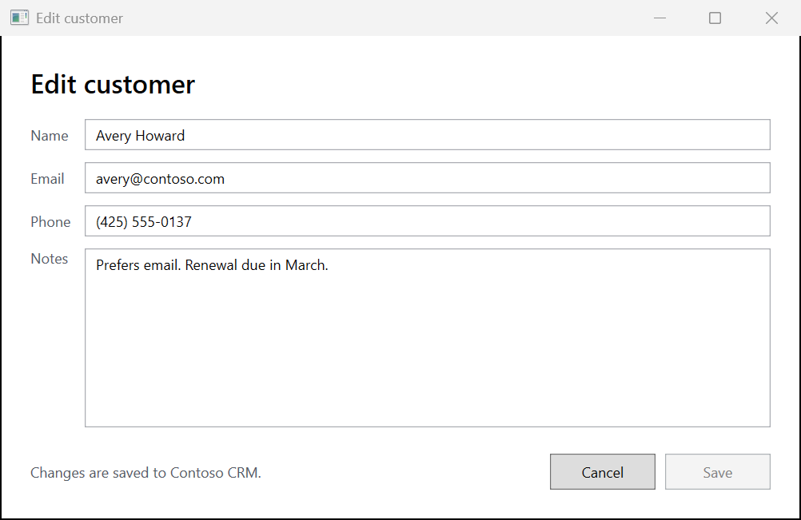

# Session transcript

Source: `Q:\source\XamlAgentDemos-notes\test-runs\VanishingSave\where1\events.jsonl`

## Tool usage

- get_file: 6
- xaml_explain_visibility: 4
- xaml_find_elements: 3
- xaml_capture_image: 3
- xaml_get_status: 2
- task_complete: 2
- skill: 1
- rg: 1
- glob: 1
- multi_replace_string_in_file: 1
- xaml_apply_hot_reload: 1
- xaml_get_element_properties: 1
- xaml_set_element_property: 1
- xaml_clear_binding_failures: 1
- xaml_get_binding_failures: 1

Failed tool calls: 1, images: 2


_Model: gpt-6-luna_


## User (17:19:11)

Where is my Save button?


**Tool call (17:19:14):** `skill`
```json
{
 "skill": "xaml-diagnostics"
}
```

<details><summary>Result `skill` success=true</summary>

```
Skill "xaml-diagnostics" loaded successfully. Follow the instructions in the skill context.
```
</details>


_Skill invoked: xaml-diagnostics_


**Tool call (17:19:16):** `xaml_get_status`
```json
{
 "progressMessage": "Checking the running XAML app and its windows"
}
```

<details><summary>Result `xaml_get_status` success=true</summary>

```
{"isDebugging":true,"debuggerState":"running","diagnosticsActive":true,"apps":[{"app":"a1","name":"VanishingSave.exe [73576]","processId":73576,"platform":"WPF (.NET)","isRemote":false,"isDesignTimeOrNoDebug":false,"sourceInfoAvailable":true,"hotReloadSupported":true,"hotReloadEnabled":true,"supportsPropertyExplorer":true,"supportsInAppToolbar":true,"supportsHitTest":true,"windows":[{"windowId":"0xAB10DE","title":"Edit customer","bounds":{"x":152,"y":152,"width":1020,"height":660},"dpiScale":1.5,"visible":true,"minimized":false}]}],"issues":[],"issuesSummary":"No problems detected.","hotReload":{"options":{"hotReloadEnabled":true,"hotReloadOnSave":false,"applyMode":"asYouType: XAML edits apply as you type, without saving (default)","wpfEnabled":true,"uwpEnabled":true,"winUIEnabled":true,"mauiEnabled":true,"justMyXaml":true,"previewSelectedElement":false,"inAppToolbar":true,"inAppSelection":false,"layoutAdorners":false,"trackFocusedElement":false,"bindingFailuresVisible":true,"compatibilityMode":false},"dotNetHotReloadEnabled":true,"isProcessingChanges":false,"errors":[]},"windowsNote":"Window bounds are physical screen pixels and include the window frame. A WPF/WinUI Window's Width and Height are device-independent units (DIPs) that also include the frame, so Width = bounds.width / dpiScale. A user's \"800 px wide\" is ambiguous: say which unit you tested. A minimized window reports x/y = -32000 and can't be captured."}
```
</details>


**Tool call (17:19:20):** `xaml_find_elements`
```json
{
 "progressMessage": "Locating Save controls",
 "app": "a1",
 "type": "*Button",
 "name": "Save",
 "maxResults": 50
}
```


**Tool call (17:19:20):** `xaml_capture_image`
```json
{
 "progressMessage": "Looking at the current edit window",
 "app": "a1",
 "windowId": "0xAB10DE",
 "maxSize": 1280
}
```

<details><summary>Result `xaml_find_elements` success=true</summary>

```
{"count":1,"totalMatches":1,"truncated":false,"results":[{"id":"a1:10","type":"System.Windows.Controls.Button","name":"SaveButton","source":{"file":"Q:\\source\\XamlAgentDemos\\src\\VanishingSave\\MainWindow.xaml","line":118,"column":14},"path":"MainWindow/Border/AdornerDecorator/ContentPresenter/Grid/Grid/Button"}]}
```
</details>


<details><summary>Result `xaml_capture_image` success=true</summary>

```
Screenshot of window 0xAB10DE "Edit customer" of app a1 (1002x651 image of the window's client area, so it's slightly smaller than the frame bounds from xaml_get_status).
```
</details>


**Tool call (17:19:29):** `xaml_explain_visibility`
```json
{
 "progressMessage": "Checking why Save is hidden",
 "elementIds": [
  "a1:10"
 ]
}
```

<details><summary>Result `xaml_explain_visibility` success=true</summary>

```
{"id":"a1:10","type":"System.Windows.Controls.Button","name":"SaveButton","source":{"file":"Q:\\source\\XamlAgentDemos\\src\\VanishingSave\\MainWindow.xaml","line":118,"column":14},"verdict":"4 separate causes, some latent behind the first; it stays hidden until every one is fixed. First: Button 'SaveButton' has Visibility=Collapsed from a binding.","causes":[{"rank":1,"kind":"visibility","message":"Button 'SaveButton' has Visibility=Collapsed from a binding.","elementId":"a1:10","property":"Visibility","value":"{Binding} -> Collapsed","valueSource":"Local","location":{"file":"Q:\\source\\XamlAgentDemos\\src\\VanishingSave\\MainWindow.xaml","line":118,"column":14},"fix":"Check the bound source value and converter (xaml_explain_property_value shows the binding), or fix the binding failure listed below."},{"rank":1,"kind":"opacity","message":"Button 'SaveButton' has Opacity=0, so it's transparent.","elementId":"a1:10","property":"Opacity","value":"0","valueSource":"StyleTrigger","location":{"file":"Q:\\source\\XamlAgentDemos\\src\\VanishingSave\\MainWindow.xaml","line":118,"column":14},"fix":"Check for a storyboard or trigger that fades it in, or change the value."},{"rank":2,"kind":"gridCell","latent":true,"message":"Button 'SaveButton' is in ColumnDefinitions[2] 'SaveColumn' of Grid 'Footer', which has Width=0: even after the rank 1 cause is fixed it gets no room.","elementId":"a1:19","property":"ColumnDefinitions[2].Width","value":"0","valueSource":"Local","location":{"file":"Q:\\source\\XamlAgentDemos\\src\\VanishingSave\\MainWindow.xaml","line":105,"column":18},"fix":"Give that row/column a non-zero, Auto or star size. If valueSource is Local with no location, code-behind sets it: search the code for 'SaveColumn'."},{"rank":2,"kind":"covered","latent":true,"message":"Border 'SyncStatusHost' shares Button 'SaveButton''s Grid cell (row 0, column 2), has an opaque Background #FFFFFFFF and draws on top because its ZIndex 1 is higher: even after the other causes are fixed it hides Button 'SaveButton'.","elementId":"a1:30","property":"Background","value":"#FFFFFFFF","valueSource":"Local","location":{"file":"Q:\\source\\XamlAgentDemos\\src\\VanishingSave\\MainWindow.xaml","line":127,"column":14},"fix":"Move the overlay to another cell, make its Background Transparent, collapse it when it has nothing to show, or lower its ZIndex below the element."}],"hitTest":{"summary":"A click at its center does NOT reach 'SaveButton' because it's disabled (IsEnabled=False):
... [truncated 1608 chars]
```
</details>


**Assistant (17:19:34):**

The button exists but is hidden by several independent UI conditions. I’m tracing those conditions to restore it rather than just locate it.


**Tool call (17:19:34):** `get_file`
```json
{
 "filename": "Q:\\source\\XamlAgentDemos\\src\\VanishingSave\\MainWindow.xaml",
 "startLine": 95,
 "endLine": 145,
 "includeLineNumbers": true
}
```


**Tool call (17:19:34):** `rg`
```json
{
 "pattern": "CanSave|SaveColumn|SyncStatusHost",
 "paths": "Q:\\source\\XamlAgentDemos\\src\\VanishingSave",
 "output_mode": "content",
 "glob": "*",
 "-n": true,
 "head_limit": 100
}
```

<details><summary>Result `rg` success=true</summary>

```
Q:\source\XamlAgentDemos\src\VanishingSave\MainWindow.xaml.cs:17:            this.SaveColumn.Width = new GridLength(0);
Q:\source\XamlAgentDemos\src\VanishingSave\MainWindow.xaml:105:                <ColumnDefinition x:Name="SaveColumn" Width="Auto" />
Q:\source\XamlAgentDemos\src\VanishingSave\MainWindow.xaml:124:                    Visibility="{Binding CanSave, Converter={StaticResource BoolToVisibility}, FallbackValue=Collapsed}" />
Q:\source\XamlAgentDemos\src\VanishingSave\MainWindow.xaml:127:            <Border x:Name="SyncStatusHost"
Q:\source\XamlAgentDemos\src\VanishingSave\obj\Debug\net10.0-windows\MainWindow.g.cs:87:        internal System.Windows.Controls.ColumnDefinition SaveColumn;
Q:\source\XamlAgentDemos\src\VanishingSave\obj\Debug\net10.0-windows\MainWindow.g.cs:111:        internal System.Windows.Controls.Border SyncStatusHost;
Q:\source\XamlAgentDemos\src\VanishingSave\obj\Debug\net10.0-windows\MainWindow.g.cs:170:            this.SaveColumn = ((System.Windows.Controls.ColumnDefinition)(target));
Q:\source\XamlAgentDemos\src\VanishingSave\obj\Debug\net10.0-windows\MainWindow.g.cs:179:            this.SyncStatusHost = ((System.Windows.Controls.Border)(target));
Q:\source\XamlAgentDemos\src\VanishingSave\obj\Debug\net10.0-windows\MainWindow.g.i.cs:87:        internal System.Windows.Controls.ColumnDefinition SaveColumn;
Q:\source\XamlAgentDemos\src\VanishingSave\obj\Debug\net10.0-windows\MainWindow.g.i.cs:111:        internal System.Windows.Controls.Border SyncStatusHost;
Q:\source\XamlAgentDemos\src\VanishingSave\obj\Debug\net10.0-windows\MainWindow.g.i.cs:170:            this.SaveColumn = ((System.Windows.Controls.ColumnDefinition)(target));
Q:\source\XamlAgentDemos\src\VanishingSave\obj\Debug\net10.0-windows\MainWindow.g.i.cs:179:            this.SyncStatusHost = ((System.Windows.Controls.Border)(target));
```
</details>

<details><summary>Result `get_file` success=true</summary>

```
```xaml src\VanishingSave\MainWindow.xaml (Lines 95-138 of 138 total. Call tools for more if needed.)
95:                      AutomationProperties.Name="Notes"
96:                      Style="{StaticResource FieldStyle}"
97:                      Text="{Binding Notes, UpdateSourceTrigger=PropertyChanged}"
98:                      TextWrapping="Wrap" />
99:         </Grid>
100: 
101:         <Grid x:Name="Footer" Grid.Row="2" Margin="0,12,0,0">
102:             <Grid.ColumnDefinitions>
103:                 <ColumnDefinition Width="*" />
104:                 <ColumnDefinition Width="Auto" />
105:                 <ColumnDefinition x:Name="SaveColumn" Width="Auto" />
106:             </Grid.ColumnDefinitions>
107: 
108:             <TextBlock VerticalAlignment="Center"
109:                        Foreground="#555B66"
110:                        Text="Changes are saved to Contoso CRM." />
111: 
112:             <Button x:Name="CancelButton"
113:                     Grid.Column="1"
114:                     Command="{Binding CancelCommand}"
115:                     Content="Cancel"
116:                     Style="{StaticResource FooterButtonStyle}" />
117: 
118:             <Button x:Name="SaveButton"
119:                     Grid.Column="2"
120:                     Command="{Binding SaveCommand}"
121:                     Content="Save"
122:                     IsDefault="True"
123:                     Style="{StaticResource FooterButtonStyle}"
124:                     Visibility="{Binding CanSave, Converter={StaticResource BoolToVisibility}, FallbackValue=Collapsed}" />
125: 
126:             <!-- Shows "Offline - changes will sync later" when the connection drops. -->
127:             <Border x:Name="SyncStatusHost"
128:                     Grid.Column="2"
129:                     Panel.ZIndex="1"
130:                     Background="White">
131:                 <TextBlock x:Name="SyncStatusText"
132:                            VerticalAlignment="Center"
133:                            Foreground="#B54708"
134:                            Text="" />
135:             </Border>
136:         </Grid>
137:     </Grid>
138: </Window>

```


```
</details>


**Tool call (17:19:41):** `get_file`
```json
{
 "filename": "Q:\\source\\XamlAgentDemos\\src\\VanishingSave\\MainWindow.xaml.cs",
 "startLine": 1,
 "endLine": 200,
 "includeLineNumbers": true
}
```


**Tool call (17:19:41):** `get_file`
```json
{
 "filename": "Q:\\source\\XamlAgentDemos\\src\\VanishingSave\\MainWindow.xaml",
 "startLine": 1,
 "endLine": 94,
 "includeLineNumbers": true
}
```


**Tool call (17:19:41):** `glob`
```json
{
 "pattern": "src\\VanishingSave\\**\\*.cs",
 "paths": "Q:\\source\\XamlAgentDemos"
}
```

<details><summary>Result `get_file` success=true</summary>

```
```csharp src\VanishingSave\MainWindow.xaml.cs (Lines 1-20 of 20 total. Call tools for more if needed.)
1: using System.Windows;
2: 
3: namespace VanishingSave;
4: 
5: public partial class MainWindow : Window
6: {
7:     public MainWindow()
8:     {
9:         this.InitializeComponent();
10:         this.Loaded += this.OnLoaded;
11:     }
12: 
13:     private void OnLoaded(object sender, RoutedEventArgs e)
14:     {
15:         if (FooterSettings.UseCompactFooter)
16:         {
17:             this.SaveColumn.Width = new GridLength(0);
18:         }
19:     }
20: }

```


```
</details>

<details><summary>Result `get_file` success=true</summary>

```
```xaml src\VanishingSave\MainWindow.xaml (Lines 1-94 of 138 total. Call tools for more if needed.)
1: <Window x:Class="VanishingSave.MainWindow"
2:         xmlns="http://schemas.microsoft.com/winfx/2006/xaml/presentation"
3:         xmlns:x="http://schemas.microsoft.com/winfx/2006/xaml"
4:         xmlns:local="clr-namespace:VanishingSave"
5:         Title="Edit customer"
6:         Width="680"
7:         Height="440"
8:         Background="White">
9:     <Window.DataContext>
10:         <local:CustomerViewModel />
11:     </Window.DataContext>
12: 
13:     <Window.Resources>
14:         <BooleanToVisibilityConverter x:Key="BoolToVisibility" />
15: 
16:         <Style x:Key="FieldLabelStyle" TargetType="TextBlock">
17:             <Setter Property="Margin" Value="0,0,12,10" />
18:             <Setter Property="VerticalAlignment" Value="Center" />
19:             <Setter Property="Foreground" Value="#555B66" />
20:         </Style>
21: 
22:         <Style x:Key="FieldStyle" TargetType="TextBox">
23:             <Setter Property="Margin" Value="0,0,0,10" />
24:             <Setter Property="Padding" Value="6,4" />
25:         </Style>
26: 
27:         <Style x:Key="FooterButtonStyle" TargetType="Button">
28:             <Setter Property="MinWidth" Value="88" />
29:             <Setter Property="Margin" Value="8,0,0,0" />
30:             <Setter Property="Padding" Value="16,6" />
31:             <Style.Triggers>
32:                 <!-- Fade out buttons that can't be used yet. -->
33:                 <Trigger Property="IsEnabled" Value="False">
34:                     <Setter Property="Opacity" Value="0" />
35:                 </Trigger>
36:             </Style.Triggers>
37:         </Style>
38:     </Window.Resources>
39: 
40:     <Grid Margin="24">
41:         <Grid.RowDefinitions>
42:             <RowDefinition Height="Auto" />
43:             <RowDefinition Height="*" />
44:             <RowDefinition Height="Auto" />
45:         </Grid.RowDefinitions>
46: 
47:         <TextBlock Margin="0,0,0,16"
48:                    FontSize="22"
49:                    FontWeight="SemiBold"
50:                    Text="Edit customer" />
51: 
52:         <Grid Grid.Row="1">
53:             <Grid.ColumnDefinitions>
54:                 <ColumnDefinition Width="Auto" />
55:                 <ColumnDefinition Width="*" />
56:             </Grid.ColumnDefinitions>
57:             <Grid.RowDefinitions>
58:             
... [truncated 1892 chars]
```
</details>

<details><summary>Result `glob` success=true</summary>

```
Q:\source\XamlAgentDemos\src\VanishingSave\MainWindow.xaml.cs
Q:\source\XamlAgentDemos\src\VanishingSave\FooterSettings.cs
Q:\source\XamlAgentDemos\src\VanishingSave\CustomerViewModel.cs
Q:\source\XamlAgentDemos\src\VanishingSave\App.xaml.cs
```
</details>


**Tool call (17:19:44):** `get_file`
```json
{
 "filename": "Q:\\source\\XamlAgentDemos\\src\\VanishingSave\\CustomerViewModel.cs",
 "startLine": 1,
 "endLine": 240,
 "includeLineNumbers": true
}
```


**Tool call (17:19:44):** `get_file`
```json
{
 "filename": "Q:\\source\\XamlAgentDemos\\src\\VanishingSave\\FooterSettings.cs",
 "startLine": 1,
 "endLine": 150,
 "includeLineNumbers": true
}
```


**Tool call (17:19:44):** `get_file`
```json
{
 "filename": "Q:\\source\\XamlAgentDemos\\src\\VanishingSave\\VanishingSave.csproj",
 "startLine": 1,
 "endLine": 100,
 "includeLineNumbers": true
}
```

<details><summary>Result `get_file` success=true</summary>

```
```csharp src\VanishingSave\CustomerViewModel.cs (Lines 1-35 of 35 total. Call tools for more if needed.)
1: namespace VanishingSave;
2: 
3: public sealed class CustomerViewModel : ObservableObject
4: {
5:     private string name = "Avery Howard";
6:     private string email = "avery@contoso.com";
7:     private string phone = "(425) 555-0137";
8:     private string notes = "Prefers email. Renewal due in March.";
9:     private bool isDirty;
10: 
11:     public CustomerViewModel()
12:     {
13:         this.SaveCommand = new RelayCommand(this.Save, () => this.IsDirty);
14:         this.CancelCommand = new RelayCommand(() => this.IsDirty = false);
15:     }
16: 
17:     public string Name { get => this.name; set { if (this.SetProperty(ref this.name, value)) this.IsDirty = true; } }
18: 
19:     public string Email { get => this.email; set { if (this.SetProperty(ref this.email, value)) this.IsDirty = true; } }
20: 
21:     public string Phone { get => this.phone; set { if (this.SetProperty(ref this.phone, value)) this.IsDirty = true; } }
22: 
23:     public string Notes { get => this.notes; set { if (this.SetProperty(ref this.notes, value)) this.IsDirty = true; } }
24: 
25:     public bool IsDirty { get => this.isDirty; set => this.SetProperty(ref this.isDirty, value); }
26: 
27:     /// <summary>Whether the current user is allowed to save customer records.</summary>
28:     public bool IsSaveAvailable => true;
29: 
30:     public RelayCommand SaveCommand { get; }
31: 
32:     public RelayCommand CancelCommand { get; }
33: 
34:     private void Save() => this.IsDirty = false;
35: }

```


```
</details>

<details><summary>Result `get_file` success=true</summary>

```
``` src\VanishingSave\VanishingSave.csproj (Lines 1-5 of 5 total. Call tools for more if needed.)
1: <Project Sdk="Microsoft.NET.Sdk">
2:   <PropertyGroup>
3:     <RootNamespace>VanishingSave</RootNamespace>
4:   </PropertyGroup>
5: </Project>

```


```
</details>

<details><summary>Result `get_file` success=true</summary>

```
```csharp src\VanishingSave\FooterSettings.cs (Lines 1-10 of 10 total. Call tools for more if needed.)
1: namespace VanishingSave;
2: 
3: public static class FooterSettings
4: {
5:     /// <summary>
6:     /// Compact footer for small screens: auto-save makes the Save column unnecessary.
7:     /// (Auto-save was cut from v2, but this switch stayed on.)
8:     /// </summary>
9:     public static bool UseCompactFooter { get; set; } = true;
10: }

```


```
</details>


**Tool call (17:20:17):** `multi_replace_string_in_file`
```json
{
 "explanation": "Restore the Save control by correcting its availability binding, disabled appearance, compact-footer default, and empty overlay.",
 "replacements": [
  {
   "filePath": "src\\VanishingSave\\MainWindow.xaml",
   "oldString": "        <Style x:Key=\"FooterButtonStyle\" TargetType=\"Button\">\n            <Setter Property=\"MinWidth\" Value=\"88\" />\n            <Setter Property=\"Margin\" Value=\"8,0,0,0\" />\n            <Setter Property=\"Padding\" Value=\"16,6\" />\n            <Style.Triggers>\n                <!-- Fade out buttons that can't be used yet. -->\n                <Trigger Property=\"IsEnabled\" Value=\"False\">\n                    <Setter Property=\"Opacity\" Value=\"0\" />\n                </Trigger>\n            </Style.Triggers>\n        </Style>",
   "newString": "        <Style x:Key=\"FooterButtonStyle\" TargetType=\"Button\">\n            <Setter Property=\"MinWidth\" Value=\"88\" />\n            <Setter Property=\"Margin\" Value=\"8,0,0,0\" />\n            <Setter Property=\"Padding\" Value=\"16,6\" />\n        </Style>",
   "explanation": "Keep disabled footer buttons visible using the platform's standard disabled appearance."
  },
  {
   "filePath": "src\\VanishingSave\\MainWindow.xaml",
   "oldString": "                    Content=\"Save\"\n                    IsDefault=\"True\"\n                    Style=\"{StaticResource FooterButtonStyle}\"\n                    Visibility=\"{Binding CanSave, Converter={StaticResource BoolToVis
... [truncated 1775 chars]
```

<details><summary>Result `multi_replace_string_in_file` success=true</summary>

```
Successfully applied 3 of 3 replacement(s) across 2 file(s).
```
</details>


**Tool call (17:20:29):** `xaml_apply_hot_reload`
```json
{
 "progressMessage": "Applying the Save button fixes to the running app",
 "includeCodeChanges": true
}
```

<details><summary>Result `xaml_apply_hot_reload` success=true</summary>

```
{"summary":"XAML: Applied with no new errors. .NET code: applied with 2 warning(s) in 'codeHotReloadWarnings': some code changes (for example static or field initializers, constructors and startup code) only take effect after the code runs again or the app restarts.","applied":true,"xamlApplied":true,"status":"applied","errors":[],"log":[],"lastHotReloadUpdate":{"secondsAgo":6,"updatesSinceToolsStarted":1},"codeChanges":".NET Hot Reload was started for saved code changes. Its results are in the Hot Reload output pane, not in 'log'; if an edit can't be hot reloaded, Visual Studio asks the user to rebuild and restart.","codeStatus":"appliedWithWarnings","codeHotReloadWarnings":["12:20:30.41 🔣  ⚠ [Q:\\source\\XamlAgentDemos\\src\\VanishingSave\\VanishingSave.csproj ({4EB184D2-643F-45DC-A2E0-9645EA07CD15})]: Q:\\source\\XamlAgentDemos\\src\\VanishingSave\\FooterSettings.cs(9,5): warning ENC0118: Changing 'auto-property' might not have any effect until the application is restarted.","12:20:30.71  ⚠ Q:\\source\\XamlAgentDemos\\src\\VanishingSave\\FooterSettings.cs (line 9): warning ENC0118: Changing 'auto-property' might not have any effect until the application is restarted."],"codeHotReloadOutput":["12:20:30.41 🔣  ⚠ [Q:\\source\\XamlAgentDemos\\src\\VanishingSave\\VanishingSave.csproj ({4EB184D2-643F-45DC-A2E0-9645EA07CD15})]: Q:\\source\\XamlAgentDemos\\src\\VanishingSave\\FooterSettings.cs(9,5): warning ENC0118: Changing 'auto-property' might not have any effect until the application is restarted.","12:20:30.71  ⚠ Q:\\source\\XamlAgentDemos\\src\\VanishingSave\\FooterSettings.cs (line 9): warning ENC0118: Changing 'auto-property' might not have any effect until the application is restarted.","12:20:31.40  Code changes were successfully applied."],"hint":"Call xaml_capture_image to verify the change visually. Views that aren't loaded (other tabs, closed dialogs) are updated when they're next shown. Source line numbers reported for existing elements can still point to the pre-edit lines until the element is recreated, so find elements by x:Name or type rather than by an old line number. Structural edits (wrapping or replacing a parent, changing a root's content) recreate elements, which resets their runtime state such as selection, checked state, typed text and scroll position, and invalidates their IDs. Re-establish the state you were testing before capturing again."}
```
</details>


**Tool call (17:20:40):** `xaml_find_elements`
```json
{
 "progressMessage": "Rechecking the live Save button",
 "app": "a1",
 "type": "Button",
 "name": "SaveButton",
 "maxResults": 10
}
```


**Tool call (17:20:40):** `xaml_capture_image`
```json
{
 "progressMessage": "Checking the updated footer visually",
 "app": "a1",
 "windowId": "0xAB10DE",
 "maxSize": 1280
}
```

<details><summary>Result `xaml_find_elements` success=true</summary>

```
{"count":1,"totalMatches":1,"truncated":false,"results":[{"id":"a1:10","type":"System.Windows.Controls.Button","name":"SaveButton","source":{"file":"Q:\\source\\XamlAgentDemos\\src\\VanishingSave\\MainWindow.xaml","line":118,"column":14},"path":"MainWindow/Border/AdornerDecorator/ContentPresenter/Grid/Grid/Button"}],"hint":"'type' matched the exact class name; subclasses with other names (for example a custom control deriving from it) aren't included. Use type=\"*Button\" to also match class names ending with it."}
```
</details>

<details><summary>Result `xaml_capture_image` success=true</summary>

```
Screenshot of window 0xAB10DE "Edit customer" of app a1 (1002x651 image of the window's client area, so it's slightly smaller than the frame bounds from xaml_get_status). Note: this image is pixel-identical to the previous capture of this window, so nothing visible changed since then (the chat may show it as a reference to the earlier image).
```
</details>


**Tool call (17:20:44):** `xaml_explain_visibility`
```json
{
 "progressMessage": "Checking remaining causes after the XAML fix",
 "elementIds": [
  "a1:10"
 ]
}
```

<details><summary>Result `xaml_explain_visibility` success=false</summary>

```
{
 "message": "{\"error\":\"TAP_ERROR\",\"message\":\"Cannot access child value on Newtonsoft.Json.Linq.JValue.\"}",
 "code": "failure"
}
```
</details>


**Tool call (17:20:49):** `xaml_get_status`
```json
{
 "progressMessage": "Checking live diagnostics after hot reload",
 "app": "a1"
}
```


**Tool call (17:20:49):** `xaml_get_element_properties`
```json
{
 "progressMessage": "Reading Save button state",
 "elementIds": [
  "a1:10"
 ],
 "nameFilter": "Visibility|Opacity|IsEnabled|Command|DataContext.IsSaveAvailable|DataContext.IsDirty",
 "includeAll": true
}
```


**Tool call (17:20:49):** `xaml_find_elements`
```json
{
 "progressMessage": "Finding the footer layout elements",
 "app": "a1",
 "name": "Footer|SaveColumn|SyncStatusHost",
 "maxResults": 20
}
```

<details><summary>Result `xaml_find_elements` success=true</summary>

```
{"count":2,"totalMatches":2,"truncated":false,"results":[{"id":"a1:19","type":"System.Windows.Controls.Grid","name":"Footer","source":{"file":"Q:\\source\\XamlAgentDemos\\src\\VanishingSave\\MainWindow.xaml","line":101,"column":10},"path":"MainWindow/Border/AdornerDecorator/ContentPresenter/Grid/Grid"},{"id":"a1:30","type":"System.Windows.Controls.Border","name":"SyncStatusHost","source":{"file":"Q:\\source\\XamlAgentDemos\\src\\VanishingSave\\MainWindow.xaml","line":127,"column":14},"path":"MainWindow/Border/AdornerDecorator/ContentPresenter/Grid/Grid/Border"}]}
```
</details>

<details><summary>Result `xaml_get_status` success=true</summary>

```
{"isDebugging":true,"debuggerState":"running","diagnosticsActive":true,"apps":[{"app":"a1","name":"VanishingSave.exe [73576]","processId":73576,"platform":"WPF (.NET)","isRemote":false,"isDesignTimeOrNoDebug":false,"sourceInfoAvailable":true,"hotReloadSupported":true,"hotReloadEnabled":true,"supportsPropertyExplorer":true,"supportsInAppToolbar":true,"supportsHitTest":true,"windows":[{"windowId":"0xAB10DE","title":"Edit customer","bounds":{"x":152,"y":152,"width":1020,"height":660},"dpiScale":1.5,"visible":true,"minimized":false}]}],"issues":[],"issuesSummary":"No problems detected.","hotReload":{"options":{"hotReloadEnabled":true,"hotReloadOnSave":false,"applyMode":"asYouType: XAML edits apply as you type, without saving (default)","wpfEnabled":true,"uwpEnabled":true,"winUIEnabled":true,"mauiEnabled":true,"justMyXaml":true,"previewSelectedElement":false,"inAppToolbar":true,"inAppSelection":false,"layoutAdorners":false,"trackFocusedElement":false,"bindingFailuresVisible":true,"compatibilityMode":false},"dotNetHotReloadEnabled":true,"isProcessingChanges":false,"lastHotReloadUpdate":{"secondsAgo":22,"updatesSinceToolsStarted":1},"errors":[]},"windowsNote":"Window bounds are physical screen pixels and include the window frame. A WPF/WinUI Window's Width and Height are device-independent units (DIPs) that also include the frame, so Width = bounds.width / dpiScale. A user's \"800 px wide\" is ambiguous: say which unit you tested. A minimized window reports x/y = -32000 and can't be captured."}
```
</details>

<details><summary>Result `xaml_get_element_properties` success=true</summary>

```
{"id":"a1:10","type":"System.Windows.Controls.Button","name":"SaveButton","source":{"file":"Q:\\source\\XamlAgentDemos\\src\\VanishingSave\\MainWindow.xaml","line":118,"column":14},"properties":[{"name":"IsEnabled","value":"False","valueType":"System.Boolean","valueSource":"Coercion"},{"name":"Command","evaluatedValue":"(XamlAgentDemos.RelayCommand)","valueType":"System.Windows.Data.BindingExpression","propertyType":"System.Windows.Input.ICommand","valueSource":"Local","isBinding":true},{"name":"Visibility","evaluatedValue":"0 (System.Windows.Visibility)","valueType":"System.Windows.Data.BindingExpression","propertyType":"System.Windows.Visibility","valueSource":"Local","isBinding":true}],"defaultValues":{"Opacity":"1"},"hiddenDefaultOrOverridden":3,"hint":"Default and overridden values were omitted. Pass includeAll=true to see them, or call xaml_explain_property_value for one property's full precedence chain.","items":[{"path":"DataContext","type":"VanishingSave.CustomerViewModel","properties":[{"name":"IsSaveAvailable","value":"True","valueSource":"Local","readOnly":true},{"name":"IsDirty","value":"False","valueSource":"Default"}]}],"note":"Item properties are live values. Change one with xaml_set_element_property using the same path, for example setters=['ColumnDefinitions[2].Width=Auto']; edit the XAML too to keep the change. Without a property filter, only set values and Actual* sizes are listed."}
```
</details>


**Tool call (17:21:01):** `xaml_set_element_property`
```json
{
 "progressMessage": "Restoring the Save column in the running window",
 "elementIds": [
  "a1:19"
 ],
 "setters": [
  "ColumnDefinitions[2].Width=Auto"
 ]
}
```

<details><summary>Result `xaml_set_element_property` success=true</summary>

```
{"id":"a1:19","property":"ColumnDefinitions[2].Width","oldValue":"0","newValue":"Auto","note":"This change only affects the running app and is lost when it restarts. Edit the XAML source to persist it. Until then it overrides the source: hot reload re-applies only the properties whose XAML changed, so undo experiments (set the original value back) before you verify a source fix."}
```
</details>


**Tool call (17:21:07):** `xaml_explain_visibility`
```json
{
 "progressMessage": "Confirming the Save button is visible",
 "elementIds": [
  "a1:10"
 ]
}
```


**Tool call (17:21:07):** `xaml_capture_image`
```json
{
 "progressMessage": "Verifying the restored Save button",
 "app": "a1",
 "windowId": "0xAB10DE",
 "maxSize": 1280
}
```




<details><summary>Result `xaml_capture_image` success=true</summary>

```
Screenshot of window 0xAB10DE "Edit customer" of app a1 (1002x651 image of the window's client area, so it's slightly smaller than the frame bounds from xaml_get_status).
```
</details>

<details><summary>Result `xaml_explain_visibility` success=true</summary>

```
{"id":"a1:10","type":"System.Windows.Controls.Button","name":"SaveButton","source":{"file":"Q:\\source\\XamlAgentDemos\\src\\VanishingSave\\MainWindow.xaml","line":118,"column":14},"verdict":"1 binding failure(s) target Button 'SaveButton'; a failed binding leaves the property at its fallback/default value.","causes":[{"rank":3,"kind":"binding","message":"1 binding failure(s) target Button 'SaveButton'; a failed binding leaves the property at its fallback/default value.","elementId":"a1:10","location":{"file":"Q:\\source\\XamlAgentDemos\\src\\VanishingSave\\MainWindow.xaml","line":118,"column":14},"fix":"Fix the binding path or DataContext (see bindingFailures)."}],"checkedOk":["size 88x29.96"],"hitTest":{"summary":"A click at its center does NOT reach 'SaveButton' because it's disabled (IsEnabled=False): input skips disabled elements and lands on Grid 'Footer' behind or around it. That element isn't necessarily covering it; fix the IsEnabled cause (see blockers, or a command's CanExecute) rather than the layout. Button 'SaveButton' has IsEnabled=False (IsEnabledCore: command CanExecute is false or the control disabled itself).","visibleFraction":1.0,"inputTarget":{"id":"a1:19","type":"System.Windows.Controls.Grid","name":"Footer","source":{"file":"Q:\\source\\XamlAgentDemos\\src\\VanishingSave\\MainWindow.xaml","line":101,"column":10},"templatedParent":null,"property":null,"value":null}},"bindingFailures":[{"target":"Button.Visibility, Name='SaveButton'","bindingPath":"CanSave","description":"CanSave property not found on object of type CustomerViewModel.","file":"Q:\\source\\XamlAgentDemos\\src\\VanishingSave\\MainWindow.xaml","line":118}],"note":"rank 1 hides the element for certain, rank 2 almost certainly, rank 3 may. latent=true means another cause masks it now, but it will keep the element hidden after that one is fixed: fix every cause, not only the first. location is where the winning value is set (the element's own tag when the value isn't from XAML). Values set from code-behind or a view model show valueSource=Local with no location. Elements inside a collapsed ancestor have no layout, so their size is also 0; fix the ancestor first."}
```
</details>


**Tool call (17:21:14):** `xaml_clear_binding_failures`
```json
{
 "progressMessage": "Clearing the stale binding diagnostic"
}
```

<details><summary>Result `xaml_clear_binding_failures` success=true</summary>

```
{"cleared":1}
```
</details>


**Tool call (17:21:16):** `xaml_explain_visibility`
```json
{
 "progressMessage": "Verifying no hidden-state causes remain",
 "elementIds": [
  "a1:10"
 ]
}
```


**Tool call (17:21:16):** `xaml_get_binding_failures`
```json
{
 "progressMessage": "Verifying the Save binding is clean",
 "maxResults": 20
}
```

<details><summary>Result `xaml_get_binding_failures` success=true</summary>

```
{"note":"This is a cumulative log since debugging started or the last xaml_clear_binding_failures, not live state: fixed failures stay listed. occurrencesSinceLastRead counts new occurrences since your previous call (0 = not seen again; it only grows when the UI using the binding is created or updated again). pathStillInSource=false means the XAML near that line no longer contains the failing path, so it was probably fixed in source (hot reload or a restart applies it). To verify a fix: clear, revisit the UI that uses the binding, then read again. Failures without a file usually come from bindings created in code.","totalUnique":0,"matched":0,"truncated":false,"failures":[]}
```
</details>

<details><summary>Result `xaml_explain_visibility` success=true</summary>

```
{"id":"a1:10","type":"System.Windows.Controls.Button","name":"SaveButton","source":{"file":"Q:\\source\\XamlAgentDemos\\src\\VanishingSave\\MainWindow.xaml","line":118,"column":14},"verdict":"No reason found for Button 'SaveButton' to be invisible: it's Visible, opaque, has a size, is inside its window and nothing covers its center. Capture an image to confirm, or check that this is the element you expect (another copy may be the one on screen).","causes":[],"checkedOk":["size 88x29.96"],"hitTest":{"summary":"A click at its center does NOT reach 'SaveButton' because it's disabled (IsEnabled=False): input skips disabled elements and lands on Grid 'Footer' behind or around it. That element isn't necessarily covering it; fix the IsEnabled cause (see blockers, or a command's CanExecute) rather than the layout. Button 'SaveButton' has IsEnabled=False (IsEnabledCore: command CanExecute is false or the control disabled itself).","visibleFraction":1.0,"inputTarget":{"id":"a1:19","type":"System.Windows.Controls.Grid","name":"Footer","source":{"file":"Q:\\source\\XamlAgentDemos\\src\\VanishingSave\\MainWindow.xaml","line":101,"column":10},"templatedParent":null,"property":null,"value":null}},"note":"rank 1 hides the element for certain, rank 2 almost certainly, rank 3 may. latent=true means another cause masks it now, but it will keep the element hidden after that one is fixed: fix every cause, not only the first. location is where the winning value is set (the element's own tag when the value isn't from XAML). Values set from code-behind or a view model show valueSource=Local with no location. Elements inside a collapsed ancestor have no layout, so their size is also 0; fix the ancestor first."}
```
</details>


**Tool call (17:21:27):** `task_complete`
```json
{
 "summary": "Your Save button is at the bottom-right, beside Cancel. It was hidden by a stale visibility binding, the compact-footer setting, a disabled-state opacity trigger, and an empty overlay. I fixed those and verified the button is visible in the running app with no remaining binding failures. It is currently disabled because there are no unsaved changes; edit a field to enable it. The corrected compact-footer default takes effect after restarting the app. Changes are in [MainWindow.xaml](vscopilot://file?path=Q%3A%5Csource%5CXamlAgentDemos%5Csrc%5CVanishingSave%5CMainWindow.xaml) and [FooterSettings.cs](vscopilot://file?path=Q%3A%5Csource%5CXamlAgentDemos%5Csrc%5CVanishingSave%5CFooterSettings.cs)."
}
```

<details><summary>Result `task_complete` success=true</summary>

```
Your Save button is at the bottom-right, beside Cancel. It was hidden by a stale visibility binding, the compact-footer setting, a disabled-state opacity trigger, and an empty overlay. I fixed those and verified the button is visible in the running app with no remaining binding failures. It is currently disabled because there are no unsaved changes; edit a field to enable it. The corrected compact-footer default takes effect after restarting the app. Changes are in [MainWindow.xaml](vscopilot://file?path=Q%3A%5Csource%5CXamlAgentDemos%5Csrc%5CVanishingSave%5CMainWindow.xaml) and [FooterSettings.cs](vscopilot://file?path=Q%3A%5Csource%5CXamlAgentDemos%5Csrc%5CVanishingSave%5CFooterSettings.cs).
```
</details>


**Task complete (17:21:27):** Your Save button is at the bottom-right, beside Cancel. It was hidden by a stale visibility binding, the compact-footer setting, a disabled-state opacity trigger, and an empty overlay. I fixed those and verified the button is visible in the running app with no remaining binding failures. It is currently disabled because there are no unsaved changes; edit a field to enable it. The corrected compact-footer default takes effect after restarting the app. Changes are in [MainWindow.xaml](vscopilot://file?path=Q%3A%5Csource%5CXamlAgentDemos%5Csrc%5CVanishingSave%5CMainWindow.xaml) and [FooterSettings.cs](vscopilot://file?path=Q%3A%5Csource%5CXamlAgentDemos%5Csrc%5CVanishingSave%5CFooterSettings.cs).


## User (17:22:02)

Thanks. Now some quick feedback for the tooling team. Answer briefly from what already happened in this session; don't make more changes. (1) Which xaml_* tools or skill guidance helped most? (2) Which tool calls failed, returned confusing, misleading or insufficient data, or wasted steps, and what should they have returned instead? (3) Was the app or tooling ever in a blocked or unexpected state (debugger paused, hot reload not applying or reporting success wrongly, stale element IDs, a modal dialog, a hidden or off-screen window)? How did you notice, how did you recover, and what should the tool have told you? (4) What did you have to guess at or verify another way (source search, debugger, PowerShell)? (5) Which fixes did you verify live in the running app, and which only in source, and why? (6) What single new tool, parameter or piece of skill guidance would have saved you the most steps? (7) Re-read my original request: did you meet every explicit requirement in it? If you skipped, merged or changed any of them, say which and why.


**Tool call (17:22:18):** `task_complete`
```json
{
 "summary": "1. **Most helpful:** `xaml_get_status` confirmed the app was live and debugging; `xaml_find_elements`, `xaml_explain_visibility`, `xaml_get_element_properties`, and `xaml_capture_image` identified and verified the hidden button. The skill’s guidance to fix latent causes and distinguish live runtime changes from source edits was especially useful.\n\n2. **Confusing calls:** The first post-edit `xaml_explain_visibility` returned `TAP_ERROR`. A later call still reported the old `CanSave` binding failure even though the live properties showed `Visibility=Visible` and `IsSaveAvailable=True`. Clearing the cumulative log and checking again showed zero failures. The explanation tool should distinguish active binding failures from stale logged ones and include `pathStillInSource` or current binding state. The first post-hot-reload screenshot was pixel-identical, without explaining that the column was still zero-width.\n\n3. **Unexpected state:** Debugger was running; no modal, stale element ID, or off-screen window. The static `FooterSettings` initializer had already run, so changing its default did not expand the current window’s Save column. The hot-reload result warned that the auto-property initializer needs a restart. I noticed the unchanged screenshot, then set the live column width to `Auto`. It would help if hot reload surfaced that existing runtime layout state as the reason the view still looked unchanged.\n\n4. **Other verification:** I searched and read the 
... [truncated 1109 chars]
```

<details><summary>Result `task_complete` success=true</summary>

```
1. **Most helpful:** `xaml_get_status` confirmed the app was live and debugging; `xaml_find_elements`, `xaml_explain_visibility`, `xaml_get_element_properties`, and `xaml_capture_image` identified and verified the hidden button. The skill’s guidance to fix latent causes and distinguish live runtime changes from source edits was especially useful.

2. **Confusing calls:** The first post-edit `xaml_explain_visibility` returned `TAP_ERROR`. A later call still reported the old `CanSave` binding failure even though the live properties showed `Visibility=Visible` and `IsSaveAvailable=True`. Clearing the cumulative log and checking again showed zero failures. The explanation tool should distinguish active binding failures from stale logged ones and include `pathStillInSource` or current binding state. The first post-hot-reload screenshot was pixel-identical, without explaining that the column was still zero-width.

3. **Unexpected state:** Debugger was running; no modal, stale element ID, or off-screen window. The static `FooterSettings` initializer had already run, so changing its default did not expand the current window’s Save column. The hot-reload result warned that the auto-property initializer needs a restart. I noticed the unchanged screenshot, then set the live column width to `Auto`. It would help if hot reload surfaced that existing runtime layout state as the reason the view still looked unchanged.

4. **Other verification:** I searched and read the XAML, code-behind, settings, and view model. That revealed the `CanSave`/`IsSaveAvailable` mismatch, the `Loaded` handler setting the column width to zero, `IsDirty` disabling Save, the opacity trigger, and the empty overlay. No debugger or PowerShell was needed.

5. **Verification scope:** XAML fixes and the runtime column-width correction were verified live; the button appeared at bottom-right, and the visibility check found no hiding causes. The `FooterSettings` default change was verified only in source; it takes effect after restart. I did not build while the app was being debugged.

6. **Most useful addition:** Have `xaml_explain_visibility` report whether each binding failure is still active, and for layout blockers, identify when the current runtime value comes from already-executed code that hot reload will not rerun.

7. **Original request:** Yes—the button is now visible at bottom-right beside Cancel. I also fixed the causes because the missing-button guidance treats that question as a request t
... [truncated 79 chars]
```
</details>


**Task complete (17:22:18):** 1. **Most helpful:** `xaml_get_status` confirmed the app was live and debugging; `xaml_find_elements`, `xaml_explain_visibility`, `xaml_get_element_properties`, and `xaml_capture_image` identified and verified the hidden button. The skill’s guidance to fix latent causes and distinguish live runtime changes from source edits was especially useful.

2. **Confusing calls:** The first post-edit `xaml_explain_visibility` returned `TAP_ERROR`. A later call still reported the old `CanSave` binding failure even though the live properties showed `Visibility=Visible` and `IsSaveAvailable=True`. Clearing the cumulative log and checking again showed zero failures. The explanation tool should distinguish active binding failures from stale logged ones and include `pathStillInSource` or current binding state. The first post-hot-reload screenshot was pixel-identical, without explaining that the column was still zero-width.

3. **Unexpected state:** Debugger was running; no modal, stale element ID, or off-screen window. The static `FooterSettings` initializer had already run, so changing its default did not expand the current window’s Save column. The hot-reload result warned that the auto-property initializer needs a restart. I noticed the unchanged screenshot, then set the live column width to `Auto`. It would help if hot reload surfaced that existing runtime layout state as the reason the view still looked unchanged.

4. **Other verification:** I searched and read the XAML, code-behind, settings, and view model. That revealed the `CanSave`/`IsSaveAvailable` mismatch, the `Loaded` handler setting the column width to zero, `IsDirty` disabling Save, the opacity trigger, and the empty overlay. No debugger or PowerShell was needed.

5. **Verification scope:** XAML fixes and the runtime column-width correction were verified live; the button appeared at bottom-right, and the visibility check found no hiding causes. The `FooterSettings` default change was verified only in source; it takes effect after restart. I did not build while the app was being debugged.

6. **Most useful addition:** Have `xaml_explain_visibility` report whether each binding failure is still active, and for layout blockers, identify when the current runtime value comes from already-executed code that hot reload will not rerun.

7. **Original request:** Yes—the button is now visible at bottom-right beside Cancel. I also fixed the causes because the missing-button guidance treats that question as a request to restore it. It remains disabled until there are unsaved changes, as intended.
