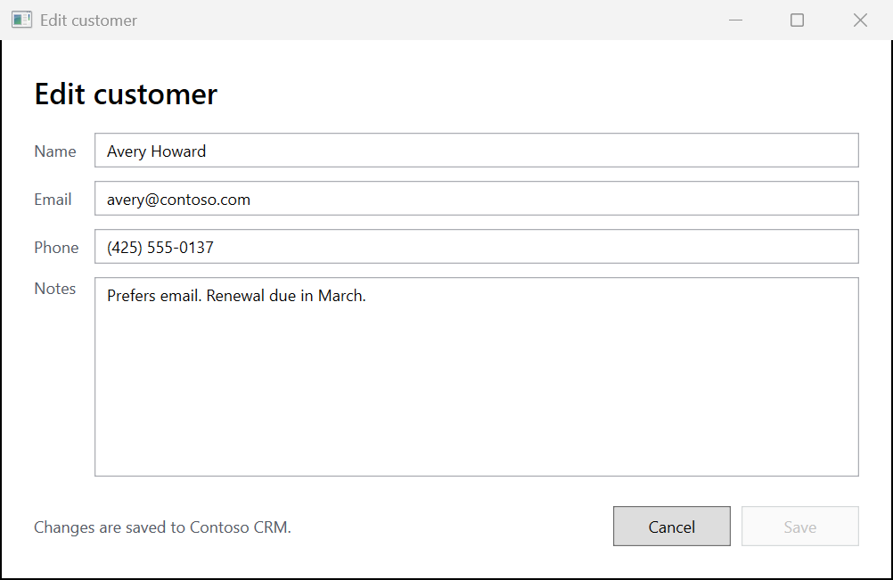

# Session transcript

Source: `Q:\source\XamlAgentDemos-notes\test-runs\VanishingSave\where2\events.jsonl`

## Tool usage

- get_file: 9
- rg: 4
- xaml_explain_visibility: 3
- multi_replace_string_in_file: 2
- xaml_get_binding_failures: 2
- task_complete: 2
- skill: 1
- xaml_get_status: 1
- xaml_find_elements: 1
- xaml_explain_property_value: 1
- xaml_apply_hot_reload: 1
- xaml_capture_image: 1
- xaml_clear_binding_failures: 1
- xaml_get_element_properties: 1

Failed tool calls: 0, images: 1


_Model: gpt-6-luna_


## User (17:26:42)

Where is my Save button?


**Tool call (17:26:47):** `skill`
```json
{
 "skill": "xaml-diagnostics"
}
```

<details><summary>Result `skill` success=true</summary>

```
Skill "xaml-diagnostics" loaded successfully. Follow the instructions in the skill context.
```
</details>


_Skill invoked: xaml-diagnostics_


**Tool call (17:26:50):** `xaml_get_status`
```json
{
 "progressMessage": "Checking the running app and its windows",
 "app": null
}
```

<details><summary>Result `xaml_get_status` success=true</summary>

```
{"isDebugging":true,"debuggerState":"running","diagnosticsActive":true,"apps":[{"app":"a1","name":"VanishingSave.exe [35292]","processId":35292,"platform":"WPF (.NET)","isRemote":false,"isDesignTimeOrNoDebug":false,"sourceInfoAvailable":true,"hotReloadSupported":true,"hotReloadEnabled":true,"supportsPropertyExplorer":true,"supportsInAppToolbar":true,"supportsHitTest":true,"windows":[{"windowId":"0x3407DC","title":"Edit customer","bounds":{"x":494,"y":494,"width":1020,"height":660},"dpiScale":1.5,"visible":true,"minimized":false}]}],"issues":[],"issuesSummary":"No problems detected.","hotReload":{"options":{"hotReloadEnabled":true,"hotReloadOnSave":false,"applyMode":"asYouType: XAML edits apply as you type, without saving (default)","wpfEnabled":true,"uwpEnabled":true,"winUIEnabled":true,"mauiEnabled":true,"justMyXaml":true,"previewSelectedElement":false,"inAppToolbar":true,"inAppSelection":false,"layoutAdorners":false,"trackFocusedElement":false,"bindingFailuresVisible":true,"compatibilityMode":false},"dotNetHotReloadEnabled":true,"isProcessingChanges":false,"errors":[]},"windowsNote":"Window bounds are physical screen pixels and include the window frame. A WPF/WinUI Window's Width and Height are device-independent units (DIPs) that also include the frame, so Width = bounds.width / dpiScale. A user's \"800 px wide\" is ambiguous: say which unit you tested. A minimized window reports x/y = -32000 and can't be captured."}
```
</details>


**Tool call (17:26:53):** `xaml_find_elements`
```json
{
 "progressMessage": "Locating the Save control in the live window",
 "app": "a1",
 "name": "Save",
 "maxResults": 50
}
```

<details><summary>Result `xaml_find_elements` success=true</summary>

```
{"count":1,"totalMatches":1,"truncated":false,"results":[{"id":"a1:10","type":"System.Windows.Controls.Button","name":"SaveButton","source":{"file":"Q:\\source\\XamlAgentDemos\\src\\VanishingSave\\MainWindow.xaml","line":118,"column":14},"path":"MainWindow/Border/AdornerDecorator/ContentPresenter/Grid/Grid/Button"}]}
```
</details>


**Tool call (17:26:56):** `xaml_explain_visibility`
```json
{
 "progressMessage": "Checking why the Save button is hidden",
 "elementIds": [
  "a1:10"
 ]
}
```

<details><summary>Result `xaml_explain_visibility` success=true</summary>

```
{"id":"a1:10","type":"System.Windows.Controls.Button","name":"SaveButton","source":{"file":"Q:\\source\\XamlAgentDemos\\src\\VanishingSave\\MainWindow.xaml","line":118,"column":14},"verdict":"4 separate causes, some latent behind the first; it stays hidden until every one is fixed. First: Button 'SaveButton' has Visibility=Collapsed from a binding.","causes":[{"rank":1,"kind":"visibility","message":"Button 'SaveButton' has Visibility=Collapsed from a binding.","elementId":"a1:10","property":"Visibility","value":"{Binding} -> Collapsed","valueSource":"Local","location":{"file":"Q:\\source\\XamlAgentDemos\\src\\VanishingSave\\MainWindow.xaml","line":118,"column":14},"fix":"Check the bound source value and converter (xaml_explain_property_value shows the binding), or fix the binding failure listed below."},{"rank":1,"kind":"opacity","message":"Button 'SaveButton' has Opacity=0, so it's transparent.","elementId":"a1:10","property":"Opacity","value":"0","valueSource":"StyleTrigger","location":{"file":"Q:\\source\\XamlAgentDemos\\src\\VanishingSave\\MainWindow.xaml","line":118,"column":14},"fix":"Check for a storyboard or trigger that fades it in, or change the value."},{"rank":2,"kind":"gridCell","latent":true,"message":"Button 'SaveButton' is in ColumnDefinitions[2] 'SaveColumn' of Grid 'Footer', which has Width=0: even after the rank 1 cause is fixed it gets no room.","elementId":"a1:19","property":"ColumnDefinitions[2].Width","value":"0","valueSource":"Local","location":{"file":"Q:\\source\\XamlAgentDemos\\src\\VanishingSave\\MainWindow.xaml","line":105,"column":18},"fix":"Give that row/column a non-zero, Auto or star size. If valueSource is Local with no location, code-behind sets it: search the code for 'SaveColumn'."},{"rank":2,"kind":"covered","latent":true,"message":"Border 'SyncStatusHost' shares Button 'SaveButton''s Grid cell (row 0, column 2), has an opaque Background #FFFFFFFF and draws on top because its ZIndex 1 is higher: even after the other causes are fixed it hides Button 'SaveButton'.","elementId":"a1:30","property":"Background","value":"#FFFFFFFF","valueSource":"Local","location":{"file":"Q:\\source\\XamlAgentDemos\\src\\VanishingSave\\MainWindow.xaml","line":127,"column":14},"fix":"Move the overlay to another cell, make its Background Transparent, collapse it when it has nothing to show, or lower its ZIndex below the element."}],"hitTest":{"summary":"A click at its center does NOT reach 'SaveButton' because it's disabled (IsEnabled=False):
... [truncated 1608 chars]
```
</details>


**Assistant (17:27:00):**

The Save control is present, but diagnostics show several stacked visibility and layout causes. I’m checking the XAML and its bound view-model logic before fixing them.


**Tool call (17:27:00):** `get_file`
```json
{
 "filename": "Q:\\source\\XamlAgentDemos\\src\\VanishingSave\\MainWindow.xaml",
 "startLine": 90,
 "endLine": 150,
 "includeLineNumbers": true
}
```


**Tool call (17:27:00):** `rg`
```json
{
 "pattern": "CanSave|SaveColumn|SyncStatusHost|SaveButton",
 "paths": "Q:\\source\\XamlAgentDemos\\src\\VanishingSave",
 "output_mode": "content",
 "-n": true,
 "head_limit": 100
}
```

<details><summary>Result `rg` success=true</summary>

```
Q:\source\XamlAgentDemos\src\VanishingSave\MainWindow.xaml:105:                <ColumnDefinition x:Name="SaveColumn" Width="Auto" />
Q:\source\XamlAgentDemos\src\VanishingSave\MainWindow.xaml:118:            <Button x:Name="SaveButton"
Q:\source\XamlAgentDemos\src\VanishingSave\MainWindow.xaml:124:                    Visibility="{Binding CanSave, Converter={StaticResource BoolToVisibility}, FallbackValue=Collapsed}" />
Q:\source\XamlAgentDemos\src\VanishingSave\MainWindow.xaml:127:            <Border x:Name="SyncStatusHost"
Q:\source\XamlAgentDemos\src\VanishingSave\MainWindow.xaml.cs:17:            this.SaveColumn.Width = new GridLength(0);
```
</details>

<details><summary>Result `get_file` success=true</summary>

```
```xaml src\VanishingSave\MainWindow.xaml (Lines 90-138 of 138 total. Call tools for more if needed.)
90:                        Text="Notes" />
91:             <TextBox x:Name="NotesBox"
92:                      Grid.Row="3"
93:                      Grid.Column="1"
94:                      AcceptsReturn="True"
95:                      AutomationProperties.Name="Notes"
96:                      Style="{StaticResource FieldStyle}"
97:                      Text="{Binding Notes, UpdateSourceTrigger=PropertyChanged}"
98:                      TextWrapping="Wrap" />
99:         </Grid>
100: 
101:         <Grid x:Name="Footer" Grid.Row="2" Margin="0,12,0,0">
102:             <Grid.ColumnDefinitions>
103:                 <ColumnDefinition Width="*" />
104:                 <ColumnDefinition Width="Auto" />
105:                 <ColumnDefinition x:Name="SaveColumn" Width="Auto" />
106:             </Grid.ColumnDefinitions>
107: 
108:             <TextBlock VerticalAlignment="Center"
109:                        Foreground="#555B66"
110:                        Text="Changes are saved to Contoso CRM." />
111: 
112:             <Button x:Name="CancelButton"
113:                     Grid.Column="1"
114:                     Command="{Binding CancelCommand}"
115:                     Content="Cancel"
116:                     Style="{StaticResource FooterButtonStyle}" />
117: 
118:             <Button x:Name="SaveButton"
119:                     Grid.Column="2"
120:                     Command="{Binding SaveCommand}"
121:                     Content="Save"
122:                     IsDefault="True"
123:                     Style="{StaticResource FooterButtonStyle}"
124:                     Visibility="{Binding CanSave, Converter={StaticResource BoolToVisibility}, FallbackValue=Collapsed}" />
125: 
126:             <!-- Shows "Offline - changes will sync later" when the connection drops. -->
127:             <Border x:Name="SyncStatusHost"
128:                     Grid.Column="2"
129:                     Panel.ZIndex="1"
130:                     Background="White">
131:                 <TextBlock x:Name="SyncStatusText"
132:                            VerticalAlignment="Center"
133:                            Foreground="#B54708"
134:                            Text="" />
135:             </Border>
136:         </Grid>
137:     </Grid>
138: </Window>

```


```
</details>


**Tool call (17:27:05):** `get_file`
```json
{
 "filename": "Q:\\source\\XamlAgentDemos\\src\\VanishingSave\\MainWindow.xaml.cs",
 "startLine": 1,
 "endLine": 200,
 "includeLineNumbers": true
}
```


**Tool call (17:27:05):** `rg`
```json
{
 "pattern": "class CustomerViewModel|CanSave|SaveCommand|SyncStatusHost|Opacity=\"0\"",
 "paths": "Q:\\source\\XamlAgentDemos\\src",
 "output_mode": "content",
 "-n": true,
 "head_limit": 200
}
```


**Tool call (17:27:05):** `get_file`
```json
{
 "filename": "Q:\\source\\XamlAgentDemos\\src\\VanishingSave\\MainWindow.xaml",
 "startLine": 1,
 "endLine": 90,
 "includeLineNumbers": true
}
```

<details><summary>Result `get_file` success=true</summary>

```
```csharp src\VanishingSave\MainWindow.xaml.cs (Lines 1-20 of 20 total. Call tools for more if needed.)
1: using System.Windows;
2: 
3: namespace VanishingSave;
4: 
5: public partial class MainWindow : Window
6: {
7:     public MainWindow()
8:     {
9:         this.InitializeComponent();
10:         this.Loaded += this.OnLoaded;
11:     }
12: 
13:     private void OnLoaded(object sender, RoutedEventArgs e)
14:     {
15:         if (FooterSettings.UseCompactFooter)
16:         {
17:             this.SaveColumn.Width = new GridLength(0);
18:         }
19:     }
20: }

```


```
</details>

<details><summary>Result `get_file` success=true</summary>

```
```xaml src\VanishingSave\MainWindow.xaml (Lines 1-90 of 138 total. Call tools for more if needed.)
1: <Window x:Class="VanishingSave.MainWindow"
2:         xmlns="http://schemas.microsoft.com/winfx/2006/xaml/presentation"
3:         xmlns:x="http://schemas.microsoft.com/winfx/2006/xaml"
4:         xmlns:local="clr-namespace:VanishingSave"
5:         Title="Edit customer"
6:         Width="680"
7:         Height="440"
8:         Background="White">
9:     <Window.DataContext>
10:         <local:CustomerViewModel />
11:     </Window.DataContext>
12: 
13:     <Window.Resources>
14:         <BooleanToVisibilityConverter x:Key="BoolToVisibility" />
15: 
16:         <Style x:Key="FieldLabelStyle" TargetType="TextBlock">
17:             <Setter Property="Margin" Value="0,0,12,10" />
18:             <Setter Property="VerticalAlignment" Value="Center" />
19:             <Setter Property="Foreground" Value="#555B66" />
20:         </Style>
21: 
22:         <Style x:Key="FieldStyle" TargetType="TextBox">
23:             <Setter Property="Margin" Value="0,0,0,10" />
24:             <Setter Property="Padding" Value="6,4" />
25:         </Style>
26: 
27:         <Style x:Key="FooterButtonStyle" TargetType="Button">
28:             <Setter Property="MinWidth" Value="88" />
29:             <Setter Property="Margin" Value="8,0,0,0" />
30:             <Setter Property="Padding" Value="16,6" />
31:             <Style.Triggers>
32:                 <!-- Fade out buttons that can't be used yet. -->
33:                 <Trigger Property="IsEnabled" Value="False">
34:                     <Setter Property="Opacity" Value="0" />
35:                 </Trigger>
36:             </Style.Triggers>
37:         </Style>
38:     </Window.Resources>
39: 
40:     <Grid Margin="24">
41:         <Grid.RowDefinitions>
42:             <RowDefinition Height="Auto" />
43:             <RowDefinition Height="*" />
44:             <RowDefinition Height="Auto" />
45:         </Grid.RowDefinitions>
46: 
47:         <TextBlock Margin="0,0,0,16"
48:                    FontSize="22"
49:                    FontWeight="SemiBold"
50:                    Text="Edit customer" />
51: 
52:         <Grid Grid.Row="1">
53:             <Grid.ColumnDefinitions>
54:                 <ColumnDefinition Width="Auto" />
55:                 <ColumnDefinition Width="*" />
56:             </Grid.ColumnDefinitions>
57:             <Grid.RowDefinitions>
58:             
... [truncated 1720 chars]
```
</details>

<details><summary>Result `rg` success=true</summary>

```
Q:\source\XamlAgentDemos\src\VanishingSave\CustomerViewModel.cs:3:public sealed class CustomerViewModel : ObservableObject
Q:\source\XamlAgentDemos\src\VanishingSave\CustomerViewModel.cs:13:        this.SaveCommand = new RelayCommand(this.Save, () => this.IsDirty);
Q:\source\XamlAgentDemos\src\VanishingSave\CustomerViewModel.cs:30:    public RelayCommand SaveCommand { get; }
Q:\source\XamlAgentDemos\src\BugRepro\ProfileViewModel.cs:17:        this.SaveCommand = new RelayCommand(this.Save, () => this.IsDirty);
Q:\source\XamlAgentDemos\src\BugRepro\ProfileViewModel.cs:49:    public RelayCommand SaveCommand { get; }
Q:\source\XamlAgentDemos\src\VanishingSave\MainWindow.xaml:120:                    Command="{Binding SaveCommand}"
Q:\source\XamlAgentDemos\src\VanishingSave\MainWindow.xaml:124:                    Visibility="{Binding CanSave, Converter={StaticResource BoolToVisibility}, FallbackValue=Collapsed}" />
Q:\source\XamlAgentDemos\src\VanishingSave\MainWindow.xaml:127:            <Border x:Name="SyncStatusHost"
Q:\source\XamlAgentDemos\src\BugRepro\MainWindow.xaml:48:                        Command="{Binding SaveCommand}"
```
</details>


**Tool call (17:27:09):** `get_file`
```json
{
 "filename": "Q:\\source\\XamlAgentDemos\\src\\VanishingSave\\CustomerViewModel.cs",
 "startLine": 1,
 "endLine": 200,
 "includeLineNumbers": true
}
```


**Tool call (17:27:09):** `rg`
```json
{
 "pattern": "class FooterSettings|static class FooterSettings|UseCompactFooter",
 "paths": "Q:\\source\\XamlAgentDemos",
 "output_mode": "content",
 "-n": true,
 "head_limit": 100
}
```


**Tool call (17:27:09):** `xaml_explain_property_value`
```json
{
 "progressMessage": "Inspecting Save visibility and enabled state",
 "elementIds": [
  "a1:10"
 ],
 "propertyNames": [
  "Visibility",
  "Opacity",
  "IsEnabled",
  "Command"
 ],
 "pairwise": false
}
```

<details><summary>Result `get_file` success=true</summary>

```
```csharp src\VanishingSave\CustomerViewModel.cs (Lines 1-35 of 35 total. Call tools for more if needed.)
1: namespace VanishingSave;
2: 
3: public sealed class CustomerViewModel : ObservableObject
4: {
5:     private string name = "Avery Howard";
6:     private string email = "avery@contoso.com";
7:     private string phone = "(425) 555-0137";
8:     private string notes = "Prefers email. Renewal due in March.";
9:     private bool isDirty;
10: 
11:     public CustomerViewModel()
12:     {
13:         this.SaveCommand = new RelayCommand(this.Save, () => this.IsDirty);
14:         this.CancelCommand = new RelayCommand(() => this.IsDirty = false);
15:     }
16: 
17:     public string Name { get => this.name; set { if (this.SetProperty(ref this.name, value)) this.IsDirty = true; } }
18: 
19:     public string Email { get => this.email; set { if (this.SetProperty(ref this.email, value)) this.IsDirty = true; } }
20: 
21:     public string Phone { get => this.phone; set { if (this.SetProperty(ref this.phone, value)) this.IsDirty = true; } }
22: 
23:     public string Notes { get => this.notes; set { if (this.SetProperty(ref this.notes, value)) this.IsDirty = true; } }
24: 
25:     public bool IsDirty { get => this.isDirty; set => this.SetProperty(ref this.isDirty, value); }
26: 
27:     /// <summary>Whether the current user is allowed to save customer records.</summary>
28:     public bool IsSaveAvailable => true;
29: 
30:     public RelayCommand SaveCommand { get; }
31: 
32:     public RelayCommand CancelCommand { get; }
33: 
34:     private void Save() => this.IsDirty = false;
35: }

```


```
</details>

<details><summary>Result `rg` success=true</summary>

```
Q:\source\XamlAgentDemos\src\VanishingSave\MainWindow.xaml.cs:15:        if (FooterSettings.UseCompactFooter)
Q:\source\XamlAgentDemos\src\VanishingSave\FooterSettings.cs:3:public static class FooterSettings
Q:\source\XamlAgentDemos\src\VanishingSave\FooterSettings.cs:9:    public static bool UseCompactFooter { get; set; } = true;
```
</details>

<details><summary>Result `xaml_explain_property_value` success=true</summary>

```
{"count":4,"failed":0,"results":[{"id":"a1:10","type":"System.Windows.Controls.Button","property":"Visibility","propertyType":"System.Windows.Visibility","evaluatedValue":"2 (System.Windows.Visibility)","effectiveSource":"Local","chain":[{"kind":"Local","description":"Local value set on the element (XAML attribute, binding or code). Wins over styles, templates and inheritance.","evaluatedValue":"2 (System.Windows.Visibility)","valueType":"System.Windows.Data.BindingExpression","isBinding":true,"effective":true,"sourceLocation":{"file":"Q:\\source\\XamlAgentDemos\\src\\VanishingSave\\MainWindow.xaml","line":118,"column":14}},{"kind":"Default","description":"The property's default value; nothing sets it.","value":"0","valueType":"System.Windows.Visibility","effective":false}],"notes":["To let a style or template value apply, remove the local value (the attribute, binding or code assignment). To change it, edit that local value. XAML and code both produce Local values, and the source location may still point to the XAML attribute after code assigned a new value. If the live value differs from the XAML attribute, or the element has no XAML attribute for it, code set it: search code-behind for the element's x:Name.","The effective value comes from a binding. If it's wrong, check xaml_get_binding_failures and the DataContext."]},{"id":"a1:10","type":"System.Windows.Controls.Button","property":"Opacity","propertyType":"System.Double","effectiveValue":"0","effectiveSource":"StyleTrigger","chain":[{"kind":"StyleTrigger","description":"Trigger in the element's Style whose condition is currently true.","value":"0","valueType":"System.Double","effective":true},{"kind":"Default","description":"The property's default value; nothing sets it.","value":"1","valueType":"System.Double","effective":false}],"notes":["Edit the setter or trigger at the source location, or set a local value to override it for this element only."]},{"id":"a1:10","type":"System.Windows.Controls.Button","property":"IsEnabled","propertyType":"System.Boolean","effectiveValue":"False","effectiveSource":"Coercion","chain":[{"kind":"Coercion","description":"The control coerced the value (for example clamped to a minimum or maximum).","value":"False","valueType":"System.Boolean","effective":true},{"kind":"Default","description":"The property's default value; nothing sets it.","value":"True","valueType":"System.Boolean","effective":false}],"notes":["Check related properties that constrain this one (for exa
... [truncated 1558 chars]
```
</details>


**Tool call (17:27:30):** `get_file`
```json
{
 "filename": "Q:\\source\\XamlAgentDemos\\src\\VanishingSave\\FooterSettings.cs",
 "startLine": 1,
 "endLine": 100,
 "includeLineNumbers": true
}
```

<details><summary>Result `get_file` success=true</summary>

```
```csharp src\VanishingSave\FooterSettings.cs (Lines 1-10 of 10 total. Call tools for more if needed.)
1: namespace VanishingSave;
2: 
3: public static class FooterSettings
4: {
5:     /// <summary>
6:     /// Compact footer for small screens: auto-save makes the Save column unnecessary.
7:     /// (Auto-save was cut from v2, but this switch stayed on.)
8:     /// </summary>
9:     public static bool UseCompactFooter { get; set; } = true;
10: }

```


```
</details>


**Tool call (17:27:41):** `rg`
```json
{
 "pattern": "class RelayCommand|class ObservableObject",
 "paths": "Q:\\source\\XamlAgentDemos",
 "output_mode": "content",
 "-n": true,
 "head_limit": 100
}
```

<details><summary>Result `rg` success=true</summary>

```
Q:\source\XamlAgentDemos\src\Shared\RelayCommand.cs:5:public sealed class RelayCommand(Action execute, Func<bool>? canExecute = null) : ICommand
Q:\source\XamlAgentDemos\src\Shared\ObservableObject.cs:6:public abstract class ObservableObject : INotifyPropertyChanged
```
</details>


**Tool call (17:27:44):** `get_file`
```json
{
 "filename": "Q:\\source\\XamlAgentDemos\\src\\Shared\\RelayCommand.cs",
 "startLine": 1,
 "endLine": 150,
 "includeLineNumbers": true
}
```


**Tool call (17:27:44):** `get_file`
```json
{
 "filename": "Q:\\source\\XamlAgentDemos\\src\\Shared\\ObservableObject.cs",
 "startLine": 1,
 "endLine": 120,
 "includeLineNumbers": true
}
```

<details><summary>Result `get_file` success=true</summary>

```
```csharp src\Shared\ObservableObject.cs (Lines 1-24 of 24 total. Call tools for more if needed.)
1: using System.ComponentModel;
2: using System.Runtime.CompilerServices;
3: 
4: namespace XamlAgentDemos;
5: 
6: public abstract class ObservableObject : INotifyPropertyChanged
7: {
8:     public event PropertyChangedEventHandler? PropertyChanged;
9: 
10:     protected bool SetProperty<T>(ref T field, T value, [CallerMemberName] string? propertyName = null)
11:     {
12:         if (EqualityComparer<T>.Default.Equals(field, value))
13:         {
14:             return false;
15:         }
16: 
17:         field = value;
18:         this.OnPropertyChanged(propertyName);
19:         return true;
20:     }
21: 
22:     protected void OnPropertyChanged([CallerMemberName] string? propertyName = null)
23:         => this.PropertyChanged?.Invoke(this, new PropertyChangedEventArgs(propertyName));
24: }

```


```
</details>

<details><summary>Result `get_file` success=true</summary>

```
```csharp src\Shared\RelayCommand.cs (Lines 1-16 of 16 total. Call tools for more if needed.)
1: using System.Windows.Input;
2: 
3: namespace XamlAgentDemos;
4: 
5: public sealed class RelayCommand(Action execute, Func<bool>? canExecute = null) : ICommand
6: {
7:     public event EventHandler? CanExecuteChanged
8:     {
9:         add => CommandManager.RequerySuggested += value;
10:         remove => CommandManager.RequerySuggested -= value;
11:     }
12: 
13:     public bool CanExecute(object? parameter) => canExecute?.Invoke() ?? true;
14: 
15:     public void Execute(object? parameter) => execute();
16: }

```


```
</details>


**Assistant (17:27:57):**

The button is hidden by a stale “compact footer” setting, a misspelled visibility binding, an empty status overlay, and a style that makes disabled buttons transparent. I’m correcting those causes while keeping Save visible (dimmed until there are changes).


**Tool call (17:27:57):** `multi_replace_string_in_file`
```json
{
 "explanation": "Restore the Save button by fixing its binding, layout, status placement, and disabled-state styling; remove obsolete compact-footer code.",
 "replacements": [
  {
   "filePath": "src\\VanishingSave\\MainWindow.xaml",
   "oldString": "            <Style.Triggers>\n                <!-- Fade out buttons that can't be used yet. -->\n                <Trigger Property=\"IsEnabled\" Value=\"False\">\n                    <Setter Property=\"Opacity\" Value=\"0\" />\n                </Trigger>\n            </Style.Triggers>",
   "newString": "            <Style.Triggers>\n                <Trigger Property=\"IsEnabled\" Value=\"False\">\n                    <Setter Property=\"Opacity\" Value=\"0.5\" />\n                </Trigger>\n            </Style.Triggers>",
   "explanation": "Keep disabled buttons visible instead of making them transparent."
  },
  {
   "filePath": "src\\VanishingSave\\MainWindow.xaml",
   "oldString": "        <Grid x:Name=\"Footer\" Grid.Row=\"2\" Margin=\"0,12,0,0\">\n            <Grid.ColumnDefinitions>\n                <ColumnDefinition Width=\"*\" />\n                <ColumnDefinition Width=\"Auto\" />\n                <ColumnDefinition x:Name=\"SaveColumn\" Width=\"Auto\" />\n            </Grid.ColumnDefinitions>",
   "newString": "        <Grid x:Name=\"Footer\" Grid.Row=\"2\" Margin=\"0,12,0,0\">\n            <Grid.ColumnDefinitions>\n                <ColumnDefinition Width=\"*\" />\n                <ColumnDefinition Width=\"Auto\" />\n 
... [truncated 3031 chars]
```

<details><summary>Result `multi_replace_string_in_file` success=true</summary>

```
Successfully applied 5 of 5 replacement(s) across 2 file(s).
```
</details>


**Tool call (17:28:15):** `get_file`
```json
{
 "filename": "Q:\\source\\XamlAgentDemos\\src\\VanishingSave\\MainWindow.xaml",
 "startLine": 98,
 "endLine": 140,
 "includeLineNumbers": true
}
```


**Tool call (17:28:15):** `get_file`
```json
{
 "filename": "Q:\\source\\XamlAgentDemos\\src\\VanishingSave\\MainWindow.xaml.cs",
 "startLine": 1,
 "endLine": 80,
 "includeLineNumbers": true
}
```

<details><summary>Result `get_file` success=true</summary>

```
```csharp src\VanishingSave\MainWindow.xaml.cs (Lines 1-11 of 11 total. Call tools for more if needed.)
1: using System.Windows;
2: 
3: namespace VanishingSave;
4: 
5: public partial class MainWindow : Window
6: {
7:     public MainWindow()
8:     {
9:         this.InitializeComponent();
10:     }
11: }

```


```
</details>

<details><summary>Result `get_file` success=true</summary>

```
```xaml src\VanishingSave\MainWindow.xaml (Lines 98-137 of 137 total. Call tools for more if needed.)
98:         </Grid>
99: 
100:         <Grid x:Name="Footer" Grid.Row="2" Margin="0,12,0,0">
101:             <Grid.ColumnDefinitions>
102:                 <ColumnDefinition Width="*" />
103:                 <ColumnDefinition Width="Auto" />
104:                 <ColumnDefinition Width="Auto" />
105:                 <ColumnDefinition Width="Auto" />
106:             </Grid.ColumnDefinitions>
107: 
108:             <TextBlock VerticalAlignment="Center"
109:                        Foreground="#555B66"
110:                        Text="Changes are saved to Contoso CRM." />
111: 
112:             <Button x:Name="CancelButton"
113:                     Grid.Column="2"
114:                     Command="{Binding CancelCommand}"
115:                     Content="Cancel"
116:                     Style="{StaticResource FooterButtonStyle}" />
117: 
118:             <Button x:Name="SaveButton"
119:                     Grid.Column="3"
120:                     Command="{Binding SaveCommand}"
121:                     Content="Save"
122:                     IsDefault="True"
123:                     Style="{StaticResource FooterButtonStyle}"
124:                     Visibility="{Binding IsSaveAvailable, Converter={StaticResource BoolToVisibility}, FallbackValue=Collapsed}" />
125: 
126:             <!-- Shows "Offline - changes will sync later" when the connection drops. -->
127:             <Border x:Name="SyncStatusHost"
128:                     Grid.Column="1"
129:                     Background="White">
130:                 <TextBlock x:Name="SyncStatusText"
131:                            VerticalAlignment="Center"
132:                            Foreground="#B54708"
133:                            Text="" />
134:             </Border>
135:         </Grid>
136:     </Grid>
137: </Window>

```


```
</details>


**Tool call (17:28:26):** `multi_replace_string_in_file`
```json
{
 "explanation": "Preserve the loaded handler for safe live hot reload and ensure its compact setting cannot collapse the Save column.",
 "replacements": [
  {
   "filePath": "src\\VanishingSave\\MainWindow.xaml",
   "oldString": "                <ColumnDefinition Width=\"*\" />\n                <ColumnDefinition Width=\"Auto\" />\n                <ColumnDefinition Width=\"Auto\" />\n                <ColumnDefinition Width=\"Auto\" />\n            </Grid.ColumnDefinitions>",
   "newString": "                <ColumnDefinition Width=\"*\" />\n                <ColumnDefinition Width=\"Auto\" />\n                <ColumnDefinition Width=\"Auto\" />\n                <ColumnDefinition x:Name=\"SaveColumn\" Width=\"Auto\" />\n            </Grid.ColumnDefinitions>",
   "explanation": "Name the Save column so the footer initialization can guarantee it remains Auto-sized."
  },
  {
   "filePath": "src\\VanishingSave\\MainWindow.xaml.cs",
   "oldString": "    public MainWindow()\n    {\n        this.InitializeComponent();\n    }\n}",
   "newString": "    public MainWindow()\n    {\n        this.InitializeComponent();\n        this.Loaded += this.OnLoaded;\n    }\n\n    private void OnLoaded(object sender, RoutedEventArgs e)\n    {\n        this.SaveColumn.Width = GridLength.Auto;\n    }\n}",
   "explanation": "Keep the loaded handler but stop the compact-footer path from zeroing Save's column."
  }
 ]
}
```

<details><summary>Result `multi_replace_string_in_file` success=true</summary>

```
Successfully applied 2 of 2 replacement(s) across 2 file(s).
```
</details>


**Tool call (17:28:29):** `xaml_apply_hot_reload`
```json
{
 "progressMessage": "Applying the Save button fix to the running app",
 "includeCodeChanges": true
}
```

<details><summary>Result `xaml_apply_hot_reload` success=true</summary>

```
{"summary":"XAML: Applied with no new errors. .NET code: applied (see 'codeHotReloadOutput'). New code runs the next time each method is called; code that already ran (constructors, startup, Loaded handlers, a failed operation that left a flag set) isn't re-run, so the state it produced stays until you trigger that code again, reopen the view, or restart the app.","applied":true,"xamlApplied":true,"status":"applied","errors":[],"log":[],"lastHotReloadUpdate":{"secondsAgo":6,"updatesSinceToolsStarted":2},"codeChanges":".NET Hot Reload was started for saved code changes. Its results are in the Hot Reload output pane, not in 'log'; if an edit can't be hot reloaded, Visual Studio asks the user to rebuild and restart.","codeStatus":"applied","codeHotReloadOutput":["12:28:30.96  Code changes were successfully applied."],"hint":"Call xaml_capture_image to verify the change visually. Views that aren't loaded (other tabs, closed dialogs) are updated when they're next shown. Source line numbers reported for existing elements can still point to the pre-edit lines until the element is recreated, so find elements by x:Name or type rather than by an old line number. Structural edits (wrapping or replacing a parent, changing a root's content) recreate elements, which resets their runtime state such as selection, checked state, typed text and scroll position, and invalidates their IDs. Re-establish the state you were testing before capturing again."}
```
</details>


**Tool call (17:28:35):** `xaml_explain_visibility`
```json
{
 "progressMessage": "Verifying the Save button is visible and unobstructed",
 "elementIds": [
  "#SaveButton"
 ]
}
```


**Tool call (17:28:35):** `xaml_capture_image`
```json
{
 "progressMessage": "Capturing the repaired customer editor",
 "app": "a1",
 "windowId": "0x3407DC",
 "maxSize": 1280
}
```


**Tool call (17:28:35):** `xaml_get_binding_failures`
```json
{
 "progressMessage": "Checking for remaining binding failures",
 "maxResults": 50
}
```

<details><summary>Result `xaml_get_binding_failures` success=true</summary>

```
{"note":"This is a cumulative log since debugging started or the last xaml_clear_binding_failures, not live state: fixed failures stay listed. occurrencesSinceLastRead counts new occurrences since your previous call (0 = not seen again; it only grows when the UI using the binding is created or updated again). pathStillInSource=false means the XAML near that line no longer contains the failing path, so it was probably fixed in source (hot reload or a restart applies it). To verify a fix: clear, revisit the UI that uses the binding, then read again. Failures without a file usually come from bindings created in code.","totalUnique":1,"matched":1,"truncated":false,"failures":[{"severity":"Warning","count":1,"pathStillInSource":false,"errorCode":"40","description":"CanSave property not found on object of type CustomerViewModel.","bindingPath":"CanSave","target":"Button.Visibility, Name='SaveButton'","targetName":"SaveButton","targetPropertyType":"Visibility","dataContextType":"CustomerViewModel","file":"Q:\\source\\XamlAgentDemos\\src\\VanishingSave\\MainWindow.xaml","line":118,"column":14,"project":"VanishingSave","originalError":"System.Windows.Data Warning: 40 : BindingExpression path error: 'CanSave' property not found on 'object' ''CustomerViewModel' (HashCode=30479632)'. BindingExpression:Path=CanSave; DataItem='CustomerViewModel' (HashCode=30479632); target element is 'Button' (Name='SaveButton'); target property is 'Visibility' (type 'Visibility')"}]}
```
</details>




<details><summary>Result `xaml_capture_image` success=true</summary>

```
Screenshot of window 0x3407DC "Edit customer" of app a1 (1002x651 image of the window's client area, so it's slightly smaller than the frame bounds from xaml_get_status).
```
</details>

<details><summary>Result `xaml_explain_visibility` success=true</summary>

```
{"id":"#SaveButton","type":"System.Windows.Controls.Button","name":"SaveButton","source":{"file":"Q:\\source\\XamlAgentDemos\\src\\VanishingSave\\MainWindow.xaml","line":118,"column":14},"verdict":"1 binding failure(s) target Button 'SaveButton'; a failed binding leaves the property at its fallback/default value.","causes":[{"rank":3,"kind":"binding","message":"1 binding failure(s) target Button 'SaveButton'; a failed binding leaves the property at its fallback/default value.","elementId":"a1:10","location":{"file":"Q:\\source\\XamlAgentDemos\\src\\VanishingSave\\MainWindow.xaml","line":118,"column":14},"fix":"Fix the binding path or DataContext (see bindingFailures)."}],"checkedOk":["size 88x29.96"],"hitTest":{"summary":"A click at its center does NOT reach 'SaveButton' because it's disabled (IsEnabled=False): input skips disabled elements and lands on Grid 'Footer' behind or around it. That element isn't necessarily covering it; fix the IsEnabled cause (see blockers, or a command's CanExecute) rather than the layout. Button 'SaveButton' has IsEnabled=False (IsEnabledCore: command CanExecute is false or the control disabled itself).","visibleFraction":1.0,"inputTarget":{"id":"a1:19","type":"System.Windows.Controls.Grid","name":"Footer","source":{"file":"Q:\\source\\XamlAgentDemos\\src\\VanishingSave\\MainWindow.xaml","line":101,"column":10},"templatedParent":null,"property":null,"value":null}},"bindingFailures":[{"target":"Button.Visibility, Name='SaveButton'","bindingPath":"CanSave","description":"CanSave property not found on object of type CustomerViewModel.","file":"Q:\\source\\XamlAgentDemos\\src\\VanishingSave\\MainWindow.xaml","line":118}],"note":"rank 1 hides the element for certain, rank 2 almost certainly, rank 3 may. latent=true means another cause masks it now, but it will keep the element hidden after that one is fixed: fix every cause, not only the first. location is where the winning value is set (the element's own tag when the value isn't from XAML). Values set from code-behind or a view model show valueSource=Local with no location. Elements inside a collapsed ancestor have no layout, so their size is also 0; fix the ancestor first."}
```
</details>


**Tool call (17:28:43):** `xaml_clear_binding_failures`
```json
{
 "progressMessage": "Clearing the stale pre-fix binding warning"
}
```

<details><summary>Result `xaml_clear_binding_failures` success=true</summary>

```
{"cleared":1}
```
</details>


**Tool call (17:28:45):** `xaml_get_element_properties`
```json
{
 "progressMessage": "Confirming the repaired Save button state",
 "elementIds": [
  "#SaveButton"
 ],
 "nameFilter": "Visibility|Opacity|IsEnabled|DataContext.IsSaveAvailable|DataContext.IsDirty",
 "includeAll": true
}
```


**Tool call (17:28:45):** `xaml_explain_visibility`
```json
{
 "progressMessage": "Rechecking all Save button visibility causes",
 "elementIds": [
  "#SaveButton"
 ]
}
```


**Tool call (17:28:45):** `xaml_get_binding_failures`
```json
{
 "progressMessage": "Verifying no new binding warnings appeared",
 "maxResults": 50
}
```

<details><summary>Result `xaml_get_binding_failures` success=true</summary>

```
{"note":"This is a cumulative log since debugging started or the last xaml_clear_binding_failures, not live state: fixed failures stay listed. occurrencesSinceLastRead counts new occurrences since your previous call (0 = not seen again; it only grows when the UI using the binding is created or updated again). pathStillInSource=false means the XAML near that line no longer contains the failing path, so it was probably fixed in source (hot reload or a restart applies it). To verify a fix: clear, revisit the UI that uses the binding, then read again. Failures without a file usually come from bindings created in code.","totalUnique":0,"matched":0,"truncated":false,"failures":[]}
```
</details>

<details><summary>Result `xaml_get_element_properties` success=true</summary>

```
{"id":"#SaveButton","type":"System.Windows.Controls.Button","name":"SaveButton","source":{"file":"Q:\\source\\XamlAgentDemos\\src\\VanishingSave\\MainWindow.xaml","line":118,"column":14},"properties":[{"name":"IsEnabled","value":"False","valueType":"System.Boolean","valueSource":"Coercion"},{"name":"Visibility","evaluatedValue":"0 (System.Windows.Visibility)","valueType":"System.Windows.Data.BindingExpression","propertyType":"System.Windows.Visibility","valueSource":"Local","isBinding":true},{"name":"Opacity","value":"0.5","valueType":"System.Double","valueSource":"StyleTrigger"}],"hiddenDefaultOrOverridden":3,"hint":"Default and overridden values were omitted. Pass includeAll=true to see them, or call xaml_explain_property_value for one property's full precedence chain.","items":[{"path":"DataContext","type":"VanishingSave.CustomerViewModel","properties":[{"name":"IsSaveAvailable","value":"True","valueSource":"Local","readOnly":true},{"name":"IsDirty","value":"False","valueSource":"Default"}]}],"note":"Item properties are live values. Change one with xaml_set_element_property using the same path, for example setters=['ColumnDefinitions[2].Width=Auto']; edit the XAML too to keep the change. Without a property filter, only set values and Actual* sizes are listed."}
```
</details>

<details><summary>Result `xaml_explain_visibility` success=true</summary>

```
{"id":"#SaveButton","type":"System.Windows.Controls.Button","name":"SaveButton","source":{"file":"Q:\\source\\XamlAgentDemos\\src\\VanishingSave\\MainWindow.xaml","line":118,"column":14},"verdict":"No reason found for Button 'SaveButton' to be invisible: it's Visible, opaque, has a size, is inside its window and nothing covers its center. Capture an image to confirm, or check that this is the element you expect (another copy may be the one on screen).","causes":[],"checkedOk":["size 88x29.96"],"hitTest":{"summary":"A click at its center does NOT reach 'SaveButton' because it's disabled (IsEnabled=False): input skips disabled elements and lands on Grid 'Footer' behind or around it. That element isn't necessarily covering it; fix the IsEnabled cause (see blockers, or a command's CanExecute) rather than the layout. Button 'SaveButton' has IsEnabled=False (IsEnabledCore: command CanExecute is false or the control disabled itself).","visibleFraction":1.0,"inputTarget":{"id":"a1:19","type":"System.Windows.Controls.Grid","name":"Footer","source":{"file":"Q:\\source\\XamlAgentDemos\\src\\VanishingSave\\MainWindow.xaml","line":101,"column":10},"templatedParent":null,"property":null,"value":null}},"note":"rank 1 hides the element for certain, rank 2 almost certainly, rank 3 may. latent=true means another cause masks it now, but it will keep the element hidden after that one is fixed: fix every cause, not only the first. location is where the winning value is set (the element's own tag when the value isn't from XAML). Values set from code-behind or a view model show valueSource=Local with no location. Elements inside a collapsed ancestor have no layout, so their size is also 0; fix the ancestor first."}
```
</details>


**Tool call (17:28:54):** `task_complete`
```json
{
 "summary": "Fixed and hot-reloaded the Save button in [MainWindow.xaml](vscopilot://file?path=Q%3A%5Csource%5CXamlAgentDemos%5Csrc%5CVanishingSave%5CMainWindow.xaml&line=118) and [MainWindow.xaml.cs](vscopilot://file?path=Q%3A%5Csource%5CXamlAgentDemos%5Csrc%5CVanishingSave%5CMainWindow.xaml.cs&line=13). It now appears in the customer editor; diagnostics confirm it is visible, opaque enough, sized, and unobstructed. It is dimmed and disabled until you make a change, as expected. Hot Reload succeeded and the stale binding warning is cleared; I did not build while the app was being debugged."
}
```

<details><summary>Result `task_complete` success=true</summary>

```
Fixed and hot-reloaded the Save button in [MainWindow.xaml](vscopilot://file?path=Q%3A%5Csource%5CXamlAgentDemos%5Csrc%5CVanishingSave%5CMainWindow.xaml&line=118) and [MainWindow.xaml.cs](vscopilot://file?path=Q%3A%5Csource%5CXamlAgentDemos%5Csrc%5CVanishingSave%5CMainWindow.xaml.cs&line=13). It now appears in the customer editor; diagnostics confirm it is visible, opaque enough, sized, and unobstructed. It is dimmed and disabled until you make a change, as expected. Hot Reload succeeded and the stale binding warning is cleared; I did not build while the app was being debugged.
```
</details>


**Task complete (17:28:54):** Fixed and hot-reloaded the Save button in [MainWindow.xaml](vscopilot://file?path=Q%3A%5Csource%5CXamlAgentDemos%5Csrc%5CVanishingSave%5CMainWindow.xaml&line=118) and [MainWindow.xaml.cs](vscopilot://file?path=Q%3A%5Csource%5CXamlAgentDemos%5Csrc%5CVanishingSave%5CMainWindow.xaml.cs&line=13). It now appears in the customer editor; diagnostics confirm it is visible, opaque enough, sized, and unobstructed. It is dimmed and disabled until you make a change, as expected. Hot Reload succeeded and the stale binding warning is cleared; I did not build while the app was being debugged.


## User (17:29:32)

Thanks. Now some quick feedback for the tooling team. Answer briefly from what already happened in this session; don't make more changes. (1) Which xaml_* tools or skill guidance helped most? (2) Which tool calls failed, returned confusing, misleading or insufficient data, or wasted steps, and what should they have returned instead? (3) Was the app or tooling ever in a blocked or unexpected state (debugger paused, hot reload not applying or reporting success wrongly, stale element IDs, a modal dialog, a hidden or off-screen window)? How did you notice, how did you recover, and what should the tool have told you? (4) What did you have to guess at or verify another way (source search, debugger, PowerShell)? (5) Which fixes did you verify live in the running app, and which only in source, and why? (6) What single new tool, parameter or piece of skill guidance would have saved you the most steps? (7) Re-read my original request: did you meet every explicit requirement in it? If you skipped, merged or changed any of them, say which and why.


**Assistant (17:29:45):**

1. **Most helpful:** `xaml_get_status` confirmed the app was running and the debugger wasn’t paused. `xaml_find_elements` and `xaml_explain_visibility` pinpointed the Save button and its stacked causes; `xaml_capture_image` and a final visibility check verified the fix. The skill’s instruction to fix latent causes—not just the first one—was especially useful.

2. **Confusing data:** After Hot Reload fixed the binding, `xaml_explain_visibility` still reported the old `CanSave` binding warning. `xaml_get_binding_failures` clarified it was historical (`pathStillInSource=false`), but I had to clear the log and check again to confirm there were no new failures. The visibility tool should distinguish current binding failures from historical ones. Its hit-test note that a disabled Save button won’t receive clicks was accurate, but easy to mistake for an obstruction.

3. **Unexpected state:** None. The debugger was running, Hot Reload applied successfully, and the window was visible. No stale element ID, modal dialog, or off-screen window interfered.

4. **What needed another check:** Diagnostics identified the bad binding path, but not the intended property or the stale footer logic. I searched and read the project source to verify the available view-model property, the code collapsing the Save column, and the overlay/style behavior.

5. **Verification:** The XAML and code changes were Hot Reloaded. The screenshot showed Save in the footer; live diagnostics confirmed it was visible, sized, and unobstructed, and the binding-failure log was clear. It remains disabled until the form changes, as expected. I didn’t verify a fresh build/restart because the app was being debugged.

6. **Most useful addition:** A way for `xaml_explain_visibility` to report only *current* binding failures, excluding stale log entries. That would have avoided the clear-and-recheck step.

7. **Original request:** Yes. “Where is my Save button?” was treated as a missing-button report; I made it visible and verified it in the running app. I also made the button dim rather than invisible while disabled.


## User (17:29:46)


**Tool call (17:29:48):** `task_complete`
```json
{
 "summary": "Provided brief feedback on the XAML diagnostics workflow, stale binding warning, runtime verification, and the original request."
}
```

<details><summary>Result `task_complete` success=true</summary>

```
Provided brief feedback on the XAML diagnostics workflow, stale binding warning, runtime verification, and the original request.
```
</details>


**Task complete (17:29:48):** Provided brief feedback on the XAML diagnostics workflow, stale binding warning, runtime verification, and the original request.
