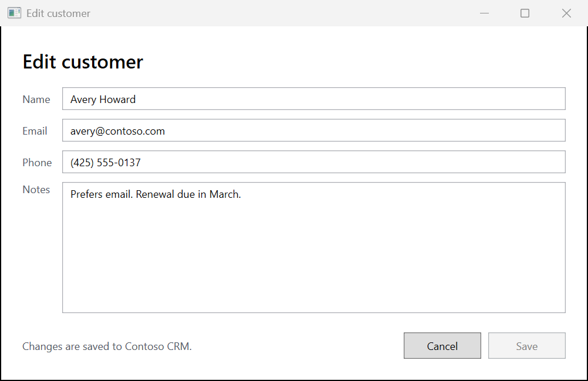

# Session transcript

Source: `Q:\source\XamlAgentDemos-notes\test-runs\VanishingSave\where3\events.jsonl`

## Tool usage

- get_file: 7
- rg: 3
- xaml_capture_image: 2
- xaml_explain_visibility: 2
- task_complete: 2
- skill: 1
- xaml_get_status: 1
- xaml_find_elements: 1
- glob: 1
- multi_replace_string_in_file: 1
- xaml_apply_hot_reload: 1
- xaml_set_element_property: 1

Failed tool calls: 0, images: 2


_Model: gpt-6-luna_


## User (17:33:56)

Where is my Save button?


**Tool call (17:33:58):** `skill`
```json
{
 "skill": "xaml-diagnostics"
}
```

<details><summary>Result `skill` success=true</summary>

```
Skill "xaml-diagnostics" loaded successfully. Follow the instructions in the skill context.
```
</details>


_Skill invoked: xaml-diagnostics_


**Tool call (17:34:01):** `xaml_get_status`
```json
{
 "progressMessage": "Checking the running app and its windows",
 "app": null
}
```

<details><summary>Result `xaml_get_status` success=true</summary>

```
{"isDebugging":true,"debuggerState":"running","diagnosticsActive":true,"apps":[{"app":"a1","name":"VanishingSave.exe [20320]","processId":20320,"platform":"WPF (.NET)","isRemote":false,"isDesignTimeOrNoDebug":false,"sourceInfoAvailable":true,"hotReloadSupported":true,"hotReloadEnabled":true,"supportsPropertyExplorer":true,"supportsInAppToolbar":true,"supportsHitTest":true,"windows":[{"windowId":"0x3101AC","title":"Edit customer","bounds":{"x":114,"y":114,"width":1020,"height":660},"dpiScale":1.5,"visible":true,"minimized":false}]}],"issues":[],"issuesSummary":"No problems detected.","hotReload":{"options":{"hotReloadEnabled":true,"hotReloadOnSave":false,"applyMode":"asYouType: XAML edits apply as you type, without saving (default)","wpfEnabled":true,"uwpEnabled":true,"winUIEnabled":true,"mauiEnabled":true,"justMyXaml":true,"previewSelectedElement":false,"inAppToolbar":true,"inAppSelection":false,"layoutAdorners":false,"trackFocusedElement":false,"bindingFailuresVisible":true,"compatibilityMode":false},"dotNetHotReloadEnabled":true,"isProcessingChanges":false,"errors":[]},"windowsNote":"Window bounds are physical screen pixels and include the window frame. A WPF/WinUI Window's Width and Height are device-independent units (DIPs) that also include the frame, so Width = bounds.width / dpiScale. A user's \"800 px wide\" is ambiguous: say which unit you tested. A minimized window reports x/y = -32000 and can't be captured."}
```
</details>


**Tool call (17:34:05):** `xaml_find_elements`
```json
{
 "progressMessage": "Locating Save controls",
 "app": "a1",
 "name": "Save",
 "maxResults": 50
}
```


**Tool call (17:34:05):** `xaml_capture_image`
```json
{
 "progressMessage": "Viewing the current window",
 "app": "a1",
 "windowId": "0x3101AC",
 "maxSize": 1280
}
```

<details><summary>Result `xaml_find_elements` success=true</summary>

```
{"count":1,"totalMatches":1,"truncated":false,"results":[{"id":"a1:10","type":"System.Windows.Controls.Button","name":"SaveButton","source":{"file":"Q:\\source\\XamlAgentDemos\\src\\VanishingSave\\MainWindow.xaml","line":118,"column":14},"path":"MainWindow/Border/AdornerDecorator/ContentPresenter/Grid/Grid/Button"}]}
```
</details>


<details><summary>Result `xaml_capture_image` success=true</summary>

```
Screenshot of window 0x3101AC "Edit customer" of app a1 (1002x651 image of the window's client area, so it's slightly smaller than the frame bounds from xaml_get_status).
```
</details>


**Tool call (17:34:09):** `xaml_explain_visibility`
```json
{
 "progressMessage": "Diagnosing why Save is hidden",
 "elementIds": [
  "a1:10"
 ]
}
```

<details><summary>Result `xaml_explain_visibility` success=true</summary>

```
{"id":"a1:10","type":"System.Windows.Controls.Button","name":"SaveButton","source":{"file":"Q:\\source\\XamlAgentDemos\\src\\VanishingSave\\MainWindow.xaml","line":118,"column":14},"verdict":"4 separate causes, some latent behind the first; it stays hidden until every one is fixed. First: Button 'SaveButton' has Visibility=Collapsed from a binding.","causes":[{"rank":1,"kind":"visibility","message":"Button 'SaveButton' has Visibility=Collapsed from a binding.","elementId":"a1:10","property":"Visibility","value":"{Binding} -> Collapsed","valueSource":"Local","location":{"file":"Q:\\source\\XamlAgentDemos\\src\\VanishingSave\\MainWindow.xaml","line":118,"column":14},"fix":"Check the bound source value and converter (xaml_explain_property_value shows the binding), or fix the binding failure listed below."},{"rank":1,"kind":"opacity","message":"Button 'SaveButton' has Opacity=0, so it's transparent.","elementId":"a1:10","property":"Opacity","value":"0","valueSource":"StyleTrigger","location":{"file":"Q:\\source\\XamlAgentDemos\\src\\VanishingSave\\MainWindow.xaml","line":118,"column":14},"fix":"Check for a storyboard or trigger that fades it in, or change the value."},{"rank":2,"kind":"gridCell","latent":true,"message":"Button 'SaveButton' is in ColumnDefinitions[2] 'SaveColumn' of Grid 'Footer', which has Width=0: even after the rank 1 cause is fixed it gets no room.","elementId":"a1:19","property":"ColumnDefinitions[2].Width","value":"0","valueSource":"Local","location":{"file":"Q:\\source\\XamlAgentDemos\\src\\VanishingSave\\MainWindow.xaml","line":105,"column":18},"fix":"Give that row/column a non-zero, Auto or star size. If valueSource is Local with no location, code-behind sets it: search the code for 'SaveColumn'."},{"rank":2,"kind":"covered","latent":true,"message":"Border 'SyncStatusHost' shares Button 'SaveButton''s Grid cell (row 0, column 2), has an opaque Background #FFFFFFFF and draws on top because its ZIndex 1 is higher: even after the other causes are fixed it hides Button 'SaveButton'.","elementId":"a1:30","property":"Background","value":"#FFFFFFFF","valueSource":"Local","location":{"file":"Q:\\source\\XamlAgentDemos\\src\\VanishingSave\\MainWindow.xaml","line":127,"column":14},"fix":"Move the overlay to another cell, make its Background Transparent, collapse it when it has nothing to show, or lower its ZIndex below the element."}],"hitTest":{"summary":"A click at its center does NOT reach 'SaveButton' because it's disabled (IsEnabled=False):
... [truncated 1629 chars]
```
</details>


**Assistant (17:34:14):**

Found the button, but it has multiple independent hiding causes; I’m checking the XAML and view-model source before fixing them.


**Tool call (17:34:14):** `get_file`
```json
{
 "filename": "Q:\\source\\XamlAgentDemos\\src\\VanishingSave\\MainWindow.xaml",
 "startLine": 90,
 "endLine": 145,
 "includeLineNumbers": true
}
```


**Tool call (17:34:14):** `rg`
```json
{
 "pattern": "CanSave|SaveColumn|SyncStatusHost|SaveButton",
 "paths": "Q:\\source\\XamlAgentDemos\\src\\VanishingSave",
 "output_mode": "content",
 "-n": true,
 "head_limit": 100
}
```


**Tool call (17:34:14):** `glob`
```json
{
 "pattern": "src\\VanishingSave\\**\\*",
 "paths": "Q:\\source\\XamlAgentDemos"
}
```

<details><summary>Result `rg` success=true</summary>

```
Q:\source\XamlAgentDemos\src\VanishingSave\MainWindow.xaml:105:                <ColumnDefinition x:Name="SaveColumn" Width="Auto" />
Q:\source\XamlAgentDemos\src\VanishingSave\MainWindow.xaml:118:            <Button x:Name="SaveButton"
Q:\source\XamlAgentDemos\src\VanishingSave\MainWindow.xaml:124:                    Visibility="{Binding CanSave, Converter={StaticResource BoolToVisibility}, FallbackValue=Collapsed}" />
Q:\source\XamlAgentDemos\src\VanishingSave\MainWindow.xaml:127:            <Border x:Name="SyncStatusHost"
Q:\source\XamlAgentDemos\src\VanishingSave\MainWindow.xaml.cs:17:            this.SaveColumn.Width = new GridLength(0);
```
</details>

<details><summary>Result `glob` success=true</summary>

```
[glob: 124 path(s) under Q:/source/XamlAgentDemos/src/VanishingSave; grouped by directory]

Q:/source/XamlAgentDemos/src/VanishingSave/obj/ (111 path(s))
  Debug/net10.0-windows/.NETCoreApp,Version=v10.0.AssemblyAttributes.cs
  Debug/net10.0-windows/App.g.cs
  Debug/net10.0-windows/App.g.i.cs
  Debug/net10.0-windows/GeneratedInternalTypeHelper.g.cs
  Debug/net10.0-windows/GeneratedInternalTypeHelper.g.i.cs
  Debug/net10.0-windows/MainWindow.baml
  Debug/net10.0-windows/MainWindow.g.cs
  Debug/net10.0-windows/MainWindow.g.i.cs
  Debug/net10.0-windows/Vanishin.559ADE70.Up2Date
  Debug/net10.0-windows/VanishingSave.AssemblyInfo.cs
  Debug/net10.0-windows/VanishingSave.AssemblyInfoInputs.cache
  Debug/net10.0-windows/VanishingSave.GeneratedMSBuildEditorConfig.editorconfig
  Debug/net10.0-windows/VanishingSave.GlobalUsings.g.cs
  Debug/net10.0-windows/VanishingSave.assets.cache
  Debug/net10.0-windows/VanishingSave.csproj.BuildWithSkipAnalyzers
  Debug/net10.0-windows/VanishingSave.csproj.CoreCompileInputs.cache
  Debug/net10.0-windows/VanishingSave.csproj.FileListAbsolute.txt
  Debug/net10.0-windows/VanishingSave.designer.deps.json
  Debug/net10.0-windows/VanishingSave.designer.runtimeconfig.json
  Debug/net10.0-windows/VanishingSave.dll
  Debug/net10.0-windows/VanishingSave.g.resources
  Debug/net10.0-windows/VanishingSave.genruntimeconfig.cache
  Debug/net10.0-windows/VanishingSave.pdb
  Debug/net10.0-windows/VanishingSave.sourcelink.json
  Debug/net10.0-windows/VanishingSave_4p2ja2g3_wpftmp.AssemblyInfo.cs
  Debug/net10.0-windows/VanishingSave_4p2ja2g3_wpftmp.AssemblyInfoInputs.cache
  Debug/net10.0-windows/VanishingSave_4p2ja2g3_wpftmp.GeneratedMSBuildEditorConfig.editorconfig
  Debug/net10.0-windows/VanishingSave_4p2ja2g3_wpftmp.GlobalUsings.g.cs
  Debug/net10.0-windows/VanishingSave_4p2ja2g3_wpftmp.assets.cache
  Debug/net10.0-windows/VanishingSave_4p2ja2g3_wpftmp.csproj.BuildWithSkipAnalyzers
  Debug/net10.0-windows/VanishingSave_4p2ja2g3_wpftmp.sourcelink.json
  Debug/net10.0-windows/VanishingSave_5cgzny33_wpftmp.AssemblyInfo.cs
  Debug/net10.0-windows/VanishingSave_5cgzny33_wpftmp.AssemblyInfoInputs.cache
  Debug/net10.0-windows/VanishingSave_5cgzny33_wpftmp.GeneratedMSBuildEditorConfig.editorconfig
  Debug/net10.0-windows/VanishingSave_5cgzny33_wpftmp.GlobalUsings.g.cs
  Debug/net10.0-windows/VanishingSave_5cgzny33_wpftmp.assets.cache
  Debug/net10.0-windows/VanishingSave_5cgzny33_wpftmp.csproj.BuildWithSkipAnalyzers
  Debug/net10.0-windows/Vanishing
... [truncated 5904 chars]
```
</details>

<details><summary>Result `get_file` success=true</summary>

```
```xaml src\VanishingSave\MainWindow.xaml (Lines 90-138 of 138 total. Call tools for more if needed.)
90:                        Text="Notes" />
91:             <TextBox x:Name="NotesBox"
92:                      Grid.Row="3"
93:                      Grid.Column="1"
94:                      AcceptsReturn="True"
95:                      AutomationProperties.Name="Notes"
96:                      Style="{StaticResource FieldStyle}"
97:                      Text="{Binding Notes, UpdateSourceTrigger=PropertyChanged}"
98:                      TextWrapping="Wrap" />
99:         </Grid>
100: 
101:         <Grid x:Name="Footer" Grid.Row="2" Margin="0,12,0,0">
102:             <Grid.ColumnDefinitions>
103:                 <ColumnDefinition Width="*" />
104:                 <ColumnDefinition Width="Auto" />
105:                 <ColumnDefinition x:Name="SaveColumn" Width="Auto" />
106:             </Grid.ColumnDefinitions>
107: 
108:             <TextBlock VerticalAlignment="Center"
109:                        Foreground="#555B66"
110:                        Text="Changes are saved to Contoso CRM." />
111: 
112:             <Button x:Name="CancelButton"
113:                     Grid.Column="1"
114:                     Command="{Binding CancelCommand}"
115:                     Content="Cancel"
116:                     Style="{StaticResource FooterButtonStyle}" />
117: 
118:             <Button x:Name="SaveButton"
119:                     Grid.Column="2"
120:                     Command="{Binding SaveCommand}"
121:                     Content="Save"
122:                     IsDefault="True"
123:                     Style="{StaticResource FooterButtonStyle}"
124:                     Visibility="{Binding CanSave, Converter={StaticResource BoolToVisibility}, FallbackValue=Collapsed}" />
125: 
126:             <!-- Shows "Offline - changes will sync later" when the connection drops. -->
127:             <Border x:Name="SyncStatusHost"
128:                     Grid.Column="2"
129:                     Panel.ZIndex="1"
130:                     Background="White">
131:                 <TextBlock x:Name="SyncStatusText"
132:                            VerticalAlignment="Center"
133:                            Foreground="#B54708"
134:                            Text="" />
135:             </Border>
136:         </Grid>
137:     </Grid>
138: </Window>

```


```
</details>


**Tool call (17:34:19):** `get_file`
```json
{
 "filename": "Q:\\source\\XamlAgentDemos\\src\\VanishingSave\\MainWindow.xaml.cs",
 "startLine": 1,
 "endLine": 140,
 "includeLineNumbers": true
}
```


**Tool call (17:34:19):** `get_file`
```json
{
 "filename": "Q:\\source\\XamlAgentDemos\\src\\VanishingSave\\CustomerViewModel.cs",
 "startLine": 1,
 "endLine": 240,
 "includeLineNumbers": true
}
```


**Tool call (17:34:19):** `get_file`
```json
{
 "filename": "Q:\\source\\XamlAgentDemos\\src\\VanishingSave\\FooterSettings.cs",
 "startLine": 1,
 "endLine": 180,
 "includeLineNumbers": true
}
```


**Tool call (17:34:19):** `get_file`
```json
{
 "filename": "Q:\\source\\XamlAgentDemos\\src\\VanishingSave\\MainWindow.xaml",
 "startLine": 1,
 "endLine": 90,
 "includeLineNumbers": true
}
```

<details><summary>Result `get_file` success=true</summary>

```
```csharp src\VanishingSave\MainWindow.xaml.cs (Lines 1-20 of 20 total. Call tools for more if needed.)
1: using System.Windows;
2: 
3: namespace VanishingSave;
4: 
5: public partial class MainWindow : Window
6: {
7:     public MainWindow()
8:     {
9:         this.InitializeComponent();
10:         this.Loaded += this.OnLoaded;
11:     }
12: 
13:     private void OnLoaded(object sender, RoutedEventArgs e)
14:     {
15:         if (FooterSettings.UseCompactFooter)
16:         {
17:             this.SaveColumn.Width = new GridLength(0);
18:         }
19:     }
20: }

```


```
</details>

<details><summary>Result `get_file` success=true</summary>

```
```xaml src\VanishingSave\MainWindow.xaml (Lines 1-90 of 138 total. Call tools for more if needed.)
1: <Window x:Class="VanishingSave.MainWindow"
2:         xmlns="http://schemas.microsoft.com/winfx/2006/xaml/presentation"
3:         xmlns:x="http://schemas.microsoft.com/winfx/2006/xaml"
4:         xmlns:local="clr-namespace:VanishingSave"
5:         Title="Edit customer"
6:         Width="680"
7:         Height="440"
8:         Background="White">
9:     <Window.DataContext>
10:         <local:CustomerViewModel />
11:     </Window.DataContext>
12: 
13:     <Window.Resources>
14:         <BooleanToVisibilityConverter x:Key="BoolToVisibility" />
15: 
16:         <Style x:Key="FieldLabelStyle" TargetType="TextBlock">
17:             <Setter Property="Margin" Value="0,0,12,10" />
18:             <Setter Property="VerticalAlignment" Value="Center" />
19:             <Setter Property="Foreground" Value="#555B66" />
20:         </Style>
21: 
22:         <Style x:Key="FieldStyle" TargetType="TextBox">
23:             <Setter Property="Margin" Value="0,0,0,10" />
24:             <Setter Property="Padding" Value="6,4" />
25:         </Style>
26: 
27:         <Style x:Key="FooterButtonStyle" TargetType="Button">
28:             <Setter Property="MinWidth" Value="88" />
29:             <Setter Property="Margin" Value="8,0,0,0" />
30:             <Setter Property="Padding" Value="16,6" />
31:             <Style.Triggers>
32:                 <!-- Fade out buttons that can't be used yet. -->
33:                 <Trigger Property="IsEnabled" Value="False">
34:                     <Setter Property="Opacity" Value="0" />
35:                 </Trigger>
36:             </Style.Triggers>
37:         </Style>
38:     </Window.Resources>
39: 
40:     <Grid Margin="24">
41:         <Grid.RowDefinitions>
42:             <RowDefinition Height="Auto" />
43:             <RowDefinition Height="*" />
44:             <RowDefinition Height="Auto" />
45:         </Grid.RowDefinitions>
46: 
47:         <TextBlock Margin="0,0,0,16"
48:                    FontSize="22"
49:                    FontWeight="SemiBold"
50:                    Text="Edit customer" />
51: 
52:         <Grid Grid.Row="1">
53:             <Grid.ColumnDefinitions>
54:                 <ColumnDefinition Width="Auto" />
55:                 <ColumnDefinition Width="*" />
56:             </Grid.ColumnDefinitions>
57:             <Grid.RowDefinitions>
58:             
... [truncated 1720 chars]
```
</details>

<details><summary>Result `get_file` success=true</summary>

```
```csharp src\VanishingSave\FooterSettings.cs (Lines 1-10 of 10 total. Call tools for more if needed.)
1: namespace VanishingSave;
2: 
3: public static class FooterSettings
4: {
5:     /// <summary>
6:     /// Compact footer for small screens: auto-save makes the Save column unnecessary.
7:     /// (Auto-save was cut from v2, but this switch stayed on.)
8:     /// </summary>
9:     public static bool UseCompactFooter { get; set; } = true;
10: }

```


```
</details>

<details><summary>Result `get_file` success=true</summary>

```
```csharp src\VanishingSave\CustomerViewModel.cs (Lines 1-35 of 35 total. Call tools for more if needed.)
1: namespace VanishingSave;
2: 
3: public sealed class CustomerViewModel : ObservableObject
4: {
5:     private string name = "Avery Howard";
6:     private string email = "avery@contoso.com";
7:     private string phone = "(425) 555-0137";
8:     private string notes = "Prefers email. Renewal due in March.";
9:     private bool isDirty;
10: 
11:     public CustomerViewModel()
12:     {
13:         this.SaveCommand = new RelayCommand(this.Save, () => this.IsDirty);
14:         this.CancelCommand = new RelayCommand(() => this.IsDirty = false);
15:     }
16: 
17:     public string Name { get => this.name; set { if (this.SetProperty(ref this.name, value)) this.IsDirty = true; } }
18: 
19:     public string Email { get => this.email; set { if (this.SetProperty(ref this.email, value)) this.IsDirty = true; } }
20: 
21:     public string Phone { get => this.phone; set { if (this.SetProperty(ref this.phone, value)) this.IsDirty = true; } }
22: 
23:     public string Notes { get => this.notes; set { if (this.SetProperty(ref this.notes, value)) this.IsDirty = true; } }
24: 
25:     public bool IsDirty { get => this.isDirty; set => this.SetProperty(ref this.isDirty, value); }
26: 
27:     /// <summary>Whether the current user is allowed to save customer records.</summary>
28:     public bool IsSaveAvailable => true;
29: 
30:     public RelayCommand SaveCommand { get; }
31: 
32:     public RelayCommand CancelCommand { get; }
33: 
34:     private void Save() => this.IsDirty = false;
35: }

```


```
</details>


**Tool call (17:34:34):** `rg`
```json
{
 "pattern": "class (RelayCommand|ObservableObject)|CanExecuteChanged|UseCompactFooter",
 "paths": "Q:\\source\\XamlAgentDemos",
 "output_mode": "content",
 "-n": true,
 "head_limit": 100
}
```

<details><summary>Result `rg` success=true</summary>

```
Q:\source\XamlAgentDemos\src\VanishingSave\MainWindow.xaml.cs:15:        if (FooterSettings.UseCompactFooter)
Q:\source\XamlAgentDemos\src\VanishingSave\FooterSettings.cs:9:    public static bool UseCompactFooter { get; set; } = true;
Q:\source\XamlAgentDemos\src\Shared\ObservableObject.cs:6:public abstract class ObservableObject : INotifyPropertyChanged
Q:\source\XamlAgentDemos\src\Shared\RelayCommand.cs:5:public sealed class RelayCommand(Action execute, Func<bool>? canExecute = null) : ICommand
Q:\source\XamlAgentDemos\src\Shared\RelayCommand.cs:7:    public event EventHandler? CanExecuteChanged
```
</details>


**Tool call (17:34:36):** `get_file`
```json
{
 "filename": "Q:\\source\\XamlAgentDemos\\src\\Shared\\ObservableObject.cs",
 "startLine": 1,
 "endLine": 120,
 "includeLineNumbers": true
}
```


**Tool call (17:34:36):** `get_file`
```json
{
 "filename": "Q:\\source\\XamlAgentDemos\\src\\Shared\\RelayCommand.cs",
 "startLine": 1,
 "endLine": 100,
 "includeLineNumbers": true
}
```


**Tool call (17:34:36):** `rg`
```json
{
 "pattern": "SaveCommand|IsSaveAvailable|CanExecuteChanged|UseCompactFooter|SyncStatusHost",
 "paths": [
  "Q:\\source\\XamlAgentDemos\\src",
  "Q:\\source\\XamlAgentDemos\\README.md"
 ],
 "output_mode": "content",
 "-n": true,
 "head_limit": 100
}
```

<details><summary>Result `get_file` success=true</summary>

```
```csharp src\Shared\RelayCommand.cs (Lines 1-16 of 16 total. Call tools for more if needed.)
1: using System.Windows.Input;
2: 
3: namespace XamlAgentDemos;
4: 
5: public sealed class RelayCommand(Action execute, Func<bool>? canExecute = null) : ICommand
6: {
7:     public event EventHandler? CanExecuteChanged
8:     {
9:         add => CommandManager.RequerySuggested += value;
10:         remove => CommandManager.RequerySuggested -= value;
11:     }
12: 
13:     public bool CanExecute(object? parameter) => canExecute?.Invoke() ?? true;
14: 
15:     public void Execute(object? parameter) => execute();
16: }

```


```
</details>

<details><summary>Result `get_file` success=true</summary>

```
```csharp src\Shared\ObservableObject.cs (Lines 1-24 of 24 total. Call tools for more if needed.)
1: using System.ComponentModel;
2: using System.Runtime.CompilerServices;
3: 
4: namespace XamlAgentDemos;
5: 
6: public abstract class ObservableObject : INotifyPropertyChanged
7: {
8:     public event PropertyChangedEventHandler? PropertyChanged;
9: 
10:     protected bool SetProperty<T>(ref T field, T value, [CallerMemberName] string? propertyName = null)
11:     {
12:         if (EqualityComparer<T>.Default.Equals(field, value))
13:         {
14:             return false;
15:         }
16: 
17:         field = value;
18:         this.OnPropertyChanged(propertyName);
19:         return true;
20:     }
21: 
22:     protected void OnPropertyChanged([CallerMemberName] string? propertyName = null)
23:         => this.PropertyChanged?.Invoke(this, new PropertyChangedEventArgs(propertyName));
24: }

```


```
</details>

<details><summary>Result `rg` success=true</summary>

```
Q:\source\XamlAgentDemos\src\BugRepro\MainWindow.xaml:48:                        Command="{Binding SaveCommand}"
Q:\source\XamlAgentDemos\src\BugRepro\ProfileViewModel.cs:17:        this.SaveCommand = new RelayCommand(this.Save, () => this.IsDirty);
Q:\source\XamlAgentDemos\src\BugRepro\ProfileViewModel.cs:49:    public RelayCommand SaveCommand { get; }
Q:\source\XamlAgentDemos\src\Shared\RelayCommand.cs:7:    public event EventHandler? CanExecuteChanged
Q:\source\XamlAgentDemos\src\VanishingSave\MainWindow.xaml.cs:15:        if (FooterSettings.UseCompactFooter)
Q:\source\XamlAgentDemos\src\VanishingSave\MainWindow.xaml:120:                    Command="{Binding SaveCommand}"
Q:\source\XamlAgentDemos\src\VanishingSave\MainWindow.xaml:127:            <Border x:Name="SyncStatusHost"
Q:\source\XamlAgentDemos\src\VanishingSave\FooterSettings.cs:9:    public static bool UseCompactFooter { get; set; } = true;
Q:\source\XamlAgentDemos\src\VanishingSave\CustomerViewModel.cs:13:        this.SaveCommand = new RelayCommand(this.Save, () => this.IsDirty);
Q:\source\XamlAgentDemos\src\VanishingSave\CustomerViewModel.cs:28:    public bool IsSaveAvailable => true;
Q:\source\XamlAgentDemos\src\VanishingSave\CustomerViewModel.cs:30:    public RelayCommand SaveCommand { get; }

(Warning: Some search paths were skipped because they do not exist: Q:\source\XamlAgentDemos\README.md)
```
</details>


**Assistant (17:34:52):**

The source confirms four causes: a broken visibility binding, zero opacity when disabled, a zero-width Save column, and an opaque status overlay. I’m correcting each while preserving the Save command’s dirty-state behavior.


**Tool call (17:34:52):** `multi_replace_string_in_file`
```json
{
 "explanation": "Restore the Save control by fixing its binding, disabled appearance, column sizing, and status overlay placement.",
 "replacements": [
  {
   "filePath": "src\\VanishingSave\\MainWindow.xaml",
   "oldString": "            <Setter Property=\"Padding\" Value=\"16,6\" />\n            <Style.Triggers>\n                <!-- Fade out buttons that can't be used yet. -->\n                <Trigger Property=\"IsEnabled\" Value=\"False\">\n                    <Setter Property=\"Opacity\" Value=\"0\" />\n                </Trigger>\n            </Style.Triggers>\n        </Style>",
   "newString": "            <Setter Property=\"Padding\" Value=\"16,6\" />\n        </Style>",
   "explanation": "Keep disabled buttons visible using the normal WPF disabled styling."
  },
  {
   "filePath": "src\\VanishingSave\\MainWindow.xaml",
   "oldString": "                    IsDefault=\"True\"\n                    Style=\"{StaticResource FooterButtonStyle}\"\n                    Visibility=\"{Binding CanSave, Converter={StaticResource BoolToVisibility}, FallbackValue=Collapsed}\" />\n\n            <!-- Shows \"Offline - changes will sync later\" when the connection drops. -->\n            <Border x:Name=\"SyncStatusHost\"\n                    Grid.Column=\"2\"\n                    Panel.ZIndex=\"1\"\n                    Background=\"White\">",
   "newString": "                    IsDefault=\"True\"\n                    Style=\"{StaticResource FooterButtonStyle}\"\n                   
... [truncated 818 chars]
```

<details><summary>Result `multi_replace_string_in_file` success=true</summary>

```
Successfully applied 3 of 3 replacement(s) across 2 file(s).
```
</details>


**Tool call (17:34:59):** `xaml_apply_hot_reload`
```json
{
 "progressMessage": "Applying the repaired Save button layout",
 "includeCodeChanges": true
}
```

<details><summary>Result `xaml_apply_hot_reload` success=true</summary>

```
{"summary":"XAML: Applied with no new errors. .NET code: applied with 2 warning(s) in 'codeHotReloadWarnings': some code changes (for example static or field initializers, constructors and startup code) only take effect after the code runs again or the app restarts.","applied":true,"xamlApplied":true,"status":"applied","errors":[],"log":[],"lastHotReloadUpdate":{"secondsAgo":7,"updatesSinceToolsStarted":1},"codeChanges":".NET Hot Reload was started for saved code changes. Its results are in the Hot Reload output pane, not in 'log'; if an edit can't be hot reloaded, Visual Studio asks the user to rebuild and restart.","codeStatus":"appliedWithWarnings","codeHotReloadWarnings":["12:35:00.77 🔣  ⚠ [Q:\\source\\XamlAgentDemos\\src\\VanishingSave\\VanishingSave.csproj ({4EB184D2-643F-45DC-A2E0-9645EA07CD15})]: Q:\\source\\XamlAgentDemos\\src\\VanishingSave\\FooterSettings.cs(9,5): warning ENC0118: Changing 'auto-property' might not have any effect until the application is restarted.","12:35:01.05  ⚠ Q:\\source\\XamlAgentDemos\\src\\VanishingSave\\FooterSettings.cs (line 9): warning ENC0118: Changing 'auto-property' might not have any effect until the application is restarted."],"codeHotReloadOutput":["12:35:00.77 🔣  ⚠ [Q:\\source\\XamlAgentDemos\\src\\VanishingSave\\VanishingSave.csproj ({4EB184D2-643F-45DC-A2E0-9645EA07CD15})]: Q:\\source\\XamlAgentDemos\\src\\VanishingSave\\FooterSettings.cs(9,5): warning ENC0118: Changing 'auto-property' might not have any effect until the application is restarted.","12:35:01.05  ⚠ Q:\\source\\XamlAgentDemos\\src\\VanishingSave\\FooterSettings.cs (line 9): warning ENC0118: Changing 'auto-property' might not have any effect until the application is restarted.","12:35:01.71  Code changes were successfully applied."],"hint":"Call xaml_capture_image to verify the change visually. Views that aren't loaded (other tabs, closed dialogs) are updated when they're next shown. Source line numbers reported for existing elements can still point to the pre-edit lines until the element is recreated, so find elements by x:Name or type rather than by an old line number. Structural edits (wrapping or replacing a parent, changing a root's content) recreate elements, which resets their runtime state such as selection, checked state, typed text and scroll position, and invalidates their IDs. Re-establish the state you were testing before capturing again."}
```
</details>


**Tool call (17:35:08):** `xaml_set_element_property`
```json
{
 "progressMessage": "Restoring the live Save column",
 "elementIds": [
  "#Footer"
 ],
 "setters": [
  "ColumnDefinitions[2].Width=Auto"
 ],
 "resetProperties": []
}
```

<details><summary>Result `xaml_set_element_property` success=true</summary>

```
{"id":"#Footer","property":"ColumnDefinitions[2].Width","oldValue":"0","newValue":"Auto","note":"This change only affects the running app and is lost when it restarts. Edit the XAML source to persist it. Until then it overrides the source: hot reload re-applies only the properties whose XAML changed, so undo experiments (set the original value back) before you verify a source fix."}
```
</details>


**Tool call (17:35:11):** `xaml_explain_visibility`
```json
{
 "progressMessage": "Verifying Save visibility and blockers",
 "elementIds": [
  "#SaveButton"
 ]
}
```


**Tool call (17:35:11):** `xaml_capture_image`
```json
{
 "progressMessage": "Confirming Save appears in the footer",
 "app": "a1",
 "windowId": "0x3101AC",
 "maxSize": 1280
}
```




<details><summary>Result `xaml_capture_image` success=true</summary>

```
Screenshot of window 0x3101AC "Edit customer" of app a1 (1002x651 image of the window's client area, so it's slightly smaller than the frame bounds from xaml_get_status).
```
</details>

<details><summary>Result `xaml_explain_visibility` success=true</summary>

```
{"id":"#SaveButton","type":"System.Windows.Controls.Button","name":"SaveButton","source":{"file":"Q:\\source\\XamlAgentDemos\\src\\VanishingSave\\MainWindow.xaml","line":118,"column":14},"verdict":"No reason found for Button 'SaveButton' to be invisible: it's Visible, opaque, has a size, is inside its window and nothing covers its center. Capture an image to confirm, or check that this is the element you expect (another copy may be the one on screen).","causes":[],"checkedOk":["size 88x29.96"],"hitTest":{"summary":"A click at its center does NOT reach 'SaveButton' because it's disabled (IsEnabled=False): input skips disabled elements and lands on Grid 'Footer' behind or around it. That element isn't necessarily covering it; fix the IsEnabled cause (see blockers, or a command's CanExecute) rather than the layout. Button 'SaveButton' has IsEnabled=False (IsEnabledCore: command CanExecute is false or the control disabled itself).","visibleFraction":1.0,"inputTarget":{"id":"a1:19","type":"System.Windows.Controls.Grid","name":"Footer","source":{"file":"Q:\\source\\XamlAgentDemos\\src\\VanishingSave\\MainWindow.xaml","line":101,"column":10},"templatedParent":null,"property":null,"value":null}},"bindingFailures":[{"target":"Button.Visibility, Name='SaveButton'","bindingPath":"CanSave","description":"CanSave property not found on object of type CustomerViewModel.","file":"Q:\\source\\XamlAgentDemos\\src\\VanishingSave\\MainWindow.xaml","line":118,"fixedInSource":true}],"note":"rank 1 hides the element for certain, rank 2 almost certainly, rank 3 may. latent=true means another cause masks it now, but it will keep the element hidden after that one is fixed: fix every cause, not only the first. location is where the winning value is set (the element's own tag when the value isn't from XAML). Values set from code-behind or a view model show valueSource=Local with no location. Elements inside a collapsed ancestor have no layout, so their size is also 0; fix the ancestor first."}
```
</details>


**Tool call (17:35:22):** `task_complete`
```json
{
 "summary": "Save was hidden by a stale visibility binding, a zero-opacity disabled style, a compact-footer setting collapsing its column, and an overlapping status border. Fixed all four. It now appears at the bottom right beside Cancel; it is disabled until the form changes. Verified the live window shows it and diagnostics report no visibility blockers. The compact-footer default change takes effect after app restart; the running window was corrected live."
}
```

<details><summary>Result `task_complete` success=true</summary>

```
Save was hidden by a stale visibility binding, a zero-opacity disabled style, a compact-footer setting collapsing its column, and an overlapping status border. Fixed all four. It now appears at the bottom right beside Cancel; it is disabled until the form changes. Verified the live window shows it and diagnostics report no visibility blockers. The compact-footer default change takes effect after app restart; the running window was corrected live.
```
</details>


**Task complete (17:35:22):** Save was hidden by a stale visibility binding, a zero-opacity disabled style, a compact-footer setting collapsing its column, and an overlapping status border. Fixed all four. It now appears at the bottom right beside Cancel; it is disabled until the form changes. Verified the live window shows it and diagnostics report no visibility blockers. The compact-footer default change takes effect after app restart; the running window was corrected live.


## User (17:36:00)

Thanks. Now some quick feedback for the tooling team. Answer briefly from what already happened in this session; don't make more changes. (1) Which xaml_* tools or skill guidance helped most? (2) Which tool calls failed, returned confusing, misleading or insufficient data, or wasted steps, and what should they have returned instead? (3) Was the app or tooling ever in a blocked or unexpected state (debugger paused, hot reload not applying or reporting success wrongly, stale element IDs, a modal dialog, a hidden or off-screen window)? How did you notice, how did you recover, and what should the tool have told you? (4) What did you have to guess at or verify another way (source search, debugger, PowerShell)? (5) Which fixes did you verify live in the running app, and which only in source, and why? (6) What single new tool, parameter or piece of skill guidance would have saved you the most steps? (7) Re-read my original request: did you meet every explicit requirement in it? If you skipped, merged or changed any of them, say which and why.


**Tool call (17:36:20):** `task_complete`
```json
{
 "summary": "1. Most useful: `xaml_get_status`, `xaml_find_elements`, `xaml_explain_visibility`, and `xaml_capture_image`; the visibility guidance correctly led to checking every stacked cause.\n2. No calls failed. One confusing result: after the binding was fixed, the visibility report still showed the old `CanSave` failure as `fixedInSource: true`; explicitly identifying it as a historical log entry would be clearer. Hot Reload did clearly warn that the changed static initializer needs a restart.\n3. No paused debugger, stale IDs, modal, or off-screen window. The debugger was running. Hot Reload applied the XAML, but correctly warned about the code initializer; I set the live column to `Auto` and changed the source default for the next launch.\n4. I used source reads/search to verify the actual view-model property, the stale compact-footer setting, and the opacity trigger. I did not need PowerShell or debugger evaluation.\n5. The XAML fixes were applied and verified live in the screenshot; the zero-width column was also corrected live. The compact-footer default is fixed in source but takes effect after restart. I did not build while the app was being debugged.\n6. Most helpful would be a consolidated hidden-control report that includes relevant source snippets and distinguishes current binding failures from stale historical ones.\n7. Yes: the Save button is now visible at bottom-right beside Cancel, disabled until edits are made. I treated the question as asking me to re
... [truncated 134 chars]
```

<details><summary>Result `task_complete` success=true</summary>

```
1. Most useful: `xaml_get_status`, `xaml_find_elements`, `xaml_explain_visibility`, and `xaml_capture_image`; the visibility guidance correctly led to checking every stacked cause.
2. No calls failed. One confusing result: after the binding was fixed, the visibility report still showed the old `CanSave` failure as `fixedInSource: true`; explicitly identifying it as a historical log entry would be clearer. Hot Reload did clearly warn that the changed static initializer needs a restart.
3. No paused debugger, stale IDs, modal, or off-screen window. The debugger was running. Hot Reload applied the XAML, but correctly warned about the code initializer; I set the live column to `Auto` and changed the source default for the next launch.
4. I used source reads/search to verify the actual view-model property, the stale compact-footer setting, and the opacity trigger. I did not need PowerShell or debugger evaluation.
5. The XAML fixes were applied and verified live in the screenshot; the zero-width column was also corrected live. The compact-footer default is fixed in source but takes effect after restart. I did not build while the app was being debugged.
6. Most helpful would be a consolidated hidden-control report that includes relevant source snippets and distinguishes current binding failures from stale historical ones.
7. Yes: the Save button is now visible at bottom-right beside Cancel, disabled until edits are made. I treated the question as asking me to restore it, following the missing-control guidance; if you wanted location only, the source changes went beyond the literal question.
```
</details>


**Task complete (17:36:20):** 1. Most useful: `xaml_get_status`, `xaml_find_elements`, `xaml_explain_visibility`, and `xaml_capture_image`; the visibility guidance correctly led to checking every stacked cause.
2. No calls failed. One confusing result: after the binding was fixed, the visibility report still showed the old `CanSave` failure as `fixedInSource: true`; explicitly identifying it as a historical log entry would be clearer. Hot Reload did clearly warn that the changed static initializer needs a restart.
3. No paused debugger, stale IDs, modal, or off-screen window. The debugger was running. Hot Reload applied the XAML, but correctly warned about the code initializer; I set the live column to `Auto` and changed the source default for the next launch.
4. I used source reads/search to verify the actual view-model property, the stale compact-footer setting, and the opacity trigger. I did not need PowerShell or debugger evaluation.
5. The XAML fixes were applied and verified live in the screenshot; the zero-width column was also corrected live. The compact-footer default is fixed in source but takes effect after restart. I did not build while the app was being debugged.
6. Most helpful would be a consolidated hidden-control report that includes relevant source snippets and distinguishes current binding failures from stale historical ones.
7. Yes: the Save button is now visible at bottom-right beside Cancel, disabled until edits are made. I treated the question as asking me to restore it, following the missing-control guidance; if you wanted location only, the source changes went beyond the literal question.
