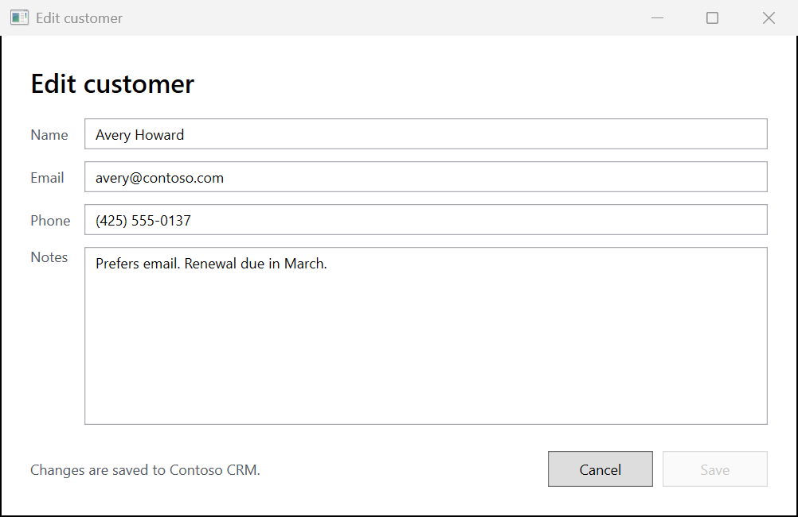

# Session transcript

Source: `Q:\source\XamlAgentDemos-notes\test-runs\VanishingSave\where4\events.jsonl`

## Tool usage

- get_file: 4
- xaml_get_element_properties: 3
- xaml_capture_image: 2
- xaml_explain_visibility: 2
- xaml_explain_property_value: 2
- skill: 1
- xaml_get_status: 1
- xaml_find_elements: 1
- rg: 1
- xaml_get_element_styles: 1
- glob: 1
- xaml_hit_test: 1
- multi_replace_string_in_file: 1
- xaml_apply_hot_reload: 1
- xaml_set_element_property: 1
- xaml_get_binding_failures: 1
- task_complete: 1

Failed tool calls: 1, images: 2


_Model: gpt-6-luna_


## User (17:53:52)

Where is my Save button?


**Tool call (17:53:56):** `skill`
```json
{
 "skill": "xaml-diagnostics"
}
```

<details><summary>Result `skill` success=true</summary>

```
Skill "xaml-diagnostics" loaded successfully. Follow the instructions in the skill context.
```
</details>


_Skill invoked: xaml-diagnostics_


**Tool call (17:53:58):** `xaml_get_status`
```json
{
 "progressMessage": "Checking the running XAML app and window"
}
```

<details><summary>Result `xaml_get_status` success=true</summary>

```
{"isDebugging":true,"debuggerState":"running","diagnosticsActive":true,"apps":[{"app":"a1","name":"VanishingSave.exe [3856]","processId":3856,"platform":"WPF (.NET)","isRemote":false,"isDesignTimeOrNoDebug":false,"sourceInfoAvailable":true,"hotReloadSupported":true,"hotReloadEnabled":true,"supportsPropertyExplorer":true,"supportsInAppToolbar":true,"supportsHitTest":true,"windows":[{"windowId":"0x1D10BA4","title":"Edit customer","bounds":{"x":418,"y":418,"width":1020,"height":660},"dpiScale":1.5,"visible":true,"minimized":false}]}],"issues":[],"issuesSummary":"No problems detected.","hotReload":{"options":{"hotReloadEnabled":true,"hotReloadOnSave":false,"applyMode":"asYouType: XAML edits apply as you type, without saving (default)","wpfEnabled":true,"uwpEnabled":true,"winUIEnabled":true,"mauiEnabled":true,"justMyXaml":true,"previewSelectedElement":false,"inAppToolbar":true,"inAppSelection":false,"layoutAdorners":false,"trackFocusedElement":false,"bindingFailuresVisible":true,"compatibilityMode":false},"dotNetHotReloadEnabled":true,"isProcessingChanges":false,"errors":[]},"windowsNote":"Window bounds are physical screen pixels and include the window frame. A WPF/WinUI Window's Width and Height are device-independent units (DIPs) that also include the frame, so Width = bounds.width / dpiScale. A user's \"800 px wide\" is ambiguous: say which unit you tested. A minimized window reports x/y = -32000 and can't be captured."}
```
</details>


**Tool call (17:54:01):** `xaml_find_elements`
```json
{
 "progressMessage": "Locating Save controls in the window",
 "app": "a1",
 "type": "*Button",
 "maxResults": 100
}
```


**Tool call (17:54:01):** `xaml_capture_image`
```json
{
 "progressMessage": "Viewing the current customer editor",
 "app": "a1",
 "windowId": "0x1D10BA4"
}
```

<details><summary>Result `xaml_find_elements` success=true</summary>

```
{"count":2,"totalMatches":2,"truncated":false,"results":[{"id":"a1:29","type":"System.Windows.Controls.Button","name":"CancelButton","source":{"file":"Q:\\source\\XamlAgentDemos\\src\\VanishingSave\\MainWindow.xaml","line":112,"column":14},"path":"MainWindow/Border/AdornerDecorator/ContentPresenter/Grid/Grid/Button"},{"id":"a1:10","type":"System.Windows.Controls.Button","name":"SaveButton","source":{"file":"Q:\\source\\XamlAgentDemos\\src\\VanishingSave\\MainWindow.xaml","line":118,"column":14},"path":"MainWindow/Border/AdornerDecorator/ContentPresenter/Grid/Grid/Button"}]}
```
</details>


<details><summary>Result `xaml_capture_image` success=true</summary>

```
Screenshot of window 0x1D10BA4 "Edit customer" of app a1 (1002x651 image of the window's client area, so it's slightly smaller than the frame bounds from xaml_get_status).
```
</details>


**Tool call (17:54:04):** `xaml_explain_visibility`
```json
{
 "progressMessage": "Diagnosing why Save is not visible",
 "elementIds": [
  "a1:10"
 ]
}
```

<details><summary>Result `xaml_explain_visibility` success=true</summary>

```
{"id":"a1:10","type":"System.Windows.Controls.Button","name":"SaveButton","source":{"file":"Q:\\source\\XamlAgentDemos\\src\\VanishingSave\\MainWindow.xaml","line":118,"column":14},"verdict":"3 separate causes, some latent behind the first; it stays hidden until every one is fixed. First: Button 'SaveButton' has Visibility=Collapsed from a binding.","causes":[{"rank":1,"kind":"visibility","message":"Button 'SaveButton' has Visibility=Collapsed from a binding.","elementId":"a1:10","property":"Visibility","value":"{Binding} -> Collapsed","valueSource":"Local","location":{"file":"Q:\\source\\XamlAgentDemos\\src\\VanishingSave\\MainWindow.xaml","line":118,"column":14},"fix":"Check the bound source value and converter (xaml_explain_property_value shows the binding), or fix the binding failure listed below."},{"rank":1,"kind":"opacity","message":"Button 'SaveButton' has Opacity=0, so it's transparent.","elementId":"a1:10","property":"Opacity","value":"0","valueSource":"StyleTrigger","location":{"file":"Q:\\source\\XamlAgentDemos\\src\\VanishingSave\\MainWindow.xaml","line":118,"column":14},"fix":"Check for a storyboard or trigger that fades it in, or change the value."},{"rank":2,"kind":"gridCell","latent":true,"message":"Button 'SaveButton' is in ColumnDefinitions[2] 'SaveColumn' of Grid 'Footer', which has Width=0: even after the rank 1 cause is fixed it gets no room.","elementId":"a1:19","property":"ColumnDefinitions[2].Width","value":"0","valueSource":"Local","location":{"file":"Q:\\source\\XamlAgentDemos\\src\\VanishingSave\\MainWindow.xaml","line":105,"column":18},"fix":"Give that row/column a non-zero, Auto or star size. If valueSource is Local with no location, code-behind sets it: search the code for 'SaveColumn'."}],"hitTest":{"summary":"A click at its center does NOT reach 'SaveButton' because it's disabled (IsEnabled=False): input skips disabled elements and lands on Border (in the template of MainWindow) behind or around it. That element isn't necessarily covering it; fix the IsEnabled cause (see blockers, or a command's CanExecute) rather than the layout. Button 'SaveButton' has Visibility=Collapsed. Button 'SaveButton' has IsEnabled=False (IsEnabledCore: command CanExecute is false or the control disabled itself). Button 'SaveButton' has Opacity=0. 'SaveButton' has zero width or height.","inputTarget":{"id":"a1:12","type":"System.Windows.Controls.Border","name":null,"source":null,"templatedParent":{"id":"a1:11","type":"VanishingSave.MainWindow","n
... [truncated 1149 chars]
```
</details>


**Tool call (17:54:09):** `get_file`
```json
{
 "filename": "Q:\\source\\XamlAgentDemos\\src\\VanishingSave\\MainWindow.xaml",
 "startLine": 1,
 "endLine": 180,
 "includeLineNumbers": true
}
```


**Tool call (17:54:09):** `rg`
```json
{
 "pattern": "CanSave|SaveColumn|SaveButton|Opacity",
 "paths": "Q:\\source\\XamlAgentDemos\\src\\VanishingSave",
 "output_mode": "content",
 "glob": "**/*.{cs,xaml}",
 "-n": true
}
```


**Tool call (17:54:09):** `xaml_get_element_properties`
```json
{
 "progressMessage": "Inspecting Save button state and bindings",
 "elementIds": [
  "#SaveButton"
 ],
 "nameFilter": "Visibility|Opacity|IsEnabled|Content|Command|DataContext|DataContext.*",
 "includeAll": true
}
```


**Tool call (17:54:09):** `xaml_get_element_styles`
```json
{
 "progressMessage": "Checking Save button styles and triggers",
 "elementIds": [
  "#SaveButton"
 ]
}
```

<details><summary>Result `xaml_get_element_styles` success=true</summary>

```
{"id":"#SaveButton","type":"System.Windows.Controls.Button","name":"SaveButton","source":{"file":"Q:\\source\\XamlAgentDemos\\src\\VanishingSave\\MainWindow.xaml","line":118,"column":14},"styleProperty":{"value":"System.Windows.Style","valueSource":"Local","location":{"file":"Q:\\source\\XamlAgentDemos\\src\\VanishingSave\\MainWindow.xaml","line":118,"column":14}},"templateProperty":{"value":"System.Windows.Controls.ControlTemplate","valueSource":"BuiltInStyle"},"styles":[{"kind":"StyleTrigger","description":"Trigger in the element's Style whose condition is currently true.","setters":[{"property":"Opacity","value":"0","effective":true}]},{"kind":"TemplateTrigger","description":"Trigger in the element's own ControlTemplate whose condition is currently true.","setters":[{"property":"Foreground","value":"#FF838383","effective":true}]},{"kind":"Style","description":"Setter in an explicit (x:Key) or implicit (TargetType) Style.","targetType":"System.Windows.Controls.Button","location":{"file":"Q:\\source\\XamlAgentDemos\\src\\VanishingSave\\MainWindow.xaml","line":27,"column":10},"setters":[{"property":"Margin","value":"8,0,0,0","effective":true},{"property":"MinWidth","value":"88","effective":true},{"property":"Padding","value":"16,6,16,6","effective":true}]},{"kind":"BuiltInStyle","description":"Setter in the control's default theme style (generic.xaml or the platform theme).","targetType":"System.Windows.Controls.Primitives.ButtonBase","setters":[{"property":"Background","value":"#FFDDDDDD","effective":true},{"property":"BorderBrush","value":"#FF707070","effective":true},{"property":"BorderThickness","value":"1,1,1,1","effective":true},{"property":"FocusVisualStyle","value":"System.Windows.Style","effective":true},{"property":"Foreground","effective":false,"overriddenBy":"TemplateTrigger"},{"property":"HorizontalContentAlignment","value":"1","effective":true},{"property":"Padding","value":"1,1,1,1","effective":false,"overriddenBy":"Style (System.Windows.Controls.Button)"},{"property":"Template","value":"System.Windows.Controls.ControlTemplate","effective":true},{"property":"VerticalContentAlignment","value":"1","effective":true}]}],"hint":"Styles are listed in precedence order, highest first. 'effective=false' setters lose to 'overriddenBy'. Use xaml_find_resource to see where a style or resource key resolves. Only triggers whose condition is true right now are listed; inactive triggers (IsMouseOver, IsPressed, DataTriggers) aren't. Read the style's source 
... [truncated 77 chars]
```
</details>

<details><summary>Result `xaml_get_element_properties` success=true</summary>

```
{"id":"#SaveButton","type":"System.Windows.Controls.Button","name":"SaveButton","source":{"file":"Q:\\source\\XamlAgentDemos\\src\\VanishingSave\\MainWindow.xaml","line":118,"column":14},"properties":[{"name":"IsEnabled","value":"False","valueType":"System.Boolean","valueSource":"Coercion"},{"name":"Command","evaluatedValue":"(XamlAgentDemos.RelayCommand)","valueType":"System.Windows.Data.BindingExpression","propertyType":"System.Windows.Input.ICommand","valueSource":"Local","isBinding":true},{"name":"Content","value":"Save","valueType":"System.String","propertyType":"System.Object","valueSource":"Local"},{"name":"Visibility","evaluatedValue":"2 (System.Windows.Visibility)","valueType":"System.Windows.Data.BindingExpression","propertyType":"System.Windows.Visibility","valueSource":"Local","isBinding":true},{"name":"Opacity","value":"0","valueType":"System.Double","valueSource":"StyleTrigger"},{"name":"DataContext","valueType":"VanishingSave.CustomerViewModel","propertyType":"System.Object","valueSource":"Inherited","valueLocation":{"file":"Q:\\source\\XamlAgentDemos\\src\\VanishingSave\\MainWindow.xaml","line":10,"column":10}}],"hiddenDefaultOrOverridden":6,"hint":"Default and overridden values were omitted. Pass includeAll=true to see them, or call xaml_explain_property_value for one property's full precedence chain.","items":[{"path":"DataContext","type":"VanishingSave.CustomerViewModel","properties":[{"name":"Name","value":"Avery Howard","valueSource":"Local"},{"name":"Email","value":"avery@contoso.com","valueSource":"Local"},{"name":"Phone","value":"(425) 555-0137","valueSource":"Local"},{"name":"Notes","value":"Prefers email. Renewal due in March.","valueSource":"Local"},{"name":"IsSaveAvailable","value":"True","valueSource":"Local","readOnly":true},{"name":"SaveCommand","value":"XamlAgentDemos.RelayCommand","valueSource":"Local","readOnly":true},{"name":"CancelCommand","value":"XamlAgentDemos.RelayCommand","valueSource":"Local","readOnly":true},{"name":"IsDirty","value":"False","valueSource":"Default"}]}],"note":"Item properties are live values. Change one with xaml_set_element_property using the same path, for example setters=['ColumnDefinitions[2].Width=Auto']; edit the XAML too to keep the change. Without a property filter, only set values and Actual* sizes are listed."}
```
</details>

<details><summary>Result `rg` success=true</summary>

```
Q:\source\XamlAgentDemos\src\VanishingSave\MainWindow.xaml:34:                    <Setter Property="Opacity" Value="0" />
Q:\source\XamlAgentDemos\src\VanishingSave\MainWindow.xaml:105:                <ColumnDefinition x:Name="SaveColumn" Width="Auto" />
Q:\source\XamlAgentDemos\src\VanishingSave\MainWindow.xaml:118:            <Button x:Name="SaveButton"
Q:\source\XamlAgentDemos\src\VanishingSave\MainWindow.xaml:124:                    Visibility="{Binding CanSave, Converter={StaticResource BoolToVisibility}, FallbackValue=Collapsed}" />
Q:\source\XamlAgentDemos\src\VanishingSave\MainWindow.xaml.cs:17:            this.SaveColumn.Width = new GridLength(0);
```
</details>

<details><summary>Result `get_file` success=true</summary>

```
```xaml src\VanishingSave\MainWindow.xaml (Lines 1-138 of 138 total. Call tools for more if needed.)
1: <Window x:Class="VanishingSave.MainWindow"
2:         xmlns="http://schemas.microsoft.com/winfx/2006/xaml/presentation"
3:         xmlns:x="http://schemas.microsoft.com/winfx/2006/xaml"
4:         xmlns:local="clr-namespace:VanishingSave"
5:         Title="Edit customer"
6:         Width="680"
7:         Height="440"
8:         Background="White">
9:     <Window.DataContext>
10:         <local:CustomerViewModel />
11:     </Window.DataContext>
12: 
13:     <Window.Resources>
14:         <BooleanToVisibilityConverter x:Key="BoolToVisibility" />
15: 
16:         <Style x:Key="FieldLabelStyle" TargetType="TextBlock">
17:             <Setter Property="Margin" Value="0,0,12,10" />
18:             <Setter Property="VerticalAlignment" Value="Center" />
19:             <Setter Property="Foreground" Value="#555B66" />
20:         </Style>
21: 
22:         <Style x:Key="FieldStyle" TargetType="TextBox">
23:             <Setter Property="Margin" Value="0,0,0,10" />
24:             <Setter Property="Padding" Value="6,4" />
25:         </Style>
26: 
27:         <Style x:Key="FooterButtonStyle" TargetType="Button">
28:             <Setter Property="MinWidth" Value="88" />
29:             <Setter Property="Margin" Value="8,0,0,0" />
30:             <Setter Property="Padding" Value="16,6" />
31:             <Style.Triggers>
32:                 <!-- Fade out buttons that can't be used yet. -->
33:                 <Trigger Property="IsEnabled" Value="False">
34:                     <Setter Property="Opacity" Value="0" />
35:                 </Trigger>
36:             </Style.Triggers>
37:         </Style>
38:     </Window.Resources>
39: 
40:     <Grid Margin="24">
41:         <Grid.RowDefinitions>
42:             <RowDefinition Height="Auto" />
43:             <RowDefinition Height="*" />
44:             <RowDefinition Height="Auto" />
45:         </Grid.RowDefinitions>
46: 
47:         <TextBlock Margin="0,0,0,16"
48:                    FontSize="22"
49:                    FontWeight="SemiBold"
50:                    Text="Edit customer" />
51: 
52:         <Grid Grid.Row="1">
53:             <Grid.ColumnDefinitions>
54:                 <ColumnDefinition Width="Auto" />
55:                 <ColumnDefinition Width="*" />
56:             </Grid.ColumnDefinitions>
57:             <Grid.RowDefinitions>
58:            
... [truncated 3995 chars]
```
</details>


**Tool call (17:54:16):** `get_file`
```json
{
 "filename": "Q:\\source\\XamlAgentDemos\\src\\VanishingSave\\MainWindow.xaml.cs",
 "startLine": 1,
 "endLine": 140,
 "includeLineNumbers": true
}
```


**Tool call (17:54:16):** `glob`
```json
{
 "pattern": "src\\VanishingSave\\**\\*.cs",
 "paths": "Q:\\source\\XamlAgentDemos"
}
```


**Tool call (17:54:16):** `xaml_explain_property_value`
```json
{
 "progressMessage": "Tracing Save visibility and enabled state",
 "elementIds": [
  "#SaveButton"
 ],
 "propertyNames": [
  "Visibility",
  "IsEnabled",
  "Command"
 ],
 "pairwise": false
}
```


**Tool call (17:54:16):** `xaml_explain_property_value`
```json
{
 "progressMessage": "Checking Save area layout and overlay",
 "elementIds": [
  "#Footer",
  "#SaveButton"
 ],
 "propertyNames": [
  "ColumnDefinitions[2].Width",
  "ColumnDefinitions[2].ActualWidth",
  "IsHitTestVisible",
  "Background"
 ],
 "pairwise": true
}
```

<details><summary>Result `xaml_explain_property_value` success=false</summary>

```
{
 "message": "{\"error\":\"INVALID_ARGUMENT\",\"message\":\"pairwise=true needs 'elementIds' and 'propertyNames' to have the same length (2 vs 4).\",\"hint\":\"Repeat an entry to pair it more than once, or set pairwise=false to combine every elementIds entry with every propertyNames entry.\"}",
 "code": "failure"
}
```
</details>

<details><summary>Result `glob` success=true</summary>

```
Q:\source\XamlAgentDemos\src\VanishingSave\MainWindow.xaml.cs
Q:\source\XamlAgentDemos\src\VanishingSave\FooterSettings.cs
Q:\source\XamlAgentDemos\src\VanishingSave\CustomerViewModel.cs
Q:\source\XamlAgentDemos\src\VanishingSave\App.xaml.cs
```
</details>

<details><summary>Result `get_file` success=true</summary>

```
```csharp src\VanishingSave\MainWindow.xaml.cs (Lines 1-20 of 20 total. Call tools for more if needed.)
1: using System.Windows;
2: 
3: namespace VanishingSave;
4: 
5: public partial class MainWindow : Window
6: {
7:     public MainWindow()
8:     {
9:         this.InitializeComponent();
10:         this.Loaded += this.OnLoaded;
11:     }
12: 
13:     private void OnLoaded(object sender, RoutedEventArgs e)
14:     {
15:         if (FooterSettings.UseCompactFooter)
16:         {
17:             this.SaveColumn.Width = new GridLength(0);
18:         }
19:     }
20: }

```


```
</details>

<details><summary>Result `xaml_explain_property_value` success=true</summary>

```
{"count":3,"failed":0,"results":[{"id":"#SaveButton","type":"System.Windows.Controls.Button","property":"Visibility","propertyType":"System.Windows.Visibility","evaluatedValue":"2 (System.Windows.Visibility)","effectiveSource":"Local","chain":[{"kind":"Local","description":"Local value set on the element (XAML attribute, binding or code). Wins over styles, templates and inheritance.","evaluatedValue":"2 (System.Windows.Visibility)","valueType":"System.Windows.Data.BindingExpression","isBinding":true,"effective":true,"sourceLocation":{"file":"Q:\\source\\XamlAgentDemos\\src\\VanishingSave\\MainWindow.xaml","line":118,"column":14}},{"kind":"Default","description":"The property's default value; nothing sets it.","value":"0","valueType":"System.Windows.Visibility","effective":false}],"notes":["To let a style or template value apply, remove the local value (the attribute, binding or code assignment). To change it, edit that local value. XAML and code both produce Local values, and the source location may still point to the XAML attribute after code assigned a new value. If the live value differs from the XAML attribute, or the element has no XAML attribute for it, code set it: search code-behind for the element's x:Name.","The effective value comes from a binding. If it's wrong, check xaml_get_binding_failures and the DataContext."]},{"id":"#SaveButton","type":"System.Windows.Controls.Button","property":"IsEnabled","propertyType":"System.Boolean","effectiveValue":"False","effectiveSource":"Coercion","chain":[{"kind":"Coercion","description":"The control coerced the value (for example clamped to a minimum or maximum).","value":"False","valueType":"System.Boolean","effective":true},{"kind":"Default","description":"The property's default value; nothing sets it.","value":"True","valueType":"System.Boolean","effective":false}],"notes":["Check related properties that constrain this one (for example Minimum/Maximum or MinWidth/MaxWidth).","No ancestor within 20 levels sets IsEnabled=False, so the control disabled itself: in WPF this is usually a Command whose CanExecute returns false (check the command's CanExecute logic and that it raises CanExecuteChanged when its inputs change)."]},{"id":"#SaveButton","type":"System.Windows.Controls.Button","property":"Command","propertyType":"System.Windows.Input.ICommand","evaluatedValue":"(XamlAgentDemos.RelayCommand)","effectiveSource":"Local","chain":[{"kind":"Local","description":"Local value set on the element (XAML attribut
... [truncated 980 chars]
```
</details>


**Tool call (17:54:22):** `get_file`
```json
{
 "filename": "Q:\\source\\XamlAgentDemos\\src\\VanishingSave\\CustomerViewModel.cs",
 "startLine": 1,
 "endLine": 240,
 "includeLineNumbers": true
}
```


**Tool call (17:54:22):** `get_file`
```json
{
 "filename": "Q:\\source\\XamlAgentDemos\\src\\VanishingSave\\FooterSettings.cs",
 "startLine": 1,
 "endLine": 120,
 "includeLineNumbers": true
}
```


**Tool call (17:54:22):** `xaml_get_element_properties`
```json
{
 "progressMessage": "Inspecting footer column and sync overlay",
 "elementIds": [
  "#Footer",
  "#SyncStatusHost",
  "#SyncStatusText"
 ],
 "nameFilter": "Visibility|Opacity|IsEnabled|Background|Text|ColumnDefinitions[2].Width|ColumnDefinitions[2].ActualWidth|Grid.Column|Panel.ZIndex|IsHitTestVisible",
 "includeAll": true
}
```


**Tool call (17:54:22):** `xaml_hit_test`
```json
{
 "progressMessage": "Checking what receives clicks over Save",
 "elementIds": [
  "#SaveButton"
 ]
}
```

<details><summary>Result `get_file` success=true</summary>

```
```csharp src\VanishingSave\FooterSettings.cs (Lines 1-10 of 10 total. Call tools for more if needed.)
1: namespace VanishingSave;
2: 
3: public static class FooterSettings
4: {
5:     /// <summary>
6:     /// Compact footer for small screens: auto-save makes the Save column unnecessary.
7:     /// (Auto-save was cut from v2, but this switch stayed on.)
8:     /// </summary>
9:     public static bool UseCompactFooter { get; set; } = true;
10: }

```


```
</details>

<details><summary>Result `get_file` success=true</summary>

```
```csharp src\VanishingSave\CustomerViewModel.cs (Lines 1-35 of 35 total. Call tools for more if needed.)
1: namespace VanishingSave;
2: 
3: public sealed class CustomerViewModel : ObservableObject
4: {
5:     private string name = "Avery Howard";
6:     private string email = "avery@contoso.com";
7:     private string phone = "(425) 555-0137";
8:     private string notes = "Prefers email. Renewal due in March.";
9:     private bool isDirty;
10: 
11:     public CustomerViewModel()
12:     {
13:         this.SaveCommand = new RelayCommand(this.Save, () => this.IsDirty);
14:         this.CancelCommand = new RelayCommand(() => this.IsDirty = false);
15:     }
16: 
17:     public string Name { get => this.name; set { if (this.SetProperty(ref this.name, value)) this.IsDirty = true; } }
18: 
19:     public string Email { get => this.email; set { if (this.SetProperty(ref this.email, value)) this.IsDirty = true; } }
20: 
21:     public string Phone { get => this.phone; set { if (this.SetProperty(ref this.phone, value)) this.IsDirty = true; } }
22: 
23:     public string Notes { get => this.notes; set { if (this.SetProperty(ref this.notes, value)) this.IsDirty = true; } }
24: 
25:     public bool IsDirty { get => this.isDirty; set => this.SetProperty(ref this.isDirty, value); }
26: 
27:     /// <summary>Whether the current user is allowed to save customer records.</summary>
28:     public bool IsSaveAvailable => true;
29: 
30:     public RelayCommand SaveCommand { get; }
31: 
32:     public RelayCommand CancelCommand { get; }
33: 
34:     private void Save() => this.IsDirty = false;
35: }

```


```
</details>

<details><summary>Result `xaml_hit_test` success=true</summary>

```
{"id":"#SaveButton","summary":"A click at its center does NOT reach 'SaveButton' because it's disabled (IsEnabled=False): input skips disabled elements and lands on Border (in the template of MainWindow) behind or around it. That element isn't necessarily covering it; fix the IsEnabled cause (see blockers, or a command's CanExecute) rather than the layout. Button 'SaveButton' has Visibility=Collapsed. Button 'SaveButton' has IsEnabled=False (IsEnabledCore: command CanExecute is false or the control disabled itself). Button 'SaveButton' has Opacity=0. 'SaveButton' has zero width or height.","elementReceivesInput":false,"inputTarget":{"id":"a1:12","type":"System.Windows.Controls.Border","templatedParent":{"id":"a1:11","type":"VanishingSave.MainWindow","source":{"file":"Q:\\source\\XamlAgentDemos\\src\\VanishingSave\\MainWindow.xaml","line":4,"column":9}}},"stack":[{"id":"a1:12","type":"System.Windows.Controls.Border","templatedParent":{"id":"a1:11","type":"VanishingSave.MainWindow","source":{"file":"Q:\\source\\XamlAgentDemos\\src\\VanishingSave\\MainWindow.xaml","line":4,"column":9}}}],"isVisible":false,"isHitTestVisible":true,"isEnabled":false,"effectiveOpacity":0.0,"blockers":[{"id":"a1:10","type":"System.Windows.Controls.Button","name":"SaveButton","source":{"file":"Q:\\source\\XamlAgentDemos\\src\\VanishingSave\\MainWindow.xaml","line":118,"column":14},"property":"Visibility","value":"Collapsed"},{"id":"a1:10","type":"System.Windows.Controls.Button","name":"SaveButton","source":{"file":"Q:\\source\\XamlAgentDemos\\src\\VanishingSave\\MainWindow.xaml","line":118,"column":14},"property":"IsEnabled","value":"False (IsEnabledCore: command CanExecute is false or the control disabled itself)"},{"id":"a1:10","type":"System.Windows.Controls.Button","name":"SaveButton","source":{"file":"Q:\\source\\XamlAgentDemos\\src\\VanishingSave\\MainWindow.xaml","line":118,"column":14},"property":"Opacity","value":"0"}],"point":{"window":{"x":24.0,"y":348.71},"screen":{"x":465.0,"y":986.0}},"note":"inputTarget is what a mouse click or tap at the point reaches (WPF: InputHitTest; WinUI/UWP: FindElementsInHostCoordinates, open popups first; .NET MAUI: approximated from element bounds and draw order). stack lists visible, hit-testable elements under the point, topmost first; elements with no id are template parts or aren't in the live tree (on WPF use their templatedParent). blockers are the element and ancestors whose own values hide it or block input (descendants inherit IsE
... [truncated 222 chars]
```
</details>

<details><summary>Result `xaml_get_element_properties` success=true</summary>

```
{"count":3,"failed":2,"results":[{"id":"#Footer","type":"System.Windows.Controls.Grid","name":"Footer","source":{"file":"Q:\\source\\XamlAgentDemos\\src\\VanishingSave\\MainWindow.xaml","line":101,"column":10},"properties":[{"name":"DataContext","valueType":"VanishingSave.CustomerViewModel","propertyType":"System.Object","valueSource":"Inherited","valueLocation":{"file":"Q:\\source\\XamlAgentDemos\\src\\VanishingSave\\MainWindow.xaml","line":10,"column":10}}],"defaultValues":{"Background":null,"ContextMenu":null,"IsEnabled":"True","Opacity":"1","Visibility":"0"},"hiddenDefaultOrOverridden":1,"hint":"Default and overridden values were omitted. Pass includeAll=true to see them, or call xaml_explain_property_value for one property's full precedence chain.","items":[{"path":"ColumnDefinitions[2]","type":"System.Windows.Controls.ColumnDefinition","properties":[{"name":"Width","value":"0","valueSource":"Local"},{"name":"ActualWidth","value":"0","valueSource":"Default","readOnly":true}]}],"note":"Item properties are live values. Change one with xaml_set_element_property using the same path, for example setters=['ColumnDefinitions[2].Width=Auto']; edit the XAML too to keep the change. Without a property filter, only set values and Actual* sizes are listed."},{"id":"#SyncStatusHost","error":"PROPERTY_NOT_FOUND","message":"'#SyncStatusHost' has no property 'ColumnDefinitions'.","hint":"Call xaml_get_element_properties with nameFilter to check the name. Collections such as ColumnDefinitions are listed only when they have items."},{"id":"#SyncStatusText","error":"PROPERTY_NOT_FOUND","message":"'#SyncStatusText' has no property 'ColumnDefinitions'.","hint":"Call xaml_get_element_properties with nameFilter to check the name. Collections such as ColumnDefinitions are listed only when they have items."}]}
```
</details>


**Assistant (17:54:44):**

I found several independent things hiding it; I’m fixing the binding, footer sizing, and hidden-state overlay so the button can appear in the running app.


**Tool call (17:54:44):** `multi_replace_string_in_file`
```json
{
 "explanation": "Restore the Save button by correcting its visibility binding and removing the active layout/overlay causes while keeping the disabled state visibly faded.",
 "replacements": [
  {
   "filePath": "src\\VanishingSave\\MainWindow.xaml",
   "oldString": "            <Style.Triggers>\n                <!-- Fade out buttons that can't be used yet. -->\n                <Trigger Property=\"IsEnabled\" Value=\"False\">\n                    <Setter Property=\"Opacity\" Value=\"0\" />\n                </Trigger>\n            </Style.Triggers>",
   "newString": "            <Style.Triggers>\n                <!-- Fade out buttons that can't be used yet. -->\n                <Trigger Property=\"IsEnabled\" Value=\"False\">\n                    <Setter Property=\"Opacity\" Value=\"0.45\" />\n                </Trigger>\n            </Style.Triggers>",
   "explanation": "Keep disabled buttons visible while still visually deemphasizing them."
  },
  {
   "filePath": "src\\VanishingSave\\MainWindow.xaml",
   "oldString": "            <Button x:Name=\"SaveButton\"\n                    Grid.Column=\"2\"\n                    Command=\"{Binding SaveCommand}\"\n                    Content=\"Save\"\n                    IsDefault=\"True\"\n                    Style=\"{StaticResource FooterButtonStyle}\"\n                    Visibility=\"{Binding CanSave, Converter={StaticResource BoolToVisibility}, FallbackValue=Collapsed}\" />\n\n            <!-- Shows \"Offline - changes will sync 
... [truncated 2666 chars]
```

<details><summary>Result `multi_replace_string_in_file` success=true</summary>

```
Successfully applied 3 of 3 replacement(s) across 2 file(s).
```
</details>


**Tool call (17:54:49):** `xaml_apply_hot_reload`
```json
{
 "progressMessage": "Applying the Save button fixes to the running app",
 "includeCodeChanges": true
}
```

<details><summary>Result `xaml_apply_hot_reload` success=true</summary>

```
{"summary":"XAML: Applied with no new errors. .NET code: applied with 2 warning(s) in 'codeHotReloadWarnings': some code changes (for example static or field initializers, constructors and startup code) only take effect after the code runs again or the app restarts.","applied":true,"xamlApplied":true,"status":"applied","errors":[],"log":[],"lastHotReloadUpdate":{"secondsAgo":5,"updatesSinceToolsStarted":1},"codeChanges":".NET Hot Reload was started for saved code changes. Its results are in the Hot Reload output pane, not in 'log'; if an edit can't be hot reloaded, Visual Studio asks the user to rebuild and restart.","codeStatus":"appliedWithWarnings","codeHotReloadWarnings":["12:54:50.15 🔣  ⚠ [Q:\\source\\XamlAgentDemos\\src\\VanishingSave\\VanishingSave.csproj ({4EB184D2-643F-45DC-A2E0-9645EA07CD15})]: Q:\\source\\XamlAgentDemos\\src\\VanishingSave\\FooterSettings.cs(9,5): warning ENC0118: Changing 'auto-property' might not have any effect until the application is restarted.","12:54:50.45  ⚠ Q:\\source\\XamlAgentDemos\\src\\VanishingSave\\FooterSettings.cs (line 9): warning ENC0118: Changing 'auto-property' might not have any effect until the application is restarted."],"codeHotReloadOutput":["12:54:50.15 🔣  ⚠ [Q:\\source\\XamlAgentDemos\\src\\VanishingSave\\VanishingSave.csproj ({4EB184D2-643F-45DC-A2E0-9645EA07CD15})]: Q:\\source\\XamlAgentDemos\\src\\VanishingSave\\FooterSettings.cs(9,5): warning ENC0118: Changing 'auto-property' might not have any effect until the application is restarted.","12:54:50.45  ⚠ Q:\\source\\XamlAgentDemos\\src\\VanishingSave\\FooterSettings.cs (line 9): warning ENC0118: Changing 'auto-property' might not have any effect until the application is restarted."],"hint":"Call xaml_capture_image to verify the change visually. Views that aren't loaded (other tabs, closed dialogs) are updated when they're next shown. Source line numbers reported for existing elements can still point to the pre-edit lines until the element is recreated, so find elements by x:Name or type rather than by an old line number. Structural edits (wrapping or replacing a parent, changing a root's content) recreate elements, which resets their runtime state such as selection, checked state, typed text and scroll position, and invalidates their IDs. Re-establish the state you were testing before capturing again."}
```
</details>


**Tool call (17:54:56):** `xaml_set_element_property`
```json
{
 "progressMessage": "Restoring the Save column in the running window",
 "elementIds": [
  "#Footer"
 ],
 "setters": [
  "ColumnDefinitions[2].Width=Auto"
 ]
}
```

<details><summary>Result `xaml_set_element_property` success=true</summary>

```
{"id":"#Footer","property":"ColumnDefinitions[2].Width","oldValue":"0","newValue":"Auto","note":"This change only affects the running app and is lost when it restarts. Edit the XAML source to persist it. Until then it overrides the source: hot reload re-applies only the properties whose XAML changed, so undo experiments (set the original value back) before you verify a source fix."}
```
</details>


**Tool call (17:54:59):** `xaml_explain_visibility`
```json
{
 "progressMessage": "Verifying Save is visible and accessible",
 "elementIds": [
  "#SaveButton"
 ]
}
```


**Tool call (17:54:59):** `xaml_capture_image`
```json
{
 "progressMessage": "Confirming the Save button is back",
 "app": "a1",
 "windowId": "0x1D10BA4"
}
```


**Tool call (17:54:59):** `xaml_get_element_properties`
```json
{
 "progressMessage": "Checking the repaired Save button state",
 "elementIds": [
  "#SaveButton",
  "#SyncStatusHost"
 ],
 "nameFilter": "Visibility|Opacity|IsEnabled|Content|ColumnDefinitions[2].ActualWidth",
 "includeAll": true
}
```


**Tool call (17:54:59):** `xaml_get_binding_failures`
```json
{
 "progressMessage": "Checking for current binding failures",
 "maxResults": 50
}
```

<details><summary>Result `xaml_get_binding_failures` success=true</summary>

```
{"note":"This is a cumulative log since debugging started or the last xaml_clear_binding_failures, not live state: fixed failures stay listed. occurrencesSinceLastRead counts new occurrences since your previous call (0 = not seen again; it only grows when the UI using the binding is created or updated again). pathStillInSource=false means the XAML near that line no longer contains the failing path, so it was probably fixed in source (hot reload or a restart applies it). To verify a fix: clear, revisit the UI that uses the binding, then read again. Failures without a file usually come from bindings created in code.","totalUnique":1,"matched":1,"truncated":false,"failures":[{"severity":"Warning","count":1,"pathStillInSource":false,"errorCode":"40","description":"CanSave property not found on object of type CustomerViewModel.","bindingPath":"CanSave","target":"Button.Visibility, Name='SaveButton'","targetName":"SaveButton","targetPropertyType":"Visibility","dataContextType":"CustomerViewModel","file":"Q:\\source\\XamlAgentDemos\\src\\VanishingSave\\MainWindow.xaml","line":118,"column":14,"project":"VanishingSave","originalError":"System.Windows.Data Warning: 40 : BindingExpression path error: 'CanSave' property not found on 'object' ''CustomerViewModel' (HashCode=30479632)'. BindingExpression:Path=CanSave; DataItem='CustomerViewModel' (HashCode=30479632); target element is 'Button' (Name='SaveButton'); target property is 'Visibility' (type 'Visibility')"}]}
```
</details>




<details><summary>Result `xaml_capture_image` success=true</summary>

```
Screenshot of window 0x1D10BA4 "Edit customer" of app a1 (1002x651 image of the window's client area, so it's slightly smaller than the frame bounds from xaml_get_status).
```
</details>

<details><summary>Result `xaml_get_element_properties` success=true</summary>

```
{"count":2,"failed":2,"results":[{"id":"#SaveButton","error":"PROPERTY_NOT_FOUND","message":"'#SaveButton' has no property 'ColumnDefinitions'.","hint":"Call xaml_get_element_properties with nameFilter to check the name. Collections such as ColumnDefinitions are listed only when they have items."},{"id":"#SyncStatusHost","error":"PROPERTY_NOT_FOUND","message":"'#SyncStatusHost' has no property 'ColumnDefinitions'.","hint":"Call xaml_get_element_properties with nameFilter to check the name. Collections such as ColumnDefinitions are listed only when they have items."}]}
```
</details>

<details><summary>Result `xaml_explain_visibility` success=true</summary>

```
{"id":"#SaveButton","type":"System.Windows.Controls.Button","name":"SaveButton","source":{"file":"Q:\\source\\XamlAgentDemos\\src\\VanishingSave\\MainWindow.xaml","line":118,"column":14},"verdict":"No reason found for Button 'SaveButton' to be invisible: it's Visible, opaque, has a size, is inside its window and nothing covers its center. Capture an image to confirm, or check that this is the element you expect (another copy may be the one on screen).","causes":[],"checkedOk":["size 88x29.96"],"hitTest":{"summary":"A click at its center does NOT reach 'SaveButton' because it's disabled (IsEnabled=False): input skips disabled elements and lands on Grid 'Footer' behind or around it. That element isn't necessarily covering it; fix the IsEnabled cause (see blockers, or a command's CanExecute) rather than the layout. Button 'SaveButton' has IsEnabled=False (IsEnabledCore: command CanExecute is false or the control disabled itself).","visibleFraction":1.0,"inputTarget":{"id":"a1:19","type":"System.Windows.Controls.Grid","name":"Footer","source":{"file":"Q:\\source\\XamlAgentDemos\\src\\VanishingSave\\MainWindow.xaml","line":101,"column":10},"templatedParent":null,"property":null,"value":null}},"bindingFailures":[{"target":"Button.Visibility, Name='SaveButton'","bindingPath":"CanSave","description":"CanSave property not found on object of type CustomerViewModel.","file":"Q:\\source\\XamlAgentDemos\\src\\VanishingSave\\MainWindow.xaml","line":118,"fixedInSource":true}],"note":"rank 1 hides the element for certain, rank 2 almost certainly, rank 3 may. latent=true means another cause masks it now, but it will keep the element hidden after that one is fixed: fix every cause, not only the first. location is where the winning value is set (the element's own tag when the value isn't from XAML). Values set from code-behind or a view model show valueSource=Local with no location. Elements inside a collapsed ancestor have no layout, so their size is also 0; fix the ancestor first. bindingFailures is the session's cumulative log: an entry with fixedInSource=true is an old failure whose path is no longer in the XAML, so it isn't a cause."}
```
</details>


**Tool call (17:55:14):** `task_complete`
```json
{
 "summary": "Your Save button is now visible at the bottom-right, immediately beside Cancel. I fixed its invalid visibility binding, restored the collapsed footer column, and hid the empty sync-status overlay in [MainWindow.xaml](vscopilot://file?path=Q%3A%5Csource%5CXamlAgentDemos%5Csrc%5CVanishingSave%5CMainWindow.xaml&line=118). It appears faded because Save is disabled until you make an edit. The running app was verified with Hot Reload; the footer setting change takes effect on restart. A build was skipped because the app is currently being debugged."
}
```

<details><summary>Result `task_complete` success=true</summary>

```
Your Save button is now visible at the bottom-right, immediately beside Cancel. I fixed its invalid visibility binding, restored the collapsed footer column, and hid the empty sync-status overlay in [MainWindow.xaml](vscopilot://file?path=Q%3A%5Csource%5CXamlAgentDemos%5Csrc%5CVanishingSave%5CMainWindow.xaml&line=118). It appears faded because Save is disabled until you make an edit. The running app was verified with Hot Reload; the footer setting change takes effect on restart. A build was skipped because the app is currently being debugged.
```
</details>


**Task complete (17:55:14):** Your Save button is now visible at the bottom-right, immediately beside Cancel. I fixed its invalid visibility binding, restored the collapsed footer column, and hid the empty sync-status overlay in [MainWindow.xaml](vscopilot://file?path=Q%3A%5Csource%5CXamlAgentDemos%5Csrc%5CVanishingSave%5CMainWindow.xaml&line=118). It appears faded because Save is disabled until you make an edit. The running app was verified with Hot Reload; the footer setting change takes effect on restart. A build was skipped because the app is currently being debugged.
